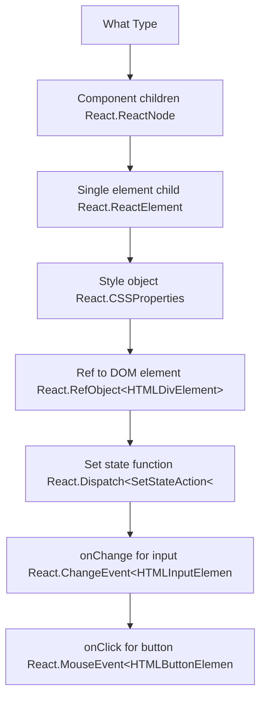

> **Navigation**: [Back to Index](../00_MASTER_INDEX.md) | [← State Management](04_State_Management.md) | [Next: Routing →](06_React_Router.md)

---

# 🔷 React + TypeScript — Type-Safe Components

---

## Part 1: Why TypeScript with React?


> ✅ Catch bugs at COMPILE time, not runtime
> ✅ Autocompletion in IDE (know exact props, return types)
> ✅ Self-documenting: types ARE documentation
> ✅ Refactoring confidence: rename a prop, find all usages instantly
> ✅ Industry standard for production React apps


---

## Part 2: Typing Components & Props

```tsx
// ── Basic Props ──
interface UserCardProps {
  name: string;
  age: number;
  email?: string;               // optional
  role: 'admin' | 'user';      // union literal type
  onDelete: (id: string) => void;  // callback
}

function UserCard({ name, age, email, role, onDelete }: UserCardProps) {
  return (
    <div>
      <h3>{name} ({age})</h3>
      {email && <p>{email}</p>}
      <span>{role}</span>
    </div>
  );
}

// ── Children Props ──
interface CardProps {
  title: string;
  children: React.ReactNode;   // ← accepts any renderable content
}

function Card({ title, children }: CardProps) {
  return <div className="card"><h3>{title}</h3>{children}</div>;
}

// ── Props with generics (reusable list component) ──
interface ListProps<T> {
  items: T[];
  renderItem: (item: T) => React.ReactNode;
  keyExtractor: (item: T) => string;
}

function List<T>({ items, renderItem, keyExtractor }: ListProps<T>) {
  return <ul>{items.map(item => <li key={keyExtractor(item)}>{renderItem(item)}</li>)}</ul>;
}

// Usage:
<List<User>
  items={users}
  renderItem={(user) => <span>{user.name}</span>}
  keyExtractor={(user) => user.id}
/>
```

---

## Part 3: Typing Hooks

```tsx
// ── useState ──
const [count, setCount] = useState(0);               // inferred as number
const [user, setUser] = useState<User | null>(null);  // explicit when initially null

// ── useRef ──
const inputRef = useRef<HTMLInputElement>(null);       // DOM element type
const countRef = useRef<number>(0);                    // mutable value

// ── useReducer ──
type Action = 
  | { type: 'INCREMENT' }
  | { type: 'DECREMENT' }
  | { type: 'SET'; payload: number };       // discriminated union

interface State { count: number }

function reducer(state: State, action: Action): State {
  switch (action.type) {
    case 'INCREMENT': return { count: state.count + 1 };
    case 'DECREMENT': return { count: state.count - 1 };
    case 'SET': return { count: action.payload };
  }
}

// ── useContext ──
interface AuthContextType {
  user: User | null;
  login: (credentials: Credentials) => Promise<void>;
  logout: () => void;
}

const AuthContext = createContext<AuthContextType | undefined>(undefined);

function useAuth(): AuthContextType {
  const context = useContext(AuthContext);
  if (!context) throw new Error('useAuth must be within AuthProvider');
  return context;
}
```

---

## Part 4: Typing Events & Forms

```tsx
// ── Event Handlers ──
function Form() {
  const handleChange = (e: React.ChangeEvent<HTMLInputElement>) => {
    console.log(e.target.value);
  };

  const handleSubmit = (e: React.FormEvent<HTMLFormElement>) => {
    e.preventDefault();
  };

  const handleClick = (e: React.MouseEvent<HTMLButtonElement>) => {
    console.log(e.clientX, e.clientY);
  };

  return (
    <form onSubmit={handleSubmit}>
      <input onChange={handleChange} />
      <button onClick={handleClick}>Submit</button>
    </form>
  );
}

// COMMON EVENT TYPES:
// React.ChangeEvent<HTMLInputElement | HTMLSelectElement | HTMLTextAreaElement>
// React.FormEvent<HTMLFormElement>
// React.MouseEvent<HTMLButtonElement>
// React.KeyboardEvent<HTMLInputElement>
// React.FocusEvent<HTMLInputElement>
```

---

## Part 5: Utility Types for React

```tsx
// Pick only some props
type UserName = Pick<User, 'firstName' | 'lastName'>;

// Omit specific props
type UserWithoutId = Omit<User, 'id'>;

// Make all props optional
type PartialUser = Partial<User>;

// Make all props required
type RequiredUser = Required<User>;

// Component props extraction
type ButtonProps = React.ComponentProps<typeof Button>;

// Extend HTML element props
interface CustomButtonProps extends React.ButtonHTMLAttributes<HTMLButtonElement> {
  variant: 'primary' | 'secondary';
  isLoading?: boolean;
}

function CustomButton({ variant, isLoading, children, ...rest }: CustomButtonProps) {
  return (
    <button className={`btn-${variant}`} disabled={isLoading} {...rest}>
      {isLoading ? <Spinner /> : children}
    </button>
  );
}
// Gets onClick, disabled, className, etc. for FREE from HTML attributes
```

---

## Quick Reference: Common Types

```
╔════════════════════════════════╦══════════════════════════════════════════════╗
║ What                          ║ Type                                          ║
╠════════════════════════════════╬══════════════════════════════════════════════╣
║ Component children            ║ React.ReactNode                               ║
║ Single element child          ║ React.ReactElement                            ║
║ Style object                  ║ React.CSSProperties                           ║
║ Ref to DOM element            ║ React.RefObject<HTMLDivElement>               ║
║ Set state function            ║ React.Dispatch<SetStateAction<T>>             ║
║ onChange for input            ║ React.ChangeEvent<HTMLInputElement>           ║
║ onClick for button            ║ React.MouseEvent<HTMLButtonElement>           ║
║ onSubmit for form             ║ React.FormEvent<HTMLFormElement>              ║
╚════════════════════════════════╩══════════════════════════════════════════════╝
```

**Flow:**
- What Type
- ↓
- Component children React.ReactNode
- ↓
- Single element child React.ReactElement
- ↓
- Style object React.CSSProperties
- ↓
- Ref to DOM element React.RefObject<HTMLDivElement&gt
- ↓
- Set state function React.Dispatch<SetStateAction<
- ↓
- onChange for input React.ChangeEvent<HTMLInputElemen



---

> **Navigation**: [< Previous](04_State_Management.md) | [Back to Index](../00_MASTER_INDEX.md) | [Next >](06_React_Router.md)