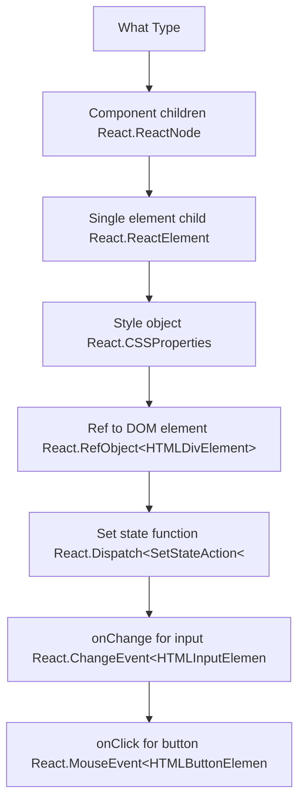

> **Navigation**: [Back to Index](../00_MASTER_INDEX.md) | [← State Management](04_State_Management.md) | [Next: Routing →](06_React_Router.md)

---

# 🔷 React + TypeScript — Type-Safe Components

---

## Part 1: Why TypeScript with React?


> ✅ Catch bugs at COMPILE time, not runtime
> ✅ Autocompletion in IDE (know exact props, return types)
> ✅ Self-documenting: types ARE documentation
> ✅ Refactoring confidence: rename a prop, find all usages instantly
> ✅ Industry standard for production React apps


---


> 🔬 **Section Challenge — Part 1: Why TypeScript with React?**
>>

## Part 2: Typing Components & Props

```tsx
// ── Basic Props ──
interface UserCardProps {
  name: string;
  age: number;
  email?: string;               // optional
  role: 'admin' | 'user';      // union literal type
  onDelete: (id: string) => void;  // callback
}

function UserCard({ name, age, email, role, onDelete }: UserCardProps) {
  return (
    <div>
      <h3>{name} ({age})</h3>
      {email && <p>{email}</p>}
      <span>{role}</span>
    </div>
  );
}

// ── Children Props ──
interface CardProps {
  title: string;
  children: React.ReactNode;   // ← accepts any renderable content
}

function Card({ title, children }: CardProps) {
  return <div className="card"><h3>{title}</h3>{children}</div>;
}

// ── Props with generics (reusable list component) ──
interface ListProps<T> {
  items: T[];
  renderItem: (item: T) => React.ReactNode;
  keyExtractor: (item: T) => string;
}

function List<T>({ items, renderItem, keyExtractor }: ListProps<T>) {
  return <ul>{items.map(item => <li key={keyExtractor(item)}>{renderItem(item)}</li>)}</ul>;
}

// Usage:
<List<User>
  items={users}
  renderItem={(user) => <span>{user.name}</span>}
  keyExtractor={(user) => user.id}
/>
```

---


## Part 3: Typing Hooks

```tsx
// ── useState ──
const [count, setCount] = useState(0);               // inferred as number
const [user, setUser] = useState<User | null>(null);  // explicit when initially null

// ── useRef ──
const inputRef = useRef<HTMLInputElement>(null);       // DOM element type
const countRef = useRef<number>(0);                    // mutable value

// ── useReducer ──
type Action = 
  | { type: 'INCREMENT' }
  | { type: 'DECREMENT' }
  | { type: 'SET'; payload: number };       // discriminated union

interface State { count: number }

function reducer(state: State, action: Action): State {
  switch (action.type) {
    case 'INCREMENT': return { count: state.count + 1 };
    case 'DECREMENT': return { count: state.count - 1 };
    case 'SET': return { count: action.payload };
  }
}

// ── useContext ──
interface AuthContextType {
  user: User | null;
  login: (credentials: Credentials) => Promise<void>;
  logout: () => void;
}

const AuthContext = createContext<AuthContextType | undefined>(undefined);

function useAuth(): AuthContextType {
  const context = useContext(AuthContext);
  if (!context) throw new Error('useAuth must be within AuthProvider');
  return context;
}
```

---


## Part 4: Typing Events & Forms

```tsx
// ── Event Handlers ──
function Form() {
  const handleChange = (e: React.ChangeEvent<HTMLInputElement>) => {
    console.log(e.target.value);
  };

  const handleSubmit = (e: React.FormEvent<HTMLFormElement>) => {
    e.preventDefault();
  };

  const handleClick = (e: React.MouseEvent<HTMLButtonElement>) => {
    console.log(e.clientX, e.clientY);
  };

  return (
    <form onSubmit={handleSubmit}>
      <input onChange={handleChange} />
      <button onClick={handleClick}>Submit</button>
    </form>
  );
}

// COMMON EVENT TYPES:
// React.ChangeEvent<HTMLInputElement | HTMLSelectElement | HTMLTextAreaElement>
// React.FormEvent<HTMLFormElement>
// React.MouseEvent<HTMLButtonElement>
// React.KeyboardEvent<HTMLInputElement>
// React.FocusEvent<HTMLInputElement>
```

---


## Part 5: Utility Types for React

```tsx
// Pick only some props
type UserName = Pick<User, 'firstName' | 'lastName'>;

// Omit specific props
type UserWithoutId = Omit<User, 'id'>;

// Make all props optional
type PartialUser = Partial<User>;

// Make all props required
type RequiredUser = Required<User>;

// Component props extraction
type ButtonProps = React.ComponentProps<typeof Button>;

// Extend HTML element props
interface CustomButtonProps extends React.ButtonHTMLAttributes<HTMLButtonElement> {
  variant: 'primary' | 'secondary';
  isLoading?: boolean;
}

function CustomButton({ variant, isLoading, children, ...rest }: CustomButtonProps) {
  return (
    <button className={`btn-${variant}`} disabled={isLoading} {...rest}>
      {isLoading ? <Spinner /> : children}
    </button>
  );
}
// Gets onClick, disabled, className, etc. for FREE from HTML attributes
```

---


> 🔬 **Section Challenge — Part 5: Utility Types for React**
>>

## Quick Reference: Common Types

```
┌────────────────────────────────┬──────────────────────────────────────────────┐
│ What                          │ Type                                          │
├────────────────────────────────┼──────────────────────────────────────────────┤
│ Component children            │ React.ReactNode                               │
│ Single element child          │ React.ReactElement                            │
│ Style object                  │ React.CSSProperties                           │
│ Ref to DOM element            │ React.RefObject<HTMLDivElement>               │
│ Set state function            │ React.Dispatch<SetStateAction<T>>             │
│ onChange for input            │ React.ChangeEvent<HTMLInputElement>           │
│ onClick for button            │ React.MouseEvent<HTMLButtonElement>           │
│ onSubmit for form             │ React.FormEvent<HTMLFormElement>              │
└────────────────────────────────┴──────────────────────────────────────────────┘
```

**Flow:**
- What Type
- ↓
- Component children React.ReactNode
- ↓
- Single element child React.ReactElement
- ↓
- Style object React.CSSProperties
- ↓
- Ref to DOM element React.RefObject<HTMLDivElement&gt
- ↓
- Set state function React.Dispatch<SetStateAction<
- ↓
- onChange for input React.ChangeEvent<HTMLInputElemen



---


> 🔬 **Section Challenge — Quick Reference: Common Types**
>>

## Advanced TypeScript Patterns for React

```
THE HISTORY OF TYPING REACT:
  2015: Flow (Facebook) was the default type checker for React.
  2018: TypeScript won. React 16.8+ (hooks) + TypeScript = standard.
  2023: Next.js, Remix, all major frameworks ship with TS by default.
  2025: React 19 types rewritten to be stricter, forwardRef deprecated.
  
  WHY DID TYPESCRIPT WIN over Flow?
  → Microsoft invested heavily in tooling (VS Code autocomplete)
  → Better community adoption → more @types/* packages
  → DefinitelyTyped repository: 10,000+ type definitions
  
  ANALOGY: TypeScript is a BLUEPRINT for your code.
  Without TS: You hand someone building materials and say "build a house."
  With TS:    You hand them blueprints + materials. 
  Mistakes are caught at the drawing board, not when the roof collapses.
```

### Discriminated Unions — Type-Safe State Machines

```tsx
// PROBLEM: API calls have 3 states: loading, success, error.
// How do you type this so TypeScript KNOWS what's available when?

// BAD: optional fields everywhere
interface BadState {
  loading: boolean;
  data?: User[];
  error?: string;
}
// Can you have data AND error? Is loading false when error exists?
// TypeScript can't help — every field is optional.

// GOOD: Discriminated union — mutually exclusive states
type RequestState<T> =
  | { status: 'idle' }                            // nothing happened yet
  | { status: 'loading' }                         // no data, no error
  | { status: 'success'; data: T }                // data guaranteed!
  | { status: 'error'; error: string; retryCount: number };

function UserList() {
  const [state, setState] = useState<RequestState<User[]>>({ status: 'idle' });

  // TypeScript narrows the type based on status check:
  if (state.status === 'success') {
    // TypeScript KNOWS state.data exists here! No optional chaining needed.
    return <ul>{state.data.map(u => <li key={u.id}>{u.name}</li>)}</ul>;
  }
  if (state.status === 'error') {
    // TypeScript KNOWS state.error and state.retryCount exist here!
    return <div>Error: {state.error} (retried {state.retryCount}x)</div>;
  }
  if (state.status === 'loading') {
    return <Spinner />;
    // state.data → TypeScript ERROR: Property 'data' does not exist
  }
  return <button onClick={() => fetchUsers()}>Load Users</button>;
}

// WHERE USED IN REAL WORLD:
// React Router v6: loader data states
// Redux Toolkit: query states (isLoading, isError, isSuccess)
// Form libraries: idle/submitting/success/error
```

### Generic Components — Ultimate Reusability

```tsx
// LEVEL 1: Generic List (already seen basics — now more powerful)
interface SelectProps<T> {
  items: T[];
  value: T | null;
  onChange: (item: T) => void;
  getLabel: (item: T) => string;
  getValue: (item: T) => string | number;
}

function Select<T>({ items, value, onChange, getLabel, getValue }: SelectProps<T>) {
  return (
    <select
      value={value ? String(getValue(value)) : ''}
      onChange={e => {
        const selected = items.find(i => String(getValue(i)) === e.target.value);
        if (selected) onChange(selected);
      }}
    >
      <option value="">Select...</option>
      {items.map(item => (
        <option key={String(getValue(item))} value={String(getValue(item))}>
          {getLabel(item)}
        </option>
      ))}
    </select>
  );
}

// Usage: TypeScript infers T from the items array!
<Select
  items={users}                    // T is inferred as User
  value={selectedUser}
  onChange={user => console.log(user.id)}  // user is typed as User!
  getLabel={u => u.name}
  getValue={u => u.id}
/>

// LEVEL 2: Generic Table Component
interface Column<T> {
  key: keyof T;                          // column must be a key of T!
  header: string;
  render?: (value: T[keyof T], row: T) => React.ReactNode;
}

interface TableProps<T> {
  data: T[];
  columns: Column<T>[];
  onRowClick?: (row: T) => void;
}

function Table<T extends { id: string | number }>({
  data, columns, onRowClick
}: TableProps<T>) {
  return (
    <table>
      <thead>
        <tr>{columns.map(c => <th key={String(c.key)}>{c.header}</th>)}</tr>
      </thead>
      <tbody>
        {data.map(row => (
          <tr key={row.id} onClick={() => onRowClick?.(row)}>
            {columns.map(col => (
              <td key={String(col.key)}>
                {col.render ? col.render(row[col.key], row) : String(row[col.key])}
              </td>
            ))}
          </tr>
        ))}
      </tbody>
    </table>
  );
}

// Usage: fully type-safe columns!
<Table
  data={users}
  columns={[
    { key: 'name', header: 'Name' },           // ✓ key must exist on User
    { key: 'email', header: 'Email' },          // ✓ 
    { key: 'role', header: 'Role', render: (v) => <Badge>{v}</Badge> },
    // { key: 'nonexistent', header: 'X' }      // ✗ TypeScript ERROR!
  ]}
/>

// LEVEL 3: Generic API Hook
function useQuery<T>(url: string) {
  const [state, setState] = useState<RequestState<T>>({ status: 'idle' });
  
  useEffect(() => {
    setState({ status: 'loading' });
    fetch(url)
      .then(r => r.json())
      .then((data: T) => setState({ status: 'success', data }))
      .catch(e => setState({ status: 'error', error: e.message, retryCount: 0 }));
  }, [url]);
  
  return state;
}

// Usage: T is inferred or explicitly set
const usersState = useQuery<User[]>('/api/users');  // state.data is User[]!
```

### Utility Types — TypeScript's Power Tools

```tsx
interface User {
  id: string;
  name: string;
  email: string;
  avatar: string;
  role: 'admin' | 'editor' | 'viewer';
  createdAt: Date;
}

// PICK: Select specific keys from a type
type UserPreview = Pick<User, 'id' | 'name' | 'avatar'>;
// = { id: string; name: string; avatar: string }

// OMIT: Remove specific keys
type CreateUserDTO = Omit<User, 'id' | 'createdAt'>;
// = { name: string; email: string; avatar: string; role: ... }

// PARTIAL: Make ALL fields optional
type UpdateUserDTO = Partial<User>;
// = { id?: string; name?: string; email?: string; ... }
// Perfect for PATCH requests where only some fields are sent

// REQUIRED: Make ALL fields required (opposite of Partial)
type StrictUser = Required<User>;  // no optional fields

// RECORD: Map keys to a value type
type RolePermissions = Record<User['role'], string[]>;
// = { admin: string[]; editor: string[]; viewer: string[] }
const permissions: RolePermissions = {
  admin: ['read', 'write', 'delete'],
  editor: ['read', 'write'],
  viewer: ['read'],
};

// EXTRACT / EXCLUDE: Filter union types
type AdminOrEditor = Extract<User['role'], 'admin' | 'editor'>;
// = 'admin' | 'editor'

type NonAdmin = Exclude<User['role'], 'admin'>;
// = 'editor' | 'viewer'

// RETURNTYPE: Get the return type of a function
async function fetchUsers(): Promise<User[]> { /* ... */ }
type FetchResult = ReturnType<typeof fetchUsers>;
// = Promise<User[]>
// Awaited<FetchResult> = User[]

// PARAMETERS: Get function parameter types as a tuple
type FetchParams = Parameters<typeof fetchUsers>;
// = [] (no parameters)

// REAL-WORLD: Creating a form component that adapts to any entity
type FormProps<T> = {
  initialValues: T;
  onSubmit: (values: T) => Promise<void>;
  validate?: (values: Partial<T>) => Partial<Record<keyof T, string>>;
};
// Form<User>, Form<Product>, Form<Order> — all type-safe!
```

### Polymorphic "as" Prop — Design System Pattern

```tsx
// Used by: Chakra UI, Radix, MUI, Headless UI
// The component renders as ANY HTML element or React component.

type PolymorphicProps<E extends React.ElementType> = {
  as?: E;
  children: React.ReactNode;
} & Omit<React.ComponentPropsWithoutRef<E>, 'as' | 'children'>;

function Box<E extends React.ElementType = 'div'>({
  as,
  children,
  ...props
}: PolymorphicProps<E>) {
  const Component = as || 'div';
  return <Component {...props}>{children}</Component>;
}

// Usage:
<Box>Default div</Box>
<Box as="section">Renders as section</Box>
<Box as="a" href="/about">Renders as anchor with href!</Box>
<Box as="button" onClick={() => alert('!')}>Renders as button!</Box>
// TypeScript knows: if as="a", then href is valid. onClick is valid for button.
// if as="a", onClick is NOT valid (anchor doesn't have onClick in same way).
```

---


---


> 🔬 **Section Challenge — Advanced TypeScript Patterns for React**
>>

## 🏋️ Practice & Interview Questions — React

### Predict / Trace
**Q1.** What is the output order of console logs?
```jsx
function App() {
  console.log('render');
  useEffect(() => { console.log('effect'); }, []);
  console.log('render2');
  return <div/>;
}
```
<details><summary>Answer</summary>

`render` → `render2` → `effect`

`useEffect` runs **after** the component renders and the DOM is committed. Both `console.log`s in the function body run first.
</details>

**Q2.** Why does this cause an infinite loop?
```jsx
useEffect(() => {
  setCount(count + 1);
}, [count]);
```
<details><summary>Answer</summary>

`setCount(count+1)` → triggers re-render → `count` changes → effect runs again → infinite loop. **Fix**: remove `count` from deps and use functional update: `setCount(prev => prev + 1)` or change dependency logic.
</details>

### Coding Problems
**Q3.** ⭐ Implement a custom `useDebounce` hook.
<details><summary>Solution</summary>

```jsx
function useDebounce(value, delay) {
  const [debouncedValue, setDebouncedValue] = useState(value);
  useEffect(() => {
    const handler = setTimeout(() => setDebouncedValue(value), delay);
    return () => clearTimeout(handler); // Cleanup on value/delay change
  }, [value, delay]);
  return debouncedValue;
}
```
</details>

**Q4.** ⭐ Implement `useFetch` — generic data fetching hook with loading/error states.
<details><summary>Solution</summary>

```jsx
function useFetch(url) {
  const [data, setData] = useState(null);
  const [loading, setLoading] = useState(true);
  const [error, setError] = useState(null);

  useEffect(() => {
    let cancelled = false;
    fetch(url)
      .then(r => r.json())
      .then(d => { if(!cancelled) setData(d); })
      .catch(e => { if(!cancelled) setError(e); })
      .finally(() => { if(!cancelled) setLoading(false); });
    return () => { cancelled = true; }; // Cleanup for race conditions
  }, [url]);

  return { data, loading, error };
}
```
</details>

**Q5.** ⭐⭐ When should you use `useCallback` vs `useMemo`?
<details><summary>Answer</summary>

`useMemo`: memoizes a **computed value** — run expensive calculation, cache result.
`useCallback`: memoizes a **function reference** — prevent child re-renders when passing callbacks.
Both only useful when: (1) the child uses `React.memo`, or (2) the value/function is a dep of another hook. Premature optimization without these conditions = needless complexity.
</details>

**Q6.** ⭐⭐ Implement a `useLocalStorage` hook.
<details><summary>Solution</summary>

```jsx
function useLocalStorage(key, initialValue) {
  const [value, setValue] = useState(() => {
    try { return JSON.parse(localStorage.getItem(key)) ?? initialValue; }
    catch { return initialValue; }
  });

  const setStoredValue = (newValue) => {
    setValue(newValue);
    localStorage.setItem(key, JSON.stringify(newValue));
  };

  return [value, setStoredValue];
}
```
</details>

### MCQ Rapid Fire
| # | Question | Answer |
|---|---|---|
| 1 | When does useEffect with [] run? | Once after mount |
| 2 | When does useEffect with no array run? | After every render |
| 3 | Key prop in lists is used for | Reconciliation (identify changed elements) |
| 4 | React.memo prevents re-render when | Props haven't changed (shallow comparison) |
| 5 | useState is synchronous? | ❌ Batched, async in React 18 |
| 6 | Controlled vs uncontrolled component | Controlled=state managed in React; Uncontrolled=DOM manages it (ref) |
| 7 | useRef vs useState | useRef: doesn't trigger re-render; useState: does |
| 8 | StrictMode effect on effects | Runs effects twice (in dev) to detect side effects |


---

## 🧠 Deep Conceptual Questions — React Internals & Mental Models

**C1. What is the React reconciliation algorithm and why does the `key` prop matter?**
<details><summary>Deep Answer</summary>

React maintains a virtual DOM (VNode tree). On state change: React creates a new VNode tree, diffs it against the previous tree (diffing = reconciliation), applies minimal real DOM mutations. Naive tree diff: O(N³). React's heuristics: O(N). Heuristic 1: different element types → destroy and rebuild subtree. Heuristic 2: same type → update props, recurse into children. **`key` prop**: tells React the element's identity across renders. Without keys in lists: React diffs by position — inserting at beginning is O(N) DOM mutations. With stable keys: React identifies which item moved/added/removed → O(1) per change. Keys must be stable+unique per list — using index as key breaks this when list is reordered.
</details>

**C2. Why does React use a virtual DOM? What performance problem does it solve?**
<details><summary>Deep Answer</summary>

Direct DOM manipulation is expensive: each `div.style.color = 'red'` forces layout recalculation, style recalculation, repaint — potentially 3-17ms per operation. Doing 50 direct DOM changes = 50 potential reflows. Virtual DOM batches all changes: compute the full desired state in JS (fast, ~ms), diff against current state, apply only the MINIMUM necessary DOM mutations in one batch (one reflow). Net effect: many state changes → few DOM mutations → fewer reflows. In React 18: concurrent rendering further batches setState calls across async boundaries. **Note**: React's VirtualDOM is a means to an end (batching + diffing), not inherently "fast" — SolidJS/Svelte skip it entirely with fine-grained reactivity and are faster for some use cases.
</details>

**C3. What is React's fiber architecture and how does it enable concurrent features?**
<details><summary>Deep Answer</summary>

Before Fiber (React 15): reconciliation = synchronous, non-interruptible tree walk. A complex update > 16ms → UI janks (dropped frames). **Fiber** (React 16+): reconciliation reimplemented as a linked list of "fiber nodes." Each fiber = a unit of work that can be paused, resumed, or abandoned. The render phase (building the fiber tree) is **interruptible**: React can pause after any fiber, yield to the browser for frames/user input, then resume. The commit phase (applying DOM changes) remains synchronous (can't be interrupted — DOM must be consistent). This enables: concurrent mode, `useTransition` (lower priority updates), `Suspense`, `useDeferredValue`. The fundamental shift: from "one big synchronous render" to "cooperative multitasking renderer."
</details>

**C4. useEffect dependency array: what is "stale closure" and how to fix it?**
<details><summary>Deep Answer</summary>

```jsx
const [count, setCount] = useState(0);
useEffect(() => {
  const id = setInterval(() => console.log(count), 1000); // stale closure!
  return () => clearInterval(id);
}, []); // count not in deps
```
The interval callback captures `count` from the initial render (= 0). Even after count updates, the closure still sees 0 — it's "stale." **Fix 1**: include count in deps — effect re-runs, interval recreated (wasteful). **Fix 2**: use `useRef` to store latest count. **Fix 3**: functional update `setCount(c => c + 1)` doesn't read stale count. Root cause: JavaScript closures capture variables at creation time. React's fn components close over state at render time. With stale deps, the closure never refreshes. `eslint-plugin-react-hooks` detects missing deps.
</details>

**C5. When does React batch state updates, and when does it NOT?**
<details><summary>Deep Answer</summary>

**React 17 and below**: batches only inside React event handlers. `setTimeout`, `Promise.then`, native event listeners → NOT batched (each setState triggers a re-render). **React 18**: **Automatic Batching** — batches all setState calls everywhere (timeouts, Promises, native events). Each React event handler still flushes at end. Opt-out (rare): `flushSync(() => setX(1))` → forces synchronous re-render.

Rule: in React 18, multiple setStates in ANY context = one re-render per batch. No more worrying about whether you're in a React event or not.
</details>

**C6. What is the purpose of `useReducer` and when is it better than multiple `useState`?**
<details><summary>Deep Answer</summary>

`useReducer` is `useState` for complex state transitions. Better than multiple `useState` when: (1) next state depends on multiple state values together (reducer receives full state), (2) multiple actions lead to similar state updates (consolidate logic in one place), (3) complex state objects where partial updates have side effects, (4) testing — reducer is a pure function, easily unit-testable in isolation. Think: `useState` = `useReducer(reducer, initialState)` where reducer is `(state, newValue) => newValue`. `useReducer` makes state transitions explicit and traceable (Redux-like). Redux IS just `useReducer` + Context for global sharing.
</details>


> **Navigation**: [< Previous](04_State_Management.md) | [Back to Index](../00_MASTER_INDEX.md) | [Next >](06_React_Router.md)
