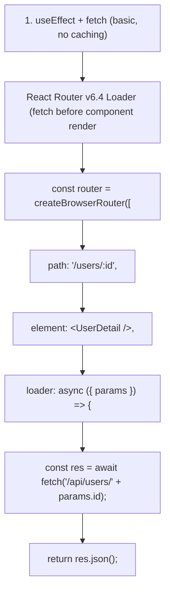

> **Navigation**: [Back to Index](../00_MASTER_INDEX.md) | [← TypeScript](05_React_TypeScript.md) | [Next: Testing →](07_React_Testing.md)

---

# 🧭 React Router & Data Fetching Patterns

---

## React Router v6

```jsx
import { BrowserRouter, Routes, Route, Link, Navigate, useParams, useNavigate, Outlet } from 'react-router-dom';

// ── Route Configuration ──
function App() {
  return (
    <BrowserRouter>
      <Routes>
        <Route path="/" element={<Layout />}>         {/* Shared layout */}
          <Route index element={<Home />} />           {/* / */}
          <Route path="users" element={<Users />} />   {/* /users */}
          <Route path="users/:id" element={<UserDetail />} /> {/* /users/123 */}
          <Route path="dashboard" element={              /* Protected route */
            <RequireAuth><Dashboard /></RequireAuth>
          } />
          <Route path="*" element={<NotFound />} />    {/* Catch-all 404 */}
        </Route>
      </Routes>
    </BrowserRouter>
  );
}

// ── Layout with Outlet ──
function Layout() {
  return (
    <div>
      <nav>
        <Link to="/">Home</Link>
        <Link to="/users">Users</Link>
      </nav>
      <main>
        <Outlet />  {/* ← Child route renders here */}
      </main>
    </div>
  );
}

// ── Dynamic Params ──
function UserDetail() {
  const { id } = useParams<{ id: string }>();
  const navigate = useNavigate();
  
  return (
    <div>
      <h1>User {id}</h1>
      <button onClick={() => navigate('/users')}>Back to list</button>
      <button onClick={() => navigate(-1)}>Go back</button>
    </div>
  );
}

// ── Protected Routes ──
function RequireAuth({ children }: { children: React.ReactNode }) {
  const { user } = useAuth();
  if (!user) return <Navigate to="/login" replace />;
  return <>{children}</>;
}
```

---

## Data Fetching Strategies

```
┌──────────────────────────────────────────────────────────────────────────────────┐
│  1. useEffect + fetch (basic, no caching)                                        │
│  2. React Query / SWR (best for most apps — caching, refetch, dedup)             │
│  3. React Router loaders (v6.4+ data router — fetch before render)               │
│  4. Next.js / Remix server components (SSR/SSG — fetch on server)                │
└──────────────────────────────────────────────────────────────────────────────────┘

React Router v6.4 Loader (fetch before component renders):

const router = createBrowserRouter([
  {
    path: "/users/:id",
    element: <UserDetail />,
    loader: async ({ params }) => {
      const res = await fetch('/api/users/' + params.id);
      if (!res.ok) throw new Response("Not Found", { status: 404 });
      return res.json();
    },
    errorElement: <ErrorPage />,
  },
]);

function UserDetail() {
  const user = useLoaderData();  // data already loaded!
  return <h1>{user.name}</h1>;
}
```

**Flow:**
- 1. useEffect + fetch (basic, no caching)
- ↓
- React Router v6.4 Loader (fetch before component render
- ↓
- const router = createBrowserRouter([
- ↓
- path: '/users/:id',
- ↓
- element: <UserDetail />,
- ↓
- loader: async ({ params }) => {
- ↓
- const res = await fetch('/api/users/' + params.id);



---


## API Layer Pattern (Production)

```tsx
// ── api/client.ts — Base HTTP client ──
const BASE_URL = import.meta.env.VITE_API_URL || '/api';

async function request<T>(url: string, options?: RequestInit): Promise<T> {
  const token = localStorage.getItem('token');
  
  const response = await fetch(`${BASE_URL}${url}`, {
    headers: {
      'Content-Type': 'application/json',
      ...(token && { Authorization: `Bearer ${token}` }),
    },
    ...options,
  });
  
  if (response.status === 401) {
    // Token expired — redirect to login
    window.location.href = '/login';
    throw new Error('Unauthorized');
  }
  
  if (!response.ok) {
    const error = await response.json().catch(() => ({ message: 'Request failed' }));
    throw new Error(error.message);
  }
  
  return response.json();
}

export const api = {
  get: <T>(url: string) => request<T>(url),
  post: <T>(url: string, data: unknown) => request<T>(url, { method: 'POST', body: JSON.stringify(data) }),
  put: <T>(url: string, data: unknown) => request<T>(url, { method: 'PUT', body: JSON.stringify(data) }),
  delete: <T>(url: string) => request<T>(url, { method: 'DELETE' }),
};

// ── api/users.ts — Domain-specific API ──
export const usersApi = {
  getAll: () => api.get<User[]>('/users'),
  getById: (id: string) => api.get<User>(`/users/${id}`),
  create: (data: CreateUserDTO) => api.post<User>('/users', data),
  update: (id: string, data: UpdateUserDTO) => api.put<User>(`/users/${id}`, data),
  delete: (id: string) => api.delete<void>(`/users/${id}`),
};

// ── hooks/useUsers.ts — React Query hooks ──
export function useUsers() {
  return useQuery({ queryKey: ['users'], queryFn: usersApi.getAll });
}

export function useUser(id: string) {
  return useQuery({ queryKey: ['users', id], queryFn: () => usersApi.getById(id), enabled: !!id });
}

export function useCreateUser() {
  const queryClient = useQueryClient();
  return useMutation({
    mutationFn: usersApi.create,
    onSuccess: () => queryClient.invalidateQueries({ queryKey: ['users'] }),
  });
}
```

---


## Form Handling (React Hook Form + Zod)

```tsx
import { useForm } from 'react-hook-form';
import { zodResolver } from '@hookform/resolvers/zod';
import { z } from 'zod';

// ── Validation Schema ──
const userSchema = z.object({
  name: z.string().min(2, 'Name must be at least 2 characters'),
  email: z.string().email('Invalid email'),
  age: z.number().min(18, 'Must be 18+').max(120),
  role: z.enum(['admin', 'user']),
});

type UserFormData = z.infer<typeof userSchema>;

// ── Form Component ──
function UserForm() {
  const { register, handleSubmit, formState: { errors, isSubmitting } } = useForm<UserFormData>({
    resolver: zodResolver(userSchema),
    defaultValues: { role: 'user' },
  });

  const onSubmit = async (data: UserFormData) => {
    await createUser(data);
  };

  return (
    <form onSubmit={handleSubmit(onSubmit)}>
      <input {...register('name')} placeholder="Name" />
      {errors.name && <span className="error">{errors.name.message}</span>}
      
      <input {...register('email')} placeholder="Email" />
      {errors.email && <span className="error">{errors.email.message}</span>}
      
      <input {...register('age', { valueAsNumber: true })} type="number" />
      {errors.age && <span className="error">{errors.age.message}</span>}
      
      <button type="submit" disabled={isSubmitting}>
        {isSubmitting ? 'Saving...' : 'Create User'}
      </button>
    </form>
  );
}
      <button type="submit" disabled={isSubmitting}>
        {isSubmitting ? 'Saving...' : 'Create User'}
      </button>
    </form>
  );
}
```

---


## React Router v6.4+ Data APIs (Advanced)

```tsx
// ── actions, loaders, and forms ──
// React Router v6.4+ brought Remix features to client-side React.
// Say goodbye to useEffect for fetching!

import { createBrowserRouter, RouterProvider, Form, useActionData, redirect } from 'react-router-dom';

// 1. Loader (GET)
const userLoader = async ({ params }) => {
  const user = await fetch(`/api/users/${params.userId}`);
  if (!user.ok) throw new Error('User not found');
  return user.json();
};

// 2. Action (POST/PUT/DELETE)
const editUserAction = async ({ request, params }) => {
  const formData = await request.formData();
  const updates = Object.fromEntries(formData);
  
  const res = await fetch(`/api/users/${params.userId}`, {
    method: 'PUT',
    body: JSON.stringify(updates),
  });
  
  if (!res.ok) return { error: "Failed to save" };
  return redirect(`/users/${params.userId}`);
};

// 3. Component uses <Form> (prevents default, calls action)
function EditUser() {
  const user = useLoaderData();
  const actionData = useActionData(); // Access action return value (like errors)
  const navigation = useNavigation(); // Know when we are submitting!
  
  const isSubmitting = navigation.state === 'submitting';

  return (
    <Form method="post">
      {actionData?.error && <p className="error">{actionData.error}</p>}
      
      <input name="firstName" defaultValue={user.firstName} />
      <input name="lastName" defaultValue={user.lastName} />
      
      <button type="submit" disabled={isSubmitting}>
        {isSubmitting ? 'Saving...' : 'Save'}
      </button>
    </Form>
  );
}

// 4. Define route with loader AND action
const router = createBrowserRouter([
  {
    path: '/users/:userId/edit',
    element: <EditUser />,
    loader: userLoader,
    action: editUserAction,
    errorElement: <ErrorBoundary />, // Catches loader AND render errors
  }
]);
```

---

## Defer & Suspense (Streaming Data)

```tsx
// Wait for critical data, but SHOW UI immediately while slow data loads!

import { defer, Await, useLoaderData } from 'react-router-dom';
import { Suspense } from 'react';

// 1. Loader uses `defer`
const dashboardLoader = async () => {
  // Fast: awaited immediately
  const user = await fetchUser(); 
  
  // Slow: NOT awaited, passed as a promise!
  const statsPromise = fetchHeavyDashboardStats(); 
  
  return defer({
    user,           // Critical data (blocks navigation)
    stats: statsPromise // Uncritical data (streams in later)
  });
};

// 2. Component uses <Suspense> and <Await>
function Dashboard() {
  const data = useLoaderData();
  
  return (
    <div>
      <h1>Welcome {data.user.name}</h1> {/* Renders immediately */}
      
      <Suspense fallback={<Spinner text="Loading heavy stats..." />}>
        {/* Await handles resolving the promise */}
        <Await resolve={data.stats} errorElement={<p>Error loading stats!</p>}>
          {(resolvedStats) => (
            <StatsChart data={resolvedStats} />
          )}
        </Await>
      </Suspense>
    </div>
  );
}
```

---


> 🔬 **Section Challenge — Defer & Suspense (Streaming Data)**
>
> **Challenge 1 (Reasoning):** `list.stream().filter().map().collect()` — at which point does data actually start flowing through the pipeline?
> <details><summary>Answer</summary>
>
> Not until `collect()` (or any terminal operation). `filter()` and `map()` are LAZY — they build a pipeline description but process nothing. When the terminal operation is called, the pipeline pulls elements through lazily: one element passes through the entire pipeline before the next is processed. This means: early termination with `findFirst()` is O(1) if the first element matches, not O(N).
> </details>
>
> **Challenge 2 (Bug Hunt):** You call `stream.filter(...).collect(...)` twice on the same stream. What happens?
> <details><summary>Answer</summary>
>
> `IllegalStateException: stream has already been operated upon or closed`. Streams are single-use. Once a terminal operation is called, the stream is consumed. Fix: create a new stream from the source each time, or collect to a `List` first and stream the list repeatedly.
> </details>
>

## Advanced Authentication Flow

```tsx
// Centralized auth state + Route protection + Redirect to origin

// 1. Auth Provider
function AuthProvider({ children }) {
  const [user, setUser] = useState(null);
  const [loading, setLoading] = useState(true);

  useEffect(() => {
    checkSession().then(u => {
      setUser(u);
      setLoading(false);
    });
  }, []);

  if (loading) return <FullScreenLoader />;

  return (
    <AuthContext.Provider value={{ user, setUser }}>
      {children}
    </AuthContext.Provider>
  );
}

// 2. Protected Route Wrapper
function RequireAuth() {
  const { user } = useAuth();
  const location = useLocation();

  if (!user) {
    // Redirect to login, but save the intended destination!
    return <Navigate to="/login" state={{ from: location.pathname }} replace />;
  }

  return <Outlet />; // Render child routes
}

// 3. Login Page
function LoginPage() {
  const { setUser } = useAuth();
  const navigate = useNavigate();
  const location = useLocation();
  
  // Where were they trying to go? Default to /dashboard
  const from = location.state?.from || '/dashboard';

  const handleLogin = async (e) => {
    e.preventDefault();
    const user = await API.login(/* credentials */);
    setUser(user);
    // Send them back to where they wanted to go!
    navigate(from, { replace: true });
  };
  
  return <form onSubmit={handleLogin}>{/* ... */}</form>;
}

// 4. Usage in Routes
<Routes>
  <Route path="/" element={<Home />} />
  <Route path="/login" element={<LoginPage />} />
  
  {/* Wrap all protected routes securely */}
  <Route element={<RequireAuth />}>
    <Route path="/dashboard" element={<Dashboard />} />
    <Route path="/settings" element={<Settings />} />
  </Route>
</Routes>
```

---

## 🔗 Cross-References

| Topic | Related Content |
|---|---|
| **Hooks** | [Hooks Deep Dive](03_Hooks_Deep_Dive.md) — useEffect, useContext |
| **Component Patterns** | [Component Patterns](02_Component_Patterns.md) — Composition |
| **Testing Routes** | [React Testing](07_React_Testing.md) — Mocking navigation |
| **API Backend** | [Node.js Express](../13_Node_Backend/01_Express_Basics.md) |

---


---

## 🏋️ Practice & Interview Questions — React

### Predict / Trace
**Q1.** What is the output order of console logs?
```jsx
function App() {
  console.log('render');
  useEffect(() => { console.log('effect'); }, []);
  console.log('render2');
  return <div/>;
}
```
<details><summary>Answer</summary>

`render` → `render2` → `effect`

`useEffect` runs **after** the component renders and the DOM is committed. Both `console.log`s in the function body run first.
</details>

**Q2.** Why does this cause an infinite loop?
```jsx
useEffect(() => {
  setCount(count + 1);
}, [count]);
```
<details><summary>Answer</summary>

`setCount(count+1)` → triggers re-render → `count` changes → effect runs again → infinite loop. **Fix**: remove `count` from deps and use functional update: `setCount(prev => prev + 1)` or change dependency logic.
</details>

### Coding Problems
**Q3.** ⭐ Implement a custom `useDebounce` hook.
<details><summary>Solution</summary>

```jsx
function useDebounce(value, delay) {
  const [debouncedValue, setDebouncedValue] = useState(value);
  useEffect(() => {
    const handler = setTimeout(() => setDebouncedValue(value), delay);
    return () => clearTimeout(handler); // Cleanup on value/delay change
  }, [value, delay]);
  return debouncedValue;
}
```
</details>

**Q4.** ⭐ Implement `useFetch` — generic data fetching hook with loading/error states.
<details><summary>Solution</summary>

```jsx
function useFetch(url) {
  const [data, setData] = useState(null);
  const [loading, setLoading] = useState(true);
  const [error, setError] = useState(null);

  useEffect(() => {
    let cancelled = false;
    fetch(url)
      .then(r => r.json())
      .then(d => { if(!cancelled) setData(d); })
      .catch(e => { if(!cancelled) setError(e); })
      .finally(() => { if(!cancelled) setLoading(false); });
    return () => { cancelled = true; }; // Cleanup for race conditions
  }, [url]);

  return { data, loading, error };
}
```
</details>

**Q5.** ⭐⭐ When should you use `useCallback` vs `useMemo`?
<details><summary>Answer</summary>

`useMemo`: memoizes a **computed value** — run expensive calculation, cache result.
`useCallback`: memoizes a **function reference** — prevent child re-renders when passing callbacks.
Both only useful when: (1) the child uses `React.memo`, or (2) the value/function is a dep of another hook. Premature optimization without these conditions = needless complexity.
</details>

**Q6.** ⭐⭐ Implement a `useLocalStorage` hook.
<details><summary>Solution</summary>

```jsx
function useLocalStorage(key, initialValue) {
  const [value, setValue] = useState(() => {
    try { return JSON.parse(localStorage.getItem(key)) ?? initialValue; }
    catch { return initialValue; }
  });

  const setStoredValue = (newValue) => {
    setValue(newValue);
    localStorage.setItem(key, JSON.stringify(newValue));
  };

  return [value, setStoredValue];
}
```
</details>

### MCQ Rapid Fire
| # | Question | Answer |
|---|---|---|
| 1 | When does useEffect with [] run? | Once after mount |
| 2 | When does useEffect with no array run? | After every render |
| 3 | Key prop in lists is used for | Reconciliation (identify changed elements) |
| 4 | React.memo prevents re-render when | Props haven't changed (shallow comparison) |
| 5 | useState is synchronous? | ❌ Batched, async in React 18 |
| 6 | Controlled vs uncontrolled component | Controlled=state managed in React; Uncontrolled=DOM manages it (ref) |
| 7 | useRef vs useState | useRef: doesn't trigger re-render; useState: does |
| 8 | StrictMode effect on effects | Runs effects twice (in dev) to detect side effects |


---

## 🧠 Deep Conceptual Questions — React Internals & Mental Models

**C1. What is the React reconciliation algorithm and why does the `key` prop matter?**
<details><summary>Deep Answer</summary>

React maintains a virtual DOM (VNode tree). On state change: React creates a new VNode tree, diffs it against the previous tree (diffing = reconciliation), applies minimal real DOM mutations. Naive tree diff: O(N³). React's heuristics: O(N). Heuristic 1: different element types → destroy and rebuild subtree. Heuristic 2: same type → update props, recurse into children. **`key` prop**: tells React the element's identity across renders. Without keys in lists: React diffs by position — inserting at beginning is O(N) DOM mutations. With stable keys: React identifies which item moved/added/removed → O(1) per change. Keys must be stable+unique per list — using index as key breaks this when list is reordered.
</details>

**C2. Why does React use a virtual DOM? What performance problem does it solve?**
<details><summary>Deep Answer</summary>

Direct DOM manipulation is expensive: each `div.style.color = 'red'` forces layout recalculation, style recalculation, repaint — potentially 3-17ms per operation. Doing 50 direct DOM changes = 50 potential reflows. Virtual DOM batches all changes: compute the full desired state in JS (fast, ~ms), diff against current state, apply only the MINIMUM necessary DOM mutations in one batch (one reflow). Net effect: many state changes → few DOM mutations → fewer reflows. In React 18: concurrent rendering further batches setState calls across async boundaries. **Note**: React's VirtualDOM is a means to an end (batching + diffing), not inherently "fast" — SolidJS/Svelte skip it entirely with fine-grained reactivity and are faster for some use cases.
</details>

**C3. What is React's fiber architecture and how does it enable concurrent features?**
<details><summary>Deep Answer</summary>

Before Fiber (React 15): reconciliation = synchronous, non-interruptible tree walk. A complex update > 16ms → UI janks (dropped frames). **Fiber** (React 16+): reconciliation reimplemented as a linked list of "fiber nodes." Each fiber = a unit of work that can be paused, resumed, or abandoned. The render phase (building the fiber tree) is **interruptible**: React can pause after any fiber, yield to the browser for frames/user input, then resume. The commit phase (applying DOM changes) remains synchronous (can't be interrupted — DOM must be consistent). This enables: concurrent mode, `useTransition` (lower priority updates), `Suspense`, `useDeferredValue`. The fundamental shift: from "one big synchronous render" to "cooperative multitasking renderer."
</details>

**C4. useEffect dependency array: what is "stale closure" and how to fix it?**
<details><summary>Deep Answer</summary>

```jsx
const [count, setCount] = useState(0);
useEffect(() => {
  const id = setInterval(() => console.log(count), 1000); // stale closure!
  return () => clearInterval(id);
}, []); // count not in deps
```
The interval callback captures `count` from the initial render (= 0). Even after count updates, the closure still sees 0 — it's "stale." **Fix 1**: include count in deps — effect re-runs, interval recreated (wasteful). **Fix 2**: use `useRef` to store latest count. **Fix 3**: functional update `setCount(c => c + 1)` doesn't read stale count. Root cause: JavaScript closures capture variables at creation time. React's fn components close over state at render time. With stale deps, the closure never refreshes. `eslint-plugin-react-hooks` detects missing deps.
</details>

**C5. When does React batch state updates, and when does it NOT?**
<details><summary>Deep Answer</summary>

**React 17 and below**: batches only inside React event handlers. `setTimeout`, `Promise.then`, native event listeners → NOT batched (each setState triggers a re-render). **React 18**: **Automatic Batching** — batches all setState calls everywhere (timeouts, Promises, native events). Each React event handler still flushes at end. Opt-out (rare): `flushSync(() => setX(1))` → forces synchronous re-render.

Rule: in React 18, multiple setStates in ANY context = one re-render per batch. No more worrying about whether you're in a React event or not.
</details>

**C6. What is the purpose of `useReducer` and when is it better than multiple `useState`?**
<details><summary>Deep Answer</summary>

`useReducer` is `useState` for complex state transitions. Better than multiple `useState` when: (1) next state depends on multiple state values together (reducer receives full state), (2) multiple actions lead to similar state updates (consolidate logic in one place), (3) complex state objects where partial updates have side effects, (4) testing — reducer is a pure function, easily unit-testable in isolation. Think: `useState` = `useReducer(reducer, initialState)` where reducer is `(state, newValue) => newValue`. `useReducer` makes state transitions explicit and traceable (Redux-like). Redux IS just `useReducer` + Context for global sharing.
</details>


> **Navigation**: [< Previous](05_React_TypeScript.md) | [Back to Index](../00_MASTER_INDEX.md) | [Next >](07_React_Testing.md)