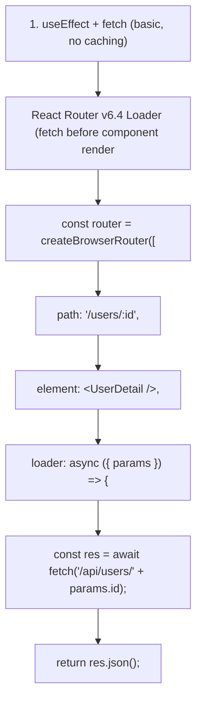

> **Navigation**: [Back to Index](../00_MASTER_INDEX.md) | [← TypeScript](05_React_TypeScript.md) | [Next: Testing →](07_React_Testing.md)

---

# 🧭 React Router & Data Fetching Patterns

---

## React Router v6

```jsx
import { BrowserRouter, Routes, Route, Link, Navigate, useParams, useNavigate, Outlet } from 'react-router-dom';

// ── Route Configuration ──
function App() {
  return (
    <BrowserRouter>
      <Routes>
        <Route path="/" element={<Layout />}>         {/* Shared layout */}
          <Route index element={<Home />} />           {/* / */}
          <Route path="users" element={<Users />} />   {/* /users */}
          <Route path="users/:id" element={<UserDetail />} /> {/* /users/123 */}
          <Route path="dashboard" element={              /* Protected route */
            <RequireAuth><Dashboard /></RequireAuth>
          } />
          <Route path="*" element={<NotFound />} />    {/* Catch-all 404 */}
        </Route>
      </Routes>
    </BrowserRouter>
  );
}

// ── Layout with Outlet ──
function Layout() {
  return (
    <div>
      <nav>
        <Link to="/">Home</Link>
        <Link to="/users">Users</Link>
      </nav>
      <main>
        <Outlet />  {/* ← Child route renders here */}
      </main>
    </div>
  );
}

// ── Dynamic Params ──
function UserDetail() {
  const { id } = useParams<{ id: string }>();
  const navigate = useNavigate();
  
  return (
    <div>
      <h1>User {id}</h1>
      <button onClick={() => navigate('/users')}>Back to list</button>
      <button onClick={() => navigate(-1)}>Go back</button>
    </div>
  );
}

// ── Protected Routes ──
function RequireAuth({ children }: { children: React.ReactNode }) {
  const { user } = useAuth();
  if (!user) return <Navigate to="/login" replace />;
  return <>{children}</>;
}
```

---

## Data Fetching Strategies

```
┌──────────────────────────────────────────────────────────────────────────────────┐
│  1. useEffect + fetch (basic, no caching)                                        │
│  2. React Query / SWR (best for most apps — caching, refetch, dedup)             │
│  3. React Router loaders (v6.4+ data router — fetch before render)               │
│  4. Next.js / Remix server components (SSR/SSG — fetch on server)                │
└──────────────────────────────────────────────────────────────────────────────────┘

React Router v6.4 Loader (fetch before component renders):

const router = createBrowserRouter([
  {
    path: "/users/:id",
    element: <UserDetail />,
    loader: async ({ params }) => {
      const res = await fetch('/api/users/' + params.id);
      if (!res.ok) throw new Response("Not Found", { status: 404 });
      return res.json();
    },
    errorElement: <ErrorPage />,
  },
]);

function UserDetail() {
  const user = useLoaderData();  // data already loaded!
  return <h1>{user.name}</h1>;
}
```

**Flow:**
- 1. useEffect + fetch (basic, no caching)
- ↓
- React Router v6.4 Loader (fetch before component render
- ↓
- const router = createBrowserRouter([
- ↓
- path: '/users/:id',
- ↓
- element: <UserDetail />,
- ↓
- loader: async ({ params }) => {
- ↓
- const res = await fetch('/api/users/' + params.id);



---

## API Layer Pattern (Production)

```tsx
// ── api/client.ts — Base HTTP client ──
const BASE_URL = import.meta.env.VITE_API_URL || '/api';

async function request<T>(url: string, options?: RequestInit): Promise<T> {
  const token = localStorage.getItem('token');
  
  const response = await fetch(`${BASE_URL}${url}`, {
    headers: {
      'Content-Type': 'application/json',
      ...(token && { Authorization: `Bearer ${token}` }),
    },
    ...options,
  });
  
  if (response.status === 401) {
    // Token expired — redirect to login
    window.location.href = '/login';
    throw new Error('Unauthorized');
  }
  
  if (!response.ok) {
    const error = await response.json().catch(() => ({ message: 'Request failed' }));
    throw new Error(error.message);
  }
  
  return response.json();
}

export const api = {
  get: <T>(url: string) => request<T>(url),
  post: <T>(url: string, data: unknown) => request<T>(url, { method: 'POST', body: JSON.stringify(data) }),
  put: <T>(url: string, data: unknown) => request<T>(url, { method: 'PUT', body: JSON.stringify(data) }),
  delete: <T>(url: string) => request<T>(url, { method: 'DELETE' }),
};

// ── api/users.ts — Domain-specific API ──
export const usersApi = {
  getAll: () => api.get<User[]>('/users'),
  getById: (id: string) => api.get<User>(`/users/${id}`),
  create: (data: CreateUserDTO) => api.post<User>('/users', data),
  update: (id: string, data: UpdateUserDTO) => api.put<User>(`/users/${id}`, data),
  delete: (id: string) => api.delete<void>(`/users/${id}`),
};

// ── hooks/useUsers.ts — React Query hooks ──
export function useUsers() {
  return useQuery({ queryKey: ['users'], queryFn: usersApi.getAll });
}

export function useUser(id: string) {
  return useQuery({ queryKey: ['users', id], queryFn: () => usersApi.getById(id), enabled: !!id });
}

export function useCreateUser() {
  const queryClient = useQueryClient();
  return useMutation({
    mutationFn: usersApi.create,
    onSuccess: () => queryClient.invalidateQueries({ queryKey: ['users'] }),
  });
}
```

---

## Form Handling (React Hook Form + Zod)

```tsx
import { useForm } from 'react-hook-form';
import { zodResolver } from '@hookform/resolvers/zod';
import { z } from 'zod';

// ── Validation Schema ──
const userSchema = z.object({
  name: z.string().min(2, 'Name must be at least 2 characters'),
  email: z.string().email('Invalid email'),
  age: z.number().min(18, 'Must be 18+').max(120),
  role: z.enum(['admin', 'user']),
});

type UserFormData = z.infer<typeof userSchema>;

// ── Form Component ──
function UserForm() {
  const { register, handleSubmit, formState: { errors, isSubmitting } } = useForm<UserFormData>({
    resolver: zodResolver(userSchema),
    defaultValues: { role: 'user' },
  });

  const onSubmit = async (data: UserFormData) => {
    await createUser(data);
  };

  return (
    <form onSubmit={handleSubmit(onSubmit)}>
      <input {...register('name')} placeholder="Name" />
      {errors.name && <span className="error">{errors.name.message}</span>}
      
      <input {...register('email')} placeholder="Email" />
      {errors.email && <span className="error">{errors.email.message}</span>}
      
      <input {...register('age', { valueAsNumber: true })} type="number" />
      {errors.age && <span className="error">{errors.age.message}</span>}
      
      <button type="submit" disabled={isSubmitting}>
        {isSubmitting ? 'Saving...' : 'Create User'}
      </button>
    </form>
  );
}
      <button type="submit" disabled={isSubmitting}>
        {isSubmitting ? 'Saving...' : 'Create User'}
      </button>
    </form>
  );
}
```

---

## React Router v6.4+ Data APIs (Advanced)

```tsx
// ── actions, loaders, and forms ──
// React Router v6.4+ brought Remix features to client-side React.
// Say goodbye to useEffect for fetching!

import { createBrowserRouter, RouterProvider, Form, useActionData, redirect } from 'react-router-dom';

// 1. Loader (GET)
const userLoader = async ({ params }) => {
  const user = await fetch(`/api/users/${params.userId}`);
  if (!user.ok) throw new Error('User not found');
  return user.json();
};

// 2. Action (POST/PUT/DELETE)
const editUserAction = async ({ request, params }) => {
  const formData = await request.formData();
  const updates = Object.fromEntries(formData);
  
  const res = await fetch(`/api/users/${params.userId}`, {
    method: 'PUT',
    body: JSON.stringify(updates),
  });
  
  if (!res.ok) return { error: "Failed to save" };
  return redirect(`/users/${params.userId}`);
};

// 3. Component uses <Form> (prevents default, calls action)
function EditUser() {
  const user = useLoaderData();
  const actionData = useActionData(); // Access action return value (like errors)
  const navigation = useNavigation(); // Know when we are submitting!
  
  const isSubmitting = navigation.state === 'submitting';

  return (
    <Form method="post">
      {actionData?.error && <p className="error">{actionData.error}</p>}
      
      <input name="firstName" defaultValue={user.firstName} />
      <input name="lastName" defaultValue={user.lastName} />
      
      <button type="submit" disabled={isSubmitting}>
        {isSubmitting ? 'Saving...' : 'Save'}
      </button>
    </Form>
  );
}

// 4. Define route with loader AND action
const router = createBrowserRouter([
  {
    path: '/users/:userId/edit',
    element: <EditUser />,
    loader: userLoader,
    action: editUserAction,
    errorElement: <ErrorBoundary />, // Catches loader AND render errors
  }
]);
```

---

## Defer & Suspense (Streaming Data)

```tsx
// Wait for critical data, but SHOW UI immediately while slow data loads!

import { defer, Await, useLoaderData } from 'react-router-dom';
import { Suspense } from 'react';

// 1. Loader uses `defer`
const dashboardLoader = async () => {
  // Fast: awaited immediately
  const user = await fetchUser(); 
  
  // Slow: NOT awaited, passed as a promise!
  const statsPromise = fetchHeavyDashboardStats(); 
  
  return defer({
    user,           // Critical data (blocks navigation)
    stats: statsPromise // Uncritical data (streams in later)
  });
};

// 2. Component uses <Suspense> and <Await>
function Dashboard() {
  const data = useLoaderData();
  
  return (
    <div>
      <h1>Welcome {data.user.name}</h1> {/* Renders immediately */}
      
      <Suspense fallback={<Spinner text="Loading heavy stats..." />}>
        {/* Await handles resolving the promise */}
        <Await resolve={data.stats} errorElement={<p>Error loading stats!</p>}>
          {(resolvedStats) => (
            <StatsChart data={resolvedStats} />
          )}
        </Await>
      </Suspense>
    </div>
  );
}
```

---

## Advanced Authentication Flow

```tsx
// Centralized auth state + Route protection + Redirect to origin

// 1. Auth Provider
function AuthProvider({ children }) {
  const [user, setUser] = useState(null);
  const [loading, setLoading] = useState(true);

  useEffect(() => {
    checkSession().then(u => {
      setUser(u);
      setLoading(false);
    });
  }, []);

  if (loading) return <FullScreenLoader />;

  return (
    <AuthContext.Provider value={{ user, setUser }}>
      {children}
    </AuthContext.Provider>
  );
}

// 2. Protected Route Wrapper
function RequireAuth() {
  const { user } = useAuth();
  const location = useLocation();

  if (!user) {
    // Redirect to login, but save the intended destination!
    return <Navigate to="/login" state={{ from: location.pathname }} replace />;
  }

  return <Outlet />; // Render child routes
}

// 3. Login Page
function LoginPage() {
  const { setUser } = useAuth();
  const navigate = useNavigate();
  const location = useLocation();
  
  // Where were they trying to go? Default to /dashboard
  const from = location.state?.from || '/dashboard';

  const handleLogin = async (e) => {
    e.preventDefault();
    const user = await API.login(/* credentials */);
    setUser(user);
    // Send them back to where they wanted to go!
    navigate(from, { replace: true });
  };
  
  return <form onSubmit={handleLogin}>{/* ... */}</form>;
}

// 4. Usage in Routes
<Routes>
  <Route path="/" element={<Home />} />
  <Route path="/login" element={<LoginPage />} />
  
  {/* Wrap all protected routes securely */}
  <Route element={<RequireAuth />}>
    <Route path="/dashboard" element={<Dashboard />} />
    <Route path="/settings" element={<Settings />} />
  </Route>
</Routes>
```

---

## 🔗 Cross-References

| Topic | Related Content |
|---|---|
| **Hooks** | [Hooks Deep Dive](03_Hooks_Deep_Dive.md) — useEffect, useContext |
| **Component Patterns** | [Component Patterns](02_Component_Patterns.md) — Composition |
| **Testing Routes** | [React Testing](07_React_Testing.md) — Mocking navigation |
| **API Backend** | [Node.js Express](../13_Node_Backend/01_Express_Basics.md) |

---

> **Navigation**: [< Previous](05_React_TypeScript.md) | [Back to Index](../00_MASTER_INDEX.md) | [Next >](07_React_Testing.md)