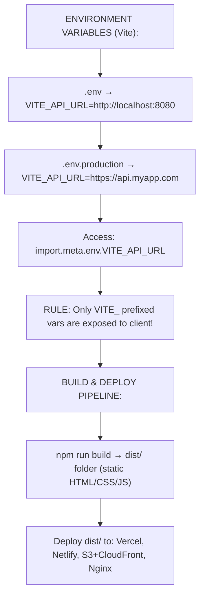

> **Navigation**: [Back to Index](../00_MASTER_INDEX.md) | [← Testing](07_React_Testing.md)

---

# ⚡ React Performance & Enterprise Patterns

---

## Part 1: Performance — Avoid Unnecessary Re-renders


> WHEN DOES A COMPONENT RE-RENDER?
>
> 1. Its state changes (useState setter called)
> 2. Its parent re-renders (props may have changed)
> 3. Context value it consumes changes
>
> REACT RE-RENDER ≠ DOM UPDATE
> Re-render: React calls your component function → creates virtual DOM
> DOM update: React diffs old vs new virtual DOM → updates only changed nodes
>
> Most re-renders are fine! Only optimize when you MEASURE a problem.


### Key Optimization Techniques

```jsx
// 1. React.memo — Skip re-render if props haven't changed
const ExpensiveList = React.memo(function ExpensiveList({ items }) {
  return <ul>{items.map(i => <li key={i.id}>{i.name}</li>)}</ul>;
});
// Only re-renders if items reference changes (shallow comparison)

// 2. useMemo — Memoize expensive calculations
const sortedData = useMemo(() => {
  return [...data].sort((a, b) => a.score - b.score); // expensive sort
}, [data]);

// 3. useCallback — Stable function references for memoized children
const handleDelete = useCallback((id: string) => {
  setItems(prev => prev.filter(i => i.id !== id));
}, []); // stable reference

// 4. Lazy loading — Code split by route
const Dashboard = lazy(() => import('./pages/Dashboard'));

function App() {
  return (
    <Suspense fallback={<Spinner />}>
      <Routes>
        <Route path="/dashboard" element={<Dashboard />} />
      </Routes>
    </Suspense>
  );
}

// 5. Virtualization — Render only visible items in long lists
import { useVirtualizer } from '@tanstack/react-virtual';

function VirtualList({ items }) {
  const parentRef = useRef(null);
  const virtualizer = useVirtualizer({
    count: items.length,
    getScrollElement: () => parentRef.current,
    estimateSize: () => 50, // estimated row height
  });
  
  return (
    <div ref={parentRef} style={{ height: '400px', overflow: 'auto' }}>
      <div style={{ height: virtualizer.getTotalSize() }}>
        {virtualizer.getVirtualItems().map(virtualRow => (
          <div key={virtualRow.key} style={{
            position: 'absolute', top: virtualRow.start, height: virtualRow.size,
          }}>
            {items[virtualRow.index].name}
          </div>
        ))}
      </div>
    </div>
  );
}
// 10,000 items? Only ~20 DOM nodes rendered at a time!
```

---

## Part 2: Enterprise Project Structure

```
src/
├── api/                   # API client & domain-specific APIs
│   ├── client.ts          # Base HTTP client (fetch wrapper)
│   ├── users.ts           # User-related API calls
│   └── orders.ts
├── components/            # Shared/reusable UI components
│   ├── ui/                # Primitives: Button, Modal, Input
│   ├── forms/             # Form components with validation
│   └── layout/            # Header, Sidebar, Footer
├── features/              # Feature-based modules (vertical slices)
│   ├── auth/
│   │   ├── components/    # LoginForm, RegisterForm
│   │   ├── hooks/         # useAuth, useLogin
│   │   ├── store/         # Auth slice/store
│   │   └── types.ts
│   ├── products/
│   │   ├── components/    # ProductList, ProductCard
│   │   ├── hooks/         # useProducts, useProductSearch
│   │   └── types.ts
│   └── cart/
├── hooks/                 # Shared custom hooks
│   ├── useDebounce.ts
│   ├── useLocalStorage.ts
│   └── useMediaQuery.ts
├── lib/                   # Third-party setup (axios, dayjs)
├── pages/                 # Route-level page components
├── store/                 # Global state (Redux store config)
├── types/                 # Shared TypeScript types
├── utils/                 # Pure utility functions
└── App.tsx
```

**Flow:**
- src/
- ↓
- api/ # API client & domain-specific APIs
- ↓
- src/
- ↓
- client.ts # Base HTTP client (fetch wrapper)
- ↓
- src/
- ↓
- users.ts # User-related API calls
- ↓
- src/
- ↓
- orders.ts
- ↓
- src/
- ↓
- components/ # Shared/reusable UI components
- ↓
- src/
- ↓
- ui/ # Primitives: Button, Modal, Input

```mermaid
flowchart TD
    N1["src/"]
    N2["api/ # API client & domain-specific APIs"]
    N3["client.ts # Base HTTP client (fetch wrapper)"]
    N4["users.ts # User-related API calls"]
    N5["orders.ts"]
    N6["components/ # Shared/reusable UI components"]
    N7["ui/ # Primitives: Button, Modal, Input"]
    N8["forms/ # Form components with validation"]
    N9["layout/ # Header, Sidebar, Footer"]
    N10["features/ # Feature-based modules (vertical slices)"]
    N11["auth/"]
    N12["components/ # LoginForm, RegisterForm"]
    N13["hooks/ # useAuth, useLogin"]
    N14["store/ # Auth slice/store"]
    N15["types.ts"]
    N16["products/"]
    N17["components/ # ProductList, ProductCard"]
    N18["hooks/ # useProducts, useProductSearch"]
    N19["cart/"]
    N20["hooks/ # Shared custom hooks"]
    N21["useDebounce.ts"]
    N22["useLocalStorage.ts"]
    N23["useMediaQuery.ts"]
    N24["lib/ # Third-party setup (axios, dayjs)"]
    N25["pages/ # Route-level page components"]
    N26["store/ # Global state (Redux store config)"]
    N27["types/ # Shared TypeScript types"]
    N28["utils/ # Pure utility functions"]
    N29["App.tsx"]
    N1 --> N2
    N1 --> N3
    N1 --> N4
    N1 --> N5
    N1 --> N6
    N1 --> N7
    N1 --> N8
    N1 --> N9
    N1 --> N10
    N1 --> N11
    N1 --> N12
    N1 --> N13
    N1 --> N14
    N1 --> N15
    N1 --> N16
    N1 --> N17
    N1 --> N18
    N1 --> N19
    N1 --> N20
    N1 --> N21
    N1 --> N22
    N1 --> N23
    N1 --> N24
    N1 --> N25
    N1 --> N26
    N1 --> N27
    N1 --> N28
    N1 --> N29
```



---

## Part 3: Key Enterprise Patterns

```tsx
// ── FEATURE FLAG SYSTEM ──
const FeatureFlagContext = createContext<Record<string, boolean>>({});

function useFeatureFlag(flag: string): boolean {
  const flags = useContext(FeatureFlagContext);
  return flags[flag] ?? false;
}

function NewCheckout() {
  const isNewCheckoutEnabled = useFeatureFlag('new-checkout');
  return isNewCheckoutEnabled ? <NewCheckoutFlow /> : <LegacyCheckout />;
}

// ── ROLE-BASED ACCESS CONTROL ──
function usePermission(permission: string): boolean {
  const { user } = useAuth();
  return user?.permissions?.includes(permission) ?? false;
}

function AdminPanel() {
  const canManageUsers = usePermission('users:manage');
  if (!canManageUsers) return <AccessDenied />;
  return <UserManagement />;
}

// ── OPTIMISTIC UPDATES (React Query) ──
const mutation = useMutation({
  mutationFn: updateTodo,
  onMutate: async (newTodo) => {
    await queryClient.cancelQueries({ queryKey: ['todos'] });
    const previous = queryClient.getQueryData(['todos']);
    queryClient.setQueryData(['todos'], (old) =>
      old.map(t => t.id === newTodo.id ? { ...t, ...newTodo } : t)
    );
    return { previous };  // save for rollback
  },
  onError: (err, newTodo, context) => {
    queryClient.setQueryData(['todos'], context.previous); // rollback
  },
  onSettled: () => {
    queryClient.invalidateQueries({ queryKey: ['todos'] }); // refetch truth
  },
});
```

---


## Part 4: Environment & Deployment

```
┌──────────────────────────────────────────────────────────────────────────────────┐
│  ENVIRONMENT VARIABLES (Vite):                                                   │
│  .env                → VITE_API_URL=http://localhost:8080                        │
│  .env.production     → VITE_API_URL=https://api.myapp.com                        │
│  Access: import.meta.env.VITE_API_URL                                            │
│  RULE: Only VITE_ prefixed vars are exposed to client!                           │
│                                                                                  │
│  BUILD & DEPLOY PIPELINE:                                                        │
│  npm run build → dist/ folder (static HTML/CSS/JS)                               │
│  Deploy dist/ to: Vercel, Netlify, S3+CloudFront, Nginx                          │
│                                                                                  │
│  ESSENTIAL TOOLING:                                                              │
│  Build: Vite (fast HMR, optimized builds)                                        │
│  Lint: ESLint + Prettier (consistent code)                                       │
│  Type check: tsc --noEmit (CI check)                                             │
│  Test: Vitest (unit/integration) + Playwright (E2E)                              │
│  CI: GitHub Actions → lint + type-check + test + build + deploy                  │
└──────────────────────────────────────────────────────────────────────────────────┘
```

**Flow:**
- ENVIRONMENT VARIABLES (Vite):
- ↓
- .env
- ↓
- VITE_API_URL=http://localhost:8080
- ↓
- .env
- ↓
- VITE_API_URL=http://localhost:8080
- ↓
- .env.production
- ↓
- VITE_API_URL=https://api.myapp.com
- ↓
- .env.production
- ↓
- VITE_API_URL=https://api.myapp.com
- ↓
- Access: import.meta.env.VITE_API_URL
- ↓
- RULE: Only VITE_ prefixed vars are exposed to client!
- ↓
- BUILD & DEPLOY PIPELINE:
- ↓
- npm run build
- ↓
- dist/ folder (static HTML/CSS/JS)



---

## React Interview Must-Knows

```
Q: "What is the virtual DOM?"
A: In-memory representation of the real DOM. When state changes, React creates
   a new virtual DOM tree, diffs it against the old one, and applies only
   the minimal set of real DOM changes. This is called reconciliation.

Q: "Why do we need keys in lists?"
A: Keys help React identify which items changed/added/removed during reconciliation.
   Without stable keys, React re-renders the entire list.

Q: "useState vs useRef?"
A: useState: triggers re-render when value changes. Use for UI state.
   useRef: persists value across renders without triggering re-render.
   Use for DOM refs, timers, previous values.

Q: "When would you use useReducer over useState?"
A: When state logic is complex (multiple sub-values, next state depends on
   previous), when state transitions need to be testable separately, or
   when passing dispatch down avoids prop drilling callbacks.

Q: "How do you handle stale closures in useEffect?"
A: Use functional updates (setCount(c => c + 1)), include deps in
   dependency array, use refs for values you don't want to trigger re-runs.
```

---


---

## 🏋️ Practice & Interview Questions — React

### Predict / Trace
**Q1.** What is the output order of console logs?
```jsx
function App() {
  console.log('render');
  useEffect(() => { console.log('effect'); }, []);
  console.log('render2');
  return <div/>;
}
```
<details><summary>Answer</summary>

`render` → `render2` → `effect`

`useEffect` runs **after** the component renders and the DOM is committed. Both `console.log`s in the function body run first.
</details>

**Q2.** Why does this cause an infinite loop?
```jsx
useEffect(() => {
  setCount(count + 1);
}, [count]);
```
<details><summary>Answer</summary>

`setCount(count+1)` → triggers re-render → `count` changes → effect runs again → infinite loop. **Fix**: remove `count` from deps and use functional update: `setCount(prev => prev + 1)` or change dependency logic.
</details>

### Coding Problems
**Q3.** ⭐ Implement a custom `useDebounce` hook.
<details><summary>Solution</summary>

```jsx
function useDebounce(value, delay) {
  const [debouncedValue, setDebouncedValue] = useState(value);
  useEffect(() => {
    const handler = setTimeout(() => setDebouncedValue(value), delay);
    return () => clearTimeout(handler); // Cleanup on value/delay change
  }, [value, delay]);
  return debouncedValue;
}
```
</details>

**Q4.** ⭐ Implement `useFetch` — generic data fetching hook with loading/error states.
<details><summary>Solution</summary>

```jsx
function useFetch(url) {
  const [data, setData] = useState(null);
  const [loading, setLoading] = useState(true);
  const [error, setError] = useState(null);

  useEffect(() => {
    let cancelled = false;
    fetch(url)
      .then(r => r.json())
      .then(d => { if(!cancelled) setData(d); })
      .catch(e => { if(!cancelled) setError(e); })
      .finally(() => { if(!cancelled) setLoading(false); });
    return () => { cancelled = true; }; // Cleanup for race conditions
  }, [url]);

  return { data, loading, error };
}
```
</details>

**Q5.** ⭐⭐ When should you use `useCallback` vs `useMemo`?
<details><summary>Answer</summary>

`useMemo`: memoizes a **computed value** — run expensive calculation, cache result.
`useCallback`: memoizes a **function reference** — prevent child re-renders when passing callbacks.
Both only useful when: (1) the child uses `React.memo`, or (2) the value/function is a dep of another hook. Premature optimization without these conditions = needless complexity.
</details>

**Q6.** ⭐⭐ Implement a `useLocalStorage` hook.
<details><summary>Solution</summary>

```jsx
function useLocalStorage(key, initialValue) {
  const [value, setValue] = useState(() => {
    try { return JSON.parse(localStorage.getItem(key)) ?? initialValue; }
    catch { return initialValue; }
  });

  const setStoredValue = (newValue) => {
    setValue(newValue);
    localStorage.setItem(key, JSON.stringify(newValue));
  };

  return [value, setStoredValue];
}
```
</details>

### MCQ Rapid Fire
| # | Question | Answer |
|---|---|---|
| 1 | When does useEffect with [] run? | Once after mount |
| 2 | When does useEffect with no array run? | After every render |
| 3 | Key prop in lists is used for | Reconciliation (identify changed elements) |
| 4 | React.memo prevents re-render when | Props haven't changed (shallow comparison) |
| 5 | useState is synchronous? | ❌ Batched, async in React 18 |
| 6 | Controlled vs uncontrolled component | Controlled=state managed in React; Uncontrolled=DOM manages it (ref) |
| 7 | useRef vs useState | useRef: doesn't trigger re-render; useState: does |
| 8 | StrictMode effect on effects | Runs effects twice (in dev) to detect side effects |


---

## 🧠 Deep Conceptual Questions — React Internals & Mental Models

**C1. What is the React reconciliation algorithm and why does the `key` prop matter?**
<details><summary>Deep Answer</summary>

React maintains a virtual DOM (VNode tree). On state change: React creates a new VNode tree, diffs it against the previous tree (diffing = reconciliation), applies minimal real DOM mutations. Naive tree diff: O(N³). React's heuristics: O(N). Heuristic 1: different element types → destroy and rebuild subtree. Heuristic 2: same type → update props, recurse into children. **`key` prop**: tells React the element's identity across renders. Without keys in lists: React diffs by position — inserting at beginning is O(N) DOM mutations. With stable keys: React identifies which item moved/added/removed → O(1) per change. Keys must be stable+unique per list — using index as key breaks this when list is reordered.
</details>

**C2. Why does React use a virtual DOM? What performance problem does it solve?**
<details><summary>Deep Answer</summary>

Direct DOM manipulation is expensive: each `div.style.color = 'red'` forces layout recalculation, style recalculation, repaint — potentially 3-17ms per operation. Doing 50 direct DOM changes = 50 potential reflows. Virtual DOM batches all changes: compute the full desired state in JS (fast, ~ms), diff against current state, apply only the MINIMUM necessary DOM mutations in one batch (one reflow). Net effect: many state changes → few DOM mutations → fewer reflows. In React 18: concurrent rendering further batches setState calls across async boundaries. **Note**: React's VirtualDOM is a means to an end (batching + diffing), not inherently "fast" — SolidJS/Svelte skip it entirely with fine-grained reactivity and are faster for some use cases.
</details>

**C3. What is React's fiber architecture and how does it enable concurrent features?**
<details><summary>Deep Answer</summary>

Before Fiber (React 15): reconciliation = synchronous, non-interruptible tree walk. A complex update > 16ms → UI janks (dropped frames). **Fiber** (React 16+): reconciliation reimplemented as a linked list of "fiber nodes." Each fiber = a unit of work that can be paused, resumed, or abandoned. The render phase (building the fiber tree) is **interruptible**: React can pause after any fiber, yield to the browser for frames/user input, then resume. The commit phase (applying DOM changes) remains synchronous (can't be interrupted — DOM must be consistent). This enables: concurrent mode, `useTransition` (lower priority updates), `Suspense`, `useDeferredValue`. The fundamental shift: from "one big synchronous render" to "cooperative multitasking renderer."
</details>

**C4. useEffect dependency array: what is "stale closure" and how to fix it?**
<details><summary>Deep Answer</summary>

```jsx
const [count, setCount] = useState(0);
useEffect(() => {
  const id = setInterval(() => console.log(count), 1000); // stale closure!
  return () => clearInterval(id);
}, []); // count not in deps
```
The interval callback captures `count` from the initial render (= 0). Even after count updates, the closure still sees 0 — it's "stale." **Fix 1**: include count in deps — effect re-runs, interval recreated (wasteful). **Fix 2**: use `useRef` to store latest count. **Fix 3**: functional update `setCount(c => c + 1)` doesn't read stale count. Root cause: JavaScript closures capture variables at creation time. React's fn components close over state at render time. With stale deps, the closure never refreshes. `eslint-plugin-react-hooks` detects missing deps.
</details>

**C5. When does React batch state updates, and when does it NOT?**
<details><summary>Deep Answer</summary>

**React 17 and below**: batches only inside React event handlers. `setTimeout`, `Promise.then`, native event listeners → NOT batched (each setState triggers a re-render). **React 18**: **Automatic Batching** — batches all setState calls everywhere (timeouts, Promises, native events). Each React event handler still flushes at end. Opt-out (rare): `flushSync(() => setX(1))` → forces synchronous re-render.

Rule: in React 18, multiple setStates in ANY context = one re-render per batch. No more worrying about whether you're in a React event or not.
</details>

**C6. What is the purpose of `useReducer` and when is it better than multiple `useState`?**
<details><summary>Deep Answer</summary>

`useReducer` is `useState` for complex state transitions. Better than multiple `useState` when: (1) next state depends on multiple state values together (reducer receives full state), (2) multiple actions lead to similar state updates (consolidate logic in one place), (3) complex state objects where partial updates have side effects, (4) testing — reducer is a pure function, easily unit-testable in isolation. Think: `useState` = `useReducer(reducer, initialState)` where reducer is `(state, newValue) => newValue`. `useReducer` makes state transitions explicit and traceable (Redux-like). Redux IS just `useReducer` + Context for global sharing.
</details>


> **Navigation**: [< Previous](07_React_Testing.md) | [Back to Index](../00_MASTER_INDEX.md) | [Next >](09_React_Deep_Reasoning.md)