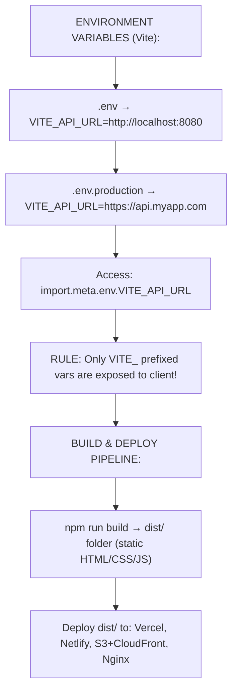

```mermaid
flowchart TD
    N1["src/"]
    N2["api/ # API client & domain-specific APIs"]
    N3["client.ts # Base HTTP client (fetch wrapper)"]
    N4["users.ts # User-related API calls"]
    N5["orders.ts"]
    N6["components/ # Shared/reusable UI components"]
    N7["ui/ # Primitives: Button, Modal, Input"]
    N8["forms/ # Form components with validation"]
    N9["layout/ # Header, Sidebar, Footer"]
    N10["features/ # Feature-based modules (vertical slices)"]
    N11["auth/"]
    N12["components/ # LoginForm, RegisterForm"]
    N13["hooks/ # useAuth, useLogin"]
    N14["store/ # Auth slice/store"]
    N15["types.ts"]
    N16["products/"]
    N17["components/ # ProductList, ProductCard"]
    N18["hooks/ # useProducts, useProductSearch"]
    N19["cart/"]
    N20["hooks/ # Shared custom hooks"]
    N21["useDebounce.ts"]
    N22["useLocalStorage.ts"]
    N23["useMediaQuery.ts"]
    N24["lib/ # Third-party setup (axios, dayjs)"]
    N25["pages/ # Route-level page components"]
    N26["store/ # Global state (Redux store config)"]
    N27["types/ # Shared TypeScript types"]
    N28["utils/ # Pure utility functions"]
    N29["App.tsx"]
    N1 --> N2
    N1 --> N3
    N1 --> N4
    N1 --> N5
    N1 --> N6
    N1 --> N7
    N1 --> N8
    N1 --> N9
    N1 --> N10
    N1 --> N11
    N1 --> N12
    N1 --> N13
    N1 --> N14
    N1 --> N15
    N1 --> N16
    N1 --> N17
    N1 --> N18
    N1 --> N19
    N1 --> N20
    N1 --> N21
    N1 --> N22
    N1 --> N23
    N1 --> N24
    N1 --> N25
    N1 --> N26
    N1 --> N27
    N1 --> N28
    N1 --> N29
```

> **Navigation**: [Back to Index](../00_MASTER_INDEX.md) | [← Testing](07_React_Testing.md)

---

# ⚡ React Performance & Enterprise Patterns

---

## Part 1: Performance — Avoid Unnecessary Re-renders


> WHEN DOES A COMPONENT RE-RENDER?
>
> 1. Its state changes (useState setter called)
> 2. Its parent re-renders (props may have changed)
> 3. Context value it consumes changes
>
> REACT RE-RENDER ≠ DOM UPDATE
> Re-render: React calls your component function → creates virtual DOM
> DOM update: React diffs old vs new virtual DOM → updates only changed nodes
>
> Most re-renders are fine! Only optimize when you MEASURE a problem.


### Key Optimization Techniques

```jsx
// 1. React.memo — Skip re-render if props haven't changed
const ExpensiveList = React.memo(function ExpensiveList({ items }) {
  return <ul>{items.map(i => <li key={i.id}>{i.name}</li>)}</ul>;
});
// Only re-renders if items reference changes (shallow comparison)

// 2. useMemo — Memoize expensive calculations
const sortedData = useMemo(() => {
  return [...data].sort((a, b) => a.score - b.score); // expensive sort
}, [data]);

// 3. useCallback — Stable function references for memoized children
const handleDelete = useCallback((id: string) => {
  setItems(prev => prev.filter(i => i.id !== id));
}, []); // stable reference

// 4. Lazy loading — Code split by route
const Dashboard = lazy(() => import('./pages/Dashboard'));

function App() {
  return (
    <Suspense fallback={<Spinner />}>
      <Routes>
        <Route path="/dashboard" element={<Dashboard />} />
      </Routes>
    </Suspense>
  );
}

// 5. Virtualization — Render only visible items in long lists
import { useVirtualizer } from '@tanstack/react-virtual';

function VirtualList({ items }) {
  const parentRef = useRef(null);
  const virtualizer = useVirtualizer({
    count: items.length,
    getScrollElement: () => parentRef.current,
    estimateSize: () => 50, // estimated row height
  });
  
  return (
    <div ref={parentRef} style={{ height: '400px', overflow: 'auto' }}>
      <div style={{ height: virtualizer.getTotalSize() }}>
        {virtualizer.getVirtualItems().map(virtualRow => (
          <div key={virtualRow.key} style={{
            position: 'absolute', top: virtualRow.start, height: virtualRow.size,
          }}>
            {items[virtualRow.index].name}
          </div>
        ))}
      </div>
    </div>
  );
}
// 10,000 items? Only ~20 DOM nodes rendered at a time!
```

---

## Part 2: Enterprise Project Structure

```
src/
├── api/                   # API client & domain-specific APIs
│   ├── client.ts          # Base HTTP client (fetch wrapper)
│   ├── users.ts           # User-related API calls
│   └── orders.ts
├── components/            # Shared/reusable UI components
│   ├── ui/                # Primitives: Button, Modal, Input
│   ├── forms/             # Form components with validation
│   └── layout/            # Header, Sidebar, Footer
├── features/              # Feature-based modules (vertical slices)
│   ├── auth/
│   │   ├── components/    # LoginForm, RegisterForm
│   │   ├── hooks/         # useAuth, useLogin
│   │   ├── store/         # Auth slice/store
│   │   └── types.ts
│   ├── products/
│   │   ├── components/    # ProductList, ProductCard
│   │   ├── hooks/         # useProducts, useProductSearch
│   │   └── types.ts
│   └── cart/
├── hooks/                 # Shared custom hooks
│   ├── useDebounce.ts
│   ├── useLocalStorage.ts
│   └── useMediaQuery.ts
├── lib/                   # Third-party setup (axios, dayjs)
├── pages/                 # Route-level page components
├── store/                 # Global state (Redux store config)
├── types/                 # Shared TypeScript types
├── utils/                 # Pure utility functions
└── App.tsx
```

**Flow:**
1. src/
2. api/ # API client & domain-specific APIs
3. src/
4. client.ts # Base HTTP client (fetch wrapper)
5. src/
6. users.ts # User-related API calls
7. src/ orders.ts src/
8. components/ # Shared/reusable UI components
9. src/
10. ui/ # Primitives: Button, Modal, Input



---

## Part 3: Key Enterprise Patterns

```tsx
// ── FEATURE FLAG SYSTEM ──
const FeatureFlagContext = createContext<Record<string, boolean>>({});

function useFeatureFlag(flag: string): boolean {
  const flags = useContext(FeatureFlagContext);
  return flags[flag] ?? false;
}

function NewCheckout() {
  const isNewCheckoutEnabled = useFeatureFlag('new-checkout');
  return isNewCheckoutEnabled ? <NewCheckoutFlow /> : <LegacyCheckout />;
}

// ── ROLE-BASED ACCESS CONTROL ──
function usePermission(permission: string): boolean {
  const { user } = useAuth();
  return user?.permissions?.includes(permission) ?? false;
}

function AdminPanel() {
  const canManageUsers = usePermission('users:manage');
  if (!canManageUsers) return <AccessDenied />;
  return <UserManagement />;
}

// ── OPTIMISTIC UPDATES (React Query) ──
const mutation = useMutation({
  mutationFn: updateTodo,
  onMutate: async (newTodo) => {
    await queryClient.cancelQueries({ queryKey: ['todos'] });
    const previous = queryClient.getQueryData(['todos']);
    queryClient.setQueryData(['todos'], (old) =>
      old.map(t => t.id === newTodo.id ? { ...t, ...newTodo } : t)
    );
    return { previous };  // save for rollback
  },
  onError: (err, newTodo, context) => {
    queryClient.setQueryData(['todos'], context.previous); // rollback
  },
  onSettled: () => {
    queryClient.invalidateQueries({ queryKey: ['todos'] }); // refetch truth
  },
});
```

---


## Part 4: Environment & Deployment

```
┌──────────────────────────────────────────────────────────────────────────────────┐
│  ENVIRONMENT VARIABLES (Vite):                                                   │
│  .env                → VITE_API_URL=http://localhost:8080                        │
│  .env.production     → VITE_API_URL=https://api.myapp.com                        │
│  Access: import.meta.env.VITE_API_URL                                            │
│  RULE: Only VITE_ prefixed vars are exposed to client!                           │
│                                                                                  │
│  BUILD & DEPLOY PIPELINE:                                                        │
│  npm run build → dist/ folder (static HTML/CSS/JS)                               │
│  Deploy dist/ to: Vercel, Netlify, S3+CloudFront, Nginx                          │
│                                                                                  │
│  ESSENTIAL TOOLING:                                                              │
│  Build: Vite (fast HMR, optimized builds)                                        │
│  Lint: ESLint + Prettier (consistent code)                                       │
│  Type check: tsc --noEmit (CI check)                                             │
│  Test: Vitest (unit/integration) + Playwright (E2E)                              │
│  CI: GitHub Actions → lint + type-check + test + build + deploy                  │
└──────────────────────────────────────────────────────────────────────────────────┘
```

**Flow:**
1. ENVIRONMENT VARIABLES (Vite):
2. .env
3. VITE_API_URL=http://localhost:8080
4. .env.production
5. VITE_API_URL=https://api.myapp.com
6. Access: import.meta.env.VITE_API_URL
7. RULE: Only VITE_ prefixed vars are exposed to client!
8. BUILD & DEPLOY PIPELINE: npm run build
9. dist/ folder (static HTML/CSS/JS)



---

## React Interview Must-Knows

```
Q: "What is the virtual DOM?"
A: In-memory representation of the real DOM. When state changes, React creates
   a new virtual DOM tree, diffs it against the old one, and applies only
   the minimal set of real DOM changes. This is called reconciliation.

Q: "Why do we need keys in lists?"
A: Keys help React identify which items changed/added/removed during reconciliation.
   Without stable keys, React re-renders the entire list.

Q: "useState vs useRef?"
A: useState: triggers re-render when value changes. Use for UI state.
   useRef: persists value across renders without triggering re-render.
   Use for DOM refs, timers, previous values.

Q: "When would you use useReducer over useState?"
A: When state logic is complex (multiple sub-values, next state depends on
   previous), when state transitions need to be testable separately, or
   when passing dispatch down avoids prop drilling callbacks.

Q: "How do you handle stale closures in useEffect?"
A: Use functional updates (setCount(c => c + 1)), include deps in
   dependency array, use refs for values you don't want to trigger re-runs.
```

