> **Navigation**: [< Previous](08_React_Performance.md) | [Back to Index](../00_MASTER_INDEX.md)

# Chapter 9 — React Deep Reasoning: The Questions That Freeze People

> **"Anyone can say 'useState manages state.' The senior engineer explains WHY React re-renders, HOW batching works, and WHAT happens when you call setState 3 times in a row."**

---

## Why This Chapter Exists


> THE FREEZE PATTERN IN REACT INTERVIEWS
>
> Junior:   "useState manages component state"
> Interviewer: "Can a component have more than one state?"
> Junior:   "...yes?"
> Interviewer: "What happens when you call setState 3 times?"
> Junior:   *freezes*
>
> Senior:   "Yes, a component can have unlimited states — each
> useState call manages an independent piece. When you
> call setState 3 times IN an event handler, React
> BATCHES them — one re-render, not three. But OUTSIDE
> an event handler (before React 18), each setState
> caused a separate re-render. React 18's automatic
> batching fixed this for ALL cases."


---

## Table of Contents

1. [useState: Batching, Stale State, and the Updater Pattern](#1-usestate-batching-stale-state-and-the-updater-pattern)
2. [Why Re-renders Happen (The REAL Trigger)](#2-why-re-renders-happen-the-real-trigger)
3. [Virtual DOM: It's Not About Speed](#3-virtual-dom-its-not-about-speed)
4. [useEffect: The Lifecycle Mental Model is WRONG](#4-useeffect-the-lifecycle-mental-model-is-wrong)
5. [Keys: Why Index as Key Breaks Things](#5-keys-why-index-as-key-breaks-things)
6. [useRef vs useState: When to Use Which](#6-useref-vs-usestate-when-to-use-which)
7. [useMemo/useCallback: When They Hurt Performance](#7-usememousecallback-when-they-hurt-performance)
8. [Context: Why It's NOT a State Manager](#8-context-why-its-not-a-state-manager)
9. [Controlled vs Uncontrolled: The Real Difference](#9-controlled-vs-uncontrolled-the-real-difference)
10. [React Fiber: How React Actually Renders](#10-react-fiber-how-react-actually-renders)
11. [Suspense & Concurrent Mode: The Future Model](#11-suspense--concurrent-mode-the-future-model)
12. [Server Components: Why They Exist](#12-server-components-why-they-exist)
13. [Common Anti-Patterns Seniors Catch Instantly](#13-common-anti-patterns-seniors-catch-instantly)

---

## 1. useState: Batching, Stale State, and the Updater Pattern

### Freeze Question #1: "Can a component have more than one state?"

**YES.** Each `useState` call manages an independent piece of state:

```jsx
function UserProfile() {
  const [name, setName] = useState('');        // State #1
  const [age, setAge] = useState(0);           // State #2
  const [isAdmin, setIsAdmin] = useState(false); // State #3
  const [errors, setErrors] = useState([]);    // State #4
  // Unlimited! Each is tracked independently.
  
  // React tracks them by ORDER OF CALLS (not by name).
  // This is WHY hooks can't be inside if/else — order must be stable.
  return <div>...</div>;
}
```

**Analogy:** Think of `useState` like labeled boxes on a shelf. You can have as many boxes as you want. Each box has its own label (variable name) and its own contents. Changing one box doesn't affect the others.

### Freeze Question #2: "What happens here?"

```jsx
function Counter() {
  const [count, setCount] = useState(0);
  
  function handleClick() {
    setCount(count + 2);  // count is 0 at this moment
    setCount(count + 3);  // count is STILL 0 at this moment
    setCount(count + 4);  // count is STILL 0 at this moment
  }
  
  return <button onClick={handleClick}>{count}</button>;
}
// After clicking: count = 4 (NOT 9!)
```

### Deep Reasoning: WHY count = 4, not 9

```
┌──────────────────────────────────────────────────────────────────┐
│  THE SNAPSHOT PRINCIPLE                                          │
│                                                                  │
│  When handleClick runs, `count` is a SNAPSHOT — frozen at 0.     │
│  It's like taking a photo: the photo doesn't change when the     │
│  subject moves. `count` in this render is ALWAYS 0.              │
│                                                                  │
│  setCount(count + 2) → setCount(0 + 2) → queue: set to 2         │
│  setCount(count + 3) → setCount(0 + 3) → queue: set to 3         │
│  setCount(count + 4) → setCount(0 + 4) → queue: set to 4         │
│                                                                  │
│  React processes queue: 2 → 3 → 4. Final: count = 4              │
│  Each call REPLACES the previous, because they all use the       │
│  same stale snapshot (0).                                        │
└──────────────────────────────────────────────────────────────────┘
```

**Flow:**
- THE SNAPSHOT PRINCIPLE
- ↓
- When handleClick runs, `count` is a SNAPSHOT — frozen a
- ↓
- It's like taking a photo: the photo doesn't change when
- ↓
- subject moves. `count` in this render is ALWAYS 0.
- ↓
- setCount(count + 2)
- ↓
- setCount(0 + 2)
- ↓
- queue: set to 2
- ↓
- setCount(count + 2)
- ↓
- setCount(0 + 2)
- ↓
- queue: set to 2
- ↓
- setCount(count + 3)
- ↓
- setCount(0 + 3)
- ↓
- queue: set to 3
- ↓
- setCount(count + 3)
- ↓
- setCount(0 + 3)
- ↓
- queue: set to 3
- ↓
- setCount(count + 4)
- ↓
- setCount(0 + 4)
- ↓
- queue: set to 4

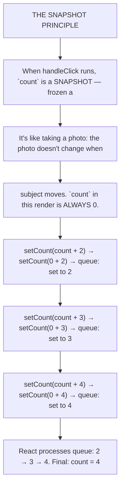

### The Fix: Updater Function Pattern

```jsx
function handleClick() {
  setCount(prev => prev + 2);  // prev = 0 → returns 2
  setCount(prev => prev + 3);  // prev = 2 → returns 5
  setCount(prev => prev + 4);  // prev = 5 → returns 9
}
// After clicking: count = 9 ✅
```

**WHY this works:**
- The arrow function receives the LATEST pending state, not the snapshot
- Each updater function chains: output of previous becomes input of next
- It's like a relay race — each runner passes the baton (latest value) to the next

```
┌──────────────────────────────────────────────────────────────────┐
│  THE RELAY RACE ANALOGY                                          │
│                                                                  │
│  setCount(count + 2)     = "Start at the photo (0), add 2"       │
│  setCount(count + 3)     = "Start at the photo (0), add 3"       │
│  → Both look at the same photo. Last one wins.                   │
│                                                                  │
│  setCount(prev => prev + 2)  = "Take baton, add 2, pass on"      │
│  setCount(prev => prev + 3)  = "Take baton, add 3, pass on"      │
│  → Each runner receives what the previous runner passed.         │
└──────────────────────────────────────────────────────────────────┘
```

**Flow:**
- THE RELAY RACE ANALOGY
- ↓
- setCount(count + 2) = 'Start at the photo (0), add 2'
- ↓
- setCount(count + 3) = 'Start at the photo (0), add 3'
- ↓
- Both look at the same photo. Last one wins.
- ↓
- setCount(prev => prev + 2) = 'Take baton, add 2, pas
- ↓
- setCount(prev => prev + 3) = 'Take baton, add 3, pas
- ↓
- Each runner receives what the previous runner passed.

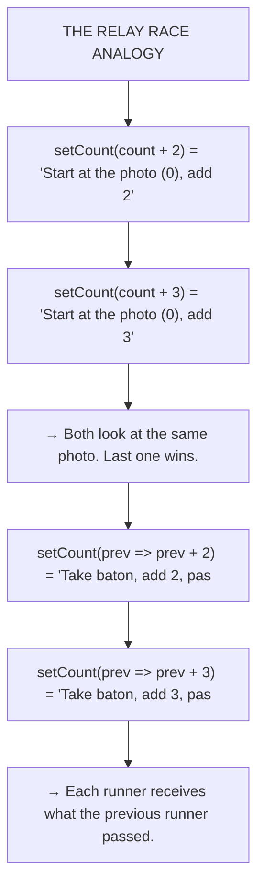

### Freeze Question #3: "Does each setState cause a re-render?"

**Before React 18:** Batched only inside React event handlers.
**React 18+:** Batched EVERYWHERE (event handlers, Promises, setTimeout, native events).

```jsx
// React 18 batching — ONE re-render for all three
function handleClick() {
  setName('Alice');     // queued
  setAge(25);           // queued
  setIsAdmin(true);     // queued
  // React batches → ONE re-render with all three updates
}

// Even in async code (React 18+):
async function handleSubmit() {
  const user = await fetchUser();
  setName(user.name);   // queued
  setAge(user.age);     // queued  
  // React 18: still batched → ONE re-render
  // React 17: NOT batched → TWO re-renders (bug)
}

// Force immediate flush if needed (rare):
import { flushSync } from 'react-dom';
flushSync(() => setCount(1)); // renders immediately
flushSync(() => setFlag(true)); // renders immediately
```

---

## 2. Why Re-renders Happen (The REAL Trigger)

### The Freeze Question
> "Why does my child component re-render even though its props didn't change?"

### Deep Reasoning

```
┌──────────────────────────────────────────────────────────────────┐
│  THE 3 RE-RENDER TRIGGERS                                        │
│                                                                  │
│  1. State change      → useState setter called                   │
│  2. Parent re-renders → ALL children re-render by default        │
│  3. Context change    → All consumers re-render                  │
│                                                                  │
│  CRITICAL: "Props changed" is NOT a trigger!                     │
│  The parent re-rendering IS the trigger, and it re-creates       │
│  the child component, passing new props (even identical ones).   │
│                                                                  │
│  THE WATERFALL ANALOGY:                                          │
│  Parent re-render is like a waterfall — water flows DOWN         │
│  through ALL children regardless of whether they "need" it.      │
│  React.memo is like putting an umbrella on a child — the         │
│  water still falls, but the child checks "are my props the       │
│  same?" and skips re-rendering if yes.                           │
└──────────────────────────────────────────────────────────────────┘
```

**Flow:**
- THE 3 RE-RENDER TRIGGERS
- ↓
- 1. State change
- ↓
- useState setter called
- ↓
- 1. State change
- ↓
- useState setter called
- ↓
- 2. Parent re-renders
- ↓
- ALL children re-render by defaul
- ↓
- 2. Parent re-renders
- ↓
- ALL children re-render by defaul
- ↓
- 3. Context change
- ↓
- All consumers re-render
- ↓
- 3. Context change
- ↓
- All consumers re-render
- ↓
- CRITICAL: 'Props changed' is NOT a trigger!
- ↓
- The parent re-rendering IS the trigger, and it re-creat
- ↓
- THE WATERFALL ANALOGY:

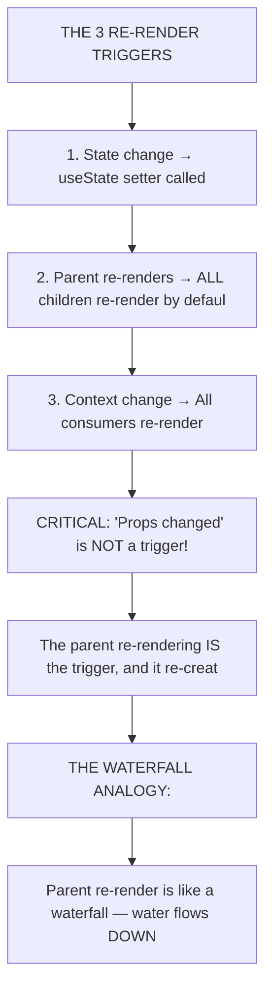

```jsx
function Parent() {
  const [count, setCount] = useState(0);
  
  return (
    <div>
      <button onClick={() => setCount(c => c + 1)}>+</button>
      {/* ExpensiveChild re-renders EVERY TIME Parent re-renders */}
      {/* Even though it receives NO props! */}
      <ExpensiveChild />
    </div>
  );
}

// Fix 1: React.memo — skip re-render if props are same
const ExpensiveChild = React.memo(function ExpensiveChild() {
  console.log('rendered'); // only logs on first render
  return <div>I'm expensive</div>;
});

// Fix 2: Move state DOWN (closer to where it's used)
function Parent() {
  return (
    <div>
      <CounterButton /> {/* state lives here now */}
      <ExpensiveChild /> {/* doesn't re-render! */}
    </div>
  );
}

// Fix 3: Children as props (composition)
function Parent({ children }) {
  const [count, setCount] = useState(0);
  return (
    <div>
      <button onClick={() => setCount(c => c + 1)}>{count}</button>
      {children} {/* children don't re-render! Already created by grandparent */}
    </div>
  );
}
// Usage: <Parent><ExpensiveChild /></Parent>
```

**WHY `children` pattern works:** `<ExpensiveChild />` is created by the GRANDPARENT. When Parent re-renders, `children` is the same React element reference — no re-creation needed.

---

## 3. Virtual DOM: It's Not About Speed

### The Freeze Question
> "Why is Virtual DOM fast?"

### Deep Reasoning

**It's NOT fast. It's fast ENOUGH while being DECLARATIVE.**

```
┌──────────────────────────────────────────────────────────────────┐
│  THE REAL REASON FOR VIRTUAL DOM                                 │
│                                                                  │
│  Raw DOM manipulation IS faster than VDOM + diff + patch.        │
│  (Svelte proves this — no VDOM, compiled to direct DOM updates)  │
│                                                                  │
│  VDOM exists because:                                            │
│  1. DECLARATIVE UI: You describe WHAT the UI should look like    │
│     React figures out HOW to get there (diffing)                 │
│  2. BATCHING: Multiple state changes → one DOM update            │
│  3. PORTABILITY: VDOM can target DOM, Native, Canvas, etc.       │
│  4. PREDICTABILITY: Same state → same UI, always                 │
│                                                                  │
│  Analogy: GPS vs manual directions                               │
│  Manual directions (imperative DOM): "Turn left, then right..."  │
│  GPS (declarative VDOM): "I want to be HERE" — GPS figures out   │
│  the route. Slightly slower, but you never get lost.             │
└──────────────────────────────────────────────────────────────────┘
```

**Flow:**
- THE REAL REASON FOR VIRTUAL DOM
- ↓
- Raw DOM manipulation IS faster than VDOM + diff + patch
- ↓
- VDOM exists because:
- ↓
- React figures out HOW to get there (diffing)
- ↓
- 2. BATCHING: Multiple state changes
- ↓
- one DOM update
- ↓
- 2. BATCHING: Multiple state changes
- ↓
- one DOM update
- ↓
- 3. PORTABILITY: VDOM can target DOM, Native, Canvas, et
- ↓
- 4. PREDICTABILITY: Same state
- ↓
- same UI, always

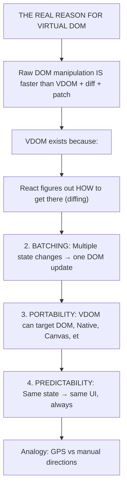

**How diffing actually works:**
```
Old VDOM:           New VDOM:           DOM Operations:
<ul>                <ul>                
  <li>A</li>         <li>A</li>        (no change)
  <li>B</li>         <li>B</li>        (no change)
  <li>C</li>         <li>D</li>        update text: C → D
</ul>               </ul>              

Only ONE DOM operation instead of re-rendering entire list.
React's diff algorithm is O(n) — it sacrifices perfect diff for speed.
```

**Flow:**
- Old VDOM: New VDOM: DOM Operations:
- ↓
- <li>A</li> <li>A</li> (no chang
- ↓
- <li>B</li> <li>B</li> (no chang
- ↓
- <li>C</li> <li>D</li> update te
- ↓
- Only ONE DOM operation instead of re-rendering entire l

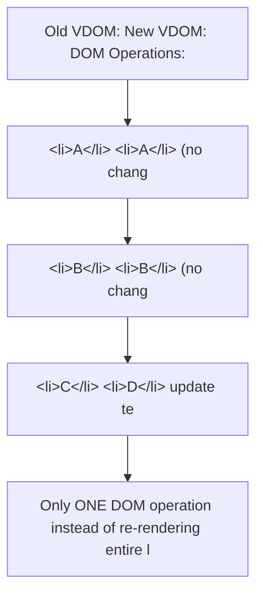

---

## 4. useEffect: The Lifecycle Mental Model is WRONG

### The Freeze Question
> "Is useEffect the same as componentDidMount?"

### Deep Reasoning

```
┌──────────────────────────────────────────────────────────────────┐
│  WRONG MENTAL MODEL (lifecycle-based):                           │
│  useEffect(fn, [])     = componentDidMount                       │
│  useEffect(fn, [dep])  = componentDidUpdate                      │
│  useEffect(fn)         = componentDidMount + componentDidUpdate  │
│                                                                  │
│  RIGHT MENTAL MODEL (synchronization-based):                     │
│  useEffect = SYNCHRONIZE with external system                    │
│                                                                  │
│  "After each render where these dependencies changed,            │
│   run this effect to sync with the outside world"                │
│                                                                  │
│  Analogy: useEffect is like a THERMOSTAT                         │
│  - It checks: "Has the target temperature (dependency) changed?" │
│  - If yes: turn on/off heater (run effect)                       │
│  - Cleanup: turn off old heater before starting new one          │
│  - It doesn't care about "mount" or "update" — just sync.        │
└──────────────────────────────────────────────────────────────────┘
```

**Flow:**
- WRONG MENTAL MODEL (lifecycle-based):
- ↓
- useEffect(fn, []) = componentDidMount
- ↓
- useEffect(fn, [dep]) = componentDidUpdate
- ↓
- useEffect(fn) = componentDidMount + componentDidUpdate
- ↓
- RIGHT MENTAL MODEL (synchronization-based):
- ↓
- useEffect = SYNCHRONIZE with external system
- ↓
- 'After each render where these dependencies changed,

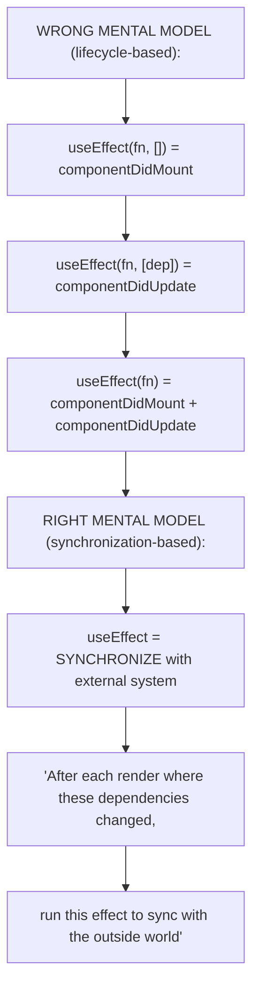

### The Tricky Behavior Most People Get Wrong

```jsx
// What does this print?
function Counter() {
  const [count, setCount] = useState(0);
  
  useEffect(() => {
    console.log('effect:', count);
    return () => console.log('cleanup:', count);
  }, [count]);
  
  // Click button 3 times:
  // Render 1: "effect: 0"
  // Click → Render 2: "cleanup: 0" then "effect: 1"
  // Click → Render 3: "cleanup: 1" then "effect: 2"
  // Click → Render 4: "cleanup: 2" then "effect: 3"
}
```

**WHY cleanup runs with OLD value:**
Each render has its own "snapshot" of state. The cleanup function from render 2 was created during render 2 — it captures count=1. When render 3 runs, it first calls the OLD cleanup (with count=1), then runs the NEW effect (with count=2).

**Think of it as:** Each render has its own effect and its own cleanup, tied to that render's snapshot. Cleanup undoes what the previous effect did.

### When NOT to useEffect

```jsx
// ❌ DON'T: Derived state (calculate during render instead)
const [items, setItems] = useState([]);
const [total, setTotal] = useState(0);
useEffect(() => {
  setTotal(items.reduce((sum, item) => sum + item.price, 0));
}, [items]); // Causes extra re-render!

// ✅ DO: Derive during render (no extra re-render)
const [items, setItems] = useState([]);
const total = items.reduce((sum, item) => sum + item.price, 0); // computed

// ❌ DON'T: Transform data on prop change
useEffect(() => {
  setFilteredList(list.filter(item => item.active));
}, [list]);

// ✅ DO: Compute in render, memo if expensive
const filteredList = useMemo(
  () => list.filter(item => item.active),
  [list]
);
```

---

## 5. Keys: Why Index as Key Breaks Things

### The Freeze Question
> "Why can't I use array index as a key?"

### Deep Reasoning

```
┌──────────────────────────────────────────────────────────────────┐
│  KEYS = IDENTITY CARDS for React's Diffing Algorithm             │
│                                                                  │
│  Without keys (or with index keys), React matches by POSITION:   │
│                                                                  │
│  Before delete "Bob":    After delete "Bob":                     │
│  index 0 → Alice         index 0 → Alice   (same position ✓)     │
│  index 1 → Bob           index 1 → Charlie (React thinks this    │
│  index 2 → Charlie                         is Bob updated!)      │
│                                                                  │
│  React: "Item at index 1 changed from Bob to Charlie"            │
│  Reality: We DELETED Bob and Charlie should keep its state       │
│                                                                  │
│  With unique keys, React matches by IDENTITY:                    │
│  key="alice" → Alice     key="alice" → Alice  (matched ✓)        │
│  key="bob"   → Bob       key="charlie"→ Charlie (matched ✓)      │
│  key="charlie"→ Charlie  Bob is GONE (removed from DOM)          │
└──────────────────────────────────────────────────────────────────┘
```

**Flow:**
- KEYS = IDENTITY CARDS for React's Diffing Algorithm
- ↓
- Before delete 'Bob': After delete 'Bob':
- ↓
- index 0
- ↓
- Alice index 0
- ↓
- Alice (same position ✓)
- ↓
- index 0
- ↓
- Alice index 0
- ↓
- Alice (same position ✓)
- ↓
- index 1
- ↓
- Bob index 1
- ↓
- Charlie (React thinks this
- ↓
- index 1
- ↓
- Bob index 1
- ↓
- Charlie (React thinks this
- ↓
- index 2
- ↓
- Charlie is Bob updated!)
- ↓
- index 2
- ↓
- Charlie is Bob updated!)
- ↓
- React: 'Item at index 1 changed from Bob to Charlie'
- ↓
- Reality: We DELETED Bob and Charlie should keep its sta

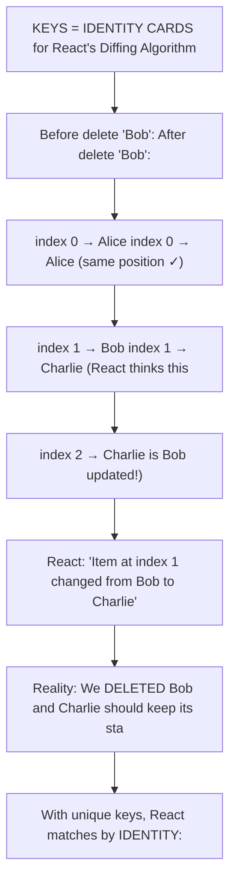

**When index keys BREAK things — visual proof:**
```jsx
// List: [Alice (input: "hello"), Bob (input: "world"), Charlie (input: "")]
// Delete Bob...
// With index keys: Alice (input: "hello"), Charlie (input: "world") ← BUG!
// Charlie inherited Bob's input because React reused the DOM node at index 1

// With unique keys: Alice (input: "hello"), Charlie (input: "") ← Correct!
```

**When index IS acceptable:**
- List never reorders
- List never filters/deletes items
- Items have no state (no inputs, no selections)
- Basically: static, display-only lists

---

## 6. useRef vs useState: When to Use Which

### The Freeze Question
> "What's the difference? Both persist values across renders."

### Deep Reasoning

```
┌──────────────────────────────────────────────────────────────────┐
│  useState vs useRef — The Billboard vs Notebook Analogy          │
│                                                                  │
│  useState:                                                       │
│  → Like a BILLBOARD on the highway                               │
│  → Everyone (the component) sees the current value               │
│  → Changing it (setState) triggers a RE-RENDER (new paint job)   │
│  → The re-render shows the new value to users                    │
│                                                                  │
│  useRef:                                                         │
│  → Like a private NOTEBOOK in your pocket                        │
│  → You can read/write anytime                                    │
│  → Changing it does NOT trigger a re-render                      │
│  → Nobody sees the change until next render (if ever)            │
│                                                                  │
│  RULE: Need UI to update?         → useState                     │
│        Need to store without UI?  → useRef                       │
└──────────────────────────────────────────────────────────────────┘
```

**Flow:**
- useState vs useRef — The Billboard vs Notebook Analogy
- ↓
- useState:
- ↓
- Like a BILLBOARD on the highway
- ↓
- Everyone (the component) sees the current value
- ↓
- The re-render shows the new value to users
- ↓
- useRef:
- ↓
- Like a private NOTEBOOK in your pocket

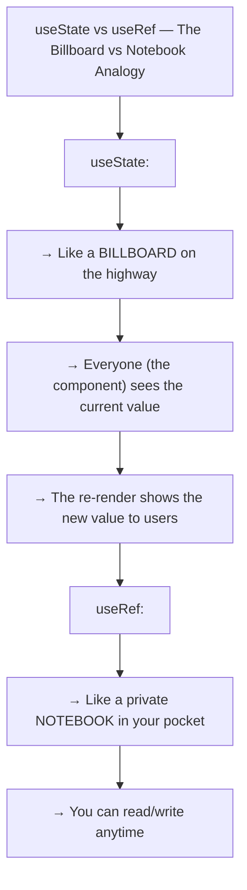

```jsx
// USE CASE: Tracking previous value (no UI update needed)
function usePrevious(value) {
  const ref = useRef();
  useEffect(() => {
    ref.current = value; // update ref AFTER render
  });
  return ref.current; // returns value from PREVIOUS render
}

// USE CASE: setInterval reference (need to clear later)
function Timer() {
  const intervalRef = useRef(null);
  
  function startTimer() {
    intervalRef.current = setInterval(() => tick(), 1000);
  }
  
  function stopTimer() {
    clearInterval(intervalRef.current); // need the reference!
  }
  // If we used useState for this, every setInterval call
  // would cause a re-render — unnecessary and wasteful!
}

// USE CASE: Measuring renders (debugging)
function Component() {
  const renderCount = useRef(0);
  renderCount.current++; // doesn't cause re-render
  console.log(`Rendered ${renderCount.current} times`);
  // If you used useState here → infinite loop!
}
```

---

## 7. useMemo/useCallback: When They Hurt Performance

### The Freeze Question
> "Should I wrap everything in useMemo for performance?"

### Deep Reasoning

```
┌──────────────────────────────────────────────────────────────────┐
│  THE CACHING TAX                                                 │
│                                                                  │
│  useMemo/useCallback are NOT free:                               │
│    1. Memory to store cached value                               │
│    2. CPU to compare dependencies on every render                │
│    3. Code complexity (harder to read)                           │
│                                                                  │
│  If the computation is CHEAP (< 1ms), the memoization overhead   │
│  may cost MORE than just recomputing!                            │
│                                                                  │
│  Analogy: Buying a safe to protect $5                            │
│  The safe costs more than what you're protecting.                │
│  Only buy a safe (useMemo) when protecting something valuable    │
│  (expensive computation or preventing cascade re-renders).       │
└──────────────────────────────────────────────────────────────────┘
```

**Flow:**
- THE CACHING TAX
- ↓
- useMemo/useCallback are NOT free:
- ↓
- 1. Memory to store cached value
- ↓
- 2. CPU to compare dependencies on every render
- ↓
- 3. Code complexity (harder to read)
- ↓
- may cost MORE than just recomputing!
- ↓
- Analogy: Buying a safe to protect $5

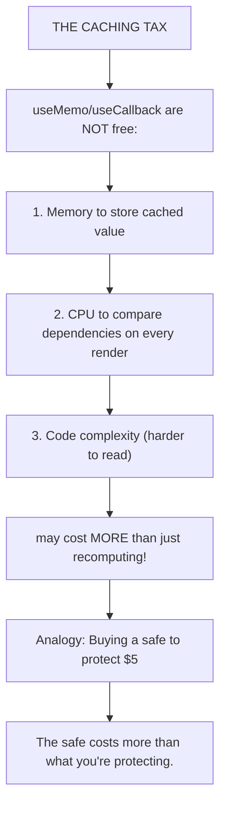

```jsx
// ❌ UNNECESSARY: Simple computation
const fullName = useMemo(() => `${first} ${last}`, [first, last]);
// String concatenation takes ~0.001ms. Memoization overhead > benefit.
// ✅ JUST DO: const fullName = `${first} ${last}`;

// ✅ NECESSARY: Expensive computation
const sortedItems = useMemo(
  () => items.slice().sort((a, b) => complexSort(a, b)),
  [items]
); // Sorting 10,000 items is expensive. Worth memoizing.

// ✅ NECESSARY: Preventing child re-renders
const MemoizedChild = React.memo(ExpensiveChild);
const handleClick = useCallback(() => {
  doSomething(id);
}, [id]);
// Without useCallback, handleClick is a NEW function each render
// → MemoizedChild sees "new prop" → re-renders despite React.memo

// ❌ USELESS useCallback without React.memo:
const handleClick = useCallback(() => doSomething(), []);
// If the child isn't wrapped in React.memo, this does NOTHING.
// The child re-renders anyway because parent re-rendered.
```

**Decision tree:**
```
Need to memoize?
├── Is the computation > 1ms? → YES → useMemo
├── Is the child wrapped in React.memo? → YES → useCallback for functions passed as props
├── Is it in a dependency array of useEffect? → MAYBE → useCallback to stabilize reference
└── None of the above? → DON'T MEMOIZE
```

**Flow:**
- Is the computation > 1ms?
- ↓
- YES
- ↓
- useMemo
- ↓
- Is the child wrapped in React.memo?
- ↓
- YES
- ↓
- useCallback for functions passed as props
- ↓
- Is it in a dependency array of useEffect?
- ↓
- MAYBE
- ↓
- useCallback to stabilize reference

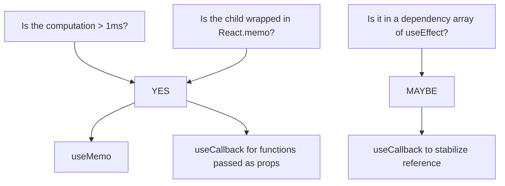

---

## 8. Context: Why It's NOT a State Manager

### The Freeze Question
> "Why do people say Context isn't good for state management?"

### Deep Reasoning

```
┌──────────────────────────────────────────────────────────────────┐
│  THE RADIO STATION ANALOGY                                       │
│                                                                  │
│  Context = Radio station broadcasting one signal                 │
│  Consumer = Radio tuned to that station                          │
│                                                                  │
│  Problem: When the station broadcasts (context value changes),   │
│  ALL radios tuned to it activate — even if they only care        │
│  about a DIFFERENT part of the signal.                           │
│                                                                  │
│  Context({ user, theme, cart, notifications })                   │
│  → Change `notifications` → ALL consumers re-render              │
│    Even the UserAvatar that only reads `user`!                   │
│                                                                  │
│  Redux/Zustand: Each component SELECTS what it cares about.      │
│  → Change `notifications` → only NotificationBadge re-renders    │
└──────────────────────────────────────────────────────────────────┘
```

**Flow:**
- THE RADIO STATION ANALOGY
- ↓
- Context = Radio station broadcasting one signal
- ↓
- Consumer = Radio tuned to that station
- ↓
- ALL radios tuned to it activate — even if they only car
- ↓
- about a DIFFERENT part of the signal.
- ↓
- Context({ user, theme, cart, notifications })
- ↓
- Change `notifications`
- ↓
- ALL consumers re-render

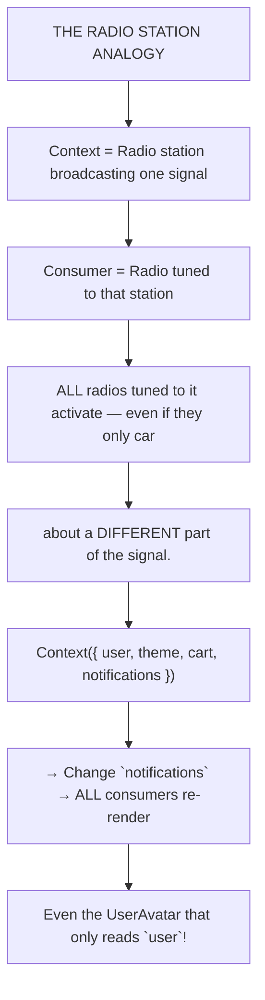

**Context IS good for:**
- Rarely-changing values (theme, locale, auth user)
- Dependency injection (services, config)
- Avoiding prop drilling for 2-3 level trees

**Context is BAD for:**
- Frequently-updating values (form state, animations)
- Large objects where subsets change often
- Shopping cart (items change frequently)

```jsx
// ❌ BAD: One giant context
const AppContext = createContext({ user: null, theme: 'light', cart: [], notifications: [] });
// Every consumer re-renders on ANY change

// ✅ GOOD: Split into focused contexts
const UserContext = createContext(null);
const ThemeContext = createContext('light');
const CartContext = createContext([]);
// Only cart consumers re-render when cart changes
```

---

## 9. Controlled vs Uncontrolled: The Real Difference

### The Freeze Question
> "What is a controlled component and WHY would I use one?"

```
┌──────────────────────────────────────────────────────────────────┐
│  THE PUPPET vs PET ANALOGY                                       │
│                                                                  │
│  Controlled = Puppet                                             │
│  → React holds the strings. Input shows WHAT REACT TELLS IT.     │
│  → value={state} + onChange={setState}                           │
│  → Single source of truth: React state                           │
│                                                                  │
│  Uncontrolled = Pet                                              │
│  → The input manages itself. You ask "what's your value?" later. │
│  → defaultValue + ref.current.value                              │
│  → Source of truth: the DOM                                      │
└──────────────────────────────────────────────────────────────────┘
```

**Flow:**
- THE PUPPET vs PET ANALOGY
- ↓
- Controlled = Puppet
- ↓
- React holds the strings. Input shows WHAT REACT TELLS
- ↓
- value={state} + onChange={setState}
- ↓
- Single source of truth: React state
- ↓
- Uncontrolled = Pet
- ↓
- defaultValue + ref.current.value

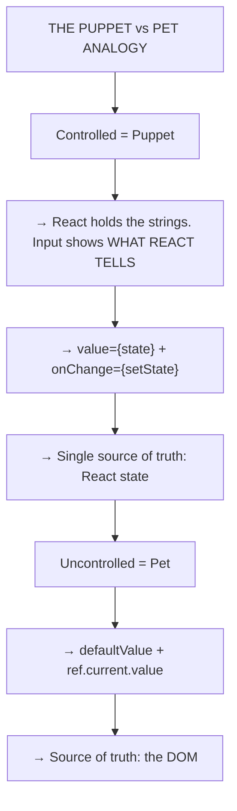

```jsx
// Controlled: React drives the input
function Controlled() {
  const [value, setValue] = useState('');
  return (
    <input 
      value={value}                    // React says what to display
      onChange={e => setValue(e.target.value)} // React updates on change
    />
  );
  // Benefits: instant validation, formatting, conditional updates
  // Can prevent user from typing certain characters
}

// Uncontrolled: DOM drives itself
function Uncontrolled() {
  const inputRef = useRef(null);
  const handleSubmit = () => {
    console.log(inputRef.current.value); // ask DOM for value
  };
  return <input ref={inputRef} defaultValue="" />;
  // Benefits: simpler code, better for file inputs, integration with non-React
}
```

---

## 10. React Fiber: How React Actually Renders

### The Freeze Question
> "How does React rendering work internally?"

### Deep Reasoning

```
┌──────────────────────────────────────────────────────────────────┐
│  REACT FIBER — The Restaurant Kitchen Analogy                    │
│                                                                  │
│  Old React (Stack Reconciler):                                   │
│  → Chef prepares ENTIRE meal before serving (blocking)           │
│  → If meal has 100 dishes, nothing gets served until ALL done    │
│  → Customer (user) sits frozen waiting                           │
│                                                                  │
│  New React (Fiber Reconciler):                                   │
│  → Chef prepares dishes in small chunks (time-slicing)           │
│  → After each dish: "Any urgent VIP orders?" (user input)        │
│  → VIP orders (clicks, typing) interrupt and get served first    │
│  → Then chef resumes the big meal                                │
│                                                                  │
│  TWO PHASES:                                                     │
│  1. RENDER PHASE (interruptible):                                │
│     → Build work-in-progress tree                                │
│     → Can be paused, aborted, restarted                          │
│     → No side effects allowed (pure computation)                 │
│                                                                  │
│  2. COMMIT PHASE (synchronous, not interruptible):               │
│     → Apply all DOM changes at once                              │
│     → Run useEffect/useLayoutEffect                              │
│     → Must be atomic (no half-done UI)                           │
└──────────────────────────────────────────────────────────────────┘
```

**Flow:**
- REACT FIBER — The Restaurant Kitchen Analogy
- ↓
- Old React (Stack Reconciler):
- ↓
- Chef prepares ENTIRE meal before serving (blocking)
- ↓
- Customer (user) sits frozen waiting
- ↓
- New React (Fiber Reconciler):
- ↓
- Chef prepares dishes in small chunks (time-slicing)
- ↓
- After each dish: 'Any urgent VIP orders?' (user input

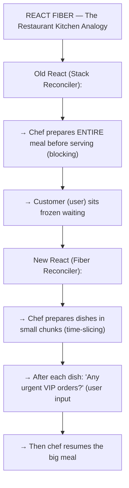

---

## 11. Suspense & Concurrent Mode: The Future Model

### The Freeze Question
> "What is Suspense and why does it matter?"

```
┌──────────────────────────────────────────────────────────────────┐
│  SUSPENSE — The Loading Dock Analogy                             │
│                                                                  │
│  Without Suspense: You manage loading states manually            │
│  → if (isLoading) return <Spinner />                             │
│  → if (error) return <Error />                                   │
│  → return <Data />                                               │
│  → Every component has its own loading/error/data logic          │
│                                                                  │
│  With Suspense: React manages loading states                     │
│  → Component "suspends" (throws a Promise)                       │
│  → Nearest <Suspense> boundary catches it                        │
│  → Shows fallback UI until Promise resolves                      │
│  → Like a loading dock: packages (data) arrive when ready,       │
│    a sign (fallback) is shown while waiting                      │
└──────────────────────────────────────────────────────────────────┘
```

**Flow:**
- SUSPENSE — The Loading Dock Analogy
- ↓
- Without Suspense: You manage loading states manually
- ↓
- if (isLoading) return <Spinner />
- ↓
- if (error) return <Error />
- ↓
- return <Data />
- ↓
- Every component has its own loading/error/data logic
- ↓
- With Suspense: React manages loading states

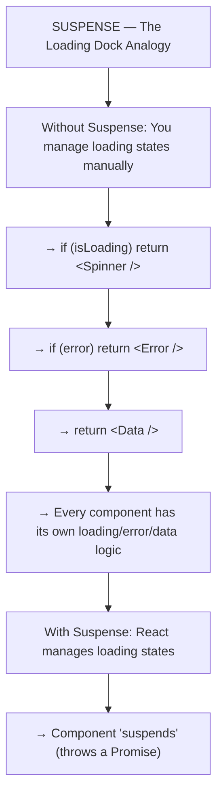

```jsx
// React 18+ with Suspense
function App() {
  return (
    <Suspense fallback={<Skeleton />}>
      <UserProfile /> {/* can "suspend" while fetching */}
    </Suspense>
  );
}

// Transitions: Mark updates as non-urgent
function SearchPage() {
  const [query, setQuery] = useState('');
  const [isPending, startTransition] = useTransition();
  
  function handleChange(e) {
    // Urgent: update input immediately
    setQuery(e.target.value);
    
    // Non-urgent: can be interrupted by more typing
    startTransition(() => {
      setSearchResults(filterResults(e.target.value));
    });
  }
  
  return (
    <>
      <input value={query} onChange={handleChange} />
      {isPending ? <Spinner /> : <Results />}
    </>
  );
}
```

---

## 12. Server Components: Why They Exist

### The Freeze Question
> "Why did React create Server Components?"

```
┌──────────────────────────────────────────────────────────────────┐
│  THE SHIPPING ANALOGY                                            │
│                                                                  │
│  Client Components = Ship raw materials to customer              │
│  → Send JS bundle to browser                                     │
│  → Browser downloads, parses, executes, renders                  │
│  → Customer builds furniture themselves (hydration)              │
│                                                                  │
│  Server Components = Ship finished furniture                     │
│  → Server renders HTML, sends result                             │
│  → No JS shipped for server components                           │
│  → Browser just displays it (no hydration needed)                │
│                                                                  │
│  Benefits:                                                       │
│  1. Smaller bundle (no JS for server components)                 │
│  2. Direct database access (no API layer needed)                 │
│  3. Sensitive logic stays on server (API keys safe)              │
│  4. Faster initial load (no JS parsing for static parts)         │
└──────────────────────────────────────────────────────────────────┘
```

**Flow:**
- THE SHIPPING ANALOGY
- ↓
- Client Components = Ship raw materials to customer
- ↓
- Send JS bundle to browser
- ↓
- Browser downloads, parses, executes, renders
- ↓
- Customer builds furniture themselves (hydration)
- ↓
- Server Components = Ship finished furniture
- ↓
- Server renders HTML, sends result

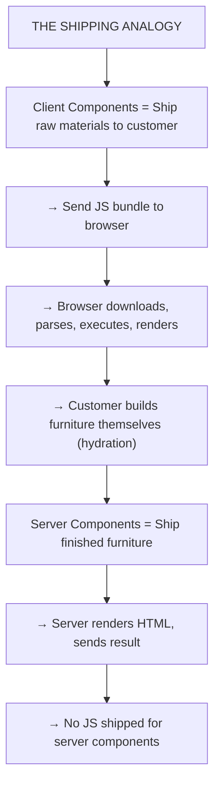

---

## 13. Common Anti-Patterns Seniors Catch Instantly

### Anti-Pattern 1: Initializing State from Props
```jsx
// ❌ BUG: State initializes ONCE. If prop changes, state doesn't update.
function UserForm({ user }) {
  const [name, setName] = useState(user.name); // only reads initial value!
  // If parent passes a different user, name is STILL the old value.
}

// ✅ FIX 1: Use key to force remount
<UserForm key={user.id} user={user} />
// When key changes, React treats it as a NEW component → fresh state

// ✅ FIX 2: Use the prop directly (if you don't need editable copy)
function UserForm({ user }) {
  return <input value={user.name} />;
}

// ✅ FIX 3: useEffect to sync (if you DO need editable state)
function UserForm({ user }) {
  const [name, setName] = useState(user.name);
  useEffect(() => setName(user.name), [user.name]); // sync on prop change
}
```

### Anti-Pattern 2: Object/Array State Mutation
```jsx
// ❌ BUG: Mutating state directly — React doesn't "see" it
const [user, setUser] = useState({ name: 'Alice', age: 25 });
function birthday() {
  user.age = 26;    // MUTATION! Same reference. No re-render.
  setUser(user);    // React sees same reference → thinks nothing changed
}

// ✅ FIX: Create new object (immutable update)
function birthday() {
  setUser(prev => ({ ...prev, age: prev.age + 1 })); // new object
  // React sees different reference → re-renders
}

// ❌ BUG: Array mutation
const [items, setItems] = useState([1, 2, 3]);
items.push(4);      // MUTATION! Same array reference.
setItems(items);     // React ignores it.

// ✅ FIX: Create new array
setItems(prev => [...prev, 4]); // new array reference
```

**WHY immutability matters:** React uses `Object.is()` (shallow comparison) to check if state changed. Same reference = "nothing changed" = no re-render. You must create a new reference for React to notice.

### Anti-Pattern 3: useEffect as Event Handler
```jsx
// ❌ WRONG: Using effect to respond to a button click
const [submitted, setSubmitted] = useState(false);
useEffect(() => {
  if (submitted) {
    submitForm(); // runs on render, not on click
    setSubmitted(false);
  }
}, [submitted]);

// ✅ RIGHT: Handle events in event handlers
function handleSubmit() {
  submitForm(); // runs on click, directly
}
```

---

## Interview Quick-Fire: React Freeze Busters

| Freeze Question | Senior-Level Answer |
|----------------|-------------------|
| "What triggers a re-render?" | setState, parent re-render, context change. NOT prop change. |
| "What is reconciliation?" | React's diffing algorithm that compares old and new VDOM trees to find minimal DOM updates. O(n) heuristic: different type = replace subtree; same type = update props; keys identify which children moved. |
| "Explain React's rendering phases" | **Render phase** (pure, interruptible): call components, build Fiber tree. **Commit phase** (synchronous): apply DOM changes, run effects. |
| "Why hooks can't be in conditions?" | React tracks hooks by CALL ORDER, not by name. Conditional hooks change the order → wrong hook gets wrong state. Like numbered lockers — skip one, every locker after is wrong. |
| "What is hydration?" | Server sends HTML (fast display). React then "hydrates" it — attaches event handlers and makes it interactive. Like building a house → adding electrical wiring. |
| "Why `useLayoutEffect` over `useEffect`?" | `useLayoutEffect` runs BEFORE browser paint (blocking). Use for DOM measurements/mutations that must happen before user sees anything. `useEffect` runs AFTER paint (non-blocking). |
| "What is a stale closure in React?" | A closure that captures an OLD state value. Happens in setTimeout, setInterval, event listeners. Fix: use updater function `setState(prev => ...)` or useRef. |
| "What is prop drilling?" | Passing props through 5+ intermediate components that don't use them. Solutions: Context (for rare changes), composition (children pattern), state management library. |
| "Can useState hold any type?" | Yes: number, string, boolean, object, array, null, function (but don't store functions — use useCallback). For objects/arrays, always return NEW reference when updating. |
| "What is a Higher-Order Component?" | A function that takes a component and returns a NEW component with extra props/behavior. Like a decorator. Largely replaced by hooks (custom hooks do the same thing more clearly). |

---

← Previous: [Chapter 8 — React Performance](08_React_Performance.md)
| [📚 Index](../00_MASTER_INDEX.md)
| Next: [TypeScript Deep Reasoning →](../17_TypeScript/04_TS_Deep_Reasoning.md)


---

> **Navigation**: [< Previous](08_React_Performance.md) | [Back to Index](../00_MASTER_INDEX.md)