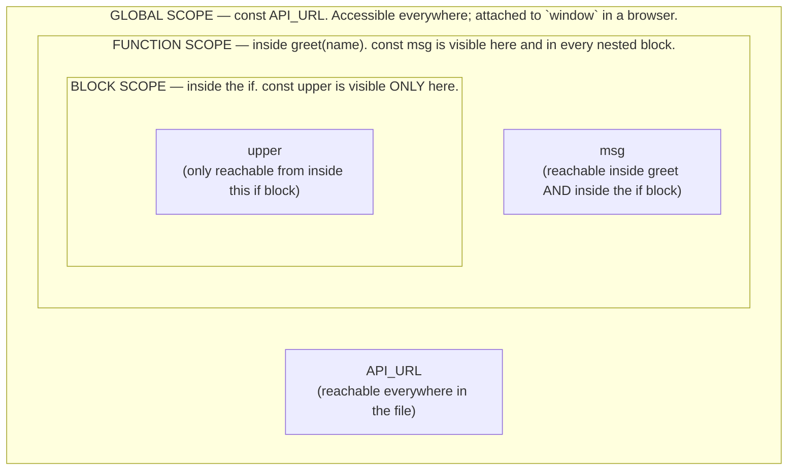

**Navigation**: [Back to Index](../00_MASTER_INDEX.md) | [Next >](02_JS_Functions_Closures.md)

**JavaScript Chapter 1/7** | [Index](../00_MASTER_INDEX.md) | [Next → Functions & Closures](02_JS_Functions_Closures.md)

# JavaScript Foundations — Types, Variables, Scope & Hoisting

## Section 0: War Stories — When JS Basics Burned Us in Production

> These incidents were caused by misunderstanding the exact concepts this chapter teaches. Read them first so the later sections land with the right weight.

### Story 1: The `var` That Survived its Block — and Lied for 3 Months

A developer wrote a pricing calculation function:

```javascript
function calculateDiscount(user) {
  if (user.isPremium) {
    var discount = 0.20;
  }
  return price * (1 - discount); // ← discount used here
}
```

For premium users: worked correctly. For non-premium users: `discount` should be `undefined` and throw a ReferenceError, right? No — `var` is **function-scoped and hoisted**. JavaScript hoisted `var discount` to the top of `calculateDiscount`, initializing it as `undefined`. Non-premium users got `price * (1 - undefined)` = `NaN`. The checkout page displayed `$NaN` for non-premium users for 3 months — until a customer screenshot went viral on Twitter.

The fix: `let discount` inside the `if` block throws a `ReferenceError` when accessed outside its scope — a loud, immediate failure instead of a silent `NaN`.

```javascript
// ✅ let is block-scoped — accessing outside the if = ReferenceError at runtime
if (user.isPremium) {
  let discount = 0.20;
}
// ReferenceError: discount is not defined ← loud failure, catches the bug early
```

**The lesson from this chapter:** `var` is function-scoped and hoisted with value `undefined`. `let` and `const` are block-scoped — the temporal dead zone makes accessing them before declaration throw an error. Always prefer `let`/`const`.

---

### Story 2: The Type Coercion that Made `0` Equal `false` — and Logged Out Every Free User

An auth guard checked if a user had remaining API credits:

```javascript
function canMakeRequest(user) {
  if (user.credits == false) {  // ← "falsy check" intended
    return false; // block request
  }
  return true;
}
```

The developer intended: "block if no credits." But `==` (loose equality) triggers type coercion. `0 == false` is `true` in JavaScript. So users with exactly `0` credits were blocked. But also: `0 == false` is `true` even when the developer meant "check for the boolean value `false`". When the API returned credits as a number (`0`, `1`, `100`), any user with `0` remaining credits was blocked. Expected. But what if credits was `""` (empty string from a parsing bug)? `"" == false` is also `true`. What if credits was `null`? `null == false` is **false** — free users with null credits passed through.

The result: paid users with 0 credits were blocked (correct), users with `null` credits (data migration artifact) were let through (wrong), and users with `""` credits (API response parsing bug) were blocked (wrong, and silent).

Fix — use `===` (strict equality) and be explicit:

```javascript
function canMakeRequest(user) {
  if (user.credits === 0) return false;   // only the number zero
  if (user.credits == null) return false; // null OR undefined (the one valid == use)
  return true;
}
```

**The lesson:** `==` performs type coercion — use `===` for all comparisons unless you explicitly want null/undefined to be interchangeable. The full coercion table is in Section 4.

---

### Story 3: `this` Lost in a Callback — 6 Months of Silent Logging Failures

A telemetry class collected user events:

```javascript
class Tracker {
  constructor() {
    this.events = [];
  }

  track(eventName) {
    this.events.push(eventName); // ← 'this' is Tracker instance here
  }

  startListening() {
    document.addEventListener('click', this.track); // ← 'this' is NOT Tracker here
  }
}

const tracker = new Tracker();
tracker.startListening();
// User clicks → 'track' is called → 'this' = undefined (strict mode) → TypeError
```

When `this.track` is passed as a callback, it's detached from the `Tracker` instance. The browser calls it as a plain function, not as a method — `this` becomes `undefined` (or the global object in sloppy mode). Every click threw `TypeError: Cannot read properties of undefined (reading 'push')` — swallowed by a try-catch upstream. Telemetry silently dropped for 6 months. 

Fix: arrow function preserves `this` lexically:

```javascript
startListening() {
  document.addEventListener('click', (e) => this.track(e.type));
  // Arrow function captures 'this' from startListening's scope = Tracker instance ✅
}
```

Or: bind at assignment time:

```javascript
startListening() {
  document.addEventListener('click', this.track.bind(this));
}
```

**The lesson:** `this` in JavaScript is determined at **call time**, not definition time. When a method is passed as a callback, it loses its `this` context. Arrow functions fix this by capturing `this` lexically. Section 3 of this chapter covers the full `this` binding rules.

---

## 5W1H — Why This Chapter?

WHAT: The absolute foundations of JavaScript — types, variables,
scope, coercion, hoisting — things that trip up everyone.

WHY: Every JS bug traces back to misunderstanding these basics.
Closures won't make sense without scope. Async won't make
sense without the event loop. This chapter is the bedrock.

WHO: Anyone writing JS — frontend, backend (Node), full-stack.

WHEN: Before learning React, Node, or any framework.

WHERE: Browsers (Chrome V8), Node.js (V8), Deno, Bun.

HOW: Read each concept → understand the reasoning → run the
examples in browser console (F12) → predict before you run.

---

## 1. What IS JavaScript? (The Reasoning)

JavaScript is a DYNAMIC, WEAKLY-TYPED, SINGLE-THREADED language
with FIRST-CLASS FUNCTIONS and PROTOTYPE-BASED inheritance.

Let's break each word down:

DYNAMIC: Types are determined at RUNTIME, not compile-time.
→ let x = 5; x = "hello"; // perfectly legal
WHY this matters: flexibility, but also bugs.

WEAKLY-TYPED: JS will COERCE types to make operations work.
→ "5" + 3 = "53" (string wins), "5" - 3 = 2 (math wins)
WHY this matters: unexpected behavior if you don't know.

SINGLE-THREADED: Only ONE call stack. One thing at a time.
→ But HOW does async work then? → The EVENT LOOP.
WHY this matters: no race conditions, but blocking is bad

FIRST-CLASS FUNCTIONS: Functions are values — pass them around.
→ const greet = function() {}; // function in a variable
WHY this matters: enables callbacks, closures, FP style.

PROTOTYPE-BASED: No classical classes (until ES6 sugar).
→ Objects inherit from other objects via prototype chain.
WHY this matters: understanding `this`, inheritance.

### JS Engine — How Code Actually Runs

**How your code actually gets from a `.js` file to running machine
instructions** is a full, separate mechanism — this chapter isn't the
place to build it in detail (you don't have closures or the event loop
yet, both of which the full story leans on), but a short, accurate
preview matters more than a compressed diagram would:

Your source text is first turned into a tree-shaped representation
(an **AST** — Abstract Syntax Tree) that captures the code's
*structure*, not its characters. That tree is then compiled to a
compact intermediate form called **bytecode**, which V8's interpreter
(**Ignition**) runs directly. If a function turns out to be called
very often — the engine tracks this — a second compiler
(**TurboFan**) recompiles just that function into genuinely optimized
machine code, betting on the patterns it observed. This two-speed
design (start fast and interpret, then selectively optimize what's
actually hot) is *why* JavaScript can be both "starts running
instantly" and "fast in tight loops" at the same time — two goals
that would conflict if the engine only had one strategy.

**[Chapter 12 — V8 Engine Internals](12_V8_Engine_Internals.md)**
builds every piece of this for real: the actual token stream and AST
for a real function, actual bytecode, the exact mechanism that makes
"hot" measurable, and why mixing property-insertion order or value
types silently makes your code slower. Come back to it once
Chapters 2–11 give you the vocabulary (closures, prototypes, the
event loop) that chapter leans on.

---

## 2. Data Types — The 8 Types

JavaScript has **7 primitive types** and **1 object type** — 8 total.
The split matters because it's not just a classification, it's a
promise about *how a value behaves when you assign or pass it*
(Section "Value vs Reference" below derives exactly what that promise is).

**The 7 primitives — immutable, always copied by value:**

| Type        | Example                    | `typeof` result |
|-------------|-----------------------------|------------------|
| `number`    | `42`, `3.14`, `NaN`, `Infinity` | `"number"`   |
| `string`    | `"hello"`, `'world'`, `` `hi` `` | `"string"`  |
| `boolean`   | `true`, `false`              | `"boolean"`     |
| `undefined` | `undefined` (not assigned)   | `"undefined"`   |
| `null`      | `null` (intentional empty)   | `"object"` ⚠️    |
| `symbol`    | `Symbol("id")` (unique)      | `"symbol"`      |
| `bigint`    | `9007199254740992n`          | `"bigint"`      |

**The 1 non-primitive type — mutable, always copied by reference:**

| Type     | Covers                                                          |
|----------|-------------------------------------------------------------------|
| `object` | `{}`, `[]`, functions, `Date`, `RegExp`, `Map`, `Set`, `WeakMap`, `WeakSet` — everything that isn't one of the 7 primitives above |

> **Why `typeof null === "object"` — the actual mechanism, not just "it's a bug."** V8's very first implementation (and every engine since, for compatibility) represents values internally using a small **type tag** stored in the low bits of the value's machine representation — a cheap way to answer "what kind of thing is this" without a separate lookup. Objects were tagged `000`. `null`, meanwhile, was represented as the machine's null pointer — which is *all zero bits*. A null pointer's low bits are `000` purely because ALL of its bits are zero, which happens to be indistinguishable from the object tag using that same bit-check. `typeof` reports "object" not because `null` conceptually is one, but because its bit pattern accidentally matches the object tag's bit pattern. Fixing this today would break every `typeof x === 'object'` null-check already deployed on the web — so it stays, permanently, as the language's oldest still-visible implementation detail.
>
> **Why `typeof NaN === "number"`.** `NaN` (Not-a-Number) is, perhaps confusingly, a specific *value within* the `number` type — the IEEE-754 floating-point standard JavaScript's `number` type is built on reserves certain bit patterns specifically to represent "this arithmetic operation had no valid numeric result" (like `0/0` or `Math.sqrt(-1)`). It's a number in the sense that it lives in the same 64-bit floating-point representation every other number does — it just represents "no valid result" rather than a quantity. This is also exactly why `NaN === NaN` is `false`: per the IEEE-754 spec, NaN is defined to compare unequal to everything, including itself — a deliberate spec choice (so that a chain of computations that produces NaN can't accidentally be "fixed" by comparing it to a stored copy of itself), not an engine quirk. Use `Number.isNaN(x)` to actually test for it.

### Value vs Reference — The #1 Source of Bugs

```javascript
// PRIMITIVES: Copied by VALUE (independent copies)
let a = 10;
let b = a; // b gets a COPY of 10
b = 20;
console.log(a); // 10 — unchanged! They're independent.

// OBJECTS: Copied by REFERENCE (same memory address)
let obj1 = { name: "Harsha" };
let obj2 = obj1; // obj2 points to SAME object
obj2.name = "Changed";
console.log(obj1.name); // "Changed" — BOTH changed!

// WHY? Because obj2 = obj1 copies the POINTER, not the object.
// Think of it like two people holding the same leash to the same dog.

// HOW to make a real copy:
let obj3 = { ...obj1 }; // Shallow copy (spread)
let obj4 = structuredClone(obj1); // Deep copy (modern)
let obj5 = JSON.parse(JSON.stringify(obj1)); // Deep copy (old way)
```

**Why primitives live on the stack and objects live on the heap —
derived, not just diagrammed.** The call stack is a fixed-size,
extremely fast region of memory that grows and shrinks in strict
last-in-first-out order as functions call and return (Section 8 of
this chapter covers the stack itself in depth). Because of that strict
ordering, the stack can only efficiently hold values whose *size is
known in advance and never changes* — a `number` is always the same
fixed number of bytes, a `boolean` is always the same fixed number of
bytes. Objects are the opposite: `{ name: "Harsha" }` might grow a new
property tomorrow, might already be enormous today — there's no fixed
size to reserve stack space for. So V8 allocates objects on the
**heap** — a much larger, more flexible region with no fixed
ordering — and the stack holds only a small, fixed-size **pointer**
(a memory address) telling you *where on the heap* the actual object
data lives.

```
STACK (fixed-size slots, LIFO)      HEAP (flexible-size, no ordering)
┌──────────────────┐                ┌────────────────────┐
│ a: 10             │                │ { name: "Harsha" } │ ← address 0x1A
│ b: 20             │                └────────────────────┘
│ obj1: 0x1A ───────┼────────────────────────┘
│ obj2: 0x1A ───────┼────────────────────────┘  (same address!)
└───────────────────┘
```

**What this diagram predicts, correctly, about the code above.**
`let b = a` copies the fixed-size *value* `10` into `b`'s own stack
slot — two completely independent numbers from that point on,
exactly what the earlier example showed. `let obj2 = obj1` copies the
fixed-size *pointer* `0x1A` into `obj2`'s stack slot — both variables
now hold the same address, pointing at the identical heap object,
which is exactly why mutating through either variable is visible
through both. Assignment in JavaScript **always** copies whatever sits
in the stack slot — for a primitive that's the value itself, for an
object reference that's the pointer, never the object's actual
contents. This single rule (*"assignment copies the stack slot,
never the heap data"*) is the whole mechanism behind every value-vs-reference
surprise you'll ever hit.

*(One honest caveat, so this doesn't overclaim precision: "stack for
primitives, heap for objects" is the correct mental model for
reasoning about JS's copy semantics, and it's how this module will
keep referring to it — but Chapter 12's V8-internals treatment shows
the real engine takes further liberties on top of this, like
sometimes proving an object never escapes a function and allocating
it on the stack anyway. That's a performance optimization layered on
top of the model here — it never changes what your code observes,
only how fast it runs, so the mental model above remains completely
reliable for predicting behavior.)*

---

🔬 **Section Challenge — 2. Data Types — The 8 Types**

**Challenge 1 (Trace):** A developer uses `typeof` to check an API response: `if (typeof data.settings === 'object') { data.settings.enabled = true; }`. What is the dangerous flaw here, and how does the JS engine evaluate it?

<details><summary>Answer</summary>

**Scenario:** Checking if a property is an object before assigning to it.
**Trace:** In JS, `typeof null === 'object'`. This is a legacy bug from the first implementation where values were stored in 32-bit units with the lowest 3 bits representing the type tag. The object type tag was `000`. `null` was represented as the NULL pointer (all zeros), so its type tag matched objects.
**Debug:** If `data.settings` is `null`, the `if` condition passes, and `null.enabled = true` throws a `TypeError: Cannot set properties of null`.
**Fix:** Always use an explicit null check or optional chaining: `if (data.settings && typeof data.settings === 'object')`.

</details>

## 3. Type Coercion — JS's Most Confusing Feature

### 5W1H: WHY does coercion exist?

> **What.** JavaScript automatically converts a value from one type to
> another when an operator expects a type it wasn't given — you write
> `"5" + 3`, and rather than throwing an error for "you can't add a
> string and a number," the engine converts one side and proceeds.
>
> **Why this design choice, not just "that's how it is."**
> [Chapter 14](14_Browser_Engines_And_Chromium_Architecture.md) covers
> the ten-day origin story in full — the relevant piece here is
> that Brendan Eich built the language for exactly this purpose:
> letting a page author with little programming background write
> something like `"Total: " + price` and have it *work*, rather than
> crash with a type error the author has no framework for
> understanding yet. Coercion is a deliberate leniency choice, not an
> oversight — and like most leniency choices, it trades predictability
> for accessibility, which is exactly why professional codebases claw
> some of that predictability back with `===` (covered next) and,
> increasingly, TypeScript.
>
> **When it fires.** Every `==` comparison, every arithmetic operator
> except when both sides are already the same type, every template
> literal interpolation, every place a value needs to become a string
> for display or a number for math.
>
> **How, mechanically.** The ECMAScript spec defines named internal
> algorithms for this — `ToPrimitive`, `ToNumber`, `ToString` — that
> every engine implements identically because the *spec* defines the
> exact steps, not just the outcome. `ToPrimitive` is the one worth
> remembering by name: it's what runs first whenever an object needs
> to become a primitive (as in `[] + {}`, worked through in this
> section's Challenge below) — it tries the object's `valueOf()`
> method, and if that doesn't yield a primitive, falls back to
> `toString()`.

```javascript
// STRING + anything = STRING (concatenation wins)
"5" + 3; // "53"  ← "5" + String(3) = "5" + "3"
"5" + true; // "5true"
"5" + null; // "5null"

// MATH operators (-, *, /) convert to NUMBER
"5" - 3; // 2    ← Number("5") - 3
"5" * "2"; // 10
"hello" - 3; // NaN  ← Number("hello") is NaN

// The WHY behind the RULE:
// + is OVERLOADED — it does both addition AND concatenation.
// If EITHER operand is a string, + picks concatenation.
// Other math operators only do math, so they convert to number.

// COMPARISON coercion:
"5" == 5; // true  ← converts string to number
null == undefined; // true  ← special rule: they equal each other
null == 0; // false ← null doesn't coerce in ==
NaN == NaN; // false ← NaN is not equal to ANYTHING, even itself

// BOOLEAN coercion (truthy/falsy):
// FALSY values — 8 at the language level (MEMORIZE):
// false, 0, -0, 0n, "", null, undefined, NaN
// Everything else is TRUTHY (including "0", "false", [], {})
//
// ...with exactly ONE host-environment exception: in a BROWSER,
// `document.all` is also falsy — a deliberate legacy-compat hack in the
// HTML spec ([[IsHTMLDDA]] internal slot) that makes it impersonate
// `undefined`. Not present in Node. So: 8 in the language, 9 in a browser.

if ("0") console.log("truthy!"); // PRINTS! "0" is truthy (non-empty string)
if ([]) console.log("truthy!"); // PRINTS! empty array is truthy
```

### The == vs === Rule (and REASONING)

> **`==` (loose equality)** converts types first, then compares.
> **`===` (strict equality)** compares without any conversion — if the
> types differ, the answer is `false` immediately, no further steps.
>
> **The rule, and the reasoning behind it, not just the rule.** Default
> to `===`. The algorithm `==` actually runs is called **`IsLooselyEqual`**
> in the ECMAScript spec (§7.2.15 in ES2023 — historically named the
> Abstract Equality Comparison Algorithm), and it branches on the *pairing*
> of the two operand types: Number-vs-String converts one way,
> String-vs-Number the other, Boolean-vs-anything converts the boolean
> to a number first, Object-vs-primitive runs `ToPrimitive` on the object,
> BigInt-vs-String parses the string, and so on down a chain of special
> cases. Nobody holds that whole table reliably in working memory, which
> means `==` isn't "sometimes surprising," it's "reliably surprising for
> any pairing you haven't specifically memorized." `===` has zero
> conversion branches: what you see is what gets compared, full stop.
>
> **The one acceptable `==` use, and why this specific case is safe
> when the general rule isn't.** `value == null` checks for *both*
> `null` and `undefined` in one comparison, because those two values
> are specifically defined (as a spec-level special case, not a
> coincidence) to loosely-equal each other and nothing else — no
> ordinary number, string, or object ever loosely-equals `null` except
> `null` and `undefined` themselves. That narrowness is exactly what
> makes it safe: `value == null` cannot accidentally match `0`, `""`,
> or any other value the general `==` rules would ambush you with,
> which is why this one exception is written into style guides instead
> of banned along with every other `==` use.
>
> **The one exception to the exception (browser only).** `document.all`
> also loosely-equals `null`, via the same `[[IsHTMLDDA]]` legacy-compat
> slot that makes it falsy — it's specified to impersonate `undefined`
> in exactly three operations: `ToBoolean`, `IsLooselyEqual`, and
> `typeof`. So `document.all == null` is `true`. It's the *only* such
> object, it exists purely so 1990s feature-detection code keeps working,
> and it doesn't exist in Node at all — but if you're automating browsers,
> know that "falsy" and "loosely equals null" are host-dependent, not
> purely language-level, facts.

---

🔬 **Section Challenge — 3. Type Coercion — JS's Most Confusing Feature**

**Challenge 1 (Reasoning):** Explain the exact internal coercion algorithm that makes `[] + {}` evaluate to `"[object Object]"` but `{} + []`, typed at the start of a line in a **browser** console (Chrome DevTools), evaluate to `0`.

<details><summary>Answer</summary>

**Scenario:** Bizarre results when using the `+` operator on complex objects.
**Trace:** The `+` operator forces the JS engine to call `ToPrimitive()` on both operands.
For `[] + {}`:

1. `[].valueOf()` is `[]` (not primitive). `[].toString()` is `""` (empty string).
2. `{}.valueOf()` is `{}` (not primitive). `{}.toString()` is `"[object Object]"`.
3. `"" + "[object Object]"` results in `"[object Object]"`.
   For `{} + []`:
4. The JS parser interprets the leading `{}` not as an empty object, but as an **empty code block**.
5. Thus, the expression is evaluated as `+ []` (unary plus on an empty array).
6. `+` forces `ToNumber()`. `[].toString()` is `""`. `Number("")` is `0`.

**⚠️ Try this in Node and you'll get a different answer — that's not you making a mistake.** The `0` result depends entirely on `{}` landing in *statement position*, where the parser is allowed to read it as a block. Change the position, change the answer:

| How you write it | Result | Why |
|---|---|---|
| `{} + []` at the start of a line (Chrome DevTools) | `0` | `{}` parsed as an empty **block**, so it's `+[]` |
| `({}) + []` | `"[object Object]"` | parens force **expression** position — a real object literal |
| `{} + []` in the **Node REPL** | `"[object Object]"` | Node wraps REPL input in parens, so it's the row above |
| `console.log({} + [])` | `"[object Object]"` | an argument is expression position |

All four verified by execution on Node v22. The lesson isn't "memorise the table" — it's that **the same characters mean different things depending on where the parser meets them**, and a REPL that silently rewrites your input can hide that from you.

**Debug/Design:** This exposes the danger of implicit coercion and the JS parser's ambiguity between object literals and code blocks. Never rely on implicit object-to-primitive conversion in arithmetic operations.
</details>

## 4. Variables — var vs let vs const

### 5W1H: WHY Three Ways?

> **What.** Three ways to declare a variable, from three different
> eras of the language: `var` (1995, the original), `let` and `const`
> (ES6 / 2015, added specifically to fix problems `var` couldn't fix
> without breaking every existing script that depended on its behavior).
>
> **Why three, instead of fixing `var` in place.** JavaScript has never
> had a breaking-change release — every script written in 1996 is
> still required to run correctly in a 2026 browser (this is the same
> "the web must not break" constraint that shapes Chapter 14's whole
> Site Isolation and multi-process story). `var`'s function-scoping and
> undefined-initialized hoisting (both covered in detail below) can't
> be changed without risking that some deployed-since-1996 script
> silently starts behaving differently. So instead of fixing `var`,
> ES6 added `let` and `const` as new keywords with corrected behavior,
> and left `var` exactly as it always was — for compatibility, not
> because anyone still recommends using it.
>
> **When to use each, as a decision, not a preference.** `const` is
> the default — reach for it first, always, for every variable. Switch
> to `let` only at the specific moment you discover you need to
> reassign the binding (a loop counter, an accumulator). Never reach
> for `var` in code you're writing today; you'll only encounter it
> reading code written before 2015 or by someone who hasn't updated
> their habits since.

```javascript
// SCOPE comparison:
function demo() {
  if (true) {
    var x = 1; // function-scoped → leaks out of if block!
    let y = 2; // block-scoped → stays inside { }
    const z = 3; // block-scoped → stays inside { }
  }
  console.log(x); // 1 ← var leaked!
  console.log(y); // ReferenceError: y is not defined
  console.log(z); // ReferenceError: z is not defined
}

// HOISTING comparison:
console.log(a); // undefined (var hoists declaration, not value)
console.log(b); // ReferenceError: Cannot access 'b' before initialization
console.log(c); // ReferenceError: Cannot access 'c' before initialization
var a = 1;
let b = 2;
const c = 3;

// const doesn't mean IMMUTABLE — it means can't REASSIGN:
const obj = { name: "Harsha" };
obj.name = "Changed"; // ✅ allowed! The OBJECT is mutable.
obj = {}; // ❌ TypeError! Can't reassign the variable.

// REASONING: const locks the BINDING (variable → value pointer),
// not the value itself. For true immutability, use Object.freeze().
```

**The full comparison, as a table you can actually query, not just skim:**

| Feature              | `var`               | `let`                | `const`               |
|-----------------------|----------------------|------------------------|-------------------------|
| Scope                 | function              | block                  | block                   |
| Hoisting behavior     | yes — initialized to `undefined` | yes — but stays in the TDZ | yes — but stays in the TDZ |
| Can reassign?         | yes                   | yes                    | **no**                  |
| Can redeclare in same scope? | yes            | no (SyntaxError)        | no (SyntaxError)         |
| Recommended usage today | never             | when you need to reassign | default — reach for this first |

TDZ = **Temporal Dead Zone** — the span of code between a scope
starting and the `let`/`const` declaration line actually being reached.
Accessing the variable during that span throws, rather than silently
returning `undefined` the way `var` would. The Hoisting section below
derives exactly why this exists and what problem it's solving.

---

## 5. Scope — The Visibility Rules

### 5W1H: WHAT is Scope?

> **What.** Scope is the answer to "from this line of code, which
> variable names are visible?" Every variable has a *region* of code
> where referencing its name resolves to it, and outside that region
> the same name either resolves to something else or doesn't resolve
> at all.
>
> **Why this needs to exist at all.** Imagine the alternative: every
> variable in a program lives in one single, flat, global namespace.
> Two functions written by two different people (or the same person, six
> months apart) that both happen to use a loop counter named `i` would
> silently stomp on each other's `i` — not a compile error, not a
> runtime error, just quietly wrong results the moment both functions
> run in the same program. Scope is the mechanism that lets `i` inside
> one function be a completely different `i` from the one inside
> another function, without either author having to coordinate names
> with the other in advance.
>
> **How JavaScript resolves it: lexical (static) scoping.** "Lexical"
> means scope is determined by *where in the source code you physically
> wrote a piece of code* — not by which function happened to call it,
> not by anything that varies at runtime. You can look at the raw text
> of a JavaScript file, with zero knowledge of how it will ever be
> invoked, and determine exactly what every variable name resolves to
> at every line, purely from nesting. This is the property that makes
> closures (next chapter) predictable — a closure's variable access is
> fixed the moment you *write* it, unaffected by the different contexts
> it might later be *called* from.



**The rule this diagram makes visible, not just states:** an inner
scope can always see everything in every scope that contains it — the
`if` block can read `msg` (its parent function's variable) and
`API_URL` (the global) without any special syntax. The reverse is
never true: `greet`'s body cannot read `upper`, because `upper` only
exists inside the `if` block, and once you've left that block (in the
source text — remember, lexical scoping cares about *where you wrote*
the code) the name simply isn't in scope anymore. This one-directional
visibility — **inward-in, never outward-out** — is the entire
foundation the next chapter's closures are built on.

### The Scope Chain (Lookup Mechanism)

```javascript
const global = "I'm global";

function outer() {
  const outerVar = "I'm outer";

  function inner() {
    const innerVar = "I'm inner";

    // JS looks for variables in this order:
    // 1. Current scope (inner) → found innerVar
    // 2. Parent scope (outer) → found outerVar
    // 3. Grandparent scope (global) → found global
    // 4. Not found anywhere → ReferenceError

    console.log(innerVar); // ✅ found in current scope
    console.log(outerVar); // ✅ found in parent scope
    console.log(global); // ✅ found in global scope
    console.log(missing); // ❌ ReferenceError
  }
  inner();
}

// REASONING: The scope chain is determined at WRITE TIME (lexical).
// When JS can't find a variable, it walks UP the chain.
// It NEVER walks down or sideways.
```

---

## 6. Hoisting — The "Invisible Move"

### 5W1H: WHAT is Hoisting?

> **What "hoisting" is describing, precisely.** JavaScript behaves *as
> if* every declaration were moved to the top of its scope before any
> code runs. Nothing is physically relocated — this is a description
> of an observable effect, not a literal mechanism. The real mechanism
> is that the engine processes each scope in **two distinct passes**,
> and hoisting is just what that two-pass process looks like from the
> outside.
>
> **Why two passes, derived from what you already know about
> parsing.** [Chapter 12, Section 3a](12_V8_Engine_Internals.md#3a-the-step-most-explanations-skip-what-tokenize-then-build-an-ast-actually-looks-like)
> showed that before any code runs, the engine has already fully
> parsed the scope into an AST — a tree where every declaration
> (`var x`, `function greet() {}`, `let y`) is already sitting there
> as a distinct, identifiable node, in a tree the engine can walk in
> whatever order it wants, independent of the order those nodes appear
> in the source text. **Pass 1 ("creation phase")** walks that
> already-built tree specifically looking for declaration nodes, and
> for each one it finds, reserves a name for it in the current scope
> — before pass 2 has executed a single line. **Pass 2 ("execution
> phase")** then walks the tree again, this time in source order,
> actually running each statement. Hoisting is simply what happens
> when pass 1 finds a name before pass 2's source-order walk would
> have reached its declaration line.
>
> **Why function declarations get the *entire function*, but `var` only
> gets its *name* — this is the detail that gets skipped most often,
> and it follows directly from the AST shapes Chapter 12 Section 3a
> showed you.** A `FunctionDeclaration` AST node is **self-contained**
> — its `params` and `body` are children of that same node, so the
> complete function is available the instant pass 1's scan reaches
> that one node; pass 1 can build the actual callable function object
> right then, during creation phase, with nothing further needed. A
> `var x = 5` declaration, by contrast, is really **two separate
> pieces** in the AST: a bare declaration node (`var x`, contributing
> only the *name* `x` to the scope) and a *separate* assignment
> operation (`x = 5`) that only runs during pass 2, in its original
> source position. Pass 1 sees the declaration node and reserves the
> name `x`, initialized to `undefined` because that's literally all
> the information available at that point — the value `5` doesn't
> exist yet as far as pass 1 is concerned, because it lives in a
> different node that pass 1 doesn't execute. This isn't an arbitrary
> rule to memorize — it's a direct, mechanical consequence of
> "a function declaration's AST node contains its whole body" versus
> "a var declaration's AST node contains only a name, with the value
> living in a separate node that hasn't run yet."
>
> **When this applies.** `var`, function declarations, `let`, `const`,
> and `class` are all hoisted in the sense above — pass 1 finds all of
> them. What differs between them is what pass 1 does once it finds
> each one: for `var`, initialize to `undefined`; for a function
> declaration, build the complete function immediately; for
> `let`/`const`/`class`, reserve the name but leave it **uninitialized**
> — deliberately unusable — until pass 2's execution reaches the actual
> declaration line. That deliberately-unusable window is the
> **Temporal Dead Zone**, worked through concretely below.

```javascript
// WHAT JS SEES vs WHAT ACTUALLY HAPPENS:

// --- You write: ---
console.log(x); // undefined (not ReferenceError!)
var x = 5;

// --- JS interprets as: ---
var x; // Declaration hoisted (value = undefined)
console.log(x); // undefined
x = 5; // Assignment stays in place

// --- Function declarations are FULLY hoisted: ---
greet("Harsha"); // ✅ Works! "Hello Harsha"
function greet(name) {
  console.log("Hello " + name);
}
// The entire function is available before its line.

// --- Function EXPRESSIONS are NOT fully hoisted: ---
greet2("Harsha"); // ❌ TypeError: greet2 is not a function
var greet2 = function (name) {
  console.log("Hello " + name);
};
// WHY? var greet2 is hoisted as undefined. undefined() → TypeError.

// --- let/const have TDZ (Temporal Dead Zone): ---
console.log(y); // ❌ ReferenceError: Cannot access 'y' before initialization
let y = 10;
// let IS hoisted (JS knows y exists) but NOT initialized.
// Accessing it before declaration throws immediately.
```

**The complete picture, as a queryable table — what pass 1 does for
each declaration form, and what that leaves you able to do before the
declaration line is actually reached:**

| Declaration          | Found by pass 1? | Value/state before its line is reached |
|------------------------|-------------------|-------------------------------------------|
| `var x = 5`             | Yes               | `undefined`                                |
| `let x = 5`             | Yes (TDZ)         | Throws `ReferenceError`                     |
| `const x = 5`           | Yes (TDZ)         | Throws `ReferenceError`                     |
| `function f() {}`       | Yes (fully built) | The complete, callable function             |
| `var f = () => {}`      | Yes (name only)   | `undefined` (the arrow function itself is an assignment, same as any `var`) |
| `class C {}`            | Yes (TDZ)         | Throws `ReferenceError`                     |

**Why the TDZ exists as a deliberate design choice, not an accident.**
Before ES6, `var`'s "hoisted to `undefined`" behavior meant using a
variable before its declaration line failed *silently* — no error, just
a confusing `undefined` propagating through your program until it
caused a symptom somewhere else entirely, often far from the actual
mistake. `let`/`const`/`class` close that gap on purpose: if you
reference the name before pass 2 has actually initialized it, that is,
provably, always a mistake — there's no legitimate reason to read a
`let` variable before its own declaration line — so instead of handing
you a silent `undefined` to debug later, the engine throws immediately,
at the exact line where the mistake actually is.

---

## 7. Operators — Beyond The Basics

### Nullish Coalescing (??) vs OR (||)

```javascript
// || returns first TRUTHY value
const a = 0 || "default"; // "default" — 0 is falsy!
const b = "" || "default"; // "default" — "" is falsy!

// ?? returns first NON-NULLISH value (only null/undefined are nullish)
const c = 0 ?? "default"; // 0 — 0 is NOT null/undefined
const d = "" ?? "default"; // "" — "" is NOT null/undefined
const e = null ?? "default"; // "default"
const f = undefined ?? "def"; // "def"

// REASONING: Use ?? when 0, "", false are VALID values.
// Use || when you want to replace ALL falsy values.

// Optional chaining (?.)
const user = { address: { city: "Hyderabad" } };
console.log(user?.address?.city); // "Hyderabad"
console.log(user?.phone?.number); // undefined (no error!)
// WITHOUT ?.: user.phone.number → TypeError: Cannot read property of undefined

// REASONING: ?. short-circuits to undefined if any part is null/undefined.
// Replaces: user && user.address && user.address.city
```

### Spread (...) and Rest (...) — Same Syntax, Different Purpose

```javascript
// SPREAD: "Expand" an iterable into individual elements
const arr1 = [1, 2, 3];
const arr2 = [...arr1, 4, 5]; // [1, 2, 3, 4, 5]
const obj1 = { a: 1, b: 2 };
const obj2 = { ...obj1, c: 3 }; // { a: 1, b: 2, c: 3 }

// REST: "Collect" remaining elements into an array/object
function sum(...numbers) {
  // rest parameter
  return numbers.reduce((a, b) => a + b, 0);
}
sum(1, 2, 3, 4); // 10

const { a, ...rest } = { a: 1, b: 2, c: 3 };
// a = 1, rest = { b: 2, c: 3 }

// REASONING: Spread "spreads out", Rest "gathers up".
// Same syntax (...) but context determines behavior.
// In function parameters → REST. Everywhere else → SPREAD.
```

---

## 8. Execution Context — How JS Runs Your Code

> **What an execution context actually bundles together.** Every time
> JS is about to run a chunk of code — the top-level script, or any
> function call — the engine creates a small record, an **execution
> context**, holding exactly three things: a **Variable Environment**
> (every `var`/`let`/`const`/function declared in this specific
> invocation), a **Scope Chain** (a link to the parent scope's
> execution context, so lookups can walk outward — the exact mechanism
> the Scope Chain section above traced), and a **`this` binding** (this
> chapter's Story 3 walked through how call-site, not definition-site,
> decides this value).
>
> **The two kinds, and why "Global" is really just a special case of
> "Function."** A **Global Execution Context** is created exactly once,
> when the script starts. A **Function Execution Context** is created
> fresh on every single call to every function — call the same function
> three times, get three separate execution contexts, each with its
> own independent Variable Environment (this is, not coincidentally,
> the exact same per-call independence that makes recursion possible at
> all — each recursive call needs its own copy of the function's local
> variables, and a fresh execution context per call is precisely how
> that independence is provided).
>
> **Why the Global execution context's `this` differs between a browser
> and Node — not a coincidence, a direct consequence of Chapter 13's
> module-wrapping mechanism.** In a browser, top-level `this` is
> `window`, because there is no wrapping — your script runs directly at
> the global scope, where `this` defaults to the global object. In
> Node, top-level `this` is `module.exports`, and
> [Chapter 13, Section 6](13_NodeJS_Architecture.md#6-the-module-system--commonjs-vs-esm)
> is where the actual mechanism lives: Node never runs your file's code
> directly at global scope — it wraps your entire file's contents in a
> function, `function(exports, require, module, __filename, __dirname) { /* your code */ }`,
> and *calls* that wrapper function with `this` explicitly set to
> `module.exports`. Your file's top-level `this` isn't special Node
> magic — it's the completely ordinary "implicit binding" rule (Story 3
> above, rule 3 of the `this` rules) applied to a function call you
> didn't write yourself but that Node makes on your behalf, every time.

**The Call Stack — where execution contexts actually live while
they're active.** The stack is a strictly ordered (LIFO — last in,
first out) region: an execution context is **pushed** onto it the
moment its function is called, and **popped** off the moment that
function returns.

```
┌───────────────┐
│ inner()       │ ← currently executing
│ outer()       │ ← waiting for inner() to finish
│ Global        │ ← waiting for outer() to finish
└───────────────┘
```

> **Why "stack overflow" is a real, fixed limit — and why it's the
> stack specifically, not the heap, that has this limit.** [Chapter 12,
> Section 10](12_V8_Engine_Internals.md#10-the-memory-heap--generations-not-one-big-pile)
> covers V8's memory model in full, but the relevant fact here: the call
> stack is allocated as a small, **fixed-size** region up front — unlike
> the heap, which can keep growing as your program allocates more
> objects, the stack's size is capped at process-start and never
> resized. Every function call pushes a new execution context onto that
> fixed region; a function that calls itself without ever hitting a
> base case (uncontrolled recursion) keeps pushing new contexts with
> nothing ever popping, and the fixed region eventually runs out of
> room — `RangeError: Maximum call stack size exceeded`, JavaScript's
> specific name for what's generically called a stack overflow.

---

🔬 **Section Challenge — 8. Execution Context — How JS Runs Your Code**

**Challenge 1 (Trace — Who/When/What):** `function a() { b(); } function b() { c(); } function c() { console.log(new Error().stack); } a();`. **Who** created each Execution Context? **When** were they pushed/popped from the Call Stack? **What** does the stack trace show?

<details><summary>Answer</summary>

**Who created each EC?** The JS engine — one Global EC at script start, then one Function EC per call: `a()` pushed, `b()` pushed, `c()` pushed. **Call Stack at `console.log` moment:** `[Global, a, b, c]` (c on top). **Stack trace shows:** `c` (line X), `b` (line Y), `a` (line Z), `<anonymous>` (global). **When popped?** `c()` returns → c's EC popped. `b()` returns → b's EC popped. `a()` returns → a's EC popped. Global EC stays until script ends. **Each EC contains:** (1) Variable Environment — `let/const/var` bindings for that function. (2) Scope Chain — link to parent EC for variable lookup. (3) `this` binding — in non-arrow functions, depends on HOW `a/b/c` were called (here: as plain functions → `this = undefined` in strict mode, `window` in non-strict). **Key insight:** The call stack is LIFO — Last In, First Out. Stack overflow = call stack exceeded its size limit. **Don't memorise a frame count** — the limit is a fixed *byte* budget, not a fixed number of frames, so the depth you actually get depends on how big each frame is (a function with more locals and parameters uses more bytes per frame, so you get fewer of them). Measured on Node v22.13.0, two functions recursing until they threw:

| Function | Frames reached |
|---|---|
| `function thin() {...}` — 0 params, 0 locals | **12,549** |
| `function fat(a…h) {...}` — 8 params, 15 locals | **3,058** |

Same machine, same V8, same recursion — **75% fewer frames**, purely because each frame costs more bytes. Change the V8 version, the platform, or pass `--stack-size` and the numbers move again. The takeaway is the mechanism (fixed byte region, push per call, no pop = eventual overflow), not a figure to rely on.

</details>

## 9. Strict Mode

```javascript
"use strict"; // Put at top of file or function

// WHY strict mode?
// Without it, JS silently ignores many mistakes.

// Without strict mode:
x = 10; // Creates a global variable silently! (bad)

// With strict mode:
("use strict");
x = 10; // ❌ ReferenceError: x is not defined (catches the bug)

// Other strict mode changes:
// • Can't delete variables: delete x; → SyntaxError
// • Can't have duplicate parameters: function f(a, a) → SyntaxError
// • Octal literals forbidden: 010 → SyntaxError
// • `this` in regular functions is undefined (not window)

// REASONING: Strict mode turns silent errors into thrown errors.
// ES6 modules and classes are ALWAYS in strict mode automatically.
```

---

## Interview Quick-Fire

```
Q: What are the falsy values in JS?
→ false, 0, -0, 0n, "", null, undefined, NaN (8 total)

Q: typeof null returns what?
→ "object" — it's a historical bug from the first JS implementation.

Q: Difference between null and undefined?
→ undefined = variable declared but not assigned (JS sets it).
  null = intentionally empty (developer sets it).
  null == undefined is true. null === undefined is false.

Q: What is hoisting?
→ JS moves declarations to the top of scope during creation phase.
  var → hoisted as undefined. let/const → hoisted but in TDZ.
  function declarations → fully hoisted.

Q: What is the Temporal Dead Zone?
→ The zone between entering scope and the let/const declaration.
  Accessing a let/const variable in the TDZ throws ReferenceError.

Q: "5" + 3 vs "5" - 3?
→ "53" (+ does concatenation if either is string)
  2 (- only does math, converts "5" to 5)
```

---

[Next → Chapter 2: Functions & Closures](02_JS_Functions_Closures.md)

---

---

## 🏋️ Practice & Interview Questions — JavaScript

### Predict / Trace

**Q1.** What prints?

```js
console.log(typeof null);
console.log(null instanceof Object);
```

<details><summary>Answer</summary>

`"object"` (historical JS bug), `false` (null is not an Object instance). This is a well-known JS quirk.

</details>

**Q2.** What is the output?

```js
console.log(1 + "2");
console.log("3" - 1);
console.log(true + false);
```

<details><summary>Answer</summary>

`"12"` (string concat), `2` (- coerces to number), `1` (true=1, false=0)

</details>

**Q3.** What prints and why?

```js
for (var i = 0; i < 3; i++) {
  setTimeout(() => console.log(i), 0);
}
```

<details><summary>Answer</summary>

`3 3 3` — `var` is function-scoped, all closures share same `i`. By the time timeouts run, loop is done, i=3. **Fix**: use `let` (block-scoped) or `setTimeout(() => console.log(i), 0, i)`.

</details>

### Coding Problems

**Q4.** ⭐ Implement `debounce(fn, delay)`.

<details><summary>Solution</summary>

```js
function debounce(fn, delay) {
  let timer;
  return function (...args) {
    clearTimeout(timer);
    timer = setTimeout(() => fn.apply(this, args), delay);
  };
}
```

</details>

**Q5.** ⭐ Implement `Promise.all` from scratch.

<details><summary>Solution</summary>

```js
function promiseAll(promises) {
  return new Promise((resolve, reject) => {
    const results = [];
    let count = 0;
    promises.forEach((p, i) => {
      Promise.resolve(p)
        .then((val) => {
          results[i] = val;
          if (++count === promises.length) resolve(results);
        })
        .catch(reject);
    });
    if (promises.length === 0) resolve([]);
  });
}
```

</details>

**Q6.** ⭐ Deep clone an object without `JSON.parse(JSON.stringify(...))`.

<details><summary>Solution</summary>

```js
function deepClone(obj) {
  if (obj === null || typeof obj !== "object") return obj;
  if (obj instanceof Date) return new Date(obj);
  if (obj instanceof Array) return obj.map(deepClone);
  const clone = {};
  for (const key in obj)
    if (obj.hasOwnProperty(key)) clone[key] = deepClone(obj[key]);
  return clone;
}
// Modern: structuredClone(obj) — built-in, handles more types
```

</details>

**Q7.** ⭐⭐ Implement `curry` function.

<details><summary>Solution</summary>

```js
function curry(fn) {
  return function curried(...args) {
    if (args.length >= fn.length) return fn(...args);
    return function (...more) {
      return curried(...args, ...more);
    };
  };
}
const add = curry((a, b, c) => a + b + c);
add(1)(2)(3); // 6
add(1, 2)(3); // 6
```

</details>

**Q8.** ⭐⭐ Implement `memoize(fn)`.

<details><summary>Solution</summary>

```js
function memoize(fn) {
  const cache = new Map();
  return function (...args) {
    const key = JSON.stringify(args);
    if (cache.has(key)) return cache.get(key);
    const result = fn.apply(this, args);
    cache.set(key, result);
    return result;
  };
}
```

</details>

### MCQ Rapid Fire

| #   | Question                             | Answer                                                          |
| --- | ------------------------------------ | --------------------------------------------------------------- |
| 1   | == vs ===                            | == coerces types; === strict (no coercion)                      |
| 2   | `typeof undefined`                   | "undefined"                                                     |
| 3   | `typeof function(){}`                | "function"                                                      |
| 4   | Prototype chain end                  | null                                                            |
| 5   | Event loop: microtasks vs macrotasks | Microtasks (Promises) run before macrotasks (setTimeout)        |
| 6   | `const` prevents                     | Reassignment, not mutation                                      |
| 7   | `var` vs `let` hoisting              | var: hoisted+initialized to undefined; let: hoisted but in TDZ  |
| 8   | `this` in arrow function             | Lexical (inherited from enclosing scope)                        |
| 9   | Optional chaining `?.`               | Returns undefined instead of throwing on null/undefined         |
| 10  | Nullish coalescing `??`              | Returns right side only if left is null/undefined (not 0 or '') |

---

## 🧠 Deep Conceptual Questions — JavaScript Engine & Language

**C1. How does the JavaScript event loop actually work?**

<details><summary>Deep Answer</summary>

```
Call Stack → runs synchronous code
     ↓ (when empty)
Microtask Queue → Promise callbacks, queueMicrotask, MutationObserver
     ↓ (when empty)
Macrotask Queue → setTimeout, setInterval, I/O, requestAnimationFrame
```

One "tick": (1) Run all synchronous code in call stack until empty, (2) Run ALL microtasks until queue empty (even if new microtasks added!), (3) Run ONE macrotask from the macrotask queue, (4) Repeat.

Critical: microtasks drain COMPLETELY before any macrotask. A microtask that continually enqueues microtasks → infinite loop, browser freezes (no macrotasks can run). `Promise.resolve().then(...)` vs `setTimeout(fn, 0)`: Promise runs BEFORE the timeout even with a 0ms delay.

</details>

**C2. What is the prototype chain and how does `class` syntax relate to it?**

<details><summary>Deep Answer</summary>

Every JS object has an internal `[[Prototype]]` link. Property lookup: check own properties → check `[[Prototype]]` → check `[[Prototype]][[Prototype]]` → ... until null. `class` is syntactic sugar over prototype-based inheritance:

```js
class Animal {
  speak() {}
} // same as:
function Animal() {}
Animal.prototype.speak = function () {};
```

`class extends` sets up the prototype chain: `Dog.prototype.__proto__ = Animal.prototype`. `super` works via `[[HomeObject]]` — a hidden reference to the class where the method was defined. Key: `typeof Dog === 'function'` — classes ARE functions. `instanceof` checks the prototype chain, not the class definition.

</details>

**C3. Explain closures: why do they exist and what problems do they solve?**

<details><summary>Deep Answer</summary>

A closure = a function + references to its lexical environment (the variables in scope when the function was created). It solves: **data encapsulation without classes**. Private state in JS (pre-class): use closure.

```js
function makeCounter() {
  let count = 0; // private — inaccessible outside
  return { increment: () => ++count, get: () => count };
}
```

`count` lives on even after `makeCounter` returns because the returned object's methods close over it. Closures keep the enclosing scope alive in memory as long as any reference to them exists — the classic memory leak: `button.addEventListener('click', heavyFunction)` — even after button is removed from DOM, heavyFunction and all its closed-over variables stay in memory.

</details>

**C4. What is the difference between `==` and `===` at the engine level?**

<details><summary>Deep Answer</summary>

`===` (strict equality): checks type first — if types differ, returns false immediately. No coercion. Two objects: only true if same reference. `==` (abstract equality): if types differ, coerces using the "Abstract Equality Comparison Algorithm" (ECMAScript spec §7.2.13). Examples: `null == undefined` → true (special case). `0 == ''` → true ('' → 0). `1 == true` → true (true → 1). `[] == false` → true ([] → '' → 0, false → 0). `[] == ![]` → true (both 0). These coercions are unintuitive and context-dependent. Always use `===` unless specifically relying on null/undefined equivalence.

</details>

**C5. `this` binding: what determines `this` in JavaScript?**

<details><summary>Deep Answer</summary>

`this` is determined at CALL TIME, not at definition time (except arrow functions):

1. **new binding**: `new Foo()` — `this` = new object
2. **Explicit binding**: `foo.call(obj)` / `foo.apply(obj)` / `foo.bind(obj)` — `this` = obj
3. **Implicit binding**: `obj.foo()` — `this` = obj (the object before the dot)
4. **Default binding**: `foo()` — `this` = global (window/global) or `undefined` (strict mode)
5. **Arrow function**: no own `this` — lexically inherits from enclosing context at DEFINITION time

Priority: new > explicit > implicit > default. Arrow functions use none of these rules — they close over `this` from their lexical scope. Common trap: `obj.method` passed as callback loses its `this` binding (becomes default/undefined-in-strict-mode). Fix: `obj.method.bind(obj)` or arrow function.

</details>

**C6. What is the Temporal Dead Zone (TDZ) and why does `let` have it?**

<details><summary>Deep Answer</summary>

All declarations (`var`, `let`, `const`) are hoisted. BUT: `var` is initialized to `undefined` at hoist time. `let`/`const` are hoisted but NOT initialized — they're in the TDZ (temporal dead zone) from block start until the declaration line is reached. Accessing a `let`/`const` variable in its TDZ → `ReferenceError`. WHY it exists: `var`'s behavior (usable before declaration returns undefined) was a source of confusing bugs. TDZ makes it impossible to use a variable before you declared it — forces cleaner code. The declaration IS "seen" by the engine (hence "temporal" — it's available AFTER the declaration, just not before).

</details>

**C7. What are WeakMap and WeakSet used for, and what makes them "weak"?**

<details><summary>Deep Answer</summary>

"Weak" = the keys are weakly referenced — they don't prevent garbage collection. If the only reference to an object is a WeakMap key, the GC can collect it, and the WeakMap entry disappears automatically. Normal Map holds strong references: `map.set(node, data)` — `node` can't be GC'd as long as the map exists (memory leak if node removed from DOM). WeakMap: GC can collect `node` when it's no longer referenced elsewhere. Entry disappears. Use cases: (1) private data per instance (WeakMap as private field store), (2) caching computed data per DOM node without memory leaks, (3) tracking active objects without preventing their collection. Cannot iterate WeakMap/WeakSet (indeterminate state due to GC).

</details>

> **Navigation**: [Back to Index](../00_MASTER_INDEX.md) | [Next >](02_JS_Functions_Closures.md)


---

## Reality Check

**"var, let, and const differ by mutability"** → The deeper split is SCOPING and the temporal dead zone: var is function-scoped and hoists initialized-to-undefined (the classic leaked loop variable), let/const are block-scoped and hoist UNINITIALIZED — referencing them before the declaration line throws, which is the TDZ. And const freezes the BINDING, not the value: const arr = [] happily accepts pushes. Three keywords, three different lifecycle stories — mutability is the least interesting of the differences.

**"== is broken, always use ==="** → The rule is right; believing it makes coercion knowledge optional is wrong: coercion still fires in if conditions (truthiness — 0, empty string, NaN, null, undefined are falsy and that IS load-bearing logic), in template literals, in plus-operator string contexts, and in sort's default STRING comparison ([10, 9, 1].sort() gives [1, 10, 9] — the bug every dashboard has shipped once). You can ban == and still be ambushed by coercion daily; the defense is knowing the five coercion sites, not just the one operator.

**"Everything in JavaScript is an object"** → Seven primitives (string, number, bigint, boolean, symbol, null, undefined) are NOT objects — they are auto-WRAPPED on property access ("x".length boxes momentarily), which is why the slogan feels true and why primitives still copy by value while objects copy by reference. That value-versus-reference line is the real content: it decides every equality check, every function-argument mutation surprise, and every "why did changing the copy change the original."

**"Number handles integers fine in practice"** → Number is IEEE-754 double: integers are exact only to 2^53-1 (Number.MAX_SAFE_INTEGER), beyond which 9007199254740993 === 9007199254740992 is TRUE — database IDs and financial totals hit this in production, which is why Twitter API returns id_str and why BigInt exists. Plus the classics: 0.1 + 0.2 !== 0.3, NaN !== NaN (use Number.isNaN), and parseInt("08") historical octal traps. Money in cents-as-integers, IDs as strings, tolerance for float comparison — the three rules that prevent the whole category.

**"this follows the surrounding code"** → this is bound by the CALL SITE, per call, by four rules in priority order: new-binding, explicit (call/apply/bind), implicit (obj.method() — the receiver before the dot), default (undefined in strict mode, globalThis otherwise) — plus the arrow-function exception that CAPTURES lexical this instead of binding at all. Every this bug is one of two errors: reading it lexically when it binds dynamically (extracted method loses its receiver), or using an arrow where dynamic binding was needed (object methods, event handlers wanting the element). Learn the four-rule dispatch and the exception; the mystique evaporates.
