> **Navigation**: [Back to Index](../00_MASTER_INDEX.md) | [Next >](02_JS_Functions_Closures.md)

> **JavaScript Chapter 1/7** | [Index](../00_MASTER_INDEX.md) | [Next → Functions & Closures](02_JS_Functions_Closures.md)

# JavaScript Foundations — Types, Variables, Scope & Hoisting

## 5W1H — Why This Chapter?


> WHAT: The absolute foundations of JavaScript — types, variables,
> scope, coercion, hoisting — things that trip up everyone.
>
> WHY:  Every JS bug traces back to misunderstanding these basics.
> Closures won't make sense without scope. Async won't make
> sense without the event loop. This chapter is the bedrock.
>
> WHO:  Anyone writing JS — frontend, backend (Node), full-stack.
>
> WHEN: Before learning React, Node, or any framework.
>
> WHERE: Browsers (Chrome V8), Node.js (V8), Deno, Bun.
>
> HOW:  Read each concept → understand the reasoning → run the
> examples in browser console (F12) → predict before you run.


---

## 1. What IS JavaScript? (The Reasoning)


> JavaScript is a DYNAMIC, WEAKLY-TYPED, SINGLE-THREADED language
> with FIRST-CLASS FUNCTIONS and PROTOTYPE-BASED inheritance.
>
> Let's break each word down:
>
> DYNAMIC: Types are determined at RUNTIME, not compile-time.
> → let x = 5; x = "hello"; // perfectly legal
> WHY this matters: flexibility, but also bugs.
>
> WEAKLY-TYPED: JS will COERCE types to make operations work.
> → "5" + 3 = "53" (string wins), "5" - 3 = 2 (math wins)
> WHY this matters: unexpected behavior if you don't know.
>
> SINGLE-THREADED: Only ONE call stack. One thing at a time.
> → But HOW does async work then? → The EVENT LOOP.
> WHY this matters: no race conditions, but blocking is bad
>
> FIRST-CLASS FUNCTIONS: Functions are values — pass them around.
> → const greet = function() {}; // function in a variable
> WHY this matters: enables callbacks, closures, FP style.
>
> PROTOTYPE-BASED: No classical classes (until ES6 sugar).
> → Objects inherit from other objects via prototype chain.
> WHY this matters: understanding `this`, inheritance.


### JS Engine — How Code Actually Runs

```
Your JS code → Engine (V8 in Chrome/Node) → Machine code

┌──────────────────────────────────────────────────────────┐
│  SOURCE CODE: let x = 5 + 3;                             │
│       │                                                  │
│       ▼                                                  │
│  PARSER → Abstract Syntax Tree (AST)                     │
│       │                                                  │
│       ▼                                                  │
│  INTERPRETER (Ignition) → Bytecode (runs immediately)    │
│       │                                                  │
│       ▼ (if code runs frequently → "hot")                │
│  JIT COMPILER (TurboFan) → Optimized machine code        │
│                                                          │
│  This is why JS is fast despite being "interpreted"      │
└──────────────────────────────────────────────────────────┘

REASONING: V8 uses JIT (Just-In-Time) compilation.
It interprets first (fast startup) then optimizes hot paths
(fast execution). Best of both worlds.
```

**Flow:**
- Your JS code
- ↓
- Engine (V8 in Chrome/Node)
- ↓
- Machine cod
- ↓
- PARSER
- ↓
- Abstract Syntax Tree (AST)
- ↓
- PARSER
- ↓
- Abstract Syntax Tree (AST)
- ↓
- INTERPRETER (Ignition)
- ↓
- Bytecode (runs immediately)
- ↓
- INTERPRETER (Ignition)
- ↓
- Bytecode (runs immediately)
- ↓
- JIT COMPILER (TurboFan)
- ↓
- Optimized machine code / This

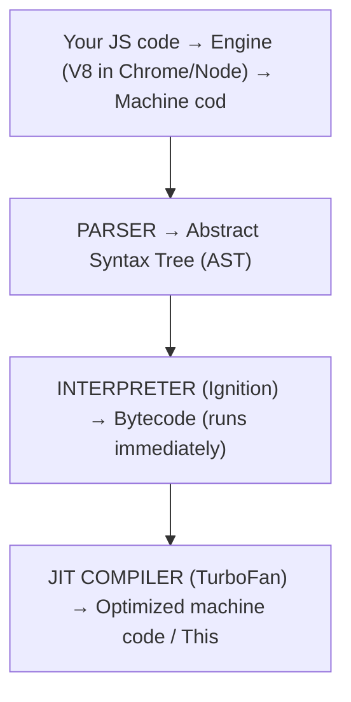

---

## 2. Data Types — The 8 Types

```
JS has 7 PRIMITIVE types + 1 OBJECT type = 8 total

PRIMITIVES (immutable, stored by VALUE):
┌───────────────┬─────────────────────────────────────────┐
│ Type          │ Example                    │ typeof     │
├───────────────┼─────────────────────────────────────────┤
│ number        │ 42, 3.14, NaN, Infinity   │ "number"    │
│ string        │ "hello", 'world', `hi`    │ "string"    │
│ boolean       │ true, false                │ "boolean"  │
│ undefined     │ undefined (not assigned)   │ "undefined"│
│ null          │ null (intentional empty)   │ "object" ⚠ │
│ symbol        │ Symbol("id") (unique)      │ "symbol"   │
│ bigint        │ 9007199254740992n          │ "bigint"   │
└───────────────┴─────────────────────────────────────────┘

NON-PRIMITIVE (mutable, stored by REFERENCE):
┌───────────────┬─────────────────────────────────────────┐
│ object        │ {}, [], function, Date, RegExp, Map,    │
│               │ Set, WeakMap, WeakSet                   │
└───────────────┴─────────────────────────────────────────┘

⚠ typeof null === "object" is a BUG from 1995. Never fixed.
⚠ typeof NaN === "number" — NaN is "Not a Number" but is a
   number type. Use Number.isNaN() to check.
```

**Flow:**
- Type Example typeof / number 42, 3.14, NaN, Infinity 'n
- ↓
- object {}, [], function, Date, RegExp, Map, / Set, Weak

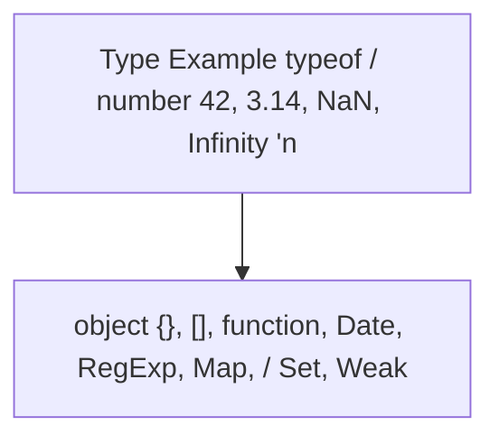

### Value vs Reference — The #1 Source of Bugs

```javascript
// PRIMITIVES: Copied by VALUE (independent copies)
let a = 10;
let b = a;      // b gets a COPY of 10
b = 20;
console.log(a); // 10 — unchanged! They're independent.

// OBJECTS: Copied by REFERENCE (same memory address)
let obj1 = { name: "Harsha" };
let obj2 = obj1;         // obj2 points to SAME object
obj2.name = "Changed";
console.log(obj1.name);  // "Changed" — BOTH changed!

// WHY? Because obj2 = obj1 copies the POINTER, not the object.
// Think of it like two people holding the same leash to the same dog.

// HOW to make a real copy:
let obj3 = { ...obj1 };           // Shallow copy (spread)
let obj4 = structuredClone(obj1); // Deep copy (modern)
let obj5 = JSON.parse(JSON.stringify(obj1)); // Deep copy (old way)
```

```
MEMORY VISUALIZATION:

STACK (primitives)         HEAP (objects)
┌──────────────┐           ┌──────────────────┐
│ a: 10        │           │ { name: "Harsha" }│ ← address 0x1A
│ b: 20        │           └──────────────────┘
│ obj1: 0x1A ──┼──────────────────┘
│ obj2: 0x1A ──┼──────────────────┘  (same address!)
└──────────────┘

REASONING: Primitives are small → stored directly on stack.
Objects can be large → stored on heap, stack holds a pointer.
Assignment copies what's on the stack (value OR pointer).
```

**Flow:**
- a: 10 / b: 20 / obj1: 0x1A / obj2: 0x1A
- ↓
- { name: 'Harsha' }

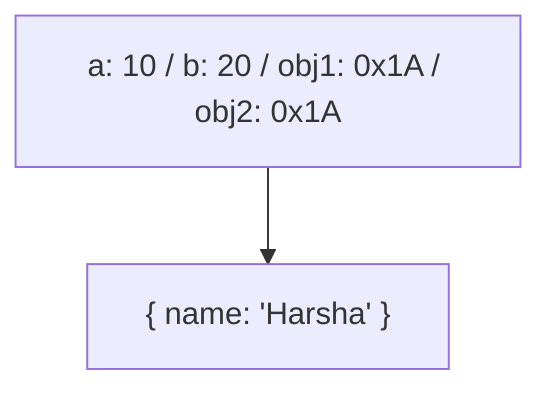

---

## 3. Type Coercion — JS's Most Confusing Feature

### 5W1H: WHY does coercion exist?

```
╔══════════════════════════════════════════════════════════════════════╗
║  WHAT: JS automatically converts types when operators expect them.   ║
║  WHY:  Brendan Eich designed JS in 10 days for beginners.            ║
║        He wanted "5" + 3 to "just work" instead of crashing.         ║
║  WHEN: Every comparison (==), arithmetic, string concatenation.      ║
║  HOW:  Internal algorithms: ToPrimitive, ToNumber, ToString.         ║
╚══════════════════════════════════════════════════════════════════════╝
```

**Flow:**
- WHY: Brendan Eich designed JS in 10 days for beginners.
- ↓
- He wanted '5' + 3 to 'just work' instead of crashing.
- ↓
- HOW: Internal algorithms: ToPrimitive, ToNumber, ToStri

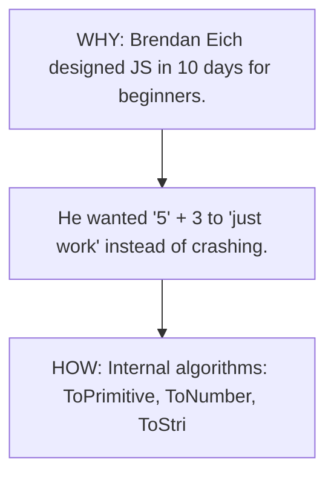

```javascript
// STRING + anything = STRING (concatenation wins)
"5" + 3       // "53"  ← "5" + String(3) = "5" + "3"
"5" + true    // "5true"
"5" + null    // "5null"

// MATH operators (-, *, /) convert to NUMBER
"5" - 3       // 2    ← Number("5") - 3
"5" * "2"     // 10
"hello" - 3   // NaN  ← Number("hello") is NaN

// The WHY behind the RULE:
// + is OVERLOADED — it does both addition AND concatenation.
// If EITHER operand is a string, + picks concatenation.
// Other math operators only do math, so they convert to number.

// COMPARISON coercion:
"5" == 5      // true  ← converts string to number
null == undefined // true  ← special rule: they equal each other
null == 0     // false ← null doesn't coerce in ==
NaN == NaN    // false ← NaN is not equal to ANYTHING, even itself

// BOOLEAN coercion (truthy/falsy):
// FALSY values (only 8 of them — MEMORIZE):
// false, 0, -0, 0n, "", null, undefined, NaN
// Everything else is TRUTHY (including "0", "false", [], {})

if ("0") console.log("truthy!"); // PRINTS! "0" is truthy (non-empty string)
if ([]) console.log("truthy!");  // PRINTS! empty array is truthy
```

### The == vs === Rule (and REASONING)

```
╔══════════════════════════════════════════════════════════════════════╗
║  == (loose equality): Converts types THEN compares                   ║
║  === (strict equality): Compares WITHOUT conversion                  ║
║                                                                      ║
║  RULE: ALWAYS use === unless you have a specific reason for ==.      ║
║                                                                      ║
║  REASONING: == has 22 type conversion rules in the spec.             ║
║  Nobody can remember all 22. === has 0 conversion rules.             ║
║  Predictable code > clever code.                                     ║
║                                                                      ║
║  The ONLY acceptable == use:                                         ║
║  if (value == null) // checks for BOTH null and undefined            ║
║  // equivalent to: if (value === null || value === undefined)        ║
╚══════════════════════════════════════════════════════════════════════╝
```

**Flow:**
- == (loose equality): Converts types THEN compares
- ↓
- REASONING: == has 22 type conversion rules in the spec.
- ↓
- Predictable code > clever code.
- ↓
- The ONLY acceptable == use:

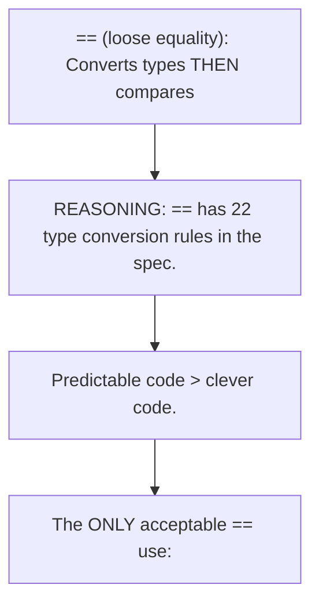

---

## 4. Variables — var vs let vs const

### 5W1H: WHY Three Ways?

```
╔══════════════════════════════════════════════════════════════════════╗
║  WHAT: var (1995), let (2015/ES6), const (2015/ES6)                  ║
║  WHY three? var had bugs (hoisting, no block scope). let/const       ║
║  were added to FIX those bugs while keeping var for backward         ║
║  compatibility.                                                      ║
║  WHEN to use each:                                                   ║
║  • const: DEFAULT choice. ~90% of variables.                         ║
║  • let: When you NEED to reassign (loops, accumulators).             ║
║  • var: NEVER in modern code. Legacy only.                           ║
╚══════════════════════════════════════════════════════════════════════╝
```

**Flow:**
- WHAT: var (1995), let (2015/ES6), const (2015/ES6)
- ↓
- were added to FIX those bugs while keeping var for back
- ↓
- compatibility.
- ↓
- WHEN to use each:
- ↓
- • const: DEFAULT choice. ~90% of variables.
- ↓
- • let: When you NEED to reassign (loops, accumulators).
- ↓
- • var: NEVER in modern code. Legacy only.

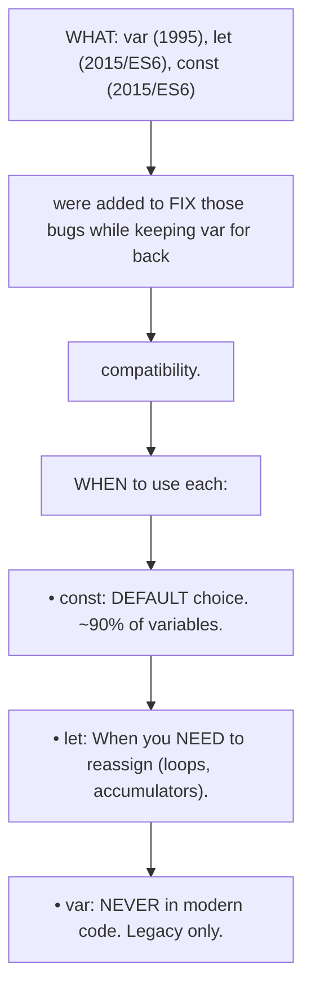

```javascript
// SCOPE comparison:
function demo() {
    if (true) {
        var x = 1;   // function-scoped → leaks out of if block!
        let y = 2;   // block-scoped → stays inside { }
        const z = 3; // block-scoped → stays inside { }
    }
    console.log(x); // 1 ← var leaked!
    console.log(y); // ReferenceError: y is not defined
    console.log(z); // ReferenceError: z is not defined
}

// HOISTING comparison:
console.log(a); // undefined (var hoists declaration, not value)
console.log(b); // ReferenceError: Cannot access 'b' before initialization
console.log(c); // ReferenceError: Cannot access 'c' before initialization
var a = 1;
let b = 2;
const c = 3;

// const doesn't mean IMMUTABLE — it means can't REASSIGN:
const obj = { name: "Harsha" };
obj.name = "Changed";  // ✅ allowed! The OBJECT is mutable.
obj = {};               // ❌ TypeError! Can't reassign the variable.

// REASONING: const locks the BINDING (variable → value pointer),
// not the value itself. For true immutability, use Object.freeze().
```

```
COMPARISON TABLE:
┌──────────┬──────────┬──────────┬──────────┐
│ Feature  │  var     │  let     │  const   │
├──────────┼──────────┼──────────┼──────────┤
│ Scope    │ function │  block   │  block   │
│ Hoisting │ yes(undef)│ yes(TDZ)│ yes(TDZ) │
│ Reassign │  yes     │  yes    │  NO       │
│ Redeclare│  yes     │  no     │  no       │
│ Use in   │  never   │ ~10%    │ ~90%      │
│ 2025+    │          │         │           │
└──────────┴──────────┴──────────┴──────────┘

TDZ = Temporal Dead Zone (the time between hoisting and
declaration where accessing the variable throws an error)
```

**Flow:**
- COMPARISON TABLE:
- ↓
- Feature var let const
- ↓
- Scope function block block
- ↓
- Hoisting yes(undef) yes(TDZ) yes(TDZ)
- ↓
- Reassign yes yes NO
- ↓
- Redeclare yes no no
- ↓
- Use in never ~10% ~90%

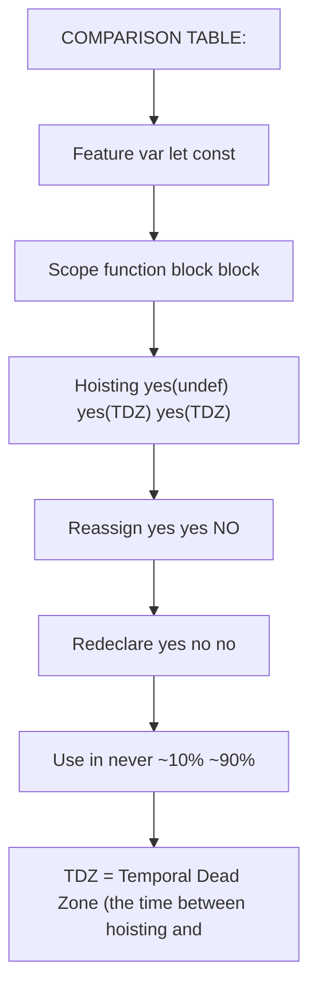

---

## 5. Scope — The Visibility Rules

### 5W1H: WHAT is Scope?

```
╔══════════════════════════════════════════════════════════════════════╗
║  WHAT: Scope determines WHERE a variable is accessible.              ║
║  WHY:  Without scope, all variables would be global → chaos.         ║
║  HOW:  JS uses LEXICAL (static) scoping — scope is determined        ║
║        by WHERE you WRITE the code, not where you call it.           ║
╚══════════════════════════════════════════════════════════════════════╝
```

**Flow:**
- WHAT: Scope determines WHERE a variable is accessible.
- ↓
- WHY: Without scope, all variables would be global
- ↓
- cha
- ↓
- WHY: Without scope, all variables would be global
- ↓
- cha
- ↓
- HOW: JS uses LEXICAL (static) scoping — scope is determ
- ↓
- by WHERE you WRITE the code, not where you call it.

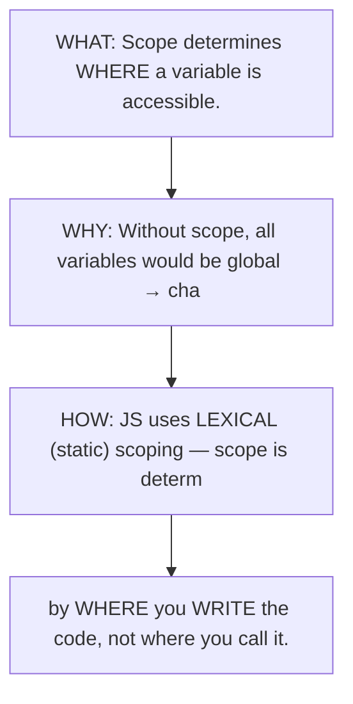

```
THREE TYPES OF SCOPE:

┌─── GLOBAL SCOPE ──────────────────────────────────────────┐
│  const API_URL = "https://api.example.com";               │
│  // Accessible EVERYWHERE. Attached to window (browser).  │
│                                                           │
│  ┌─── FUNCTION SCOPE ───────────────────────────────┐     │
│  │  function greet(name) {                           │    │
│  │    const msg = "Hello " + name;                   │    │
│  │    // msg accessible here + inner blocks          │    │
│  │                                                   │    │
│  │    ┌─── BLOCK SCOPE ──────────────────────┐      │     │
│  │    │  if (name) {                          │      │    │
│  │    │    const upper = name.toUpperCase();   │      │   │
│  │    │    // upper only accessible HERE       │      │   │
│  │    │    // Can access msg (outer scope) ✅ │      │     │
│  │    │    // Can access API_URL (global) ✅  │      │     │
│  │    │  }                                    │      │    │
│  │    └───────────────────────────────────────┘      │    │
│  │    // upper NOT accessible here ❌               │      │
│  │  }                                                │    │
│  └───────────────────────────────────────────────────┘    │
│  // msg NOT accessible here ❌                             │
└───────────────────────────────────────────────────────────┘

RULE: Inner scopes can access outer scopes (scope chain).
Outer scopes CANNOT access inner scopes.
This is the foundation of CLOSURES (next chapter).
```

**Flow:**
- THREE TYPES OF SCOPE:
- ↓
- GLOBAL SCOPE
- ↓
- const API_URL = 'https://api.example.com';
- ↓
- FUNCTION SCOPE
- ↓
- function greet(name) {
- ↓
- const msg = 'Hello ' + name;
- ↓
- BLOCK SCOPE

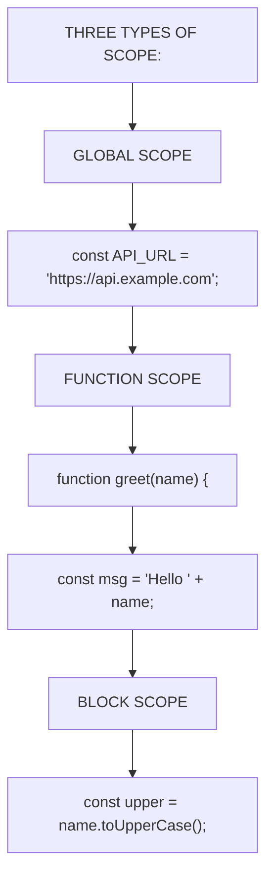

### The Scope Chain (Lookup Mechanism)

```javascript
const global = "I'm global";

function outer() {
    const outerVar = "I'm outer";

    function inner() {
        const innerVar = "I'm inner";

        // JS looks for variables in this order:
        // 1. Current scope (inner) → found innerVar
        // 2. Parent scope (outer) → found outerVar
        // 3. Grandparent scope (global) → found global
        // 4. Not found anywhere → ReferenceError

        console.log(innerVar);  // ✅ found in current scope
        console.log(outerVar);  // ✅ found in parent scope
        console.log(global);    // ✅ found in global scope
        console.log(missing);   // ❌ ReferenceError
    }
    inner();
}

// REASONING: The scope chain is determined at WRITE TIME (lexical).
// When JS can't find a variable, it walks UP the chain.
// It NEVER walks down or sideways.
```

---

## 6. Hoisting — The "Invisible Move"

### 5W1H: WHAT is Hoisting?

```
╔══════════════════════════════════════════════════════════════════════╗
║  WHAT: JS "moves" declarations to the top of their scope BEFORE      ║
║        executing any code. (Technically, it's about creation         ║
║        phase vs execution phase — nothing physically moves.)         ║
║                                                                      ║
║  WHY:  The JS engine makes TWO passes:                               ║
║        Pass 1 (Creation): Find all declarations, allocate memory.    ║
║        Pass 2 (Execution): Run code line by line.                    ║
║                                                                      ║
║  WHEN: This happens with var, function declarations, let/const.      ║
║        But BEHAVIOR differs between them.                            ║
╚══════════════════════════════════════════════════════════════════════╝
```

**Flow:**
- executing any code. (Technically, it's about creation
- ↓
- phase vs execution phase — nothing physically moves.)
- ↓
- WHY: The JS engine makes TWO passes:
- ↓
- Pass 1 (Creation): Find all declarations, allocate memo
- ↓
- Pass 2 (Execution): Run code line by line.
- ↓
- But BEHAVIOR differs between them.

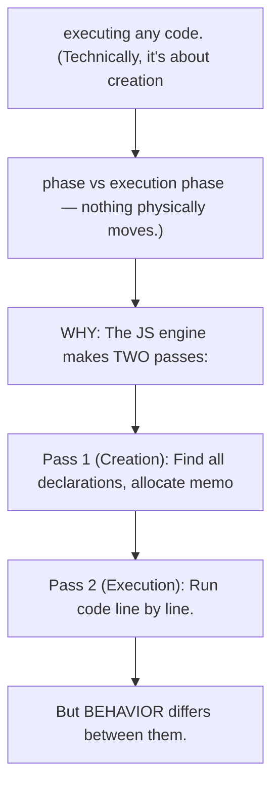

```javascript
// WHAT JS SEES vs WHAT ACTUALLY HAPPENS:

// --- You write: ---
console.log(x);     // undefined (not ReferenceError!)
var x = 5;

// --- JS interprets as: ---
var x;               // Declaration hoisted (value = undefined)
console.log(x);     // undefined
x = 5;              // Assignment stays in place

// --- Function declarations are FULLY hoisted: ---
greet("Harsha");     // ✅ Works! "Hello Harsha"
function greet(name) {
    console.log("Hello " + name);
}
// The entire function is available before its line.

// --- Function EXPRESSIONS are NOT fully hoisted: ---
greet2("Harsha");    // ❌ TypeError: greet2 is not a function
var greet2 = function(name) {
    console.log("Hello " + name);
};
// WHY? var greet2 is hoisted as undefined. undefined() → TypeError.

// --- let/const have TDZ (Temporal Dead Zone): ---
console.log(y);     // ❌ ReferenceError: Cannot access 'y' before initialization
let y = 10;
// let IS hoisted (JS knows y exists) but NOT initialized.
// Accessing it before declaration throws immediately.
```

```
HOISTING SUMMARY:

┌───────────────────┬────────────┬────────────────────┐
│ Declaration       │ Hoisted?   │ Value before line? │
├───────────────────┼────────────┼────────────────────┤
│ var x = 5         │ Yes        │ undefined          │
│ let x = 5         │ Yes (TDZ)  │ ReferenceError     │
│ const x = 5       │ Yes (TDZ)  │ ReferenceError     │
│ function f() {}   │ Yes (full) │ The function itself│
│ var f = () => {}  │ Yes        │ undefined          │
│ class C {}        │ Yes (TDZ)  │ ReferenceError     │
└───────────────────┴────────────┴────────────────────┘

REASONING: TDZ exists to catch bugs. If you use a variable
before declaring it, that's almost certainly a mistake.
let/const throw immediately instead of silently being undefined.
```

**Flow:**
- HOISTING SUMMARY:
- ↓
- Declaration Hoisted? Value before line?
- ↓
- var x = 5 Yes undefined
- ↓
- let x = 5 Yes (TDZ) ReferenceError
- ↓
- const x = 5 Yes (TDZ) ReferenceError
- ↓
- function f() {} Yes (full) The function itself
- ↓
- var f = () => {} Yes undefined

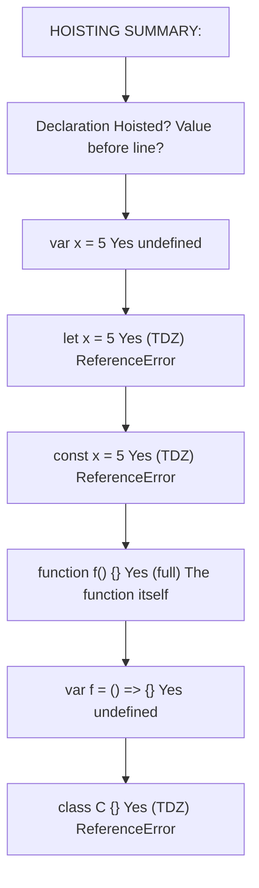

---

## 7. Operators — Beyond The Basics

### Nullish Coalescing (??) vs OR (||)

```javascript
// || returns first TRUTHY value
const a = 0 || "default";     // "default" — 0 is falsy!
const b = "" || "default";    // "default" — "" is falsy!

// ?? returns first NON-NULLISH value (only null/undefined are nullish)
const c = 0 ?? "default";     // 0 — 0 is NOT null/undefined
const d = "" ?? "default";    // "" — "" is NOT null/undefined
const e = null ?? "default";  // "default"
const f = undefined ?? "def"; // "def"

// REASONING: Use ?? when 0, "", false are VALID values.
// Use || when you want to replace ALL falsy values.

// Optional chaining (?.)
const user = { address: { city: "Hyderabad" } };
console.log(user?.address?.city);     // "Hyderabad"
console.log(user?.phone?.number);     // undefined (no error!)
// WITHOUT ?.: user.phone.number → TypeError: Cannot read property of undefined

// REASONING: ?. short-circuits to undefined if any part is null/undefined.
// Replaces: user && user.address && user.address.city
```

### Spread (...) and Rest (...) — Same Syntax, Different Purpose

```javascript
// SPREAD: "Expand" an iterable into individual elements
const arr1 = [1, 2, 3];
const arr2 = [...arr1, 4, 5];     // [1, 2, 3, 4, 5]
const obj1 = { a: 1, b: 2 };
const obj2 = { ...obj1, c: 3 };   // { a: 1, b: 2, c: 3 }

// REST: "Collect" remaining elements into an array/object
function sum(...numbers) {          // rest parameter
    return numbers.reduce((a, b) => a + b, 0);
}
sum(1, 2, 3, 4); // 10

const { a, ...rest } = { a: 1, b: 2, c: 3 };
// a = 1, rest = { b: 2, c: 3 }

// REASONING: Spread "spreads out", Rest "gathers up".
// Same syntax (...) but context determines behavior.
// In function parameters → REST. Everywhere else → SPREAD.
```

---

## 8. Execution Context — How JS Runs Your Code

```
Every time JS runs code, it creates an EXECUTION CONTEXT.

┌──────────────────────────────────────────────────────────┐
│  EXECUTION CONTEXT contains:                             │
│                                                          │
│  1. Variable Environment (variables, functions)          │
│  2. Scope Chain (link to parent scopes)                  │
│  3. `this` binding (depends on HOW function is called)   │
└──────────────────────────────────────────────────────────┘

TYPES:
• Global Execution Context: Created when script starts.
  In browser: this = window. In Node: this = module.exports.

• Function Execution Context: Created for each function call.
  Has its own variables, scope chain, and `this`.

CALL STACK:
┌───────────────┐
│ inner()       │ ← currently executing
│ outer()       │ ← waiting for inner() to finish
│ Global        │ ← waiting for outer() to finish
└───────────────┘
Functions are PUSHED when called, POPPED when they return.
Stack Overflow = too many pushes without pops (infinite recursion)
```

**Flow:**
- EXECUTION CONTEXT contains: / 1. Variable Environment (
- ↓
- inner() / outer() / Global

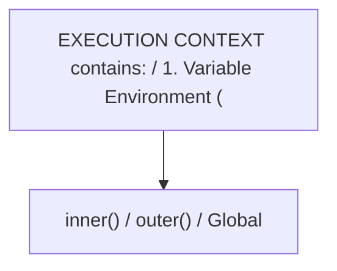

---

## 9. Strict Mode

```javascript
"use strict"; // Put at top of file or function

// WHY strict mode?
// Without it, JS silently ignores many mistakes.

// Without strict mode:
x = 10;  // Creates a global variable silently! (bad)

// With strict mode:
"use strict";
x = 10;  // ❌ ReferenceError: x is not defined (catches the bug)

// Other strict mode changes:
// • Can't delete variables: delete x; → SyntaxError
// • Can't have duplicate parameters: function f(a, a) → SyntaxError
// • Octal literals forbidden: 010 → SyntaxError
// • `this` in regular functions is undefined (not window)

// REASONING: Strict mode turns silent errors into thrown errors.
// ES6 modules and classes are ALWAYS in strict mode automatically.
```

---

## Interview Quick-Fire

```
Q: What are the falsy values in JS?
→ false, 0, -0, 0n, "", null, undefined, NaN (8 total)

Q: typeof null returns what?
→ "object" — it's a historical bug from the first JS implementation.

Q: Difference between null and undefined?
→ undefined = variable declared but not assigned (JS sets it).
  null = intentionally empty (developer sets it).
  null == undefined is true. null === undefined is false.

Q: What is hoisting?
→ JS moves declarations to the top of scope during creation phase.
  var → hoisted as undefined. let/const → hoisted but in TDZ.
  function declarations → fully hoisted.

Q: What is the Temporal Dead Zone?
→ The zone between entering scope and the let/const declaration.
  Accessing a let/const variable in the TDZ throws ReferenceError.

Q: "5" + 3 vs "5" - 3?
→ "53" (+ does concatenation if either is string)
  2 (- only does math, converts "5" to 5)
```

**Flow:**
- var
- ↓
- hoisted as undefined. let/const
- ↓
- hoisted but in TDZ.
- ↓
- function declarations
- ↓
- fully hoisted.

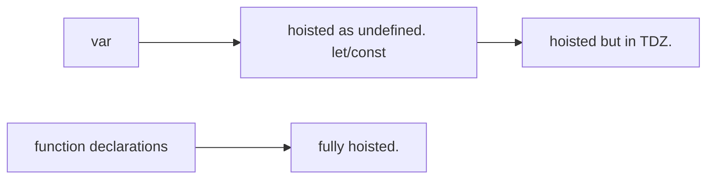

---

> [Next → Chapter 2: Functions & Closures](02_JS_Functions_Closures.md)


---

> **Navigation**: [Back to Index](../00_MASTER_INDEX.md) | [Next >](02_JS_Functions_Closures.md)