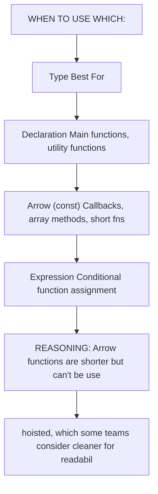
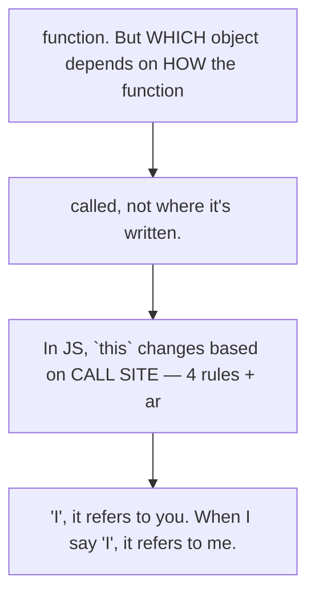
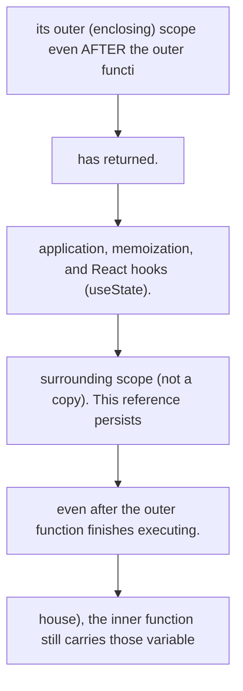
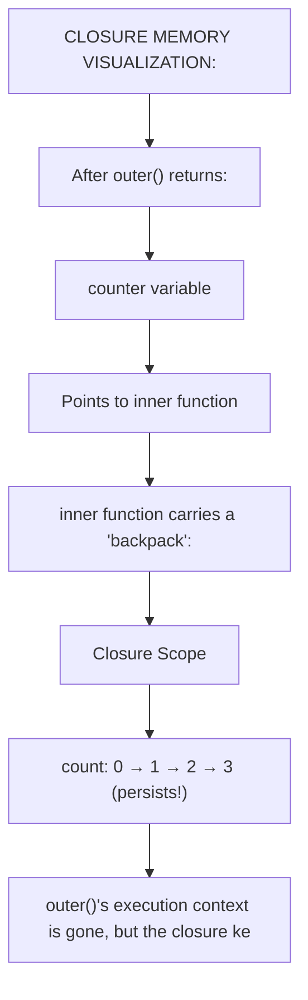
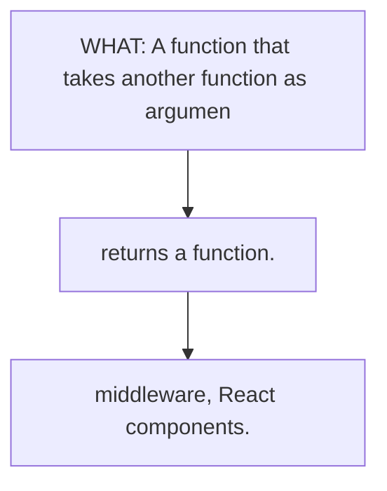
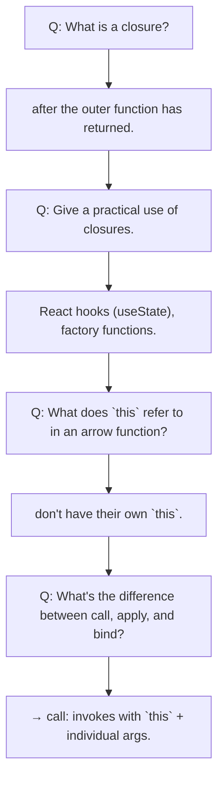

**JavaScript Chapter 2/7** | [← Previous: Foundations](01_JS_Foundations.md) | [Index](../00_MASTER_INDEX.md) | [Next → Objects & Prototypes](03_JS_Objects_Prototypes.md)

# Functions & Closures — The Heart of JavaScript

## 5W1H — Why This Chapter?


WHAT: Functions are FIRST-CLASS citizens in JS. They can be
stored in variables, passed as arguments, returned from
other functions. Closures emerge from this + lexical scope.

WHY:  Closures power React hooks, event handlers, callbacks,
module patterns, currying, memoization — everything.
"If you understand closures, you understand JS."

WHO:  Every JS developer. Every React developer (useState IS
a closure). Every Node developer (callbacks are closures).

WHEN: After understanding scope (Chapter 1).

HOW:  Functions create scope → inner functions remember outer
scope → that's a closure. It's that simple (and profound).


---

## 1. Function Declarations vs Expressions

```javascript
// DECLARATION: Hoisted FULLY. Can call before the line.
greet("Harsha"); // ✅ Works!
function greet(name) {
    return `Hello ${name}`;
}

// EXPRESSION: Variable is hoisted, but value is NOT.
sayHi("Harsha"); // ❌ TypeError: sayHi is not a function
const sayHi = function(name) {
    return `Hi ${name}`;
};

// ARROW FUNCTION (ES6): Shorter syntax + lexical `this`
const add = (a, b) => a + b;
const square = x => x * x;           // Single param: no parens needed
const getUser = () => ({ name: "H" }); // Return object: wrap in ()

// NAMED FUNCTION EXPRESSION: For recursion & stack traces
const factorial = function fact(n) {
    return n <= 1 ? 1 : n * fact(n - 1); // fact is only visible inside
};
```

```
WHEN TO USE WHICH:
┌──────────────────┬───────────────────────────────────────┐
│ Type             │ Best For                              │
├──────────────────┼───────────────────────────────────────┤
│ Declaration      │ Main functions, utility functions     │
│ Arrow (const)    │ Callbacks, array methods, short fns   │
│ Expression       │ Conditional function assignment       │
└──────────────────┴───────────────────────────────────────┘

REASONING: Arrow functions are shorter but can't be used as
constructors and don't have their own `this`. Declarations are
hoisted, which some teams consider cleaner for readability.
```

**Flow:**
1. WHEN TO USE WHICH:
2. Type Best For
3. Declaration Main functions, utility functions
4. Arrow (const) Callbacks, array methods, short fns
5. Expression Conditional function assignment
6. REASONING: Arrow functions are shorter but can't be use hoisted, which some teams consider cleaner for readabil



---


🔬 **Section Challenge — 1. Function Declarations vs Expressions**
>
**Challenge 2 (Design):** `ROW_NUMBER()` vs `RANK()` vs `DENSE_RANK()` — show with an example where they produce different results.
<details><summary>Answer</summary>

Scores: [100, 90, 90, 80]. ROW_NUMBER: 1,2,3,4 (always unique, arbitrary for ties). RANK: 1,2,2,4 (gives same rank to ties, SKIPS the next rank). DENSE_RANK: 1,2,2,3 (same rank to ties, NO skipping). Use: ROW_NUMBER for pagination (must be unique). RANK when you want 'no 3rd place if two tied for 2nd'. DENSE_RANK when you want consecutive ranks despite ties.
</details>


## 2. Parameters — Default, Rest, Destructuring

```javascript
// DEFAULT PARAMETERS (ES6)
function createUser(name, role = "viewer", active = true) {
    return { name, role, active };
}
createUser("Harsha");                    // { name: "Harsha", role: "viewer", active: true }
createUser("Harsha", "admin");           // { name: "Harsha", role: "admin", active: true }
createUser("Harsha", undefined, false);  // { name: "Harsha", role: "viewer", active: false }
// undefined triggers default. null does NOT.

// REST PARAMETERS (...)
function sum(...numbers) {
    return numbers.reduce((acc, n) => acc + n, 0);
}
sum(1, 2, 3, 4); // 10

// DESTRUCTURED PARAMETERS (great for config objects)
function createComponent({ tag = "div", className = "", children = [] }) {
    // Now you have tag, className, children as local variables
    return `<${tag} class="${className}">${children.join("")}</${tag}>`;
}
createComponent({ tag: "h1", className: "title", children: ["Hello"] });
// <h1 class="title">Hello</h1>

// WHY destructured params?
// 1. Named parameters → order doesn't matter
// 2. Self-documenting → you see what the function expects
// 3. Defaults built in → clean fallback behavior
```

---


## 3. `this` Keyword — The Most Confusing Part of JS

### 5W1H: WHY is `this` confusing?

```
╔══════════════════════════════════════════════════════════════════════╗
║  WHAT: `this` refers to the OBJECT that is executing the current     ║
║        function. But WHICH object depends on HOW the function is     ║
║        called, not where it's written.                               ║
║                                                                      ║
║  WHY confusing: In Java, `this` always refers to the instance.       ║
║  In JS, `this` changes based on CALL SITE — 4 rules + arrow.         ║
║                                                                      ║
║  ANALOGY: `this` is like the word "I" in English. When YOU say       ║
║  "I", it refers to you. When I say "I", it refers to me.             ║
║  The meaning depends on WHO IS SPEAKING (who called the function).   ║
╚══════════════════════════════════════════════════════════════════════╝
```

**Flow:**
1. function. But WHICH object depends on HOW the function
2. called, not where it's written. In JS, `this` changes based on CALL SITE — 4 rules + ar 'I', it refers to you. When I say 'I', it refers to me.



### The 5 Rules of `this` (in priority order)

```javascript
// RULE 1: new binding (highest priority)
function Person(name) {
    this.name = name; // `this` = newly created object
}
const p = new Person("Harsha"); // this → {}

// RULE 2: explicit binding (call, apply, bind)
function greet() {
    console.log(`Hello, ${this.name}`);
}
const user = { name: "Harsha" };
greet.call(user);   // "Hello, Harsha" — this = user
greet.apply(user);  // Same, but args as array: greet.apply(user, [arg1, arg2])
const bound = greet.bind(user); // Returns NEW function with this locked to user
bound(); // "Hello, Harsha"

// RULE 3: implicit binding (object method)
const obj = {
    name: "Harsha",
    greet() {
        console.log(this.name); // this = obj (the object BEFORE the dot)
    }
};
obj.greet(); // "Harsha"

// ⚠️ BUT: Method extraction LOSES binding!
const fn = obj.greet;
fn(); // undefined — `this` is now global/undefined (no dot!)

// RULE 4: default binding (lowest priority)
function standalone() {
    console.log(this); // window (browser) or global (Node)
}
standalone(); // In strict mode: undefined

// RULE 5: Arrow functions — NO own `this`
const obj2 = {
    name: "Harsha",
    greet: () => {
        console.log(this.name); // ❌ `this` is NOT obj2!
        // Arrow inherits `this` from enclosing LEXICAL scope.
    },
    greetCorrect() {
        const inner = () => {
            console.log(this.name); // ✅ "Harsha" — inherits from greetCorrect
        };
        inner();
    }
};
```

```
`this` DETERMINATION FLOWCHART:

Is it an ARROW function?
├── YES → `this` = enclosing lexical scope's `this`
└── NO ↓

Called with NEW keyword?
├── YES → `this` = newly created object
└── NO ↓

Called with call/apply/bind?
├── YES → `this` = specified object
└── NO ↓

Called as object.method()?
├── YES → `this` = object before the dot
└── NO ↓

Default: `this` = window (or undefined in strict mode)
```

**Flow:**
1. YES
2. `this` = enclosing lexical scope's `this` YES `this` = newly created object YES `this` = specified object YES `this` = object before the dot

```mermaid
flowchart LR
    N1["YES"]
    N2["`this` = enclosing lexical scope's `this`"]
    N3["`this` = newly created object"]
    N4["`this` = specified object"]
    N5["`this` = object before the dot"]
    N1 --> N2
    N1 --> N3
    N1 --> N4
    N1 --> N5
```

---


## 4. Closures — The Most Important Concept

### 5W1H: WHAT is a Closure?

```
╔══════════════════════════════════════════════════════════════════════╗
║  WHAT: A closure is a function that REMEMBERS the variables from     ║
║        its outer (enclosing) scope even AFTER the outer function     ║
║        has returned.                                                 ║
║                                                                      ║
║  WHY:  Closures enable data privacy, factory functions, partial      ║
║        application, memoization, and React hooks (useState).         ║
║                                                                      ║
║  HOW:  When a function is created, it captures a reference to its    ║
║        surrounding scope (not a copy). This reference persists       ║
║        even after the outer function finishes executing.             ║
║                                                                      ║
║  ANALOGY: A closure is like a backpack. When a function is born      ║
║  inside another function, it packs the outer function's variables    ║
║  into its backpack. Even after leaving the outer function (the       ║
║  house), the inner function still carries those variables.           ║
╚══════════════════════════════════════════════════════════════════════╝
```

**Flow:**
1. its outer (enclosing) scope even AFTER the outer functi
2. has returned.
3. application, memoization, and React hooks (useState).
4. surrounding scope (not a copy). This reference persists
5. even after the outer function finishes executing.
6. house), the inner function still carries those variable



```javascript
// SIMPLEST CLOSURE EXAMPLE:
function outer() {
    let count = 0;           // Variable in outer scope

    function inner() {
        count++;             // inner "closes over" count
        console.log(count);
    }

    return inner;            // Return the function (not its result)
}

const counter = outer();     // outer() finishes executing
counter(); // 1 — BUT count is still alive!
counter(); // 2 — count persists between calls!
counter(); // 3

// WHY does count persist?
// When inner was created, it captured a REFERENCE to count.
// Even though outer() finished, inner still holds that reference.
// JS garbage collector sees it's still referenced → keeps it alive.
```

```
CLOSURE MEMORY VISUALIZATION:

After outer() returns:

┌─ counter variable ─────────────────────────────────────┐
│  Points to inner function                              │
│  inner function carries a "backpack":                  │
│  ┌─── Closure Scope ──────────────────┐                │
│  │  count: 0 → 1 → 2 → 3 (persists!) │                 │
│  └────────────────────────────────────┘                │
└────────────────────────────────────────────────────────┘

outer()'s execution context is gone, but the closure keeps
count alive because inner still references it.
```

**Flow:**
1. CLOSURE MEMORY VISUALIZATION:
2. After outer() returns: counter variable
3. Points to inner function
4. inner function carries a 'backpack':
5. Closure Scope count: 0 1 2 3 (persists!)



### Closure Use Cases

```javascript
// USE CASE 1: DATA PRIVACY (Module Pattern)
function createBankAccount(initialBalance) {
    let balance = initialBalance; // PRIVATE — no outside access

    return {
        deposit(amount) {
            balance += amount;
            return balance;
        },
        withdraw(amount) {
            if (amount > balance) throw new Error("Insufficient funds");
            balance -= amount;
            return balance;
        },
        getBalance() {
            return balance; // Only way to READ balance
        }
    };
}

const account = createBankAccount(1000);
account.deposit(500);    // 1500
account.withdraw(200);   // 1300
account.getBalance();    // 1300
// account.balance → undefined! It's private.

// REASONING: balance is in the closure scope.
// Only the returned methods can access it.
// This is ENCAPSULATION without classes!


// USE CASE 2: FUNCTION FACTORY
function createMultiplier(multiplier) {
    return function(number) {
        return number * multiplier; // closes over `multiplier`
    };
}

const double = createMultiplier(2);
const triple = createMultiplier(3);
double(5); // 10
triple(5); // 15
// Each returned function has its OWN closure with its OWN multiplier.


// USE CASE 3: MEMOIZATION (Caching)
function memoize(fn) {
    const cache = {}; // Closure stores the cache

    return function(...args) {
        const key = JSON.stringify(args);
        if (cache[key] !== undefined) {
            console.log("Cache hit!");
            return cache[key];
        }
        const result = fn(...args);
        cache[key] = result;
        return result;
    };
}

const expensiveAdd = memoize((a, b) => {
    console.log("Computing...");
    return a + b;
});
expensiveAdd(1, 2); // "Computing..." → 3
expensiveAdd(1, 2); // "Cache hit!" → 3 (no recomputation)


// USE CASE 4: REACT'S useState (simplified)
function useState(initialValue) {
    let state = initialValue; // Closure!

    function getState() {
        return state;
    }

    function setState(newValue) {
        state = newValue;
        // In real React: triggers re-render
    }

    return [getState, setState];
}

const [getName, setName] = useState("Harsha");
getName();          // "Harsha"
setName("Updated");
getName();          // "Updated"
```

### The Classic Closure Bug (Interview Favorite)

```javascript
// THE BUG:
for (var i = 0; i < 3; i++) {
    setTimeout(() => console.log(i), 100);
}
// Output: 3, 3, 3 — NOT 0, 1, 2!

// WHY? var is function-scoped, so there's ONE `i` variable.
// By the time setTimeout fires (100ms later), the loop has finished.
// All three functions share the SAME i, which is now 3.

// FIX 1: Use let (creates new variable per iteration)
for (let i = 0; i < 3; i++) {
    setTimeout(() => console.log(i), 100);
}
// Output: 0, 1, 2 ✅ — let creates a new `i` for each iteration

// FIX 2: IIFE (old way, before let existed)
for (var i = 0; i < 3; i++) {
    (function(j) {
        setTimeout(() => console.log(j), 100);
    })(i); // Pass current i into IIFE as j → each closure has its own j
}
// Output: 0, 1, 2 ✅
```

---


🔬 **Section Challenge — 4. Closures — The Most Important Concept**

**Challenge 1 (Reasoning):** What is a closure and why can't garbage collection remove variables that are closed over?
<details><summary>Answer</summary>

A closure is a function that retains a reference to its lexical environment (the scope where it was created). Variables closed over are kept alive by the closure reference — GC can't collect them because there's still a reference (the closure's internal scope). Memory leak scenario: large data object captured in a closure, closure stored in a long-lived event listener → data stays in memory for the page's lifetime. Fix: explicitly null the large variable after use, or use a WeakRef.
</details>


## 5. Higher-Order Functions

### 5W1H: WHAT are Higher-Order Functions?

```
╔══════════════════════════════════════════════════════════════════════╗
║  WHAT: A function that takes another function as argument OR         ║
║        returns a function.                                           ║
║  WHY:  Enables composition, abstraction, and declarative code.       ║
║  WHO:  Used everywhere: Array methods, event handlers, Express       ║
║        middleware, React components.                                 ║
╚══════════════════════════════════════════════════════════════════════╝
```

**Flow:**
1. WHAT: A function that takes another function as argumen
2. returns a function.
3. middleware, React components.



```javascript
// Array higher-order methods (the most important ones):

const numbers = [1, 2, 3, 4, 5, 6, 7, 8, 9, 10];

// map: Transform each element → new array
const doubled = numbers.map(n => n * 2);
// [2, 4, 6, 8, 10, 12, 14, 16, 18, 20]

// filter: Keep elements that pass a test → new array
const evens = numbers.filter(n => n % 2 === 0);
// [2, 4, 6, 8, 10]

// reduce: Accumulate into a single value
const sum = numbers.reduce((acc, n) => acc + n, 0);
// 55

// find: Return FIRST element that passes test
const firstBig = numbers.find(n => n > 5);
// 6

// some: Does ANY element pass?
numbers.some(n => n > 5);  // true

// every: Do ALL elements pass?
numbers.every(n => n > 0); // true

// forEach: Side effects only (no return value)
numbers.forEach(n => console.log(n));

// CHAINING — the power of functional style:
const result = numbers
    .filter(n => n % 2 === 0)    // [2, 4, 6, 8, 10]
    .map(n => n * 3)             // [6, 12, 18, 24, 30]
    .reduce((acc, n) => acc + n, 0); // 90

// REASONING: Each method returns a new array (immutable pattern).
// Chain them for readable, declarative data transformations.
// This is the foundation of React's JSX rendering pattern:
// data.filter(...).map(item => <Component {...item} />)
```

---


🔬 **Section Challenge — 5. Higher-Order Functions**
>
**Challenge 2 (Design):** `ROW_NUMBER()` vs `RANK()` vs `DENSE_RANK()` — show with an example where they produce different results.
<details><summary>Answer</summary>

Scores: [100, 90, 90, 80]. ROW_NUMBER: 1,2,3,4 (always unique, arbitrary for ties). RANK: 1,2,2,4 (gives same rank to ties, SKIPS the next rank). DENSE_RANK: 1,2,2,3 (same rank to ties, NO skipping). Use: ROW_NUMBER for pagination (must be unique). RANK when you want 'no 3rd place if two tied for 2nd'. DENSE_RANK when you want consecutive ranks despite ties.
</details>


## 6. IIFE — Immediately Invoked Function Expression

```javascript
// WHAT: A function that runs immediately after creation.
// WHY:  Creates a private scope. Avoids polluting global namespace.
// WHEN: Less common now (we have modules), but appears in libraries.

(function() {
    const secret = "hidden";
    console.log("IIFE ran!"); // Runs immediately
})();

// REVEALING MODULE PATTERN (pre-ES6 modules)
const Calculator = (function() {
    let result = 0; // Private via closure

    return {
        add(n)    { result += n; return this; },
        subtract(n) { result -= n; return this; },
        getResult() { return result; }
    };
})();

Calculator.add(10).subtract(3).getResult(); // 7
```

---


## 7. Currying & Partial Application

```javascript
// CURRYING: Transform f(a, b, c) into f(a)(b)(c)

// Normal function:
function add(a, b) { return a + b; }

// Curried version:
function curriedAdd(a) {
    return function(b) {
        return a + b; // Closure over `a`
    };
}
const add5 = curriedAdd(5);
add5(3); // 8
add5(7); // 12

// Arrow syntax:
const multiply = a => b => a * b;
const double = multiply(2);
double(5); // 10

// REAL USE CASE: Event handlers in React
const handleInputChange = (fieldName) => (event) => {
    // fieldName is curried in
    setFormData(prev => ({
        ...prev,
        [fieldName]: event.target.value
    }));
};

// In JSX:
// <input onChange={handleInputChange("email")} />
// <input onChange={handleInputChange("password")} />

// GENERIC CURRY UTILITY:
function curry(fn) {
    return function curried(...args) {
        if (args.length >= fn.length) {
            return fn(...args);
        }
        return function(...moreArgs) {
            return curried(...args, ...moreArgs);
        };
    };
}

const curriedSum = curry((a, b, c) => a + b + c);
curriedSum(1)(2)(3);     // 6
curriedSum(1, 2)(3);     // 6
curriedSum(1)(2, 3);     // 6
```

---


## 8. Composition & Pipe

```javascript
// COMPOSE: Right-to-left function application
const compose = (...fns) => x => fns.reduceRight((acc, fn) => fn(acc), x);

// PIPE: Left-to-right function application (more readable)
const pipe = (...fns) => x => fns.reduce((acc, fn) => fn(acc), x);

const trim = str => str.trim();
const toLower = str => str.toLowerCase();
const addExclaim = str => str + "!";

const processInput = pipe(trim, toLower, addExclaim);
processInput("  Hello World  "); // "hello world!"

// REASONING: Build complex operations from small, reusable pieces.
// Each function does ONE thing. Composition chains them.
// This is the mental model behind React component composition too.
```

---

## 9. Recursion (JS-Specific Notes)

```javascript
// JS has no tail-call optimization in practice (except Safari).
// So recursive functions CAN blow the stack. Be mindful of depth.

// Classic: Flatten nested array
function flatten(arr) {
    return arr.reduce((acc, item) =>
        acc.concat(Array.isArray(item) ? flatten(item) : item), []
    );
}
flatten([1, [2, [3, [4]]]]); // [1, 2, 3, 4]

// Modern alternative: arr.flat(Infinity)
[1, [2, [3, [4]]]].flat(Infinity); // [1, 2, 3, 4]

// Deep clone via recursion
function deepClone(obj) {
    if (obj === null || typeof obj !== "object") return obj;
    const clone = Array.isArray(obj) ? [] : {};
    for (const key in obj) {
        if (obj.hasOwnProperty(key)) {
            clone[key] = deepClone(obj[key]);
        }
    }
    return clone;
}
// Modern alternative: structuredClone(obj)
```

---


🔬 **Section Challenge — 9. Recursion (JS-Specific Notes)**
>
**Challenge 2 (Bug Hunt):** ```java
void fib(int n) { return n<=1 ? n : fib(n-1) + fib(n-2); }
fib(50) // takes forever
```
Why and what are the 3 fixes?
<details><summary>Answer</summary>

Exponential time O(2^N) — `fib(n-1)` and `fib(n-2)` each recursively recompute the same subproblems billions of times. Fix 1: Memoization — `Map<Integer,Long> memo`, return early if computed. O(N) time, O(N) space. Fix 2: Bottom-up DP — array `dp[i] = dp[i-1] + dp[i-2]`. O(N) time, O(N) space. Fix 3: O(1) space — just track last two values with two variables. O(N) time, O(1) space.
</details>


## Interview Quick-Fire

```
Q: What is a closure?
→ A function that remembers variables from its outer scope even
  after the outer function has returned.

Q: Give a practical use of closures.
→ Data privacy (module pattern), memoization, event handlers,
  React hooks (useState), factory functions.

Q: What does `this` refer to in an arrow function?
→ The `this` of the enclosing lexical scope. Arrow functions
  don't have their own `this`.

Q: What's the difference between call, apply, and bind?
→ call: invokes with `this` + individual args.
  apply: invokes with `this` + args as array.
  bind: returns new function with `this` locked (doesn't invoke).

Q: What's the output? for (var i=0; i<3; i++) setTimeout(() => console.log(i), 0);
→ 3, 3, 3 — because var is function-scoped, all closures share
  the same i. Fix: use let.

Q: What is currying?
→ Transforming f(a, b) into f(a)(b). Each call returns a new
  function until all args are received. Uses closures.

Q: What is a higher-order function?
→ A function that takes a function as argument or returns one.
  Examples: map, filter, reduce, addEventListener.
```

**Flow:**
1. Q: What is a closure?
2. after the outer function has returned.
3. Q: Give a practical use of closures.
4. React hooks (useState), factory functions.
5. Q: What does `this` refer to in an arrow function?
6. don't have their own `this`. Q: What's the difference between call, apply, and bind?



---

[← Previous: Foundations](01_JS_Foundations.md) | [Index](../00_MASTER_INDEX.md) | [Next → Objects & Prototypes](03_JS_Objects_Prototypes.md)

---

## 🏋️ Practice & Interview Questions — JavaScript

### Predict / Trace
**Q1.** What prints?
```js
console.log(typeof null);
console.log(null instanceof Object);
```
<details><summary>Answer</summary>

`"object"` (historical JS bug), `false` (null is not an Object instance). This is a well-known JS quirk.
</details>

**Q2.** What is the output?
```js
console.log(1 + "2");
console.log("3" - 1);
console.log(true + false);
```
<details><summary>Answer</summary>

`"12"` (string concat), `2` (- coerces to number), `1` (true=1, false=0)
</details>

**Q3.** What prints and why?
```js
for (var i = 0; i < 3; i++) {
  setTimeout(() => console.log(i), 0);
}
```
<details><summary>Answer</summary>

`3 3 3` — `var` is function-scoped, all closures share same `i`. By the time timeouts run, loop is done, i=3. **Fix**: use `let` (block-scoped) or `setTimeout(() => console.log(i), 0, i)`.
</details>

### Coding Problems
**Q4.** ⭐ Implement `debounce(fn, delay)`.
<details><summary>Solution</summary>

```js
function debounce(fn, delay) {
  let timer;
  return function(...args) {
    clearTimeout(timer);
    timer = setTimeout(() => fn.apply(this, args), delay);
  };
}
```
</details>

**Q5.** ⭐ Implement `Promise.all` from scratch.
<details><summary>Solution</summary>

```js
function promiseAll(promises) {
  return new Promise((resolve, reject) => {
    const results = [];
    let count = 0;
    promises.forEach((p, i) => {
      Promise.resolve(p)
        .then(val => { results[i] = val; if(++count === promises.length) resolve(results); })
        .catch(reject);
    });
    if(promises.length === 0) resolve([]);
  });
}
```
</details>

**Q6.** ⭐ Deep clone an object without `JSON.parse(JSON.stringify(...))`.
<details><summary>Solution</summary>

```js
function deepClone(obj) {
  if(obj === null || typeof obj !== 'object') return obj;
  if(obj instanceof Date) return new Date(obj);
  if(obj instanceof Array) return obj.map(deepClone);
  const clone = {};
  for(const key in obj) if(obj.hasOwnProperty(key)) clone[key] = deepClone(obj[key]);
  return clone;
}
// Modern: structuredClone(obj) — built-in, handles more types
```
</details>

**Q7.** ⭐⭐ Implement `curry` function.
<details><summary>Solution</summary>

```js
function curry(fn) {
  return function curried(...args) {
    if(args.length >= fn.length) return fn(...args);
    return function(...more) { return curried(...args, ...more); };
  };
}
const add = curry((a, b, c) => a + b + c);
add(1)(2)(3); // 6
add(1, 2)(3); // 6
```
</details>

**Q8.** ⭐⭐ Implement `memoize(fn)`.
<details><summary>Solution</summary>

```js
function memoize(fn) {
  const cache = new Map();
  return function(...args) {
    const key = JSON.stringify(args);
    if(cache.has(key)) return cache.get(key);
    const result = fn.apply(this, args);
    cache.set(key, result);
    return result;
  };
}
```
</details>

### MCQ Rapid Fire
| # | Question | Answer |
|---|---|---|
| 1 | == vs === | == coerces types; === strict (no coercion) |
| 2 | `typeof undefined` | "undefined" |
| 3 | `typeof function(){}` | "function" |
| 4 | Prototype chain end | null |
| 5 | Event loop: microtasks vs macrotasks | Microtasks (Promises) run before macrotasks (setTimeout) |
| 6 | `const` prevents | Reassignment, not mutation |
| 7 | `var` vs `let` hoisting | var: hoisted+initialized to undefined; let: hoisted but in TDZ |
| 8 | `this` in arrow function | Lexical (inherited from enclosing scope) |
| 9 | Optional chaining `?.` | Returns undefined instead of throwing on null/undefined |
| 10 | Nullish coalescing `??` | Returns right side only if left is null/undefined (not 0 or '') |

---

## 🧠 Deep Conceptual Questions — JavaScript Engine & Language

**C1. How does the JavaScript event loop actually work?**
<details><summary>Deep Answer</summary>

```
Call Stack → runs synchronous code
     ↓ (when empty)
Microtask Queue → Promise callbacks, queueMicrotask, MutationObserver
     ↓ (when empty)
Macrotask Queue → setTimeout, setInterval, I/O, requestAnimationFrame
```

One "tick": (1) Run all synchronous code in call stack until empty, (2) Run ALL microtasks until queue empty (even if new microtasks added!), (3) Run ONE macrotask from the macrotask queue, (4) Repeat.

Critical: microtasks drain COMPLETELY before any macrotask. A microtask that continually enqueues microtasks → infinite loop, browser freezes (no macrotasks can run). `Promise.resolve().then(...)` vs `setTimeout(fn, 0)`: Promise runs BEFORE the timeout even with a 0ms delay.
</details>

**C2. What is the prototype chain and how does `class` syntax relate to it?**
<details><summary>Deep Answer</summary>

Every JS object has an internal `[[Prototype]]` link. Property lookup: check own properties → check `[[Prototype]]` → check `[[Prototype]][[Prototype]]` → ... until null. `class` is syntactic sugar over prototype-based inheritance:
```js
class Animal { speak() {} }  // same as:
function Animal() {}
Animal.prototype.speak = function() {};
```
`class extends` sets up the prototype chain: `Dog.prototype.__proto__ = Animal.prototype`. `super` works via `[[HomeObject]]` — a hidden reference to the class where the method was defined. Key: `typeof Dog === 'function'` — classes ARE functions. `instanceof` checks the prototype chain, not the class definition.
</details>

**C3. Explain closures: why do they exist and what problems do they solve?**
<details><summary>Deep Answer</summary>

A closure = a function + references to its lexical environment (the variables in scope when the function was created). It solves: **data encapsulation without classes**. Private state in JS (pre-class): use closure.
```js
function makeCounter() {
  let count = 0; // private — inaccessible outside
  return { increment: () => ++count, get: () => count };
}
```
`count` lives on even after `makeCounter` returns because the returned object's methods close over it. Closures keep the enclosing scope alive in memory as long as any reference to them exists — the classic memory leak: `button.addEventListener('click', heavyFunction)` — even after button is removed from DOM, heavyFunction and all its closed-over variables stay in memory.
</details>

**C4. What is the difference between `==` and `===` at the engine level?**
<details><summary>Deep Answer</summary>

`===` (strict equality): checks type first — if types differ, returns false immediately. No coercion. Two objects: only true if same reference. `==` (abstract equality): if types differ, coerces using the "Abstract Equality Comparison Algorithm" (ECMAScript spec §7.2.13). Examples: `null == undefined` → true (special case). `0 == ''` → true ('' → 0). `1 == true` → true (true → 1). `[] == false` → true ([] → '' → 0, false → 0). `[] == ![]` → true (both 0). These coercions are unintuitive and context-dependent. Always use `===` unless specifically relying on null/undefined equivalence.
</details>

**C5. `this` binding: what determines `this` in JavaScript?**
<details><summary>Deep Answer</summary>

`this` is determined at CALL TIME, not at definition time (except arrow functions):
1. **new binding**: `new Foo()` — `this` = new object
2. **Explicit binding**: `foo.call(obj)` / `foo.apply(obj)` / `foo.bind(obj)` — `this` = obj
3. **Implicit binding**: `obj.foo()` — `this` = obj (the object before the dot)
4. **Default binding**: `foo()` — `this` = global (window/global) or `undefined` (strict mode)
5. **Arrow function**: no own `this` — lexically inherits from enclosing context at DEFINITION time

Priority: new > explicit > implicit > default. Arrow functions use none of these rules — they close over `this` from their lexical scope. Common trap: `obj.method` passed as callback loses its `this` binding (becomes default/undefined-in-strict-mode). Fix: `obj.method.bind(obj)` or arrow function.
</details>

**C6. What is the Temporal Dead Zone (TDZ) and why does `let` have it?**
<details><summary>Deep Answer</summary>

All declarations (`var`, `let`, `const`) are hoisted. BUT: `var` is initialized to `undefined` at hoist time. `let`/`const` are hoisted but NOT initialized — they're in the TDZ (temporal dead zone) from block start until the declaration line is reached. Accessing a `let`/`const` variable in its TDZ → `ReferenceError`. WHY it exists: `var`'s behavior (usable before declaration returns undefined) was a source of confusing bugs. TDZ makes it impossible to use a variable before you declared it — forces cleaner code. The declaration IS "seen" by the engine (hence "temporal" — it's available AFTER the declaration, just not before).
</details>

**C7. What are WeakMap and WeakSet used for, and what makes them "weak"?**
<details><summary>Deep Answer</summary>

"Weak" = the keys are weakly referenced — they don't prevent garbage collection. If the only reference to an object is a WeakMap key, the GC can collect it, and the WeakMap entry disappears automatically. Normal Map holds strong references: `map.set(node, data)` — `node` can't be GC'd as long as the map exists (memory leak if node removed from DOM). WeakMap: GC can collect `node` when it's no longer referenced elsewhere. Entry disappears. Use cases: (1) private data per instance (WeakMap as private field store), (2) caching computed data per DOM node without memory leaks, (3) tracking active objects without preventing their collection. Cannot iterate WeakMap/WeakSet (indeterminate state due to GC).
</details>

