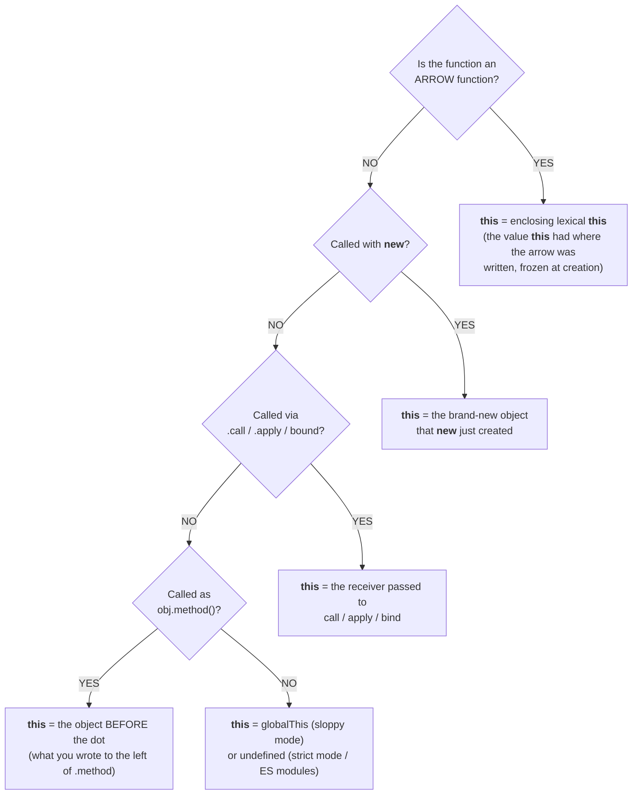
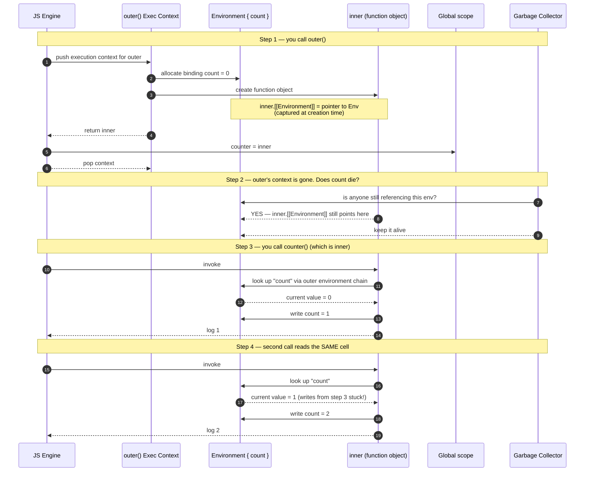

**JavaScript Chapter 2/7** | [← Previous: Foundations](01_JS_Foundations.md) | [Index](../00_MASTER_INDEX.md) | [Next → Objects & Prototypes](03_JS_Objects_Prototypes.md)

# Functions & Closures — The Heart of JavaScript

## 5W1H — Why This Chapter?

> **What "first-class" means, precisely — not just a label.** A
> language treats functions as first-class when a function is a value
> like any other: it can be stored in a variable, passed as an
> argument, returned from another function, and stuffed into an array
> or object — no special syntax required, no restrictions a `number`
> or `string` wouldn't also have. JavaScript functions satisfy every
> one of those; that's the entire content of the label.
>
> **Why this chapter follows Chapter 1's scope chapter directly, and
> not, say, objects or async.** Closures — this chapter's central
> concept — are not a separate feature bolted onto functions. They are
> the *direct, mechanical consequence* of combining two things Chapter
> 1 already gave you: functions being values you can return and pass
> around, and lexical scoping (the Scope Chain section) determining
> what a piece of code can see based on where it was *written*. Once
> both of those are true simultaneously, closures aren't something the
> language had to add — they're something that becomes unavoidable.
> Section 4 below derives exactly why.
>
> **Where this shows up, concretely, so the abstraction lands.** React's
> `useState` is a closure holding a component's value between renders.
> Every `debounce`/`throttle` utility is a closure holding a timer ID.
> Every module pattern that hides internal state is a closure standing
> in for what other languages use a `private` class field for. This
> isn't a list of unrelated use cases — it's the same one mechanism,
> derived once in Section 4, showing up everywhere state needs to
> survive between calls without being globally visible.

---

## 1. Function Declarations vs Expressions

```javascript
// DECLARATION: Hoisted FULLY. Can call before the line.
greet("Harsha"); // ✅ Works!
function greet(name) {
  return `Hello ${name}`;
}

// EXPRESSION: Variable is hoisted, but value is NOT.
sayHi("Harsha"); // ❌ TypeError: sayHi is not a function
const sayHi = function (name) {
  return `Hi ${name}`;
};

// ARROW FUNCTION (ES6): Shorter syntax + lexical `this`
const add = (a, b) => a + b;
const square = (x) => x * x; // Single param: no parens needed
const getUser = () => ({ name: "H" }); // Return object: wrap in ()

// NAMED FUNCTION EXPRESSION: For recursion & stack traces
const factorial = function fact(n) {
  return n <= 1 ? 1 : n * fact(n - 1); // fact is only visible inside
};
```

**When to reach for each form:**

| Form                          | Best for                                           | Why (mechanism)                                                                                  |
|-------------------------------|----------------------------------------------------|--------------------------------------------------------------------------------------------------|
| `function greet() { }`        | Top-level utilities, main entry points             | Fully hoisted — callable before its line. `this` is dynamic (see the 5 rules below).                |
| `const greet = () => { }`     | Callbacks (`.map`, event handlers), tiny helpers   | No own `this` — inherits from enclosing scope. Cannot be `new`‑ed. Shorter syntax for expressions. |
| `const greet = function() {}` | Rare — conditional assignment, named recursion    | Behaves like an arrow for hoisting (TDZ), but keeps its own `this`. Named form aids stack traces.  |

The choice is not stylistic — it is behavioural. Pick by *what `this` and hoisting must do*, not by which is shorter.

---

🧪 **Section Challenge – 1. Function Declarations vs Expressions**

**Challenge 1 (Reasoning):** `function greet() {}` vs `const greet = () => {}` — name 3 behavioral differences beyond syntax.

<details><summary>Answer</summary>

1. **Hoisting**: Declarations are fully hoisted (callable before definition). Arrow/expression variables are hoisted but uninitialized (TDZ with `const`). 2. **`this` binding**: Declarations have dynamic `this` (depends on call site). Arrows capture lexical `this` (from enclosing scope). 3. **`arguments` object**: Declarations have their own `arguments`. Arrows inherit `arguments` from enclosing scope (or it's undefined). Bonus: Declarations can be used as constructors (`new greet()`). Arrows cannot — they throw TypeError.
</details>

## 2. Parameters — Default, Rest, Destructuring

```javascript
// DEFAULT PARAMETERS (ES6)
function createUser(name, role = "viewer", active = true) {
  return { name, role, active };
}
createUser("Harsha"); // { name: "Harsha", role: "viewer", active: true }
createUser("Harsha", "admin"); // { name: "Harsha", role: "admin", active: true }
createUser("Harsha", undefined, false); // { name: "Harsha", role: "viewer", active: false }
// undefined triggers default. null does NOT.

// REST PARAMETERS (...)
function sum(...numbers) {
  return numbers.reduce((acc, n) => acc + n, 0);
}
sum(1, 2, 3, 4); // 10

// DESTRUCTURED PARAMETERS (great for config objects)
function createComponent({ tag = "div", className = "", children = [] }) {
  // Now you have tag, className, children as local variables
  return `<${tag} class="${className}">${children.join("")}</${tag}>`;
}
createComponent({ tag: "h1", className: "title", children: ["Hello"] });
// <h1 class="title">Hello</h1>

// WHY destructured params?
// 1. Named parameters → order doesn't matter
// 2. Self-documenting → you see what the function expects
// 3. Defaults built in → clean fallback behavior
```

---

## 3. `this` Keyword — The Most Confusing Part of JS

### 5W1H: WHY is `this` confusing?

> **WHAT.** `this` is a *runtime* reference to whichever object is
> currently executing the function. It is NOT a compile-time property
> of the function — the same function can see four different `this`
> values depending on how it is called.
>
> **WHY it confuses Java/C# readers.** In those languages `this` is
> baked in at method definition; the class that owns the method is the
> instance you get. In JS the function is a first-class value — it
> can be attached to any object, ripped off any object, or called with
> a fabricated receiver via `call`/`apply`/`bind`. So `this` is
> decided at the *call site*, not at the *definition site*.
>
> **The mental fix.** Stop asking "what does `this` refer to inside
> this function?" — that question has no answer in isolation. Ask
> instead: "how was this function called at this specific call site?"
> Then walk the 5 rules below in priority order.

### The 5 Rules of `this` (in priority order)

```javascript
// RULE 1: new binding (highest priority)
function Person(name) {
  this.name = name; // `this` = newly created object
}
const p = new Person("Harsha"); // this → {}

// RULE 2: explicit binding (call, apply, bind)
function greet() {
  console.log(`Hello, ${this.name}`);
}
const user = { name: "Harsha" };
greet.call(user); // "Hello, Harsha" — this = user
greet.apply(user); // Same, but args as array: greet.apply(user, [arg1, arg2])
const bound = greet.bind(user); // Returns NEW function with this locked to user
bound(); // "Hello, Harsha"

// RULE 3: implicit binding (object method)
const obj = {
  name: "Harsha",
  greet() {
    console.log(this.name); // this = obj (the object BEFORE the dot)
  },
};
obj.greet(); // "Harsha"

// ⚠️ BUT: Method extraction LOSES binding!
const fn = obj.greet;
fn(); // undefined — `this` is now global/undefined (no dot!)

// RULE 4: default binding (lowest priority)
function standalone() {
  console.log(this); // window (browser) or global (Node)
}
standalone(); // In strict mode: undefined

// RULE 5: Arrow functions — NO own `this`
const obj2 = {
  name: "Harsha",
  greet: () => {
    console.log(this.name); // ❌ `this` is NOT obj2!
    // Arrow inherits `this` from enclosing LEXICAL scope.
  },
  greetCorrect() {
    const inner = () => {
      console.log(this.name); // ✅ "Harsha" — inherits from greetCorrect
    };
    inner();
  },
};
```

**How the JS engine picks `this` at a call site — walk this tree
top-to-bottom, stop at the first YES:**



**Why this order matters.** Arrow-check comes first because arrows opt
out of the whole game — they have no `this` slot and won't accept any
runtime binding. `new` comes next because it *invents* a receiver
(the newly allocated object) which trumps any dot on the left. Only
after ruling those two out do `.call`/`.apply`/`bound` come in — they
inject an explicit receiver over whatever the syntax would have chosen.
The `obj.method()` implicit rule is the everyday default. Bare
`f()` with none of the above hits the last rule.

---

## 4. Closures — The Most Important Concept

### 5W1H: WHAT is a Closure?

> **WHAT.** A closure is a function bundled with the *lexical
> environment* it was defined in — the set of variable bindings that
> were visible at its creation. When the function runs later, those
> bindings are still reachable through it, even if the outer function
> that created them has already returned.
>
> **WHY it exists.** JavaScript has two places to keep state: object
> properties and closure variables. Closures give you privacy that
> classes don't — no outside code can read or write a closed-over
> variable, only the functions that captured it. That is how modules
> hide internals, how `setTimeout` callbacks remember their arguments,
> how `useState` remembers a component's slot between renders, how
> `debounce` holds a timer, and how a for-loop‑per‑iteration `let`
> gives each iteration its own binding.
>
> **HOW it works (mechanism, not metaphor).** Every function object in
> JS carries an internal `[[Environment]]` slot: a pointer to the
> *variable environment* that existed at the moment the function was
> created. When you call the function, the engine builds a new
> execution context whose *outer environment* is that pointer. So any
> identifier the function doesn't declare itself is looked up by
> walking that chain of environment records until it hits a binding.
> Because the closure holds a live reference (not a snapshot), reads
> see the current value and writes update the shared cell.

```javascript
// SIMPLEST CLOSURE EXAMPLE:
function outer() {
  let count = 0; // Variable in outer scope

  function inner() {
    count++; // inner "closes over" count
    console.log(count);
  }

  return inner; // Return the function (not its result)
}

const counter = outer(); // outer() finishes executing
counter(); // 1 — BUT count is still alive!
counter(); // 2 — count persists between calls!
counter(); // 3

// WHY does count persist?
// When inner was created, it captured a REFERENCE to count.
// Even though outer() finished, inner still holds that reference.
// JS garbage collector sees it's still referenced → keeps it alive.
```

**Trace what actually happens — who allocates what, and who
still holds a reference:**



**Why `count` persists across calls, in one sentence:** `count` lives
inside an *environment record*, not inside `outer`'s stack frame; the
function object `inner` holds a pointer to that record; the GC keeps
the record alive as long as any pointer to it exists.

**Why every call sees the previous value:** `inner` doesn't get a
snapshot of `count`; it reads and writes the *same cell* through the
environment chain. That's why `counter(); counter(); counter();`
prints `1, 2, 3` and not `1, 1, 1`.

### Closure Use Cases

```javascript
// USE CASE 1: DATA PRIVACY (Module Pattern)
function createBankAccount(initialBalance) {
  let balance = initialBalance; // PRIVATE — no outside access

  return {
    deposit(amount) {
      balance += amount;
      return balance;
    },
    withdraw(amount) {
      if (amount > balance) throw new Error("Insufficient funds");
      balance -= amount;
      return balance;
    },
    getBalance() {
      return balance; // Only way to READ balance
    },
  };
}

const account = createBankAccount(1000);
account.deposit(500); // 1500
account.withdraw(200); // 1300
account.getBalance(); // 1300
// account.balance → undefined! It's private.

// REASONING: balance is in the closure scope.
// Only the returned methods can access it.
// This is ENCAPSULATION without classes!

// USE CASE 2: FUNCTION FACTORY
function createMultiplier(multiplier) {
  return function (number) {
    return number * multiplier; // closes over `multiplier`
  };
}

const double = createMultiplier(2);
const triple = createMultiplier(3);
double(5); // 10
triple(5); // 15
// Each returned function has its OWN closure with its OWN multiplier.

// USE CASE 3: MEMOIZATION (Caching)
function memoize(fn) {
  const cache = {}; // Closure stores the cache

  return function (...args) {
    const key = JSON.stringify(args);
    if (cache[key] !== undefined) {
      console.log("Cache hit!");
      return cache[key];
    }
    const result = fn(...args);
    cache[key] = result;
    return result;
  };
}

const expensiveAdd = memoize((a, b) => {
  console.log("Computing...");
  return a + b;
});
expensiveAdd(1, 2); // "Computing..." → 3
expensiveAdd(1, 2); // "Cache hit!" → 3 (no recomputation)

// USE CASE 4: REACT'S useState (simplified)
function useState(initialValue) {
  let state = initialValue; // Closure!

  function getState() {
    return state;
  }

  function setState(newValue) {
    state = newValue;
    // In real React: triggers re-render
  }

  return [getState, setState];
}

const [getName, setName] = useState("Harsha");
getName(); // "Harsha"
setName("Updated");
getName(); // "Updated"
```

### The Classic Closure Bug (Interview Favorite)

```javascript
// THE BUG:
for (var i = 0; i < 3; i++) {
  setTimeout(() => console.log(i), 100);
}
// Output: 3, 3, 3 — NOT 0, 1, 2!

// WHY? var is function-scoped, so there's ONE `i` variable.
// By the time setTimeout fires (100ms later), the loop has finished.
// All three functions share the SAME i, which is now 3.

// FIX 1: Use let (creates new variable per iteration)
for (let i = 0; i < 3; i++) {
  setTimeout(() => console.log(i), 100);
}
// Output: 0, 1, 2 ✅ — let creates a new `i` for each iteration

// FIX 2: IIFE (old way, before let existed)
for (var i = 0; i < 3; i++) {
  (function (j) {
    setTimeout(() => console.log(j), 100);
  })(i); // Pass current i into IIFE as j → each closure has its own j
}
// Output: 0, 1, 2 ✅
```

---

🔬 **Section Challenge — 4. Closures — The Most Important Concept**

**Challenge 1 (Reasoning):** What is a closure and why can't garbage collection remove variables that are closed over?

<details><summary>Answer</summary>

A closure is a function that retains a reference to its lexical environment (the scope where it was created). Variables closed over are kept alive by the closure reference — GC can't collect them because there's still a reference (the closure's internal scope). Memory leak scenario: large data object captured in a closure, closure stored in a long-lived event listener — data stays in memory for the page's lifetime. Fix: explicitly null the large variable after use, or use a WeakRef.

</details>

## 5. Higher-Order Functions

### 5W1H: WHAT are Higher-Order Functions?

> **WHAT.** A higher-order function (HOF) either takes a function as
> an argument, returns a function, or both. Nothing more exotic than
> that — the "higher-order" part just means it operates on functions
> the way ordinary functions operate on numbers.
>
> **WHY it exists.** Two payoffs. (1) *Abstracting control flow* —
> iteration (`.forEach`), transformation (`.map`), accumulation
> (`.reduce`) and search (`.find`) become one line each, because the
> loop is inside the HOF and only the per-element verb changes. (2)
> *Wrapping behaviour around a call* — memoize, debounce, throttle,
> retry, log, guard-against-null: each is a function that takes your
> function and returns a decorated version.
>
> **WHERE you meet it in real code.** Array methods, event listeners,
> Express middleware, React hooks (custom hooks are HOFs over hooks),
> Redux thunks, RxJS operators, Node stream transforms.

```javascript
// Array higher-order methods (the most important ones):

const numbers = [1, 2, 3, 4, 5, 6, 7, 8, 9, 10];

// map: Transform each element → new array
const doubled = numbers.map((n) => n * 2);
// [2, 4, 6, 8, 10, 12, 14, 16, 18, 20]

// filter: Keep elements that pass a test → new array
const evens = numbers.filter((n) => n % 2 === 0);
// [2, 4, 6, 8, 10]

// reduce: Accumulate into a single value
const sum = numbers.reduce((acc, n) => acc + n, 0);
// 55

// find: Return FIRST element that passes test
const firstBig = numbers.find((n) => n > 5);
// 6

// some: Does ANY element pass?
numbers.some((n) => n > 5); // true

// every: Do ALL elements pass?
numbers.every((n) => n > 0); // true

// forEach: Side effects only (no return value)
numbers.forEach((n) => console.log(n));

// CHAINING — the power of functional style:
const result = numbers
  .filter((n) => n % 2 === 0) // [2, 4, 6, 8, 10]
  .map((n) => n * 3) // [6, 12, 18, 24, 30]
  .reduce((acc, n) => acc + n, 0); // 90

// REASONING: Each method returns a new array (immutable pattern).
// Chain them for readable, declarative data transformations.
// This is the foundation of React's JSX rendering pattern:
// data.filter(...).map(item => <Component {...item} />)
```

---

🧪🔬 **Section Challenge – 5. Higher-Order Functions**

**Challenge 1 (Reasoning):** Implement `Array.prototype.reduce` from scratch. What makes it more powerful than `map` or `filter`?

<details><summary>Answer</summary>

```javascript
Array.prototype.myReduce = function (callback, initialValue) {
  let acc = initialValue !== undefined ? initialValue : this[0];
  let startIndex = initialValue !== undefined ? 0 : 1;
  for (let i = startIndex; i < this.length; i++) {
    acc = callback(acc, this[i], i, this);
  }
  return acc;
};
```

`reduce` is more powerful because it can produce ANY output type (number, string, object, array) — not just a transformed array. You can implement `map`, `filter`, `flat`, `groupBy`, and any other array method using `reduce` alone. It's the universal accumulator.

</details>

## 6. IIFE — Immediately Invoked Function Expression

> **What it is, and why the syntax looks the way it does — not just
> "that's the pattern."** An IIFE is a function that's called the
> instant it's defined, specifically to get a private, throwaway scope
> — the Scope Chain mechanism from Chapter 1 applied deliberately: any
> `const`/`let` declared inside never leaks past the function's closing
> `}`, so it's a clean way to run setup code without adding a single
> name to whatever scope contains it (historically the global scope,
> before ES6 modules made this less necessary for that specific
> purpose).
>
> **Why it needs the wrapping parentheses — this is the detail almost
> every explanation skips, and it's the exact same parser ambiguity
> Chapter 1's `{} + []` challenge already introduced you to.** Write
> `function() { ... }();` at the START of a statement, and it's a
> `SyntaxError` — not because JavaScript can't call functions
> immediately, but because of how the parser decides what kind of node
> to build. When the parser sees the keyword `function` at the
> beginning of a statement, its grammar rule commits to building a
> **`FunctionDeclaration`** node — and a `FunctionDeclaration` node has
> no slot in the grammar for "and now call it" immediately after its
> closing brace; declarations are meant to be *referenced later*, not
> invoked in place. Wrapping the function in parentheses —
> `(function() { ... })` — forces a different parse: parentheses can
> only ever contain an *expression*, never a declaration, so the parser
> is forced down the **`FunctionExpression`** path instead — a
> `FunctionExpression` node genuinely does have a "and now call it"
> slot right after it, which is exactly what the trailing `()` fills.
> The parentheses aren't decoration or convention — they're the one
> lever that changes which AST node type gets built for the exact same
> function-keyword-and-body text, the same underlying "same source
> text, meaningfully different parse depending on position" mechanism
> Chapter 1 already showed you with `{} + []`.

```javascript
(function () {
  const secret = "hidden";
  console.log("IIFE ran!"); // Runs immediately
})();

// REVEALING MODULE PATTERN (pre-ES6 modules)
const Calculator = (function () {
  let result = 0; // Private via closure

  return {
    add(n) {
      result += n;
      return this;
    },
    subtract(n) {
      result -= n;
      return this;
    },
    getResult() {
      return result;
    },
  };
})();

Calculator.add(10).subtract(3).getResult(); // 7
```

---

## 7. Currying & Partial Application

> **Currying is not a new mechanism — it's closures, applied to
> arguments instead of to internal state.** Section 4 derived that a
> closure is a function bundled with a live pointer to the environment
> it was created in. `curriedAdd(5)` creates exactly that: an inner
> function whose environment contains a binding for `a = 5`, and that
> inner function is what gets returned. Calling `add5(3)` doesn't
> re-run `curriedAdd` — it invokes the already-existing inner function,
> which reads `a` from the environment it's still pointing at (the
> identical "environment chain lookup, not a snapshot" mechanism
> Section 4's sequence diagram traced for the `outer`/`inner`/`count`
> example) and combines it with the new argument `b`. Every "curried"
> function is, mechanically, nothing more than one function returning
> another function that closes over the first function's parameter —
> the exact same shape as `createMultiplier` from Section 4's use
> cases, just with a name ("currying") for the specific pattern of
> doing it to build up a full argument list one call at a time.

```javascript
// CURRYING: Transform f(a, b, c) into f(a)(b)(c)

// Normal function:
function add(a, b) {
  return a + b;
}

// Curried version:
function curriedAdd(a) {
  return function (b) {
    return a + b; // Closure over `a`
  };
}
const add5 = curriedAdd(5);
add5(3); // 8
add5(7); // 12

// Arrow syntax:
const multiply = (a) => (b) => a * b;
const double = multiply(2);
double(5); // 10

// REAL USE CASE: Event handlers in React
const handleInputChange = (fieldName) => (event) => {
  // fieldName is curried in
  setFormData((prev) => ({
    ...prev,
    [fieldName]: event.target.value,
  }));
};

// In JSX:
// <input onChange={handleInputChange("email")} />
// <input onChange={handleInputChange("password")} />

// GENERIC CURRY UTILITY:
function curry(fn) {
  return function curried(...args) {
    if (args.length >= fn.length) {
      return fn(...args);
    }
    return function (...moreArgs) {
      return curried(...args, ...moreArgs);
    };
  };
}

const curriedSum = curry((a, b, c) => a + b + c);
curriedSum(1)(2)(3); // 6
curriedSum(1, 2)(3); // 6
curriedSum(1)(2, 3); // 6
```

---

## 8. Composition & Pipe

```javascript
// COMPOSE: Right-to-left function application
const compose =
  (...fns) =>
  (x) =>
    fns.reduceRight((acc, fn) => fn(acc), x);

// PIPE: Left-to-right function application (more readable)
const pipe =
  (...fns) =>
  (x) =>
    fns.reduce((acc, fn) => fn(acc), x);

const trim = (str) => str.trim();
const toLower = (str) => str.toLowerCase();
const addExclaim = (str) => str + "!";

const processInput = pipe(trim, toLower, addExclaim);
processInput("  Hello World  "); // "hello world!"

// REASONING: Build complex operations from small, reusable pieces.
// Each function does ONE thing. Composition chains them.
// This is the mental model behind React component composition too.
```

---

## 9. Recursion (JS-Specific Notes)

> **Why recursion has a depth limit at all — this is [Chapter 1,
> Section 8](01_JS_Foundations.md#8-execution-context--how-js-runs-your-code)'s
> Execution Context and Call Stack mechanism, not a separate JS quirk.**
> Every call to a recursive function — including a call to *itself* —
> pushes a brand-new execution context onto the call stack, exactly the
> way any function call does. `flatten([1,[2,[3]]])` calling
> `flatten([2,[3]])` calling `flatten([3])` pushes three separate
> execution contexts, one per still-unfinished call, each waiting for
> its inner call to return before it can pop. Chapter 1 derived that
> the call stack is a **fixed-size** region, unlike the heap — so a
> recursive function that goes deep enough (thousands of nested levels)
> eventually pushes more execution contexts than that fixed region has
> room for, and you get the exact same `RangeError: Maximum call stack
> size exceeded` Chapter 1 predicted for any uncontrolled-recursion
> case, whether or not the recursion was intentional.
>
> **What "tail-call optimization" would fix, and why relying on it in
> JS today is unsafe.** In a language with proper tail calls, if a
> function's *very last action* is to return the result of calling
> another function (or itself) with nothing left to do afterward, the
> engine can reuse the current execution context instead of pushing a
> new one — because there's genuinely nothing left in the current call
> that still needs its own context once the tail call's result comes
> back. The ECMAScript spec technically allows this optimization, and
> Safari's JavaScriptCore implements it — but V8 (Chrome, Node,
> Edge) and Firefox's SpiderMonkey do not, despite the spec permitting
> it, because implementing it fully turned out to conflict with how
> those engines' debuggers construct stack traces. The practical
> consequence: write recursion as if NO engine will ever save you with
> tail-call optimization, because for the two most widely-deployed
> engines, none will.

```javascript
// Classic: Flatten nested array
function flatten(arr) {
  return arr.reduce(
    (acc, item) => acc.concat(Array.isArray(item) ? flatten(item) : item),
    [],
  );
}
flatten([1, [2, [3, [4]]]]); // [1, 2, 3, 4]

// Modern alternative: arr.flat(Infinity)
[1, [2, [3, [4]]]].flat(Infinity); // [1, 2, 3, 4]

// Deep clone via recursion
function deepClone(obj) {
  if (obj === null || typeof obj !== "object") return obj;
  const clone = Array.isArray(obj) ? [] : {};
  for (const key in obj) {
    if (obj.hasOwnProperty(key)) {
      clone[key] = deepClone(obj[key]);
    }
  }
  return clone;
}
// Modern alternative: structuredClone(obj)
```

---

🧪🔬 **Section Challenge – 9. Recursion (JS-Specific Notes)**

**Challenge 1 (Bug Hunt):** This recursive flatten fails on deeply nested arrays in Node.js. Why?

```javascript
function flatten(arr) {
  return arr.reduce(
    (acc, item) => acc.concat(Array.isArray(item) ? flatten(item) : item),
    [],
  );
}
flatten(deeplyNestedArray); // RangeError: Maximum call stack size exceeded
```

<details><summary>Answer</summary>

JavaScript has no tail-call optimization in practice (only Safari implements it). Each recursive call adds a frame to the call stack (~10,000 frame limit in V8). Deeply nested arrays (1000+ levels) blow the stack. Fix 1: Use iterative approach with an explicit stack (array). Fix 2: Use built-in `arr.flat(Infinity)` which is implemented natively in C++ and doesn't use JS call stack. Fix 3: For custom logic, use a while loop with a stack array to simulate recursion.

</details>

## Interview Quick-Fire

```
Q: What is a closure?
→ A function that remembers variables from its outer scope even
  after the outer function has returned.

Q: Give a practical use of closures.
→ Data privacy (module pattern), memoization, event handlers,
  React hooks (useState), factory functions.

Q: What does `this` refer to in an arrow function?
→ The `this` of the enclosing lexical scope. Arrow functions
  don't have their own `this`.

Q: What's the difference between call, apply, and bind?
→ call: invokes with `this` + individual args.
  apply: invokes with `this` + args as array.
  bind: returns new function with `this` locked (doesn't invoke).

Q: What's the output? for (var i=0; i<3; i++) setTimeout(() => console.log(i), 0);
→ 3, 3, 3 — because var is function-scoped, all closures share
  the same i. Fix: use let.

Q: What is currying?
→ Transforming f(a, b) into f(a)(b). Each call returns a new
  function until all args are received. Uses closures.

Q: What is a higher-order function?
→ A function that takes a function as argument or returns one.
  Examples: map, filter, reduce, addEventListener.
```

---

[← Previous: Foundations](01_JS_Foundations.md) | [Index](../00_MASTER_INDEX.md) | [Next → Objects & Prototypes](03_JS_Objects_Prototypes.md)


---

## Reality Check

**"A closure is a function inside a function"** → A closure is a function PLUS its captured environment surviving after the outer scope returned — the inner function is merely where you can observe it. The precise model: functions capture VARIABLES (live bindings), not values-at-creation. That one distinction explains the classic var-in-loop bug (all callbacks share one variable), why let-in-loop fixes it (new binding per iteration), and why a "snapshot" requires deliberately copying into a new scope. People who say "captures the value" carry a model that fails exactly at the famous interview question.

**"Closures are an interview topic, rarely used deliberately"** → Closures are the DOMINANT state mechanism in real JS: every event handler remembering its context, every debounce/throttle holding its timer, every module hiding privates, every React hook (useState IS a closure over the fiber's slot), every memoize cache. The interview question is artificial; the mechanism is load-bearing in every file. The reframe that helps: JS has two state containers — object properties and closure variables — and idiomatic code chooses closures for encapsulation-by-default.

**"Closures leak memory"** → Closures RETAIN exactly what they reference — that is the contract, not a leak. Leaks come from unexpected retention topology: a tiny callback capturing a huge buffer it uses once (the closure pins the buffer for the callback's lifetime), long-lived subscriptions holding entire component scopes, and (historically) same-scope closures sharing one environment record so ONE closure retaining anything retained everything siblings referenced. The audit skill: for any long-lived function, enumerate what it closes over and how big that transitively is — the fix is usually extracting the small value into a parameter before the capture.

**"bind, call, and apply are legacy this-fixers"** → call/apply are invocation-time receivers; bind is PARTIAL APPLICATION machinery that happens to also fix this — bound functions can pre-fill arguments, and the result is a new function with permanent bindings (bind-again does nothing, a fact exploited by security-sensitive code). Arrows replaced most this-fixing use, but bind's remaining niches are real: pre-filled callbacks, method extraction for handler maps, and the sneaky fact that class fields with arrows create PER-INSTANCE functions (memory cost, breaks prototype patching for tests) versus bind-in-constructor being explicit about the same trade.

**"Higher-order functions are functional-programming style preference"** → HOFs are how JS expresses CONTROL FLOW you cannot write otherwise: once/memoize/debounce wrap behavior around calls, middleware chains compose request handling, and array methods take the loop inward so the caller supplies only the verb. The engineering content is the CONTRACTS: does the wrapper preserve this and arguments (spread and apply correctly), does it propagate errors or swallow them, is the wrapped function's identity stable (React deps, removeEventListener need the SAME reference — the inline-wrapper re-creation bug). Writing a correct debounce from scratch — leading/trailing options, cancel method, this-preservation — remains one of the highest-signal small exercises in the language.
