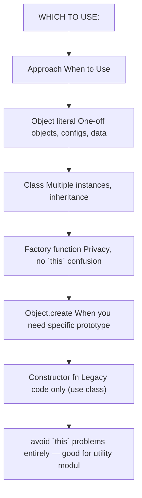
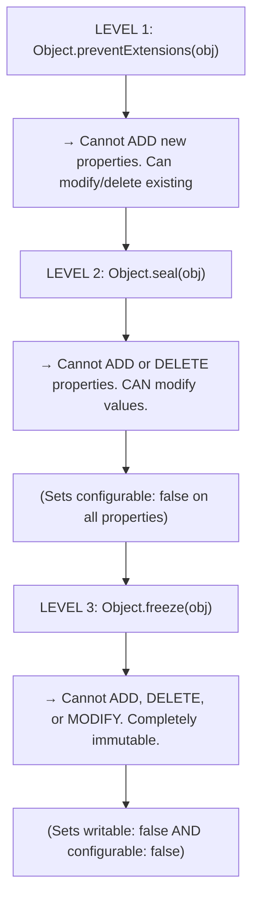
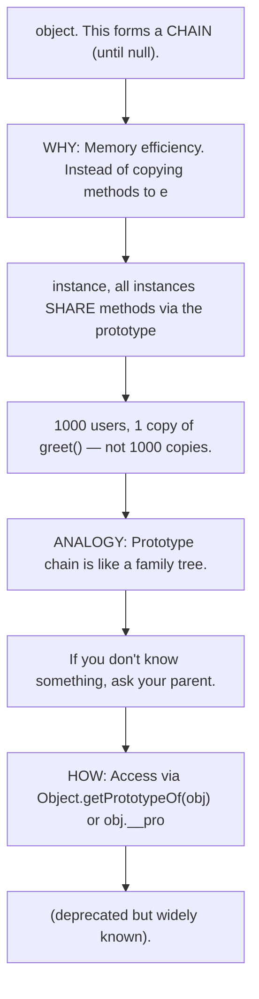
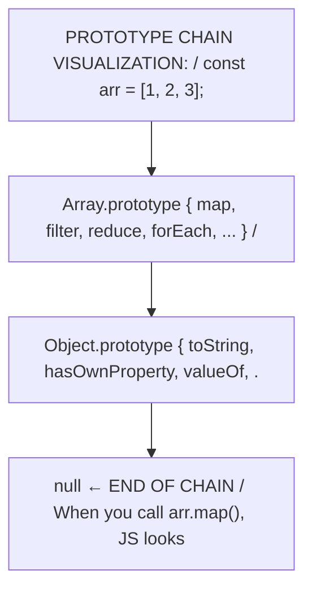
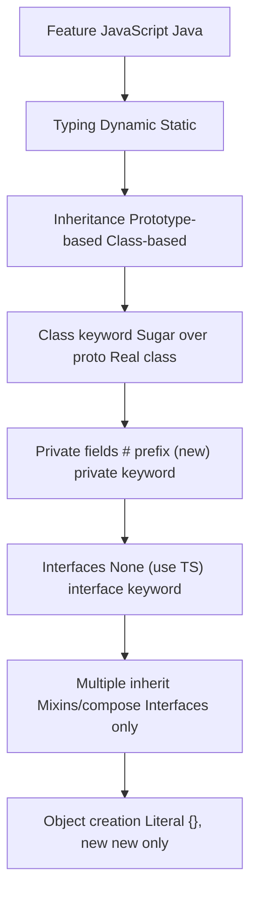
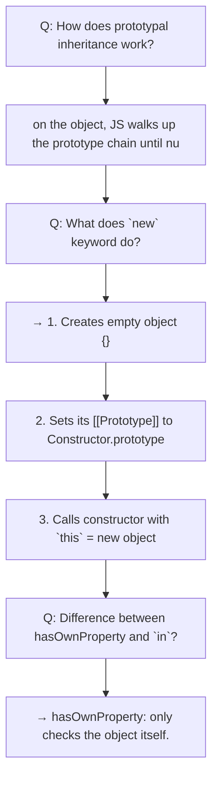

> **JavaScript Chapter 3/7** | [← Previous: Functions & Closures](02_JS_Functions_Closures.md) | [Index](../00_MASTER_INDEX.md) | [Next → Async & Promises](04_JS_Async_Promises.md)

# Objects & Prototypes — How JS Really Does Inheritance

## 5W1H — Why This Chapter?


> WHAT: Objects are JS's universal data structure. Prototypes are
> JS's inheritance mechanism. Classes (ES6) are sugar on top.
>
> WHY:  Everything in JS is (or behaves like) an object.
> Understanding prototypes explains: why [].map works,
> how inheritance works, what `class` really does.
>
> WHO:  Anyone doing JS — React props are objects, APIs return
> objects, DOM elements are objects.
>
> WHEN: After understanding functions and closures (Ch 2).
>
> HOW:  Every object has an internal [[Prototype]] link to another
> object. When you access a property, JS walks this chain.


---

## 1. Object Creation — 5 Ways

```javascript
// WAY 1: Object literal (most common)
const user = {
    name: "Harsha",
    age: 24,
    greet() { return `Hi, I'm ${this.name}`; }
};

// WAY 2: Object.create() (prototype-based)
const personProto = {
    greet() { return `Hi, I'm ${this.name}`; }
};
const user2 = Object.create(personProto);
user2.name = "Harsha";
// user2 inherits greet from personProto

// WAY 3: Constructor function (pre-ES6)
function Person(name, age) {
    this.name = name;
    this.age = age;
}
Person.prototype.greet = function() {
    return `Hi, I'm ${this.name}`;
};
const user3 = new Person("Harsha", 24);

// WAY 4: ES6 Class (syntactic sugar over Way 3)
class PersonClass {
    constructor(name, age) {
        this.name = name;
        this.age = age;
    }
    greet() { return `Hi, I'm ${this.name}`; }
}
const user4 = new PersonClass("Harsha", 24);

// WAY 5: Factory function (uses closures, no `this` needed)
function createPerson(name, age) {
    return {
        getName() { return name; },  // closure over name
        getAge() { return age; },    // closure over age
        greet() { return `Hi, I'm ${name}`; }
    };
}
const user5 = createPerson("Harsha", 24);
```

```
WHICH TO USE:
┌───────────────────┬────────────────────────────────────┐
│ Approach          │ When to Use                        │
├───────────────────┼────────────────────────────────────┤
│ Object literal    │ One-off objects, configs, data     │
│ Class             │ Multiple instances, inheritance    │
│ Factory function  │ Privacy, no `this` confusion       │
│ Object.create     │ When you need specific prototype   │
│ Constructor fn    │ Legacy code only (use class)       │
└───────────────────┴────────────────────────────────────┘

REASONING: In React, you'll mostly use object literals (props,
state) and classes (old class components). Factory functions
avoid `this` problems entirely — good for utility modules.
```

**Flow:**
- WHICH TO USE:
- ↓
- Approach When to Use
- ↓
- Object literal One-off objects, configs, data
- ↓
- Class Multiple instances, inheritance
- ↓
- Factory function Privacy, no `this` confusion
- ↓
- Object.create When you need specific prototype
- ↓
- Constructor fn Legacy code only (use class)



---

## 2. Property Descriptors — What Properties Really Are

```javascript
const obj = { name: "Harsha" };

// Every property has hidden descriptors:
console.log(Object.getOwnPropertyDescriptor(obj, "name"));
// {
//   value: "Harsha",
//   writable: true,      ← can change value?
//   enumerable: true,    ← shows in for...in/Object.keys()?
//   configurable: true   ← can delete or change descriptor?
// }

// Define read-only property:
Object.defineProperty(obj, "id", {
    value: 42,
    writable: false,       // Can't change
    enumerable: true,
    configurable: false    // Can't delete or reconfigure
});
obj.id = 100;   // Silently fails (strict mode: TypeError)
console.log(obj.id); // 42

// GETTER/SETTER (computed properties):
const person = {
    firstName: "Sai",
    lastName: "Harsha",

    get fullName() {
        return `${this.firstName} ${this.lastName}`;
    },
    set fullName(value) {
        const [first, last] = value.split(" ");
        this.firstName = first;
        this.lastName = last;
    }
};

person.fullName;           // "Sai Harsha" (calls getter)
person.fullName = "New Name"; // calls setter
person.firstName;          // "New"
```

---

## 3. Object Immutability — 3 Levels

```
╔══════════════════════════════════════════════════════════════════════╗
║  LEVEL 1: Object.preventExtensions(obj)                              ║
║  → Cannot ADD new properties. Can modify/delete existing.            ║
║                                                                      ║
║  LEVEL 2: Object.seal(obj)                                           ║
║  → Cannot ADD or DELETE properties. CAN modify values.               ║
║  (Sets configurable: false on all properties)                        ║
║                                                                      ║
║  LEVEL 3: Object.freeze(obj)                                         ║
║  → Cannot ADD, DELETE, or MODIFY. Completely immutable.              ║
║  (Sets writable: false AND configurable: false)                      ║
║                                                                      ║
║  ⚠ ALL THREE ARE SHALLOW! Nested objects are NOT frozen.             ║
║                                                                      ║
║  const obj = Object.freeze({ a: 1, b: { c: 2 } });                   ║
║  obj.a = 10;     // Silently fails ✅                                 ║
║  obj.b.c = 10;   // WORKS! ❌ b is not frozen                         ║
║                                                                      ║
║  For deep freeze, use structuredClone or a recursive freeze.         ║
╚══════════════════════════════════════════════════════════════════════╝
```

**Flow:**
- LEVEL 1: Object.preventExtensions(obj)
- ↓
- Cannot ADD new properties. Can modify/delete existing
- ↓
- LEVEL 2: Object.seal(obj)
- ↓
- Cannot ADD or DELETE properties. CAN modify values.
- ↓
- (Sets configurable: false on all properties)
- ↓
- LEVEL 3: Object.freeze(obj)
- ↓
- Cannot ADD, DELETE, or MODIFY. Completely immutable.



---

## 4. Prototypes — JS's Inheritance Mechanism

### 5W1H: WHY Prototypes?

```
╔══════════════════════════════════════════════════════════════════════╗
║  WHAT: Every object has a hidden [[Prototype]] link to another       ║
║        object. This forms a CHAIN (until null).                      ║
║                                                                      ║
║  WHY:  Memory efficiency. Instead of copying methods to every        ║
║        instance, all instances SHARE methods via the prototype.      ║
║        1000 users, 1 copy of greet() — not 1000 copies.              ║
║                                                                      ║
║  ANALOGY: Prototype chain is like a family tree.                     ║
║  If you don't know something, ask your parent.                       ║
║  If parent doesn't know, ask grandparent. Up to the root (null).     ║
║                                                                      ║
║  HOW:  Access via Object.getPrototypeOf(obj) or obj.__proto__        ║
║        (deprecated but widely known).                                ║
╚══════════════════════════════════════════════════════════════════════╝
```

**Flow:**
- object. This forms a CHAIN (until null).
- ↓
- WHY: Memory efficiency. Instead of copying methods to e
- ↓
- instance, all instances SHARE methods via the prototype
- ↓
- 1000 users, 1 copy of greet() — not 1000 copies.
- ↓
- ANALOGY: Prototype chain is like a family tree.
- ↓
- If you don't know something, ask your parent.
- ↓
- HOW: Access via Object.getPrototypeOf(obj) or obj.__pro



```
╔══════════════════════════════════════════════════════════════════════╗
║  PROTOTYPE CHAIN VISUALIZATION:                                      ║
║                                                                      ║
║  const arr = [1, 2, 3];                                              ║
║                                                                      ║
║  arr                                                                 ║
║   │ .__proto__                                                       ║
║   ▼                                                                  ║
║  Array.prototype { map, filter, reduce, forEach, ... }               ║
║   │ .__proto__                                                       ║
║   ▼                                                                  ║
║  Object.prototype { toString, hasOwnProperty, valueOf, ... }         ║
║   │ .__proto__                                                       ║
║   ▼                                                                  ║
║  null  ← END OF CHAIN                                                ║
║                                                                      ║
║  When you call arr.map(), JS looks:                                  ║
║  1. Does arr have own property "map"? → No                           ║
║  2. Does Array.prototype have "map"? → YES! Use it.                  ║
║                                                                      ║
║  When you call arr.toString(), JS looks:                             ║
║  1. arr → No  2. Array.prototype → has its own toString → Use it     ║
║  (If Array.prototype didn't have it, would go to Object.prototype)   ║
╚══════════════════════════════════════════════════════════════════════╝
```

**Flow:**
- PROTOTYPE CHAIN VISUALIZATION: / const arr = [1, 2, 3];
- ↓
- Array.prototype { map, filter, reduce, forEach, ... } /
- ↓
- Object.prototype { toString, hasOwnProperty, valueOf, .
- ↓
- null ← END OF CHAIN / When you call arr.map(), JS looks



```javascript
// HOW prototype works in practice:
function Animal(name) {
    this.name = name;
}
Animal.prototype.speak = function() {
    return `${this.name} makes a sound`;
};

function Dog(name, breed) {
    Animal.call(this, name);   // Call parent constructor
    this.breed = breed;
}
Dog.prototype = Object.create(Animal.prototype); // Set up chain
Dog.prototype.constructor = Dog;                  // Fix constructor ref
Dog.prototype.bark = function() {
    return `${this.name} barks!`;
};

const rex = new Dog("Rex", "German Shepherd");
rex.bark();   // "Rex barks!"      ← found on Dog.prototype
rex.speak();  // "Rex makes a sound" ← found on Animal.prototype
rex.toString(); // "[object Object]" ← found on Object.prototype

// rex own properties: { name: "Rex", breed: "German Shepherd" }
// Dog.prototype: { bark, constructor }
// Animal.prototype: { speak, constructor }
// Object.prototype: { toString, hasOwnProperty, ... }
```

---


> 🔬 **Section Challenge — 4. Prototypes — JS's Inheritance Mechanism**
>
> **Challenge 1 (Reasoning):** `Object.create(proto)` vs `new Constructor()` — what's the practical difference?
> <details><summary>Answer</summary>
>
> `new Constructor()`: runs the constructor function (initializes instance properties), sets `__proto__` to `Constructor.prototype`. `Object.create(proto)`: creates an object with `proto` as its prototype, NO constructor called. Use `Object.create(null)` to create a pure dictionary with no inherited properties (no `toString`, `hasOwnProperty`, etc.) — useful for safe maps. `Object.create(SomeClass.prototype)` creates an instance-like object without running the constructor (used in class inheritance setup).
> </details>
>

## 5. ES6 Classes — Syntactic Sugar

```javascript
class Animal {
    // CONSTRUCTOR: Called when you do `new Animal(...)`
    constructor(name) {
        this.name = name;  // Instance property
    }

    // INSTANCE METHOD: Added to Animal.prototype
    speak() {
        return `${this.name} makes a sound`;
    }

    // STATIC METHOD: On the class itself, NOT on instances
    static kingdom() {
        return "Animalia";
    }

    // GETTER/SETTER
    get info() {
        return `Animal: ${this.name}`;
    }
}

class Dog extends Animal {
    #tricks = [];  // PRIVATE FIELD (ES2022) — truly private!

    constructor(name, breed) {
        super(name);        // MUST call super() before using `this`
        this.breed = breed;
    }

    bark() {
        return `${this.name} barks!`;
    }

    // OVERRIDE parent method
    speak() {
        return `${this.name} woofs!`;
    }

    // Access private field
    addTrick(trick) {
        this.#tricks.push(trick);
    }

    showTricks() {
        return this.#tricks.join(", ");
    }
}

const rex = new Dog("Rex", "GSD");
rex.bark();           // "Rex barks!"
rex.speak();          // "Rex woofs!" (overridden)
Animal.kingdom();     // "Animalia" (static)
rex.addTrick("sit");
rex.showTricks();     // "sit"
// rex.#tricks;       // ❌ SyntaxError — truly private!
```

```
╔══════════════════════════════════════════════════════════════════════╗
║  CLASS ≡ PROTOTYPE (what class actually does):                       ║
║                                                                      ║
║  class Dog extends Animal { bark() {} }                              ║
║                                                                      ║
║  IS EXACTLY THE SAME AS:                                             ║
║                                                                      ║
║  function Dog(name, breed) { Animal.call(this, name); ... }          ║
║  Dog.prototype = Object.create(Animal.prototype);                    ║
║  Dog.prototype.constructor = Dog;                                    ║
║  Dog.prototype.bark = function() {};                                 ║
║                                                                      ║
║  REASONING: `class` doesn't add new behavior to JS. It's just        ║
║  cleaner syntax for the prototype pattern. Under the hood, it's      ║
║  still prototypes. But class syntax prevents common mistakes         ║
║  like forgetting to set constructor.                                 ║
╚══════════════════════════════════════════════════════════════════════╝
```

**Flow:**
- CLASS ≡ PROTOTYPE (what class actually does):
- ↓
- class Dog extends Animal { bark() {} }
- ↓
- IS EXACTLY THE SAME AS:
- ↓
- function Dog(name, breed) { Animal.call(this, name); ..
- ↓
- Dog.prototype = Object.create(Animal.prototype);
- ↓
- Dog.prototype.constructor = Dog;
- ↓
- Dog.prototype.bark = function() {};


---

## 6. Object Methods — Essential Toolkit

```javascript
const user = { name: "Harsha", age: 24, role: "developer" };

// KEYS, VALUES, ENTRIES
Object.keys(user);    // ["name", "age", "role"]
Object.values(user);  // ["Harsha", 24, "developer"]
Object.entries(user);  // [["name","Harsha"], ["age",24], ["role","developer"]]

// Destructuring from entries (convert to Map):
const map = new Map(Object.entries(user));

// ASSIGN (shallow merge — mutates target!)
const defaults = { theme: "dark", lang: "en" };
const prefs = { theme: "light" };
const result = Object.assign({}, defaults, prefs);
// { theme: "light", lang: "en" }

// SPREAD is preferred (creates new object):
const result2 = { ...defaults, ...prefs }; // Same result, cleaner

// fromEntries (opposite of entries)
const entries = [["a", 1], ["b", 2]];
const obj = Object.fromEntries(entries); // { a: 1, b: 2 }

// USE CASE: Transform object values
const prices = { apple: 1, banana: 2, cherry: 3 };
const doubled = Object.fromEntries(
    Object.entries(prices).map(([key, val]) => [key, val * 2])
);
// { apple: 2, banana: 4, cherry: 6 }
```

---

## 7. Destructuring — Extracting Object Properties

```javascript
// BASIC
const { name, age } = user;
// Creates: const name = user.name; const age = user.age;

// RENAME
const { name: userName, age: userAge } = user;
// userName = "Harsha", userAge = 24

// DEFAULT
const { name, phone = "N/A" } = user;
// phone = "N/A" (user has no phone property)

// NESTED
const company = {
    name: "Tech Corp",
    address: { city: "Hyderabad", zip: "500001" }
};
const { address: { city, zip } } = company;
// city = "Hyderabad", zip = "500001"

// REST
const { name: n, ...rest } = user;
// n = "Harsha", rest = { age: 24, role: "developer" }

// IN FUNCTION PARAMS (very common in React)
function UserCard({ name, age, role = "viewer" }) {
    return `<div>${name} (${age}) - ${role}</div>`;
}
UserCard(user); // <div>Harsha (24) - developer</div>

// ARRAY DESTRUCTURING
const [first, second, ...rest] = [1, 2, 3, 4, 5];
// first = 1, second = 2, rest = [3, 4, 5]

// SWAP
let a = 1, b = 2;
[a, b] = [b, a]; // a = 2, b = 1 — no temp variable needed!
```

---


## 8. Iterators & Symbols

```javascript
// SYMBOL: Unique, immutable identifier (no two symbols are equal)
const id = Symbol("id");
const id2 = Symbol("id");
id === id2; // false — always unique!

// Use: Hidden/non-colliding property keys
const user = {
    name: "Harsha",
    [id]: 12345    // Symbol as key — won't show in Object.keys()
};
Object.keys(user);           // ["name"] — symbol hidden!
Object.getOwnPropertySymbols(user); // [Symbol(id)]

// WELL-KNOWN SYMBOLS — customize built-in behavior:
class Range {
    constructor(start, end) {
        this.start = start;
        this.end = end;
    }

    // Make Range iterable with for...of
    [Symbol.iterator]() {
        let current = this.start;
        const end = this.end;
        return {
            next() {
                return current <= end
                    ? { value: current++, done: false }
                    : { done: true };
            }
        };
    }
}

const range = new Range(1, 5);
for (const n of range) console.log(n); // 1, 2, 3, 4, 5
[...range]; // [1, 2, 3, 4, 5] — spread works too!
```

---

## 9. Comparison: JS vs Java Objects

```
┌──────────────────┬──────────────────┬──────────────────┐
│ Feature          │ JavaScript       │ Java             │
├──────────────────┼──────────────────┼──────────────────┤
│ Typing           │ Dynamic          │ Static           │
│ Inheritance      │ Prototype-based  │ Class-based      │
│ Class keyword    │ Sugar over proto │ Real class       │
│ Private fields   │ # prefix (new)   │ private keyword  │
│ Interfaces       │ None (use TS)    │ interface keyword│
│ Multiple inherit │ Mixins/compose   │ Interfaces only  │
│ Object creation  │ Literal {}, new  │ new only         │
│ Property access  │ Dynamic (obj[x]) │ Fixed at compile │
│ this keyword     │ Changes by call  │ Always instance  │
│ Null safety      │ ?. operator      │ Optional (Java17)│
└──────────────────┴──────────────────┴──────────────────┘

KEY INSIGHT: In Java, the class defines the shape forever.
In JS, objects are "bags of properties" — you can add/remove
properties at any time. More flexible, but less safe.
```

**Flow:**
- Feature JavaScript Java
- ↓
- Typing Dynamic Static
- ↓
- Inheritance Prototype-based Class-based
- ↓
- Class keyword Sugar over proto Real class
- ↓
- Private fields # prefix (new) private keyword
- ↓
- Interfaces None (use TS) interface keyword
- ↓
- Multiple inherit Mixins/compose Interfaces only



---

## Interview Quick-Fire

```
Q: How does prototypal inheritance work?
→ Every object has a [[Prototype]] link. When a property isn't found
  on the object, JS walks up the prototype chain until null.

Q: What does `new` keyword do?
→ 1. Creates empty object {}
   2. Sets its [[Prototype]] to Constructor.prototype
   3. Calls constructor with `this` = new object
   4. Returns the object (unless constructor returns an object)

Q: Difference between hasOwnProperty and `in`?
→ hasOwnProperty: only checks the object itself.
  `in`: checks object AND its entire prototype chain.

Q: How to create truly private properties?
→ ES2022: # prefix (class #field). Before: closures in factory.
  WeakMap was used as a workaround.

Q: Object.create(null) — why?
→ Creates an object with NO prototype. No toString, no hasOwnProperty.
  Used for pure dictionaries (e.g., Map-like storage) with no
  prototype pollution risk.

Q: How to check if a property exists?
→ "prop" in obj (includes prototype chain)
  obj.hasOwnProperty("prop") (own only)
  Object.hasOwn(obj, "prop") (modern, own only — preferred)
```

**Flow:**
- Q: How does prototypal inheritance work?
- ↓
- on the object, JS walks up the prototype chain until nu
- ↓
- Q: What does `new` keyword do?
- ↓
- 1. Creates empty object {}
- ↓
- 2. Sets its [[Prototype]] to Constructor.prototype
- ↓
- 3. Calls constructor with `this` = new object
- ↓
- Q: Difference between hasOwnProperty and `in`?



---

> [← Previous: Functions & Closures](02_JS_Functions_Closures.md) | [Index](../00_MASTER_INDEX.md) | [Next → Async & Promises](04_JS_Async_Promises.md)

---

## 🏋️ Practice & Interview Questions — JavaScript

### Predict / Trace
**Q1.** What prints?
```js
console.log(typeof null);
console.log(null instanceof Object);
```
<details><summary>Answer</summary>

`"object"` (historical JS bug), `false` (null is not an Object instance). This is a well-known JS quirk.
</details>

**Q2.** What is the output?
```js
console.log(1 + "2");
console.log("3" - 1);
console.log(true + false);
```
<details><summary>Answer</summary>

`"12"` (string concat), `2` (- coerces to number), `1` (true=1, false=0)
</details>

**Q3.** What prints and why?
```js
for (var i = 0; i < 3; i++) {
  setTimeout(() => console.log(i), 0);
}
```
<details><summary>Answer</summary>

`3 3 3` — `var` is function-scoped, all closures share same `i`. By the time timeouts run, loop is done, i=3. **Fix**: use `let` (block-scoped) or `setTimeout(() => console.log(i), 0, i)`.
</details>

### Coding Problems
**Q4.** ⭐ Implement `debounce(fn, delay)`.
<details><summary>Solution</summary>

```js
function debounce(fn, delay) {
  let timer;
  return function(...args) {
    clearTimeout(timer);
    timer = setTimeout(() => fn.apply(this, args), delay);
  };
}
```
</details>

**Q5.** ⭐ Implement `Promise.all` from scratch.
<details><summary>Solution</summary>

```js
function promiseAll(promises) {
  return new Promise((resolve, reject) => {
    const results = [];
    let count = 0;
    promises.forEach((p, i) => {
      Promise.resolve(p)
        .then(val => { results[i] = val; if(++count === promises.length) resolve(results); })
        .catch(reject);
    });
    if(promises.length === 0) resolve([]);
  });
}
```
</details>

**Q6.** ⭐ Deep clone an object without `JSON.parse(JSON.stringify(...))`.
<details><summary>Solution</summary>

```js
function deepClone(obj) {
  if(obj === null || typeof obj !== 'object') return obj;
  if(obj instanceof Date) return new Date(obj);
  if(obj instanceof Array) return obj.map(deepClone);
  const clone = {};
  for(const key in obj) if(obj.hasOwnProperty(key)) clone[key] = deepClone(obj[key]);
  return clone;
}
// Modern: structuredClone(obj) — built-in, handles more types
```
</details>

**Q7.** ⭐⭐ Implement `curry` function.
<details><summary>Solution</summary>

```js
function curry(fn) {
  return function curried(...args) {
    if(args.length >= fn.length) return fn(...args);
    return function(...more) { return curried(...args, ...more); };
  };
}
const add = curry((a, b, c) => a + b + c);
add(1)(2)(3); // 6
add(1, 2)(3); // 6
```
</details>

**Q8.** ⭐⭐ Implement `memoize(fn)`.
<details><summary>Solution</summary>

```js
function memoize(fn) {
  const cache = new Map();
  return function(...args) {
    const key = JSON.stringify(args);
    if(cache.has(key)) return cache.get(key);
    const result = fn.apply(this, args);
    cache.set(key, result);
    return result;
  };
}
```
</details>

### MCQ Rapid Fire
| # | Question | Answer |
|---|---|---|
| 1 | == vs === | == coerces types; === strict (no coercion) |
| 2 | `typeof undefined` | "undefined" |
| 3 | `typeof function(){}` | "function" |
| 4 | Prototype chain end | null |
| 5 | Event loop: microtasks vs macrotasks | Microtasks (Promises) run before macrotasks (setTimeout) |
| 6 | `const` prevents | Reassignment, not mutation |
| 7 | `var` vs `let` hoisting | var: hoisted+initialized to undefined; let: hoisted but in TDZ |
| 8 | `this` in arrow function | Lexical (inherited from enclosing scope) |
| 9 | Optional chaining `?.` | Returns undefined instead of throwing on null/undefined |
| 10 | Nullish coalescing `??` | Returns right side only if left is null/undefined (not 0 or '') |

---

## 🧠 Deep Conceptual Questions — JavaScript Engine & Language

**C1. How does the JavaScript event loop actually work?**
<details><summary>Deep Answer</summary>

```
Call Stack → runs synchronous code
     ↓ (when empty)
Microtask Queue → Promise callbacks, queueMicrotask, MutationObserver
     ↓ (when empty)
Macrotask Queue → setTimeout, setInterval, I/O, requestAnimationFrame
```

One "tick": (1) Run all synchronous code in call stack until empty, (2) Run ALL microtasks until queue empty (even if new microtasks added!), (3) Run ONE macrotask from the macrotask queue, (4) Repeat.

Critical: microtasks drain COMPLETELY before any macrotask. A microtask that continually enqueues microtasks → infinite loop, browser freezes (no macrotasks can run). `Promise.resolve().then(...)` vs `setTimeout(fn, 0)`: Promise runs BEFORE the timeout even with a 0ms delay.
</details>

**C2. What is the prototype chain and how does `class` syntax relate to it?**
<details><summary>Deep Answer</summary>

Every JS object has an internal `[[Prototype]]` link. Property lookup: check own properties → check `[[Prototype]]` → check `[[Prototype]][[Prototype]]` → ... until null. `class` is syntactic sugar over prototype-based inheritance:
```js
class Animal { speak() {} }  // same as:
function Animal() {}
Animal.prototype.speak = function() {};
```
`class extends` sets up the prototype chain: `Dog.prototype.__proto__ = Animal.prototype`. `super` works via `[[HomeObject]]` — a hidden reference to the class where the method was defined. Key: `typeof Dog === 'function'` — classes ARE functions. `instanceof` checks the prototype chain, not the class definition.
</details>

**C3. Explain closures: why do they exist and what problems do they solve?**
<details><summary>Deep Answer</summary>

A closure = a function + references to its lexical environment (the variables in scope when the function was created). It solves: **data encapsulation without classes**. Private state in JS (pre-class): use closure.
```js
function makeCounter() {
  let count = 0; // private — inaccessible outside
  return { increment: () => ++count, get: () => count };
}
```
`count` lives on even after `makeCounter` returns because the returned object's methods close over it. Closures keep the enclosing scope alive in memory as long as any reference to them exists — the classic memory leak: `button.addEventListener('click', heavyFunction)` — even after button is removed from DOM, heavyFunction and all its closed-over variables stay in memory.
</details>

**C4. What is the difference between `==` and `===` at the engine level?**
<details><summary>Deep Answer</summary>

`===` (strict equality): checks type first — if types differ, returns false immediately. No coercion. Two objects: only true if same reference. `==` (abstract equality): if types differ, coerces using the "Abstract Equality Comparison Algorithm" (ECMAScript spec §7.2.13). Examples: `null == undefined` → true (special case). `0 == ''` → true ('' → 0). `1 == true` → true (true → 1). `[] == false` → true ([] → '' → 0, false → 0). `[] == ![]` → true (both 0). These coercions are unintuitive and context-dependent. Always use `===` unless specifically relying on null/undefined equivalence.
</details>

**C5. `this` binding: what determines `this` in JavaScript?**
<details><summary>Deep Answer</summary>

`this` is determined at CALL TIME, not at definition time (except arrow functions):
1. **new binding**: `new Foo()` — `this` = new object
2. **Explicit binding**: `foo.call(obj)` / `foo.apply(obj)` / `foo.bind(obj)` — `this` = obj
3. **Implicit binding**: `obj.foo()` — `this` = obj (the object before the dot)
4. **Default binding**: `foo()` — `this` = global (window/global) or `undefined` (strict mode)
5. **Arrow function**: no own `this` — lexically inherits from enclosing context at DEFINITION time

Priority: new > explicit > implicit > default. Arrow functions use none of these rules — they close over `this` from their lexical scope. Common trap: `obj.method` passed as callback loses its `this` binding (becomes default/undefined-in-strict-mode). Fix: `obj.method.bind(obj)` or arrow function.
</details>

**C6. What is the Temporal Dead Zone (TDZ) and why does `let` have it?**
<details><summary>Deep Answer</summary>

All declarations (`var`, `let`, `const`) are hoisted. BUT: `var` is initialized to `undefined` at hoist time. `let`/`const` are hoisted but NOT initialized — they're in the TDZ (temporal dead zone) from block start until the declaration line is reached. Accessing a `let`/`const` variable in its TDZ → `ReferenceError`. WHY it exists: `var`'s behavior (usable before declaration returns undefined) was a source of confusing bugs. TDZ makes it impossible to use a variable before you declared it — forces cleaner code. The declaration IS "seen" by the engine (hence "temporal" — it's available AFTER the declaration, just not before).
</details>

**C7. What are WeakMap and WeakSet used for, and what makes them "weak"?**
<details><summary>Deep Answer</summary>

"Weak" = the keys are weakly referenced — they don't prevent garbage collection. If the only reference to an object is a WeakMap key, the GC can collect it, and the WeakMap entry disappears automatically. Normal Map holds strong references: `map.set(node, data)` — `node` can't be GC'd as long as the map exists (memory leak if node removed from DOM). WeakMap: GC can collect `node` when it's no longer referenced elsewhere. Entry disappears. Use cases: (1) private data per instance (WeakMap as private field store), (2) caching computed data per DOM node without memory leaks, (3) tracking active objects without preventing their collection. Cannot iterate WeakMap/WeakSet (indeterminate state due to GC).
</details>

