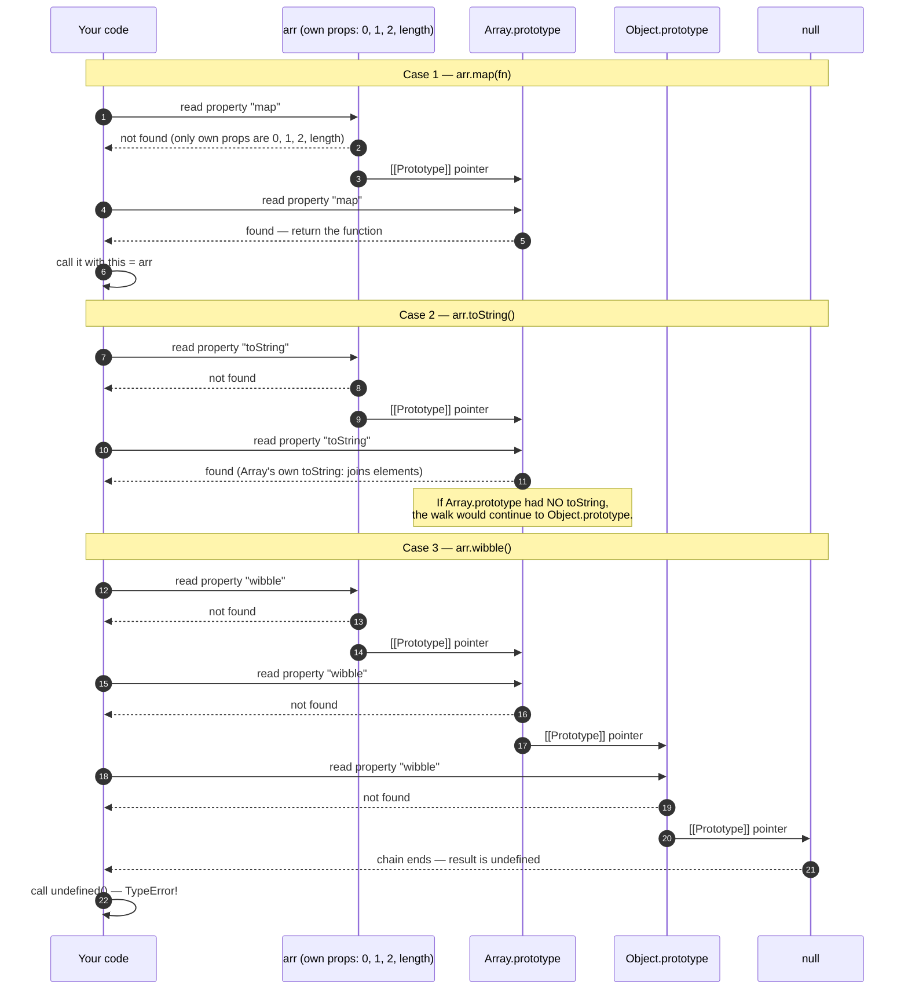

**JavaScript Chapter 3/7** | [← Previous: Functions & Closures](02_JS_Functions_Closures.md) | [Index](../00_MASTER_INDEX.md) | [Next → Async & Promises](04_JS_Async_Promises.md)

# Objects & Prototypes — How JS Really Does Inheritance

## 5W1H — Why This Chapter?

WHAT: Objects are JS's universal data structure. Prototypes are
JS's inheritance mechanism. Classes (ES6) are sugar on top.

WHY: Everything in JS is (or behaves like) an object.
Understanding prototypes explains: why [].map works,
how inheritance works, what `class` really does.

WHO: Anyone doing JS — React props are objects, APIs return
objects, DOM elements are objects.

WHEN: After understanding functions and closures (Ch 2).

HOW: Every object has an internal [[Prototype]] link to another
object. When you access a property, JS walks this chain.

---

## 1. Object Creation — 5 Ways

```javascript
// WAY 1: Object literal (most common)
const user = {
  name: "Harsha",
  age: 24,
  greet() {
    return `Hi, I'm ${this.name}`;
  },
};

// WAY 2: Object.create() (prototype-based)
const personProto = {
  greet() {
    return `Hi, I'm ${this.name}`;
  },
};
const user2 = Object.create(personProto);
user2.name = "Harsha";
// user2 inherits greet from personProto

// WAY 3: Constructor function (pre-ES6)
function Person(name, age) {
  this.name = name;
  this.age = age;
}
Person.prototype.greet = function () {
  return `Hi, I'm ${this.name}`;
};
const user3 = new Person("Harsha", 24);

// WAY 4: ES6 Class (syntactic sugar over Way 3)
class PersonClass {
  constructor(name, age) {
    this.name = name;
    this.age = age;
  }
  greet() {
    return `Hi, I'm ${this.name}`;
  }
}
const user4 = new PersonClass("Harsha", 24);

// WAY 5: Factory function (uses closures, no `this` needed)
function createPerson(name, age) {
  return {
    getName() {
      return name;
    }, // closure over name
    getAge() {
      return age;
    }, // closure over age
    greet() {
      return `Hi, I'm ${name}`;
    },
  };
}
const user5 = createPerson("Harsha", 24);
```

**Which object-creation form to reach for:**

| Form                         | When it fits                                  | Why (mechanism)                                                                                       |
|------------------------------|-----------------------------------------------|-------------------------------------------------------------------------------------------------------|
| `const x = { }` (literal)    | One-off objects, configs, JSON-shaped data    | No prototype gymnastics. `[[Prototype]]` is `Object.prototype`. Cheapest form.                        |
| `class Foo { }`              | Multiple instances, inheritance chains        | Sugar for constructor + prototype wiring. Prevents forgetting `.prototype.constructor`.               |
| `factory()` returning `{ }`  | Privacy, avoiding `this` traps                | Enclosing closure holds privates. Each call returns a *fresh* object with no shared prototype methods. |
| `Object.create(proto)`       | You need a specific `[[Prototype]]` (mixins)  | Bypasses constructors — you hand-pick the prototype link. Also used for `Object.create(null)` maps.  |
| `function Foo() { }` + `new` | Legacy code, hand-rolled prototype chains     | The pre-ES6 way `class` compiles to. Fine to read; rarely correct to write today.                     |

In React work you'll see literals (props, state, config) and classes
(legacy class components) most. Factories are the escape hatch when
`this` gets in the way; `Object.create(null)` is the specialised move
for prototype-free lookup tables.

---

## 2. Property Descriptors — What Properties Really Are

```javascript
const obj = { name: "Harsha" };

// Every property has hidden descriptors:
console.log(Object.getOwnPropertyDescriptor(obj, "name"));
// {
//   value: "Harsha",
//   writable: true,      ← can change value?
//   enumerable: true,    ← shows in for...in/Object.keys()?
//   configurable: true   ← can delete or change descriptor?
// }

// Define read-only property:
Object.defineProperty(obj, "id", {
  value: 42,
  writable: false, // Can't change
  enumerable: true,
  configurable: false, // Can't delete or reconfigure
});
obj.id = 100; // Silently fails (strict mode: TypeError)
console.log(obj.id); // 42

// GETTER/SETTER (computed properties):
const person = {
  firstName: "Sai",
  lastName: "Harsha",

  get fullName() {
    return `${this.firstName} ${this.lastName}`;
  },
  set fullName(value) {
    const [first, last] = value.split(" ");
    this.firstName = first;
    this.lastName = last;
  },
};

person.fullName; // "Sai Harsha" (calls getter)
person.fullName = "New Name"; // calls setter
person.firstName; // "New"
```

---

## 3. Object Immutability — 3 Levels

> **Level 1 — `Object.preventExtensions(obj)`.** No new properties
> can be *added*. Existing ones can still be modified or deleted.
> Implementation: the internal `[[Extensible]]` slot flips to `false`.
>
> **Level 2 — `Object.seal(obj)`.** Level 1 + every own property
> becomes `configurable: false`. So no adds, no deletes, no property
> descriptor changes. Values can still be overwritten (`writable`
> is untouched).
>
> **Level 3 — `Object.freeze(obj)`.** Level 2 + every own property
> becomes `writable: false`. The object is now fully closed — no
> add, no delete, no reassign. Writes fail silently in sloppy mode,
> throw in strict mode.
>
> **All three are SHALLOW.** They act only on the object's *own*
> properties. Nested object references are untouched:
>
> ```javascript
> const obj = Object.freeze({ a: 1, b: { c: 2 } });
> obj.a = 10;      // ✅ silently ignored (strict: TypeError)
> obj.b.c = 10;    // ❌ succeeds — b itself was never frozen
> ```
>
> For deep immutability: `structuredClone(obj)` to snapshot, or a
> recursive freeze that walks every property whose value is an
> object and freezes that too.

---

## 4. Prototypes — JS's Inheritance Mechanism

### 5W1H: WHY Prototypes?

> **WHAT.** Every JavaScript object carries a hidden internal slot
> called `[[Prototype]]` (readable as `Object.getPrototypeOf(obj)`,
> historically as `obj.__proto__`). That slot is either another
> object or `null`. This forms a chain: `obj → proto → proto's
> proto → ... → null`. Property lookup walks the chain.
>
> **WHY it exists.** Memory. Without prototypes, every instance of a
> class would need its own copy of every method. With prototypes,
> methods live on the shared prototype object; 10,000 instances
> share one `greet` function. The instance stores only its own
> instance data.
>
> **HOW you use it.** You almost never touch `[[Prototype]]`
> directly. `class`, `new`, `Object.create`, and object literals set
> it for you. But when something goes wrong — `undefined is not a
> function`, `hasOwnProperty is not a function`, method resolution
> confusion — the fix is always the same: pick up the chain with
> `Object.getPrototypeOf` and walk it until you find (or don't find)
> what you expected.

**How lookup actually works — trace `arr.map()` and `arr.toString()`
step by step, and watch the engine walk the chain until it finds
(or doesn't find) the method:**

```javascript
const arr = [1, 2, 3];
arr.map(x => x * 2);   // where does map come from?
arr.toString();        // where does toString come from?
arr.wibble();          // where does the "not a function" error come from?
```



**The rule of the walk:**

1. Read starts at the object itself.
2. If the property is not found, follow the `[[Prototype]]` pointer
   to the next object in the chain.
3. Stop the first time the name is found (returning that value) or
   when the chain reaches `null` (returning `undefined`).
4. If the found value is a function and you called it, the function
   runs with `this` bound to the *starting* object — not the
   prototype where it was defined. That's why `arr.map(...)` runs
   `map` with `this = arr`, and how one shared method serves every
   array.

**Why `undefined is not a function` is really a chain-walk failure:**
it means the walk hit `null` before finding a match, `undefined`
came back, and then you tried to call it. Debugging move:
`console.log(Object.getPrototypeOf(arr))` — and again on the
result — until you see the chain you actually have vs the chain you
assumed.

```javascript
// HOW prototype works in practice:
function Animal(name) {
  this.name = name;
}
Animal.prototype.speak = function () {
  return `${this.name} makes a sound`;
};

function Dog(name, breed) {
  Animal.call(this, name); // Call parent constructor
  this.breed = breed;
}
Dog.prototype = Object.create(Animal.prototype); // Set up chain
Dog.prototype.constructor = Dog; // Fix constructor ref
Dog.prototype.bark = function () {
  return `${this.name} barks!`;
};

const rex = new Dog("Rex", "German Shepherd");
rex.bark(); // "Rex barks!"      ← found on Dog.prototype
rex.speak(); // "Rex makes a sound" ← found on Animal.prototype
rex.toString(); // "[object Object]" ← found on Object.prototype

// rex own properties: { name: "Rex", breed: "German Shepherd" }
// Dog.prototype: { bark, constructor }
// Animal.prototype: { speak, constructor }
// Object.prototype: { toString, hasOwnProperty, ... }
```

---

🔬 **Section Challenge — 4. Prototypes — JS's Inheritance Mechanism**

**Challenge 1 (Reasoning):** `Object.create(proto)` vs `new Constructor()` — what's the practical difference?

<details><summary>Answer</summary>

`new Constructor()`: runs the constructor function (initializes instance properties), sets `__proto__` to `Constructor.prototype`. `Object.create(proto)`: creates an object with `proto` as its prototype, NO constructor called. Use `Object.create(null)` to create a pure dictionary with no inherited properties (no `toString`, `hasOwnProperty`, etc.) — useful for safe maps. `Object.create(SomeClass.prototype)` creates an instance-like object without running the constructor (used in class inheritance setup).

</details>

## 5. ES6 Classes — Syntactic Sugar

```javascript
class Animal {
  // CONSTRUCTOR: Called when you do `new Animal(...)`
  constructor(name) {
    this.name = name; // Instance property
  }

  // INSTANCE METHOD: Added to Animal.prototype
  speak() {
    return `${this.name} makes a sound`;
  }

  // STATIC METHOD: On the class itself, NOT on instances
  static kingdom() {
    return "Animalia";
  }

  // GETTER/SETTER
  get info() {
    return `Animal: ${this.name}`;
  }
}

class Dog extends Animal {
  #tricks = []; // PRIVATE FIELD (ES2022) — truly private!

  constructor(name, breed) {
    super(name); // MUST call super() before using `this`
    this.breed = breed;
  }

  bark() {
    return `${this.name} barks!`;
  }

  // OVERRIDE parent method
  speak() {
    return `${this.name} woofs!`;
  }

  // Access private field
  addTrick(trick) {
    this.#tricks.push(trick);
  }

  showTricks() {
    return this.#tricks.join(", ");
  }
}

const rex = new Dog("Rex", "GSD");
rex.bark(); // "Rex barks!"
rex.speak(); // "Rex woofs!" (overridden)
Animal.kingdom(); // "Animalia" (static)
rex.addTrick("sit");
rex.showTricks(); // "sit"
// rex.#tricks;       // ❌ SyntaxError — truly private!
```

> **`class` is desugared into the same prototype wiring you'd write
> by hand.** These two are equivalent to the engine — the top form
> is what you write, the bottom is what runs:
>
> ```javascript
> // What you write:
> class Dog extends Animal {
>   constructor(name, breed) { super(name); this.breed = breed; }
>   bark() { return `${this.name} barks!`; }
> }
>
> // What it becomes (roughly):
> function Dog(name, breed) {
>   Animal.call(this, name);           // super(name)
>   this.breed = breed;
> }
> Dog.prototype = Object.create(Animal.prototype);  // set up chain
> Dog.prototype.constructor = Dog;                  // fix constructor
> Dog.prototype.bark = function() {                 // instance method
>   return `${this.name} barks!`;
> };
> ```
>
> **Why the sugar matters even though it changes no behaviour:**
> `class` closes off the two mistakes that used to lose hours —
> forgetting `Object.create` for the chain (so `instanceof Animal`
> quietly broke), and forgetting `.prototype.constructor = Dog`
> (so `new dog.constructor(...)` produced an `Animal`). It also
> makes `super`, private `#fields`, and `static` blocks first-class.
> Same runtime model, safer surface.

---

## 6. Object Methods — Essential Toolkit

```javascript
const user = { name: "Harsha", age: 24, role: "developer" };

// KEYS, VALUES, ENTRIES
Object.keys(user); // ["name", "age", "role"]
Object.values(user); // ["Harsha", 24, "developer"]
Object.entries(user); // [["name","Harsha"], ["age",24], ["role","developer"]]

// Destructuring from entries (convert to Map):
const map = new Map(Object.entries(user));

// ASSIGN (shallow merge — mutates target!)
const defaults = { theme: "dark", lang: "en" };
const prefs = { theme: "light" };
const result = Object.assign({}, defaults, prefs);
// { theme: "light", lang: "en" }

// SPREAD is preferred (creates new object):
const result2 = { ...defaults, ...prefs }; // Same result, cleaner

// fromEntries (opposite of entries)
const entries = [
  ["a", 1],
  ["b", 2],
];
const obj = Object.fromEntries(entries); // { a: 1, b: 2 }

// USE CASE: Transform object values
const prices = { apple: 1, banana: 2, cherry: 3 };
const doubled = Object.fromEntries(
  Object.entries(prices).map(([key, val]) => [key, val * 2]),
);
// { apple: 2, banana: 4, cherry: 6 }
```

---

## 7. Destructuring — Extracting Object Properties

```javascript
// BASIC
const { name, age } = user;
// Creates: const name = user.name; const age = user.age;

// RENAME
const { name: userName, age: userAge } = user;
// userName = "Harsha", userAge = 24

// DEFAULT
const { name, phone = "N/A" } = user;
// phone = "N/A" (user has no phone property)

// NESTED
const company = {
  name: "Tech Corp",
  address: { city: "Hyderabad", zip: "500001" },
};
const {
  address: { city, zip },
} = company;
// city = "Hyderabad", zip = "500001"

// REST
const { name: n, ...rest } = user;
// n = "Harsha", rest = { age: 24, role: "developer" }

// IN FUNCTION PARAMS (very common in React)
function UserCard({ name, age, role = "viewer" }) {
  return `<div>${name} (${age}) - ${role}</div>`;
}
UserCard(user); // <div>Harsha (24) - developer</div>

// ARRAY DESTRUCTURING
const [first, second, ...rest] = [1, 2, 3, 4, 5];
// first = 1, second = 2, rest = [3, 4, 5]

// SWAP
let a = 1,
  b = 2;
[a, b] = [b, a]; // a = 2, b = 1 — no temp variable needed!
```

---

## 8. Iterators & Symbols

```javascript
// SYMBOL: Unique, immutable identifier (no two symbols are equal)
const id = Symbol("id");
const id2 = Symbol("id");
id === id2; // false — always unique!

// Use: Hidden/non-colliding property keys
const user = {
  name: "Harsha",
  [id]: 12345, // Symbol as key — won't show in Object.keys()
};
Object.keys(user); // ["name"] — symbol hidden!
Object.getOwnPropertySymbols(user); // [Symbol(id)]

// WELL-KNOWN SYMBOLS — customize built-in behavior:
class Range {
  constructor(start, end) {
    this.start = start;
    this.end = end;
  }

  // Make Range iterable with for...of
  [Symbol.iterator]() {
    let current = this.start;
    const end = this.end;
    return {
      next() {
        return current <= end
          ? { value: current++, done: false }
          : { done: true };
      },
    };
  }
}

const range = new Range(1, 5);
for (const n of range) console.log(n); // 1, 2, 3, 4, 5
[...range]; // [1, 2, 3, 4, 5] — spread works too!
```

---

## 9. Comparison: JS vs Java Objects

**JavaScript objects vs Java objects — the differences that trip
Java-first readers:**

| Aspect                | JavaScript                            | Java                                |
|-----------------------|---------------------------------------|-------------------------------------|
| Typing                | Dynamic (values carry the type)       | Static (variables carry the type)   |
| Inheritance mechanism | Prototype chain (per-object link)     | Class hierarchy (fixed at compile)  |
| `class` keyword       | Sugar over prototype wiring           | A real class with its own runtime   |
| Private fields        | `#name` (ES2022)                      | `private` modifier                  |
| Interfaces            | None built-in — use TypeScript       | `interface` keyword                 |
| Multiple inheritance  | Mixins / composition                  | Interfaces only                     |
| Object creation       | Literals `{}`, `new`, `Object.create` | `new` only                          |
| Property access       | Dynamic: `obj[computedKey]`           | Fixed at compile time               |
| `this`                | Chosen at call site (5 rules)         | Always the current instance         |
| Null safety           | Optional chaining `?.`                | `Optional<T>` (Java 8+)             |

**The big model shift:** in Java a class *defines the shape once and
forever*. In JS an object is a "bag of properties" — you can add,
delete, or replace properties at any moment, and its behaviour depends
on which prototype chain it happens to be pointing at right now. More
flexible, less safe. TypeScript is how JS-shop teams claw back the
safety without giving up the flexibility.

---

## Interview Quick-Fire

```
Q: How does prototypal inheritance work?
→ Every object has a [[Prototype]] link. When a property isn't found
  on the object, JS walks up the prototype chain until null.

Q: What does `new` keyword do?
→ 1. Creates empty object {}
   2. Sets its [[Prototype]] to Constructor.prototype
   3. Calls constructor with `this` = new object
   4. Returns the object (unless constructor returns an object)

Q: Difference between hasOwnProperty and `in`?
→ hasOwnProperty: only checks the object itself.
  `in`: checks object AND its entire prototype chain.

Q: How to create truly private properties?
→ ES2022: # prefix (class #field). Before: closures in factory.
  WeakMap was used as a workaround.

Q: Object.create(null) — why?
→ Creates an object with NO prototype. No toString, no hasOwnProperty.
  Used for pure dictionaries (e.g., Map-like storage) with no
  prototype pollution risk.

Q: How to check if a property exists?
→ "prop" in obj (includes prototype chain)
  obj.hasOwnProperty("prop") (own only)
  Object.hasOwn(obj, "prop") (modern, own only — preferred)
```

---

[← Previous: Functions & Closures](02_JS_Functions_Closures.md) | [Index](../00_MASTER_INDEX.md) | [Next → Async & Promises](04_JS_Async_Promises.md)

---


---

## Reality Check

**"JavaScript classes made prototypes obsolete knowledge"** → class is SYNTAX over the same prototype machinery, and the machinery shows through constantly: methods live on Constructor.prototype (one shared function — why patching it affects all instances, and why class fields with arrows do NOT share), instanceof walks the prototype chain (breaks across iframes/realms), super dispatches via [[HomeObject]], and extending built-ins needs the chain intact. Debugging class-based code without the prototype model means every one of these surfaces as magic — the syntax hid the model precisely where you need it.

**"Property access is a simple lookup"** → Access walks the CHAIN until hit or null, but ASSIGNMENT does not mirror it: writing a property always creates/updates on the receiver (shadowing the inherited one), except when an inherited SETTER or non-writable property intercepts — the asymmetry behind "why did writing create a copy instead of updating the shared one" and its evil twin "why did my write silently do nothing" (frozen prototype property, strict mode throws, sloppy mode swallows). Get walks, set shadows, accessors ambush: three clauses that decode a whole genre of surprises.

**"Spread and Object.assign copy objects"** → Both copy ONE LEVEL of own enumerable properties: nested objects share references (the mutated-draft-corrupts-original classic), getters are EVALUATED into static values (live property becomes stale snapshot), prototypes are dropped (class instances become plain objects), and non-enumerables/symbols follow their own rules. Deep copy is structuredClone (handles cycles, Dates, Maps — but not functions or class prototypes). The professional habit: say WHICH copy you need — shallow, deep, or structural-with-prototype — because "copy" alone under-specifies in exactly the ways that ship bugs.

**"Getters and setters are Java-style encapsulation imported"** → Accessors make property access PROGRAMMABLE, which cuts both ways: computed properties and lazy initialization (replace-yourself-on-first-read memoization) are the legitimate wins; the costs are invisible side effects (a getter that allocates or logs — property reads in hot loops becoming performance cliffs), spread/JSON snapshotting evaluating them at surprising times, and debugging pain (hovering in DevTools TRIGGERS the getter). The rule that survives: getters must be cheap and pure; anything else deserves a method name with parentheses that admit work is happening.

**"Private fields are naming-convention underscore, formalized"** → #fields are mechanically different, not cosmetically: enforced by the runtime (outside access is a SyntaxError, not a lookup miss), invisible to Object.keys/JSON/spread/Proxy (serialization and mocking strategies break), branded to the class (the same-class-can-access-other-instances nuance, and #x in obj as the brand check), and hostile to monkey-patching test seams that underscore-privates allowed. Choosing # is choosing hard encapsulation with its testing and serialization consequences — a real design decision, not a lint upgrade.
