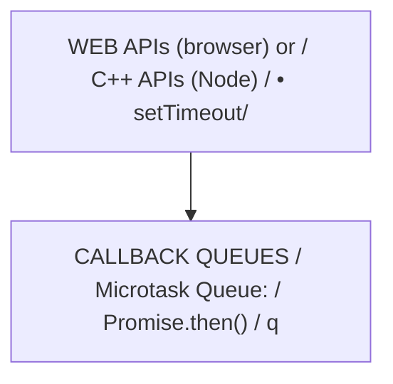
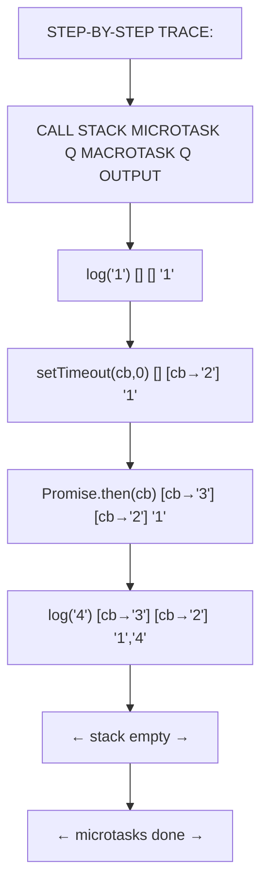
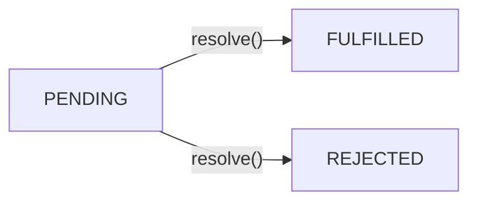
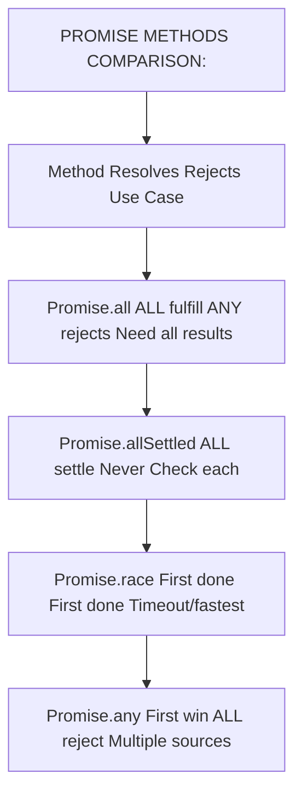
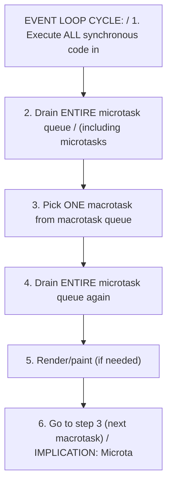
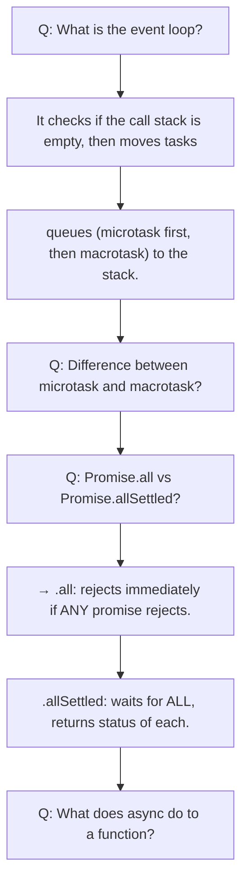

**JavaScript Chapter 4/7** | [← Previous: Objects & Prototypes](03_JS_Objects_Prototypes.md) | [Index](../00_MASTER_INDEX.md) | [Next → DOM & Browser APIs](05_JS_DOM_BrowserAPIs.md)

# Async JavaScript — Event Loop, Promises & Async/Await

## 5W1H — Why This Chapter?


WHAT: How JS handles asynchronous operations despite being
SINGLE-THREADED. Event loop, callbacks, promises, async.

WHY:  Every web app does async: API calls, file reads, timers,
user events, animations. Without understanding async, you
WILL have bugs — race conditions, callback hell, unhandled
promise rejections, stale closures in React.

WHO:  Every developer. Frontend (fetch, events), Backend (DB,
file I/O, HTTP), React (useEffect, data fetching).

WHEN: After understanding closures and scope (they're essential
for understanding how async callbacks capture variables).

HOW:  JS delegates async work to browser/Node APIs. When done,
the result goes to a QUEUE. The EVENT LOOP moves it to
the call stack when the stack is empty.


---

## 1. The Event Loop — The Core Mental Model

### 5W1H: WHY is JS Single-Threaded?


WHY single-threaded?
JS was designed for the DOM. If two threads modified the same
DOM element simultaneously → race condition → crash/corruption.
One thread = no data races on the DOM. Simpler mental model.

BUT HOW does it handle async then?
The EVENT LOOP — JS's secret weapon.


```
THE EVENT LOOP ARCHITECTURE:

┌──────────────────────────────────────────────────────────┐
│  YOUR JS CODE                                            │
│  ┌──────────────┐    ┌────────────────────────────┐      │
│  │  CALL STACK  │    │  WEB APIs (browser) or     │      │
│  │              │    │  C++ APIs (Node)            │     │
│  │ ┌──────────┐ │    │                              │    │
│  │ │ func3()  │ │    │  • setTimeout/setInterval    │    │
│  │ │ func2()  │ │    │  • fetch / XMLHttpRequest    │    │
│  │ │ func1()  │ │    │  • addEventListener          │    │
│  │ │ global   │ │    │  • geolocation               │    │
│  │ └──────────┘ │    │  • FileReader                │    │
│  └──────────────┘    └─────────────┬──────────────┘      │
│         ▲                          │                     │
│         │                          ▼                     │
│         │              ┌───────────────────────┐         │
│         │              │  CALLBACK QUEUES      │         │
│         │              │                                 │
│    EVENT LOOP          │  Microtask Queue:     │         │
│    (checks if          │  Promise.then()        │        │
│     stack is           │  queueMicrotask()      │        │
│     empty, then        │  MutationObserver      │        │
│     moves next         │                        │        │
│     task to stack)     │  Macrotask Queue:     │         │
│         │              │  setTimeout()          │        │
│         │              │  setInterval()         │        │
│         └──────────────│  I/O callbacks         │        │
│                        │  UI rendering          │        │
│                        └───────────────────────┘         │
└──────────────────────────────────────────────────────────┘

CRITICAL RULE:
Microtasks ALWAYS run before macrotasks.
After each macrotask, ALL pending microtasks run first.
```

**Flow:**
1. WEB APIs (browser) or / C++ APIs (Node) / • setTimeout/
2. CALLBACK QUEUES / Microtask Queue: / Promise.then() / q



### The Event Loop in Action — Step by Step

```javascript
console.log("1");                          // Sync → call stack

setTimeout(() => console.log("2"), 0);     // Macro → macrotask queue

Promise.resolve().then(() => console.log("3")); // Micro → microtask queue

console.log("4");                          // Sync → call stack

// OUTPUT: 1, 4, 3, 2
// WHY?
// 1. "1" runs immediately (sync)
// 2. setTimeout REGISTERS callback → macrotask queue (even with 0ms!)
// 3. Promise.then REGISTERS callback → microtask queue
// 4. "4" runs immediately (sync)
// 5. Stack is empty → event loop checks microtasks first → "3"
// 6. No more microtasks → check macrotasks → "2"
```

```
╔══════════════════════════════════════════════════════════════════════╗
║  STEP-BY-STEP TRACE:                                                 ║
║                                                                      ║
║  CALL STACK          MICROTASK Q     MACROTASK Q    OUTPUT           ║
║  ─────────────       ──────────      ──────────     ──────           ║
║  log("1")            []              []             "1"              ║
║  setTimeout(cb,0)    []              [cb→"2"]       "1"              ║
║  Promise.then(cb)    [cb→"3"]        [cb→"2"]       "1"              ║
║  log("4")            [cb→"3"]        [cb→"2"]       "1","4"          ║
║  ← stack empty →                                                     ║
║  cb→"3"              []              [cb→"2"]       "1","4","3"      ║
║  ← microtasks done →                                                 ║
║  cb→"2"              []              []             "1","4","3","2"  ║
╚══════════════════════════════════════════════════════════════════════╝
```

**Flow:**
1. STEP-BY-STEP TRACE:
2. CALL STACK MICROTASK Q MACROTASK Q OUTPUT
3. log('1') [] [] '1' setTimeout(cb,0) [] [cb '2'] '1'
4. setTimeout(cb,0) [] [cb '2'] '1'
5. Promise.then(cb) [cb '3'] [cb '2'] '1'
6. log('4') [cb '3'] [cb '2'] '1','4'
7. ← stack empty



---

## 2. Callbacks — The Old Way

```javascript
// WHAT: Pass a function to be called LATER when the async operation finishes.

// Simple callback:
function fetchUser(id, callback) {
    setTimeout(() => {
        const user = { id, name: "Harsha" };
        callback(null, user);  // Node convention: callback(error, result)
    }, 1000);
}

fetchUser(1, (error, user) => {
    if (error) { console.error(error); return; }
    console.log(user);
});

// CALLBACK HELL (the problem with callbacks):
getUser(1, (err, user) => {
    getOrders(user.id, (err, orders) => {
        getOrderDetails(orders[0].id, (err, details) => {
            getShippingInfo(details.shippingId, (err, shipping) => {
                // 4 levels deep — hard to read, hard to handle errors
                console.log(shipping);
            });
        });
    });
});

// WHY callback hell is bad:
// 1. Pyramid of doom — indentation keeps growing
// 2. Error handling at every level
// 3. Hard to refactor or add steps
// 4. Can't use try/catch (async errors escape it)
// SOLUTION: Promises.
```

---

## 3. Promises — The Modern Foundation

### 5W1H: WHAT is a Promise?

```
WHAT: A Promise is an object representing a FUTURE value.
      It will eventually be either FULFILLED (success) or
      REJECTED (failure).

WHY:  Promises solve callback hell with chaining (.then).
      They provide .catch for centralized error handling.
      They enable async/await (Chapter section 4).

ANALOGY: A promise is like an order receipt at a restaurant.
You place an order → get a receipt (promise). Eventually:
• Your food arrives (fulfilled) → enjoy it (.then)
• Kitchen is out of ingredients (rejected) → handle it (.catch)
• While waiting, you can do other things (non-blocking).

STATES:
┌──────────┐    resolve()    ┌───────────┐
│ PENDING  │───────────────→│ FULFILLED  │
│          │                 └───────────┘
│          │    reject()     ┌───────────┐
│          │───────────────→│ REJECTED   │
└──────────┘                 └───────────┘
Once settled (fulfilled/rejected), a promise NEVER changes state.
```

**Flow:**
1. PENDING --(resolve())--> FULFILLED
2. PENDING --(resolve())--> REJECTED



```javascript
// CREATING a Promise:
const myPromise = new Promise((resolve, reject) => {
    // This executor runs IMMEDIATELY (synchronous!)
    const success = true;

    if (success) {
        resolve("Data loaded!");  // Fulfill the promise
    } else {
        reject(new Error("Failed to load")); // Reject the promise
    }
});

// CONSUMING a Promise:
myPromise
    .then(data => {
        console.log(data);       // "Data loaded!"
        return data.toUpperCase(); // Return value → next .then
    })
    .then(upper => {
        console.log(upper);      // "DATA LOADED!"
    })
    .catch(error => {
        console.error(error);    // Catches ANY error in the chain
    })
    .finally(() => {
        console.log("Done!");    // Runs ALWAYS (success or failure)
    });

// CHAINING solves callback hell:
getUser(1)
    .then(user => getOrders(user.id))
    .then(orders => getOrderDetails(orders[0].id))
    .then(details => getShippingInfo(details.shippingId))
    .then(shipping => console.log(shipping))
    .catch(error => console.error(error)); // ONE catch for ALL!
```

### Promise Static Methods — Parallel & Race Patterns

```javascript
const p1 = fetch("/api/users");
const p2 = fetch("/api/products");
const p3 = fetch("/api/orders");

// Promise.all — Wait for ALL, fail if ANY fails
const [users, products, orders] = await Promise.all([p1, p2, p3]);
// If ANY promise rejects → entire Promise.all rejects immediately
// USE: When you need ALL results and can't proceed without them.

// Promise.allSettled — Wait for ALL, never fails
const results = await Promise.allSettled([p1, p2, p3]);
// results = [
//   { status: "fulfilled", value: ... },
//   { status: "rejected",  reason: Error },
//   { status: "fulfilled", value: ... }
// ]
// USE: When you want to know the status of each, regardless of failure.

// Promise.race — First to settle (fulfill OR reject) wins
const fastest = await Promise.race([p1, p2, p3]);
// USE: Timeout pattern:
const withTimeout = Promise.race([
    fetch("/api/data"),
    new Promise((_, reject) => setTimeout(() => reject(new Error("Timeout")), 5000))
]);

// Promise.any — First to FULFILL wins (ignores rejections)
const first = await Promise.any([p1, p2, p3]);
// If ALL reject → AggregateError
// USE: Try multiple sources, use whichever responds first.
```

```
PROMISE METHODS COMPARISON:
┌───────────────────┬────────────┬────────────┬─────────────────┐
│ Method            │ Resolves   │ Rejects    │ Use Case        │
├───────────────────┼────────────┼────────────┼─────────────────┤
│ Promise.all       │ ALL fulfill│ ANY rejects│ Need all results│
│ Promise.allSettled│ ALL settle │ Never      │ Check each      │
│ Promise.race      │ First done │ First done │ Timeout/fastest │
│ Promise.any       │ First win  │ ALL reject │ Multiple sources│
└───────────────────┴────────────┴────────────┴─────────────────┘
```

**Flow:**
1. PROMISE METHODS COMPARISON:
2. Method Resolves Rejects Use Case
3. Promise.all ALL fulfill ANY rejects Need all results
4. Promise.allSettled ALL settle Never Check each
5. Promise.race First done First done Timeout/fastest
6. Promise.any First win ALL reject Multiple sources



---


🔬 **Section Challenge — 3. Promises — The Modern Foundation**

**Challenge 1 (Reasoning):** `Promise.all([p1,p2,p3])` — p2 rejects. What happens to p1 and p3?
<details><summary>Answer</summary>

`Promise.all` rejects immediately when ANY promise rejects (fail-fast). p1 and p3 are still running — their promises continue executing, but their results are ignored. If they reject too, those rejections are also silently ignored (potential unhandled rejection warnings). Use `Promise.allSettled` to wait for ALL to complete regardless of success/failure, getting all results including errors.
</details>

**Challenge 2 (Design):** Implement `Promise.race` from scratch.
<details><summary>Answer</summary>

```javascript
function race(promises) {
    return new Promise((resolve, reject) => {
        promises.forEach(p => Promise.resolve(p).then(resolve, reject));
        // First to resolve OR reject wins — others are ignored
    });
}
```
Once the first promise settles, the outer promise is settled. Other promises continue running internally but their results are discarded.
</details>


## 4. Async/Await — The Clean Syntax

### 5W1H: WHY Async/Await?

```
╔══════════════════════════════════════════════════════════════════════╗
║  WHAT: Syntactic sugar over Promises. Makes async code LOOK and      ║
║        BEHAVE like synchronous code.                                 ║
║                                                                      ║
║  WHY:  .then chains are better than callbacks, but still messy       ║
║        for complex flows. async/await reads top-to-bottom.           ║
║                                                                      ║
║  HOW:  `async` marks a function as returning a Promise.              ║
║        `await` pauses execution until the Promise resolves.          ║
║        (The thread isn't blocked — other code can run!)              ║
╚══════════════════════════════════════════════════════════════════════╝
```

**Flow:**
1. BEHAVE like synchronous code.
2. HOW: `async` marks a function as returning a Promise.
3. `await` pauses execution until the Promise resolves.
4. (The thread isn't blocked — other code can run!)

```mermaid
flowchart TD
    N1["BEHAVE like synchronous code."]
    N2["HOW: `async` marks a function as returning a Promise."]
    N3["`await` pauses execution until the Promise resolves."]
    N4["(The thread isn't blocked — other code can run!)"]
    N1 --> N2
    N2 --> N3
    N3 --> N4
```

```javascript
// WITH PROMISES (chaining):
function fetchUserData() {
    return getUser(1)
        .then(user => getOrders(user.id))
        .then(orders => getOrderDetails(orders[0].id))
        .then(details => details)
        .catch(error => console.error(error));
}

// WITH ASYNC/AWAIT (same logic, cleaner):
async function fetchUserData() {
    try {
        const user = await getUser(1);
        const orders = await getOrders(user.id);
        const details = await getOrderDetails(orders[0].id);
        return details;
    } catch (error) {
        console.error(error); // try/catch works with await!
    }
}

// RULES:
// 1. `await` can ONLY be used inside an `async` function (or top-level in modules)
// 2. `async` function ALWAYS returns a Promise
// 3. `await` pauses the function, NOT the thread

// PARALLEL with async/await (IMPORTANT!):
async function fetchAll() {
    // ❌ WRONG — runs sequentially (waits for each):
    const users = await fetch("/api/users");
    const products = await fetch("/api/products"); // Waits for users first!

    // ✅ RIGHT — runs in parallel:
    const [users2, products2] = await Promise.all([
        fetch("/api/users"),
        fetch("/api/products")
    ]);
}
```

### Error Handling Patterns

```javascript
// PATTERN 1: Try/Catch (most common)
async function fetchData() {
    try {
        const response = await fetch("/api/data");
        if (!response.ok) throw new Error(`HTTP ${response.status}`);
        const data = await response.json();
        return data;
    } catch (error) {
        console.error("Fetch failed:", error.message);
        return null; // or throw error; to propagate
    }
}

// PATTERN 2: Go-style [error, data] tuple
async function safeAsync(promise) {
    try {
        const data = await promise;
        return [null, data];
    } catch (error) {
        return [error, null];
    }
}

// Usage:
const [error, user] = await safeAsync(getUser(1));
if (error) { /* handle */ }

// PATTERN 3: .catch on await (inline)
const user = await getUser(1).catch(err => null);
if (!user) { /* handle */ }

// ALWAYS handle rejections! Unhandled rejections crash Node.
// In browsers, they log warnings and may become errors.
```

---


🔬 **Section Challenge — 4. Async/Await — The Clean Syntax**

**Challenge 1 (Reasoning):** `await Promise.all([fetch(a), fetch(b)])` vs `await fetch(a); await fetch(b)`. What's the performance difference?
<details><summary>Answer</summary>

`Promise.all`: both fetches START simultaneously (concurrent). Total time = max(timeA, timeB). Sequential awaits: fetch B doesn't start until fetch A completes. Total time = timeA + timeB. For independent requests, ALWAYS use `Promise.all`. Sequential await is only appropriate when B depends on A's result.
</details>

**Challenge 2 (Bug Hunt):** An `async` function has `try { await doWork(); } catch(e) {}`. `doWork()` rejects. Is the rejection handled?
<details><summary>Answer</summary>

Yes — `await` unwraps the rejected promise and throws the rejection value as a synchronous error, which is caught by the `catch` block. Without `try/catch` around `await`: unhandled rejection. Without `await` (just `doWork()`): the rejection is a separate promise — the `try/catch` CANNOT catch it (it's asynchronous). Always `await` async calls if you want to catch their rejections synchronously.
</details>


## 5. Advanced Async Patterns

### Generators & Async Generators

```javascript
// GENERATOR: A function that can PAUSE and RESUME.
function* idGenerator() {
    let id = 0;
    while (true) {
        yield ++id;  // yield pauses and returns a value
    }
}
const gen = idGenerator();
gen.next(); // { value: 1, done: false }
gen.next(); // { value: 2, done: false }
gen.next(); // { value: 3, done: false }

// WHY generators matter:
// 1. Lazy evaluation — produce values on demand
// 2. Iterator protocol — works with for...of
// 3. Async generators — for streaming data

// ASYNC GENERATOR: yield + async combined
async function* fetchPages(url) {
    let page = 1;
    while (true) {
        const response = await fetch(`${url}?page=${page}`);
        const data = await response.json();
        if (data.length === 0) break;
        yield data;
        page++;
    }
}

// Consume with for await...of:
for await (const page of fetchPages("/api/users")) {
    console.log("Got page:", page);
}
```

### AbortController — Cancelling Async Operations

```javascript
// WHAT: The ONLY standard way to cancel fetch requests.
// WHY: User navigates away, component unmounts, request becomes stale.

const controller = new AbortController();

// Pass signal to fetch:
fetch("/api/data", { signal: controller.signal })
    .then(response => response.json())
    .then(data => console.log(data))
    .catch(error => {
        if (error.name === "AbortError") {
            console.log("Request was cancelled");
        } else {
            throw error;
        }
    });

// Cancel after 3 seconds:
setTimeout(() => controller.abort(), 3000);

// REACT USE CASE:
useEffect(() => {
    const controller = new AbortController();

    fetch("/api/data", { signal: controller.signal })
        .then(res => res.json())
        .then(data => setData(data))
        .catch(err => {
            if (err.name !== "AbortError") setError(err);
        });

    return () => controller.abort(); // Cleanup on unmount!
}, []);
```

---


## 6. Microtasks vs Macrotasks — Deep Dive

```javascript
// MICROTASKS (higher priority):
// • Promise.then/.catch/.finally callbacks
// • queueMicrotask()
// • MutationObserver callbacks

// MACROTASKS (lower priority):
// • setTimeout / setInterval
// • setImmediate (Node.js only)
// • I/O operations
// • UI rendering events
// • requestAnimationFrame (between macro tasks, before paint)

// THE RULE: After each macrotask, run ALL pending microtasks
// before the next macrotask.

console.log("start");

setTimeout(() => console.log("timeout 1"), 0);
setTimeout(() => console.log("timeout 2"), 0);

Promise.resolve()
    .then(() => {
        console.log("promise 1");
        // Adding a new microtask from WITHIN a microtask
        return Promise.resolve();
    })
    .then(() => console.log("promise 2"));

queueMicrotask(() => console.log("microtask"));

console.log("end");

// OUTPUT:
// start
// end
// promise 1    ← microtask queue
// microtask    ← microtask queue
// promise 2    ← microtask queue (added during microtask phase!)
// timeout 1    ← macrotask queue
// timeout 2    ← macrotask queue
```

```
EVENT LOOP CYCLE:

┌─────────────────────────────────────────────────────────┐
│ 1. Execute ALL synchronous code in call stack           │
│                │                                        │
│                ▼                                        │
│ 2. Drain ENTIRE microtask queue                         │
│    (including microtasks added DURING this step!)       │
│                │                                        │
│                ▼                                        │
│ 3. Pick ONE macrotask from macrotask queue              │
│                │                                        │
│                ▼                                        │
│ 4. Drain ENTIRE microtask queue again                   │
│                │                                        │
│                ▼                                        │
│ 5. Render/paint (if needed)                             │
│                │                                        │
│                ▼                                        │
│ 6. Go to step 3 (next macrotask)                        │
└─────────────────────────────────────────────────────────┘

IMPLICATION: Microtasks can starve macrotasks!
If microtasks keep adding more microtasks, setTimeout callbacks
and UI rendering NEVER run. The page freezes.
```

**Flow:**
1. EVENT LOOP CYCLE: / 1. Execute ALL synchronous code in
2. Drain ENTIRE microtask queue / (including microtasks Pick ONE macrotask from macrotask queue Drain ENTIRE microtask queue again Render/paint (if needed) Go to step 3 (next macrotask) / IMPLICATION: Microta



---

## 7. Common Async Patterns in Real Code

```javascript
// PATTERN: Debounce (wait until user stops typing)
function debounce(fn, delay) {
    let timer;
    return function(...args) {
        clearTimeout(timer);
        timer = setTimeout(() => fn.apply(this, args), delay);
    };
}
const search = debounce(query => fetch(`/api/search?q=${query}`), 300);
// Only fires 300ms AFTER user stops typing

// PATTERN: Throttle (run at most once per interval)
function throttle(fn, interval) {
    let lastTime = 0;
    return function(...args) {
        const now = Date.now();
        if (now - lastTime >= interval) {
            lastTime = now;
            fn.apply(this, args);
        }
    };
}
const handleScroll = throttle(() => console.log("Scrolled!"), 100);

// PATTERN: Retry with exponential backoff
async function fetchWithRetry(url, maxRetries = 3) {
    for (let i = 0; i < maxRetries; i++) {
        try {
            const response = await fetch(url);
            if (response.ok) return await response.json();
            throw new Error(`HTTP ${response.status}`);
        } catch (error) {
            if (i === maxRetries - 1) throw error;
            const delay = Math.pow(2, i) * 1000; // 1s, 2s, 4s
            console.log(`Retry ${i + 1} in ${delay}ms...`);
            await new Promise(resolve => setTimeout(resolve, delay));
        }
    }
}

// PATTERN: Concurrent limit (process N at a time)
async function asyncPool(limit, items, iteratorFn) {
    const results = [];
    const executing = [];

    for (const item of items) {
        const p = iteratorFn(item);
        results.push(p);

        if (items.length >= limit) {
            const e = p.then(() => executing.splice(executing.indexOf(e), 1));
            executing.push(e);
            if (executing.length >= limit) await Promise.race(executing);
        }
    }

    return Promise.all(results);
}
// Process 5 URLs at a time:
await asyncPool(5, urls, url => fetch(url).then(r => r.json()));
```

---


## Interview Quick-Fire

```
Q: What is the event loop?
→ The mechanism that allows single-threaded JS to handle async.
  It checks if the call stack is empty, then moves tasks from
  queues (microtask first, then macrotask) to the stack.

Q: Output? setTimeout(()=>log(1),0); Promise.resolve().then(()=>log(2)); log(3);
→ 3, 2, 1 — sync first, then microtask (promise), then macrotask (timeout)

Q: Difference between microtask and macrotask?
→ Microtasks (promises, queueMicrotask) run BEFORE macrotasks
  (setTimeout, I/O). All microtasks drain before next macrotask.

Q: Promise.all vs Promise.allSettled?
→ .all: rejects immediately if ANY promise rejects.
  .allSettled: waits for ALL, returns status of each.

Q: What does async do to a function?
→ Makes it return a Promise. Allows `await` inside.
  The return value becomes the resolved value of the promise.

Q: Can you cancel a fetch request?
→ Yes, using AbortController. Pass its signal to fetch options.
  Call controller.abort() to cancel.

Q: How to run async operations in parallel?
→ Promise.all([promise1, promise2, promise3])
  NOT: await p1; await p2; (this runs sequentially!)
```

**Flow:**
1. Q: What is the event loop?
2. It checks if the call stack is empty, then moves tasks
3. queues (microtask first, then macrotask) to the stack.
4. Q: Difference between microtask and macrotask?
5. Q: Promise.all vs Promise.allSettled?
6. .all: rejects immediately if ANY promise rejects.
7. .allSettled: waits for ALL, returns status of each.



---

[← Previous: Objects & Prototypes](03_JS_Objects_Prototypes.md) | [Index](../00_MASTER_INDEX.md) | [Next → DOM & Browser APIs](05_JS_DOM_BrowserAPIs.md)

---

## 🏋️ Practice & Interview Questions — Concurrency (Extra)

### Predict / Trace
**Q1.** Is this code thread-safe?
```java
if (!map.containsKey(key)) { map.put(key, compute(key)); }
```
<details><summary>Answer</summary>

**No.** Two threads can both pass `containsKey` check simultaneously → both compute and put → race condition, duplicate computation, possible data loss. **Fix**: `map.computeIfAbsent(key, k -> compute(k))` on ConcurrentHashMap — atomic!
</details>

**Q2.** What's wrong with checking `if(future.isDone())` before `future.get()`?
<details><summary>Answer</summary>

Nothing wrong functionally, but it's redundant. `future.get()` blocks until done anyway. Only use `isDone()` when you want **non-blocking check** (poll pattern). `isDone()` followed immediately by `get()` has a TOCTOU race — another thread could cancel it between your check and get (though `get()` would throw `CancellationException`).
</details>

### Coding Problems
**Q3.** ⭐⭐ Implement a thread-safe bounded blocking queue from scratch with `wait/notify`.
<details><summary>Solution</summary>

```java
class BoundedQueue<T> {
    private final Queue<T> queue = new LinkedList<>();
    private final int capacity;
    BoundedQueue(int cap){ this.capacity=cap; }

    synchronized void put(T item) throws InterruptedException {
        while(queue.size()==capacity) wait(); // Full — wait
        queue.offer(item);
        notifyAll(); // Signal waiting consumers
    }

    synchronized T take() throws InterruptedException {
        while(queue.isEmpty()) wait(); // Empty — wait
        T item=queue.poll();
        notifyAll(); // Signal waiting producers
        return item;
    }
}
```
</details>

**Q4.** ⭐⭐ Implement a simple `Future<T>` from scratch.
<details><summary>Solution</summary>

```java
class SimpleFuture<T> {
    private T value; private Throwable error;
    private boolean done=false;

    synchronized void complete(T val){ value=val; done=true; notifyAll(); }
    synchronized void completeExceptionally(Throwable t){ error=t; done=true; notifyAll(); }

    synchronized T get() throws Exception {
        while(!done) wait();
        if(error!=null) throw new ExecutionException(error);
        return value;
    }
}
```
</details>

**Q5.** ⭐⭐⭐ Design a rate limiter (Token Bucket algorithm).
<details><summary>Solution</summary>

```java
class TokenBucket {
    private final long capacity, refillRate;
    private double tokens;
    private long lastRefill = System.nanoTime();

    TokenBucket(long capacity, long tokensPerSecond){
        this.capacity=capacity; this.refillRate=tokensPerSecond; this.tokens=capacity;
    }

    synchronized boolean tryAcquire(){
        refill();
        if(tokens>=1){ tokens--; return true; }
        return false;
    }

    private void refill(){
        long now = System.nanoTime();
        double added = (now-lastRefill)/1e9 * refillRate;
        tokens = Math.min(capacity, tokens+added);
        lastRefill = now;
    }
}
```
</details>

### Interview Questions
**Q6.** What is a memory barrier / fence and when does Java insert one?
<details><summary>Answer</summary>

A memory barrier is a CPU instruction that prevents reordering across it. Java inserts them:
- **volatile write**: StoreStore + StoreLoad barrier → all prior writes visible before the volatile write
- **volatile read**: LoadLoad + LoadStore barrier → all subsequent reads see up-to-date values
- **synchronized exit**: StoreLoad barrier (like volatile write)
- **synchronized entry**: LoadLoad barrier (like volatile read)
</details>

**Q7.** What is false sharing and how do you prevent it?
<details><summary>Answer</summary>

Two threads modify different variables that happen to be on the **same CPU cache line** (64 bytes). When one thread modifies its variable, it invalidates the entire cache line — the other thread's variable (though unchanged) must be re-fetched. **Fix**: `@Contended` annotation (Java 8+) adds padding to isolate variables to separate cache lines.

```java
@sun.misc.Contended
class PaddedCounter { volatile long value; }
```
</details>

### MCQ Rapid Fire
| # | Question | Answer |
|---|---|---|
| 1 | ExecutorService.shutdown() — does it wait for tasks? | ❌ Initiates shutdown, doesn't wait. Use awaitTermination() |
| 2 | ExecutorService.shutdownNow() — does it stop running tasks? | Tries to interrupt them, returns list of queued tasks |
| 3 | Future.cancel(true) — does it stop the task? | Only if task checks isInterrupted() |
| 4 | CompletableFuture.get() vs join() | get() throws checked exceptions; join() throws unchecked |
| 5 | Which is faster: AtomicLong or LongAdder? | LongAdder under contention (stripes), AtomicLong for single reads |
| 6 | Volatile does not guarantee: | Atomicity of compound operations (check-then-act) |
| 7 | Thread.yield() does what? | Hints scheduler to give up CPU, no guarantee |
| 8 | Daemon threads — example in JDK | GC threads, JIT compiler threads, finalizer thread |

---

## 🧠 Deep Conceptual Questions — JavaScript Engine & Language

**C1. How does the JavaScript event loop actually work?**
<details><summary>Deep Answer</summary>

```
Call Stack → runs synchronous code
     ↓ (when empty)
Microtask Queue → Promise callbacks, queueMicrotask, MutationObserver
     ↓ (when empty)
Macrotask Queue → setTimeout, setInterval, I/O, requestAnimationFrame
```

One "tick": (1) Run all synchronous code in call stack until empty, (2) Run ALL microtasks until queue empty (even if new microtasks added!), (3) Run ONE macrotask from the macrotask queue, (4) Repeat.

Critical: microtasks drain COMPLETELY before any macrotask. A microtask that continually enqueues microtasks → infinite loop, browser freezes (no macrotasks can run). `Promise.resolve().then(...)` vs `setTimeout(fn, 0)`: Promise runs BEFORE the timeout even with a 0ms delay.
</details>

**C2. What is the prototype chain and how does `class` syntax relate to it?**
<details><summary>Deep Answer</summary>

Every JS object has an internal `[[Prototype]]` link. Property lookup: check own properties → check `[[Prototype]]` → check `[[Prototype]][[Prototype]]` → ... until null. `class` is syntactic sugar over prototype-based inheritance:
```js
class Animal { speak() {} }  // same as:
function Animal() {}
Animal.prototype.speak = function() {};
```
`class extends` sets up the prototype chain: `Dog.prototype.__proto__ = Animal.prototype`. `super` works via `[[HomeObject]]` — a hidden reference to the class where the method was defined. Key: `typeof Dog === 'function'` — classes ARE functions. `instanceof` checks the prototype chain, not the class definition.
</details>

**C3. Explain closures: why do they exist and what problems do they solve?**
<details><summary>Deep Answer</summary>

A closure = a function + references to its lexical environment (the variables in scope when the function was created). It solves: **data encapsulation without classes**. Private state in JS (pre-class): use closure.
```js
function makeCounter() {
  let count = 0; // private — inaccessible outside
  return { increment: () => ++count, get: () => count };
}
```
`count` lives on even after `makeCounter` returns because the returned object's methods close over it. Closures keep the enclosing scope alive in memory as long as any reference to them exists — the classic memory leak: `button.addEventListener('click', heavyFunction)` — even after button is removed from DOM, heavyFunction and all its closed-over variables stay in memory.
</details>

**C4. What is the difference between `==` and `===` at the engine level?**
<details><summary>Deep Answer</summary>

`===` (strict equality): checks type first — if types differ, returns false immediately. No coercion. Two objects: only true if same reference. `==` (abstract equality): if types differ, coerces using the "Abstract Equality Comparison Algorithm" (ECMAScript spec §7.2.13). Examples: `null == undefined` → true (special case). `0 == ''` → true ('' → 0). `1 == true` → true (true → 1). `[] == false` → true ([] → '' → 0, false → 0). `[] == ![]` → true (both 0). These coercions are unintuitive and context-dependent. Always use `===` unless specifically relying on null/undefined equivalence.
</details>

**C5. `this` binding: what determines `this` in JavaScript?**
<details><summary>Deep Answer</summary>

`this` is determined at CALL TIME, not at definition time (except arrow functions):
1. **new binding**: `new Foo()` — `this` = new object
2. **Explicit binding**: `foo.call(obj)` / `foo.apply(obj)` / `foo.bind(obj)` — `this` = obj
3. **Implicit binding**: `obj.foo()` — `this` = obj (the object before the dot)
4. **Default binding**: `foo()` — `this` = global (window/global) or `undefined` (strict mode)
5. **Arrow function**: no own `this` — lexically inherits from enclosing context at DEFINITION time

Priority: new > explicit > implicit > default. Arrow functions use none of these rules — they close over `this` from their lexical scope. Common trap: `obj.method` passed as callback loses its `this` binding (becomes default/undefined-in-strict-mode). Fix: `obj.method.bind(obj)` or arrow function.
</details>

**C6. What is the Temporal Dead Zone (TDZ) and why does `let` have it?**
<details><summary>Deep Answer</summary>

All declarations (`var`, `let`, `const`) are hoisted. BUT: `var` is initialized to `undefined` at hoist time. `let`/`const` are hoisted but NOT initialized — they're in the TDZ (temporal dead zone) from block start until the declaration line is reached. Accessing a `let`/`const` variable in its TDZ → `ReferenceError`. WHY it exists: `var`'s behavior (usable before declaration returns undefined) was a source of confusing bugs. TDZ makes it impossible to use a variable before you declared it — forces cleaner code. The declaration IS "seen" by the engine (hence "temporal" — it's available AFTER the declaration, just not before).
</details>

**C7. What are WeakMap and WeakSet used for, and what makes them "weak"?**
<details><summary>Deep Answer</summary>

"Weak" = the keys are weakly referenced — they don't prevent garbage collection. If the only reference to an object is a WeakMap key, the GC can collect it, and the WeakMap entry disappears automatically. Normal Map holds strong references: `map.set(node, data)` — `node` can't be GC'd as long as the map exists (memory leak if node removed from DOM). WeakMap: GC can collect `node` when it's no longer referenced elsewhere. Entry disappears. Use cases: (1) private data per instance (WeakMap as private field store), (2) caching computed data per DOM node without memory leaks, (3) tracking active objects without preventing their collection. Cannot iterate WeakMap/WeakSet (indeterminate state due to GC).
</details>

