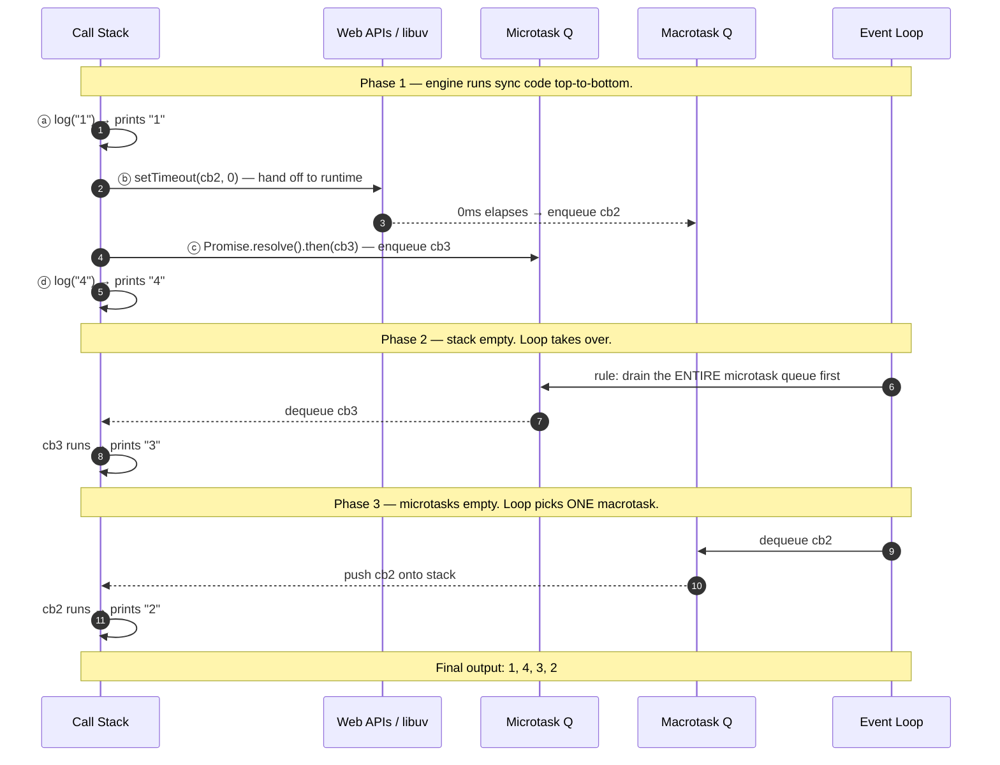
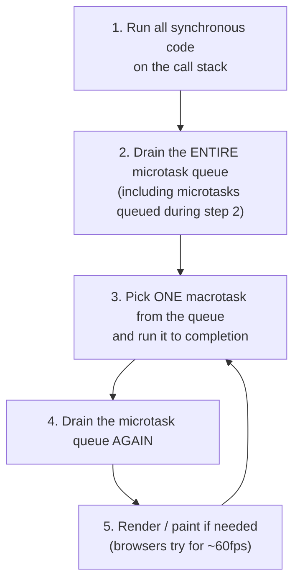

**JavaScript Chapter 4/7** | [← Previous: Objects & Prototypes](03_JS_Objects_Prototypes.md) | [Index](../00_MASTER_INDEX.md) | [Next → DOM & Browser APIs](05_JS_DOM_BrowserAPIs.md)

# Async JavaScript — Event Loop, Promises & Async/Await

## 5W1H — Why This Chapter?

WHAT: How JS handles asynchronous operations despite being
SINGLE-THREADED. Event loop, callbacks, promises, async.

WHY: Every web app does async: API calls, file reads, timers,
user events, animations. Without understanding async, you
WILL have bugs — race conditions, callback hell, unhandled
promise rejections, stale closures in React.

WHO: Every developer. Frontend (fetch, events), Backend (DB,
file I/O, HTTP), React (useEffect, data fetching).

WHEN: After understanding closures and scope (they're essential
for understanding how async callbacks capture variables).

HOW: JS delegates async work to browser/Node APIs. When done,
the result goes to a QUEUE. The EVENT LOOP moves it to
the call stack when the stack is empty.

---

## 1. The Event Loop — The Core Mental Model

### 5W1H: WHY is JS Single-Threaded?

WHY single-threaded?
JS was designed for the DOM. If two threads modified the same
DOM element simultaneously → race condition → crash/corruption.
One thread = no data races on the DOM. Simpler mental model.

BUT HOW does it handle async then?
The EVENT LOOP — JS's secret weapon.

### The Cast — five things you need to distinguish

The word "JavaScript" is used loosely for two very different pieces.
Async only makes sense once you separate them:

1. **JS Engine (V8, SpiderMonkey, …)** — a single-threaded machine that
   holds a **Call Stack** (functions currently executing) and a **Heap**
   (your objects). It knows nothing about time, network, or the DOM.
   It just executes JS instructions top-to-bottom until the stack empties.
2. **Runtime (Web APIs in browsers, libuv in Node)** — a separate
   layer, written in C++, that CAN do timers, network I/O, filesystem,
   and DOM events *in parallel with the engine*. When the engine calls
   `setTimeout(cb, 1000)`, it's really saying "hey runtime, remember
   this callback for me and give it back in 1000ms."
3. **Macrotask Queue** — a FIFO queue where the runtime deposits
   callbacks from timers, I/O, and `MessageChannel`. One entry runs per
   loop tick.
4. **Microtask Queue** — a FIFO queue for `Promise.then/catch/finally`,
   `queueMicrotask`, and `MutationObserver`. Drained *completely* per
   loop tick — this is the whole reason promises appear "faster" than
   timers.
5. **Event Loop** — a tiny supervisor that does one thing on repeat:
   *if the call stack is empty, drain all microtasks, then move one
   macrotask onto the stack, then repeat.*

Now watch those five actors handle one program, step by step.

```javascript
console.log("1");                                     // ⓐ sync
setTimeout(() => console.log("2"), 0);                // ⓑ macro
Promise.resolve().then(() => console.log("3"));       // ⓒ micro
console.log("4");                                     // ⓓ sync
// Actual output: 1, 4, 3, 2
```



**Why the order is `1, 4, 3, 2` — not `1, 2, 3, 4`:**

- `1` and `4` are synchronous — they run before the engine ever yields.
  `setTimeout` and `Promise.then` only *register* callbacks; they
  don't run them.
- `3` beats `2` because the loop drains the *entire* microtask queue
  before touching a macrotask. `Promise.then` puts its callback on the
  microtask queue; `setTimeout` puts its callback on the macrotask
  queue. Microtasks always win.

**Snapshot at each step (what's in each queue when):**

| # | Action                                | Microtask Q  | Macrotask Q  | Output       |
|---|---------------------------------------|--------------|--------------|--------------|
| 1 | `log("1")` runs                       | `[]`         | `[]`         | `1`          |
| 2 | `setTimeout(cb2, 0)` — hand off       | `[]`         | `[cb2]`      | `1`          |
| 3 | `Promise.then(cb3)` — enqueue         | `[cb3]`      | `[cb2]`      | `1`          |
| 4 | `log("4")` runs                       | `[cb3]`      | `[cb2]`      | `1, 4`       |
| 5 | Stack empty → loop drains micro → cb3 | `[]`         | `[cb2]`      | `1, 4, 3`    |
| 6 | Micro empty → loop pulls macro → cb2  | `[]`         | `[]`         | `1, 4, 3, 2` |


---

## 2. Callbacks — The Old Way

```javascript
// WHAT: Pass a function to be called LATER when the async operation finishes.

// Simple callback:
function fetchUser(id, callback) {
  setTimeout(() => {
    const user = { id, name: "Harsha" };
    callback(null, user); // Node convention: callback(error, result)
  }, 1000);
}

fetchUser(1, (error, user) => {
  if (error) {
    console.error(error);
    return;
  }
  console.log(user);
});

// CALLBACK HELL (the problem with callbacks):
getUser(1, (err, user) => {
  getOrders(user.id, (err, orders) => {
    getOrderDetails(orders[0].id, (err, details) => {
      getShippingInfo(details.shippingId, (err, shipping) => {
        // 4 levels deep — hard to read, hard to handle errors
        console.log(shipping);
      });
    });
  });
});

// WHY callback hell is bad:
// 1. Pyramid of doom — indentation keeps growing
// 2. Error handling at every level
// 3. Hard to refactor or add steps
// 4. Can't use try/catch (async errors escape it)
// SOLUTION: Promises.
```

---

## 3. Promises — The Modern Foundation

### 5W1H: WHAT is a Promise?

```
WHAT: A Promise is an object representing a FUTURE value.
      It will eventually be either FULFILLED (success) or
      REJECTED (failure).

WHY:  Promises solve callback hell with chaining (.then).
      They provide .catch for centralized error handling.
      They enable async/await (Chapter section 4).

ANALOGY: A promise is like an order receipt at a restaurant.
You place an order → get a receipt (promise). Eventually:
• Your food arrives (fulfilled) → enjoy it (.then)
• Kitchen is out of ingredients (rejected) → handle it (.catch)
• While waiting, you can do other things (non-blocking).

STATES (a Promise is a state machine with exactly one transition):

    ┌─────────────┐   resolve(value)   ┌─────────────┐
    │   PENDING   │ ───────────────▶ │  FULFILLED  │
    │             │                    └─────────────┘
    │             │   reject(reason)  ┌─────────────┐
    │             │ ───────────────▶ │  REJECTED   │
    └─────────────┘                    └─────────────┘

Once settled (fulfilled/rejected), a promise NEVER changes state.
```

```javascript
// CREATING a Promise:
const myPromise = new Promise((resolve, reject) => {
  // This executor runs IMMEDIATELY (synchronous!)
  const success = true;

  if (success) {
    resolve("Data loaded!"); // Fulfill the promise
  } else {
    reject(new Error("Failed to load")); // Reject the promise
  }
});

// CONSUMING a Promise:
myPromise
  .then((data) => {
    console.log(data); // "Data loaded!"
    return data.toUpperCase(); // Return value → next .then
  })
  .then((upper) => {
    console.log(upper); // "DATA LOADED!"
  })
  .catch((error) => {
    console.error(error); // Catches ANY error in the chain
  })
  .finally(() => {
    console.log("Done!"); // Runs ALWAYS (success or failure)
  });

// CHAINING solves callback hell:
getUser(1)
  .then((user) => getOrders(user.id))
  .then((orders) => getOrderDetails(orders[0].id))
  .then((details) => getShippingInfo(details.shippingId))
  .then((shipping) => console.log(shipping))
  .catch((error) => console.error(error)); // ONE catch for ALL!
```

### Promise Static Methods — Parallel & Race Patterns

```javascript
const p1 = fetch("/api/users");
const p2 = fetch("/api/products");
const p3 = fetch("/api/orders");

// Promise.all — Wait for ALL, fail if ANY fails
const [users, products, orders] = await Promise.all([p1, p2, p3]);
// If ANY promise rejects → entire Promise.all rejects immediately
// USE: When you need ALL results and can't proceed without them.

// Promise.allSettled — Wait for ALL, never fails
const results = await Promise.allSettled([p1, p2, p3]);
// results = [
//   { status: "fulfilled", value: ... },
//   { status: "rejected",  reason: Error },
//   { status: "fulfilled", value: ... }
// ]
// USE: When you want to know the status of each, regardless of failure.

// Promise.race — First to settle (fulfill OR reject) wins
const fastest = await Promise.race([p1, p2, p3]);
// USE: Timeout pattern:
const withTimeout = Promise.race([
  fetch("/api/data"),
  new Promise((_, reject) =>
    setTimeout(() => reject(new Error("Timeout")), 5000),
  ),
]);

// Promise.any — First to FULFILL wins (ignores rejections)
const first = await Promise.any([p1, p2, p3]);
// If ALL reject → AggregateError
// USE: Try multiple sources, use whichever responds first.
```

**Promise combinators — how each one settles:**

| Method               | Resolves when          | Rejects when       | Use case                     |
|----------------------|------------------------|--------------------|------------------------------|
| `Promise.all`        | ALL fulfill            | ANY rejects (fast) | Need every result            |
| `Promise.allSettled` | ALL settle             | Never              | Report status of each        |
| `Promise.race`       | First to settle wins   | First to settle    | Timeout / fastest wins       |
| `Promise.any`        | First to FULFILL wins  | ALL reject         | Try multiple sources         |

---

🔬 **Section Challenge — 3. Promises — The Modern Foundation**

**Challenge 1 (Reasoning):** `Promise.all([p1,p2,p3])` — p2 rejects. What happens to p1 and p3?

<details><summary>Answer</summary>

`Promise.all` rejects immediately when ANY promise rejects (fail-fast). p1 and p3 are still running — their promises continue executing, but their results are ignored. If they reject too, those rejections are also silently ignored (potential unhandled rejection warnings). Use `Promise.allSettled` to wait for ALL to complete regardless of success/failure, getting all results including errors.

</details>

**Challenge 2 (Design):** Implement `Promise.race` from scratch.

<details><summary>Answer</summary>

```javascript
function race(promises) {
  return new Promise((resolve, reject) => {
    promises.forEach((p) => Promise.resolve(p).then(resolve, reject));
    // First to resolve OR reject wins — others are ignored
  });
}
```

Once the first promise settles, the outer promise is settled. Other promises continue running internally but their results are discarded.

</details>

## 4. Async/Await — The Clean Syntax

### 5W1H: WHY Async/Await?

> **WHAT**: Syntactic sugar over Promises. Makes async code LOOK and
> BEHAVE like synchronous code.
>
> **WHY**: `.then` chains beat callbacks, but they still nest awkwardly
> for complex flows. `async`/`await` reads top-to-bottom.
>
> **HOW**: `async` marks a function as returning a Promise.
> `await` pauses execution of the *function* until the Promise resolves.
> The *thread* is not blocked — other code keeps running on the event loop.


```javascript
// WITH PROMISES (chaining):
function fetchUserData() {
  return getUser(1)
    .then((user) => getOrders(user.id))
    .then((orders) => getOrderDetails(orders[0].id))
    .then((details) => details)
    .catch((error) => console.error(error));
}

// WITH ASYNC/AWAIT (same logic, cleaner):
async function fetchUserData() {
  try {
    const user = await getUser(1);
    const orders = await getOrders(user.id);
    const details = await getOrderDetails(orders[0].id);
    return details;
  } catch (error) {
    console.error(error); // try/catch works with await!
  }
}

// RULES:
// 1. `await` can ONLY be used inside an `async` function (or top-level in modules)
// 2. `async` function ALWAYS returns a Promise
// 3. `await` pauses the function, NOT the thread

// PARALLEL with async/await (IMPORTANT!):
async function fetchAll() {
  // ❌ WRONG — runs sequentially (waits for each):
  const users = await fetch("/api/users");
  const products = await fetch("/api/products"); // Waits for users first!

  // ✅ RIGHT — runs in parallel:
  const [users2, products2] = await Promise.all([
    fetch("/api/users"),
    fetch("/api/products"),
  ]);
}
```

### Error Handling Patterns

```javascript
// PATTERN 1: Try/Catch (most common)
async function fetchData() {
  try {
    const response = await fetch("/api/data");
    if (!response.ok) throw new Error(`HTTP ${response.status}`);
    const data = await response.json();
    return data;
  } catch (error) {
    console.error("Fetch failed:", error.message);
    return null; // or throw error; to propagate
  }
}

// PATTERN 2: Go-style [error, data] tuple
async function safeAsync(promise) {
  try {
    const data = await promise;
    return [null, data];
  } catch (error) {
    return [error, null];
  }
}

// Usage:
const [error, user] = await safeAsync(getUser(1));
if (error) {
  /* handle */
}

// PATTERN 3: .catch on await (inline)
const user = await getUser(1).catch((err) => null);
if (!user) {
  /* handle */
}

// ALWAYS handle rejections! Unhandled rejections crash Node.
// In browsers, they log warnings and may become errors.
```

---

🔬 **Section Challenge — 4. Async/Await — The Clean Syntax**

**Challenge 1 (Reasoning):** `await Promise.all([fetch(a), fetch(b)])` vs `await fetch(a); await fetch(b)`. What's the performance difference?

<details><summary>Answer</summary>

`Promise.all`: both fetches START simultaneously (concurrent). Total time = max(timeA, timeB). Sequential awaits: fetch B doesn't start until fetch A completes. Total time = timeA + timeB. For independent requests, ALWAYS use `Promise.all`. Sequential await is only appropriate when B depends on A's result.

</details>

**Challenge 2 (Bug Hunt):** An `async` function has `try { await doWork(); } catch(e) {}`. `doWork()` rejects. Is the rejection handled?

<details><summary>Answer</summary>

Yes — `await` unwraps the rejected promise and throws the rejection value as a synchronous error, which is caught by the `catch` block. Without `try/catch` around `await`: unhandled rejection. Without `await` (just `doWork()`): the rejection is a separate promise — the `try/catch` CANNOT catch it (it's asynchronous). Always `await` async calls if you want to catch their rejections synchronously.

</details>

## 5. Advanced Async Patterns

### Generators & Async Generators

```javascript
// GENERATOR: A function that can PAUSE and RESUME.
function* idGenerator() {
  let id = 0;
  while (true) {
    yield ++id; // yield pauses and returns a value
  }
}
const gen = idGenerator();
gen.next(); // { value: 1, done: false }
gen.next(); // { value: 2, done: false }
gen.next(); // { value: 3, done: false }

// WHY generators matter:
// 1. Lazy evaluation — produce values on demand
// 2. Iterator protocol — works with for...of
// 3. Async generators — for streaming data

// ASYNC GENERATOR: yield + async combined
async function* fetchPages(url) {
  let page = 1;
  while (true) {
    const response = await fetch(`${url}?page=${page}`);
    const data = await response.json();
    if (data.length === 0) break;
    yield data;
    page++;
  }
}

// Consume with for await...of:
for await (const page of fetchPages("/api/users")) {
  console.log("Got page:", page);
}
```

### AbortController — Cancelling Async Operations

```javascript
// WHAT: The ONLY standard way to cancel fetch requests.
// WHY: User navigates away, component unmounts, request becomes stale.

const controller = new AbortController();

// Pass signal to fetch:
fetch("/api/data", { signal: controller.signal })
  .then((response) => response.json())
  .then((data) => console.log(data))
  .catch((error) => {
    if (error.name === "AbortError") {
      console.log("Request was cancelled");
    } else {
      throw error;
    }
  });

// Cancel after 3 seconds:
setTimeout(() => controller.abort(), 3000);

// REACT USE CASE:
useEffect(() => {
  const controller = new AbortController();

  fetch("/api/data", { signal: controller.signal })
    .then((res) => res.json())
    .then((data) => setData(data))
    .catch((err) => {
      if (err.name !== "AbortError") setError(err);
    });

  return () => controller.abort(); // Cleanup on unmount!
}, []);
```

---

## 6. Microtasks vs Macrotasks — Deep Dive

```javascript
// MICROTASKS (higher priority):
// • Promise.then/.catch/.finally callbacks
// • queueMicrotask()
// • MutationObserver callbacks

// MACROTASKS (lower priority):
// • setTimeout / setInterval
// • setImmediate (Node.js only)
// • I/O operations
// • UI rendering events
// • requestAnimationFrame (between macro tasks, before paint)

// THE RULE: After each macrotask, run ALL pending microtasks
// before the next macrotask.

console.log("start");

setTimeout(() => console.log("timeout 1"), 0);
setTimeout(() => console.log("timeout 2"), 0);

Promise.resolve()
  .then(() => {
    console.log("promise 1");
    // Adding a new microtask from WITHIN a microtask
    return Promise.resolve();
  })
  .then(() => console.log("promise 2"));

queueMicrotask(() => console.log("microtask"));

console.log("end");

// OUTPUT:
// start
// end
// promise 1    ← microtask queue
// microtask    ← microtask queue
// promise 2    ← microtask queue (added during microtask phase!)
// timeout 1    ← macrotask queue
// timeout 2    ← macrotask queue
```



**Implication — microtasks can starve macrotasks.** If every microtask
schedules another microtask, step 2 (or step 4) never terminates.
`setTimeout` callbacks never fire, no macrotask ever runs, no frame
ever paints. The page freezes even though the CPU is busy.


---

## 7. Common Async Patterns in Real Code

```javascript
// PATTERN: Debounce (wait until user stops typing)
function debounce(fn, delay) {
  let timer;
  return function (...args) {
    clearTimeout(timer);
    timer = setTimeout(() => fn.apply(this, args), delay);
  };
}
const search = debounce((query) => fetch(`/api/search?q=${query}`), 300);
// Only fires 300ms AFTER user stops typing

// PATTERN: Throttle (run at most once per interval)
function throttle(fn, interval) {
  let lastTime = 0;
  return function (...args) {
    const now = Date.now();
    if (now - lastTime >= interval) {
      lastTime = now;
      fn.apply(this, args);
    }
  };
}
const handleScroll = throttle(() => console.log("Scrolled!"), 100);

// PATTERN: Retry with exponential backoff
async function fetchWithRetry(url, maxRetries = 3) {
  for (let i = 0; i < maxRetries; i++) {
    try {
      const response = await fetch(url);
      if (response.ok) return await response.json();
      throw new Error(`HTTP ${response.status}`);
    } catch (error) {
      if (i === maxRetries - 1) throw error;
      const delay = Math.pow(2, i) * 1000; // 1s, 2s, 4s
      console.log(`Retry ${i + 1} in ${delay}ms...`);
      await new Promise((resolve) => setTimeout(resolve, delay));
    }
  }
}

// PATTERN: Concurrent limit (process N at a time)
async function asyncPool(limit, items, iteratorFn) {
  const results = [];
  const executing = [];

  for (const item of items) {
    const p = iteratorFn(item);
    results.push(p);

    if (items.length >= limit) {
      const e = p.then(() => executing.splice(executing.indexOf(e), 1));
      executing.push(e);
      if (executing.length >= limit) await Promise.race(executing);
    }
  }

  return Promise.all(results);
}
// Process 5 URLs at a time:
await asyncPool(5, urls, (url) => fetch(url).then((r) => r.json()));
```

---

## Interview Quick-Fire

```
Q: What is the event loop?
→ The mechanism that allows single-threaded JS to handle async.
  It checks if the call stack is empty, then moves tasks from
  queues (microtask first, then macrotask) to the stack.

Q: Output? setTimeout(()=>log(1),0); Promise.resolve().then(()=>log(2)); log(3);
→ 3, 2, 1 — sync first, then microtask (promise), then macrotask (timeout)

Q: Difference between microtask and macrotask?
→ Microtasks (promises, queueMicrotask) run BEFORE macrotasks
  (setTimeout, I/O). All microtasks drain before next macrotask.

Q: Promise.all vs Promise.allSettled?
→ .all: rejects immediately if ANY promise rejects.
  .allSettled: waits for ALL, returns status of each.

Q: What does async do to a function?
→ Makes it return a Promise. Allows `await` inside.
  The return value becomes the resolved value of the promise.

Q: Can you cancel a fetch request?
→ Yes, using AbortController. Pass its signal to fetch options.
  Call controller.abort() to cancel.

Q: How to run async operations in parallel?
→ Promise.all([promise1, promise2, promise3])
  NOT: await p1; await p2; (this runs sequentially!)
```

---

[← Previous: Objects & Prototypes](03_JS_Objects_Prototypes.md) | [Index](../00_MASTER_INDEX.md) | [Next → DOM & Browser APIs](05_JS_DOM_BrowserAPIs.md)

---


---

## Reality Check

**"await pauses the thread"** → await SUSPENDS THE FUNCTION and returns control to the event loop — nothing pauses: the rest of the async function becomes a continuation queued for when the promise settles. This is why two sequential awaits serialize their operations (each waits before STARTING the next — the accidental-waterfall performance bug) while Promise.all starts both first; and why "async" never means "parallel" for CPU work — one thread runs all the JavaScript regardless. The model: async/await is cooperative scheduling syntax, not concurrency.

**"Unhandled promise rejections are like uncaught exceptions"** → They are DELAYED and DETACHED: a rejection with no handler attached yet is not necessarily unhandled (attaching later works), but a promise whose rejection path is simply forgotten — the fire-and-forget call, the missing return inside .then, the async function called without await in a try block — fails silently-then-fatally (Node kills the process on unhandled rejections in modern versions). The three leak sites are exactly those: forgotten return in a chain, un-awaited async call inside try/catch (the catch cannot catch it), and .then(ok) with no second argument or .catch. Every one looks correct in review.

**"Promise.all is how you run things concurrently"** → Promise.all is the fail-FAST combinator — one rejection rejects the whole and the OTHER operations keep running unobserved (their failures then become unhandled rejections; their side effects still land). The family exists because policies differ: allSettled (collect every outcome — the batch-processing default), race (first to SETTLE, including failure — timeout patterns), any (first SUCCESS — redundant-endpoint patterns). Choosing all by reflex when the requirement was "process every item and report failures" is the most common async design bug in application code.

**"async/await made the microtask/macrotask distinction irrelevant"** → await IS microtask scheduling: every await yields to the microtask queue, microtasks drain COMPLETELY before the next macrotask (timers, I/O), and rendering waits for the drain — so a microtask loop starves the UI exactly like a while(true), and the setTimeout-0-versus-Promise.resolve ordering question is really "which queue?" The practical surfaces: state updates flushing before timers, "why does my await run before the setTimeout I scheduled first," and the queueMicrotask-versus-setTimeout choice when deliberately deferring. The queues did not go away; the syntax just stopped mentioning them.

**"Async functions compose like sync functions with await sprinkled in"** → Composition changes in three specific ways people miss: EVERY async function returns a promise (a caller forgetting await gets a promise object — truthy, comparisons silently wrong), error boundaries follow the AWAIT points not the call structure (try/catch catches only what is awaited inside it), and loops fork into semantics: for-of-with-await serializes, map-with-async fires everything at once returning promises (forEach-with-async is pure fire-and-forget — the classic "why is my array empty after the loop"). The audit habit for any async code: find every promise created, and point to where it is awaited or explicitly handed off — unaccounted promises are the bug inventory.
