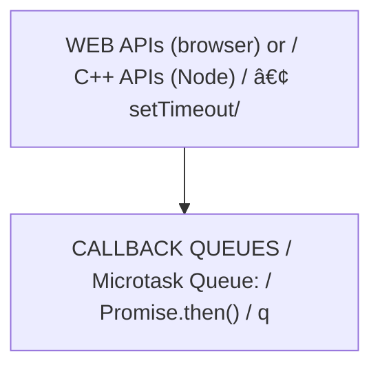
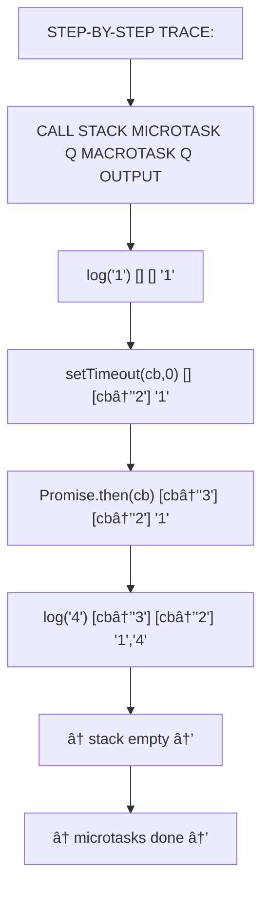
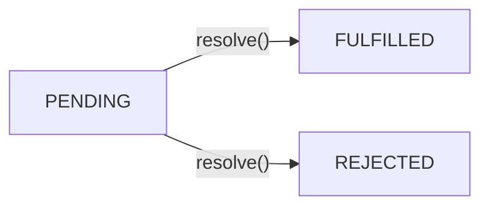
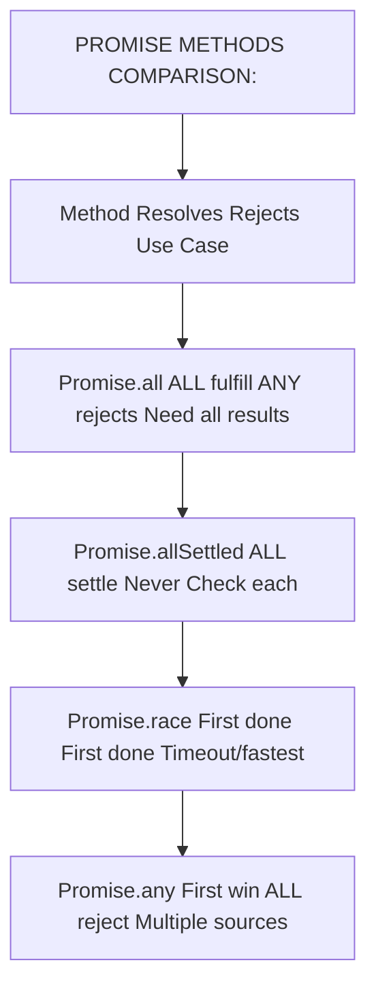
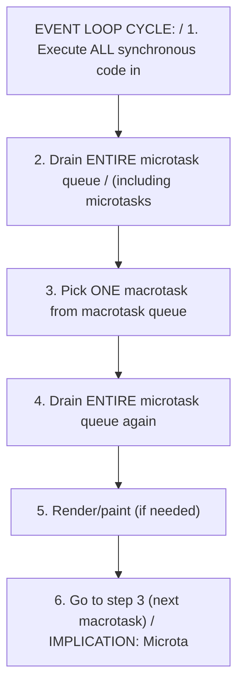
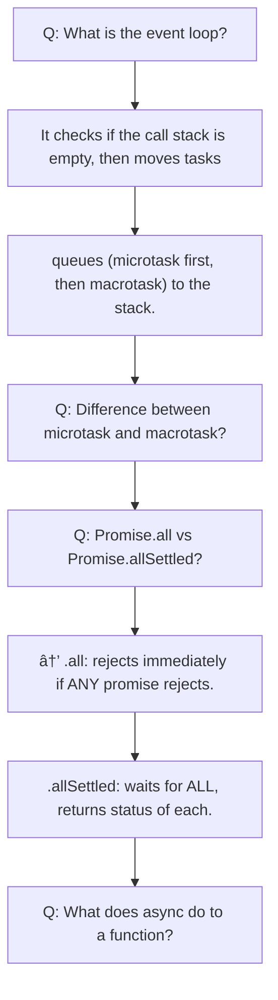

**JavaScript Chapter 4/7** | [← Previous: Objects & Prototypes](03_JS_Objects_Prototypes.md) | [Index](../00_MASTER_INDEX.md) | [Next → DOM & Browser APIs](05_JS_DOM_BrowserAPIs.md)

# Async JavaScript — Event Loop, Promises & Async/Await

## 5W1H — Why This Chapter?


WHAT: How JS handles asynchronous operations despite being
SINGLE-THREADED. Event loop, callbacks, promises, async.

WHY:  Every web app does async: API calls, file reads, timers,
user events, animations. Without understanding async, you
WILL have bugs — race conditions, callback hell, unhandled
promise rejections, stale closures in React.

WHO:  Every developer. Frontend (fetch, events), Backend (DB,
file I/O, HTTP), React (useEffect, data fetching).

WHEN: After understanding closures and scope (they're essential
for understanding how async callbacks capture variables).

HOW:  JS delegates async work to browser/Node APIs. When done,
the result goes to a QUEUE. The EVENT LOOP moves it to
the call stack when the stack is empty.


---

## 1. The Event Loop — The Core Mental Model

### 5W1H: WHY is JS Single-Threaded?


WHY single-threaded?
JS was designed for the DOM. If two threads modified the same
DOM element simultaneously → race condition → crash/corruption.
One thread = no data races on the DOM. Simpler mental model.

BUT HOW does it handle async then?
The EVENT LOOP — JS's secret weapon.


```
THE EVENT LOOP ARCHITECTURE:

┌──────────────────────────────────────────────────────────┐
│  YOUR JS CODE                                            │
│  ┌──────────────┐    ┌────────────────────────────┐      │
│  │  CALL STACK  │    │  WEB APIs (browser) or     │      │
│  │              │    │  C++ APIs (Node)            │     │
│  │ ┌──────────┐ │    │                              │    │
│  │ │ func3()  │ │    │  • setTimeout/setInterval    │    │
│  │ │ func2()  │ │    │  • fetch / XMLHttpRequest    │    │
│  │ │ func1()  │ │    │  • addEventListener          │    │
│  │ │ global   │ │    │  • geolocation               │    │
│  │ └──────────┘ │    │  • FileReader                │    │
│  └──────────────┘    └─────────────┬──────────────┘      │
│         ▲                          │                     │
│         │                          ▼                     │
│         │              ┌───────────────────────┐         │
│         │              │  CALLBACK QUEUES      │         │
│         │              │                                 │
│    EVENT LOOP          │  Microtask Queue:     │         │
│    (checks if          │  Promise.then()        │        │
│     stack is           │  queueMicrotask()      │        │
│     empty, then        │  MutationObserver      │        │
│     moves next         │                        │        │
│     task to stack)     │  Macrotask Queue:     │         │
│         │              │  setTimeout()          │        │
│         │              │  setInterval()         │        │
│         └──────────────│  I/O callbacks         │        │
│                        │  UI rendering          │        │
│                        └───────────────────────┘         │
└──────────────────────────────────────────────────────────┘

CRITICAL RULE:
Microtasks ALWAYS run before macrotasks.
After each macrotask, ALL pending microtasks run first.
```

**Flow:**
1. WEB APIs (browser) or / C++ APIs (Node) / • setTimeout/
2. CALLBACK QUEUES / Microtask Queue: / Promise.then() / q



### The Event Loop in Action — Step by Step

```javascript
console.log("1");                          // Sync → call stack

setTimeout(() => console.log("2"), 0);     // Macro → macrotask queue

Promise.resolve().then(() => console.log("3")); // Micro → microtask queue

console.log("4");                          // Sync → call stack

// OUTPUT: 1, 4, 3, 2
// WHY?
// 1. "1" runs immediately (sync)
// 2. setTimeout REGISTERS callback → macrotask queue (even with 0ms!)
// 3. Promise.then REGISTERS callback → microtask queue
// 4. "4" runs immediately (sync)
// 5. Stack is empty → event loop checks microtasks first → "3"
// 6. No more microtasks → check macrotasks → "2"
```

```
╔══════════════════════════════════════════════════════════════════════╗
â•‘  STEP-BY-STEP TRACE:                                                 â•‘
â•‘                                                                      â•‘
â•‘  CALL STACK          MICROTASK Q     MACROTASK Q    OUTPUT           â•‘
║  ─────────────       ──────────      ──────────     ──────           ║
â•‘  log("1")            []              []             "1"              â•‘
║  setTimeout(cb,0)    []              [cb→"2"]       "1"              ║
║  Promise.then(cb)    [cb→"3"]        [cb→"2"]       "1"              ║
║  log("4")            [cb→"3"]        [cb→"2"]       "1","4"          ║
║  ← stack empty →                                                     ║
║  cb→"3"              []              [cb→"2"]       "1","4","3"      ║
║  ← microtasks done →                                                 ║
║  cb→"2"              []              []             "1","4","3","2"  ║
╚══════════════════════════════════════════════════════════════════════╝
```

**Flow:**
1. STEP-BY-STEP TRACE:
2. CALL STACK MICROTASK Q MACROTASK Q OUTPUT
3. log('1') [] [] '1' setTimeout(cb,0) [] [cb '2'] '1'
4. setTimeout(cb,0) [] [cb '2'] '1'
5. Promise.then(cb) [cb '3'] [cb '2'] '1'
6. log('4') [cb '3'] [cb '2'] '1','4'
7. ← stack empty



---

## 2. Callbacks — The Old Way

```javascript
// WHAT: Pass a function to be called LATER when the async operation finishes.

// Simple callback:
function fetchUser(id, callback) {
    setTimeout(() => {
        const user = { id, name: "Harsha" };
        callback(null, user);  // Node convention: callback(error, result)
    }, 1000);
}

fetchUser(1, (error, user) => {
    if (error) { console.error(error); return; }
    console.log(user);
});

// CALLBACK HELL (the problem with callbacks):
getUser(1, (err, user) => {
    getOrders(user.id, (err, orders) => {
        getOrderDetails(orders[0].id, (err, details) => {
            getShippingInfo(details.shippingId, (err, shipping) => {
                // 4 levels deep — hard to read, hard to handle errors
                console.log(shipping);
            });
        });
    });
});

// WHY callback hell is bad:
// 1. Pyramid of doom — indentation keeps growing
// 2. Error handling at every level
// 3. Hard to refactor or add steps
// 4. Can't use try/catch (async errors escape it)
// SOLUTION: Promises.
```

---

## 3. Promises — The Modern Foundation

### 5W1H: WHAT is a Promise?

```
WHAT: A Promise is an object representing a FUTURE value.
      It will eventually be either FULFILLED (success) or
      REJECTED (failure).

WHY:  Promises solve callback hell with chaining (.then).
      They provide .catch for centralized error handling.
      They enable async/await (Chapter section 4).

ANALOGY: A promise is like an order receipt at a restaurant.
You place an order → get a receipt (promise). Eventually:
• Your food arrives (fulfilled) → enjoy it (.then)
• Kitchen is out of ingredients (rejected) → handle it (.catch)
• While waiting, you can do other things (non-blocking).

STATES:
┌──────────┐    resolve()    ┌───────────┐
│ PENDING  │───────────────→│ FULFILLED  │
│          │                 └───────────┘
│          │    reject()     ┌───────────┐
│          │───────────────→│ REJECTED   │
└──────────┘                 └───────────┘
Once settled (fulfilled/rejected), a promise NEVER changes state.
```

**Flow:**
1. PENDING --(resolve())--> FULFILLED
2. PENDING --(resolve())--> REJECTED



```javascript
// CREATING a Promise:
const myPromise = new Promise((resolve, reject) => {
    // This executor runs IMMEDIATELY (synchronous!)
    const success = true;

    if (success) {
        resolve("Data loaded!");  // Fulfill the promise
    } else {
        reject(new Error("Failed to load")); // Reject the promise
    }
});

// CONSUMING a Promise:
myPromise
    .then(data => {
        console.log(data);       // "Data loaded!"
        return data.toUpperCase(); // Return value → next .then
    })
    .then(upper => {
        console.log(upper);      // "DATA LOADED!"
    })
    .catch(error => {
        console.error(error);    // Catches ANY error in the chain
    })
    .finally(() => {
        console.log("Done!");    // Runs ALWAYS (success or failure)
    });

// CHAINING solves callback hell:
getUser(1)
    .then(user => getOrders(user.id))
    .then(orders => getOrderDetails(orders[0].id))
    .then(details => getShippingInfo(details.shippingId))
    .then(shipping => console.log(shipping))
    .catch(error => console.error(error)); // ONE catch for ALL!
```

### Promise Static Methods — Parallel & Race Patterns

```javascript
const p1 = fetch("/api/users");
const p2 = fetch("/api/products");
const p3 = fetch("/api/orders");

// Promise.all — Wait for ALL, fail if ANY fails
const [users, products, orders] = await Promise.all([p1, p2, p3]);
// If ANY promise rejects → entire Promise.all rejects immediately
// USE: When you need ALL results and can't proceed without them.

// Promise.allSettled — Wait for ALL, never fails
const results = await Promise.allSettled([p1, p2, p3]);
// results = [
//   { status: "fulfilled", value: ... },
//   { status: "rejected",  reason: Error },
//   { status: "fulfilled", value: ... }
// ]
// USE: When you want to know the status of each, regardless of failure.

// Promise.race — First to settle (fulfill OR reject) wins
const fastest = await Promise.race([p1, p2, p3]);
// USE: Timeout pattern:
const withTimeout = Promise.race([
    fetch("/api/data"),
    new Promise((_, reject) => setTimeout(() => reject(new Error("Timeout")), 5000))
]);

// Promise.any — First to FULFILL wins (ignores rejections)
const first = await Promise.any([p1, p2, p3]);
// If ALL reject → AggregateError
// USE: Try multiple sources, use whichever responds first.
```

```
PROMISE METHODS COMPARISON:
┌───────────────────┬────────────┬────────────┬─────────────────┐
│ Method            │ Resolves   │ Rejects    │ Use Case        │
├───────────────────┼────────────┼────────────┼─────────────────┤
│ Promise.all       │ ALL fulfill│ ANY rejects│ Need all results│
│ Promise.allSettled│ ALL settle │ Never      │ Check each      │
│ Promise.race      │ First done │ First done │ Timeout/fastest │
│ Promise.any       │ First win  │ ALL reject │ Multiple sources│
└───────────────────┴────────────┴────────────┴─────────────────┘
```

**Flow:**
1. PROMISE METHODS COMPARISON:
2. Method Resolves Rejects Use Case
3. Promise.all ALL fulfill ANY rejects Need all results
4. Promise.allSettled ALL settle Never Check each
5. Promise.race First done First done Timeout/fastest
6. Promise.any First win ALL reject Multiple sources



---


🔬 **Section Challenge — 3. Promises — The Modern Foundation**

**Challenge 1 (Reasoning):** `Promise.all([p1,p2,p3])` — p2 rejects. What happens to p1 and p3?
<details><summary>Answer</summary>

`Promise.all` rejects immediately when ANY promise rejects (fail-fast). p1 and p3 are still running — their promises continue executing, but their results are ignored. If they reject too, those rejections are also silently ignored (potential unhandled rejection warnings). Use `Promise.allSettled` to wait for ALL to complete regardless of success/failure, getting all results including errors.
</details>

**Challenge 2 (Design):** Implement `Promise.race` from scratch.
<details><summary>Answer</summary>

```javascript
function race(promises) {
    return new Promise((resolve, reject) => {
        promises.forEach(p => Promise.resolve(p).then(resolve, reject));
        // First to resolve OR reject wins — others are ignored
    });
}
```
Once the first promise settles, the outer promise is settled. Other promises continue running internally but their results are discarded.
</details>


## 4. Async/Await — The Clean Syntax

### 5W1H: WHY Async/Await?

```
╔══════════════════════════════════════════════════════════════════════╗
â•‘  WHAT: Syntactic sugar over Promises. Makes async code LOOK and      â•‘
â•‘        BEHAVE like synchronous code.                                 â•‘
â•‘                                                                      â•‘
â•‘  WHY:  .then chains are better than callbacks, but still messy       â•‘
â•‘        for complex flows. async/await reads top-to-bottom.           â•‘
â•‘                                                                      â•‘
â•‘  HOW:  `async` marks a function as returning a Promise.              â•‘
â•‘        `await` pauses execution until the Promise resolves.          â•‘
║        (The thread isn't blocked — other code can run!)              ║
╚══════════════════════════════════════════════════════════════════════╝
```

**Flow:**
1. BEHAVE like synchronous code.
2. HOW: `async` marks a function as returning a Promise.
3. `await` pauses execution until the Promise resolves.
4. (The thread isn't blocked — other code can run!)

```mermaid
flowchart TD
    N1["BEHAVE like synchronous code."]
    N2["HOW: `async` marks a function as returning a Promise."]
    N3["`await` pauses execution until the Promise resolves."]
    N4["(The thread isn't blocked — other code can run!)"]
    N1 --> N2
    N2 --> N3
    N3 --> N4
```

```javascript
// WITH PROMISES (chaining):
function fetchUserData() {
    return getUser(1)
        .then(user => getOrders(user.id))
        .then(orders => getOrderDetails(orders[0].id))
        .then(details => details)
        .catch(error => console.error(error));
}

// WITH ASYNC/AWAIT (same logic, cleaner):
async function fetchUserData() {
    try {
        const user = await getUser(1);
        const orders = await getOrders(user.id);
        const details = await getOrderDetails(orders[0].id);
        return details;
    } catch (error) {
        console.error(error); // try/catch works with await!
    }
}

// RULES:
// 1. `await` can ONLY be used inside an `async` function (or top-level in modules)
// 2. `async` function ALWAYS returns a Promise
// 3. `await` pauses the function, NOT the thread

// PARALLEL with async/await (IMPORTANT!):
async function fetchAll() {
    // ❌ WRONG — runs sequentially (waits for each):
    const users = await fetch("/api/users");
    const products = await fetch("/api/products"); // Waits for users first!

    // ✅ RIGHT — runs in parallel:
    const [users2, products2] = await Promise.all([
        fetch("/api/users"),
        fetch("/api/products")
    ]);
}
```

### Error Handling Patterns

```javascript
// PATTERN 1: Try/Catch (most common)
async function fetchData() {
    try {
        const response = await fetch("/api/data");
        if (!response.ok) throw new Error(`HTTP ${response.status}`);
        const data = await response.json();
        return data;
    } catch (error) {
        console.error("Fetch failed:", error.message);
        return null; // or throw error; to propagate
    }
}

// PATTERN 2: Go-style [error, data] tuple
async function safeAsync(promise) {
    try {
        const data = await promise;
        return [null, data];
    } catch (error) {
        return [error, null];
    }
}

// Usage:
const [error, user] = await safeAsync(getUser(1));
if (error) { /* handle */ }

// PATTERN 3: .catch on await (inline)
const user = await getUser(1).catch(err => null);
if (!user) { /* handle */ }

// ALWAYS handle rejections! Unhandled rejections crash Node.
// In browsers, they log warnings and may become errors.
```

---


🔬 **Section Challenge — 4. Async/Await — The Clean Syntax**

**Challenge 1 (Reasoning):** `await Promise.all([fetch(a), fetch(b)])` vs `await fetch(a); await fetch(b)`. What's the performance difference?
<details><summary>Answer</summary>

`Promise.all`: both fetches START simultaneously (concurrent). Total time = max(timeA, timeB). Sequential awaits: fetch B doesn't start until fetch A completes. Total time = timeA + timeB. For independent requests, ALWAYS use `Promise.all`. Sequential await is only appropriate when B depends on A's result.
</details>

**Challenge 2 (Bug Hunt):** An `async` function has `try { await doWork(); } catch(e) {}`. `doWork()` rejects. Is the rejection handled?
<details><summary>Answer</summary>

Yes — `await` unwraps the rejected promise and throws the rejection value as a synchronous error, which is caught by the `catch` block. Without `try/catch` around `await`: unhandled rejection. Without `await` (just `doWork()`): the rejection is a separate promise — the `try/catch` CANNOT catch it (it's asynchronous). Always `await` async calls if you want to catch their rejections synchronously.
</details>


## 5. Advanced Async Patterns

### Generators & Async Generators

```javascript
// GENERATOR: A function that can PAUSE and RESUME.
function* idGenerator() {
    let id = 0;
    while (true) {
        yield ++id;  // yield pauses and returns a value
    }
}
const gen = idGenerator();
gen.next(); // { value: 1, done: false }
gen.next(); // { value: 2, done: false }
gen.next(); // { value: 3, done: false }

// WHY generators matter:
// 1. Lazy evaluation — produce values on demand
// 2. Iterator protocol — works with for...of
// 3. Async generators — for streaming data

// ASYNC GENERATOR: yield + async combined
async function* fetchPages(url) {
    let page = 1;
    while (true) {
        const response = await fetch(`${url}?page=${page}`);
        const data = await response.json();
        if (data.length === 0) break;
        yield data;
        page++;
    }
}

// Consume with for await...of:
for await (const page of fetchPages("/api/users")) {
    console.log("Got page:", page);
}
```

### AbortController — Cancelling Async Operations

```javascript
// WHAT: The ONLY standard way to cancel fetch requests.
// WHY: User navigates away, component unmounts, request becomes stale.

const controller = new AbortController();

// Pass signal to fetch:
fetch("/api/data", { signal: controller.signal })
    .then(response => response.json())
    .then(data => console.log(data))
    .catch(error => {
        if (error.name === "AbortError") {
            console.log("Request was cancelled");
        } else {
            throw error;
        }
    });

// Cancel after 3 seconds:
setTimeout(() => controller.abort(), 3000);

// REACT USE CASE:
useEffect(() => {
    const controller = new AbortController();

    fetch("/api/data", { signal: controller.signal })
        .then(res => res.json())
        .then(data => setData(data))
        .catch(err => {
            if (err.name !== "AbortError") setError(err);
        });

    return () => controller.abort(); // Cleanup on unmount!
}, []);
```

---


## 6. Microtasks vs Macrotasks — Deep Dive

```javascript
// MICROTASKS (higher priority):
// • Promise.then/.catch/.finally callbacks
// • queueMicrotask()
// • MutationObserver callbacks

// MACROTASKS (lower priority):
// • setTimeout / setInterval
// • setImmediate (Node.js only)
// • I/O operations
// • UI rendering events
// • requestAnimationFrame (between macro tasks, before paint)

// THE RULE: After each macrotask, run ALL pending microtasks
// before the next macrotask.

console.log("start");

setTimeout(() => console.log("timeout 1"), 0);
setTimeout(() => console.log("timeout 2"), 0);

Promise.resolve()
    .then(() => {
        console.log("promise 1");
        // Adding a new microtask from WITHIN a microtask
        return Promise.resolve();
    })
    .then(() => console.log("promise 2"));

queueMicrotask(() => console.log("microtask"));

console.log("end");

// OUTPUT:
// start
// end
// promise 1    ← microtask queue
// microtask    ← microtask queue
// promise 2    ← microtask queue (added during microtask phase!)
// timeout 1    ← macrotask queue
// timeout 2    ← macrotask queue
```

```
EVENT LOOP CYCLE:

┌─────────────────────────────────────────────────────────┐
│ 1. Execute ALL synchronous code in call stack           │
│                │                                        │
│                ▼                                        │
│ 2. Drain ENTIRE microtask queue                         │
│    (including microtasks added DURING this step!)       │
│                │                                        │
│                ▼                                        │
│ 3. Pick ONE macrotask from macrotask queue              │
│                │                                        │
│                ▼                                        │
│ 4. Drain ENTIRE microtask queue again                   │
│                │                                        │
│                ▼                                        │
│ 5. Render/paint (if needed)                             │
│                │                                        │
│                ▼                                        │
│ 6. Go to step 3 (next macrotask)                        │
└─────────────────────────────────────────────────────────┘

IMPLICATION: Microtasks can starve macrotasks!
If microtasks keep adding more microtasks, setTimeout callbacks
and UI rendering NEVER run. The page freezes.
```

**Flow:**
1. EVENT LOOP CYCLE: / 1. Execute ALL synchronous code in
2. Drain ENTIRE microtask queue / (including microtasks Pick ONE macrotask from macrotask queue Drain ENTIRE microtask queue again Render/paint (if needed) Go to step 3 (next macrotask) / IMPLICATION: Microta



---

## 7. Common Async Patterns in Real Code

```javascript
// PATTERN: Debounce (wait until user stops typing)
function debounce(fn, delay) {
    let timer;
    return function(...args) {
        clearTimeout(timer);
        timer = setTimeout(() => fn.apply(this, args), delay);
    };
}
const search = debounce(query => fetch(`/api/search?q=${query}`), 300);
// Only fires 300ms AFTER user stops typing

// PATTERN: Throttle (run at most once per interval)
function throttle(fn, interval) {
    let lastTime = 0;
    return function(...args) {
        const now = Date.now();
        if (now - lastTime >= interval) {
            lastTime = now;
            fn.apply(this, args);
        }
    };
}
const handleScroll = throttle(() => console.log("Scrolled!"), 100);

// PATTERN: Retry with exponential backoff
async function fetchWithRetry(url, maxRetries = 3) {
    for (let i = 0; i < maxRetries; i++) {
        try {
            const response = await fetch(url);
            if (response.ok) return await response.json();
            throw new Error(`HTTP ${response.status}`);
        } catch (error) {
            if (i === maxRetries - 1) throw error;
            const delay = Math.pow(2, i) * 1000; // 1s, 2s, 4s
            console.log(`Retry ${i + 1} in ${delay}ms...`);
            await new Promise(resolve => setTimeout(resolve, delay));
        }
    }
}

// PATTERN: Concurrent limit (process N at a time)
async function asyncPool(limit, items, iteratorFn) {
    const results = [];
    const executing = [];

    for (const item of items) {
        const p = iteratorFn(item);
        results.push(p);

        if (items.length >= limit) {
            const e = p.then(() => executing.splice(executing.indexOf(e), 1));
            executing.push(e);
            if (executing.length >= limit) await Promise.race(executing);
        }
    }

    return Promise.all(results);
}
// Process 5 URLs at a time:
await asyncPool(5, urls, url => fetch(url).then(r => r.json()));
```

---


## Interview Quick-Fire

```
Q: What is the event loop?
→ The mechanism that allows single-threaded JS to handle async.
  It checks if the call stack is empty, then moves tasks from
  queues (microtask first, then macrotask) to the stack.

Q: Output? setTimeout(()=>log(1),0); Promise.resolve().then(()=>log(2)); log(3);
→ 3, 2, 1 — sync first, then microtask (promise), then macrotask (timeout)

Q: Difference between microtask and macrotask?
→ Microtasks (promises, queueMicrotask) run BEFORE macrotasks
  (setTimeout, I/O). All microtasks drain before next macrotask.

Q: Promise.all vs Promise.allSettled?
→ .all: rejects immediately if ANY promise rejects.
  .allSettled: waits for ALL, returns status of each.

Q: What does async do to a function?
→ Makes it return a Promise. Allows `await` inside.
  The return value becomes the resolved value of the promise.

Q: Can you cancel a fetch request?
→ Yes, using AbortController. Pass its signal to fetch options.
  Call controller.abort() to cancel.

Q: How to run async operations in parallel?
→ Promise.all([promise1, promise2, promise3])
  NOT: await p1; await p2; (this runs sequentially!)
```

**Flow:**
1. Q: What is the event loop?
2. It checks if the call stack is empty, then moves tasks
3. queues (microtask first, then macrotask) to the stack.
4. Q: Difference between microtask and macrotask?
5. Q: Promise.all vs Promise.allSettled?
6. .all: rejects immediately if ANY promise rejects.
7. .allSettled: waits for ALL, returns status of each.



---

[← Previous: Objects & Prototypes](03_JS_Objects_Prototypes.md) | [Index](../00_MASTER_INDEX.md) | [Next → DOM & Browser APIs](05_JS_DOM_BrowserAPIs.md)

---
