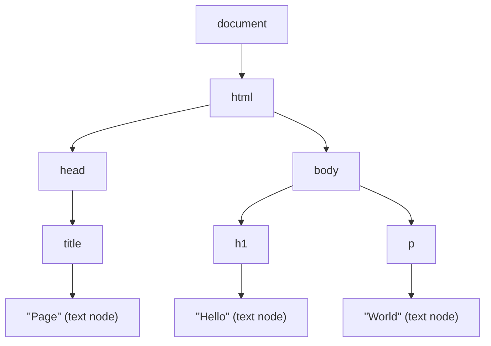
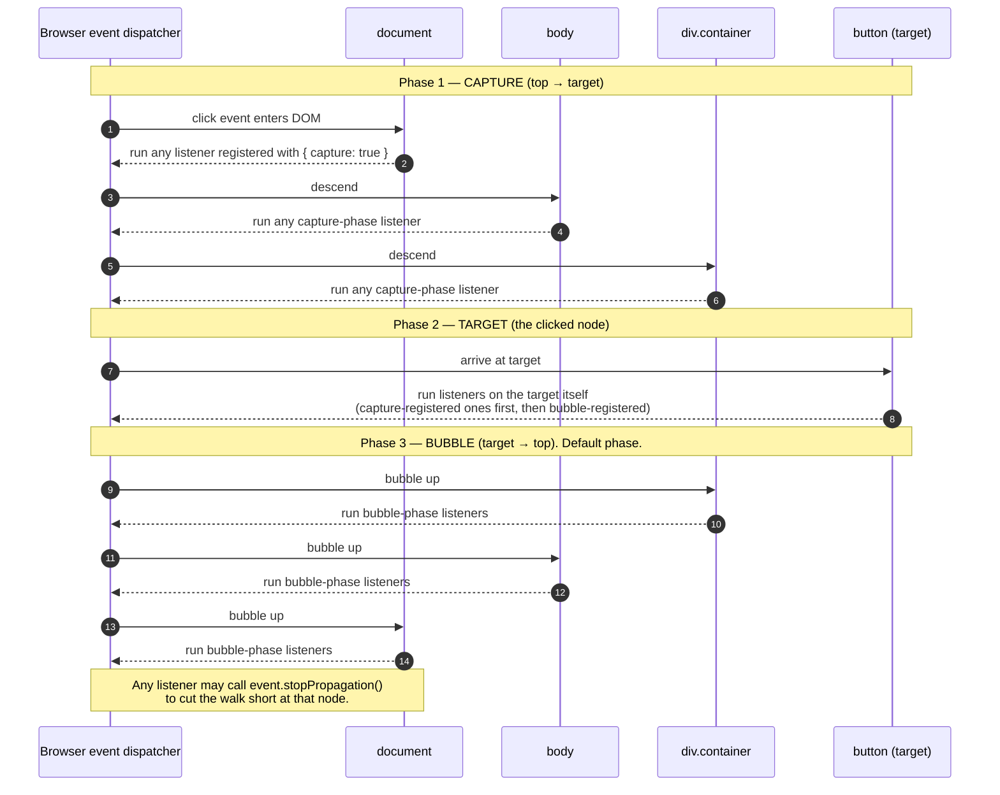

**JavaScript Chapter 5/7** | [← Previous: Async & Promises](04_JS_Async_Promises.md) | [Index](../00_MASTER_INDEX.md) | [Next → Modern ES6+](06_JS_Modern_ES6Plus.md)

# DOM Manipulation & Browser APIs

## 5W1H — Why This Chapter?

WHAT: The DOM (Document Object Model) is the browser's in-memory
representation of your HTML. Browser APIs are the tools
the browser gives JS to interact with the page and more.

WHY: React abstracts the DOM — but you MUST understand what's
underneath. Debugging, performance, third-party libraries,
vanilla JS projects, and interview questions require it.

WHO: Every frontend developer. Even React devs need DOM
knowledge for refs, portals, and performance tuning.

WHEN: After understanding JS fundamentals + async.

WHERE: Only in browsers (not Node.js). Node has no DOM.

HOW: HTML → Parser → DOM Tree. JS accesses via `document` API.

---

## 1. What IS the DOM?

The DOM is what the browser builds *from* your HTML — a live tree of
node objects held in memory. HTML is text; the DOM is the runtime
data structure that mirrors it. Everything JavaScript can query,
mutate, or listen to on the page lives in this tree.

**Watch the HTML on the left become the DOM on the right:**

```html
<html>
  <head>
    <title>Page</title>
  </head>
  <body>
    <h1>Hello</h1>
    <p>World</p>
  </body>
</html>
```



**Two facts that trip people up:**

1. **Text is its own node.** `<p>World</p>` is not one node — it is a
   `<p>` element node with a text-node child that holds the string
   `"World"`. Whitespace between tags counts too, which is why
   `element.childNodes` is often longer than `element.children`.
2. **The DOM is not your HTML file.** The file is disk bytes; the DOM
   is a live object graph. Every `element.style.color = "red"` writes
   to the graph, and the browser paints the change on the next frame.
   DevTools' "Elements" panel shows the current DOM, not the file.

### Node Types

```javascript
// Everything in the DOM is a NODE. Types:
// Element nodes: <div>, <p>, <h1>         → nodeType = 1
// Text nodes: "Hello World"                → nodeType = 3
// Comment nodes: <!-- comment -->          → nodeType = 8
// Document node: document                  → nodeType = 9

// REASONING: Text is separate from elements!
// <p>Hello</p> is TWO nodes: Element(p) → Text("Hello")
```

---

## 2. Selecting Elements

```javascript
// BY ID (fastest — unique per page)
const header = document.getElementById("main-header");
// Returns: HTMLElement or null

// BY CSS SELECTOR (most versatile — use this!)
const el = document.querySelector(".card"); // FIRST match
const allCards = document.querySelectorAll(".card"); // ALL matches (NodeList)

// SELECTORS ARE CSS:
document.querySelector("div.container > p:first-child");
document.querySelector("[data-id='42']");
document.querySelector("input[type='email']");
document.querySelectorAll("nav a.active");

// OLD METHODS (still work, less common):
document.getElementsByClassName("card"); // HTMLCollection (live!)
document.getElementsByTagName("p"); // HTMLCollection (live!)
document.getElementsByName("email"); // NodeList

// LIVE vs STATIC:
// getElementsBy* returns LIVE collections — auto-update when DOM changes
// querySelectorAll returns STATIC NodeList — snapshot at call time
// REASONING: Static is safer (no surprise mutations). Use querySelectorAll.

// NodeList → Array (to use array methods):
const cards = document.querySelectorAll(".card");
const cardsArray = [...cards]; // Spread
// or: Array.from(cards)
cardsArray.filter((card) => card.classList.contains("active"));
```

---

## 3. Traversing the DOM

**Traversal API cheatsheet — same DOM as `<ul id="list">` with three
`<li>` children:**

| From here    | Ask for              | Get                                    |
|--------------|----------------------|----------------------------------------|
| `li` (any)   | `.parentElement`     | the `<ul>`                             |
| `ul`         | `.children`          | HTMLCollection `[li, li, li]` (elements) |
| `ul`         | `.firstElementChild` | first `<li>`                           |
| `ul`         | `.lastElementChild`  | last `<li>`                            |
| a middle `li`| `.nextElementSibling`| next `<li>` (or `null` at the end)     |
| a middle `li`| `.previousElementSibling` | previous `<li>` (or `null` at start) |
| any node     | `.closest(selector)` | walk UP until a match, or `null`       |

**Why the `*Element*` versions and not `firstChild` / `nextSibling` /
`childNodes`?** Because the non-`Element` versions include text
nodes — and whitespace between tags is a text node. So
`ul.firstChild` on a nicely-indented `<ul>` is a whitespace text node,
not the first `<li>`. The `*Element*` variants skip text nodes and
give you what your eyes see. Use them by default; reach for the
text-inclusive versions only when you are specifically iterating text
content.

```javascript
const list = document.getElementById("list");

// Parent
list.parentElement; // <body> (or whatever wraps it)
list.closest(".container"); // Walk UP to find matching ancestor

// Children
list.children; // HTMLCollection of direct children
list.children.length; // 3
list.firstElementChild; // <li>First</li>
list.lastElementChild; // <li>Third</li>

// Siblings
const second = list.children[1];
second.nextElementSibling; // <li>Third</li>
second.previousElementSibling; // <li>First</li>

// closest() — walk UP the tree (very useful!)
// In event handlers:
button.addEventListener("click", (e) => {
  const card = e.target.closest(".card"); // Find parent card
  card.classList.toggle("selected");
});
```

---

## 4. Creating & Modifying Elements

```javascript
// CREATE
const div = document.createElement("div");
div.className = "card";
div.id = "card-1";
div.textContent = "Hello World"; // Text only (safe from XSS)
div.innerHTML = "<strong>Hello</strong>"; // Parses HTML (XSS risk!)

// SET ATTRIBUTES
div.setAttribute("data-id", "42");
div.dataset.id; // "42" (dataset maps data-* attrs)
div.style.backgroundColor = "blue"; // Inline style
div.classList.add("active", "visible");
div.classList.remove("hidden");
div.classList.toggle("dark-mode");
div.classList.contains("active"); // true

// APPEND TO DOM
document.body.appendChild(div); // Add as last child
document.body.prepend(div); // Add as first child
document.body.insertBefore(div, reference); // Before specific element

// MODERN (cleaner):
parent.append(div, "text", anotherDiv); // Multiple items, text ok
parent.prepend(div);
sibling.before(div); // Insert before sibling
sibling.after(div); // Insert after sibling

// REMOVE
div.remove(); // Modern
parent.removeChild(div); // Old way

// CLONE
const clone = div.cloneNode(true); // true = deep clone (with children)
const shallow = div.cloneNode(false); // Just the element, no children

// REPLACE
oldElement.replaceWith(newElement); // Modern
parent.replaceChild(newElement, oldElement); // Old way
```

### Performance: DocumentFragment

```javascript
// ❌ BAD: Each appendChild triggers a reflow/repaint
for (let i = 0; i < 1000; i++) {
  const li = document.createElement("li");
  li.textContent = `Item ${i}`;
  list.appendChild(li); // 1000 DOM updates!
}

// ✅ GOOD: Build in a fragment, then append ONCE
const fragment = document.createDocumentFragment();
for (let i = 0; i < 1000; i++) {
  const li = document.createElement("li");
  li.textContent = `Item ${i}`;
  fragment.appendChild(li); // No DOM update yet
}
list.appendChild(fragment); // ONE DOM update!

// REASONING: DOM operations are expensive because each change may
// trigger the browser to recalculate layout (reflow) and repaint.
// Batching changes into a fragment minimizes these operations.
// This is EXACTLY what React's Virtual DOM does automatically.
```

---

## 5. Events — How User Interaction Works

### 5W1H: The Event System

> **WHAT.** An event is a small object the browser fires at a node
> when something happens to it — click, keypress, submit, resize.
> An event listener is a function you registered ahead of time to be
> called when a matching event reaches a node.
>
> **WHY it exists.** The browser has no idea what your app cares
> about. It just tells every node in the tree "something happened
> here" and lets your code decide what to do. That's the entire
> mechanism behind every button, form, drag, and hover on the web.
>
> **HOW it dispatches (this is the part that surprises people).** An
> event doesn't only fire on the element you clicked. The browser
> walks the DOM tree top-to-bottom to the target node (the *capture*
> phase), fires at the target itself (*target* phase), then walks
> back up to `document` (the *bubble* phase). Any listener along the
> way, in any of the three phases, gets a chance to run. Which phase
> your listener runs in depends on the third argument to
> `addEventListener` (`false`/omitted = bubble — the default; `true`
> or `{ capture: true }` = capture).

**Trace one real click on the button in this tree — which node the
browser touches, in what order, and when your listeners get called:**

```html
<document>
  <body>
    <div class="container">
      <button id="btn">Click me</button>
    </div>
  </body>
</document>
```



**Reading the diagram, three facts that fix real bugs:**

1. **`event.target` vs `event.currentTarget`.** `target` is the
   button (the node the click actually hit). `currentTarget` is
   whichever node's listener is currently running — which changes as
   the event walks up. If you delegate on `.container` and the user
   clicks the button, `currentTarget === div.container` but
   `target === button`.
2. **`stopPropagation()` only stops the *rest* of the walk.** All
   listeners on the *current* node still run. `stopImmediatePropagation()`
   also stops the remaining listeners on the current node.
3. **The default phase is bubble.** `addEventListener('click', h)` is
   short for `addEventListener('click', h, { capture: false })`. That's
   why event delegation on a parent works: the click on a child bubbles
   up and hits your parent listener on the way home.

That last fact is exactly how the delegation pattern below works —
without bubbling it would be impossible.

```javascript
// ADDING EVENT LISTENERS:
const button = document.querySelector("#myButton");

button.addEventListener("click", function (event) {
  console.log(event.target); // The element that was clicked
  console.log(event.currentTarget); // The element with the listener
  console.log(event.type); // "click"

  // Stop bubbling:
  event.stopPropagation();

  // Prevent default browser behavior:
  event.preventDefault(); // e.g., stop form submission, link navigation
});

// REMOVE listener (need same function reference):
const handler = (e) => console.log("clicked");
button.addEventListener("click", handler);
button.removeEventListener("click", handler);

// CAPTURE phase listener (rarely needed):
parent.addEventListener("click", handler, true); // true = capture
parent.addEventListener("click", handler, { capture: true }); // Same

// ONCE (auto-removes after first fire):
button.addEventListener("click", handler, { once: true });
```

### Event Delegation — The Most Important Pattern

```javascript
// ❌ BAD: One listener per button (100 buttons = 100 listeners)
document.querySelectorAll(".delete-btn").forEach((btn) => {
  btn.addEventListener("click", handleDelete);
});

// ✅ GOOD: One listener on parent, delegate via event.target
document.querySelector("#todo-list").addEventListener("click", (e) => {
  if (e.target.matches(".delete-btn")) {
    const todoItem = e.target.closest(".todo-item");
    todoItem.remove();
  }
  if (e.target.matches(".edit-btn")) {
    // Handle edit
  }
});

// WHY delegation?
// 1. Memory efficient — 1 listener instead of 100
// 2. Works for DYNAMICALLY ADDED elements (future items too!)
// 3. This is exactly what React does under the hood — it attaches
//    ONE listener to the root and delegates all events.
```

### Common Events Reference

**The events you'll actually reach for, grouped by input surface:**

| Group     | Events                                                      |
|-----------|-------------------------------------------------------------|
| Mouse     | `click`, `dblclick`, `mouseenter`, `mouseleave`, `mousemove`|
| Keyboard  | `keydown`, `keyup` (`keypress` is deprecated — avoid)      |
| Form      | `submit`, `change`, `input`, `focus`, `blur`, `reset`       |
| Window    | `load`, `DOMContentLoaded`, `resize`, `scroll`, `beforeunload` |
| Touch     | `touchstart`, `touchmove`, `touchend`                       |
| Drag/drop | `dragstart`, `drag`, `dragover`, `drop`, `dragend`          |
| Clipboard | `copy`, `cut`, `paste`                                      |

**Two pairs that everyone confuses:**

*`input` vs `change`.* `input` fires on every keystroke or slider
tick — use it for real-time search, character counters, live
previews. `change` fires only when the field loses focus (blur) with
a different value — use it for form fields where you only care about
the final value, not every keystroke in between.

*`DOMContentLoaded` vs `load`.* `DOMContentLoaded` fires when the
HTML is fully parsed and the DOM tree is built — stylesheets and
sub-resources may still be loading. `load` fires when *everything*
(images, CSS, iframes, fonts) has finished. For JS initialisation
that touches the DOM, use `DOMContentLoaded`; you almost never need
`load` unless you're measuring or reacting to full-page readiness.

---

## 6. Forms & Validation

```javascript
const form = document.querySelector("#signup-form");

form.addEventListener("submit", (e) => {
  e.preventDefault(); // Prevent page reload!

  // Get form data (modern way):
  const formData = new FormData(form);
  const data = Object.fromEntries(formData);
  // { email: "user@test.com", password: "123", name: "Harsha" }

  // Validate:
  if (!data.email.includes("@")) {
    showError("Invalid email");
    return;
  }

  // Send to API:
  fetch("/api/signup", {
    method: "POST",
    headers: { "Content-Type": "application/json" },
    body: JSON.stringify(data),
  });
});

// INDIVIDUAL INPUT ACCESS:
const email = form.elements.email; // By name attribute
const email2 = form.querySelector("[name='email']");
email.value; // Current value
email.validity.valid; // Built-in validation
email.validity.typeMismatch; // Email format check
email.setCustomValidity("Custom error"); // Custom validation message

// HTML5 VALIDATION ATTRIBUTES:
// <input required>                 — must fill
// <input type="email">            — email format
// <input minlength="8">           — minimum length
// <input pattern="[A-Za-z]+">     — regex pattern
// <input min="0" max="100">       — number range
```

---

## 7. Browser Storage APIs

**Four places to keep data on the client, and what each is for:**

| Feature         | `localStorage`  | `sessionStorage` | Cookies             | IndexedDB          |
|-----------------|-----------------|------------------|---------------------|--------------------|
| Capacity        | ~5–10 MB       | ~5 MB            | ~4 KB               | Hundreds of MB     |
| Persistence     | Forever         | Until tab closes | Until expiry / clear| Forever            |
| Sent on every request | No        | No               | Yes (per matching domain) | No           |
| Scope           | Origin          | Origin + tab     | Domain (+ path)     | Origin             |
| API shape       | `getItem`/`setItem` (sync) | Same as local | `document.cookie` string | Async, transactional |
| Data type       | String only     | String only      | String only         | Any structured-cloneable value |
| Sync or async   | Synchronous     | Synchronous      | Synchronous         | **Asynchronous**   |

**Which to reach for:**

- **`localStorage`** — durable UI state you can afford to lose (dark-mode
  preference, draft form input, cart before checkout). No server round-trip.
- **`sessionStorage`** — per-tab state that dies with the tab (multi-step
  wizard progress, dismissed banners).
- **Cookies** — anything the *server* needs (auth session id, CSRF token,
  A/B experiment bucket). Set `HttpOnly` for auth so JS can't read it, and
  `Secure` + `SameSite` for anything sensitive.
- **IndexedDB** — large or structured client data (offline caches, uploaded
  files, an in-browser database for a PWA). Async, so it doesn't block
  the main thread the way `localStorage` does at multi-megabyte sizes.

```javascript
// localStorage (persists forever until cleared):
localStorage.setItem("theme", "dark");
localStorage.getItem("theme"); // "dark"
localStorage.removeItem("theme");
localStorage.clear(); // Remove ALL

// Store objects (must serialize):
const user = { name: "Harsha", prefs: { theme: "dark" } };
localStorage.setItem("user", JSON.stringify(user));
const stored = JSON.parse(localStorage.getItem("user"));

// sessionStorage (same API, clears when tab closes):
sessionStorage.setItem("wizard-step", "3");

// Listen for storage changes (cross-tab communication!):
window.addEventListener("storage", (e) => {
  console.log(`Key ${e.key} changed from ${e.oldValue} to ${e.newValue}`);
});
// Fires when ANOTHER tab changes localStorage. Not the current tab.
```

---

## 8. Fetch API — Making HTTP Requests

```javascript
// BASIC GET:
const response = await fetch("https://api.example.com/users");
const data = await response.json();

// IMPORTANT: fetch only rejects on NETWORK errors.
// 404 and 500 are NOT rejections — check response.ok!
if (!response.ok) {
  throw new Error(`HTTP error! status: ${response.status}`);
}

// POST with JSON body:
const newUser = await fetch("https://api.example.com/users", {
  method: "POST",
  headers: {
    "Content-Type": "application/json",
    Authorization: "Bearer " + token,
  },
  body: JSON.stringify({ name: "Harsha", email: "h@test.com" }),
});

// PUT, DELETE:
await fetch(`/api/users/${id}`, { method: "DELETE" });
await fetch(`/api/users/${id}`, {
  method: "PUT",
  headers: { "Content-Type": "application/json" },
  body: JSON.stringify(updatedData),
});

// UPLOAD FILE:
const formData = new FormData();
formData.append("file", fileInput.files[0]);
await fetch("/api/upload", { method: "POST", body: formData });
// Don't set Content-Type — browser sets it with boundary automatically!

// Response methods:
response.json(); // Parse as JSON
response.text(); // Plain text
response.blob(); // Binary (images, files)
response.headers; // Headers object
response.status; // 200, 404, etc.
response.ok; // true if status 200-299
```

---

🔬 **Section Challenge — 8. Fetch API — Making HTTP Requests**

**Challenge 1 (Debug — Who/When/What):** `fetch('/api/users')` does not throw even when the server returns 500. **Who** decides what counts as a rejection? **When** does `fetch` actually reject? **What** must you check manually?

<details><summary>Answer</summary>

**Who decides?** The Fetch API specification — `fetch` only rejects on **network-level failures** (no DNS, connection refused, CORS block, offline). **When rejects?** Only when the TCP connection fails before any HTTP response arrives. **Status 500?** The server DID respond — that is a valid HTTP response. Fetch resolves with a `Response` object where `response.ok === false` and `response.status === 500`. **What to check:** Always `if (!response.ok) throw new Error(response.status)` before calling `response.json()`. Otherwise 4xx/5xx responses are silently treated as success — a common bug where error JSON gets parsed as if it were data.

</details>

## 9. Other Essential Browser APIs

```javascript
// INTERSECTION OBSERVER (lazy loading, infinite scroll)
const observer = new IntersectionObserver(
  (entries) => {
    entries.forEach((entry) => {
      if (entry.isIntersecting) {
        entry.target.src = entry.target.dataset.src; // Load image
        observer.unobserve(entry.target); // Stop watching
      }
    });
  },
  { threshold: 0.1 },
); // Trigger when 10% visible

document
  .querySelectorAll("img[data-src]")
  .forEach((img) => observer.observe(img));

// MUTATION OBSERVER (watch DOM changes)
const observer2 = new MutationObserver((mutations) => {
  mutations.forEach((m) => console.log("DOM changed:", m));
});
observer2.observe(document.body, { childList: true, subtree: true });

// RESIZE OBSERVER (responsive without media queries)
const resizeObs = new ResizeObserver((entries) => {
  entries.forEach((e) => {
    console.log("New size:", e.contentRect.width, e.contentRect.height);
  });
});
resizeObs.observe(document.querySelector("#myElement"));

// HISTORY API (SPA routing)
history.pushState({ page: 2 }, "Page 2", "/page/2");
history.replaceState(state, title, url);
history.back();
history.forward();
window.addEventListener("popstate", (e) => {
  console.log("Navigation:", e.state);
});

// CLIPBOARD API
await navigator.clipboard.writeText("Copied text!");
const text = await navigator.clipboard.readText();

// GEOLOCATION
navigator.geolocation.getCurrentPosition(
  (pos) => console.log(pos.coords.latitude, pos.coords.longitude),
  (err) => console.error(err),
);
```

---

## 10. Why React Exists — The DOM Problem

> **The problem with hand-rolling DOM code at scale:**
>
> 1. **Imperative — you narrate every step.** *"Find the badge, change
>    its text, remove the disabled class, re-enable the button,
>    now update the total, now sync the URL, ..."* — as features
>    stack, the narration becomes a maze that no one can keep in
>    their head.
> 2. **State drifts from the DOM.** You have two sources of truth: the
>    JS variables you compute from, and what's actually rendered.
>    Any code path that updates one without the other quietly rots
>    the UI.
> 3. **Every write is a paint.** Each `appendChild`, `style` change,
>    or `textContent` assignment can trigger reflow + repaint. A loop
>    of 100 small writes is 100 layout passes.
>
> **How React reframes each of those:**
>
> 1. **Declarative rendering.** You write "given this state, the UI
>    should look like this JSX." React figures out the DOM operations.
>    Your code no longer describes *steps*, only *shape*.
> 2. **One-way data flow.** State is the single source of truth;
>    React re-derives the DOM from state on every change. No drift
>    is possible because there is no second source to drift from.
> 3. **Virtual DOM + batching.** React holds a lightweight tree of
>    what the UI *should* be, diffs it against the previous version,
>    and applies one minimal set of DOM writes per render. The 100
>    small writes become one batched patch.
>
> **You still need to know the real DOM.** For refs, for measuring
> layout, for third-party libraries, for `useEffect` cleanup, and
> for reading React error messages that describe reconciliation.
> React is not a replacement for the DOM — it's a controller for it.

---

## Interview Quick-Fire

```
Q: What is event delegation?
→ Attach one listener to a parent instead of many to children.
  Use event.target to determine which child was clicked.
  Benefits: memory efficient, works for dynamic elements.

Q: Difference between event.target and event.currentTarget?
→ target: the element that TRIGGERED the event (was clicked).
  currentTarget: the element the LISTENER is attached to.

Q: What is event bubbling?
→ After an event fires on target, it "bubbles up" through ancestors.
  button → div → body → html → document.
  Use stopPropagation() to stop it.

Q: DOMContentLoaded vs load event?
→ DOMContentLoaded: HTML parsed, DOM ready (images may still load).
  load: EVERYTHING loaded (images, CSS, iframes, fonts).

Q: How to store user preferences client-side?
→ localStorage for persistent prefs (theme, language).
  sessionStorage for temporary data (wizard step).
  Cookies for auth tokens (httpOnly, secure).

Q: How does React's Virtual DOM relate to the real DOM?
→ React creates a JS object tree (virtual DOM). On state change,
  it diffs old vs new virtual trees, calculates minimum changes,
  then applies only those to the real DOM (reconciliation).
```

---

[← Previous: Async & Promises](04_JS_Async_Promises.md) | [Index](../00_MASTER_INDEX.md) | [Next → Modern ES6+](06_JS_Modern_ES6Plus.md)

---


---

## Reality Check

**"DOM APIs are slow"** → DOM READS are cheap; forced synchronous LAYOUT is the expense: interleaving writes (style changes) with reads that require geometry (offsetHeight, getBoundingClientRect) forces the engine to flush layout per read — the read-write-read-write loop that turns 60fps into 6. Batch reads, then batch writes (or requestAnimationFrame-phase them), and the same "slow DOM" runs instantly. The model to carry: the DOM is a data structure; LAYOUT is the calculation; you pay when you demand fresh geometry mid-mutation.

**"addEventListener registers a callback for an element"** → Events run a three-phase DISPATCH through the tree — capture down, target, bubble up — and the architecture-grade consequences hang off that: delegation (one listener on the container serving a thousand rows, surviving re-renders — the pattern frameworks are built on), stopPropagation versus stopImmediatePropagation semantics, passive listeners as a scroll-performance contract (you promise not to preventDefault, the browser stops waiting for you), and the {once, capture, signal} options people never read. currentTarget-versus-target is the delegation detail that separates users from understanders.

**"innerHTML is the fast way to build DOM"** → innerHTML re-parses and REPLACES the subtree — destroying listeners and state on everything inside, and opening XSS the moment any interpolated string is user-influenced (the number-one web vulnerability class, one template literal away). The modern toolkit: textContent for text (safe, fast), insertAdjacentHTML for append-without-reparse, template elements plus cloneNode for repeated structure, and sanitization (DOMPurify/Trusted Types) mandatory at any HTML-from-data boundary. innerHTML in reviews should read like eval: justified or rejected.

**"querySelector returns live results like getElementsBy*"** → The split is STATIC versus LIVE: querySelectorAll snapshots (safe to iterate-and-mutate), getElementsByClassName/TagName return live HTMLCollections that shrink UNDER your loop as you remove matching nodes (the skipped-every-other-element classic), and childNodes-versus-children adds the text-node surprise. One sentence of API taxonomy — which collections are live, which are static, which include text nodes — retires three recurring bug reports.

**"Browser storage means localStorage"** → localStorage is SYNCHRONOUS (blocks the main thread — a real cost at app scale), string-only (JSON tax on every access), ~5MB, and per-origin shared across tabs (with the storage event as the free cross-tab channel people forget exists). The taxonomy that matters: cookies are the only thing SERVERS see (and carry security attributes — HttpOnly, SameSite — that JS storage cannot express, which is why tokens in localStorage are an XSS one-shot), IndexedDB is the async big-data store, and sessionStorage is per-TAB not per-session-in-the-auth-sense. Choosing storage is choosing a threat model plus a performance profile, not picking a convenience API.
