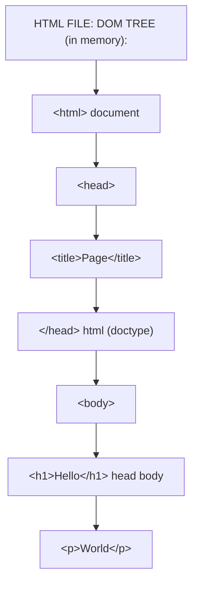
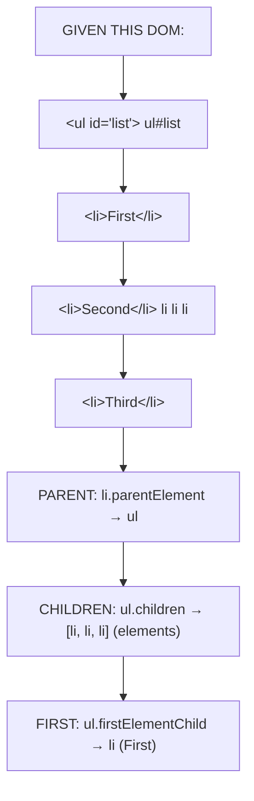
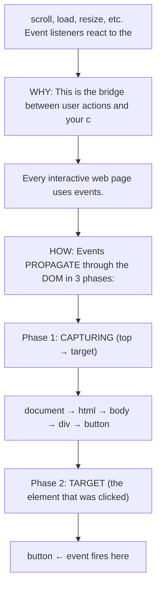
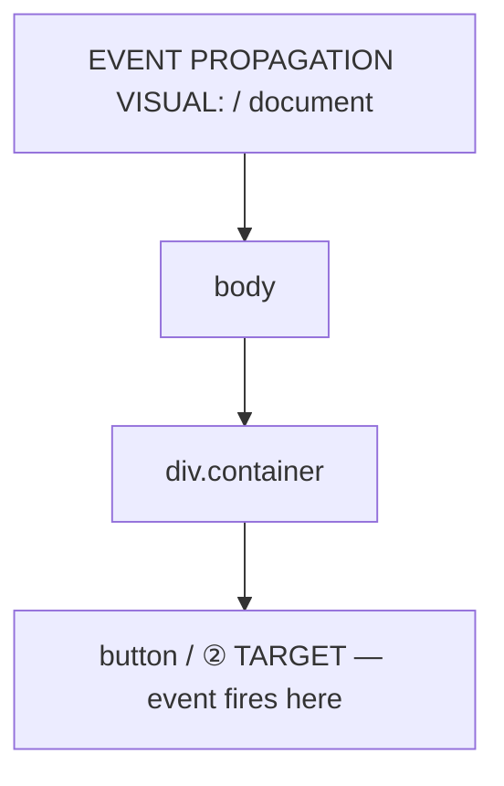
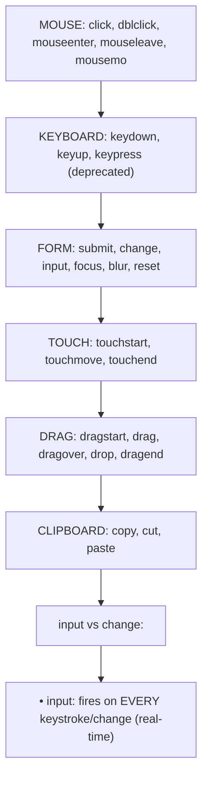
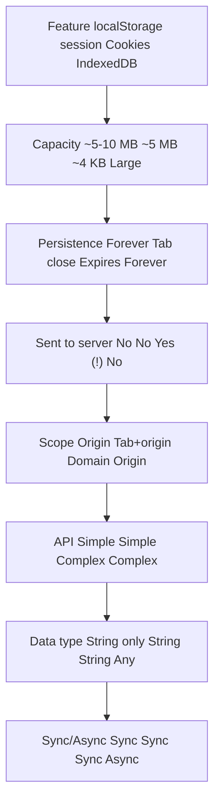
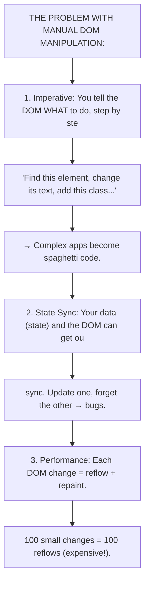
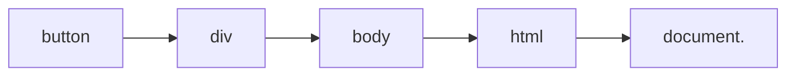

> **JavaScript Chapter 5/7** | [← Previous: Async & Promises](04_JS_Async_Promises.md) | [Index](../00_MASTER_INDEX.md) | [Next → Modern ES6+](06_JS_Modern_ES6Plus.md)

# DOM Manipulation & Browser APIs

## 5W1H — Why This Chapter?


> WHAT: The DOM (Document Object Model) is the browser's in-memory
> representation of your HTML. Browser APIs are the tools
> the browser gives JS to interact with the page and more.
>
> WHY:  React abstracts the DOM — but you MUST understand what's
> underneath. Debugging, performance, third-party libraries,
> vanilla JS projects, and interview questions require it.
>
> WHO:  Every frontend developer. Even React devs need DOM
> knowledge for refs, portals, and performance tuning.
>
> WHEN: After understanding JS fundamentals + async.
>
> WHERE: Only in browsers (not Node.js). Node has no DOM.
>
> HOW:  HTML → Parser → DOM Tree. JS accesses via `document` API.


---

## 1. What IS the DOM?

```
HTML FILE:                      DOM TREE (in memory):

<html>                          document
  <head>                            │
    <title>Page</title>         ┌───┴───┐
  </head>                      html     (doctype)
  <body>                       ┌┴┐
    <h1>Hello</h1>           head body
    <p>World</p>              │  ┌─┴─┐
  </body>                   title h1  p
</html>                      │    │    │
                            "Page" "Hello" "World"
                            (text) (text)  (text)

REASONING: The browser reads HTML text → builds a TREE of NODE
objects. Each HTML tag becomes an Element node. Text becomes a
Text node. This tree IS the DOM. JS can read and modify it.

KEY INSIGHT: The DOM is NOT your HTML file. It's a LIVE object
tree in memory. When JS modifies it, the page updates visually.
```

**Flow:**
- HTML FILE: DOM TREE (in memory):
- ↓
- <html> document
- ↓
- <head>
- ↓
- <title>Page</title>
- ↓
- </head> html (doctype)
- ↓
- <body>
- ↓
- <h1>Hello</h1> head body



### Node Types

```javascript
// Everything in the DOM is a NODE. Types:
// Element nodes: <div>, <p>, <h1>         → nodeType = 1
// Text nodes: "Hello World"                → nodeType = 3
// Comment nodes: <!-- comment -->          → nodeType = 8
// Document node: document                  → nodeType = 9

// REASONING: Text is separate from elements!
// <p>Hello</p> is TWO nodes: Element(p) → Text("Hello")
```

---

## 2. Selecting Elements

```javascript
// BY ID (fastest — unique per page)
const header = document.getElementById("main-header");
// Returns: HTMLElement or null

// BY CSS SELECTOR (most versatile — use this!)
const el = document.querySelector(".card");          // FIRST match
const allCards = document.querySelectorAll(".card");  // ALL matches (NodeList)

// SELECTORS ARE CSS:
document.querySelector("div.container > p:first-child");
document.querySelector("[data-id='42']");
document.querySelector("input[type='email']");
document.querySelectorAll("nav a.active");

// OLD METHODS (still work, less common):
document.getElementsByClassName("card");    // HTMLCollection (live!)
document.getElementsByTagName("p");         // HTMLCollection (live!)
document.getElementsByName("email");        // NodeList

// LIVE vs STATIC:
// getElementsBy* returns LIVE collections — auto-update when DOM changes
// querySelectorAll returns STATIC NodeList — snapshot at call time
// REASONING: Static is safer (no surprise mutations). Use querySelectorAll.

// NodeList → Array (to use array methods):
const cards = document.querySelectorAll(".card");
const cardsArray = [...cards];         // Spread
// or: Array.from(cards)
cardsArray.filter(card => card.classList.contains("active"));
```

---


## 3. Traversing the DOM

```
╔══════════════════════════════════════════════════════════════════════╗
║  GIVEN THIS DOM:                                                     ║
║                                                                      ║
║  <ul id="list">                   ul#list                            ║
║    <li>First</li>                ┌──┼──┐                             ║
║    <li>Second</li>              li  li  li                           ║
║    <li>Third</li>                                                    ║
║  </ul>                                                               ║
║                                                                      ║
║  PARENT:     li.parentElement       → ul                             ║
║  CHILDREN:   ul.children            → [li, li, li] (elements)        ║
║  FIRST:      ul.firstElementChild   → li (First)                     ║
║  LAST:       ul.lastElementChild    → li (Third)                     ║
║  NEXT:       li.nextElementSibling  → li (Second)                    ║
║  PREV:       li.previousElementSibling → li (First)                  ║
║                                                                      ║
║  ⚠ Use *Element* versions (not childNodes/firstChild) to skip        ║
║  text nodes (whitespace between tags counts as text nodes!)          ║
╚══════════════════════════════════════════════════════════════════════╝
```

**Flow:**
- GIVEN THIS DOM:
- ↓
- <ul id='list'> ul#list
- ↓
- <li>First</li>
- ↓
- <li>Second</li> li li li
- ↓
- <li>Third</li>
- ↓
- PARENT: li.parentElement
- ↓
- ul
- ↓
- PARENT: li.parentElement
- ↓
- ul
- ↓
- CHILDREN: ul.children
- ↓
- [li, li, li] (elements)



```javascript
const list = document.getElementById("list");

// Parent
list.parentElement;                    // <body> (or whatever wraps it)
list.closest(".container");            // Walk UP to find matching ancestor

// Children
list.children;                         // HTMLCollection of direct children
list.children.length;                  // 3
list.firstElementChild;                // <li>First</li>
list.lastElementChild;                 // <li>Third</li>

// Siblings
const second = list.children[1];
second.nextElementSibling;             // <li>Third</li>
second.previousElementSibling;        // <li>First</li>

// closest() — walk UP the tree (very useful!)
// In event handlers:
button.addEventListener("click", (e) => {
    const card = e.target.closest(".card"); // Find parent card
    card.classList.toggle("selected");
});
```

---


## 4. Creating & Modifying Elements

```javascript
// CREATE
const div = document.createElement("div");
div.className = "card";
div.id = "card-1";
div.textContent = "Hello World";             // Text only (safe from XSS)
div.innerHTML = "<strong>Hello</strong>";     // Parses HTML (XSS risk!)

// SET ATTRIBUTES
div.setAttribute("data-id", "42");
div.dataset.id;                              // "42" (dataset maps data-* attrs)
div.style.backgroundColor = "blue";          // Inline style
div.classList.add("active", "visible");
div.classList.remove("hidden");
div.classList.toggle("dark-mode");
div.classList.contains("active");            // true

// APPEND TO DOM
document.body.appendChild(div);             // Add as last child
document.body.prepend(div);                 // Add as first child
document.body.insertBefore(div, reference); // Before specific element

// MODERN (cleaner):
parent.append(div, "text", anotherDiv);    // Multiple items, text ok
parent.prepend(div);
sibling.before(div);                        // Insert before sibling
sibling.after(div);                         // Insert after sibling

// REMOVE
div.remove();                               // Modern
parent.removeChild(div);                    // Old way

// CLONE
const clone = div.cloneNode(true);          // true = deep clone (with children)
const shallow = div.cloneNode(false);       // Just the element, no children

// REPLACE
oldElement.replaceWith(newElement);          // Modern
parent.replaceChild(newElement, oldElement); // Old way
```

### Performance: DocumentFragment

```javascript
// ❌ BAD: Each appendChild triggers a reflow/repaint
for (let i = 0; i < 1000; i++) {
    const li = document.createElement("li");
    li.textContent = `Item ${i}`;
    list.appendChild(li); // 1000 DOM updates!
}

// ✅ GOOD: Build in a fragment, then append ONCE
const fragment = document.createDocumentFragment();
for (let i = 0; i < 1000; i++) {
    const li = document.createElement("li");
    li.textContent = `Item ${i}`;
    fragment.appendChild(li); // No DOM update yet
}
list.appendChild(fragment); // ONE DOM update!

// REASONING: DOM operations are expensive because each change may
// trigger the browser to recalculate layout (reflow) and repaint.
// Batching changes into a fragment minimizes these operations.
// This is EXACTLY what React's Virtual DOM does automatically.
```

---


## 5. Events — How User Interaction Works

### 5W1H: The Event System

```
╔══════════════════════════════════════════════════════════════════════╗
║  WHAT: Events are signals that something happened — click, type,     ║
║        scroll, load, resize, etc. Event listeners react to them.     ║
║                                                                      ║
║  WHY:  This is the bridge between user actions and your code.        ║
║        Every interactive web page uses events.                       ║
║                                                                      ║
║  HOW:  Events PROPAGATE through the DOM in 3 phases:                 ║
║                                                                      ║
║  Phase 1: CAPTURING (top → target)                                   ║
║           document → html → body → div → button                      ║
║                                                                      ║
║  Phase 2: TARGET (the element that was clicked)                      ║
║           button ← event fires here                                  ║
║                                                                      ║
║  Phase 3: BUBBLING (target → top) ← DEFAULT!                         ║
║           button → div → body → html → document                      ║
║                                                                      ║
║  ANALOGY: Drop a stone in a pond.                                    ║
║  Capturing = stone going down. Bubbling = ripples coming up.         ║
╚══════════════════════════════════════════════════════════════════════╝
```

**Flow:**
- scroll, load, resize, etc. Event listeners react to the
- ↓
- WHY: This is the bridge between user actions and your c
- ↓
- Every interactive web page uses events.
- ↓
- HOW: Events PROPAGATE through the DOM in 3 phases:
- ↓
- Phase 1: CAPTURING (top
- ↓
- target)
- ↓
- Phase 1: CAPTURING (top
- ↓
- target)
- ↓
- document
- ↓
- html
- ↓
- body
- ↓
- div
- ↓
- button
- ↓
- document
- ↓
- html
- ↓
- body
- ↓
- div
- ↓
- button
- ↓
- Phase 2: TARGET (the element that was clicked)



```
EVENT PROPAGATION VISUAL:

┌─── document ──────────────────────────────────────────┐
│  ① Capture ↓                          ③ Bubble ↑      │
│  ┌─── body ──────────────────────────────────────┐    │
│  │  ① ↓                                  ③ ↑    │     │
│  │  ┌─── div.container ──────────────────────┐   │    │
│  │  │  ① ↓                          ③ ↑     │   │     │
│  │  │  ┌─── button ─────────────────────┐    │   │    │
│  │  │  │                                │    │   │    │
│  │  │  │  ② TARGET — event fires here  │    │   │     │
│  │  │  │                                │    │   │    │
│  │  │  └────────────────────────────────┘    │   │    │
│  │  └────────────────────────────────────────┘   │    │
│  └───────────────────────────────────────────────┘    │
└───────────────────────────────────────────────────────┘
```

**Flow:**
- EVENT PROPAGATION VISUAL: / document
- ↓
- body
- ↓
- div.container
- ↓
- button / ② TARGET — event fires here



```javascript
// ADDING EVENT LISTENERS:
const button = document.querySelector("#myButton");

button.addEventListener("click", function(event) {
    console.log(event.target);       // The element that was clicked
    console.log(event.currentTarget); // The element with the listener
    console.log(event.type);         // "click"

    // Stop bubbling:
    event.stopPropagation();

    // Prevent default browser behavior:
    event.preventDefault(); // e.g., stop form submission, link navigation
});

// REMOVE listener (need same function reference):
const handler = (e) => console.log("clicked");
button.addEventListener("click", handler);
button.removeEventListener("click", handler);

// CAPTURE phase listener (rarely needed):
parent.addEventListener("click", handler, true);  // true = capture
parent.addEventListener("click", handler, { capture: true }); // Same

// ONCE (auto-removes after first fire):
button.addEventListener("click", handler, { once: true });
```

### Event Delegation — The Most Important Pattern

```javascript
// ❌ BAD: One listener per button (100 buttons = 100 listeners)
document.querySelectorAll(".delete-btn").forEach(btn => {
    btn.addEventListener("click", handleDelete);
});

// ✅ GOOD: One listener on parent, delegate via event.target
document.querySelector("#todo-list").addEventListener("click", (e) => {
    if (e.target.matches(".delete-btn")) {
        const todoItem = e.target.closest(".todo-item");
        todoItem.remove();
    }
    if (e.target.matches(".edit-btn")) {
        // Handle edit
    }
});

// WHY delegation?
// 1. Memory efficient — 1 listener instead of 100
// 2. Works for DYNAMICALLY ADDED elements (future items too!)
// 3. This is exactly what React does under the hood — it attaches
//    ONE listener to the root and delegates all events.
```

### Common Events Reference

```
╔══════════════════════════════════════════════════════════════════════╗
║  MOUSE:     click, dblclick, mouseenter, mouseleave, mousemove       ║
║  KEYBOARD:  keydown, keyup, keypress (deprecated)                    ║
║  FORM:      submit, change, input, focus, blur, reset                ║
║  WINDOW:    load, DOMContentLoaded, resize, scroll, beforeunload     ║
║  TOUCH:     touchstart, touchmove, touchend                          ║
║  DRAG:      dragstart, drag, dragover, drop, dragend                 ║
║  CLIPBOARD: copy, cut, paste                                         ║
║                                                                      ║
║  input vs change:                                                    ║
║  • input: fires on EVERY keystroke/change (real-time)                ║
║  • change: fires when element LOSES FOCUS (on blur)                  ║
║  For real-time search: use "input". For form fields: "change".       ║
║                                                                      ║
║  DOMContentLoaded vs load:                                           ║
║  • DOMContentLoaded: DOM is ready (HTML parsed). Scripts can run.    ║
║  • load: EVERYTHING loaded (images, CSS, iframes).                   ║
║  RULE: Use DOMContentLoaded for JS initialization.                   ║
╚══════════════════════════════════════════════════════════════════════╝
```

**Flow:**
- MOUSE: click, dblclick, mouseenter, mouseleave, mousemo
- ↓
- KEYBOARD: keydown, keyup, keypress (deprecated)
- ↓
- FORM: submit, change, input, focus, blur, reset
- ↓
- TOUCH: touchstart, touchmove, touchend
- ↓
- DRAG: dragstart, drag, dragover, drop, dragend
- ↓
- CLIPBOARD: copy, cut, paste
- ↓
- input vs change:



---


## 6. Forms & Validation

```javascript
const form = document.querySelector("#signup-form");

form.addEventListener("submit", (e) => {
    e.preventDefault(); // Prevent page reload!

    // Get form data (modern way):
    const formData = new FormData(form);
    const data = Object.fromEntries(formData);
    // { email: "user@test.com", password: "123", name: "Harsha" }

    // Validate:
    if (!data.email.includes("@")) {
        showError("Invalid email");
        return;
    }

    // Send to API:
    fetch("/api/signup", {
        method: "POST",
        headers: { "Content-Type": "application/json" },
        body: JSON.stringify(data)
    });
});

// INDIVIDUAL INPUT ACCESS:
const email = form.elements.email;         // By name attribute
const email2 = form.querySelector("[name='email']");
email.value;                                // Current value
email.validity.valid;                       // Built-in validation
email.validity.typeMismatch;               // Email format check
email.setCustomValidity("Custom error");   // Custom validation message

// HTML5 VALIDATION ATTRIBUTES:
// <input required>                 — must fill
// <input type="email">            — email format
// <input minlength="8">           — minimum length
// <input pattern="[A-Za-z]+">     — regex pattern
// <input min="0" max="100">       — number range
```

---

## 7. Browser Storage APIs

```
┌───────────────┬────────────┬──────────┬──────────┬────────────┐
│ Feature       │ localStorage│ session  │ Cookies  │ IndexedDB │
├───────────────┼────────────┼──────────┼──────────┼────────────┤
│ Capacity      │ ~5-10 MB   │ ~5 MB    │ ~4 KB    │ Large      │
│ Persistence   │ Forever    │ Tab close│ Expires  │ Forever    │
│ Sent to server│ No         │ No       │ Yes (!)  │ No         │
│ Scope         │ Origin     │ Tab+origin│ Domain  │ Origin     │
│ API           │ Simple     │ Simple   │ Complex  │ Complex    │
│ Data type     │ String only│ String   │ String   │ Any        │
│ Sync/Async    │ Sync       │ Sync     │ Sync     │ Async      │
└───────────────┴────────────┴──────────┴──────────┴────────────┘

USE CASES:
• localStorage: dark mode pref, cart items, form drafts
• sessionStorage: one-time banners, wizard progress
• Cookies: authentication (httpOnly cookies), tracking
• IndexedDB: offline apps, large data, file caching
```

**Flow:**
- Feature localStorage session Cookies IndexedDB
- ↓
- Capacity ~5-10 MB ~5 MB ~4 KB Large
- ↓
- Persistence Forever Tab close Expires Forever
- ↓
- Sent to server No No Yes (!) No
- ↓
- Scope Origin Tab+origin Domain Origin
- ↓
- API Simple Simple Complex Complex
- ↓
- Data type String only String String Any



```javascript
// localStorage (persists forever until cleared):
localStorage.setItem("theme", "dark");
localStorage.getItem("theme");           // "dark"
localStorage.removeItem("theme");
localStorage.clear();                    // Remove ALL

// Store objects (must serialize):
const user = { name: "Harsha", prefs: { theme: "dark" } };
localStorage.setItem("user", JSON.stringify(user));
const stored = JSON.parse(localStorage.getItem("user"));

// sessionStorage (same API, clears when tab closes):
sessionStorage.setItem("wizard-step", "3");

// Listen for storage changes (cross-tab communication!):
window.addEventListener("storage", (e) => {
    console.log(`Key ${e.key} changed from ${e.oldValue} to ${e.newValue}`);
});
// Fires when ANOTHER tab changes localStorage. Not the current tab.
```

---

## 8. Fetch API — Making HTTP Requests

```javascript
// BASIC GET:
const response = await fetch("https://api.example.com/users");
const data = await response.json();

// IMPORTANT: fetch only rejects on NETWORK errors.
// 404 and 500 are NOT rejections — check response.ok!
if (!response.ok) {
    throw new Error(`HTTP error! status: ${response.status}`);
}

// POST with JSON body:
const newUser = await fetch("https://api.example.com/users", {
    method: "POST",
    headers: {
        "Content-Type": "application/json",
        "Authorization": "Bearer " + token
    },
    body: JSON.stringify({ name: "Harsha", email: "h@test.com" })
});

// PUT, DELETE:
await fetch(`/api/users/${id}`, { method: "DELETE" });
await fetch(`/api/users/${id}`, {
    method: "PUT",
    headers: { "Content-Type": "application/json" },
    body: JSON.stringify(updatedData)
});

// UPLOAD FILE:
const formData = new FormData();
formData.append("file", fileInput.files[0]);
await fetch("/api/upload", { method: "POST", body: formData });
// Don't set Content-Type — browser sets it with boundary automatically!

// Response methods:
response.json();   // Parse as JSON
response.text();   // Plain text
response.blob();   // Binary (images, files)
response.headers;  // Headers object
response.status;   // 200, 404, etc.
response.ok;       // true if status 200-299
```

---


> 🔬 **Section Challenge — 8. Fetch API — Making HTTP Requests**
>
> **Challenge 1 (Reasoning):** `Connection: keep-alive` vs HTTP/2 — what does each one do differently for multiplexing?
> <details><summary>Answer</summary>
>
> HTTP/1.1 keep-alive: reuse ONE TCP connection for sequential requests. Still head-of-line blocking — request 2 waits for response 1. HTTP/2: one TCP connection, but requests are multiplexed as frames with stream IDs. Multiple requests in-flight simultaneously. Response frames for different streams are interleaved. HTTP/2 also has header compression (HPACK) and server push. Still has TCP HOL blocking (one lost packet blocks all streams). HTTP/3 (QUIC): uses UDP, per-stream reliability, eliminates TCP HOL blocking entirely.
> </details>
>

## 9. Other Essential Browser APIs

```javascript
// INTERSECTION OBSERVER (lazy loading, infinite scroll)
const observer = new IntersectionObserver((entries) => {
    entries.forEach(entry => {
        if (entry.isIntersecting) {
            entry.target.src = entry.target.dataset.src; // Load image
            observer.unobserve(entry.target);            // Stop watching
        }
    });
}, { threshold: 0.1 }); // Trigger when 10% visible

document.querySelectorAll("img[data-src]").forEach(img => observer.observe(img));

// MUTATION OBSERVER (watch DOM changes)
const observer2 = new MutationObserver((mutations) => {
    mutations.forEach(m => console.log("DOM changed:", m));
});
observer2.observe(document.body, { childList: true, subtree: true });

// RESIZE OBSERVER (responsive without media queries)
const resizeObs = new ResizeObserver(entries => {
    entries.forEach(e => {
        console.log("New size:", e.contentRect.width, e.contentRect.height);
    });
});
resizeObs.observe(document.querySelector("#myElement"));

// HISTORY API (SPA routing)
history.pushState({ page: 2 }, "Page 2", "/page/2");
history.replaceState(state, title, url);
history.back();
history.forward();
window.addEventListener("popstate", (e) => {
    console.log("Navigation:", e.state);
});

// CLIPBOARD API
await navigator.clipboard.writeText("Copied text!");
const text = await navigator.clipboard.readText();

// GEOLOCATION
navigator.geolocation.getCurrentPosition(
    pos => console.log(pos.coords.latitude, pos.coords.longitude),
    err => console.error(err)
);
```

---

## 10. Why React Exists — The DOM Problem

```
╔══════════════════════════════════════════════════════════════════════╗
║  THE PROBLEM WITH MANUAL DOM MANIPULATION:                           ║
║                                                                      ║
║  1. Imperative: You tell the DOM WHAT to do, step by step.           ║
║     "Find this element, change its text, add this class..."          ║
║     → Complex apps become spaghetti code.                            ║
║                                                                      ║
║  2. State Sync: Your data (state) and the DOM can get out of         ║
║     sync. Update one, forget the other → bugs.                       ║
║                                                                      ║
║  3. Performance: Each DOM change = reflow + repaint.                 ║
║     100 small changes = 100 reflows (expensive!).                    ║
║                                                                      ║
║  REACT'S SOLUTION:                                                   ║
║                                                                      ║
║  1. Declarative: Describe WHAT the UI should look like.              ║
║     React figures out HOW to update the DOM.                         ║
║                                                                      ║
║  2. Virtual DOM: React diffs a virtual tree, then applies            ║
║     MINIMAL real DOM changes (batched for performance).              ║
║                                                                      ║
║  3. One-way data flow: State → UI. Change state, UI updates          ║
║     automatically. No manual sync.                                   ║
║                                                                      ║
║  BUT: Understanding the real DOM helps you debug React, use refs,    ║
║  optimize performance, and write vanilla JS when needed.             ║
╚══════════════════════════════════════════════════════════════════════╝
```

**Flow:**
- THE PROBLEM WITH MANUAL DOM MANIPULATION:
- ↓
- 1. Imperative: You tell the DOM WHAT to do, step by ste
- ↓
- 'Find this element, change its text, add this class...'
- ↓
- Complex apps become spaghetti code.
- ↓
- 2. State Sync: Your data (state) and the DOM can get ou
- ↓
- sync. Update one, forget the other
- ↓
- bugs.
- ↓
- sync. Update one, forget the other
- ↓
- bugs.
- ↓
- 3. Performance: Each DOM change = reflow + repaint.



---

## Interview Quick-Fire

```
Q: What is event delegation?
→ Attach one listener to a parent instead of many to children.
  Use event.target to determine which child was clicked.
  Benefits: memory efficient, works for dynamic elements.

Q: Difference between event.target and event.currentTarget?
→ target: the element that TRIGGERED the event (was clicked).
  currentTarget: the element the LISTENER is attached to.

Q: What is event bubbling?
→ After an event fires on target, it "bubbles up" through ancestors.
  button → div → body → html → document.
  Use stopPropagation() to stop it.

Q: DOMContentLoaded vs load event?
→ DOMContentLoaded: HTML parsed, DOM ready (images may still load).
  load: EVERYTHING loaded (images, CSS, iframes, fonts).

Q: How to store user preferences client-side?
→ localStorage for persistent prefs (theme, language).
  sessionStorage for temporary data (wizard step).
  Cookies for auth tokens (httpOnly, secure).

Q: How does React's Virtual DOM relate to the real DOM?
→ React creates a JS object tree (virtual DOM). On state change,
  it diffs old vs new virtual trees, calculates minimum changes,
  then applies only those to the real DOM (reconciliation).
```

**Flow:**
- button
- ↓
- div
- ↓
- body
- ↓
- html
- ↓
- document.



---

> [← Previous: Async & Promises](04_JS_Async_Promises.md) | [Index](../00_MASTER_INDEX.md) | [Next → Modern ES6+](06_JS_Modern_ES6Plus.md)

---

## 🏋️ Practice & Interview Questions — JavaScript

### Predict / Trace
**Q1.** What prints?
```js
console.log(typeof null);
console.log(null instanceof Object);
```
<details><summary>Answer</summary>

`"object"` (historical JS bug), `false` (null is not an Object instance). This is a well-known JS quirk.
</details>

**Q2.** What is the output?
```js
console.log(1 + "2");
console.log("3" - 1);
console.log(true + false);
```
<details><summary>Answer</summary>

`"12"` (string concat), `2` (- coerces to number), `1` (true=1, false=0)
</details>

**Q3.** What prints and why?
```js
for (var i = 0; i < 3; i++) {
  setTimeout(() => console.log(i), 0);
}
```
<details><summary>Answer</summary>

`3 3 3` — `var` is function-scoped, all closures share same `i`. By the time timeouts run, loop is done, i=3. **Fix**: use `let` (block-scoped) or `setTimeout(() => console.log(i), 0, i)`.
</details>

### Coding Problems
**Q4.** ⭐ Implement `debounce(fn, delay)`.
<details><summary>Solution</summary>

```js
function debounce(fn, delay) {
  let timer;
  return function(...args) {
    clearTimeout(timer);
    timer = setTimeout(() => fn.apply(this, args), delay);
  };
}
```
</details>

**Q5.** ⭐ Implement `Promise.all` from scratch.
<details><summary>Solution</summary>

```js
function promiseAll(promises) {
  return new Promise((resolve, reject) => {
    const results = [];
    let count = 0;
    promises.forEach((p, i) => {
      Promise.resolve(p)
        .then(val => { results[i] = val; if(++count === promises.length) resolve(results); })
        .catch(reject);
    });
    if(promises.length === 0) resolve([]);
  });
}
```
</details>

**Q6.** ⭐ Deep clone an object without `JSON.parse(JSON.stringify(...))`.
<details><summary>Solution</summary>

```js
function deepClone(obj) {
  if(obj === null || typeof obj !== 'object') return obj;
  if(obj instanceof Date) return new Date(obj);
  if(obj instanceof Array) return obj.map(deepClone);
  const clone = {};
  for(const key in obj) if(obj.hasOwnProperty(key)) clone[key] = deepClone(obj[key]);
  return clone;
}
// Modern: structuredClone(obj) — built-in, handles more types
```
</details>

**Q7.** ⭐⭐ Implement `curry` function.
<details><summary>Solution</summary>

```js
function curry(fn) {
  return function curried(...args) {
    if(args.length >= fn.length) return fn(...args);
    return function(...more) { return curried(...args, ...more); };
  };
}
const add = curry((a, b, c) => a + b + c);
add(1)(2)(3); // 6
add(1, 2)(3); // 6
```
</details>

**Q8.** ⭐⭐ Implement `memoize(fn)`.
<details><summary>Solution</summary>

```js
function memoize(fn) {
  const cache = new Map();
  return function(...args) {
    const key = JSON.stringify(args);
    if(cache.has(key)) return cache.get(key);
    const result = fn.apply(this, args);
    cache.set(key, result);
    return result;
  };
}
```
</details>

### MCQ Rapid Fire
| # | Question | Answer |
|---|---|---|
| 1 | == vs === | == coerces types; === strict (no coercion) |
| 2 | `typeof undefined` | "undefined" |
| 3 | `typeof function(){}` | "function" |
| 4 | Prototype chain end | null |
| 5 | Event loop: microtasks vs macrotasks | Microtasks (Promises) run before macrotasks (setTimeout) |
| 6 | `const` prevents | Reassignment, not mutation |
| 7 | `var` vs `let` hoisting | var: hoisted+initialized to undefined; let: hoisted but in TDZ |
| 8 | `this` in arrow function | Lexical (inherited from enclosing scope) |
| 9 | Optional chaining `?.` | Returns undefined instead of throwing on null/undefined |
| 10 | Nullish coalescing `??` | Returns right side only if left is null/undefined (not 0 or '') |

---

## 🧠 Deep Conceptual Questions — JavaScript Engine & Language

**C1. How does the JavaScript event loop actually work?**
<details><summary>Deep Answer</summary>

```
Call Stack → runs synchronous code
     ↓ (when empty)
Microtask Queue → Promise callbacks, queueMicrotask, MutationObserver
     ↓ (when empty)
Macrotask Queue → setTimeout, setInterval, I/O, requestAnimationFrame
```

One "tick": (1) Run all synchronous code in call stack until empty, (2) Run ALL microtasks until queue empty (even if new microtasks added!), (3) Run ONE macrotask from the macrotask queue, (4) Repeat.

Critical: microtasks drain COMPLETELY before any macrotask. A microtask that continually enqueues microtasks → infinite loop, browser freezes (no macrotasks can run). `Promise.resolve().then(...)` vs `setTimeout(fn, 0)`: Promise runs BEFORE the timeout even with a 0ms delay.
</details>

**C2. What is the prototype chain and how does `class` syntax relate to it?**
<details><summary>Deep Answer</summary>

Every JS object has an internal `[[Prototype]]` link. Property lookup: check own properties → check `[[Prototype]]` → check `[[Prototype]][[Prototype]]` → ... until null. `class` is syntactic sugar over prototype-based inheritance:
```js
class Animal { speak() {} }  // same as:
function Animal() {}
Animal.prototype.speak = function() {};
```
`class extends` sets up the prototype chain: `Dog.prototype.__proto__ = Animal.prototype`. `super` works via `[[HomeObject]]` — a hidden reference to the class where the method was defined. Key: `typeof Dog === 'function'` — classes ARE functions. `instanceof` checks the prototype chain, not the class definition.
</details>

**C3. Explain closures: why do they exist and what problems do they solve?**
<details><summary>Deep Answer</summary>

A closure = a function + references to its lexical environment (the variables in scope when the function was created). It solves: **data encapsulation without classes**. Private state in JS (pre-class): use closure.
```js
function makeCounter() {
  let count = 0; // private — inaccessible outside
  return { increment: () => ++count, get: () => count };
}
```
`count` lives on even after `makeCounter` returns because the returned object's methods close over it. Closures keep the enclosing scope alive in memory as long as any reference to them exists — the classic memory leak: `button.addEventListener('click', heavyFunction)` — even after button is removed from DOM, heavyFunction and all its closed-over variables stay in memory.
</details>

**C4. What is the difference between `==` and `===` at the engine level?**
<details><summary>Deep Answer</summary>

`===` (strict equality): checks type first — if types differ, returns false immediately. No coercion. Two objects: only true if same reference. `==` (abstract equality): if types differ, coerces using the "Abstract Equality Comparison Algorithm" (ECMAScript spec §7.2.13). Examples: `null == undefined` → true (special case). `0 == ''` → true ('' → 0). `1 == true` → true (true → 1). `[] == false` → true ([] → '' → 0, false → 0). `[] == ![]` → true (both 0). These coercions are unintuitive and context-dependent. Always use `===` unless specifically relying on null/undefined equivalence.
</details>

**C5. `this` binding: what determines `this` in JavaScript?**
<details><summary>Deep Answer</summary>

`this` is determined at CALL TIME, not at definition time (except arrow functions):
1. **new binding**: `new Foo()` — `this` = new object
2. **Explicit binding**: `foo.call(obj)` / `foo.apply(obj)` / `foo.bind(obj)` — `this` = obj
3. **Implicit binding**: `obj.foo()` — `this` = obj (the object before the dot)
4. **Default binding**: `foo()` — `this` = global (window/global) or `undefined` (strict mode)
5. **Arrow function**: no own `this` — lexically inherits from enclosing context at DEFINITION time

Priority: new > explicit > implicit > default. Arrow functions use none of these rules — they close over `this` from their lexical scope. Common trap: `obj.method` passed as callback loses its `this` binding (becomes default/undefined-in-strict-mode). Fix: `obj.method.bind(obj)` or arrow function.
</details>

**C6. What is the Temporal Dead Zone (TDZ) and why does `let` have it?**
<details><summary>Deep Answer</summary>

All declarations (`var`, `let`, `const`) are hoisted. BUT: `var` is initialized to `undefined` at hoist time. `let`/`const` are hoisted but NOT initialized — they're in the TDZ (temporal dead zone) from block start until the declaration line is reached. Accessing a `let`/`const` variable in its TDZ → `ReferenceError`. WHY it exists: `var`'s behavior (usable before declaration returns undefined) was a source of confusing bugs. TDZ makes it impossible to use a variable before you declared it — forces cleaner code. The declaration IS "seen" by the engine (hence "temporal" — it's available AFTER the declaration, just not before).
</details>

**C7. What are WeakMap and WeakSet used for, and what makes them "weak"?**
<details><summary>Deep Answer</summary>

"Weak" = the keys are weakly referenced — they don't prevent garbage collection. If the only reference to an object is a WeakMap key, the GC can collect it, and the WeakMap entry disappears automatically. Normal Map holds strong references: `map.set(node, data)` — `node` can't be GC'd as long as the map exists (memory leak if node removed from DOM). WeakMap: GC can collect `node` when it's no longer referenced elsewhere. Entry disappears. Use cases: (1) private data per instance (WeakMap as private field store), (2) caching computed data per DOM node without memory leaks, (3) tracking active objects without preventing their collection. Cannot iterate WeakMap/WeakSet (indeterminate state due to GC).
</details>

