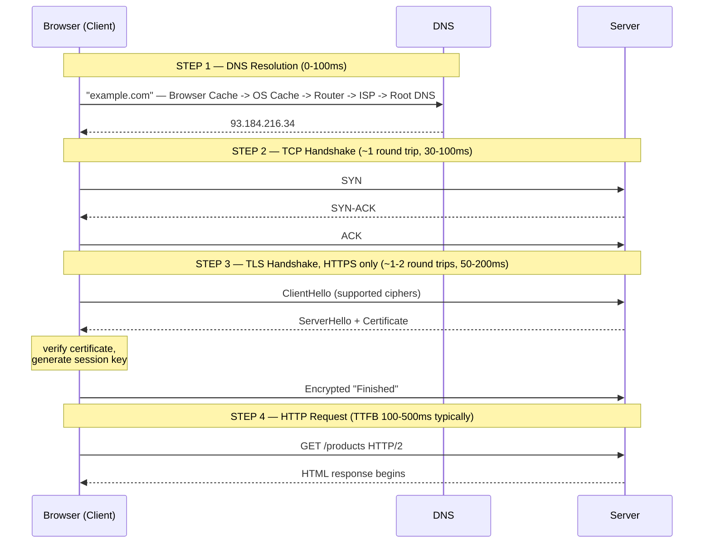

> **Navigation**: [< Previous](08_JS_Deep_Reasoning.md) | [Back to Index](../00_MASTER_INDEX.md) | [Next >](10_Web_Workers_ServiceWorkers.md)

# 🌐 Chapter 9 — Browser Internals: How the Web Actually Renders

> **"When you type a URL and press Enter, a cascade of 15+ steps happens before pixels appear on screen. Understanding this pipeline is the difference between 'it works' and 'it works FAST.' Every performance optimization maps to a specific stage in this pipeline."**

> **Where this pipeline actually runs, in the bigger picture.** Every
> stage below — HTML parsing, CSSOM, layout, paint — executes inside
> ONE specific OS process: a sandboxed **Renderer process**.
> [Chapter 14](14_Browser_Engines_And_Chromium_Architecture.md),
> Sections 6–9 zoom out to that process-level view: how a Renderer
> gets spun up for a navigation, why it's deliberately sandboxed away
> from your filesystem and network, and how the GPU process this
> chapter's Compositing section (7) hands work off to fits into the
> full multi-process picture. This chapter stays zoomed IN — what
> happens inside that one process; Chapter 14 is the zoomed-OUT view
> of everything around it.

---

## Table of Contents

1. [Navigation — From URL to First Byte](#1-navigation--from-url-to-first-byte)
2. [HTML Parsing — Building the DOM Tree](#2-html-parsing--building-the-dom-tree)
3. [CSS Parsing — Building the CSSOM](#3-css-parsing--building-the-cssom)
4. [The Render Tree — Combining DOM + CSSOM](#4-the-render-tree--combining-dom--cssom)
5. [Layout (Reflow) — Calculating Geometry](#5-layout-reflow--calculating-geometry)
6. [Paint — Drawing Pixels](#6-paint--drawing-pixels)
7. [Compositing — GPU Layers](#7-compositing--gpu-layers)
8. [The Critical Rendering Path](#8-the-critical-rendering-path)
9. [JavaScript Execution & the Event Loop in the Browser](#9-javascript-execution--the-event-loop-in-the-browser)
10. [Reflow vs Repaint — What Triggers What](#10-reflow-vs-repaint--what-triggers-what)
11. [requestAnimationFrame & Rendering Pipeline Timing](#11-requestanimationframe--rendering-pipeline-timing)
12. [How Browsers Optimize — Batching, Layers, and Compositing](#12-how-browsers-optimize--batching-layers-and-compositing)

---

## 1. Navigation — From URL to First Byte

> **Why these four steps run in this exact order and none can be
> skipped or reordered — each one is a hard prerequisite for the
> next, not just "the way it's usually done."** `https://example.com`
> names a domain, not an address; the OS network stack cannot open a
> connection to a name, only to an IP — so DNS resolution has to
> finish first. TCP's three-way handshake then has to complete before
> ANY bytes can flow reliably in either direction — TLS is not a
> separate connection, it's an encrypted conversation carried inside
> the TCP stream the handshake just opened, so it cannot start a
> moment earlier. Only once that encrypted channel exists can the
> browser safely send the HTTP request line and headers — sending them
> any sooner would mean sending the request in plaintext, defeating
> HTTPS entirely. Four steps, four dependencies, one strict order:



Add it up and the browser can easily burn **200-800ms before the
first byte of HTML arrives** — and that's the number `preconnect`
targets: `<link rel="preconnect" href="https://api.example.com">`
tells the browser to run Steps 1-3 (DNS + TCP + TLS) early, in
parallel with the current page still loading, so that by the time
code actually needs that origin, only Step 4 is left to pay for.

---

## 2. HTML Parsing — Building the DOM Tree

```
  Browser receives HTML bytes → Characters → Tokens → Nodes → DOM Tree


  TOKENIZATION (byte by byte):
  ════════════════════════════

  HTML bytes: <div class="card"><h2>Title</h2><p>Text</p></div>

  Tokens:
  ┌─────────────────────┐
  │ StartTag: div        │  (with attribute class="card")
  │ StartTag: h2         │
  │ Character: "Title"   │
  │ EndTag: h2           │
  │ StartTag: p          │
  │ Character: "Text"    │
  │ EndTag: p            │
  │ EndTag: div          │
  └─────────────────────┘


  DOM TREE CONSTRUCTION:
  ══════════════════════

  document
    └── html
        ├── head
        │   └── ...
        └── body
            └── div.card          ← Element node
                ├── h2            ← Element node
                │   └── "Title"   ← Text node
                └── p
                    └── "Text"


  ⚠️ PARSER-BLOCKING BEHAVIOR:
  ════════════════════════════

  When the parser encounters <script src="app.js">:

  1. HTML parsing STOPS
  2. Browser fetches app.js (network request!)
  3. Browser executes app.js (may modify DOM)
  4. HTML parsing RESUMES

  This is WHY scripts block rendering!

  SOLUTIONS:
  <script src="app.js" defer>   → Download in parallel, execute AFTER HTML parsed
  <script src="app.js" async>   → Download in parallel, execute ASAP (order not guaranteed)

  ┌─────────────────────────────────────────────────────────────┐
  │  normal:   HTML ████░░░░░░████████████                      │
  │                      ↑ blocked       ↑ resume               │
  │            JS        ░░░░░████                              │
  │                      fetch  exec                            │
  │                                                             │
  │  defer:    HTML ████████████████████ → JS exec             │
  │            JS   ░░░░░░░░░░░░░       (parallel download)    │
  │                                                             │
  │  async:    HTML ████████░░░░████████                        │
  │            JS   ░░░░░░░████         (exec when ready)      │
  └─────────────────────────────────────────────────────────────┘
```

---

> 🔬 **Section Challenge — 2. HTML Parsing — Building the DOM Tree**
>
> **Challenge 1 (Trace):** Why does placing a `<script src="heavy.js"></script>` in the `<head>` cause a "white screen of death," but placing it just before `</body>` doesn't?
>
> <details><summary>Answer</summary>
>
> **Scenario:** Long rendering delays on initial page load.
> **Trace:** HTML parsing is strictly synchronous and top-down. When the parser hits a `<script>` tag, it HALTS parsing, fetches the script (if external), executes it, and only then resumes parsing. If it's in the `<head>`, the parser stops before reading the `<body>`, so the screen stays blank. If it's at the end of the `<body>`, the DOM is already built and painted.
> **Debug/Design Fix:** Use the `defer` attribute (`<script src="..." defer></script>`) in the `<head>`. It tells the parser to fetch the file in parallel but WAIT to execute it until after the HTML parsing is fully complete, preserving the fast DOM construction.
>
> </details>

## 3. CSS Parsing — Building the CSSOM

```
  CSS bytes → Characters → Tokens → Nodes → CSSOM Tree

  CSS:
  body { font-size: 16px; }
  .card { display: flex; padding: 1rem; }
  .card h2 { color: #333; font-weight: bold; }

  CSSOM TREE:
  ═══════════

  (root)
    └── body
        │ font-size: 16px
        │
        └── .card
            │ display: flex
            │ padding: 1rem
            │ font-size: 16px  ← INHERITED from body!
            │
            └── h2
                │ color: #333
                │ font-weight: bold
                │ font-size: 16px  ← inherited
                │ display: flex... NO! h2 doesn't inherit display


  ⚠️ CSS IS RENDER-BLOCKING:
  ══════════════════════════

  The browser WILL NOT render ANYTHING until ALL CSS is parsed.

  Why? Without CSS, the browser doesn't know:
  - Is this element display: none? (don't render at all)
  - What size is it? (can't layout)
  - What color is the text? (can't paint)

  So if your CSS file is huge or slow to load → BLANK SCREEN.

  OPTIMIZATION:
  1. Inline critical CSS in <head> (above-the-fold styles)
  2. Load non-critical CSS with media queries:
     <link rel="stylesheet" href="print.css" media="print">
     (browser still downloads it, but doesn't block rendering)
  3. Minimize CSS file size (remove unused styles)
```

---

> 🔬 **Section Challenge — 3. CSS Parsing — Building the CSSOM**
>
> **Challenge 1 (Trace):** A developer moves a heavy CSS file from the top of the HTML to the bottom, expecting the text to appear faster and be styled later. Instead, the page stays blank for the exact same amount of time. Why?
>
> <details><summary>Answer</summary>
>
> **Scenario:** Attempting to unblock HTML parsing by moving CSS down the page.
> **Trace:** CSS is **render-blocking**. The browser refuses to paint ANY pixels until the CSSOM (CSS Object Model) is fully constructed. If it painted without CSS, users would see a Flash of Unstyled Content (FOUC), and the browser would have to do a massive, expensive recalculation (Layout/Paint) once the CSS arrived.
> **Debug/Design Fix:** You cannot prevent CSS from blocking the render, but you can optimize it. Extract the "Critical CSS" (above-the-fold styles) and inline it directly into a `<style>` block in the `<head>`. Load the remaining CSS asynchronously using `<link rel="preload">` or `media="print" onload="this.media='all'"`.
>
> </details>

## 4. The Render Tree — Combining DOM + CSSOM

```
  DOM Tree + CSSOM = Render Tree

  The Render Tree contains ONLY visible elements.

  DOM Tree:                     CSSOM says:
  ─────────                     ───────────
  html                          html { }
    head                        head → display: none (by default)
      title                     .hidden → display: none
    body                        span → display: inline
      div.card                  div → display: block
        h2
        p
      span.hidden


  Render Tree (visible only):
  ═══════════════════════════

  body                          ← head is EXCLUDED (display:none by default)
    div.card (display: block)
      h2 (display: block)
        "Title"
      p (display: block)
        "Text"
                                ← span.hidden is EXCLUDED (display:none)


  WHAT'S EXCLUDED:
  ═════════════════
  • <head>, <meta>, <script>, <link> → not visual
  • Any element with display: none → not in render tree at all
  • visibility: hidden → IN render tree (takes up space, just invisible!)
  • opacity: 0 → IN render tree (takes up space, just transparent!)
```

---

> 🔬 **Section Challenge — 4. The Render Tree — Combining DOM + CSSOM**
>
> **Challenge 1 (Reasoning):** You want to hide a heavy, complex DOM subtree. How does using `display: none` differ from `visibility: hidden` in terms of memory and the Render Tree?
>
> <details><summary>Answer</summary>
>
> **Scenario:** Hiding elements to improve performance.
> **Trace:** The Render Tree combines the DOM and CSSOM but EXCLUDES anything that shouldn't be painted. If you apply `display: none`, the element and all its children are completely omitted from the Render Tree. The browser does zero layout or paint work for them. If you apply `visibility: hidden`, the element is INVISIBLE, but it is STILL IN the Render Tree. The browser still calculates its exact layout (width/height) because it must take up space.
> **Debug:** For best performance when hiding complex trees, use `display: none` or the HTML5 `hidden` attribute. Use `visibility: hidden` ONLY if you need the empty space to preserve the layout structure.
>
> </details>

## 5. Layout (Reflow) — Calculating Geometry

```
  The Render Tree knows WHAT to show, but not WHERE or HOW BIG.
  Layout calculates every element's exact position and size.


  THE LAYOUT PROCESS:
  ═══════════════════

  1. Start at root (<html>)
     → viewport width = device width (e.g., 1920px)

  2. For each element, calculate:
     → width (based on parent, content, CSS)
     → height (based on content, CSS)
     → position (x, y coordinates)

  3. Percentages resolved against parent:
     body { width: 100% }    → 1920px
     .card { width: 50% }    → 960px
     .card p { width: 80% }  → 768px


  LAYOUT IS EXPENSIVE:
  ════════════════════

  One element changes size → ALL descendants may need recalculation.

  Example: Expanding an accordion
  ┌────────────────────────────┐
  │ Accordion Item 1 (closed)  │
  ├────────────────────────────┤
  │ Accordion Item 2 (OPEN!)   │ ← Height changes!
  │ Content content content    │
  │ More content here          │
  ├────────────────────────────┤ ← Item 3 shifts DOWN
  │ Accordion Item 3           │
  ├────────────────────────────┤ ← Item 4 shifts DOWN
  │ Accordion Item 4           │
  └────────────────────────────┘ ← Footer shifts DOWN

  ONE height change → entire page below reflows!
```

---

> 🔬 **Section Challenge — 5. Layout (Reflow) — Calculating Geometry**
>
> **Challenge 1 (Debug):** Animating the `width` and `height` of a 100-item list causes massive frame drops (jank) on mobile devices. Why?
>
> <details><summary>Answer</summary>
>
> **Scenario:** CSS animations causing lag.
> **Trace:** Changing `width` or `height` invalidates the geometry of the element. This forces the browser to run the **Layout** step. Because elements affect each other, a layout change in one item can cascade, forcing the browser to recalculate the geometry of its parent, siblings, and children. Doing this 60 times a second (in an animation) destroys the CPU.
> **Debug/Design Fix:** Never animate geometry properties (width, height, top, left, margin). Instead, use `transform: scale(x, y)` or `transform: translate(x, y)`. Transforms bypass Layout and Paint entirely, happening solely on the GPU during the Composite phase.
>
> </details>

## 6. Paint — Drawing Pixels

```
  After layout, the browser knows WHERE everything goes.
  Now it needs to fill in the PIXELS.

  PAINT RECORDS (drawing instructions):
  ═════════════════════════════════════

  For a blue button with white text:
  1. Draw rounded rectangle (x:100, y:200, w:120, h:40, borderRadius:8)
  2. Fill with #3b82f6
  3. Draw border (1px solid #2563eb)
  4. Position text "Submit" at (x:130, y:215)
  5. Fill text with #ffffff
  6. Apply font: 16px Inter, weight 600

  The browser creates these instructions for EVERY visible element.


  PAINT ORDER (z-order):
  ══════════════════════

  Elements paint in this order:
  1. Background color
  2. Background image
  3. Border
  4. Children (in DOM order, modified by z-index)
  5. Outline

  This is why z-index matters — it changes the paint order.
```

> **Why this exact order, and not some other one.** Painting is a
> "painter's algorithm" — each step draws directly on top of whatever
> was drawn before it, with no way to paint "underneath" something
> already there. So the order has to go back-to-front by visual
> layering intent: background first because everything else sits ON
> the background, then border, then children last among those (so a
> child's content visibly sits on top of its own parent's background
> and border, not hidden beneath them), and outline dead last because
> an outline is drawn around the outside of an element and is meant to
> stay visible even when children fill the element's interior.
> `z-index` matters because it's the one lever that lets you override
> step 4's default DOM-order painting — without it, later DOM siblings
> always paint over earlier ones simply because they're painted later
> in this same sequence.

---

> 🔬 **Section Challenge — 6. Paint — Drawing Pixels**
>
> **Challenge 1 (Reasoning):** A developer adds `box-shadow` and `border-radius` to 500 cards on a dashboard, and scrolling suddenly becomes extremely sluggish. What phase of the pipeline is choking?
>
> <details><summary>Answer</summary>
>
> **Scenario:** Fancy UI styles causing scroll lag.
> **Trace:** `box-shadow` and `border-radius` are notoriously expensive **Paint** operations. The browser has to mathematically calculate the pixel blending for shadows and anti-aliasing for curves. When scrolling, new parts of the page enter the viewport, forcing the browser to rapidly paint these expensive pixels on the CPU.
> **Debug:** The pipeline is choking at the Paint phase. To fix it, you can either remove the expensive properties, or promote the cards to their own GPU layers (using `will-change: transform` or `transform: translateZ(0)`), so they are painted once and cached as a texture on the GPU.
>
> </details>

## 7. Compositing — GPU Layers

> **Why splitting into layers helps — it's Section 6's Paint step,
> applied selectively instead of globally.** Painting means "convert
> this region into pixels." Without layers, animating one element
> forces the browser to redraw that region on the SAME surface as
> everything around it, so the whole shared surface repaints. A GPU
> layer gives one element its own separate pixel surface (its own
> texture). Now animating it means the GPU just repositions or
> re-blends that one already-painted texture against the others — the
> other layers' pixels are untouched and reused as-is, because they
> were never drawn onto the same surface to begin with.
>
> **Why THESE specific properties are what promotes an element to its
> own layer.** Each one is a property the browser can apply without
> touching the pixels themselves: `transform` repositions/rotates/
> scales an existing texture, `opacity` re-blends one, and
> `<video>`/`<canvas>`/WebGL already produce pixels from a source
> outside the normal paint step. Because none of these require
> re-running Paint, isolating the element onto its own layer lets the
> GPU handle the change alone, completely skipping the CPU.

```
  THE COMPOSITING PROCESS — layers stack, then the GPU merges them:

  ┌── Layer 1 (background) ──────────────────────────┐
  │  Static page content                              │
  │  ┌── Layer 2 (fixed header) ─────────────────┐   │
  │  │  Sticky nav with logo                      │   │
  │  └────────────────────────────────────────────┘   │
  │  ┌── Layer 3 (animated card) ─────────────────┐   │
  │  │  Card being dragged (transform)            │   │
  │  └────────────────────────────────────────────┘   │
  │  ┌── Layer 4 (modal overlay) ─────────────────┐   │
  │  │  opacity: 0.5 background + modal content   │   │
  │  └────────────────────────────────────────────┘   │
  └───────────────────────────────────────────────────┘
```

> **Why the three performance tiers below are a strict ladder, not
> three independent options.** Each tier is defined by which upstream
> stage a change can skip — and Section 5 already established that
> Layout cascades to descendants while Paint doesn't, so skipping
> Layout is worth more than skipping Paint:

| Tier | Properties | What runs | Why |
|---|---|---|---|
| **Best** — composite-only | `transform`, `opacity` | GPU only | Repositions/re-blends an existing texture — no CPU work, no Layout cascade ([§5](#5-layout-reflow--calculating-geometry)) to trigger |
| **OK** — paint-only | `color`, `background-color`, `box-shadow` | CPU repaint + Composite | Geometry is unchanged (no cascade), but the pixels themselves differ, so Paint ([§6](#6-paint--drawing-pixels)) must redraw them |
| **Worst** — layout | `width`, `height`, `margin`, `top`, `left`, `font-size` | Layout + Paint + Composite | Geometry changed — Section 5's cascade rule forces recalculating descendants, THEN repainting, THEN recompositing |

---

> 🔬 **Section Challenge — 7. Compositing — GPU Layers**
>
> **Challenge 1 (Design):** You learn that `will-change: transform` puts an element on its own GPU layer, making animations silky smooth. You decide to apply `* { will-change: transform; }` to your entire app. What happens next?
>
> <details><summary>Answer</summary>
>
> **Scenario:** Over-optimizing by forcing everything onto the GPU.
> **Trace:** GPU memory (VRAM) is strictly limited. Every new compositor layer requires memory to store its texture (the painted pixels). By forcing every element into its own layer, you will immediately exhaust the device's VRAM.
> **Debug:** The browser will crash, or the OS will aggressively terminate the tab.
> **Design Fix:** Use `will-change` sparingly. Only apply it to elements that are _currently_ or _about to be_ animated, and remove it when the animation completes to free up GPU memory.
>
> </details>

## 8. The Critical Rendering Path

```
  THE FULL PIPELINE:
  ══════════════════

  HTML bytes → DOM Tree ──────────┐
                                   ├──→ Render Tree → Layout → Paint → Composite → PIXELS!
  CSS bytes → CSSOM Tree ─────────┘         ▲
                                            │
  JS execution ─────────────────── can modify DOM/CSSOM


  CRITICAL RENDERING PATH = minimum work to show FIRST pixels.


  TO OPTIMIZE:
  ════════════

  1. MINIMIZE critical resources:
     Only load what's needed for above-the-fold content.

  2. MINIMIZE critical path length:
     Reduce number of round trips (DNS, TCP, TLS, requests).

  3. MINIMIZE critical bytes:
     Compress CSS/JS, remove unused code.


  IDEAL LOADING SEQUENCE:
  ═══════════════════════

  <head>
    <!-- 1. Critical CSS inline (no extra request!) -->
    <style>
      /* Only styles for above-the-fold content */
      body { margin: 0; font-family: system-ui; }
      .header { height: 60px; background: #fff; }
      .hero { padding: 4rem 2rem; }
    </style>

    <!-- 2. Preconnect to required origins -->
    <link rel="preconnect" href="https://fonts.googleapis.com">

    <!-- 3. Preload critical resources -->
    <link rel="preload" href="/fonts/inter.woff2" as="font" crossorigin>

    <!-- 4. Non-critical CSS loaded asynchronously -->
    <link rel="stylesheet" href="/styles/main.css" media="print" onload="this.media='all'">
  </head>
  <body>
    <!-- 5. Content first, scripts last -->
    <div id="app">...</div>

    <!-- 6. JS deferred (doesn't block parsing) -->
    <script src="/js/app.js" defer></script>
  </body>
```

---

> 🔬 **Section Challenge — 8. The Critical Rendering Path**
>
> **Challenge 1 (Reasoning):** Your web app has a 2MB CSS file. A user on a slow 3G connection visits your site. Explain exactly what the user sees on their screen during the 15 seconds it takes to download this CSS file.
>
> <details><summary>Answer</summary>
>
> **Scenario:** Massive, render-blocking CSS on a slow connection.
> **Trace:** The browser quickly downloads the HTML and begins constructing the DOM. However, it spots the `<link rel="stylesheet">` in the `<head>`. Because CSS is render-blocking, the browser completely halts the rendering pipeline at the CSSOM step. It will build the DOM in the background, but it will **not** construct the Render Tree, nor will it Layout or Paint.
> **Debug:** The user sees an absolutely blank white screen for 15 seconds.
> **Fix:** Implement Critical CSS. Extract the bare minimum styles needed for the initial viewport, inline them in the `<head>`, and load the remaining 2MB file asynchronously (e.g., `<link rel="stylesheet" href="main.css" media="print" onload="this.media='all'">`).
>
> </details>

## 9. JavaScript Execution & the Event Loop in the Browser

> **Why JS execution and every rendering step share one thread — the
> same call-stack constraint [Chapter 1, Section 8](01_JS_Foundations.md#8-execution-context--how-js-runs-your-code)
> derived, extended to cover more than just JS.** A single Call Stack
> means one place instructions execute at a time — Chapter 1 used that
> to explain stack overflow and synchronous blocking. This chapter's
> Sections 2-7 (DOM updates, style calculation, layout, paint) are ALL
> instructions that also have to run somewhere, and Chromium schedules
> them on that identical main thread, not a separate one. So a long
> JS task doesn't just delay other JS — it delays style/layout/paint
> too, because they're all competing for the one thread this section's
> heading covers. ([Chapter 10, Section 1](10_Web_Workers_ServiceWorkers.md#1-why-we-need-workers--the-main-thread-problem)
> traces the exact frame-drop consequence of this.)

Every one of those tasks has to fit inside a hard budget, or frames get dropped:

| Work item | Typical cost |
|---|---|
| Input events (click, scroll) | ~2ms |
| JavaScript execution | ~6ms |
| `requestAnimationFrame` callbacks | ~1ms |
| Style calculation | ~2ms |
| Layout | ~2ms |
| Paint | ~2ms |
| Composite | ~1ms |
| **Total** | **~16ms — fits inside the 16.67ms/frame budget at 60fps** |

`1000ms / 60 ≈ 16.67ms` is the budget because 60fps means one frame every sixtieth of a second — so **50ms of JS doesn't just feel "a bit slow," it consumes roughly `50 / 16.67 ≈ 3` entire frames** worth of budget, and all three get dropped, not slowed down.

> **Where rendering fits into the event loop — and why it sits exactly
> there.** The macrotask/microtask draining order below is [Chapter 4](04_JS_Async_Promises.md)'s
> event loop mechanism, unchanged — this chapter adds what the browser
> does AFTER a task's microtasks finish. Rendering needs a fully
> settled DOM to paint correctly: if the browser tried to render in
> the middle of a microtask chain, it could paint a half-finished
> intermediate state a script never intended anyone to see. So the
> browser waits until the Call Stack is empty AND every queued
> microtask has drained — Chapter 4's own guarantee — before it's
> safe to treat the DOM as stable enough to measure and draw:

```
  1. Run ONE macrotask (setTimeout, setInterval, I/O, events)
  2. Run ALL microtasks (Promise.then, queueMicrotask, MutationObserver)
  3. If it's time to render (usually 60 times/second):
     a. Run requestAnimationFrame callbacks
     b. Style calculation
     c. Layout
     d. Paint
     e. Composite
  4. If idle → run requestIdleCallback
  5. Go to step 1
```

---

> 🔬 **Section Challenge — 9. JavaScript Execution & the Event Loop in the Browser**
>
> **Challenge 1 (Trace):** You have a CPU-intensive `while` loop that takes 5 seconds to complete on the main thread. During those 5 seconds, the user furiously clicks a button 10 times. What happens, and when do the click handlers run?
>
> <details><summary>Answer</summary>
>
> **Scenario:** Blocking the main thread while user input occurs.
> **Trace:** The Event Loop only processes the macrotask/microtask queues when the Call Stack is empty. During the 5-second `while` loop, the Call Stack is blocked. The browser's OS thread registers the 10 clicks and pushes them into the Macrotask Queue, but the Event Loop cannot dequeue them.
> **Debug:** For 5 seconds, the UI is completely frozen (no hover states, no scrolling). Exactly after the 5-second loop finishes and the Call Stack clears, the Event Loop will aggressively process the Macrotask Queue, firing the click handler 10 times in rapid succession.
> **Fix:** Offload the 5-second calculation to a Web Worker, freeing the main thread to handle the click events instantly.
>
> </details>

## 10. Reflow vs Repaint — What Triggers What

> **Same three tiers [Section 7](#7-compositing--gpu-layers) already
> ranked, now mapped to the concrete properties that land in each
> one** — "reflow" is this chapter's name for the Worst tier
> (Layout → Paint → Composite), "repaint" for the OK tier
> (Paint → Composite only):

| Tier | Triggered by CSS | Cost |
|---|---|---|
| **Reflow** (Layout → Paint → Composite) | `width`, `height`, `padding`, `margin`, `border-width`, `top`/`left`/`right`/`bottom`, `font-size`, `font-family`, `display`, `position`, `float`, `overflow`, `text-align` | Expensive — geometry changed, Section 5's cascade applies |
| **Repaint** (Paint → Composite) | `color`, `background-color`, `background-image`, `border-color`, `outline`, `visibility`, `box-shadow` | Moderate — pixels change, geometry doesn't |
| **Composite-only** (Composite) | `transform`, `opacity` | Cheapest — this is why you animate with `transform`, not `left`/`top` |

> **Why certain JS *reads* — not just CSS writes — also force a
> reflow, on their own, with no animation involved.** Browsers are
> lazy about layout: a style **write** like `el.style.height = ...`
> doesn't recalculate anything immediately, it just flags the layout
> as "dirty" and defers the real work until the browser actually needs
> it (batching many writes into one recalculation is exactly why this
> is cheap). But `el.offsetHeight` is a **read**, and it has to return
> an exact, pixel-correct number — there's no way to answer "how tall
> is this, right now" from a layout that's known to be stale. So the
> browser has no choice but to pause JS and run the deferred Layout
> step synchronously, immediately, just to answer that one read. That
> forced, out-of-schedule Layout is what makes `offsetHeight`,
> `offsetWidth`, `getBoundingClientRect()`, `scrollTop`,
> `clientHeight`, and `getComputedStyle()` reflow triggers even though
> none of them is a "change" at all.

### Layout Thrashing — The #1 Performance Killer

```javascript
// BAD — Layout Thrashing (read-write-read-write):
for (let i = 0; i < items.length; i++) {
  const height = items[i].offsetHeight; // READ → forces layout
  items[i].style.height = height + 10 + "px"; // WRITE → invalidates layout
  // Next iteration: READ again → forces ANOTHER layout!
}
// N elements = N forced layouts!

// GOOD — Batch reads, then batch writes:
const heights = items.map((item) => item.offsetHeight); // ALL reads first
items.forEach((item, i) => {
  item.style.height = heights[i] + 10 + "px"; // ALL writes after
});
// 1 forced layout total!
```

---

> 🔬 **Section Challenge — 10. Reflow vs Repaint — What Triggers What**
>
> **Challenge 1 (Trace):** Why does `const h = el.offsetHeight; el.style.height = (h + 10) + 'px';` cause Layout Thrashing if placed inside a `for` loop, but `const h = el.offsetHeight;` alone does not?
>
> <details><summary>Answer</summary>
>
> **Scenario:** Accidentally forcing synchronous layout in a loop.
> **Trace:** Browsers are lazy and batch DOM writes. `el.style.height = ...` doesn't immediately recalculate layout; it just flags the DOM as "dirty." However, when you ask for `el.offsetHeight` (a read), the browser MUST give you the exact, pixel-perfect value. If the DOM is "dirty" from a previous write in the loop, the browser is forced to pause JavaScript execution and run a synchronous Layout step immediately to calculate the correct height.
> **Debug:** In a loop, write-then-read forces a full layout recalculation on _every iteration_.
> **Fix:** Read all values first (caching them), then write all values. Or use `requestAnimationFrame` to batch DOM updates just before the next paint.
>
> </details>

## 11. requestAnimationFrame & Rendering Pipeline Timing

> **"rAF runs before paint" isn't a separate feature — it's step 3a
> of [Section 9](#9-javascript-execution--the-event-loop-in-the-browser)'s
> event loop, which you've already seen.** `setTimeout` schedules a
> **macrotask** — Chapter 4's queue, with zero awareness that
> rendering exists at all; the browser might run it, then still be
> mid-frame, then run it again before ever reaching step 3.
> `requestAnimationFrame` instead schedules its callback to run at a
> fixed position INSIDE the render step itself — specifically before
> style calculation and layout — so the browser can guarantee it fires
> exactly once per frame, never more, and never in the middle of one:

| | `setTimeout(fn, 16)` | `requestAnimationFrame(fn)` |
|---|---|---|
| Scheduled as | A macrotask — "run after ~16ms" | Step 3a of the render phase — "run before next paint" |
| Sync to screen refresh | No — plain timer, unaware rendering exists | Yes — runs once per actual frame |
| Can fire mid-frame / twice before paint | Yes — causes visible tearing | No — the loop's structure makes this impossible |
| Background tabs | Keeps firing (until browser-specific throttling) | Automatically paused — no frames to align to |
| Gives a timestamp | No — you'd call `Date.now()` yourself | Yes — passed as the callback's argument, for precise elapsed-time math |

```javascript
// Smooth animation with rAF:
function animate(timestamp) {
  // Calculate progress
  const elapsed = timestamp - startTime;
  const progress = Math.min(elapsed / duration, 1);

  // Use transform (composite-only, no reflow!):
  element.style.transform = `translateX(${progress * 300}px)`;

  if (progress < 1) {
    requestAnimationFrame(animate);
  }
}

const startTime = performance.now();
const duration = 500; // ms
requestAnimationFrame(animate);
```

---

> 🔬 **Section Challenge — 11. requestAnimationFrame & Rendering Pipeline Timing**
>
> **Challenge 1 (Reasoning):** You use `setInterval(animate, 1000 / 60)` to move an element to achieve 60fps. Why will this animation occasionally look stuttery or tear, whereas `requestAnimationFrame(animate)` will not?
>
> <details><summary>Answer</summary>
>
> **Scenario:** Using JavaScript timers for UI animation.
> **Trace:** `setInterval` is just a timer pushing a macrotask into the queue every ~16.6ms. It has zero awareness of the monitor's physical refresh rate or the browser's rendering pipeline. If the Event Loop is busy, the interval callback might be delayed, causing two frames to render back-to-back, or it might fire right in the middle of a screen draw, causing visual tearing.
> **Debug/Design:** `requestAnimationFrame` is hooked directly into the rendering pipeline. The browser guarantees that the `rAF` callback will execute _exactly once_ right before the style calculation and layout phases of the next screen refresh, resulting in perfectly synchronized, tear-free animations.
>
> </details>

## 12. How Browsers Optimize — Batching, Layers, and Compositing

**Batching is [Section 10](#10-reflow-vs-repaint--what-triggers-what)'s lazy-write/eager-read rule, applied to multiple writes in a row** — every write just re-flags "dirty," so three writes with no read between them still only cost one deferred Layout; a read forces that pending Layout to run immediately, right where it appears:

```javascript
// These 3 writes DON'T cause 3 separate reflows:
element.style.width = "200px";
element.style.height = "100px";
element.style.margin = "10px";
// Browser batches these → ONE reflow at next paint

// BUT reading layout properties FORCES immediate reflow:
element.style.width = "200px";
const w = element.offsetWidth; // FORCES reflow NOW!
element.style.height = "100px"; // invalidates again
const h = element.offsetHeight; // FORCES ANOTHER reflow!
```

**Virtual scrolling attacks the cost at its source: [Section 5](#5-layout-reflow--calculating-geometry) established that Layout has to visit every node in the render tree**, and a 10,000-row list means 10,000 nodes it has to size and position — most of them scrolled off-screen and invisible. Keeping only the ~20 rows currently in the viewport in the DOM, and swapping their content as the user scrolls, holds the render tree at a constant ~20 nodes regardless of how large the underlying list is — Layout's cost stops scaling with list size at all. (Libraries: `react-window`, `react-virtuoso`, `tanstack-virtual`.)

**`contain` attacks a different cost: [Section 5](#5-layout-reflow--calculating-geometry)'s cascade rule forces the browser to assume, by default, that ANY layout change might affect ancestors or siblings** — that's WHY one accordion item resizing can shift everything below it. `contain` is an explicit promise from the developer that breaks that assumption on purpose for one subtree:

```css
.card {
  contain: layout; /* layout changes inside don't affect outside */
  contain: paint; /* painting inside doesn't bleed outside */
  contain: content; /* shorthand for layout + paint + style */
}
```

With that promise in place, the browser no longer has to defensively recheck the rest of the page when something inside `.card` changes — it can trust the boundary and skip work it would otherwise be forced to redo just in case.

---

> **Next Chapter**: [Web Workers & Service Workers →](10_Web_Workers_ServiceWorkers.md)

---


---

## Reality Check

**"The browser renders HTML as it parses it"** → Parsing feeds a PIPELINE with blocking rules people build careers on misunderstanding: CSS blocks RENDERING (not parsing — but scripts wait for CSSOM because they might read styles), synchronous scripts block PARSING (defer/async/module exist to break exactly this), and the preload scanner races ahead fetching despite blocks. The practical decode of every waterfall chart is these three rules; "why is my page white for two seconds" is almost always one of them firing as designed.

**"Layout, paint, composite are stages of the same cost"** → They are a COST LADDER you climb involuntarily: transform/opacity changes can stay composite-only (GPU moves existing textures — cheap, the entire basis of performant animation), color/shadow changes add paint, and geometry changes (width, top, font-size) trigger layout which cascades to everything below. The engineering rule: animate only transform and opacity; the debugging rule: DevTools Performance shows WHICH rung each frame paid, and jank investigations start by finding who forced layout. will-change is the escape hatch that costs memory per layer — a hint, not a sprinkle.

**"requestAnimationFrame runs at 60fps"** → rAF runs BEFORE THE NEXT PAINT, whatever rate the display and load dictate (120Hz monitors, throttled background tabs where it stops entirely, dropped frames under load) — its guarantee is phase, not frequency: your callback sees a consistent pre-layout moment, making it the correct slot for read-then-write DOM choreography and the wrong tool for timing (durations come from the timestamp argument, never from counting calls). Animation logic that assumes 16.67ms per tick drifts on every device that is not a 60Hz desktop — which is now most devices.

**"The main thread runs my JavaScript"** → The main thread runs your JS AND parsing AND style AND layout AND paint setup AND event dispatch — one queue for all of it, which is why "my code is fast" pages still jank (the 4ms handler fires during a 12ms layout on a frame that also parses a chunk). Long-task thinking replaces function thinking: anything over 50ms freezes input visibly; the levers are chunking (scheduler.yield / setTimeout seams), moving pure computation to workers, and CSS containment to fence layout blast radius. The metric that captures it all is INP — input delay is main-thread arithmetic, not mystery.

**"Reflow bugs are fixed by touching the DOM less"** → The trigger is not touches but SYNC GEOMETRY READS after writes: one read (offsetHeight, getComputedStyle, getBoundingClientRect) after one style write forces a full layout flush mid-frame; a loop of them is layout thrashing at N flushes per frame. Fixes are ordering, not abstinence: batch all reads, then all writes (or split across rAF phases), cache geometry that cannot have changed, and use ResizeObserver/IntersectionObserver to be TOLD about geometry instead of polling for it. The same DOM touch count, reordered, is the 10x difference — the model is flush-scheduling, not frugality.
