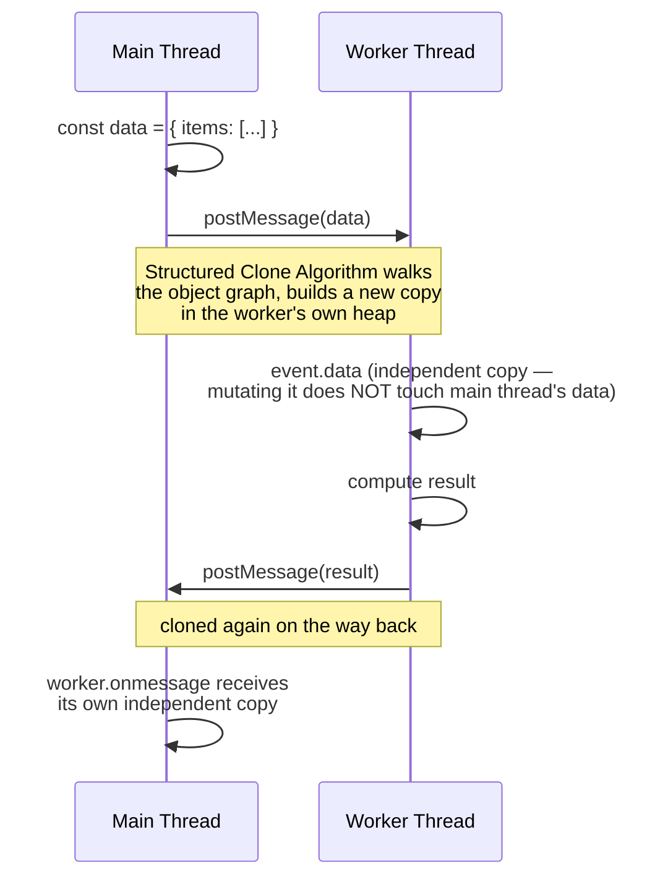
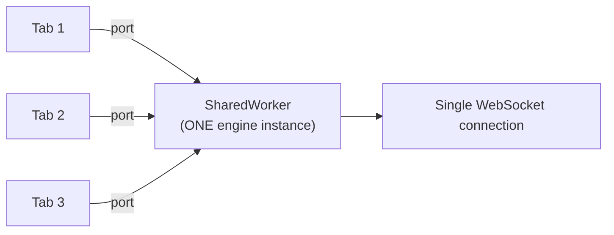
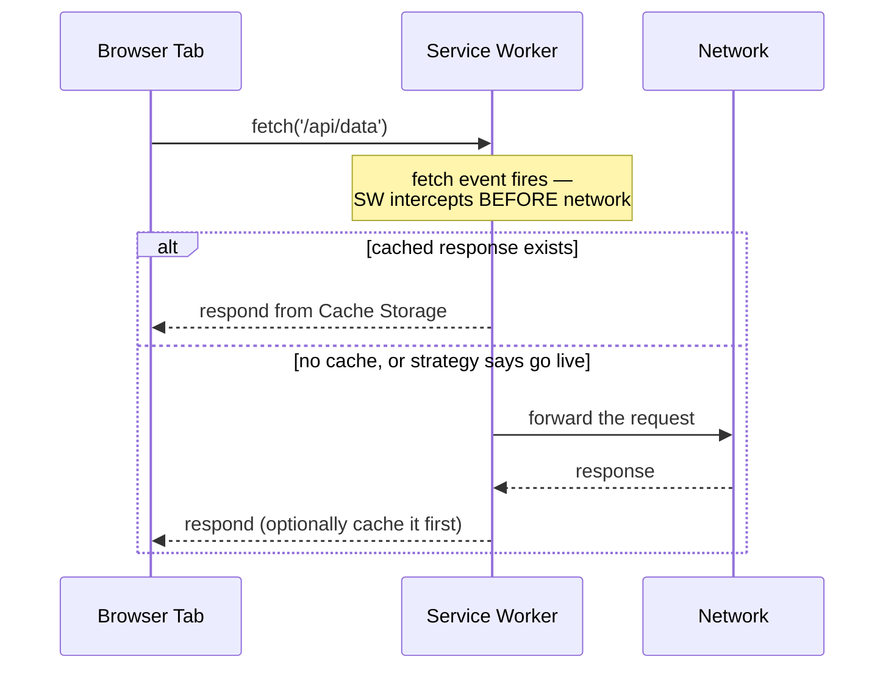
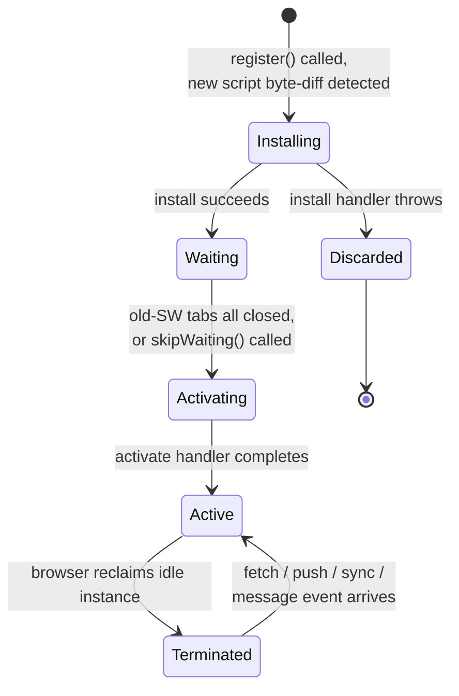

**Navigation**: [< Previous](09_Browser_Internals_Rendering.md) | [Back to Index](../00_MASTER_INDEX.md) | [Next >](11_Advanced_Web_APIs.md)

# ⚙️ Chapter 10 — Web Workers & Service Workers: Threading in the Browser

**"JavaScript is single-threaded, but the browser is NOT. Web Workers let you run expensive computation off the main thread so your UI stays smooth. Service Workers give your app superpowers — offline support, push notifications, and background sync."**

---

## Table of Contents

1. [Why We Need Workers — The Main Thread Problem](#1-why-we-need-workers--the-main-thread-problem)
2. [Dedicated Web Workers — Basics](#2-dedicated-web-workers--basics)
3. [Worker Communication — postMessage Deep Dive](#3-worker-communication--postmessage-deep-dive)
4. [Transferable Objects — Zero-Copy Performance](#4-transferable-objects--zero-copy-performance)
5. [SharedWorker — One Worker, Multiple Tabs](#5-sharedworker--one-worker-multiple-tabs)
6. [Worker Limitations — What You Cannot Do](#6-worker-limitations--what-you-cannot-do)
7. [Real-World Use Cases for Web Workers](#7-real-world-use-cases-for-web-workers)
8. [Service Workers — The Proxy Between Browser and Network](#8-service-workers--the-proxy-between-browser-and-network)
9. [Service Worker Lifecycle](#9-service-worker-lifecycle)
10. [Caching Strategies — Offline-First Patterns](#10-caching-strategies--offline-first-patterns)
11. [Background Sync & Push Notifications](#11-background-sync--push-notifications)
12. [Workbox — Production-Ready Service Workers](#12-workbox--production-ready-service-workers)

---

## 1. Why We Need Workers — The Main Thread Problem

> **Why ALL of these land on one thread — not a list of unrelated
> facts, one consequence of the engine model [Chapter 12](12_V8_Engine_Internals.md)
> already established.** A tab's JS engine is a single instance with
> one Call Stack — there is exactly one place JS instructions execute.
> [Chapter 9's rendering pipeline](09_Browser_Internals_Rendering.md)
> (style calculation, layout, paint) and the browser's input-event
> dispatch (Chapter 5's capture/target/bubble walk) are ALSO scheduled
> through that same single-threaded event loop [Chapter 4](04_JS_Async_Promises.md)
> derived — they're different KINDS of work, but they all compete for
> the identical one thread's attention. That's not an arbitrary design
> limitation; it's what "the browser has one JS engine per tab" (Chapter
> 14's per-Renderer-process model) necessarily implies for everything
> scheduled through it.
>
> **Where the "16ms" below comes from.** [Chapter 9, Section 9](09_Browser_Internals_Rendering.md#9-javascript-execution--the-event-loop-in-the-browser)
> already derived it: 60fps means the browser must produce a new frame
> every `1000ms / 60 ≈ 16.67ms` (rounded to 16ms here), and that budget
> has to cover style calculation, layout, paint, AND any JS handlers —
> all on the one thread this section just established. A single 200ms
> JS task doesn't just run "a bit slow," it consumes the budget of
> roughly twelve consecutive frames, and every one of those frames gets
> silently dropped because the thread that would produce them is still
> busy executing that one JS task.

Twelve dropped frames is what "JS takes 200ms" actually costs, laid out one frame at a time:

```
  Main Thread — no worker:
  Frame 1 (16ms) │ HEAVY JS running (200ms) ███████████████████ │ Frame 14 (16ms)
                  ← 12 frames DROPPED — UI frozen: no click, scroll, or typing lands →

  Main Thread — same work moved to a Worker:
  Frame 1 │ Frame 2 │ Frame 3 │ ... │ Frame 12 │ Frame 13   ← every frame renders on time, 60fps
  (16ms)  │ (16ms)  │ (16ms)  │     │ (16ms)   │ (16ms)

  Worker Thread — running in parallel:
  HEAVY JS (200ms) ███████████████████████████████████████████  ← invisible to the main thread's frame budget
```

---

## 2. Dedicated Web Workers — Basics

```javascript
// ═══════════════════════════════════════════
// CREATING A WORKER — main.js
// ═══════════════════════════════════════════

// Worker runs in a SEPARATE file
const worker = new Worker("heavy-computation.js");

// Send data TO the worker
worker.postMessage({
  type: "SORT_DATA",
  data: hugeArray,
});

// Receive results FROM the worker
worker.onmessage = (event) => {
  console.log("Sorted data:", event.data);
  renderTable(event.data); // Back on main thread, update UI
};

// Handle errors
worker.onerror = (error) => {
  console.error("Worker error:", error.message);
};

// Terminate when done
worker.terminate();
```

> **Why `self`, not `window`, inside a worker.** `window` isn't just a
> name for "the global object" — it specifically represents a
> *browsing context* (a tab/frame with a `document`, a URL bar entry,
> history). A Worker's engine instance was never given one of those
> (Section 6 covers the full list of what it lacks). `self` is the
> more general property every JS global scope exposes as a
> self-reference, regardless of what KIND of global scope it is — a
> `Window` in a tab, or a bare `WorkerGlobalScope` here. Code written
> against `self` therefore works in both places; code written against
> `window` only works in a tab, which is precisely why reaching for
> `window.something` inside a worker fails, not because it's
> "disabled," but because that object was never created in this
> engine instance to begin with.

```javascript
// ═══════════════════════════════════════════
// INSIDE THE WORKER — heavy-computation.js
// ═══════════════════════════════════════════

self.onmessage = (event) => {
  const { type, data } = event.data;

  switch (type) {
    case "SORT_DATA":
      // This sorting takes 200ms — but doesn't block UI!
      const sorted = data.sort((a, b) => a.value - b.value);
      self.postMessage(sorted);
      break;

    case "FILTER_DATA":
      const filtered = data.filter((item) => item.active);
      self.postMessage(filtered);
      break;
  }
};
```

### Inline Workers (No Separate File)

```javascript
// Create worker from a Blob — useful in bundled apps
const workerCode = `
  self.onmessage = (e) => {
    const result = e.data.map(n => n * n);
    self.postMessage(result);
  };
`;

const blob = new Blob([workerCode], { type: "application/javascript" });
const worker = new Worker(URL.createObjectURL(blob));

worker.postMessage([1, 2, 3, 4, 5]);
worker.onmessage = (e) => console.log(e.data); // [1, 4, 9, 16, 25]
```

---

## 3. Worker Communication — postMessage Deep Dive

**Data is cloned, not shared — every message crosses the thread boundary as an independent copy, in both directions.**



**How to read this diagram.** Follow the arrows between the two lifelines: the main thread calls `postMessage(data)`, the structured clone algorithm builds a separate copy in the worker's heap, the worker computes and posts a result back, and that result is cloned again on the way home. The thing to notice is the note on each hop: neither side ever shares an object with the other, so mutating the received copy cannot affect the sender.

Not everything survives that clone walk — the algorithm can only rebuild things it knows how to serialize:

| Clones successfully | Cannot be cloned |
|---|---|
| Objects, Arrays, Maps, Sets | Functions |
| Dates, RegExp | DOM nodes |
| ArrayBuffer, TypedArrays | Symbols |
| Blob, File, ImageData | Class instances with methods |

> **Why worker isolation forces cloning instead of sharing — and why
> that specific list of can/can't-clone types isn't arbitrary.** A
> Worker is a genuinely separate JS engine instance with its own
> memory space — not a thread sharing the main thread's heap, a fully
> distinct one (this is exactly why Chapter 12's "the JS engine has a
> Call Stack and a Heap" model applies twice here: once per engine
> instance, main thread and worker each getting their own). Two
> separate heaps means an object reference from one is simply
> meaningless in the other — there's no pointer you could hand across
> that the receiving engine could dereference. The **structured clone
> algorithm** solves this by recursively walking the value's entire
> object graph and rebuilding an equivalent, independent copy in the
> destination heap (tracking already-visited objects so cyclic
> references don't loop forever — the same reachability-tracing idea
> [Chapter 12, Section 11](12_V8_Engine_Internals.md#11-garbage-collection--scavenge-and-mark-sweep-compact)
> uses for GC, repurposed here for copying instead of marking).
>
> **Why functions and DOM nodes specifically can't survive that walk.**
> A function isn't just its source text — Chapter 2's closure
> derivation established that a function carries a live pointer to the
> `[[Environment]]` it was created in, potentially referencing
> arbitrary other variables, other functions, anything in scope at
> creation. There is no way to serialize "a pointer into this specific
> engine's live execution state" into a form a *different* engine
> instance could reconstruct — the environment it would need to point
> to doesn't exist over there. A DOM node fails for a related reason:
> it's not a plain data object, it's a live handle into one specific
> document's render tree ([Chapter 9](09_Browser_Internals_Rendering.md)'s
> DOM), tied to that document's C++-backed internals — a worker has no
> DOM at all (Section 6 below), so there's nothing on the receiving
> side to even reconstruct into.

---

## 4. Transferable Objects — Zero-Copy Performance

```javascript
// PROBLEM: Cloning a 100MB ArrayBuffer takes time + doubles memory
const buffer = new ArrayBuffer(100 * 1024 * 1024); // 100MB

// SLOW — structured clone (copies 100MB):
worker.postMessage(buffer); // 100MB allocated in worker too!

// FAST — transfer ownership (zero copy):
worker.postMessage(buffer, [buffer]); // Second arg = transferables
// buffer.byteLength is now 0! Main thread can't use it anymore.
// Worker OWNS the buffer — no copy needed.
```

> **Why transfer can skip the copy that Section 3 said was mandatory.**
> The structured clone algorithm copies because two engine instances
> have two separate heaps, and a reference into one heap is garbage in
> the other — that constraint doesn't go away here. What changes is
> *which* heap the data lives in. `postMessage(buffer, [buffer])`
> doesn't copy the 100MB region and hand the worker a duplicate; it
> **moves ownership** of that exact memory region from the main
> thread's heap bookkeeping to the worker's. Nothing was cloned, so
> there's no "two separate copies to keep in sync" problem — there's
> only ever one copy, and only one side is allowed to touch it. That's
> also why `buffer.byteLength` becomes `0` on the main thread
> immediately after: if the main thread could still read it, both
> threads would be reading/writing the same bytes with zero
> synchronization, reintroducing exactly the shared-mutable-state race
> conditions the entire clone-not-share design in Section 3 exists to
> avoid.

| Approach | What crosses the boundary | Cost | Main thread after |
|---|---|---|---|
| **Clone** (default) | A full copy of the data | O(size) — 100MB cloned = 100MB allocated twice | Original still usable |
| **Transfer** (`[buffer]` as 2nd arg) | Ownership only, zero bytes copied | O(1) — pointer handoff | `buffer.byteLength === 0`, unusable |

Only a specific set of types support this ownership handoff — anything with an underlying raw memory buffer or an OS-level handle: `ArrayBuffer`, `MessagePort`, `ImageBitmap`, `OffscreenCanvas`, `ReadableStream`/`WritableStream`/`TransformStream`.

---

## 5. SharedWorker — One Worker, Multiple Tabs

```javascript
// ═══════════════════════════════════════════
// SharedWorker — shared across all tabs of same origin
// ═══════════════════════════════════════════

// any-page.js (same code in every tab)
const shared = new SharedWorker("shared-worker.js");
shared.port.start();

shared.port.postMessage({ type: "JOIN", userId: "user123" });
shared.port.onmessage = (e) => {
  console.log("Broadcast from worker:", e.data);
};
```

```javascript
// shared-worker.js
const connections = [];

self.onconnect = (event) => {
  const port = event.ports[0];
  connections.push(port);

  port.onmessage = (e) => {
    if (e.data.type === "BROADCAST") {
      // Send to ALL connected tabs
      connections.forEach((p) => p.postMessage(e.data.message));
    }
  };

  port.start();
};
```

> **Why a dedicated Worker can't do this, but SharedWorker can — one
> difference in *how many* engine instances exist.** A `new Worker(...)`
> in Tab 1 and a `new Worker(...)` in Tab 2 create two independent
> engine instances, each with its own heap — Section 3's model applies
> per tab, not across tabs, so there is no way for them to see each
> other's state even if they run identical code. `SharedWorker` changes
> that cardinality directly: the browser keys the instance by script
> URL + origin, and `new SharedWorker("shared-worker.js")` from a
> *second* tab connects a new `port` to the **same already-running**
> engine instance rather than spawning another one. That single shared
> instance is what makes a fan-in topology possible — one WebSocket
> connection, one in-memory cache, one coordination point, reachable
> from every tab through its own `port`:



**How to read this diagram.** Three tabs each connect through their own `port` to a single SharedWorker instance, and that one instance holds the one WebSocket to the server. The thing to notice is the fan-in shape: many tabs on the left, one worker and one connection on the right.

> Without SharedWorker, three tabs open a WebSocket connection each —
> three sockets, three handshakes, three copies of the same server
> state. With it, the sockets collapse to one because the *thing
> holding the connection* collapsed to one. The same cardinality
> argument explains the other common use cases: a shopping cart or
> session shared across tabs, coordinating so only one tab plays audio,
> or fetching shared data once instead of once per tab — all of them
> are really "N tabs, 1 engine instance" problems in disguise.

---

## 6. Worker Limitations — What You Cannot Do

> **Why the boundary falls exactly here — one fact explains every
> item on both lists.** Section 3 already established the real
> mechanism: a Worker is a genuinely separate JS engine instance, not
> a thread sharing the main thread's objects. `document` and `window`
> are objects the MAIN thread's engine instance holds — `document`
> specifically is Chapter 9's live DOM tree, which only exists because
> a Renderer process's main thread is the one running Chapter 9's
> parse/layout/paint pipeline. A worker's engine instance was never
> given a DOM to hold in the first place, so `document.querySelector`
> isn't "blocked," it's simply undefined — there's no DOM object over
> there to call it on. Parent-scope variables and closures fail for
> the identical reason Section 3's structured-clone limitation does:
> a closure over the creating script's variables is a live pointer
> into THAT script's environment record, meaningless in a separate
> engine instance with its own, unrelated heap.

**What workers DO have — everything that doesn't require a DOM or a
shared heap:**

| Cannot access | Why (the DOM/heap-isolation mechanism above) | Can access | Why it's fine |
|---|---|---|---|
| `document`, `window` | No DOM exists in a worker's engine instance at all | `fetch()` / `XMLHttpRequest` | Pure network I/O, no DOM involved |
| `alert()`, `confirm()`, `prompt()` | These are `window`-specific UI methods | `setTimeout` / `setInterval` | Timers are engine/runtime features, not DOM |
| Parent scope variables / closures | Separate heap — no pointer from one engine instance is meaningful in another | `IndexedDB`, `Cache API` | Both are origin-scoped storage, independent of any one engine instance |
| — | — | `importScripts()` | Loads more JS INTO this same worker's own engine instance |
| — | — | `crypto`, `navigator`, read-only `location` | Pure computation / read-only info, no DOM dependency |

---

## 7. Real-World Use Cases for Web Workers

```javascript
// ═══════════════════════════════════════════
// USE CASE 1: Image Processing (resize, filter, crop)
// ═══════════════════════════════════════════
// image-worker.js
self.onmessage = (event) => {
  const { imageData, filter } = event.data;
  const pixels = imageData.data; // Uint8ClampedArray

  if (filter === "grayscale") {
    for (let i = 0; i < pixels.length; i += 4) {
      const avg = (pixels[i] + pixels[i + 1] + pixels[i + 2]) / 3;
      pixels[i] = pixels[i + 1] = pixels[i + 2] = avg;
    }
  }

  self.postMessage(imageData, [imageData.data.buffer]); // Transfer!
};

// ═══════════════════════════════════════════
// USE CASE 2: CSV/JSON Parsing of Large Files
// ═══════════════════════════════════════════
// parser-worker.js
self.onmessage = (event) => {
  const csvText = event.data;
  const lines = csvText.split("\n");
  const headers = lines[0].split(",");

  const records = [];
  for (let i = 1; i < lines.length; i++) {
    const values = lines[i].split(",");
    const record = {};
    headers.forEach((h, idx) => (record[h.trim()] = values[idx]?.trim()));
    records.push(record);
  }

  self.postMessage(records);
};

// ═══════════════════════════════════════════
// USE CASE 3: Search/Filter in Large Dataset
// ═══════════════════════════════════════════
// search-worker.js
let dataset = null;

self.onmessage = (event) => {
  const { type, payload } = event.data;

  if (type === "LOAD") {
    dataset = payload; // Store dataset in worker memory
    self.postMessage({ type: "READY", count: dataset.length });
  }

  if (type === "SEARCH") {
    const query = payload.toLowerCase();
    const results = dataset.filter(
      (item) =>
        item.name.toLowerCase().includes(query) ||
        item.email.toLowerCase().includes(query),
    );
    self.postMessage({ type: "RESULTS", data: results });
  }
};

// ═══════════════════════════════════════════
// USE CASE 4: Encryption/Hashing
// ═══════════════════════════════════════════
// crypto-worker.js
self.onmessage = async (event) => {
  const { action, data } = event.data;

  if (action === "HASH") {
    const encoder = new TextEncoder();
    const buffer = encoder.encode(data);
    const hashBuffer = await crypto.subtle.digest("SHA-256", buffer);
    const hashArray = Array.from(new Uint8Array(hashBuffer));
    const hashHex = hashArray
      .map((b) => b.toString(16).padStart(2, "0"))
      .join("");
    self.postMessage({ hash: hashHex });
  }
};
```

---

## 8. Service Workers — The Proxy Between Browser and Network

> **A Service Worker is still Section 3's "separate JS engine
> instance" — with one capability nothing else in this chapter has.**
> Registering one (`navigator.serviceWorker.register('/sw.js', {scope:
> '/'})`) doesn't attach it to a page; it installs the script against
> an **origin + scope** at the browser level, independent of any tab.
> That's why it keeps Section 6's limitations (no DOM, no
> synchronous access to page variables — same separate-heap reasoning)
> but adds something a dedicated Worker never gets: the browser routes
> every `fetch` originating from a page inside its scope THROUGH the
> Service Worker first, as an actual step in the network request
> pipeline, not a notification after the fact. That's the mechanism
> behind every capability in this section — offline support, caching,
> push, background sync — they're all just "code that runs at the
> point where a request would otherwise go to the network":



**How to read this diagram.** A tab calls `fetch('/api/data')` and the Service Worker's fetch event fires before the network is touched. Follow the `alt` branches: if a cached response exists it is returned straight from Cache Storage; otherwise the worker forwards the request to the network and replies, optionally caching the response first. The thing to notice is that the Service Worker sits between the tab and the network on every request.

Every item below is that same interception point used for a different purpose:

| Capability | What it uses the intercept point for |
|---|---|
| Offline support | Serve a cached response when the network step never runs |
| Caching strategies | Decide cache-vs-network ordering per request ([Section 10](#10-caching-strategies--offline-first-patterns)) |
| Push notifications | Wake the SW from a server push even with no tab open |
| Background sync | Queue a failed request, retry once connectivity returns |
| Network proxy | Rewrite requests/responses programmatically before either side sees them |

### Registration

```javascript
// main.js — register the service worker
if ("serviceWorker" in navigator) {
  window.addEventListener("load", async () => {
    try {
      const registration = await navigator.serviceWorker.register("/sw.js", {
        scope: "/", // Controls all pages under /
      });
      console.log("SW registered:", registration.scope);
    } catch (error) {
      console.error("SW registration failed:", error);
    }
  });
}
```

---

🔬 **Section Challenge — 8. Service Workers — The Proxy Between Browser and Network**

**Challenge 1 (Design):** You deploy a new version of your SPA, but users complain they are still seeing the old UI for days. Your Service Worker uses a standard 'Cache First' strategy for the HTML file. What caused this, and how do you design a robust SW update flow?

<details><summary>Answer</summary>

- **Scenario:** Users stuck on an old version of the app despite new deployments.
- **Trace:** The browser fetches the `sw.js` file (which is byte-compared with the existing one). If it detects a change, the new SW installs but goes into the **WAITING** state. It will _not_ activate until all tabs controlled by the old SW are closed. Furthermore, if the `index.html` was heavily cached, the browser might not even know there's a new SW.
- **Debug/Design Fix:**

1. **Never cache `index.html` or `sw.js`** with a Cache-First strategy. Use `Network-First` or set strict `Cache-Control: no-cache` headers for them.
2. Listen for the SW update on the client: when a new SW is waiting, show a "New version available! [Refresh]" toast.
3. On clicking Refresh, send a message to the waiting SW: `worker.postMessage({ type: 'SKIP_WAITING' })`.
4. Inside the SW, handle it: `self.addEventListener('message', e => { if (e.data.type === 'SKIP_WAITING') self.skipWaiting(); })`.
5. Listen for the `controllerchange` event on the client to automatically reload the page once the new SW takes over.
</details>

## 9. Service Worker Lifecycle

> **Every state below exists to answer one question: what happens to
> tabs that are ALREADY OPEN when a new version of the Service Worker
> ships?** A page loaded five minutes ago may hold assumptions the old
> SW baked in — a cache-key format, a message shape — and Section 8
> established that the SW sits in the request path for that page right
> now. Swapping it out mid-session risks the new SW receiving a
> request or message it doesn't understand. The lifecycle is the
> browser's answer: never let a new SW take control while an old one
> still has live tabs depending on it, unless the developer explicitly
> says that's safe.
>
> - **Installing → Waiting, not Installing → Active directly**,
>   because install can (and often does) finish long before it's safe
>   to take over — the new script must sit ready-but-inactive until
>   every tab still running the old SW has closed or navigated away.
>   `self.skipWaiting()` exists as an explicit opt-out: "I know old
>   tabs are still open, take over anyway" — safe only if you've
>   designed for both SW versions to coexist during the handoff.
> - **Activate is a separate step from Install, not folded into it**,
>   because cache cleanup has to happen right before the new SW takes
>   over, not right after it installs — the old SW may still be
>   actively serving from those caches during however long Waiting
>   lasts. Deleting them at Install time would break the still-active
>   old version.
> - **Active cycles with Terminated**, because Section 8's "persists
>   independent of any tab" does NOT mean "runs forever" — it means
>   "restarts on the next event." The browser kills idle SW instances
>   to reclaim memory, confident it can always spin the script back up
>   the moment a `fetch`/`push`/`sync`/`message` event needs it. That's
>   precisely why a global variable is the wrong place to hold state:
>   it's gone the next time the browser wakes the SW. State that must
>   survive belongs in `caches` or IndexedDB — storage that outlives
>   the SW's own execution lifetime.



**How to read this diagram.** Read the arrows as the Service Worker lifecycle: `register()` leads to Installing, which either fails into Discarded or succeeds into Waiting, then Activating and Active. The thing to notice is the loop at the bottom: an Active worker can be Terminated when idle and is woken again by a fetch, push, sync or message event, which is why state must live in `caches` or IndexedDB rather than in memory.

```javascript
// sw.js — Service Worker
const CACHE_NAME = "app-v1";
const ASSETS_TO_CACHE = [
  "/",
  "/index.html",
  "/styles/main.css",
  "/scripts/app.js",
  "/images/logo.svg",
];

// INSTALL — Pre-cache essential assets
self.addEventListener("install", (event) => {
  event.waitUntil(
    caches.open(CACHE_NAME).then((cache) => {
      return cache.addAll(ASSETS_TO_CACHE);
    }),
  );
  self.skipWaiting(); // Don't wait for old SW to die
});

// ACTIVATE — Clean up old caches
self.addEventListener("activate", (event) => {
  event.waitUntil(
    caches.keys().then((cacheNames) => {
      return Promise.all(
        cacheNames
          .filter((name) => name !== CACHE_NAME)
          .map((name) => caches.delete(name)),
      );
    }),
  );
  self.clients.claim(); // Take control of all tabs immediately
});
```

---

## 10. Caching Strategies — Offline-First Patterns

> **All three strategies below implement the same `fetch` event
> handler pattern — what differs is purely the ORDER they check cache
> vs network, and that ordering is the entire tradeoff.** A Service
> Worker's `fetch` handler intercepts every request for its scope
> (Section 8) and must decide, for each one, where the response comes
> from. There are exactly two sources (cache, network) and each has an
> opposing property: cache is instant but can be outdated, network is
> current but can be slow or unavailable. Every "strategy" below is
> just a different policy for resolving that one tradeoff.

**Strategy 1 — Cache First.** Best for static assets (CSS, JS,
images, fonts) that rarely change and are usually versioned in their
filename anyway, so staleness isn't really a risk: check the cache
first, and only fall through to the network (populating the cache for
next time) on a miss.

```javascript
self.addEventListener("fetch", (event) => {
  event.respondWith(
    caches.match(event.request).then((cached) => {
      return (
        cached ||
        fetch(event.request).then((response) => {
          const clone = response.clone();
          caches
            .open(CACHE_NAME)
            .then((cache) => cache.put(event.request, clone));
          return response;
        })
      );
    }),
  );
});
```

**Strategy 2 — Network First.** Best for API calls, dynamic content,
news feeds — anywhere freshness matters more than raw speed: try the
network first, and only fall back to whatever's cached if the network
attempt genuinely fails (offline, timeout):

```javascript
self.addEventListener("fetch", (event) => {
  event.respondWith(
    fetch(event.request)
      .then((response) => {
        const clone = response.clone();
        caches
          .open(CACHE_NAME)
          .then((cache) => cache.put(event.request, clone));
        return response;
      })
      .catch(() => caches.match(event.request)),
  );
});
```

**Strategy 3 — Stale-While-Revalidate.** The pragmatic middle ground:
best when content updates occasionally but serving a slightly-stale
version for one request is genuinely fine. Return whatever's cached
immediately (instant response), and simultaneously kick off a network
fetch in the background purely to refresh the cache for the NEXT
request — the current request never waits on that background fetch:

```javascript
self.addEventListener("fetch", (event) => {
  event.respondWith(
    caches.open(CACHE_NAME).then((cache) => {
      return cache.match(event.request).then((cached) => {
        const fetchPromise = fetch(event.request).then((networkResponse) => {
          cache.put(event.request, networkResponse.clone());
          return networkResponse;
        });
        return cached || fetchPromise;
      });
    }),
  );
});
```

> **Choosing a strategy is not a style preference — it's the output of two questions about the asset.**
> 1. **How often does the content actually change?** If a file's URL changes every time its content changes (a hashed bundle name like `app.3f2a1c.js`), the *old* cache entry can never become wrong — a stale filename simply never gets requested again. If the URL stays fixed while the content underneath it changes (an API endpoint, a social feed), the cache entry under that same URL can genuinely go stale.
> 2. **How bad is it to show a stale version for one extra round-trip?** A logo or font looking "one deploy behind" is invisible to the user. A stock price or a chat message looking one deploy behind is a correctness bug.
>
> Cross those two questions and the three strategies fall out as the only sensible answers, not arbitrary picks:
> - **Never goes stale + staleness is cheap anyway → Cache First.** Skip the network entirely; there's nothing to gain by asking.
> - **Can go stale + staleness is expensive → Network First.** Pay the round-trip every time so the user never sees wrong data; fall back to cache only when there's no network at all.
> - **Can go stale + staleness is cheap for one request → Stale-While-Revalidate.** Answer instantly from cache, then quietly fetch and overwrite it in the background so the *next* request is correct.

| Asset Type | Changes how often? | Cost of staleness | Strategy |
|---|---|---|---|
| App shell (HTML) | Rarely, deploy-to-deploy | Low (next nav fixes it) | Cache First |
| CSS / JS bundles | Only on deploy, filename hashed | Zero (old filename never reused) | Cache First |
| Fonts | Almost never | Zero | Cache First |
| Images | Rarely | Low | Cache First |
| API data | Continuously | High (wrong data shown as truth) | Network First |
| User avatar | Occasionally | Low (one stale image is fine) | Stale-While-Revalidate |
| Social feed | Continuously | High (users notice missing posts) | Network First |
| Product catalog | Occasionally | Low (price fixes itself next load) | Stale-While-Revalidate |

---

## 11. Background Sync & Push Notifications

```javascript
// ═══════════════════════════════════════════
// BACKGROUND SYNC — Send when back online
// ═══════════════════════════════════════════

// main.js — Queue a sync event
async function sendMessage(message) {
  // Save to IndexedDB (persists offline)
  await saveToIndexedDB("outbox", message);

  // Request background sync
  const reg = await navigator.serviceWorker.ready;
  await reg.sync.register("send-messages");
}

// sw.js — Handle the sync event
self.addEventListener("sync", (event) => {
  if (event.tag === "send-messages") {
    event.waitUntil(
      getFromIndexedDB("outbox").then((messages) => {
        return Promise.all(
          messages.map((msg) =>
            fetch("/api/messages", {
              method: "POST",
              headers: { "Content-Type": "application/json" },
              body: JSON.stringify(msg),
            }).then(() => deleteFromIndexedDB("outbox", msg.id)),
          ),
        );
      }),
    );
  }
});
```

```javascript
// ═══════════════════════════════════════════
// PUSH NOTIFICATIONS
// ═══════════════════════════════════════════

// main.js — Subscribe to push
async function subscribeToPush() {
  const reg = await navigator.serviceWorker.ready;
  const subscription = await reg.pushManager.subscribe({
    userVisibleOnly: true,
    applicationServerKey: urlBase64ToUint8Array(VAPID_PUBLIC_KEY),
  });

  // Send subscription to your server
  await fetch("/api/push-subscribe", {
    method: "POST",
    headers: { "Content-Type": "application/json" },
    body: JSON.stringify(subscription),
  });
}

// sw.js — Handle incoming push
self.addEventListener("push", (event) => {
  const data = event.data.json();
  event.waitUntil(
    self.registration.showNotification(data.title, {
      body: data.body,
      icon: "/images/notification-icon.png",
      badge: "/images/badge.png",
      data: { url: data.url },
    }),
  );
});

// sw.js — Handle notification click
self.addEventListener("notificationclick", (event) => {
  event.notification.close();
  event.waitUntil(clients.openWindow(event.notification.data.url));
});
```

---

## 12. Workbox — Production-Ready Service Workers

```javascript
// Instead of writing SW caching logic by hand,
// use Google's Workbox library:

// sw.js (using Workbox)
import { precacheAndRoute } from "workbox-precaching";
import { registerRoute } from "workbox-routing";
import {
  CacheFirst,
  NetworkFirst,
  StaleWhileRevalidate,
} from "workbox-strategies";
import { ExpirationPlugin } from "workbox-expiration";

// Pre-cache app shell (injected at build time)
precacheAndRoute(self.__WB_MANIFEST);

// Cache images (cache first, expire after 30 days)
registerRoute(
  ({ request }) => request.destination === "image",
  new CacheFirst({
    cacheName: "images",
    plugins: [
      new ExpirationPlugin({
        maxEntries: 60,
        maxAgeSeconds: 30 * 24 * 60 * 60,
      }),
    ],
  }),
);

// API calls (network first, fallback to cache)
registerRoute(
  ({ url }) => url.pathname.startsWith("/api/"),
  new NetworkFirst({
    cacheName: "api-cache",
    plugins: [new ExpirationPlugin({ maxEntries: 50, maxAgeSeconds: 5 * 60 })],
  }),
);

// Google Fonts (stale-while-revalidate)
registerRoute(
  ({ url }) => url.origin === "https://fonts.googleapis.com",
  new StaleWhileRevalidate({ cacheName: "google-fonts-stylesheets" }),
);
```

Every row below is a consequence of a mechanism this chapter already derived, not an independent fact to memorize:

| Feature | Web Worker | Service Worker | Why they differ |
|---|---|---|---|
| Purpose | Heavy computation | Network proxy / cache | Different reason to want a 2nd engine instance — offload CPU work ([§1](#1-why-we-need-workers--the-main-thread-problem)) vs sit in the request path ([§8](#8-service-workers--the-proxy-between-browser-and-network)) |
| Lifetime | Tied to the tab that created it | Independent of any tab | A Worker is owned by the page's `new Worker()` call; a SW is registered at the origin level and outlives the page ([§9](#9-service-worker-lifecycle)) |
| DOM access | ❌ | ❌ | Both are separate engine instances that were never given a DOM to hold — identical reason in both cases ([§6](#6-worker-limitations--what-you-cannot-do)) |
| HTTPS only | Not required | Required | A SW can intercept and rewrite *every* request in its scope — if it could be delivered over plain HTTP, a network attacker could inject one and silently MITM the origin forever. A Worker can't intercept other requests or outlive the tab, so it doesn't carry that risk |
| `fetch` / `push` events | ❌ | ✅ | Only a SW is registered into the browser's network layer and origin-level event system ([§8](#8-service-workers--the-proxy-between-browser-and-network)) |
| Scope | Per tab (one instance per `new Worker()` call) | Per origin + path scope | Same cardinality argument as SharedWorker ([§5](#5-sharedworker--one-worker-multiple-tabs)), taken further — keyed by origin, not even requiring an open tab |
| Survives tab close | No | Yes (browser wakes it on the next event) | Direct consequence of the Waiting/Active state machine in [§9](#9-service-worker-lifecycle), which exists specifically to decouple SW lifetime from any one tab |

---

**Next Chapter**: [Advanced Web APIs →](11_Advanced_Web_APIs.md)

---


---

## Reality Check

**"Workers give JavaScript multithreading"** → Workers give ISOLATED threads with message passing — no shared objects, no locks, no data races BY CONSTRUCTION: postMessage structured-CLONES payloads (cost proportional to size — shipping 100MB of JSON to a worker can cost more than the computation), with two escape hatches: Transferables (ArrayBuffers move ownership, zero-copy, source becomes unusable) and SharedArrayBuffer (true sharing, requires cross-origin-isolation headers, brings Atomics and actual concurrency reasoning back). The design consequence: workers suit coarse-grained jobs with small messages — parse, crunch, index — not chatty fine-grained calls.

**"Web Workers and Service Workers are variations of the same thing"** → Same thread-isolation machinery, OPPOSITE lifecycles and jobs: web workers are owned by a page (spawned, messaged, die with it — computation offload), service workers are owned by the ORIGIN (installed once, wake for events, serve ALL tabs, terminate whenever idle — a programmable network proxy). The lifecycle inversion is the entire mental model: you call a web worker; a service worker gets CALLED by the browser. Confusing them produces the classic errors — global state in a service worker (killed between events) and expecting a web worker to outlive navigation.

**"Service workers cache things automatically"** → Service workers execute YOUR fetch-event code — every caching behavior is a strategy you wrote: cache-first (fast, stale), network-first (fresh, slow offline), stale-while-revalidate (fast AND eventually fresh — the pragmatic default). Nothing is cached, invalidated, or bounded unless coded; the Cache API is a manual key-value store with no eviction policy of its own. The production war stories are all strategy bugs: HTML cached cache-first pinning users to a dead version, API responses cached without auth-awareness, caches growing unbounded. The SW is a proxy you author — authorship is the risk and the power.

**"Deploying a new service worker updates the app"** → The update dance is the trap everyone falls in once: the new SW installs but WAITS while any old-controlled tab exists, activates only after full tab closure (refresh is NOT enough — the old worker controls the refreshing tab), and even then controls only future loads unless clients.claim. The byte-different check happens per navigation (24h cap), skipWaiting force-activates with a mixed-assets risk (old page, new worker), and the professional pattern is the update-available toast wired to skipWaiting-then-reload. Shipping a broken SW without this understanding means users pinned to the broken version by the very mechanism meant to update them.

**"Offline support means adding a service worker"** → The SW intercepts requests; OFFLINE is an application architecture: which data is readable offline (IndexedDB, synced), which actions QUEUE while disconnected (background sync, replay-on-reconnect), how conflicts resolve when the queue lands on changed server state (last-write-wins? merge? surface to user?), and how the UI communicates degraded mode. A fetch-handler-only "offline app" shows cached shells with dead data and lost writes — the proxy layer worked perfectly while the product failed. Offline is a data-synchronization design problem; the service worker is merely its network valve.
