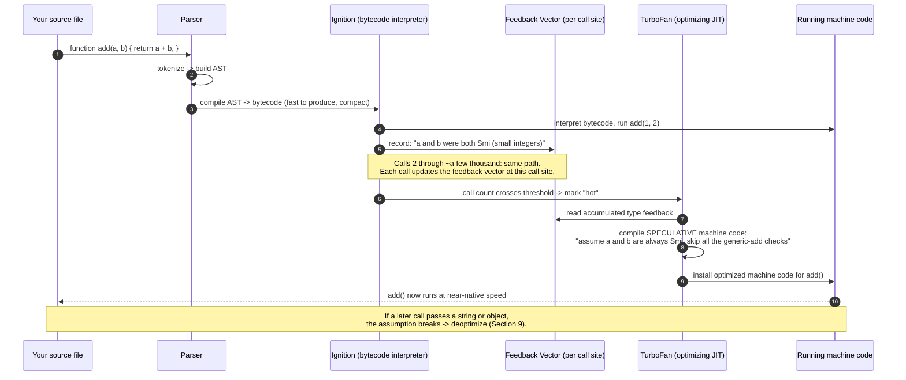
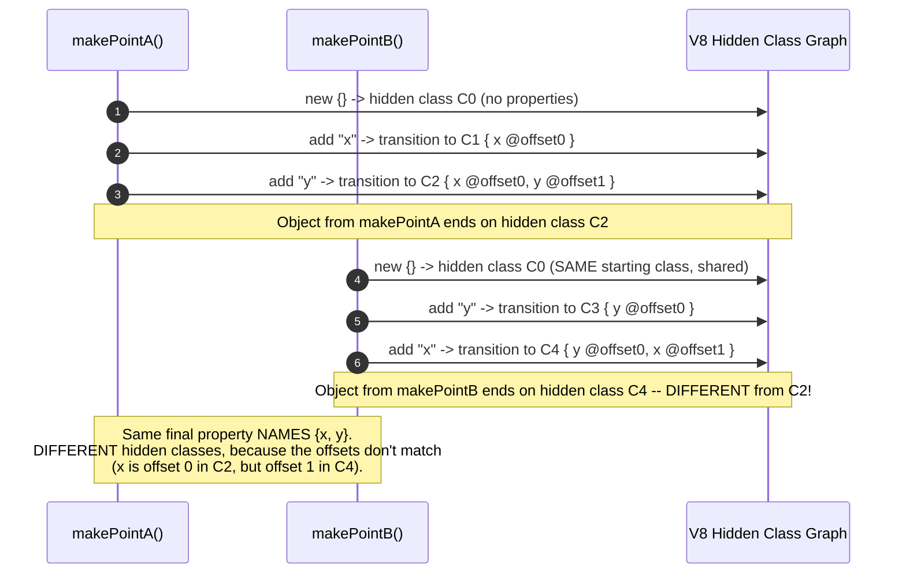
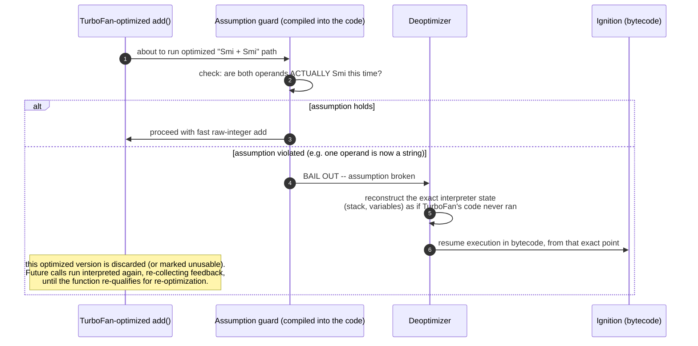
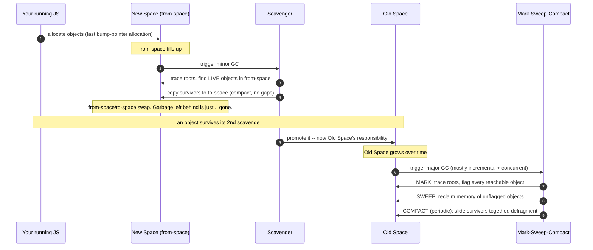

**Navigation**: [< Previous](11_Advanced_Web_APIs.md) | [Back to Index](../00_MASTER_INDEX.md) | [Next >](13_NodeJS_Architecture.md)

# ⚙️ Chapter 12 — V8 Engine Internals: How JavaScript Actually Runs

**"`for...in` is 'slow' and arrays with mixed types are 'slow' — every JS developer has heard this. Almost none can say WHY. The answer isn't folklore, it's four concrete mechanisms inside V8: hidden classes, inline caches, elements kinds, and a two-tier compiler pipeline. Once you see the mechanism, the 'gotchas' stop being rules to memorize and become predictions you can derive."**

---

## Table of Contents

1. [What V8 Actually Owns](#1-what-v8-actually-owns)
2. [From Source Text to Running Code — The Pipeline](#2-from-source-text-to-running-code--the-pipeline)
   - 2a. ["Cold," "Warm," and "Hot" Code — the Vocabulary This Pipeline Is Named Around](#2a-cold-warm-and-hot-code--the-vocabulary-this-whole-pipeline-is-named-around)
3. [Parsing — Why V8 Reads Your Code Twice](#3-parsing--why-v8-reads-your-code-twice)
   - 3a. [The Step Most Explanations Skip — Tokens, Then the AST, Worked in Full](#3a-the-step-most-explanations-skip-what-tokenize-then-build-an-ast-actually-looks-like)
4. [Ignition — The Bytecode Interpreter](#4-ignition--the-bytecode-interpreter)
5. [Hidden Classes — The Mechanism Behind "Consistent Object Shapes Are Fast"](#5-hidden-classes--the-mechanism-behind-consistent-object-shapes-are-fast)
6. [Inline Caches — Why the Same Line of Code Gets Faster](#6-inline-caches--why-the-same-line-of-code-gets-faster)
7. [Elements Kinds — Why Arrays Are Not Just Arrays](#7-elements-kinds--why-arrays-are-not-just-arrays)
8. [TurboFan — The Optimizing Compiler](#8-turbofan--the-optimizing-compiler)
9. [Deoptimization — When V8's Bet Doesn't Pay Off](#9-deoptimization--when-v8s-bet-doesnt-pay-off)
10. [The Memory Heap — Generations, Not One Big Pile](#10-the-memory-heap--generations-not-one-big-pile)
11. [Garbage Collection — Scavenge and Mark-Sweep-Compact](#11-garbage-collection--scavenge-and-mark-sweep-compact)
12. [Closures in V8 Terms — What a Closure Actually Pins in Memory](#12-closures-in-v8-terms--what-a-closure-actually-pins-in-memory)
13. [Reading It Yourself — DevTools and `--trace` Flags](#13-reading-it-yourself--devtools-and---trace-flags)
    - 13a. [Watching Cold → Warm → Hot Happen, With `--trace-opt`](#13a-watching-cold--warm--hot-happen-with---trace-opt)

---

## 1. What V8 Actually Owns

Chapter 4 covered the event loop — the mechanism that decides **when** a piece of JS gets to run. This chapter covers something different: what happens **inside** the box labeled "run this function" once the event loop hands it control.

> **The division of labor, precisely.** "The JavaScript engine" is a specific piece of software — V8, in Chrome and Node.js (SpiderMonkey in Firefox, JavaScriptCore in Safari play the equivalent role). V8's job is narrow and total: turn JS source text into running machine instructions, execute them, and manage the memory those instructions allocate. It does **not** know what `setTimeout` is, does not talk to the network, does not touch the DOM. Those are the *runtime's* job — the browser's Web APIs or Node's C++/libuv layer, sitting outside V8 and calling into it only to run callbacks.
>
> **Why draw this line at all.** Because every "JS is slow" or "JS is fast" claim you've heard is really a claim about ONE of these two systems, and they fail for completely different reasons. A `fetch` that hangs is a network/runtime problem — V8 is idle, waiting. A `for` loop over a million elements that pins the tab is a V8 problem — the runtime isn't involved at all. Diagnosing performance requires knowing which system you're even looking at, and this chapter is entirely about the second one: what V8 does with the synchronous code it's handed.

---

## 2. From Source Text to Running Code — The Pipeline

Here is the concrete path one function takes from the moment you write it to the moment it's fast:



**How to read this diagram.** The lifelines trace one function, `add`, from source to fast code: the parser tokenizes and builds an AST, Ignition compiles it to bytecode and runs it while recording type feedback, and once the call count crosses the threshold TurboFan reads that feedback and installs speculative optimized machine code. The thing to notice is the final note: if a later call breaks the type assumption, the code deoptimizes (Section 9).

**The two names to hold onto:** **Ignition** is the bytecode interpreter — it runs first, runs everything, and is designed to start fast and collect information. **TurboFan** is the optimizing compiler — it runs later, only for code that's actually hot, and produces genuinely fast machine code by betting on the patterns Ignition observed. (Since 2021, V8 also has **Sparkplug**, a very fast non-optimizing baseline compiler that sits between Ignition and TurboFan, and **Maglev**, a mid-tier optimizing compiler added in 2024 — both exist purely to shrink the gap before TurboFan kicks in. The three-name mental model of *interpret → observe → optimize* still holds; V8 just added faster rungs on that same ladder.)

This whole pipeline exists because of one tension: **compiling straight to optimized machine code is slow to produce but fast to run; interpreting bytecode is fast to produce but slow to run.** A web page loads hundreds of functions that run once and never again (event handler setup, one-time init). Fully optimizing all of them would waste time compiling code that never benefits. Only functions that actually run *many times* (loops, hot call sites) earn the cost of full optimization. The two-tier pipeline is V8 paying the optimization cost only where it pays off.

### 2a. "Cold," "Warm," and "Hot" Code — the Vocabulary This Whole Pipeline Is Named Around

The words "hot" and "cold" just appeared above without being formally defined, and they're used constantly in any real discussion of JIT engines — worth pausing on before going further, because they're not vague marketing language, they're a precise **temperature classification of a specific function, based on how many times it has actually been called (or how many times a specific loop inside it has actually iterated) so far in the current program's run.** The temperature is not a property of the source code sitting in your file — the exact same function is "cold" the moment the process starts and can become "hot" ninety seconds later, purely as a consequence of how often it happened to be called in between. Three tiers, each mapped onto a real, specific V8 component you've already met above:

- **Cold code** — a function that has been called few enough times (in the simplest mental model: once, or a handful of times) that V8 has no reason to believe it's worth spending any compilation effort on beyond the cheapest possible option. Cold code runs on **Ignition**, interpreted from bytecode, with the full per-instruction overhead Section 4 will describe (no shortcuts, no speculation, just faithfully executing whatever the bytecode says, one instruction at a time). Every function in your program is cold the very first time it runs — there is no way to skip this tier, because V8 has no data yet about how the function behaves.
- **Warm code** — a function whose call count has crossed a first threshold, signaling it's probably worth a *little* extra compilation investment, but not yet proven hot enough to justify TurboFan's expensive, full speculative-optimization treatment. This is specifically what **Sparkplug** (mentioned above) exists for: a genuinely fast, non-optimizing compiler that turns Ignition's bytecode into straightforward machine code with almost no analysis — no type speculation, no inlining, none of TurboFan's expensive reasoning — just a mechanical, instruction-by-instruction translation from bytecode to machine code, fast enough to compile that V8 can afford to do it eagerly for a much larger set of functions than it could ever afford to run through TurboFan.
- **Hot code** — a function whose call count (or whose loop-iteration count, for a long-running loop inside an otherwise rarely-called function) has crossed a second, much higher threshold, marking it as worth TurboFan's genuinely expensive, full speculative-optimization treatment — everything Section 8 describes: reading the accumulated type feedback, betting on the patterns observed so far, compiling machine code that hard-codes those assumptions and skips every check that would otherwise be needed to handle cases that, statistically, aren't happening for this particular function.

> **Why three tiers instead of the two this chapter mostly talks about.** The two-tier mental model (Ignition interprets, TurboFan optimizes) is the right *conceptual* story — it's what makes the tension in the paragraph above ("compiling straight to optimized code is slow to produce, interpreting is slow to run") make sense, and it's accurate for how V8 worked for most of its history. But it leaves a real gap: a function that's genuinely called often — say, a few hundred times a second — is running interpreted (slow per-call) for potentially a long stretch of real wall-clock time before it accumulates enough calls to justify TurboFan's expensive analysis. Sparkplug's whole reason for existing is to shrink exactly that gap: give "warm" functions a cheap, fast, no-analysis compile almost immediately, so they're running as (unoptimized, but real) machine code well before they'd have qualified for TurboFan, rather than staying stuck on Ignition's slower interpreted execution the entire time they're warming up.

---

## 3. Parsing — Why V8 Reads Your Code Twice

> **What parsing does.** Source text is a flat string. Before anything can run, V8 must turn it into an **Abstract Syntax Tree (AST)** — a tree of nodes like `BinaryExpression(+, Identifier(a), Identifier(b))` that captures the code's structure, not its characters.
>
> **The twist: V8 usually does this in two passes, on purpose.** When V8 first encounters a `function`, it doesn't fully parse the body. It runs a cheap **pre-parse**: just enough to find the function's boundaries (where it starts and ends) and check for syntax errors, without building a full AST for the inside. The full parse only happens the first time the function is actually **called**.
>
> **Why.** A typical page defines far more functions than it calls on that page load — utility functions used only on other routes, event handlers for features the user never touches, library code for edge cases. Fully parsing all of it up front burns CPU time and memory building ASTs nobody will use. Pre-parsing lets V8 skip that work for the majority of functions, and pay the full parse cost lazily, exactly once, only for functions that actually execute.

```javascript
function neverCalled() {
  // V8 pre-parses this: confirms it's syntactically valid,
  // records where it starts/ends, builds NO full AST for the body.
  const x = someExpensiveLookingButUnusedComputation();
  return x * 2;
}

function add(a, b) {
  return a + b;
}

console.log(add(1, 2)); // <- THIS call triggers the full parse of add(),
                         //    not neverCalled(). neverCalled() stays pre-parsed
                         //    for the entire session if it's genuinely never invoked.
```

**The practical consequence — the IIFE-wrapping advice you've seen in old style guides.** Wrapping code in `(function() { ... })()` used to be recommended partly because eagerly-invoked functions get parsed immediately (no benefit there), while *unwrapped top-level code outside any function* has always been eagerly, fully parsed — there's no "call" event to defer to. The pre-parse optimization is specifically about function bodies that might never run. It has nothing to do with variable scoping (that's a separate, still-valid reason to use module scope or an IIFE) — but the performance folklore around it usually conflates the two.

### 3a. The Step Most Explanations Skip: What "Tokenize, Then Build an AST" Actually Looks Like

Section 3's definition said parsing turns source text into an AST "through tokenization." That single word is doing a lot of quiet work — it names an entire intermediate stage that most explanations of parsing skip straight past, jumping from "here's your source code" directly to "here's your AST" as if that were one step. It is not one step. It is at least two, each producing its own distinct, inspectable data structure, and seeing both of those structures — not just being told they exist — is what makes "parsing" stop being a black box.

**Stage one: the raw source string.** Before anything else, this is all V8 has — a flat sequence of characters, with no concept yet of "this is a keyword" or "this is a variable name." For a tiny function:

```javascript
function add(a, b) {
  return a + b;
}
```

To the very first stage of the parser, this is not yet "a function." It is exactly this, and nothing more: the 39 characters `f`, `u`, `n`, `c`, `t`, `i`, `o`, `n`, ` `, `a`, `d`, `d`, `(`, `a`, `,`, ` `, `b`, `)`, ` `, `{`, and so on, one after another, with no grouping, no meaning, no structure — a string, indistinguishable in kind from a text file that happens to contain no valid JavaScript at all. Nothing about "characters" alone tells you where one meaningful unit ends and the next begins; `function` and `add` are separated by a space in this example, but JavaScript's grammar does not actually require whitespace everywhere (`a+b` is exactly as valid as `a + b`), so even "split on spaces" is not a real strategy. Something has to walk this character stream and decide, character by character, where the meaningful boundaries fall.

**Stage two: the lexer (or "scanner") turns characters into tokens.** This is the piece that actually does that boundary-finding — a component inside V8's parser called the **lexer**, whose only job is to consume the raw character stream and group it into **tokens**: the smallest units that have independent meaning in JavaScript's grammar. A token is not a character — it's a small, classified chunk, tagged with a type (`Keyword`, `Identifier`, `Punctuator`, `NumericLiteral`, and so on) and, usually, the exact text it matched. Running the lexer over the `add` function above produces this token stream — this is a genuinely real intermediate artifact, not a simplification, and it is the actual input the next stage receives:

```
Keyword      "function"
Identifier   "add"
Punctuator   "("
Identifier   "a"
Punctuator   ","
Identifier   "b"
Punctuator   ")"
Punctuator   "{"
Keyword      "return"
Identifier   "a"
Punctuator   "+"
Identifier   "b"
Punctuator   ";"
Punctuator   "}"
```

Notice precisely what this stream does and does not contain. It has *flattened away whitespace entirely* — there is no token for the space between `function` and `add`, because whitespace carries no grammatical meaning in this context and the lexer's whole job is to discard exactly the parts of the source that don't matter, keeping only the parts that do. It has also *classified* each chunk — the lexer already knows `return` is a `Keyword` and `add` is an `Identifier`, a decision it makes by comparing each matched chunk of characters against JavaScript's fixed list of reserved keywords. But — and this is the crucial limitation of this stage, the exact reason a further step is still needed — the token stream is still **flat**. It is a *list*, one token after another, with no nesting, no grouping, no representation of the fact that `a`, `+`, and `b` together form one arithmetic expression, or that `return a + b;` together forms one statement, or that the whole thing lives inside the body of `add`. A flat list of tokens cannot, by itself, answer "what is the second argument's name?" or "what expression does this function return?" — those are structural questions, and a flat list has no structure to query.

**Stage three: the parser proper turns the flat token stream into a nested AST.** This is the step that actually builds structure, by walking the token stream left to right while applying JavaScript's grammar rules — rules like "a `function` keyword is followed by an optional identifier, then a parenthesized, comma-separated parameter list, then a brace-delimited block of statements" — and, every time a rule matches, creating a **node** in a tree to represent it, with that node's children being whatever sub-structures the rule says belong inside it. For the exact same `add` function, here is the AST this stage produces — shown as the same kind of plain, inspectable JSON-like structure that real tools (Babel, ESLint, the `acorn` parser V8's own approach is conceptually descended from) actually produce and that you can generate yourself by pasting this function into any online "AST explorer":

```
FunctionDeclaration
├── id: Identifier "add"
├── params:
│     ├── Identifier "a"
│     └── Identifier "b"
└── body: BlockStatement
      └── ReturnStatement
            └── argument: BinaryExpression "+"
                  ├── left: Identifier "a"
                  └── right: Identifier "b"
```

Now the structural questions from the previous paragraph have real answers, reachable by walking the tree: "what is the second parameter's name?" is `params[1].name`, literally a tree traversal. "What expression does this function return?" is `body.argument`, again a direct path down the tree. This is the entire point of building a nested tree instead of stopping at the flat token list — a tree is a data structure that *represents relationships* (this token is *inside* this statement, this expression is *the argument to* this return), which a flat list of tokens fundamentally cannot do no matter how you tag the individual tokens.

**Why this two-stage split (lexer, then parser) exists at all, instead of one stage doing everything at once.** It's a genuine, deliberate engineering decision, not an accident of implementation history: separating "what are the meaningful chunks" (lexing) from "how do those chunks nest into structure" (parsing) means each stage can be simple and fast at the one job it does. The lexer never has to think about grammar nesting — it just needs to recognize "this sequence of characters is a valid identifier" or "this is the `+` operator," independent of where that token ends up in the tree. The parser never has to think about individual characters or whitespace — it operates purely on the already-classified token stream, reasoning only about grammar rules. Collapsing both into one combined pass is possible (some hand-written toy parsers do exactly that) but produces code that has to simultaneously track character-level state (am I inside a string literal? a comment? does this dash belong to a number or an operator?) *and* grammar-level state (am I inside a function body? an argument list?) at every single step — a combinatorial mess that the two-stage split avoids by strictly separating those two concerns into two passes, each of which only has to hold one kind of state in its head at a time.

**Connecting this back to pre-parsing, precisely.** Section 3 described V8's pre-parse step as "just enough to find the function's boundaries and check for syntax errors, without building a full AST for the inside." Now that both intermediate stages are visible, that description can be made exact: pre-parsing still runs the **lexer** over the function's entire body (it has to — finding the matching closing `}` requires tokenizing far enough to count brace-nesting depth correctly, since a `}` inside a string literal or a nested object doesn't count, and only a real token-aware scan can tell the difference). What pre-parsing *skips* is stage three — it does NOT run the full grammar-rule-matching pass that would produce `ReturnStatement` and `BinaryExpression` nodes for the body. It tokenizes, notices where the matching `}` falls, records "a function named `add` lives between these two source positions, taking these two parameter names," and discards the token stream without ever building the nested tree. The full AST — the actual `FunctionDeclaration`/`BlockStatement`/`ReturnStatement`/`BinaryExpression` structure shown above — gets built for the first time on the *second* pass, the one triggered specifically by the function actually being called.

---

## 4. Ignition — The Bytecode Interpreter

Once a function is fully parsed into an AST (both stages from Section 3a complete — tokens grouped into a nested tree), Ignition compiles that AST into **bytecode** — not machine code, an intermediate instruction set specific to V8, interpreted rather than run directly by the CPU. This is a *third* distinct representation of the same function, on top of the two from Section 3a (token stream, then AST) — and, exactly as with those two, it's worth seeing what it actually looks like rather than only being told it exists.

> **Why bytecode and not machine code, immediately.** Machine code is fast to run but large and slow to generate well (a good compiler does register allocation, instruction scheduling, dead-code elimination — all expensive analysis). Generating *naive* machine code is possible but produces code barely faster than a good interpreter, for a much higher generation cost and a much larger memory footprint (machine code is bulkier per operation than compact bytecode). For code that runs once, that trade is a pure loss. Ignition's bytecode is deliberately compact — small enough that a memory-constrained mobile device can hold bytecode for far more of the page's code than it could hold optimized machine code for the same code.

**What bytecode is: a small, fixed set of simple instructions operating on registers and an accumulator.** Where the AST represents `a + b` as a *tree node* (a `BinaryExpression` with two children), bytecode represents the same computation as a short, linear *sequence of instructions* — the same shift from "nested structure" to "flat sequence" that happened once already (tokens were flat, the AST made them nested; now bytecode flattens the AST back into a sequence, but a sequence of much richer, execution-ready instructions rather than raw tokens). Compiling the `add` function's AST from Section 3a into Ignition bytecode produces something in the following shape (V8's exact instruction mnemonics shift slightly between versions — you can see the precise, current output for any function yourself by running `node --print-bytecode --print-bytecode-filter=add your-script.js`, which is worth actually doing once, so this stops being something you were told and becomes something you watched happen):

```
StackCheck                  ; verify there's enough stack space to proceed
Ldar  a1                    ; LOAD the second argument (b) into the accumulator
Add   a0                    ; ADD the first argument (a) to the accumulator's
                             ; current value (b) — accumulator now holds a + b
Return                       ; return whatever's currently in the accumulator
```

Two things about this shape are worth sitting with, because they explain *why* this representation is what Ignition actually runs. First, notice there is exactly one implicit "working slot" — the **accumulator** — that most instructions read from and write to, rather than every instruction naming two full operands the way `a + b` does in source. This is a deliberate register-machine design: keeping most instructions accumulator-centric (read the accumulator, combine with one named value, leave the result in the accumulator) makes each individual bytecode instruction shorter to encode — fewer bytes per instruction directly serves the "keep this compact" goal from the paragraph above. Second, notice this is *already* the representation Section 5 and Section 6's mechanisms (hidden classes, inline caches) attach themselves to: an `Add` instruction, a property-read instruction like `LdaNamedProperty` — these are the actual, specific bytecode instructions whose executions get recorded into feedback vectors, not an abstract "the interpreter runs your code" gesture. When Section 4's next paragraph says "every time a bytecode instruction touches a value... Ignition records what it saw," this `Add` instruction, right here, executing with `a0` and the accumulator both holding small integers, is a concrete instance of exactly that recording happening.

> **What Ignition does while it interprets, that a naive interpreter wouldn't.** Every time a bytecode instruction touches a value — a property read, an arithmetic op, a function call — Ignition records what it saw into a **feedback vector** attached to that specific call site: "this `+` operation's operands were both small integers," "this `.name` access was on an object shaped like `Map47`." This is pure bookkeeping laid on top of interpretation — cheap to collect because Ignition is already looking at the value to execute the operation anyway. That feedback is the entire input TurboFan will later use to decide what to assume.

This is the mechanism that makes the next four sections possible: **hidden classes** and **elements kinds** are what Ignition's feedback vectors actually record; **inline caches** are how that recorded feedback speeds up Ignition's *own* interpretation, before TurboFan is even involved.

---

## 5. Hidden Classes — The Mechanism Behind "Consistent Object Shapes Are Fast"

JavaScript objects are dynamic — you can add or delete properties at any time. But looking up a property by name (`obj.name`) on every single access, the way you'd look up a key in a hash map, is far slower than languages like Java or C++ where a class's fields are fixed and each field lives at a known, fixed offset in memory. V8 wants that fixed-offset speed for JS objects too, without giving up JS's dynamism. **Hidden classes** (V8 calls them **Maps** internally — unrelated to the JS `Map` data structure, and often called **Shapes** in other engines) are how.

> **The mechanism.** Every object V8 creates has a hidden class describing its current shape: which property names it has, and at what offset each one lives. When you create an object and then add a property to it, V8 doesn't mutate that hidden class — it creates a **new** hidden class representing the new shape, and links the old one to the new one via a **transition**. Objects that go through the same sequence of property additions end up sharing the same chain of hidden classes and land on the identical final hidden class — which is exactly what lets V8 treat "this specific offset holds the `name` property" as a compile-time fact instead of a runtime lookup.

Trace what actually happens for two objects built with the **same properties added in a different order**:

```javascript
function makePointA(x, y) {
  const p = {};
  p.x = x; // transition: {} -> {x}
  p.y = y; // transition: {x} -> {x, y}
  return p;
}

function makePointB(x, y) {
  const p = {};
  p.y = y; // transition: {} -> {y}
  p.x = x; // transition: {y} -> {y, x}
  return p;
}
```



**How to read this diagram.** Both functions assign the same two properties, but the diagram shows each one walking the hidden-class graph from the same starting class `C0`: `makePointA` goes C0, C1 (x), C2 (x, y), while `makePointB` goes C0, C3 (y), C4 (y, x). The thing to notice is that the final objects have the same property names yet end on different hidden classes (C2 vs C4), because the order of insertion changes the offsets.

**Why this matters in practice.** Any code that reads `.x` from a mix of `makePointA()` and `makePointB()` results is reading from objects with two *different* hidden classes, even though every object "has an x and a y." That call site cannot assume a single fixed offset for `.x` — it has to check which shape it's looking at every time. This is the entire reason for the classic advice "always initialize an object's properties in the same order, ideally in a constructor" — it's not a style preference, it's the only way to guarantee every instance shares one hidden class.

```javascript
// ✅ Guarantees identical hidden classes for every instance —
// properties assigned in the same order, every time, from one place.
class Point {
  constructor(x, y) {
    this.x = x;
    this.y = y;
  }
}
```

---

## 6. Inline Caches — Why the Same Line of Code Gets Faster

Hidden classes give V8 a fixed offset per shape. **Inline Caches (ICs)** are how a specific *call site* in your code remembers that offset so it can skip the lookup on repeat visits.

> **The mechanism, traced.** Every property-access instruction in the bytecode (`obj.x`) has its own IC slot. The first time that instruction runs, V8 does the full lookup — walk the hidden class, find `x` at offset 0 — and then **caches** the result at that instruction: "if you see hidden class C2 again, `x` is at offset 0, no lookup needed." The next time that exact bytecode instruction runs, it checks: is the incoming object's hidden class still C2? If yes, jump straight to offset 0 — no property search, just a pointer offset read. That's a **monomorphic** IC — one shape seen, one shape remembered, fastest possible path.
>
> **What happens when a second shape shows up at the same call site.** The IC doesn't just overwrite its cache — it upgrades to **polymorphic**: it now stores a small list of (hidden class → offset) pairs (V8 handles up to 4 by default) and checks each on lookup. Still fast — a handful of pointer comparisons — just not as fast as monomorphic's single check.
>
> **What happens past 4 shapes.** The IC gives up trying to cache specific shapes and goes **megamorphic**: it falls back to a global, shared, general-purpose lookup (a dictionary keyed by property name), the same kind of lookup every JS engine without hidden classes would do for every access. This is the slow path — and it's "slow" only relative to monomorphic, not slow in any absolute sense; it's what you'd get by default in a simpler engine.

```javascript
function getX(obj) {
  return obj.x; // ONE call site, in ONE function.
}

// Call this 10,000 times with the SAME shape:
for (let i = 0; i < 10000; i++) getX({ x: i, y: 0 }); // monomorphic IC — fastest

// Call this with 5+ DIFFERENT shapes:
getX({ x: 1, y: 2 });               // shape A
getX({ x: 1, y: 2, z: 3 });         // shape B
getX({ x: 1, name: "p" });          // shape C
getX({ x: 1, active: true });       // shape D
getX({ x: 1, tag: "x" });           // shape E -- 5th distinct shape
// The getX call site's IC has now gone megamorphic.
// EVERY future call through this function, even with a shape it's
// already seen, pays the generic-lookup cost from here on.
```

**Why "polymorphic functions are slower" is really an IC story, not a "V8 hates flexibility" story.** A function isn't inherently penalized for accepting varied inputs — the penalty is specifically that its property-access call sites can no longer commit to one offset. Code that processes a genuinely heterogeneous collection (a mixed-shape array from an API response, say) will run those property accesses megamorphic no matter how you write the loop — the fix is normalizing the shapes *before* the hot loop (e.g., mapping every item through one constructor first), not micro-tweaking the loop syntax.

---

## 7. Elements Kinds — Why Arrays Are Not Just Arrays

Everything in Sections 5–6 covers **named properties**. Arrays get their own, parallel optimization for **indexed** access (`arr[i]`), called **elements kinds** — and it's one of the highest-leverage, least-known V8 mechanisms for everyday performance.

> **The mechanism.** Internally, an array's elements are stored in one of several backing-store representations, ranked from fastest/most specific to slowest/most general:
>
> 1. **`PACKED_SMI_ELEMENTS`** — every slot filled (no holes), every value a small integer (Smi = "small integer," V8's tagged representation for integers that fit in 31 bits). Stored as a flat, densely packed array of raw integers.
> 2. **`PACKED_DOUBLE_ELEMENTS`** — every slot filled, values are floating-point numbers. Flat array of raw doubles.
> 3. **`PACKED_ELEMENTS`** — every slot filled, but values are a mix of types (strings, objects, mixed numbers) or not statically known to be numeric. Stored as an array of tagged pointers, like a generic object property.
> 4. **`HOLEY_*` variants of the above** — same value-type rules, but the array has *gaps* (created by `delete arr[i]`, `arr.length = n` shrinking, or `new Array(5)` then filling out of order). Every read now needs an extra check: "is this slot actually filled, or do I need to walk the prototype chain for a hole?"
> 5. **`DICTIONARY_ELEMENTS`** — the array has been used so sparsely or irregularly (huge index gaps, non-integer-like keys) that V8 gives up on array-shaped storage entirely and falls back to a hash map, same as a slow generic object.
>
> **The one-way ratchet.** An array can transition from a fast kind to a slower kind, but **never back**. Once an integer array receives one `NaN` or one hole, it's permanently in the slower kind for its lifetime — even if you later "fix" the contents.

```javascript
const arr = [1, 2, 3, 4, 5];
// elements kind: PACKED_SMI_ELEMENTS -- flat, fast, tightly packed integers.

arr.push(6.5);
// elements kind transitions to PACKED_DOUBLE_ELEMENTS.
// Every element -- including the integers -- is now stored as a double.
// This transition is PERMANENT for this array object.

arr[10] = 99;
// index 10 on a length-7 array creates indices 7-9 as HOLES.
// elements kind transitions to HOLEY_DOUBLE_ELEMENTS.
// Every read must now check "is this a hole?" before trusting the value.

arr.push("done");
// a string in a numeric array -- elements kind transitions to
// HOLEY_ELEMENTS: the most general, slowest kind this array can reach.
// There is no path back to PACKED_SMI_ELEMENTS for this array, ever.
```

**Why this is worth knowing, concretely.** A tight numeric loop over a `PACKED_SMI_ELEMENTS` array can be auto-vectorized and iterated almost like a C array — V8 knows every slot is filled and every value is a raw integer, no type checks needed per element. The same loop over a `HOLEY_ELEMENTS` array pays a hole-check and a type-check on every single access. Two loops that look identical in your source can differ by an order of magnitude purely because of how the array was built. This is why `new Array(length)` followed by filling it out of order, or `delete`-ing individual array indices, is specifically called out as an anti-pattern in performance guides — `arr.pop()` / `arr.splice()` from the end, or building with `.push()` in order, keep the array packed.

---

## 8. TurboFan — The Optimizing Compiler

Ignition + hidden classes + ICs already make interpretation fast. TurboFan exists for the next tier: functions called often enough (a call-count threshold, or enough loop iterations) that paying for genuinely optimized machine code is worth it.

> **What TurboFan actually does that Ignition can't.** It reads the accumulated feedback vectors for the function — "this call site's IC has stayed monomorphic on hidden class C2 for its entire life," "this arithmetic op has only ever seen Smis" — and compiles machine code that **hard-codes those assumptions**, skipping every check Ignition had to perform at runtime. If `a + b` has only ever been Smi + Smi, TurboFan emits a raw integer-add instruction with no type checks, no boxing, no dispatch. This is **speculative optimization**: TurboFan is betting the future will look like the past, and it's willing to be wrong — because Section 9 describes the safety net for when it is.

This is why a hot function can visibly "warm up" — its first several thousand calls run through Ignition's interpreted bytecode (correct, but doing full type checks every time), then abruptly speed up once TurboFan's optimized version is installed and takes over silently at the same call site.

---

## 9. Deoptimization — When V8's Bet Doesn't Pay Off

TurboFan's optimized code is only valid **as long as its assumptions hold**. The moment a call violates one — a new hidden class shows up, an operand isn't the type it was compiled for — that optimized code is not "slow," it's **wrong**, and V8 must throw it away immediately.



**How to read this diagram.** Optimized `add()` first runs an assumption guard that checks whether both operands are really small integers. If the guard holds, the fast integer add proceeds; if it fails, the Deoptimizer rebuilds the exact interpreter state and resumes in Ignition bytecode. The thing to notice is the last note: the optimized version is discarded and the function runs interpreted again while it re-collects feedback.

**Why this explains real, observed jank.** A function that runs fast for a while and then suddenly, permanently slows down is very often a deopt: something changed the shape of the values flowing through it (an API response occasionally includes an extra field, a loop occasionally receives `undefined`, a "numbers-only" accumulator gets one string appended). The fix is never "add more code to handle the edge case reactively" — it's making the function's inputs genuinely, structurally consistent so TurboFan's assumptions stay true. This is the same lesson as hidden classes and elements kinds, arriving from a different direction: **consistency is not a style preference in V8's world, it's the literal input to every optimization decision the engine makes.**

---

## 10. The Memory Heap — Generations, Not One Big Pile

Everything above concerns *code*. The rest of this chapter concerns *data* — where the objects those functions create actually live, and how V8 reclaims the ones nobody needs anymore.

> **The core design decision, and the empirical fact behind it.** V8's heap is split into **generations** because of an observed pattern across essentially all programs, called the **generational hypothesis**: *most objects die young*. Loop-local temporaries, one-off intermediate values, short-lived closures — the overwhelming majority of allocations are garbage within microseconds of being created. A small minority survive much longer (a cache, a component's persistent state, a global registry). Treating all objects with one strategy wastes effort scanning long-lived survivors over and over. Splitting the heap by *expected lifetime* lets V8 use a cheap strategy for the common case (short-lived) and a more thorough, less frequent strategy for the rare case (long-lived).

The heap V8 gives your process is divided into (roughly):

| Region | Holds | Collected by | How often |
|---|---|---|---|
| **New Space** (Young Generation) | Freshly allocated objects | Scavenger (Section 11) | Very frequently — it's small and fills fast |
| **Old Space** (Old Generation) | Objects that survived multiple young-gen collections | Mark-Sweep-Compact | Less frequently — mostly incremental/concurrent to avoid pausing |
| **Large Object Space** | Objects too big to fit New Space's allocation scheme (e.g., large arrays/strings) | Marked, never moved/compacted | As needed |
| **Code Space** | Compiled machine code from Ignition/TurboFan | Managed separately from data | N/A |

New Space is deliberately kept **small** (a few MB) — that's not a limitation, it's the design. A small young generation means a scavenge pass finishes fast, because it only has to look at a small region.

---

## 11. Garbage Collection — Scavenge and Mark-Sweep-Compact

> **The reachability model, derived from first principles.** V8 does not use reference counting for its main heap (reference counting can't reclaim cycles — two objects that only reference each other are "referenced" forever even if nothing else in the program can reach them). Instead, V8 uses **tracing**: starting from a known set of **roots** — the call stack's local variables, global object properties, active closures' captured variables — it walks every reachable reference, marking every object it touches. Anything left unmarked at the end is provably unreachable from any root, and is garbage, cycles included, because an isolated cycle simply never gets touched by the walk from the roots.

**New Space collection — the Scavenger (a copying/semi-space collector).** New Space is split into two equal halves, **from-space** and **to-space**. All allocation happens in from-space. When from-space fills up, the Scavenger walks the roots, finds every *live* object currently in from-space, and **copies** just those survivors into to-space — tightly packed, no gaps. Everything left behind in from-space (the vast majority, per the generational hypothesis) is simply abandoned, and the two spaces swap roles for the next cycle. This is fast specifically **because** so few objects survive: copying is proportional to *live* data, not to *total* data, so a young generation with 95% garbage does roughly 5% of the copying work a naive "scan everything" collector would.

An object that survives **two** scavenges is judged long-lived and gets **promoted** to Old Space — it stops being scavenged and becomes Old Space's problem from then on.

**Old Space collection — Mark-Sweep-Compact.** Old Space can't use the copying trick cheaply (too much live data to copy every cycle). Instead: **Mark** — trace from roots, flag every reachable object. **Sweep** — walk the heap linearly, reclaim every unflagged (unreachable) object's memory back into a free list. **Compact** (periodically, not every cycle) — slide surviving objects together to eliminate fragmentation, so large contiguous allocations stay possible. Because Old Space can be large, doing all of this on the main thread in one pause would visibly freeze the page — so V8's Orinoco project made most of this **incremental** (small slices interleaved with your JS) and **concurrent** (running on background threads while your JS keeps executing), specifically to avoid the multi-hundred-millisecond pauses that gave GC its "stop-the-world" reputation.



**How to read this diagram.** Top to bottom: new objects are allocated in New Space, which triggers a minor GC when the from-space fills; the Scavenger copies live objects to the to-space and the two swap. An object that survives its second scavenge is promoted to Old Space, and when Old Space grows, the Mark-Sweep-Compact collector marks reachable objects, sweeps the rest and periodically compacts. The thing to notice is that the two collectors work on different spaces with different strategies.

---

## 12. Closures in V8 Terms — What a Closure Actually Pins in Memory

Chapter 2 derived closures at the language-spec level: a function captures a reference to its enclosing *environment*, not a snapshot of individual variable values. This section is the same fact, restated as a memory-management consequence.

> **The mechanism.** When V8 creates a closure, it doesn't hand it copies of the variables it uses — it gives it a pointer to a **Context** object (V8's runtime representation of a lexical environment) holding *all* the variables declared in that scope, not just the ones the closure happens to reference. As long as ANY closure created from that scope is reachable, the entire Context — every variable in it — is reachable too, and the GC's tracing walk will not reclaim it.

```javascript
function outer() {
  const hugeBuffer = new Array(1_000_000).fill("x"); // large, allocated once
  const label = "small";

  function inner() {
    console.log(label); // only reads `label` -- never touches hugeBuffer
  }

  return inner;
}

const leaky = outer();
// outer()'s execution finished long ago. But `leaky` (== inner) holds a
// pointer to outer()'s Context object. `hugeBuffer` lives in that SAME
// Context, even though inner() never reads it. As long as `leaky` is
// reachable, hugeBuffer is reachable too -- it cannot be collected.
```

Whether V8's optimizer can, in some cases, prove a specific slot is truly dead and elide it from the Context is an internal detail that changes between V8 versions and should never be relied on. The safe mental model, correct at the language-spec level regardless of any specific engine's cleverness: **a closure keeps its entire enclosing scope reachable, not just the variables it names.** The fix, when this matters, is structural — narrow the scope the closure is created in, or explicitly null out large values you're done with before the closure that outlives them is created.

---

## 13. Reading It Yourself — DevTools and `--trace` Flags

Everything above is directly observable, not just theoretical:

- **Chrome DevTools → Memory tab → Heap Snapshot** shows live objects grouped by constructor/hidden class, and lets you inspect what's keeping a suspected leak reachable (the "Retainers" panel walks the reference chain back to a GC root — the exact mechanism from Section 11).
- **Chrome DevTools → Performance tab → record → look for "Minor GC" / "Major GC" entries** on the main thread track — these are Scavenger and Mark-Sweep-Compact passes happening live, with their actual pause durations.
- **`node --trace-deopt your-script.js`** prints every deoptimization V8 performs, with the reason (e.g., `wrong map`, meaning a hidden-class mismatch — exactly Section 9's mechanism) and the function/line it happened at.
- **`node --trace-ic your-script.js`** prints inline cache state transitions (`Monomorphic` → `Polymorphic` → `Megamorphic`) as they happen, letting you find the exact call site where a hot function's property access degraded.
- **`%GetOptimizationStatus`, `%HasFastProperties`** and other V8-only intrinsics (usable with `node --allow-natives-syntax`) let you query a specific object's or function's optimization state directly from your own code — useful for building minimal, isolated repros of the mechanisms in this chapter rather than trusting folklore.

### 13a. Watching Cold → Warm → Hot Happen, With `--trace-opt`

Section 2a defined the three temperatures. This is how to actually
**watch** a function cross those thresholds, on your own machine,
instead of taking the definitions on faith.

> **The flag: `--trace-opt`.** This prints one line every time
> TurboFan (or Maglev, on newer V8) decides a function has earned
> optimized compilation — the exact moment "warm/hot" stops being an
> abstract label and becomes an event you can see. Pair it with
> `--trace-deopt` (already listed above) to see the matching event
> when an optimized function gets thrown back to Ignition.

**Step 1 — write a function that gets called enough times to actually
qualify, and run it with the flag:**

```javascript
// hot-test.js
function add(a, b) {
  return a + b;
}

for (let i = 0; i < 1_000_000; i++) {
  add(i, i + 1);
}
```

```bash
node --trace-opt --trace-deopt hot-test.js
```

You'll see output naming `add` once it's marked and compiled — that
line is TurboFan's decision, timestamped, for a function that started
this run **cold**, spent its early calls **interpreted by Ignition**
(Section 4), and crossed into what Section 2a called **hot** once its
call count justified the compile.

**Step 2 — force a deopt on purpose, and watch `--trace-deopt` catch
it, closing the loop with Section 9:**

```javascript
// deopt-test.js
function add(a, b) {
  return a + b;
}

for (let i = 0; i < 1_000_000; i++) {
  add(i, i + 1); // every call so far: Smi + Smi
}

add("surprise", "!"); // one call with strings — breaks the assumption
```

Run this with the same two flags. You'll see the `--trace-opt` line
for `add` becoming optimized partway through the numeric loop, and
then — immediately after the `add("surprise", "!")` call — a
`--trace-deopt` line naming `add` and a reason (V8 reports something
to the effect of a type/map mismatch — Section 9's "the guard failed"
event, happening in front of you instead of described in prose).

**Step 3 — query a function's status directly from inside your own
script, using `%GetOptimizationStatus`.** This needs
`--allow-natives-syntax`, since `%`-prefixed calls are V8-internal
intrinsics not meant for normal code:

```javascript
// status-test.js
function add(a, b) {
  return a + b;
}

for (let i = 0; i < 1_000_000; i++) add(i, i + 1);

// %GetOptimizationStatus returns a bitmask. The exact bit meanings
// have changed across V8 versions, so don't hardcode "what number
// means optimized" from a blog post -- print the raw value and cross
// check it against your installed V8's own source
// (v8/test/mjsunit/mjsunit.js defines the current constants) rather
// than trusting a number that may already be stale for your version.
console.log(%GetOptimizationStatus(add));
```

```bash
node --allow-natives-syntax status-test.js
```

**Why building the habit of checking, rather than assuming, matters.**
Every claim in Sections 2a, 4, 8, and 9 about "this function is now
hot" or "this call site went megamorphic" is something you can verify
on your own machine with your own code, on your specific V8 version —
which is a stronger foundation for reasoning about a real production
slowdown than remembering a rule from this chapter and hoping it still
applies to whatever engine version is actually running.

---

## 🔬 Section Challenges

> **Challenge 1 (Trace — Hidden Classes).** Two functions build "the same" object:
> ```javascript
> function buildA() { const o = {}; o.id = 1; o.name = "a"; return o; }
> function buildB() { const o = { id: 1 }; o.name = "a"; o.extra = true; delete o.extra; return o; }
> ```
> Do `buildA()` and `buildB()` produce objects with the same hidden class? Walk the transition chain for each.
>
> <details><summary>Answer</summary>
>
> **No.** `buildA` transitions `{} → {id} → {id, name}` — two transitions, ending on a hidden class with exactly `{id, name}`. `buildB` transitions `{} → {id}` (via the object literal) `→ {id, name} → {id, name, extra}` (adding `extra`) `→` **a dictionary-mode or a "back to {id,name}-shaped" object depending on V8 version** when `extra` is deleted — but critically, `delete` does not cleanly reverse a transition the way you might hope; historically it either forces the object into slow/dictionary mode or leaves a distinct hidden class that is NOT guaranteed to be identical to the one `buildA` reached by simply never adding `extra` in the first place. The takeaway generalizes beyond the exact mechanism: `delete` on an object property is one of the more reliable ways to push an object off the fast hidden-class path entirely, and two objects that look identical by `JSON.stringify` can be running through completely different, non-shared hidden-class chains because of how they got there — not just what they end with.
>
> </details>

> **Challenge 2 (Reasoning — Inline Caches).** A function `getTotal(item)` reads `item.price * item.qty` and is called in a tight loop over an array where every item comes from `JSON.parse(apiResponse)`. Why might this call site be megamorphic even though every item "looks the same" (same keys, same types) when you `console.log` a sample?
>
> <details><summary>Answer</summary>
>
> `JSON.parse` builds each resulting object by adding keys in the order they appear in the JSON text. If the API's JSON serializer doesn't guarantee stable key ordering across responses (common with objects built from hash maps/dictionaries server-side, or with optional/nullable fields sometimes omitted and sometimes present-but-null), different parsed objects can pick up their properties in different orders — which, per Section 5, produces **different hidden classes** even when the final key set and value types are identical. `console.log` shows you *values*, not the hidden class the object is actually running on, so "looks the same" is not evidence of "is the same shape" — the fix is to normalize each item into a shape via a single constructor/mapping function immediately after parsing, before it enters any hot loop.
>
> </details>

> **Challenge 3 (Debug — Deoptimization).** A numeric summation function runs fast for the first 100,000 calls in a benchmark, then abruptly gets ~10x slower for the rest of the run, and stays slow. What's the most likely V8-level explanation, and what single change to the benchmark would confirm it?
>
> <details><summary>Answer</summary>
>
> Most likely: TurboFan optimized the function early (it's hot, gets called constantly), specializing on whatever types the first ~100,000 calls actually used (e.g., all Smis). Then a later call passed a value outside that assumption — a float, a string, `NaN`, `undefined` — triggering a deopt (Section 9). The function falls back to interpreted Ignition bytecode and, depending on V8's heuristics, may be **marked as unoptimizable for that call site** if the deopt reason recurs, meaning it never gets re-optimized and stays at interpreter speed for the rest of the run. To confirm: run the exact same benchmark with `node --trace-deopt`, and look for a deopt event logged at approximately the 100,000-call mark, with a reason like `wrong map` or a type-mismatch message naming the function.
>
> </details>

---

## Interview Quick-Fire

```
Q: What's the difference between Ignition and TurboFan?
→ Ignition is the bytecode interpreter — runs everything first, collects
  type feedback. TurboFan is the optimizing JIT — compiles hot functions
  to speculative machine code using that feedback. Ignition is fast to
  start; TurboFan is fast to run, but only for code that earns it.

Q: What is a "hidden class" and why does property insertion order matter?
→ V8's internal representation of an object's shape (property names +
  offsets). Objects built by adding the same properties in the same
  order share a hidden class and get fixed-offset access. Same
  properties in a different order produce a different hidden class —
  even though the object "looks the same."

Q: Monomorphic vs polymorphic vs megamorphic — what do these mean?
→ States of an inline cache at one call site, based on how many distinct
  hidden classes it has seen: 1 = monomorphic (fastest, single cached
  offset), 2-4 = polymorphic (small list of cached shapes), 5+ =
  megamorphic (gives up caching, falls back to generic dictionary lookup).

Q: Why does mixing types in an array hurt performance?
→ Arrays have their own "elements kind" (PACKED_SMI_ELEMENTS,
  PACKED_DOUBLE_ELEMENTS, PACKED_ELEMENTS, HOLEY_* variants,
  DICTIONARY_ELEMENTS) ranked fast-to-slow. Adding a float to an int
  array, or creating a hole, transitions the array to a slower kind
  PERMANENTLY — there's no path back to a faster kind for that array.

Q: What triggers a deoptimization?
→ TurboFan compiles machine code assuming the type patterns it observed
  hold going forward. If a later call violates that assumption (wrong
  type, unexpected hidden class), the compiled guard fails, V8 discards
  the optimized code, reconstructs interpreter state, and resumes in
  Ignition bytecode — a "bailout."

Q: Why does V8 have generational garbage collection?
→ The generational hypothesis: most objects die young. A small,
  frequently-collected New Space (copying Scavenger) handles the common
  case cheaply; a larger, less-frequently-collected Old Space
  (Mark-Sweep-Compact, mostly incremental/concurrent) handles the
  minority of long-lived survivors.

Q: Why can a closure cause a memory leak even if it only uses one small variable?
→ A closure holds a pointer to its entire enclosing Context object, not
  just the variables it references. Every variable declared in that
  scope stays reachable — and un-collectable — as long as any closure
  from that scope is reachable, including large values the closure
  never touches.
```

---

**Next Chapter**: [Node.js Architecture →](13_NodeJS_Architecture.md)

---

## Reality Check

**"V8 just runs your JavaScript"** → V8 runs a PIPELINE, and which stage your code is in determines its speed by an order of magnitude: freshly-called code runs interpreted (Ignition) with full type checks every operation; code that gets hot enough earns speculative machine code (TurboFan) with those checks compiled away entirely; code whose assumptions later break gets kicked back to interpreted (deoptimization) — the same function, same source, running at three different speeds across its own lifetime depending on what V8 has learned and whether that learning still holds.

**"Objects with the same properties are the same shape"** → Same PROPERTY NAMES is not the same hidden class — the mechanism keys on insertion order too, so two objects with identical final property sets built via different construction paths (different literal order, conditionally-added fields, `delete` then re-add) can be running on entirely different hidden classes, silently pushing every call site that handles both into polymorphic or megamorphic mode. This is why "always assign properties in the same order, ideally from one constructor" is engineering advice, not style preference.

**"Arrays are just arrays"** → Arrays have an internal "elements kind" tier (packed-int → packed-double → packed-generic → holey variants → dictionary) that only ever moves toward SLOWER, and moves there PERMANENTLY the moment a float lands in an int array, a hole appears, or a non-numeric value is pushed in. Two visually-identical arrays can iterate at wildly different speeds because of how they were built, not what they currently contain — `new Array(n)` then filling out of order, or `delete arr[i]`, are the two most common accidental triggers.

**"Garbage collection pauses your whole program"** → That was true of naive stop-the-world collectors; V8's actual design specifically engineers around it. New Space collection (Scavenger) is cheap BECAUSE most objects die young — it copies only survivors, proportional to live data not total data. Old Space collection (Mark-Sweep-Compact) is mostly incremental (small slices interleaved with your JS) and concurrent (background threads) specifically so multi-hundred-millisecond freezes stay rare — the generational split exists to make the common case (short-lived garbage) nearly free and confine the expensive case (long-lived data) to infrequent, mostly-hidden work.

**"A closure only keeps alive the variables it uses"** → A closure holds a reference to its entire enclosing Context object — EVERY variable declared in that lexical scope, not a curated subset. A closure that reads one small string from a scope that also declared a million-element array keeps that array reachable for as long as the closure itself is reachable, regardless of whether the closure ever touches it. This is the actual mechanism behind "closures can leak memory" — it's not that closures are leaky by nature, it's that they pin an entire scope, and a scope containing something large is a scope you should keep narrow.
