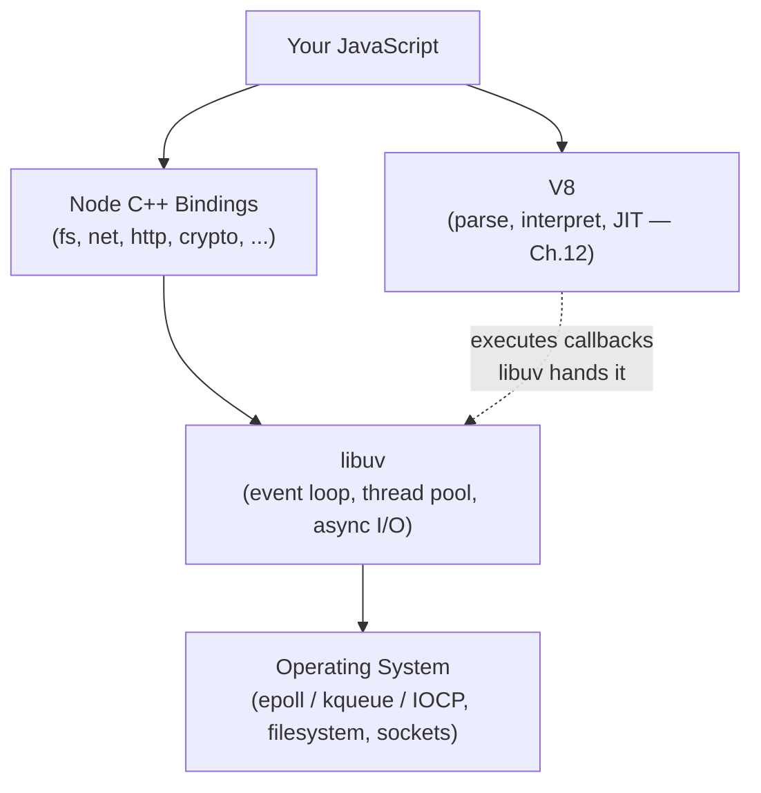
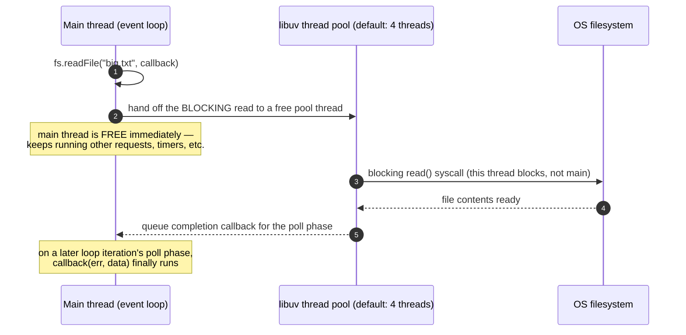
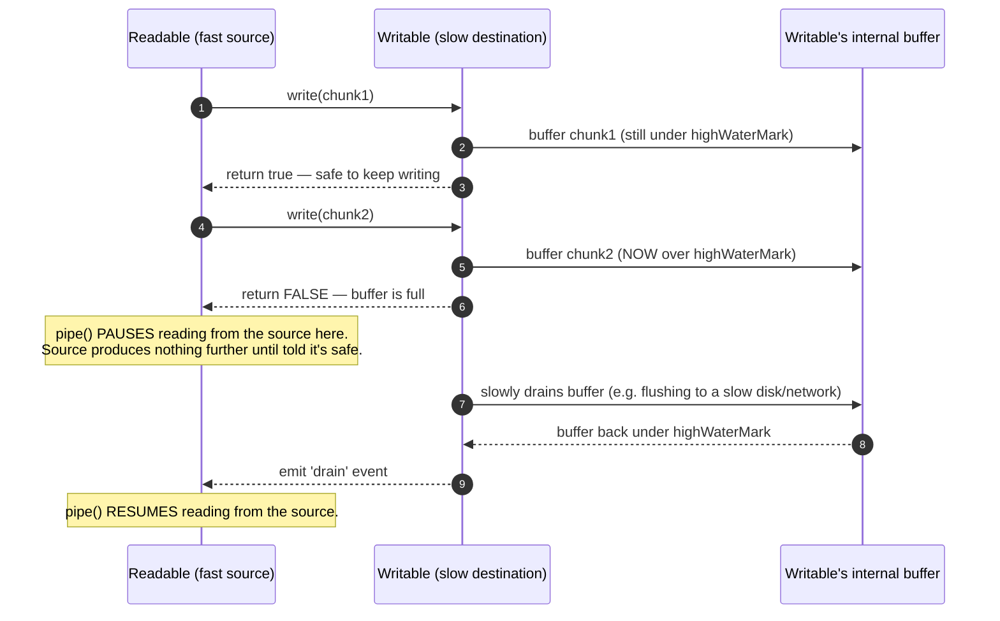

**Navigation**: [< Previous](12_V8_Engine_Internals.md) | [Back to Index](../00_MASTER_INDEX.md) | [Next >](14_Browser_Engines_And_Chromium_Architecture.md)

# 🟢 Chapter 13 — Node.js Architecture: What's Actually Running Your Server

**"Chapter 4 taught the event loop as microtasks-vs-macrotasks — true, but that was the BROWSER's simplified telling. Node's real event loop, built on a C library called libuv, has six named phases with different rules for each. That difference is why `setImmediate` and `setTimeout(fn, 0)` race unpredictably at startup but never inside an I/O callback, why `fs.readFile` doesn't block your server but computing a hash sometimes does, and why your process refuses to exit even after your code 'finished.'"**

---

## Table of Contents

1. [What Node Actually Is](#1-what-node-actually-is)
2. [The libuv Event Loop — Six Phases, Not Two Queues](#2-the-libuv-event-loop--six-phases-not-two-queues)
3. [process.nextTick and Microtasks — Where They Really Run](#3-processnexttick-and-microtasks--where-they-really-run)
4. [The Thread Pool — Why fs Is Async But Doesn't Feel Like It](#4-the-thread-pool--why-fs-is-async-but-doesnt-feel-like-it)
5. [Why the Process Won't Exit — Handles, Refs, and the Loop's Real Stopping Condition](#5-why-the-process-wont-exit--handles-refs-and-the-loops-real-stopping-condition)
6. [The Module System — CommonJS vs ESM](#6-the-module-system--commonjs-vs-esm)
7. [Buffers — Binary Data Outside the V8 Heap](#7-buffers--binary-data-outside-the-v8-heap)
8. [Streams — Processing Data You Can't Fit in Memory](#8-streams--processing-data-you-cant-fit-in-memory)
9. [Backpressure — The Mechanism That Keeps Streams From Blowing Up Memory](#9-backpressure--the-mechanism-that-keeps-streams-from-blowing-up-memory)
10. [Scaling Beyond One Thread — worker_threads, cluster, child_process](#10-scaling-beyond-one-thread--worker_threads-cluster-child_process)

---

## 1. What Node Actually Is

> **The layered picture.** Node.js is three things glued together, and knowing which layer you're in explains most of Node's "surprising" behavior:
>
> 1. **V8** — the same engine from Chapter 12. Parses, interprets, and JIT-compiles your JavaScript. Knows nothing about files, sockets, or timers.
> 2. **libuv** — a C library that provides the event loop, thread pool, and async I/O. This is Node's actual runtime, the same role the browser's Web APIs play for Ch04's event loop — except libuv's rules are different from a browser's, in ways that matter.
> 3. **Node bindings + core JS modules** — a thin C++ layer (and increasingly, a "internal JS" layer) that exposes libuv's capabilities to your JavaScript as the `fs`, `net`, `http`, `crypto` modules you actually call.
>
> **What Node explicitly does NOT have, because there's no browser underneath it:** no `window`, no `document`, no DOM, no `fetch` until it was added as a *Node-specific* implementation years later (not inherited from a browser). Where the browser hands V8 callbacks after network/timer/DOM events, Node hands V8 callbacks after libuv's I/O events — files finishing reads, sockets receiving data, timers elapsing. Same *shape* of relationship (engine executes, runtime schedules), structurally different underlying mechanism.



---

## 2. The libuv Event Loop — Six Phases, Not Two Queues

Chapter 4 taught "macrotask queue vs microtask queue" — accurate for the browser, and accurate enough for Node at a beginner level. The real mechanism inside libuv is more specific: the loop advances through **six named phases**, each with its own callback queue and its own rules, in a fixed order, every single iteration ("tick") of the loop.

```mermaid
sequenceDiagram
    autonumber
    participant Loop as libuv event loop
    participant Timers as 1. timers
    participant Pending as 2. pending callbacks
    participant Poll as 4. poll
    participant Check as 5. check
    participant Close as 6. close callbacks

    Note over Loop,Close: One full iteration ("tick") of the loop, in order:

    Loop->>Timers: run any setTimeout/setInterval callbacks<br/>whose delay has elapsed
    Loop->>Pending: run I/O callbacks deferred from the<br/>previous iteration (e.g. certain TCP errors)
    Note over Loop: idle, prepare phases run here too — internal use only
    Loop->>Poll: retrieve new I/O events; run their callbacks.<br/>BLOCKS here waiting for I/O if nothing else is due.
    Loop->>Check: run setImmediate() callbacks —<br/>this phase exists SPECIFICALLY to run<br/>right after poll, every iteration
    Loop->>Close: run close-event callbacks<br/>(e.g. socket.on('close', ...))
    Close-->>Loop: iteration complete — start the next tick at "timers" again
```

**Why `setImmediate` and `setTimeout(fn, 0)` race unpredictably at the top level, but never inside an I/O callback — derived, not memorized.**

```javascript
// At the TOP LEVEL of a script:
setTimeout(() => console.log("timeout"), 0);
setImmediate(() => console.log("immediate"));
// Order is NOT guaranteed. Why: setTimeout's minimum delay still has to
// elapse (at least ~1ms), and how much time has ALREADY passed since
// process start (module loading, etc.) when the loop first reaches the
// "timers" phase varies run to run. Sometimes the 1ms has already
// elapsed by the time "timers" phase runs (timeout fires first);
// sometimes it hasn't (loop moves on, immediate fires first in "check").

// Inside an I/O callback:
const fs = require("fs");
fs.readFile(__filename, () => {
  setTimeout(() => console.log("timeout"), 0);
  setImmediate(() => console.log("immediate"));
  // Order here IS guaranteed: "immediate" ALWAYS logs first.
});
// Why: fs.readFile's callback runs during the POLL phase (Section 4).
// From poll, the loop's very next phase is ALWAYS "check" — where
// setImmediate lives. To reach "timers" again, the loop must complete
// this entire iteration and wrap around. So setImmediate (next phase)
// unconditionally beats setTimeout (needs a full extra lap), no race.
```

This is the payoff of learning the phase model instead of "two queues": the *first* example is genuinely non-deterministic and no amount of staring at "microtask vs macrotask" explains why; the *second* example is 100% deterministic and the phase-order diagram derives it directly.

---

## 3. `process.nextTick` and Microtasks — Where They Really Run

Node has **two** callback queues that are neither timers nor I/O, and they don't wait for a phase boundary — they drain after **every single callback** the loop runs, anywhere.

> **The two queues, and their strict priority order.** `process.nextTick(fn)` schedules onto the **nextTick queue**. `Promise.prototype.then` (and `queueMicrotask`) schedules onto the **microtask queue** — the same concept as Chapter 4's browser microtask queue. After the loop finishes running any single callback (a timer callback, an I/O callback, anything), it checks: **is the nextTick queue non-empty? Drain it completely — including any new nextTick calls added while draining. THEN check the microtask queue and drain it completely the same way.** Only once both are fully empty does the loop proceed to whatever's next (the next phase, or the next callback in the current phase).

```javascript
console.log("1: sync");

setTimeout(() => console.log("2: timeout (timers phase)"), 0);

Promise.resolve().then(() => console.log("3: promise microtask"));

process.nextTick(() => console.log("4: nextTick"));

console.log("5: sync");

// Output: 1, 5, 4, 3, 2
// 1 and 5 — synchronous, run immediately.
// Then, BEFORE the loop even reaches the timers phase, it drains:
//   nextTick queue first (4), THEN microtask queue (3).
// Only THEN does the loop proceed to the timers phase and run the
// setTimeout callback (2).
```

**Why this two-queue priority is a real footgun, not just trivia.** `process.nextTick` runs BEFORE Promise microtasks, always — a recursive `process.nextTick` call can starve not just timers and I/O (same risk Promise microtasks carry, per Chapter 4) but starve the Promise microtask queue itself, since nextTick is checked and fully drained first, every single time. Library code that does `process.nextTick(() => emitter.emit(...))` to guarantee "always async, never sync" ordering is a legitimate, common pattern — but recursive, unbounded `nextTick` scheduling is one of the few ways to genuinely hang a Node process while every individual callback looks harmless in isolation.

---

## 4. The Thread Pool — Why `fs` Is Async But Doesn't Feel Like It

Networking in Node (`net`, `http`, most of what an API server does) is asynchronous using **real OS-level async I/O** — `epoll` on Linux, `kqueue` on macOS/BSD, IOCP on Windows. The OS itself notifies libuv when a socket has data, with zero extra threads needed; this is why Node can hold tens of thousands of concurrent open connections on a single thread.

> **The problem this doesn't solve: filesystem I/O.** Most operating systems' filesystem APIs have no equivalent non-blocking primitive — reading a file is, at the OS level, a call that blocks the calling thread until the disk (or OS page cache) returns data. There's no `epoll`-for-files on most platforms. If Node ran `fs.readFile` on its single main thread the "real async" way, it would have to actually block that thread — freezing every other request the server is handling.
>
> **libuv's answer: a thread pool.** For operations the OS can't do truly non-blocking (most of `fs`, `dns.lookup` specifically, and some of `crypto` — `pbkdf2`, `scrypt`, `randomBytes` — and `zlib`), libuv hands the *blocking* call off to one of a small pool of background threads (**default size: 4**, configurable via the `UV_THREADPOOL_SIZE` environment variable, up to 128). That thread blocks — but it's not your main thread, so your event loop keeps running everything else. When the background thread's blocking call finishes, it queues the completion callback to run on the main thread during the **poll** phase, same as if it had been real async I/O all along.



**Why this explains a very real production surprise: `crypto.pbkdf2` slowing down unrelated file reads.** Both compete for the *same* 4-thread pool by default. A route that does expensive password hashing (`pbkdf2`) under load can saturate all 4 pool threads, and now `fs.readFile` calls from *completely unrelated* requests queue up waiting for a free pool thread — even though reading a file and hashing a password have nothing to do with each other in your code. The fix is either raising `UV_THREADPOOL_SIZE`, or moving genuinely CPU-heavy work (password hashing, image processing) to `worker_threads` (Section 10) instead of relying on the pool meant for blocking-I/O-that-isn't-really-CPU-bound.

---

## 5. Why the Process Won't Exit — Handles, Refs, and the Loop's Real Stopping Condition

> **The mechanism.** Node's process exits naturally when the event loop has **no more work to do** — precisely, no pending timers, no pending I/O, no open **handles** keeping it alive. A "handle" is libuv's term for any long-lived resource the loop is watching: an open TCP server socket, an open file descriptor, an active `setInterval`. Each handle the loop is tracking counts as a reason to keep looping. This is why a bare HTTP server script never exits on its own — `server.listen()` creates a handle that stays open indefinitely, by design, waiting for connections.

```javascript
const http = require("http");
const server = http.createServer((req, res) => res.end("hi"));
server.listen(3000);
// Script "finishes" running top-to-bottom instantly.
// Process does NOT exit. Why: server.listen() registered an open
// TCP handle. The loop has a reason to keep spinning — it might
// receive a connection at any moment. This is correct, intended
// behavior for a server, not a bug.

server.unref();
// Tells the loop: "don't count THIS handle as a reason to stay alive."
// If this were the ONLY open handle, the process would now exit
// immediately, even though the server object still technically exists.
// Real use case: a background keepalive connection that shouldn't
// itself prevent a CLI tool from exiting once its real work is done.
```

**The debugging habit this justifies.** "My script won't exit" is almost never mysterious once you know to ask "what handle is still open?" — `node --trace-sync-io` or, more directly, `process._getActiveHandles()` (an internal API, but genuinely useful for a one-off debug session) lists exactly what's keeping the loop alive: a database connection pool that was never `.end()`-ed, a `setInterval` that was never `clearInterval`-ed, a server that was never `.close()`-d. The fix is always the same shape: find the handle, close it explicitly, or `unref()` it if it's legitimately meant to be optional.

---

## 6. The Module System — CommonJS vs ESM

Node shipped with its own module system, **CommonJS (CJS)**, years before JavaScript itself standardized modules (**ESM**, the `import`/`export` syntax). Both are supported today, and they behave differently in ways that matter, not just syntactically.

> **CommonJS — synchronous, wrapped, cached by reference.** When you `require("./thing")`, Node does this, in order: (1) resolve the file path, (2) check an internal cache keyed by that resolved path — if already loaded, return the **cached** `module.exports` immediately, running nothing again, (3) if not cached, read the file, wrap its entire contents in a function: `function(exports, require, module, __filename, __dirname) { /* your file's code */ }`, (4) execute that wrapper function synchronously, right there, blocking until it completes, (5) cache and return `module.exports`. Because step (4) is synchronous, `require` calls execute in the exact textual order you write them, and a `require`-ing module cannot proceed until the thing it required has *fully* finished running.
>
> **What this makes circular requires do — a genuinely common gotcha.** If `a.js` requires `b.js`, and `b.js` requires `a.js` back, Node does NOT infinite-loop — the cache (step 2) catches it. But `b.js` receives whatever `a.js`'s `module.exports` looked like **at the exact moment** `a.js`'s `require("./b")` line ran — which is usually a **partial**, incomplete object, because `a.js` hasn't finished executing yet.

```javascript
// a.js
exports.name = "a";
const b = require("./b"); // b.js runs NOW, and requires a.js back —
                            // gets the object as it exists at THIS line:
                            // only { name: "a" } so far.
exports.value = 42; // added AFTER b required a — b never sees this.

// b.js
const a = require("./a"); // a is mid-execution: { name: "a" } only.
console.log(a.value); // undefined — NOT 42, even though a.js eventually sets it.
```

> **ESM — asynchronous, statically analyzed, live bindings.** `import`/`export` is parsed and its dependency graph resolved **before** any module body runs (static analysis — this is why `import` must be at the top level, not conditional, unlike `require` which is just a function call you can put anywhere). Node loads ESM modules asynchronously by design. Crucially, ESM exports are **live bindings**, not copied values — an ESM circular-import doesn't get a frozen snapshot like CJS; if the exporting module later reassigns an exported `let` variable, every importer sees the updated value, because they're bound to the same underlying variable, not a value copied at import time.

| | CommonJS (`require`) | ESM (`import`) |
|---|---|---|
| Loading | Synchronous | Asynchronous |
| Dependency graph | Resolved dynamically, as `require()` calls execute | Resolved statically, before execution, from parsed `import` statements |
| Circular reference | Returns a **partial** snapshot of exports at that moment | Live **bindings** — later updates are visible to earlier importers |
| Can `import`/`require` conditionally? | Yes — it's just a function call | No, top-level only (a **dynamic** `import()` function exists for conditional/async loading) |
| File extension / opt-in | `.cjs`, or default unless `"type": "module"` in `package.json` | `.mjs`, or `"type": "module"` in `package.json` |
| Top-level `await` | Not supported (the whole point is it's synchronous) | Supported |

**Why interop between the two is a genuine source of production bugs.** Node lets ESM `import` a CJS module (it wraps the CJS `module.exports` as a synthetic default export), but a CJS `require()` **cannot** load a genuine ESM module at all — the synchronous, function-call nature of `require` is fundamentally incompatible with ESM's asynchronous loading. Libraries that ship only as ESM ("pure ESM" packages) cannot be `require()`-d by CJS consumers no matter what — the calling code must itself be ESM, or use a dynamic `import()` (which returns a Promise, changing the calling code's shape).

---

## 7. Buffers — Binary Data Outside the V8 Heap

> **What a Buffer is and why it exists.** `Buffer` is Node's representation of a fixed-length chunk of raw binary bytes — reading a file, receiving TCP data, and hashing all deal in `Buffer`s, not strings, because binary data isn't inherently text (a JPEG's bytes aren't meaningfully "a string" until you choose an encoding to interpret them through).
>
> **The V8-heap connection, tying directly back to Chapter 12.** JS strings and objects live on V8's managed heap (Chapter 12, Section 10) — sized, generationally collected, subject to V8's per-process heap size limits. `Buffer`s are allocated **outside** that heap, in raw process memory, specifically so that holding large binary payloads (a multi-hundred-MB file being processed, for instance) doesn't count against V8's heap limits or trigger V8 GC passes to manage it. A small `Buffer` object living ON the V8 heap holds a *pointer* to the actual bytes living off-heap — the JS-visible object is tiny regardless of how much binary data it points to.

```javascript
const buf = Buffer.from("hello", "utf8");
// buf is NOT a string. It's raw bytes: <Buffer 68 65 6c 6c 6f>
// Converting requires an explicit encoding choice — there is no
// "the" string representation of arbitrary bytes:
console.log(buf.toString("utf8")); // "hello"
console.log(buf.toString("hex")); // "68656c6c6f"
console.log(buf.toString("base64")); // "aGVsbG8="

// Buffers are mutable, fixed-length, and index like arrays of bytes:
buf[0] = 0x48; // 'H' — mutates in place, no new allocation
console.log(buf.toString()); // "Hello"
```

---

## 8. Streams — Processing Data You Can't Fit in Memory

> **The problem streams solve.** `fs.readFile("huge-video.mp4", cb)` reads the **entire file into memory** before your callback runs once. For a 10GB file, that's a 10GB `Buffer` — likely more memory than the process (or the machine) has, just to start processing byte one. **Streams** process data in small chunks as they arrive, so memory usage stays roughly constant regardless of the total data size — you're never holding more than a chunk or two at once.
>
> **The four stream types, by data direction.** **Readable** — a source you read chunks FROM (`fs.createReadStream`, an incoming HTTP request body). **Writable** — a destination you write chunks TO (`fs.createWriteStream`, an outgoing HTTP response). **Duplex** — both directions independently (a raw TCP socket — you read and write on the same connection). **Transform** — a Duplex stream where what you write IN gets transformed and is what comes OUT (`zlib.createGzip()` — write raw bytes in, read compressed bytes out).

```javascript
const fs = require("fs");
const zlib = require("zlib");

// Compress a potentially-huge file WITHOUT ever holding the whole
// thing in memory: read a chunk -> compress that chunk -> write it out
// -> repeat. Peak memory usage: a few chunk-sized buffers, not the file size.
fs.createReadStream("huge-video.mp4")
  .pipe(zlib.createGzip()) // Transform stream
  .pipe(fs.createWriteStream("huge-video.mp4.gz"));
```

---

## 9. Backpressure — The Mechanism That Keeps Streams From Blowing Up Memory

Streams solve the "10GB file" problem only if reading stays paced to writing. If the source produces chunks faster than the destination can consume them, an unpaced pipeline just moves the memory problem into an internal buffer instead of solving it. **Backpressure** is the explicit signaling mechanism that prevents that.

> **The mechanism, precisely.** Every Writable stream has an internal buffer with a configurable **`highWaterMark`** (default 16KB for most streams). Calling `writable.write(chunk)` returns a **boolean**: `true` if the internal buffer is still under `highWaterMark` (safe to keep writing immediately), `false` if the buffer has now exceeded it (the destination can't keep up — STOP writing more, for now). When the internal buffer has drained back down and it's safe to resume, the Writable emits a **`'drain'`** event. `.pipe()` implements exactly this protocol automatically: it pauses reading from the source the moment `.write()` returns `false`, and resumes reading only after `'drain'` fires.



**Why hand-rolling stream consumption without respecting this return value is a classic memory-leak-under-load bug.**

```javascript
// ❌ IGNORES backpressure — reads and writes as fast as the SOURCE
// allows, completely ignoring whether the destination can keep up:
readable.on("data", (chunk) => {
  writable.write(chunk); // return value ignored!
});
// Under a slow destination (a rate-limited network write, a slow disk),
// writable's internal buffer grows WITHOUT BOUND, because nothing is
// telling the source to slow down. This is the exact 10GB-file memory
// blowup streams exist to prevent — just moved one level deeper.

// ✅ RESPECTS backpressure — this is literally what .pipe() does
// internally, which is why "just use .pipe()" is the standard advice
// unless you have a specific reason to hand-roll flow control:
readable.pipe(writable);
```

---

## 10. Scaling Beyond One Thread — worker_threads, cluster, child_process

Node's event loop is single-threaded by design (Chapter 4's whole "no data races on the DOM" argument, minus the DOM specifics — one thread, one JS heap, no shared-memory races by default). That single thread is enough for I/O-bound workloads (most web servers: waiting on network/disk, not computing), because libuv's async I/O and thread pool (Section 4) keep the main thread free while I/O happens elsewhere. It is **not** enough for CPU-bound work — a genuinely expensive computation (image resizing, complex data transforms, that same `pbkdf2` from Section 4) blocks the ONE thread handling every concurrent request. Node offers three different escapes, for three different problems:

| Tool | Solves | Mechanism | When to reach for it |
|---|---|---|---|
| **`worker_threads`** | CPU-bound work blocking the main thread | Spawns additional V8 isolates + event loops IN-PROCESS. Can share memory via `SharedArrayBuffer`; otherwise communicates via structured-clone message passing | Genuinely CPU-heavy synchronous work (parsing huge files, image processing, crypto) that would otherwise freeze request handling |
| **`cluster`** | Using more than one CPU core for a server | Forks multiple **full OS processes**, each running its own complete copy of your app, sharing the listening port (the OS/master process load-balances incoming connections across them, typically round-robin) | Scaling an HTTP server across all CPU cores on one machine — the standard production pattern before/alongside container-level horizontal scaling |
| **`child_process`** | Running another program, or isolating a crash-prone task | Spawns an entirely separate process (could be Node, could be `python`, `ffmpeg`, anything executable), communicating via stdin/stdout/IPC | Shelling out to external tools, or isolating untrusted/crash-prone work so it can't take down the main server process |

**Why `worker_threads` and `cluster` are not interchangeable, despite both being "more parallelism."** A `cluster`-forked process is a **separate OS process with its own memory space** — no shared objects, no shared V8 heap, communication only via serialized message-passing (or the shared listening socket). A `worker_thread` runs its own V8 isolate but within the **same OS process**, and can share raw memory directly through `SharedArrayBuffer` when that's genuinely needed (lock-free numeric computation across threads). Reach for `cluster` when the goal is "handle more concurrent requests by using more cores" (I/O-bound scaling); reach for `worker_threads` when the goal is "run this specific CPU-heavy function without blocking everything else" (CPU-bound offloading) — conflating the two leads to either paying process-fork overhead for a problem threads would solve more cheaply, or fighting `SharedArrayBuffer`'s complexity for a problem process-level isolation would solve more simply.

---

## 🔬 Section Challenges

> **Challenge 1 (Trace — Event Loop Phases).** Predict the exact output order:
> ```javascript
> const fs = require("fs");
>
> setTimeout(() => console.log("timeout"), 0);
> setImmediate(() => console.log("immediate"));
> fs.readFile(__filename, () => {
>   console.log("readFile callback");
>   setTimeout(() => console.log("nested timeout"), 0);
>   setImmediate(() => console.log("nested immediate"));
> });
> Promise.resolve().then(() => console.log("promise"));
> process.nextTick(() => console.log("nextTick"));
> console.log("sync");
> ```
>
> <details><summary>Answer</summary>
>
> **Output:** `sync` → `nextTick` → `promise` → (`timeout` and `immediate` in either order — genuinely a race, per Section 2) → `readFile callback` → `nested immediate` → `nested timeout`.
>
> **Why:** `sync` runs first (synchronous). Before the loop even starts its first phase, `nextTick` then `promise` drain (Section 3's strict priority). `timeout` (timers phase) and `immediate` (check phase) race at the top level exactly as Section 2 explains — order not guaranteed. `fs.readFile`'s callback runs later, once the disk read actually completes (during a poll phase) — by then the top-level timeout/immediate have already resolved. Inside that callback, `nested immediate` is now deterministic and fires BEFORE `nested timeout`, because — exactly as derived in Section 2 — a callback running during poll always reaches the check phase (next) before it can loop back around to timers.
>
> </details>

> **Challenge 2 (Reasoning — Thread Pool).** A Node API server has two endpoints: `/hash` (calls `crypto.pbkdf2` with expensive parameters) and `/download` (streams a file with `fs.createReadStream`). Under heavy load on `/hash`, users report `/download` becoming slow too, even though the two endpoints share no code. Explain the mechanism, and name two different fixes.
>
> <details><summary>Answer</summary>
>
> **Mechanism:** Both `crypto.pbkdf2` and `fs.createReadStream`'s underlying reads are dispatched to libuv's **thread pool** (Section 4), which defaults to only 4 threads shared across ALL such operations process-wide, regardless of which route triggered them. Enough concurrent `/hash` requests can occupy all 4 pool threads simultaneously; any `/download` request's file-read work then queues behind them for a free thread, even though the two features are logically unrelated in your codebase.
>
> **Fix 1:** Raise `UV_THREADPOOL_SIZE` (e.g., to 16) — cheap, but only pushes the ceiling higher, doesn't remove the shared-resource coupling.
>
> **Fix 2 (more correct):** Move the CPU-heavy `pbkdf2` work to a `worker_threads` pool dedicated to hashing (Section 10) — this removes it from the shared libuv thread pool entirely, so heavy hashing load can no longer starve unrelated file I/O no matter how much load it's under.
>
> </details>

> **Challenge 3 (Debug — Module System).** A test suite intermittently fails with `TypeError: someExport is not a function`, only when tests run in a certain order, never when run individually. The failing module and the module it imports from require each other. What's the mechanism, and what's the fix?
>
> <details><summary>Answer</summary>
>
> Classic CommonJS circular-`require` (Section 6): whichever module happens to be required FIRST (order-dependent — hence "only in a certain test order") executes first and, partway through its own top-level code, requires the second module back. If the second module also requires the first back at ITS top level, it receives whatever partial `module.exports` the first module has built SO FAR — potentially missing the very function the test later tries to call, if that function was defined further down in the first module's file, after the circular `require` line. The fix: break the cycle structurally (extract the shared piece both modules need into a third, independent module they both require, rather than requiring each other directly), or, if the cycle is unavoidable, move any `require()` of the circularly-dependent module to the TOP of the file (before other code that might trigger the require while things are still uninitialized) and ensure functions that must be visible are defined/assigned before any `require()` line that could re-enter this file.
>
> </details>

---

## Interview Quick-Fire

```
Q: Name the six phases of the libuv event loop, in order.
→ timers → pending callbacks → idle/prepare (internal) → poll →
  check → close callbacks. Loops back to timers after close callbacks.

Q: Does setImmediate always run before setTimeout(fn, 0)?
→ No — at the top level it's a genuine race (depends on how much time
  elapsed before the loop reached the timers phase). INSIDE an I/O
  callback (running during poll), setImmediate is guaranteed to run
  first, because poll's next phase is always check (setImmediate),
  before the loop could reach timers again.

Q: What's the priority order between process.nextTick and Promise microtasks?
→ nextTick queue drains FIRST and COMPLETELY (including anything it
  adds while draining), then the Promise microtask queue drains the
  same way. This happens after every single callback, not just once
  per phase.

Q: Why does fs.readFile need a thread pool but net/http sockets don't?
→ The OS provides true non-blocking async I/O for sockets (epoll/kqueue/
  IOCP) — no extra thread needed. Most OS filesystem APIs have no
  non-blocking equivalent, so libuv fakes async by running the blocking
  call on one of a small pool of background threads (default 4).

Q: Why won't a bare `server.listen()` script exit on its own?
→ listen() creates an open handle (the listening socket) that the event
  loop counts as a reason to keep running. The loop only exits when
  there are no pending timers, I/O, or open handles. server.close() or
  handle.unref() are how you release that.

Q: What's the actual difference between require() and import in terms of timing?
→ require() is synchronous and resolves its dependency graph dynamically
  as calls execute — you can require() conditionally. import is
  asynchronous and its dependency graph is resolved statically before
  any module body runs — it must be top-level (dynamic import() exists
  for the conditional/async case).

Q: In a circular require, why might an imported function be undefined?
→ CommonJS require() returns whatever module.exports looked like AT THE
  EXACT MOMENT the circular require line executed — a partial snapshot,
  not the finished module. If the needed export is defined further down
  in the file, after that line, the circular importer never sees it.

Q: What is backpressure and how does .pipe() implement it?
→ writable.write() returns false once its internal buffer exceeds
  highWaterMark, signaling "stop sending data." pipe() pauses reading
  from the source the instant it sees false, and resumes only after the
  writable emits 'drain'. This keeps memory bounded regardless of how
  much faster the source produces data than the destination consumes it.

Q: cluster vs worker_threads — what's the actual difference?
→ cluster forks separate OS PROCESSES (own memory each, communicate via
  message-passing or the shared listening socket) — for scaling I/O-bound
  servers across CPU cores. worker_threads run additional V8 isolates
  IN the same process, optionally sharing raw memory via
  SharedArrayBuffer — for offloading CPU-bound work without blocking
  the main thread.
```

---

**Next Chapter**: [Browser Engines & Chromium Architecture →](14_Browser_Engines_And_Chromium_Architecture.md)

---

## Reality Check

**"Node's event loop is the same as the browser's, just without the DOM"** → Node's loop, via libuv, has SIX NAMED PHASES (timers, pending callbacks, idle/prepare, poll, check, close callbacks) run in a fixed order every tick — a structurally different mechanism than a browser's render-interleaved loop, not a simplified version of it. The phase model is what makes `setImmediate`-vs-`setTimeout` behavior derivable instead of memorized: non-deterministic at the top level (a genuine race), deterministic inside I/O callbacks (poll's next phase is always check) — a distinction with no browser equivalent because browsers have no poll/check phases at all.

**"fs.readFile is truly asynchronous, same mechanism as an HTTP request"** → Sockets get REAL OS-level async I/O (epoll/kqueue/IOCP) — zero extra threads, scales to tens of thousands of connections on one thread. Filesystem calls, on most OSes, have no non-blocking equivalent at all — libuv FAKES async for them by shipping the blocking call to one of a small, SHARED, 4-thread-by-default pool. Both endpoints "feel" async from your callback-based code, but they're running on completely different underlying machinery, which is exactly why heavy crypto or fs load on one route can slow down an unrelated route's file reads — they're competing for the same small pool.

**"process.nextTick and Promise.then are basically the same microtask mechanism"** → They're two DIFFERENT queues with a strict, non-negotiable priority: nextTick fully drains (including anything it schedules while draining) BEFORE the Promise microtask queue is even checked, and this repeats after every single callback the loop runs anywhere — not once per phase. A recursive process.nextTick doesn't just starve timers and I/O the way runaway Promise chains can (Chapter 4) — it starves the Promise microtask queue too, since nextTick is checked first, every time.

**"require() and import are just different syntax for the same thing"** → require() is a synchronous FUNCTION CALL, resolving its dependency graph dynamically as your code runs — which is exactly why it can be conditional, and exactly why a circular require can return a genuinely incomplete, partial object (whatever module.exports contained at that exact line, not the finished module). import is resolved STATICALLY before any module body executes, must be top-level, and produces live bindings — a circular ESM import sees LATER updates to an exported variable, a CommonJS one is frozen at whatever existed at require-time. The two systems fail differently under the same circular-dependency shape, and CJS cannot require() a pure-ESM package at all — not a syntax gap, a synchronous-vs-asynchronous-loading gap.

**"Streams are just a memory-efficient way to read files"** → Streams solve a coordination problem, not just a memory problem — backpressure (write() returning false, the 'drain' event) is the explicit signal that keeps a FAST source from overwhelming a SLOW destination's internal buffer. Hand-rolling `.on('data', chunk => writable.write(chunk))` while ignoring write()'s return value re-creates the exact unbounded-memory-growth problem streams exist to prevent, just one level deeper — the destination's internal buffer grows without limit instead of your own variable. `.pipe()` isn't a convenience wrapper, it's the reference implementation of the backpressure protocol, which is why hand-rolled stream consumption is a common source of "worked fine in dev, OOM'd in production under real load" bugs.
