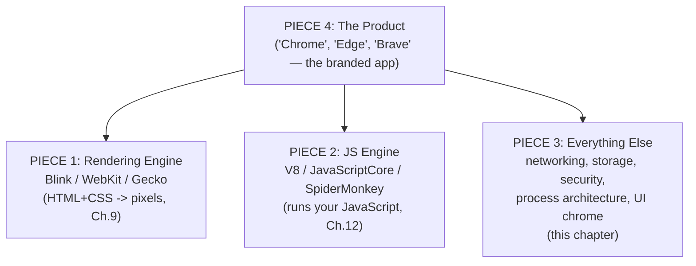
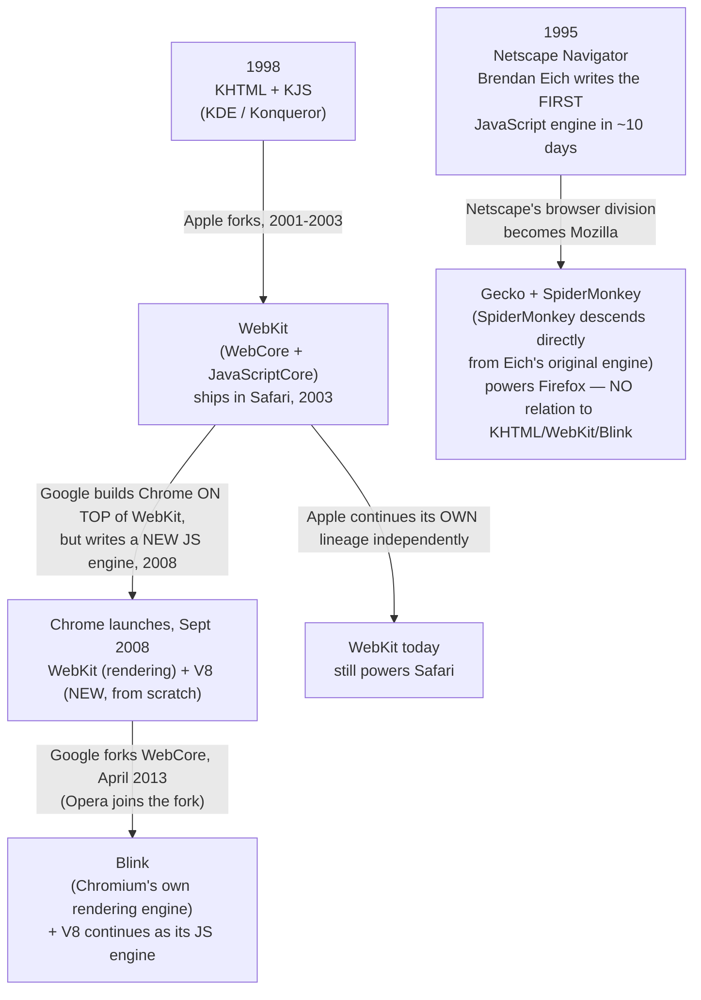
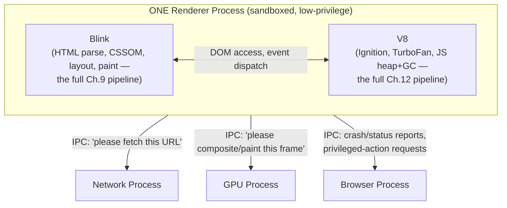
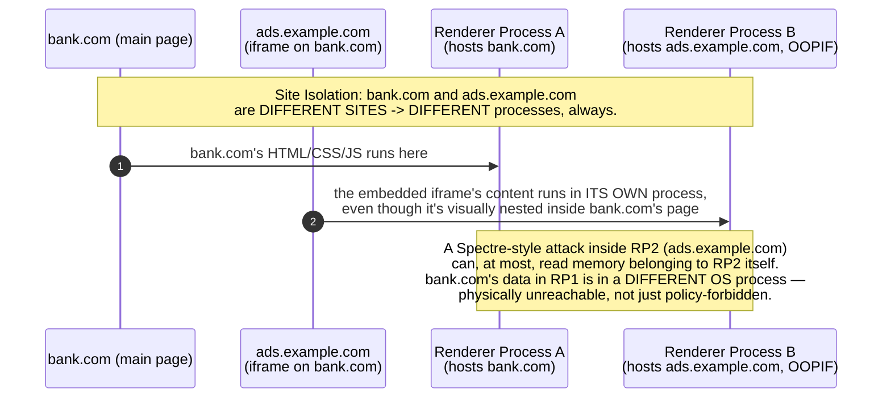
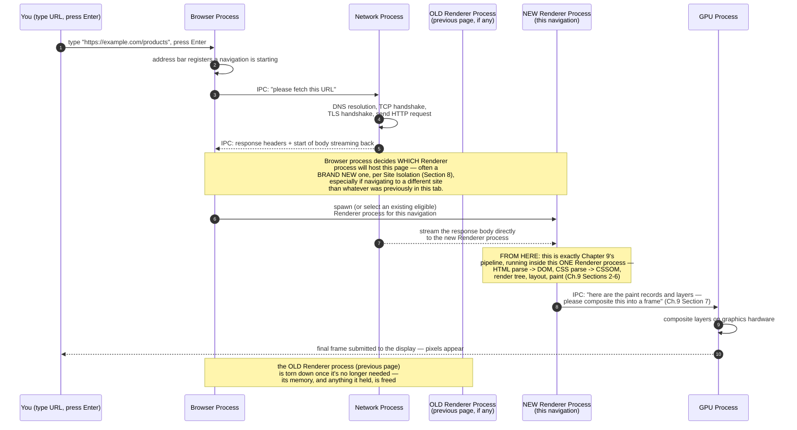

**Navigation**: [< Previous](13_NodeJS_Architecture.md) | [Back to Index](../00_MASTER_INDEX.md) | [Next >](../07_Modern_Java/Ch08_Collections_Internals.md)

# 🧭 Chapter 14 — Browser Engines & Chromium Architecture: What's Actually Running the Browser

**"'Chrome uses V8' is true and also badly incomplete — V8 is the JavaScript engine, Blink is the rendering engine, and 'Chrome' is a whole constellation of separate operating-system PROCESSES that only look like one program. This chapter builds that picture patiently, one layer at a time: what each engine actually is, where they came from, and exactly what happens — process by process — between you typing a URL and a page appearing on screen."**

---

## Table of Contents

1. [Four Different Things People Call "The Browser"](#1-four-different-things-people-call-the-browser)
2. [Where Today's Engines Actually Came From — A Real History](#2-where-todays-engines-actually-came-from--a-real-history)
3. [Chromium vs. Chrome — The Open Project vs. The Product](#3-chromium-vs-chrome--the-open-project-vs-the-product)
4. [The Chromium Family — Who Else Runs on Blink + V8](#4-the-chromium-family--who-else-runs-on-blink--v8)
5. [Why Modern Browsers Run Multiple Processes At All](#5-why-modern-browsers-run-multiple-processes-at-all)
6. [The Browser Process — The One in Charge](#6-the-browser-process--the-one-in-charge)
7. [The Renderer Process — Where Your Page Actually Lives](#7-the-renderer-process--where-your-page-actually-lives)
8. [Site Isolation — Why One Page Can Be Several Renderer Processes](#8-site-isolation--why-one-page-can-be-several-renderer-processes)
9. [The GPU Process — Turning Pixels Into Light](#9-the-gpu-process--turning-pixels-into-light)
10. [The Network Service Process](#10-the-network-service-process)
11. [Utility and Plugin Processes — The Small Specialists](#11-utility-and-plugin-processes--the-small-specialists)
12. [Mojo — How Isolated Processes Talk to Each Other](#12-mojo--how-isolated-processes-talk-to-each-other)
13. [The Full Trace — Typing a URL and Pressing Enter, Across Every Process](#13-the-full-trace--typing-a-url-and-pressing-enter-across-every-process)
14. [Scenario Walkthroughs](#14-scenario-walkthroughs)
15. [Section Challenges](#15-section-challenges)
16. [Interview Quick-Fire](#16-interview-quick-fire)
17. [Reality Check](#17-reality-check)

---

## 1. Four Different Things People Call "The Browser"

Let's slow all the way down before touching any history or architecture, because almost every confusion in this space starts with one word — "browser" — quietly meaning four different pieces of software depending on who's using it.

**Piece one: the rendering engine (also called the "layout engine").** This is the component whose entire job is: given HTML and CSS, figure out what a page should look like, and turn that into pixels. This is what Chapter 9 of this module walked through in detail — parsing HTML into a DOM tree, parsing CSS into a CSSOM tree, combining them into a render tree, computing layout, painting, and compositing. Chromium's rendering engine is called **Blink**. Safari's is called **WebKit**. Firefox's is called **Gecko**.

**Piece two: the JavaScript engine.** A completely separate component whose only job is to run JavaScript — parse it, interpret it, JIT-compile the hot parts, manage its memory. Chapter 12 of this module covered this in depth for one specific engine. Chromium uses **V8**. Safari uses **JavaScriptCore**. Firefox uses **SpiderMonkey**.

**Piece three: everything else that isn't rendering or JavaScript.** Networking (making HTTP requests, managing the cache, handling cookies), storage (`localStorage`, IndexedDB, the disk cache), security sandboxing, the address bar and bookmarks UI, the extension system, the process architecture that ties it all together. This is the largest piece by code volume and the one this chapter is actually about.

**Piece four: the product/brand people install.** "Chrome," "Edge," "Safari," "Firefox," "Brave" — the thing with an icon on your desktop. This is a *specific combination* of pieces one, two, and three, wrapped in a company's own branding, update mechanism, and sometimes proprietary extras layered on top.

> **Why this four-way split matters before anything else in this chapter.** People say "V8 renders the page" (V8 doesn't render anything — it runs JS; Blink renders), or "Chrome and Edge are basically the same browser" (true for pieces one, two, and three — Edge uses Blink and V8 — but false for piece four, where Microsoft's UI, sync system, and telemetry differ entirely from Google's). Every sentence in the rest of this chapter is precise about *which* of these four things it's describing, because conflating them is where most of the folklore about browsers comes from.



---

## 2. Where Today's Engines Actually Came From — A Real History

This section is deliberately a story with dates, not a bare fact list — the *order* things happened in is what makes today's engine landscape make sense, rather than looking like an arbitrary pile of brand names.

**Step one — 1998, KHTML.** The KDE desktop environment for Linux needed a web browser for its file manager, called Konqueror. A small team wrote a rendering engine for it from scratch, named **KHTML**, along with a companion JavaScript engine named **KJS**. This project was open source, reasonably clean, and — importantly for what happens next — nobody outside the Linux world was paying much attention to it yet.

**Step two — 2001 to 2003, Apple forks KHTML into WebKit.** Apple needed a rendering engine for a new browser they were building, which would become Safari. Rather than starting from zero, Apple's engineers took KHTML's source code, forked it, and began heavily modifying it. Apple named their rendering-engine fork **WebCore**, wrote a new JavaScript engine called **JavaScriptCore** (itself evolved out of KHTML's KJS), and the combination of WebCore + JavaScriptCore + Apple's surrounding browser plumbing became known as **WebKit**. Safari launched publicly in 2003, and Apple eventually open-sourced their WebKit fork, so it grew its own independent developer community, separate from — and eventually much larger than — the original KHTML project it came from.

**Step three — 2008, Google builds Chrome on WebKit, but writes a brand-new JS engine.** When Google decided to build its own browser, it had a choice for the rendering engine: build one from scratch, or start from an existing one. Google chose to build on **WebKit** — reusing Apple's (originally KHTML's) rendering engine rather than reinventing HTML/CSS parsing and layout from zero. But for the *JavaScript* engine, Google went a completely different route: they assembled a team in Aarhus, Denmark, led by **Lars Bak**, and built an entirely new JavaScript engine from scratch, named **V8**. This was a deliberate, separate decision — reuse the rendering engine, but build a new, faster JS engine, because Google's bet was that JavaScript performance specifically was about to become the thing that decided whether "web apps" (like the Gmail and Google Maps Google was already building) could ever feel as responsive as native desktop software.

Chrome launched publicly on **September 2, 2008**. Two things about that launch were genuinely new to the mainstream browser world, and both are direct ancestors of content already in this module: V8 was the first mainstream JS engine built to compile JavaScript toward native machine code rather than only interpreting it (the ancestor of Chapter 12's whole Ignition/TurboFan story), and Chrome shipped with a **multi-process architecture** from day one (the ancestor of this entire chapter, covered starting in Section 5) — both explained, at launch, in a widely-read comic book Google commissioned from cartoonist Scott McCloud specifically to make the reasoning accessible to non-engineers.

**Step four — April 2013, Google forks WebKit into Blink.** For five years, Chrome shipped Google's own V8 alongside Apple's WebKit rendering engine — two different organizations, with different priorities, sharing one codebase. By 2013, Google's Chromium project had grown its own large set of changes layered on top of WebKit, many specifically to support its multi-process architecture more deeply than WebKit's existing design (built with Safari's simpler, single-process-per-tab-ish model in mind) easily allowed. Rather than continuing to maintain an enormous, increasingly divergent patch set on top of Apple's codebase, Google announced it was **forking** WebCore (WebKit's rendering-engine component specifically — not JavaScriptCore, since Chrome was already using its own V8) into a new, independently-developed project named **Blink**. Opera — which had just switched its own browser from its long-running in-house engine, Presto, to WebKit only months earlier — joined Google in this fork immediately, having reached the same conclusion about needing more architectural freedom than continuing to track Apple's WebKit would allow.

**Meanwhile — an entirely separate lineage: Firefox.** Firefox's rendering engine, **Gecko**, and its JavaScript engine, **SpiderMonkey**, share no ancestry with KHTML/WebKit/Blink at all. Both trace back to **Netscape** — the company that shipped the first mass-market web browser and, in 1995, had Brendan Eich write the very first JavaScript engine (literally the origin of the language itself) in about ten days. When Netscape's browser division became the Mozilla Foundation, Gecko and SpiderMonkey (SpiderMonkey being the direct descendant of Eich's original engine) continued as independently developed, non-WebKit-derived, non-Blink-derived engines — the reason Firefox is routinely described as maintaining rendering-engine and JS-engine *diversity* on the web, distinct from the WebKit/Blink family tree.



> **Why this history is worth actually knowing, not just skimming.** It answers, with mechanism instead of trivia, three questions engineers genuinely ask: "why does V8 feel unrelated to Blink even though they ship together?" (because they ARE unrelated — V8 was built from scratch in 2008 specifically as a separate project from the rendering engine, and that separateness is architecturally real, not just a naming quirk). "Why is Safari's engine called both 'WebKit' and sometimes 'WebCore'?" (WebKit is the umbrella name for the combination; WebCore is specifically the rendering-engine component inside it — the same component Google forked into Blink). "Why do people worry about a 'Chromium monoculture'?" (because Blink and WebKit share a common ancestor but have been developed independently since 2013, while Gecko never shared that ancestry at all — so today's "big three" engine diversity is really Blink, WebKit, and Gecko, and two of those three trace back to the same 1998 codebase).

---

## 3. Chromium vs. Chrome — The Open Project vs. The Product

This is the piece-four distinction from Section 1, made concrete.

> **Chromium is the open-source project.** Google develops and publishes the entire browser's source code — Blink, V8, the multi-process architecture, the networking stack, the UI — under an open-source license, as a project called **Chromium**. Anyone can download this source code, compile it, and run the resulting browser. That compiled result is sometimes literally called "Chromium" as a standalone browser too (some Linux distributions ship a package named exactly that).
>
> **Chrome is Chromium plus Google's proprietary layer on top.** Google takes the open Chromium source, and before shipping it as the product named "Google Chrome," adds a specific set of closed-source pieces: the Chrome name and logo, an integrated Widevine DRM module (needed for streaming services like Netflix to play protected video), specific PDF-viewer refinements, Google's own automatic-update mechanism, optional usage-statistics and crash-reporting that phones home to Google, the "Sign in to Chrome" feature that syncs bookmarks/history/passwords to a Google account, and increasingly, integrations with Google's other products and AI features. None of these additions are in the open Chromium source — they're licensed and bundled by Google specifically for the branded Chrome build.

| | Chromium | Google Chrome |
|---|---|---|
| Source | Fully open source | Chromium's open source + Google's closed-source additions |
| Blink + V8 | Yes | Yes (same engines, same version) |
| Auto-updates | No built-in updater | Google's auto-update service |
| DRM (Widevine, for Netflix etc.) | Not included | Included |
| Usage stats / crash reports to Google | No | Optional, on by default in most installs |
| Google account sync | Not included | Included |
| Who ships it | Anyone (Linux distros, developers building from source) | Google |

**Why this matters practically.** If you've ever noticed a plain "Chromium" browser on Linux can't play a Netflix video the way installed Chrome can, or lacks the "Sign in" button — that's this exact distinction, not a bug. The rendering and JavaScript behavior (Blink + V8) is identical between the two; what differs is entirely in piece three and piece four from Section 1 — the surrounding product, not the engines.

---

## 4. The Chromium Family — Who Else Runs on Blink + V8

Google isn't the only company shipping a browser built on the open Chromium project. Each of the following takes Chromium's Blink + V8 engines and layers its *own* distinct piece-three-and-four additions on top — their own UI, their own privacy policies, their own extra features — while sharing the identical underlying rendering and JavaScript behavior:

- **Microsoft Edge** — originally built on Microsoft's own engine, **EdgeHTML** (and, going further back, Internet Explorer's Trident engine). In January 2020, Microsoft switched Edge to be built on Chromium instead, adopting Blink and V8, while keeping Edge's own UI, sync system, and Microsoft-specific integrations on top.
- **Opera** — switched from its own long-running **Presto** engine to WebKit in 2013, then joined Google's Blink fork immediately afterward that same year (mentioned in Section 2). Still Chromium-based today, with Opera's own UI and features (built-in VPN toggle, sidebar apps) layered on.
- **Brave** — Chromium-based, with its own privacy-focused defaults (aggressive ad and tracker blocking built in) and its own optional cryptocurrency-rewards system layered on top of the same Blink/V8 core.
- **Vivaldi**, **Arc** (The Browser Company), **Samsung Internet**, and many others — same pattern: take the open Chromium base, keep Blink and V8 untouched (or nearly so), differentiate entirely at the UI/feature layer.

> **The "Chromium monoculture" concern, stated precisely.** With this many browsers sharing one rendering engine and one JS engine underneath different skins, a website that only gets tested against "whatever Chrome does" is, in practice, being tested against the *majority* of the browser market simultaneously — even though it looks like testing against just one product. If Blink implements a web-platform feature slightly differently from the official spec, or ships a non-standard behavior that becomes popular, site authors who only test in Chrome-family browsers can end up depending on Blink-specific behavior without realizing it, because so many of the browsers they might casually check ("let me also try it in Edge... yep, works there too") are actually running the identical rendering engine under a different name. This is precisely why WebKit (Safari) and Gecko (Firefox) maintaining genuine independent implementations is considered valuable for the web platform as a whole, beyond simple user choice — they're the check against Blink's real-world behavior quietly becoming "the standard" purely through market share rather than through the actual web standards process.

---

## 5. Why Modern Browsers Run Multiple Processes At All

Everything from here on is about piece three from Section 1 — specifically, the architecture that ties Blink, V8, networking, and the UI together into what looks like one program. Let's build the reasoning from scratch, the way Chrome's own 2008 launch explained it, before naming any specific process type.

> **Start from the single-process world, and watch it fail.** Imagine one browser process holds everything: every open tab's HTML/CSS/JS, the address bar, the network connections, all of it, in one operating-system process with one shared memory space. Two failure modes follow directly and unavoidably from that design:
>
> **Failure mode one — a crash anywhere is a crash everywhere.** If ONE tab's JavaScript triggers a bug that crashes the process (an out-of-bounds memory access in the rendering engine, an infinite-recursion stack overflow, anything), the entire process dies — every other open tab, and any work in progress in them, dies with it. There is no way to contain damage to just the misbehaving tab, because there is only one process to begin with.
>
> **Failure mode two — a security bug anywhere is a security bug everywhere.** If an attacker finds an exploitable bug in the rendering engine or JS engine (these are enormous, complex C++ codebases parsing untrusted content from the entire internet — bugs are a statistical certainty, not a hypothetical), and that engine runs with the same OS-level privileges as the whole browser, a successful exploit on ONE malicious page can potentially read or write anything the browser process itself can access — which, in a naive single-process design, could include the user's files, other tabs' data, saved passwords, anything.
>
> **The multi-process answer to both, in one sentence.** Split the browser into multiple OS-level processes with different responsibilities and different privilege levels, so that a crash or a successful exploit inside the process that renders untrusted web content is *contained* to that one process — unable to directly touch the other tabs, and, critically, unable to directly touch the filesystem, other processes' memory, or most OS-level capabilities, because the operating system itself enforces process boundaries as a hard security barrier, not just a software convention Chrome's own code has to get right.

This is not a minor implementation detail — it's the organizing principle behind everything in Sections 6 through 12. Each process type that follows exists because of a specific piece of this reasoning: contain crashes, or contain compromise, or both.

---

## 6. The Browser Process — The One in Charge

> **What it is.** Exactly **one** Browser process exists per running instance of the browser (per browser window/session, not per tab). It is the most privileged process — the one allowed to talk to the operating system relatively freely: read and write files (within reason), manage the other processes' lifecycles (start them, stop them, restart a crashed one), own the actual UI you see and interact with (the address bar, tab strip, bookmarks menu, browser chrome around the page content itself — the word "chrome" in "Google Chrome" originally refers to exactly this UI frame, not the JS/rendering engines).
>
> **What it deliberately does NOT do.** It does not parse untrusted HTML. It does not run untrusted JavaScript. Those jobs are handed off entirely to Renderer processes (Section 7) — precisely because the Browser process is trusted with real OS privileges, and the entire multi-process design exists to keep untrusted content as far away from those privileges as possible.
>
> **What it coordinates.** When you type a URL and press Enter, it's the Browser process that owns that address bar, decides a navigation is happening, asks the Network process (Section 10) to actually fetch the resource, and once a response starts coming back, hands the job of turning that response into pixels off to a Renderer process — spinning up a new one if needed. It's also the process that notices when a Renderer process has crashed or become unresponsive, and is what shows you Chrome's own "Aw, Snap!" (or equivalent) recovery page for that one tab, without the rest of your open tabs being affected at all.

---

## 7. The Renderer Process — Where Your Page Actually Lives

> **What it is.** A Renderer process is where Blink and V8 actually run — where Chapter 9's entire HTML-parsing/CSSOM/layout/paint/composite pipeline happens, and where Chapter 12's entire Ignition/TurboFan JavaScript-execution pipeline happens. Broadly, and with important exceptions covered in Section 8, each open site tends to get its own Renderer process.
>
> **The defining property: it is deliberately sandboxed and low-privilege.** A Renderer process runs with the operating system configured to strip away almost all direct capabilities — it typically cannot open arbitrary files on disk, cannot make raw network connections itself, cannot access most OS APIs directly. When a page's JavaScript calls `fetch()`, the Renderer process doesn't quietly open a socket itself — it sends a request, via IPC (Section 12), to the Network process, asking it to perform the fetch on the Renderer's behalf, and receives the response back the same way. This is Section 5's "contain the compromise" reasoning made concrete: if an attacker's malicious page manages to exploit a genuine bug in Blink or V8 and gain arbitrary code execution *inside* the Renderer process, the OS sandbox still stands between that compromised process and the user's actual files, other tabs' memory, and the network — the attacker has to find and chain a SECOND exploit, one that escapes the sandbox itself, to do meaningful damage, which is a substantially higher bar.
>
> **One Renderer runs the FULL pipeline internally.** Everything Chapter 9 described — DOM construction, CSSOM construction, render-tree combination, layout, paint — happens inside one Renderer process, on its own main thread (the same "main thread" Chapter 9, Section 9 described as running JS execution, DOM updates, style calculation, and layout all on one thread — that description is specifically describing a Renderer process's internals). Chapter 12's V8 pipeline (Ignition, TurboFan, the JS heap and its generational garbage collector) also lives entirely inside this same Renderer process, dedicated to that one process's JavaScript.



---

## 8. Site Isolation — Why One Page Can Be Several Renderer Processes

Section 7 said "each open site tends to get its own Renderer process" and deliberately deferred the interesting complication — because a single page frequently *embeds* content from other sites (an ad in an `<iframe>`, an embedded video player, a third-party payment widget), and the question of which process THAT content runs in has a real history worth telling slowly.

> **Before 2018 — iframes could share a process with their parent page.** Chromium's original multi-process model isolated by *tab*, roughly, but did not strictly guarantee that a cross-origin iframe embedded inside a page ran in a genuinely separate OS process from that page. The two were still kept apart by *software*-level checks — the browser's own code enforcing the same-origin policy, JavaScript's sandbox rules — but they could physically share the same process and the same raw memory space, with software rules being the only thing standing between them.
>
> **January 2018 — Spectre and Meltdown are disclosed.** These were a new *category* of security vulnerability, affecting nearly all modern CPUs, exploiting **speculative execution** — a performance optimization where a CPU guesses ahead at what a program is about to do and starts executing that guess before confirming it's correct, then discards the work if the guess was wrong. Researchers demonstrated that even when the CPU correctly discards a wrong guess's *results*, subtle, measurable side effects of that speculative work (specifically, timing differences in CPU cache behavior) could leak information about data the guess had touched — including data that JavaScript's own sandboxing rules were supposed to make completely inaccessible to a malicious script. The devastating part for browser vendors specifically: a malicious script could potentially use this technique to read OTHER data resident in the *same process's memory* — even data that JS-level same-origin checks were correctly, faithfully enforcing — because Spectre-style attacks operate below the level JavaScript's rules even apply at. A software rule saying "you may not read that variable" is meaningless against an attack that reads the underlying hardware cache instead of asking the language to hand the variable over.
>
> **The fix: turn the origin boundary into an OS-process boundary, not just a software rule.** This is **Site Isolation**, which Chromium made the default behavior starting around mid-2018 (Chrome 67), specifically accelerated as a direct response to Spectre. Under Site Isolation, cross-site content — including iframes — generally gets its own, genuinely separate Renderer process, called an **out-of-process iframe (OOPIF)**, even when it's visually embedded inside another site's page. Two pieces of content from different sites no longer merely have software rules keeping them apart; they are physically in different OS processes, with different memory spaces the operating system itself keeps separate, which a same-process CPU cache-timing attack like Spectre cannot cross, because there is no "same process" to exploit in the first place.



**Why this is the single most important architectural fact in this chapter to actually retain.** It's the concrete answer to "why does my browser use so much RAM with a lot of tabs open, and why does it seem to get worse with more embedded ads/widgets per page?" — every genuinely cross-site iframe is, by design, an entire separate Renderer process, with its own memory overhead, specifically traded off against exactly the security guarantee just described. That memory cost is not an accident or an unoptimized rough edge; it's the direct, deliberate price of Site Isolation's security model.

---

## 9. The GPU Process — Turning Pixels Into Light

> **What it is and why it's separate.** Exactly one GPU process (typically) exists, owning the browser's actual connection to the graphics driver and hardware. It exists as its own process for two distinct reasons that happen to point the same direction: **stability** — GPU drivers are notoriously more crash-prone than most other system software, being close to hardware and vendor-specific, so isolating that instability into its own process means a GPU driver crash doesn't take down Renderer processes or the Browser process with it — and **the privilege mismatch** — talking directly to graphics hardware requires capabilities that a sandboxed, low-privilege Renderer process (Section 7) is specifically NOT granted, for the same reasons it isn't granted raw filesystem or network access.
>
> **What actually happens here.** This is precisely where Chapter 9's **Compositing** section (Section 7 of that chapter) physically executes — a Renderer process does layout and paint internally, but hands the resulting paint records and layer information to the GPU process via IPC, which is what actually composites those layers together on the graphics hardware and produces the final frame that gets shown on screen. `transform` and `opacity` animations being "composite-only" and cheap (Chapter 9's Section 10) specifically means the Renderer process doesn't need to redo layout or paint work and re-send new paint records to the GPU process on every frame — the GPU process can reuse layer textures it already has and just recombine them differently, which is both why it's fast and why it's a genuinely different process's job than the Renderer's.

---

## 10. The Network Service Process

> **What it is.** Starting around 2019, Chromium underwent an effort informally called "servicification" — extracting pieces of functionality that used to live inside the Browser process into their own separate, independently sandboxed processes. The Network service is the result of that effort applied to networking: DNS resolution, establishing and managing HTTP/HTTPS connections, the cookie jar, the HTTP cache, all moved into their own dedicated process, separate from the Browser process itself.
>
> **Why pull it out of the already-trusted Browser process specifically.** Even the Browser process, despite being the most privileged process in the whole architecture, benefits from having its OWN attack surface reduced. Networking code parses responses from arbitrary servers on the open internet — every HTTP header, every TLS certificate, every redirect chain is untrusted input, structurally similar in spirit to the "untrusted content" reasoning that justified sandboxing Renderer processes in Section 5. Giving the Network service its own, separately sandboxed process means a bug specifically in networking-response parsing doesn't automatically hand an attacker the FULL privileges the Browser process holds — it's contained to whatever the Network process itself is allowed to do, which is deliberately less.
>
> **How it's used, in the flow you'll see in Section 13.** When the Browser process decides a navigation needs to happen, or when a sandboxed Renderer process's page calls `fetch()`, neither of them performs networking directly — both send a request, via IPC, to the Network service, which does the actual DNS lookup and TCP/TLS/HTTP work, and delivers the result back the same way.

---

## 11. Utility and Plugin Processes — The Small Specialists

Beyond Browser, Renderer, GPU, and Network, Chromium spins up a number of smaller, single-purpose **Utility processes** for specific tasks that similarly benefit from sandboxed isolation — an audio-processing service, PDF parsing (specifically kept sandboxed since PDF files are, like HTML, untrusted content from the internet that a malicious file could try to exploit a parser bug in), and processes for extensions in some configurations. The exact catalog of utility processes has changed across Chromium's history and varies by platform and version — the durable, teachable fact is the *pattern*, not a specific fixed list: **any functionality that parses untrusted input, or that benefits from being independently restartable without disturbing the rest of the browser, is a candidate for its own small sandboxed process**, following the exact same reasoning chain from Section 5 all the way through. This is architecture as a repeated, deliberate policy, not a fixed one-time list of exactly N process types.

---

## 12. Mojo — How Isolated Processes Talk to Each Other

Every section above described processes that are DELIBERATELY isolated from each other — separate memory spaces, separate OS-level privileges, unable to simply call each other's functions or share objects the way threads within one process could. But a browser has to function as one coherent program; a Renderer genuinely needs to ask the Network process to fetch a URL and get the answer back. Something has to bridge these isolated processes.

> **The mechanism: Mojo.** Mojo is Chromium's own inter-process communication (IPC) framework — a structured, asynchronous message-passing system. Rather than processes sharing memory directly (which would defeat the entire point of isolating them), a process that needs another process to do something sends a **message** describing the request across a well-defined interface, and the receiving process handles it and can send a message back with a result. This is conceptually the same shape of idea as an HTTP API call between two separate backend services — well-defined interfaces, message passing instead of shared memory, both sides able to be developed, updated, and crash/restart independently, precisely because they don't depend on sharing raw memory layout with each other.
>
> **Why this design, and not something simpler.** A simpler design — processes literally sharing a region of memory and reading/writing it directly — would reintroduce exactly the problem Site Isolation (Section 8) was built specifically to eliminate: shared memory is exactly the kind of surface a Spectre-style side-channel attack, or a more mundane memory-corruption bug, can exploit across a boundary that's supposed to be a hard security wall. Message-passing IPC keeps every process's actual memory genuinely private to itself; the ONLY things that cross the boundary are the specific, structured messages a well-defined interface explicitly allows — a much smaller, much more carefully audited attack surface than "these two processes can see each other's whole memory."

---

## 13. The Full Trace — Typing a URL and Pressing Enter, Across Every Process

Chapter 9 traced what happens once HTML bytes start arriving, entirely from the perspective of a single Renderer process, because that's genuinely where that story belongs. This section traces the SAME overall journey, but zoomed one level further out — showing which of the last seven sections' processes does which piece of the work, and in what order, before Chapter 9's pipeline even begins.



**The two things this diagram adds on top of Chapter 9's telling, precisely.** First: the Network service, not the Renderer, does the actual DNS/TCP/TLS/HTTP work — the Renderer process never touches a raw socket, consistent with Section 7's sandboxing. Second: navigating to a new site frequently means an entirely NEW Renderer process gets created for it — the "one process per site" idea from Sections 7–8 isn't just a static fact about already-open tabs, it's actively decided fresh at every navigation, which is also exactly why a heavy page with many cross-site iframes (Section 8) can end up spinning up several Renderer processes just to display one browser tab.

---

## 14. Scenario Walkthroughs

The sections above built the pieces one at a time, in order. This section deliberately slows down further and walks through four separate, concrete situations — each showing the SAME architecture from a different angle, so the pieces click together as a system rather than staying separate facts.

### Scenario A — One tab crashes. What happens to your other 15 open tabs?

You have 16 tabs open. One of them is running a buggy web app whose JavaScript triggers a genuine engine-level crash inside Blink or V8. Trace it: that tab's content lives in its own Renderer process (Section 7). That Renderer process dies. The Browser process (Section 6), which is separately monitoring every Renderer process's health via IPC, detects that this ONE process has terminated unexpectedly, and shows a recovery page ("Aw, Snap!" or equivalent) specifically in that ONE tab. Every other tab is running in an *entirely different* Renderer process — a completely separate OS process, with its own separate memory, that the crashed process's death has no direct effect on whatsoever. Your other 15 tabs continue running, mid-video, mid-form-fill, completely undisturbed, because "one tab" and "one process" are, by this architecture's design, close to the same boundary.

### Scenario B — A malicious ad in an iframe tries to read your banking page's data.

You're on `bank.com`, which embeds an ad from `ads.example.com` in an iframe. The ad's script attempts a Spectre-style speculative-execution attack, trying to read whatever data happens to be sitting nearby in memory. Trace it, per Section 8: `bank.com` and `ads.example.com` are different sites, so Site Isolation guarantees they're running in genuinely different Renderer processes — the ad's Renderer process has its own separate slice of RAM, managed by the OS, that does not contain `bank.com`'s data at all. The attack can, at absolute most, read memory that already belongs to the ad's own process — which was never going to contain your banking session in the first place. The attack fails not because JavaScript's same-origin policy caught it (a Spectre-class attack specifically doesn't go through JavaScript's normal rules at all) — it fails because the data it's trying to reach was never physically present in the same process to begin with.

### Scenario C — You open 20 tabs. Does that really mean 20 separate Renderer processes?

Not necessarily, and this is worth being precise about rather than over-simplifying into "always exactly one process per tab." Chromium's actual process-allocation policy considers the SITE each tab is showing (per Site Isolation, Section 8), and on resource-constrained platforms (notably Android, and Chromium generally under memory pressure) applies additional heuristics to consolidate multiple same-site or otherwise-eligible tabs into fewer processes than a strict one-per-tab rule would produce, specifically to control total memory usage. The durable, correct mental model is not "20 tabs = 20 processes" as an exact count — it's "the number and boundaries of Renderer processes are actively managed, driven primarily by SITE identity (for security, via Site Isolation) and secondarily by resource pressure (for memory efficiency), and can change as you navigate, open, and close tabs" — a policy, not a fixed arithmetic rule.

### Scenario D — A page with heavy WebGL and video. Which processes actually light up?

You open a page doing real-time 3D rendering via WebGL alongside an autoplaying video. Trace the division of labor: the Renderer process (Section 7) still owns the page's DOM, CSS, and the JavaScript driving the WebGL calls and video-element control — but the actual GPU-side work (executing the WebGL draw calls against the graphics hardware, decoding the video's compressed frames, compositing the final result) is handed off via IPC to the GPU process (Section 9), which is precisely why a demanding WebGL/video-heavy page shows elevated activity specifically in the GPU process (visible in the browser's own task manager, which lists CPU/memory per process by exactly this taxonomy) rather than only in the Renderer process's own CPU usage — the work is genuinely split across the process boundary this whole chapter has been describing, not merely conceptually but observably, in real running numbers you can watch.

---

## 15. Section Challenges

> **Challenge 1 (Reasoning — Piece Separation).** A colleague says "we should switch our app's polyfills because Chrome's V8 doesn't support feature X yet." Using Section 1's four-piece breakdown, what's specifically wrong with how this claim is phrased, and what would need to be true for it to make sense?
>
> <details><summary>Answer</summary>
>
> "Feature X" needs to be classified by WHICH piece would support it before the sentence means anything. If X is a JavaScript language feature (say, a new `Array` method, or new syntax), V8 (piece two) is indeed the right thing to check — that claim could be precisely correct. But if X is a CSS feature, a new HTML element, or a new DOM/Web API, the relevant piece is Blink (piece one) or piece three (browser-provided APIs), and "V8 doesn't support it" is simply the wrong engine to blame — V8 has no opinion on CSS or DOM APIs at all, since those aren't part of the JavaScript language V8 implements. The fix to the sentence: name the specific feature and check which of Chromium's actual sub-projects (V8's own feature-support tracking, or Blink's) is the one that governs it, rather than using "V8" as a catch-all name for "whatever Chrome supports."
>
> </details>

> **Challenge 2 (Trace — Site Isolation).** A single-page app at `app.example.com` embeds three iframes: one from `cdn.example.com` (same registrable site, different subdomain), one from `payments.example.com` (also same registrable site, different subdomain), and one from `ads-network.com` (a genuinely different site). Under Site Isolation's site-based (not just origin-based) model, how many Renderer processes does this page's content most plausibly span, and why?
>
> <details><summary>Answer</summary>
>
> Site Isolation groups by **site** — generally the registrable domain (e.g., `example.com`), not the full origin (subdomain + scheme + port) — specifically because same-site subdomains commonly need to interact more closely (e.g., via `document.domain` relaxation in some legacy configurations, or because they're simply operated by the same trusted party) and don't represent the security boundary that a genuinely different registrable domain does. So `app.example.com`, `cdn.example.com`, and `payments.example.com` — all under the same `example.com` site — are eligible to share ONE Renderer process. `ads-network.com` is a different site entirely, and per Section 8's whole reasoning, gets its own, separate Renderer process regardless of how the other three are grouped. Most plausible answer: **two** Renderer processes — one for the `example.com` family of frames, one for `ads-network.com` — though the exact grouping can still be influenced by additional heuristics; the key derivable fact being tested is that Site Isolation's boundary is SITE (registrable domain), not the narrower notion of origin.
>
> </details>

> **Challenge 3 (Debug — Process Model).** A user reports: "Chrome's task manager shows a GPU process using 40% CPU, but my page doesn't use `<canvas>`, WebGL, or `<video>` at all — just a long article with a lot of text and some CSS `box-shadow` effects on cards, similar to what Chapter 9 discussed." Is this actually surprising, given what this chapter and Chapter 9 both cover?
>
> <details><summary>Answer</summary>
>
> Not surprising at all, once Section 9 and Chapter 9's compositing material are connected. Compositing — recombining painted layers into a final frame — is GPU process work (Section 9) for essentially ANY page with layered content, not only pages using explicit 3D/video APIs. Chapter 9 specifically named `box-shadow` as an expensive PAINT-phase property (Section 6 of that chapter), and depending on how many "cards" are promoted to their own compositor layers (Chapter 9, Section 7 — things like `position: sticky`, certain animations, or explicit `will-change` hints all create layers), the GPU process can end up doing meaningful compositing work purely from ordinary 2D page layout and styling, with zero WebGL or `<canvas>` in sight. The lesson generalizes: "GPU process activity" does not mean "3D graphics" — it means "compositing is happening," which is a normal, constant part of how ANY Chromium page reaches the screen, just to varying degrees of intensity.
>
> </details>

---

## 16. Interview Quick-Fire

```
Q: What's the difference between a "rendering engine" and a "JavaScript engine"?
→ Two separate components with separate jobs. The rendering engine (Blink,
  WebKit, Gecko) turns HTML+CSS into pixels — parsing, layout, paint,
  composite. The JS engine (V8, JavaScriptCore, SpiderMonkey) only runs
  JavaScript. They ship together but are independently developed projects.

Q: What's the actual relationship between WebKit and Blink?
→ Blink is a 2013 Google (and Opera) fork of WebCore, the rendering-engine
  component inside Apple's WebKit. They share a common ancestor (also
  tracing back further to 1998's KHTML) but have been developed
  completely independently since the 2013 fork.

Q: Does Firefox share any lineage with Chrome or Safari's engines?
→ No. Gecko and SpiderMonkey descend from Netscape/Mozilla, entirely
  separate from the KHTML -> WebKit -> Blink lineage. SpiderMonkey
  descends directly from Brendan Eich's original 1995 JavaScript engine.

Q: What's the actual difference between Chromium and Google Chrome?
→ Chromium is Google's open-source browser project. Chrome is Chromium
  plus Google's proprietary additions: branding, Widevine DRM, auto-
  update, optional telemetry, Google account sync. Same Blink/V8 engines
  underneath either way.

Q: Why does Chromium use multiple OS processes instead of one?
→ Two failure modes a single-process design can't contain: one tab
  crashing kills the whole browser, and a security exploit in one page
  can potentially access everything the browser process can. Splitting
  into separate, differently-privileged processes contains both — a
  crash or compromise in a sandboxed Renderer can't directly reach other
  tabs or the filesystem.

Q: What does the Browser process do, and what does it deliberately NOT do?
→ Owns the UI (address bar, tabs), coordinates the other processes, has
  the most OS privilege. It deliberately never parses untrusted HTML/CSS
  or runs untrusted JS itself — that's handed off entirely to sandboxed
  Renderer processes, keeping untrusted content away from its privileges.

Q: What is Site Isolation, and what specific event drove Chromium to make it default?
→ The guarantee that different SITES run in genuinely separate OS
  processes, including cross-site iframes (out-of-process iframes /
  OOPIFs), not just separated by software-level same-origin checks.
  Made default around mid-2018, specifically accelerated as a response
  to the Spectre CPU vulnerability disclosed January 2018, which could
  leak same-process memory regardless of JS-level sandboxing rules.

Q: Why is there a separate GPU process instead of the Renderer talking to graphics hardware directly?
→ Stability (GPU drivers crash more than most software, and isolating
  that keeps it from taking down Renderer/Browser processes) and
  privilege (talking to hardware needs capabilities a sandboxed,
  low-privilege Renderer process is deliberately not granted).

Q: How do Chromium's isolated processes actually communicate?
→ Mojo — an asynchronous, structured message-passing IPC framework.
  Processes never share raw memory directly (that would defeat the
  isolation); they send messages across well-defined interfaces instead.
```

---

**Next Chapter**: [Java Collections Internals →](../07_Modern_Java/Ch08_Collections_Internals.md)

---

## 17. Reality Check

**"Chrome uses V8, so V8 is what makes pages render"** → V8 runs JavaScript and has zero involvement in parsing HTML/CSS or painting pixels — that's Blink's job, an entirely separate, independently developed component that happens to ship alongside V8. A page with NO JavaScript at all still fully renders via Blink alone; V8 never even starts. Treating "V8" as shorthand for "whatever Chrome does with a page" conflates two projects with different histories, different codebases, and different teams that only share a release schedule.

**"WebKit and Blink are basically the same engine with different names"** → They share a common ancestor (Blink was forked FROM WebKit's WebCore in April 2013) but have been independently developed ever since — over a decade of divergent changes, different priorities (Blink shaped heavily by Chromium's multi-process architecture, WebKit by Safari's different constraints), different feature-support timelines. "Shares history" and "is the same today" are different claims, and treating Safari's WebKit-based rendering as "close enough to Chrome" is exactly the kind of assumption that produces Chrome-only-tested sites silently breaking in Safari.

**"Chromium and Chrome are just two names for the same browser"** → Chromium is Google's open-source project; Chrome is that project plus a specific, closed-source layer Google adds before shipping it under the Chrome brand — DRM support, auto-updates, account sync, telemetry. The rendering and JS behavior (Blink + V8) is identical either way, which is exactly why the confusion persists — but "does this feature work" and "does this page render the same" are different questions from "is this literally one piece of software," and a plain Chromium build genuinely lacks capabilities (like playing DRM-protected video) that installed Chrome has.

**"Modern browsers are multi-process just for performance/parallelism"** → Performance is a secondary benefit; the ORIGINATING reason, explicit in Chrome's own 2008 launch materials, is fault and security containment — one tab crashing shouldn't kill every open tab, and a security exploit in the process rendering untrusted internet content shouldn't automatically have the same privileges as the whole browser. The process boundaries are deliberately drawn along TRUST boundaries (what's allowed to touch the filesystem, the network, other tabs' memory) as much as along workload boundaries — which is why the Browser process, not just "the busiest process," is the most privileged one, and why sandboxed Renderer processes are the least privileged despite often being the most CPU-active.

**"Site Isolation is about JavaScript's same-origin policy, just enforced more strictly"** → Same-origin policy is a SOFTWARE rule the browser's own code enforces; Site Isolation exists specifically because the January 2018 Spectre disclosure showed that software rules alone aren't sufficient — a CPU-level side-channel attack can leak same-process memory regardless of what JavaScript's sandboxing correctly forbids at the language level, because the attack doesn't go through JavaScript's rules at all. Site Isolation's actual fix is moving the boundary from "software promises not to let you read this" to "this data is not physically present in your process's memory, full stop" — a categorically stronger guarantee than a same-origin check, which is exactly why it costs real memory (extra Renderer processes) to provide.
