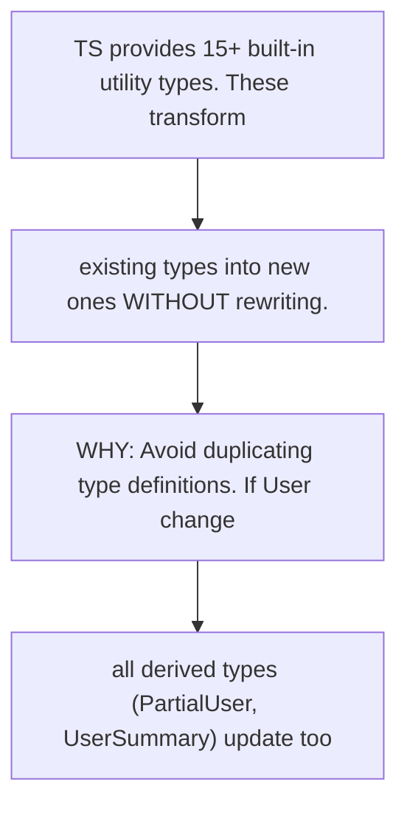
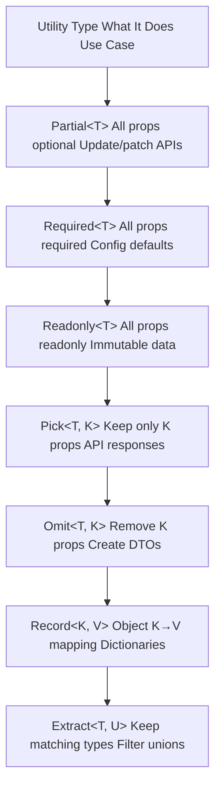
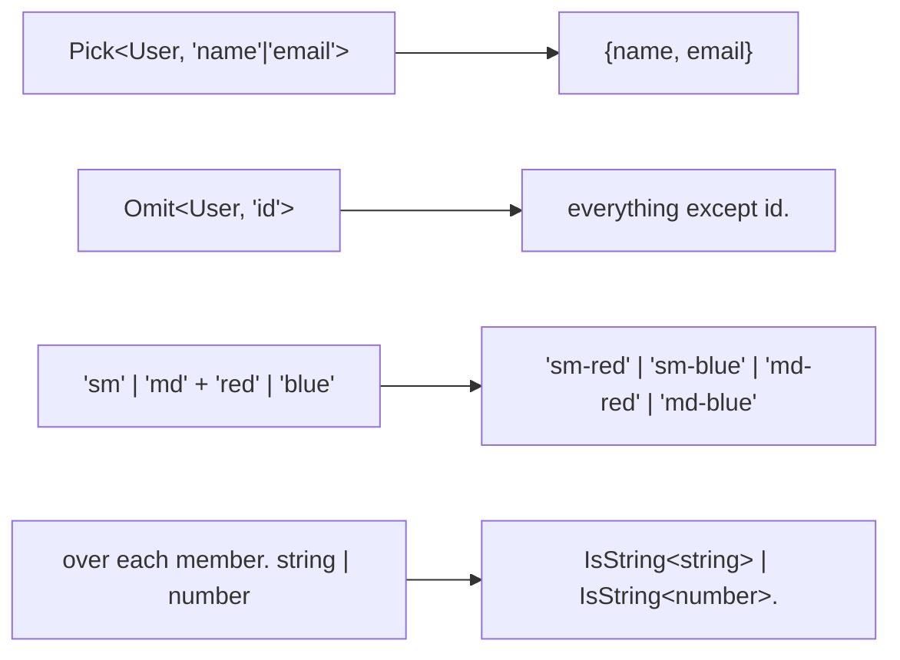

> **Navigation**: [< Previous](01_TS_Foundations.md) | [Back to Index](../00_MASTER_INDEX.md) | [Next >](03_TS_Patterns_BestPractices.md)

> **TypeScript Chapter 2/3** | [← Foundations](01_TS_Foundations.md) | [Index](../00_MASTER_INDEX.md) | [Next → Patterns](03_TS_Patterns_BestPractices.md)

# TypeScript Advanced Types — Generics, Utility Types & Type Gymnastics

## 5W1H — Why This Chapter?


> WHAT: Advanced type system features that make TS extremely
> powerful — generics, mapped types, conditional types,
> utility types, template literal types.
>
> WHY:  Real codebases need FLEXIBLE yet SAFE types:
> - A function that works with any array type
> - An API response wrapper generic over the data shape
> - Making some fields optional while keeping others required
> - Creating new types from existing ones automatically
>
> WHO:  Intermediate-to-advanced TS developers, library authors,
> anyone working with complex API types or state management.
>
> WHEN: After mastering basic types, interfaces, and unions.
>
> HOW:  Generics provide the "type variables." Utility types,
> mapped types, and conditional types build on that for
> sophisticated type transformations.


---

## 1. Generics Deep Dive

### The Core Idea


> ANALOGY: Generics are FUNCTION PARAMETERS, but for TYPES.
>
> Regular function:  function add(a: number, b: number) → number
> Generic function:  function first<T>(arr: T[]) → T
>
> `a` and `b` are VALUE parameters (filled with values at call).
> `T` is a TYPE parameter (filled with types at call).
>
> first<number>([1, 2, 3]) → T becomes number → returns number
> first<string>(["a", "b"]) → T becomes string → returns string


```typescript
// GENERIC FUNCTION:
function identity<T>(value: T): T {
    return value;
}
identity<string>("hello"); // Explicit: T = string
identity(42);              // Inferred: T = number

// MULTIPLE TYPE PARAMETERS:
function pair<K, V>(key: K, value: V): [K, V] {
    return [key, value];
}
pair("name", "Harsha");    // → [string, string]
pair("age", 24);           // → [string, number]

// GENERIC INTERFACE:
interface ApiResponse<T> {
    data: T;
    status: number;
    message: string;
    timestamp: Date;
}

type UserResponse = ApiResponse<User>;
type ProductResponse = ApiResponse<Product[]>;

// GENERIC CLASS:
class Stack<T> {
    private items: T[] = [];

    push(item: T): void {
        this.items.push(item);
    }

    pop(): T | undefined {
        return this.items.pop();
    }

    peek(): T | undefined {
        return this.items[this.items.length - 1];
    }

    get size(): number {
        return this.items.length;
    }
}

const numStack = new Stack<number>();
numStack.push(1);
numStack.push(2);
numStack.pop(); // TS knows: number | undefined
```

### Generic Constraints

```typescript
// EXTENDS constraint — "T must have at least..."
function getLength<T extends { length: number }>(item: T): number {
    return item.length;
}
getLength("hello");   // ✅ string has .length
getLength([1, 2]);    // ✅ array has .length  
// getLength(42);     // ❌ number doesn't have .length

// KEYOF constraint — "K must be a key of T"
function getProperty<T, K extends keyof T>(obj: T, key: K): T[K] {
    return obj[key];
}
const user = { name: "Harsha", age: 24 };
getProperty(user, "name"); // TS knows: returns string
getProperty(user, "age");  // TS knows: returns number
// getProperty(user, "email"); // ❌ "email" is not a key of user

// DEFAULT GENERIC TYPE:
interface PaginatedResponse<T = unknown> {
    items: T[];
    total: number;
    page: number;
    pageSize: number;
}
// Can use without specifying T:
const response: PaginatedResponse = { items: [], total: 0, page: 1, pageSize: 10 };
```

### Real-World Generic Patterns

```typescript
// PATTERN 1: API Fetcher
async function fetchData<T>(url: string): Promise<ApiResponse<T>> {
    const res = await fetch(url);
    if (!res.ok) throw new Error(`HTTP ${res.status}`);
    return res.json() as Promise<ApiResponse<T>>;
}
const users = await fetchData<User[]>("/api/users");
// users.data is User[] — fully typed!

// PATTERN 2: Event Emitter
class TypedEmitter<Events extends Record<string, any[]>> {
    private handlers: Partial<{ [K in keyof Events]: Array<(...args: Events[K]) => void> }> = {};

    on<K extends keyof Events>(event: K, handler: (...args: Events[K]) => void): void {
        (this.handlers[event] ??= []).push(handler);
    }

    emit<K extends keyof Events>(event: K, ...args: Events[K]): void {
        this.handlers[event]?.forEach(h => h(...args));
    }
}

const emitter = new TypedEmitter<{
    login: [user: User];
    error: [code: number, message: string];
    logout: [];
}>();

emitter.on("login", (user) => console.log(user.name)); // user is typed!
emitter.on("error", (code, msg) => {}); // code: number, msg: string
emitter.emit("login", { id: 1, name: "Harsha", email: "" }); // Type-checked!

// PATTERN 3: Builder Pattern
class QueryBuilder<T> {
    private conditions: string[] = [];
    private selectedFields: (keyof T)[] = [];

    select(...fields: (keyof T)[]): this {
        this.selectedFields = fields;
        return this;
    }

    where(field: keyof T, value: T[keyof T]): this {
        this.conditions.push(`${String(field)} = ${value}`);
        return this;
    }

    build(): string {
        const fields = this.selectedFields.length
            ? this.selectedFields.join(", ")
            : "*";
        const where = this.conditions.length
            ? ` WHERE ${this.conditions.join(" AND ")}`
            : "";
        return `SELECT ${fields}${where}`;
    }
}
```

---

## 2. Utility Types — Built-in Type Transformations

```
╔══════════════════════════════════════════════════════════════════════╗
║  TS provides 15+ built-in utility types. These transform             ║
║  existing types into new ones WITHOUT rewriting.                     ║
║                                                                      ║
║  WHY: Avoid duplicating type definitions. If User changes,           ║
║  all derived types (PartialUser, UserSummary) update too.            ║
╚══════════════════════════════════════════════════════════════════════╝
```

**Flow:**
- TS provides 15+ built-in utility types. These transform
- ↓
- existing types into new ones WITHOUT rewriting.
- ↓
- WHY: Avoid duplicating type definitions. If User change
- ↓
- all derived types (PartialUser, UserSummary) update too



```typescript
interface User {
    id: number;
    name: string;
    email: string;
    age: number;
    role: "admin" | "user";
}

// ═══════════════════════════════════════════════════════════
// PARTIAL<T> — Makes ALL properties optional
// ═══════════════════════════════════════════════════════════
type UpdateUser = Partial<User>;
// { id?: number; name?: string; email?: string; age?: number; role?: ... }
// USE CASE: PATCH/update API — only send changed fields

function updateUser(id: number, updates: Partial<User>): void {
    // Can pass { name: "New" } or { age: 25 } or both
}

// ═══════════════════════════════════════════════════════════
// REQUIRED<T> — Makes ALL properties required (opposite of Partial)
// ═══════════════════════════════════════════════════════════
interface Config {
    host?: string;
    port?: number;
    debug?: boolean;
}
type FullConfig = Required<Config>;
// { host: string; port: number; debug: boolean } — no optionals

// ═══════════════════════════════════════════════════════════
// READONLY<T> — Makes ALL properties readonly
// ═══════════════════════════════════════════════════════════
type ImmutableUser = Readonly<User>;
const frozenUser: ImmutableUser = { id: 1, name: "H", email: "", age: 24, role: "user" };
// frozenUser.name = "New"; // ❌ Error — readonly!

// ═══════════════════════════════════════════════════════════
// PICK<T, Keys> — Select specific properties from T
// ═══════════════════════════════════════════════════════════
type UserSummary = Pick<User, "id" | "name">;
// { id: number; name: string }

// ═══════════════════════════════════════════════════════════
// OMIT<T, Keys> — Remove specific properties from T
// ═══════════════════════════════════════════════════════════
type CreateUserDTO = Omit<User, "id">;
// { name: string; email: string; age: number; role: ... } — no 'id'

// ═══════════════════════════════════════════════════════════
// RECORD<Keys, Value> — Create object type with specific keys & value type
// ═══════════════════════════════════════════════════════════
type Permissions = Record<"read" | "write" | "delete", boolean>;
// { read: boolean; write: boolean; delete: boolean }

type UserMap = Record<string, User>;
const users: UserMap = {
    "u1": { id: 1, name: "A", email: "", age: 24, role: "admin" },
    "u2": { id: 2, name: "B", email: "", age: 25, role: "user" }
};

// ═══════════════════════════════════════════════════════════
// EXTRACT<T, U> — Extract members from T that are assignable to U
// ═══════════════════════════════════════════════════════════
type StringOrNumber = string | number | boolean;
type JustStrings = Extract<StringOrNumber, string>; // string

// ═══════════════════════════════════════════════════════════
// EXCLUDE<T, U> — Remove members from T that are assignable to U
// ═══════════════════════════════════════════════════════════
type NotBoolean = Exclude<StringOrNumber, boolean>; // string | number

// ═══════════════════════════════════════════════════════════
// NONNULLABLE<T> — Remove null and undefined from T
// ═══════════════════════════════════════════════════════════
type MaybeString = string | null | undefined;
type DefiniteString = NonNullable<MaybeString>; // string

// ═══════════════════════════════════════════════════════════
// RETURNTYPE<T> — Extract the return type of a function
// ═══════════════════════════════════════════════════════════
function fetchUsers() {
    return Promise.resolve([{ id: 1, name: "A" }]);
}
type FetchResult = ReturnType<typeof fetchUsers>;
// Promise<{ id: number; name: string }[]>

type AwaitedResult = Awaited<ReturnType<typeof fetchUsers>>;
// { id: number; name: string }[]

// ═══════════════════════════════════════════════════════════
// PARAMETERS<T> — Extract parameter types as tuple
// ═══════════════════════════════════════════════════════════
function createUser(name: string, age: number, role: "admin" | "user") {}
type CreateUserParams = Parameters<typeof createUser>;
// [name: string, age: number, role: "admin" | "user"]
```

### Utility Types Cheat Sheet

```
╔══════════════════════════════════════════════════════════════════════╗
║  Utility Type         │ What It Does          │ Use Case             ║
║  ─────────────────────┼───────────────────────┼──────────────────    ║
║  Partial<T>           │ All props optional     │ Update/patch APIs   ║
║  Required<T>          │ All props required     │ Config defaults     ║
║  Readonly<T>          │ All props readonly     │ Immutable data      ║
║  Pick<T, K>           │ Keep only K props      │ API responses       ║
║  Omit<T, K>           │ Remove K props         │ Create DTOs         ║
║  Record<K, V>         │ Object K→V mapping     │ Dictionaries        ║
║  Extract<T, U>        │ Keep matching types    │ Filter unions       ║
║  Exclude<T, U>        │ Remove matching types  │ Filter unions       ║
║  NonNullable<T>       │ Remove null/undefined  │ After null check    ║
║  ReturnType<F>        │ Function return type   │ Infer from fn       ║
║  Parameters<F>        │ Function param tuple   │ Wrapper functions   ║
║  Awaited<T>           │ Unwrap Promise<T>      │ Async return types  ║
║  ConstructorParams<C> │ Constructor params     │ Factory patterns    ║
╚══════════════════════════════════════════════════════════════════════╝
```

**Flow:**
- Utility Type What It Does Use Case
- ↓
- Partial<T> All props optional Update/patch APIs
- ↓
- Required<T> All props required Config defaults
- ↓
- Readonly<T> All props readonly Immutable data
- ↓
- Pick<T, K> Keep only K props API responses
- ↓
- Omit<T, K> Remove K props Create DTOs
- ↓
- Record<K, V> Object K
- ↓
- V mapping Dictionaries



---

## 3. Mapped Types — Type Algebra

```typescript
// MAPPED TYPE: Transform each property of an existing type.
// Syntax:  { [K in keyof T]: NewType }

// HOW Partial<T> works internally:
type MyPartial<T> = {
    [K in keyof T]?: T[K]; // For each key, make optional
};

// HOW Readonly<T> works internally:
type MyReadonly<T> = {
    readonly [K in keyof T]: T[K]; // For each key, add readonly
};

// CUSTOM: Make all properties nullable
type Nullable<T> = {
    [K in keyof T]: T[K] | null;
};

type NullableUser = Nullable<User>;
// { id: number | null; name: string | null; ... }

// CUSTOM: Deep Readonly (recursive)
type DeepReadonly<T> = {
    readonly [K in keyof T]: T[K] extends object
        ? DeepReadonly<T[K]>
        : T[K];
};

// REMAPPING KEYS (TS 4.1+):
type Getters<T> = {
    [K in keyof T as `get${Capitalize<string & K>}`]: () => T[K];
};

type UserGetters = Getters<User>;
// { getId: () => number; getName: () => string; getEmail: () => string; ... }

// FILTERING with key remapping:
type OnlyStringProps<T> = {
    [K in keyof T as T[K] extends string ? K : never]: T[K];
};

type UserStrings = OnlyStringProps<User>;
// { name: string; email: string } — only string properties kept!
```

---

## 4. Conditional Types — Type-Level If/Else

```typescript
// Syntax:  T extends U ? TrueType : FalseType

// BASIC:
type IsString<T> = T extends string ? true : false;
type A = IsString<"hello">; // true
type B = IsString<42>;      // false

// INFER keyword — extract types from within:
type UnwrapPromise<T> = T extends Promise<infer U> ? U : T;
type X = UnwrapPromise<Promise<string>>; // string
type Y = UnwrapPromise<number>;          // number (not a promise)

// Extract array element type:
type ElementOf<T> = T extends (infer E)[] ? E : never;
type Z = ElementOf<string[]>; // string

// Extract function return type (how ReturnType works):
type MyReturnType<T> = T extends (...args: any[]) => infer R ? R : never;

// DISTRIBUTIVE conditional types:
// When T is a UNION, conditional distributes over each member:
type ToArray<T> = T extends any ? T[] : never;
type Result = ToArray<string | number>; // string[] | number[]
// NOT (string | number)[]

// Prevent distribution with [T]:
type ToArrayNonDist<T> = [T] extends [any] ? T[] : never;
type Result2 = ToArrayNonDist<string | number>; // (string | number)[]
```

### Real-World Conditional Type Examples

```typescript
// API Response that varies by endpoint:
type ApiEndpoint = "/users" | "/products" | "/orders";

type ApiData<E extends ApiEndpoint> =
    E extends "/users" ? User[] :
    E extends "/products" ? Product[] :
    E extends "/orders" ? Order[] :
    never;

async function fetchApi<E extends ApiEndpoint>(endpoint: E): Promise<ApiData<E>> {
    const res = await fetch(endpoint);
    return res.json();
}
const users = await fetchApi("/users");    // Type: User[]
const products = await fetchApi("/products"); // Type: Product[]

// Event handler map:
type EventPayload<E extends string> =
    E extends "click" ? { x: number; y: number } :
    E extends "keypress" ? { key: string; code: number } :
    E extends "submit" ? { formData: FormData } :
    Record<string, unknown>;
```

---

## 5. Template Literal Types

```typescript
// Combine string literals at the TYPE level:
type Color = "red" | "green" | "blue";
type Size = "sm" | "md" | "lg";

type ClassName = `${Size}-${Color}`;
// "sm-red" | "sm-green" | "sm-blue" | "md-red" | "md-green" | ... (9 combos)

// CSS-like property names:
type CSSProperty = `${"margin" | "padding"}-${"top" | "right" | "bottom" | "left"}`;
// "margin-top" | "margin-right" | ... | "padding-left" (8 combos)

// Event handler naming:
type EventName = "click" | "focus" | "blur";
type HandlerName = `on${Capitalize<EventName>}`;
// "onClick" | "onFocus" | "onBlur"

// INTRINSIC STRING MANIPULATION TYPES:
type Upper = Uppercase<"hello">;    // "HELLO"
type Lower = Lowercase<"HELLO">;    // "hello"
type Cap = Capitalize<"hello">;     // "Hello"
type Uncap = Uncapitalize<"Hello">; // "hello"

// PATTERN MATCHING with template literals:
type ExtractRouteParams<T extends string> =
    T extends `${string}:${infer Param}/${infer Rest}`
        ? Param | ExtractRouteParams<`/${Rest}`>
        : T extends `${string}:${infer Param}`
            ? Param
            : never;

type Params = ExtractRouteParams<"/users/:userId/posts/:postId">;
// "userId" | "postId" — extracted from the route string!
```

---

## 6. Discriminated Unions — Advanced Patterns

```typescript
// STATE MACHINE (React reducer pattern):
type AuthState =
    | { status: "idle" }
    | { status: "loading" }
    | { status: "authenticated"; user: User; token: string }
    | { status: "error"; error: string; retryCount: number };

function renderAuth(state: AuthState): string {
    switch (state.status) {
        case "idle":
            return "Please log in";
        case "loading":
            return "Loading...";
        case "authenticated":
            return `Welcome, ${state.user.name}`; // TS knows user exists
        case "error":
            return `Error: ${state.error} (${state.retryCount} retries)`;
    }
}

// RESULT TYPE (inspired by Rust):
type Result<T, E = Error> =
    | { ok: true; value: T }
    | { ok: false; error: E };

function divide(a: number, b: number): Result<number, string> {
    if (b === 0) return { ok: false, error: "Division by zero" };
    return { ok: true, value: a / b };
}

const result = divide(10, 3);
if (result.ok) {
    console.log(result.value.toFixed(2)); // TS knows: number
} else {
    console.error(result.error); // TS knows: string
}

// ACTION/REDUCER PATTERN (Redux-style):
type Action =
    | { type: "ADD_TODO"; payload: { text: string } }
    | { type: "TOGGLE_TODO"; payload: { id: number } }
    | { type: "DELETE_TODO"; payload: { id: number } }
    | { type: "SET_FILTER"; payload: { filter: "all" | "active" | "done" } };

interface State {
    todos: Array<{ id: number; text: string; done: boolean }>;
    filter: "all" | "active" | "done";
}

function reducer(state: State, action: Action): State {
    switch (action.type) {
        case "ADD_TODO":
            return {
                ...state,
                todos: [...state.todos, {
                    id: Date.now(),
                    text: action.payload.text, // TS knows: { text: string }
                    done: false
                }]
            };
        case "TOGGLE_TODO":
            return {
                ...state,
                todos: state.todos.map(t =>
                    t.id === action.payload.id ? { ...t, done: !t.done } : t
                )
            };
        case "DELETE_TODO":
            return {
                ...state,
                todos: state.todos.filter(t => t.id !== action.payload.id)
            };
        case "SET_FILTER":
            return { ...state, filter: action.payload.filter };
    }
}
```

---

## 7. Type Challenges — Practice Problems

```typescript
// CHALLENGE 1: Implement DeepPartial
type DeepPartial<T> = {
    [K in keyof T]?: T[K] extends object
        ? T[K] extends Function
            ? T[K]
            : DeepPartial<T[K]>
        : T[K];
};

// CHALLENGE 2: Implement Flatten (one level)
type Flatten<T> = T extends (infer U)[]
    ? U
    : T;

// CHALLENGE 3: Implement TupleToUnion
type TupleToUnion<T extends readonly any[]> = T[number];
type Test = TupleToUnion<[string, number, boolean]>; // string | number | boolean

// CHALLENGE 4: Implement NonEmptyArray
type NonEmptyArray<T> = [T, ...T[]];
function firstElement<T>(arr: NonEmptyArray<T>): T {
    return arr[0]; // No undefined possible!
}

// CHALLENGE 5: Implement StrictOmit (errors on invalid keys)
type StrictOmit<T, K extends keyof T> = Omit<T, K>;
// Unlike Omit, this errors if K is not actually a key of T
```

---

## Interview Quick-Fire

```
Q: What are generics and why use them?
→ Type parameters that let you write reusable, type-safe code.
  Without generics, you'd need different function per type or use `any`.

Q: Explain Pick vs Omit?
→ Pick<T, K> keeps only keys K. Omit<T, K> removes keys K.
  Pick<User, "name"|"email"> → {name, email}
  Omit<User, "id"> → everything except id.

Q: What is a mapped type?
→ A type that transforms each property of another type.
  Syntax: { [K in keyof T]: ... }. Partial, Readonly, Record all work this way.

Q: What is the `infer` keyword?
→ Used in conditional types to EXTRACT a type from a pattern.
  T extends Promise<infer U> ? U : T — extracts the U from Promise<U>.

Q: How do template literal types work?
→ They combine string literal types: `${A}-${B}` creates all combinations.
  "sm" | "md" + "red" | "blue" → "sm-red" | "sm-blue" | "md-red" | "md-blue"

Q: What is a discriminated union?
→ Union where each variant has a literal "tag" field. TS narrows the type
  in switch/if based on the tag. Essential for reducers, state machines, APIs.

Q: Explain conditional types distribution?
→ When T in `T extends U ? X : Y` is a union, the condition distributes
  over each member. string | number → IsString<string> | IsString<number>.
```

**Flow:**
- Pick<User, 'name'
- ↓
- 'email'>
- ↓
- {name, email}
- ↓
- Omit<User, 'id'>
- ↓
- everything except id.
- ↓
- 'sm'
- ↓
- 'md' + 'red'
- ↓
- 'blue'
- ↓
- 'sm-red'
- ↓
- 'sm-blue'
- ↓
- 'md-red'
- ↓
- 'md-blue'
- ↓
- over each member. string
- ↓
- number
- ↓
- IsString<string>
- ↓
- IsString<number>.



---

> [← Foundations](01_TS_Foundations.md) | [Index](../00_MASTER_INDEX.md) | [Next → Patterns](03_TS_Patterns_BestPractices.md)


---

> **Navigation**: [< Previous](01_TS_Foundations.md) | [Back to Index](../00_MASTER_INDEX.md) | [Next >](03_TS_Patterns_BestPractices.md)