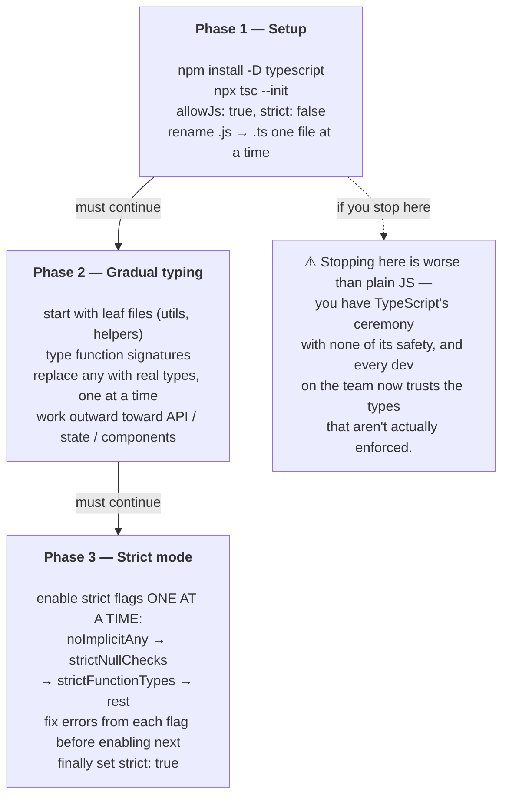

**Navigation**: [< Previous](02_TS_Advanced_Types.md) | [Back to Index](../00_MASTER_INDEX.md) | [Next >](04_TS_Deep_Reasoning.md)

**TypeScript Chapter 3/3** | [← Advanced Types](02_TS_Advanced_Types.md) | [Index](../00_MASTER_INDEX.md) | [Next Series → CSS Foundations](../18_CSS_Complete/01_CSS_Foundations.md)

# TypeScript Patterns & Best Practices — Production-Grade TS

## 5W1H — Why This Chapter?

WHAT: Real-world TypeScript patterns, best practices, and
production techniques used in professional codebases.

WHY: Knowing types isn't enough — you need to know HOW to
organize, structure, and apply them in real projects.
Bad TS is worse than no TS (false confidence).

WHO: Developers writing production TypeScript — React apps,
Node APIs, libraries, internal tools.

WHEN: After understanding generics and utility types.

HOW: Design patterns + anti-patterns + real codebase examples.

---

## 1. The "Think in Types First" Approach

BEFORE writing logic, define your data shapes.

Step 1: What data exist? → Define interfaces/types
Step 2: What operations? → Define function signatures
Step 3: What can go wrong? → Union types for error states
Step 4: Implement logic

This is TYPE-DRIVEN DEVELOPMENT.
The types become your specification — code fills in the blanks.

```typescript
// EXAMPLE: E-commerce Cart — Types First

// Step 1: Data shapes
interface Product {
  id: string;
  name: string;
  price: number; // in cents
  stock: number;
  category: "electronics" | "clothing" | "food";
}

interface CartItem {
  product: Product;
  quantity: number;
}

interface Cart {
  items: CartItem[];
  couponCode: string | null;
  discountPercent: number;
}

// Step 2: Operations
type CartAction =
  | { type: "ADD_ITEM"; product: Product; quantity: number }
  | { type: "REMOVE_ITEM"; productId: string }
  | { type: "UPDATE_QUANTITY"; productId: string; quantity: number }
  | { type: "APPLY_COUPON"; code: string }
  | { type: "CLEAR" };

// Step 3: Error states
type CartError =
  | { kind: "OUT_OF_STOCK"; product: string; available: number }
  | { kind: "INVALID_COUPON"; code: string }
  | { kind: "ITEM_NOT_FOUND"; productId: string }
  | { kind: "NEGATIVE_QUANTITY" };

type CartResult<T> = { ok: true; value: T } | { ok: false; error: CartError };

// Step 4: Implementation follows naturally
function cartReducer(state: Cart, action: CartAction): CartResult<Cart> {
  switch (action.type) {
    case "ADD_ITEM": {
      if (action.quantity <= 0) {
        return { ok: false, error: { kind: "NEGATIVE_QUANTITY" } };
      }
      if (action.product.stock < action.quantity) {
        return {
          ok: false,
          error: {
            kind: "OUT_OF_STOCK",
            product: action.product.name,
            available: action.product.stock,
          },
        };
      }
      const existing = state.items.find(
        (i) => i.product.id === action.product.id,
      );
      if (existing) {
        return {
          ok: true,
          value: {
            ...state,
            items: state.items.map((i) =>
              i.product.id === action.product.id
                ? { ...i, quantity: i.quantity + action.quantity }
                : i,
            ),
          },
        };
      }
      return {
        ok: true,
        value: {
          ...state,
          items: [
            ...state.items,
            { product: action.product, quantity: action.quantity },
          ],
        },
      };
    }
    // ... other cases follow same structure
    default:
      return { ok: true, value: state };
  }
}
```

---

🔬 **Section Challenge — 1. The "Think in Types First" Approach**

**Challenge 1 (Design):** You are building a complex multi-step wizard. Why is it an anti-pattern to define the state as `{ step1Data?: Data, step2Data?: Data, currentStep: number }`? How does "Type-Driven Development" fix this?

<details><summary>Answer</summary>

**Scenario:** Representing complex UI state across multiple screens.
**Trace:** If you use optional properties (`?`), you create a combinatorial explosion of **impossible states**. The type system allows `{ currentStep: 3, step1Data: undefined }`, which shouldn't happen. The compiler cannot help you catch logical flow errors.
**Design Fix:** Use a **Discriminated Union** to make impossible states unrepresentable:

```typescript
type WizardState =
  | { step: 1; data: null }
  | { step: 2; data: { step1: Data } }
  | { step: 3; data: { step1: Data; step2: Data } };
```

By defining the exact shapes first, the compiler enforces the correct data presence at every step.

</details>

## 2. React + TypeScript Patterns

### Component Props

```typescript
// BASIC PROPS:
interface ButtonProps {
    label: string;
    variant?: "primary" | "secondary" | "danger";
    size?: "sm" | "md" | "lg";
    disabled?: boolean;
    onClick: () => void;
}

const Button: React.FC<ButtonProps> = ({
    label,
    variant = "primary",
    size = "md",
    disabled = false,
    onClick
}) => (
    <button
        className={`btn btn-${variant} btn-${size}`}
        disabled={disabled}
        onClick={onClick}
    >
        {label}
    </button>
);

// CHILDREN PATTERN:
interface CardProps {
    title: string;
    children: React.ReactNode;  // Any valid JSX
}

// POLYMORPHIC "as" PROP:
type PolymorphicProps<E extends React.ElementType> = {
    as?: E;
    children: React.ReactNode;
} & Omit<React.ComponentPropsWithoutRef<E>, "as" | "children">;

function Box<E extends React.ElementType = "div">({
    as,
    children,
    ...props
}: PolymorphicProps<E>) {
    const Component = as || "div";
    return <Component {...props}>{children}</Component>;
}

// Usage:
<Box>Regular div</Box>
<Box as="section" id="main">Section element</Box>
<Box as="a" href="/about">Link element</Box>
// TS knows the valid props based on `as`!
```

### Hooks

```typescript
// useState with explicit type:
const [user, setUser] = useState<User | null>(null);
// TS knows: user is User | null

// useReducer (type-safe):
function useCart() {
  const [cart, dispatch] = useReducer(cartReducer, {
    items: [],
    couponCode: null,
    discountPercent: 0,
  });
  return { cart, dispatch };
}

// Custom Hook with generic:
function useLocalStorage<T>(key: string, initialValue: T) {
  const [stored, setStored] = useState<T>(() => {
    try {
      const item = window.localStorage.getItem(key);
      return item ? (JSON.parse(item) as T) : initialValue;
    } catch {
      return initialValue;
    }
  });

  const setValue = (value: T | ((prev: T) => T)) => {
    const valueToStore = value instanceof Function ? value(stored) : value;
    setStored(valueToStore);
    window.localStorage.setItem(key, JSON.stringify(valueToStore));
  };

  return [stored, setValue] as const;
  // REASONING: `as const` makes return type [T, (v: T | ((p: T) => T)) => void]
  // Without it, TS infers (T | ((v: ...) => void))[] — wrong!
}

// Usage:
const [theme, setTheme] = useLocalStorage<"light" | "dark">("theme", "light");
// theme: "light" | "dark" — perfectly typed!

// useRef patterns:
const inputRef = useRef<HTMLInputElement>(null); // For DOM elements
const countRef = useRef<number>(0); // For mutable values
```

### Event Handlers

```typescript
// React SyntheticEvent types:
const handleClick = (e: React.MouseEvent<HTMLButtonElement>) => {
  console.log(e.clientX, e.clientY);
};

const handleChange = (e: React.ChangeEvent<HTMLInputElement>) => {
  console.log(e.target.value); // TS knows: string
};

const handleSubmit = (e: React.FormEvent<HTMLFormElement>) => {
  e.preventDefault();
  const formData = new FormData(e.currentTarget);
};

const handleKeyDown = (e: React.KeyboardEvent<HTMLInputElement>) => {
  if (e.key === "Enter") submitForm();
};

// (Common React-event types — see the table below the code block.)
```

**Common React event handler types — which generic to import for
each handler prop:**

| Handler prop            | Event type                                            | Notes                                                                                          |
|-------------------------|-------------------------------------------------------|------------------------------------------------------------------------------------------------|
| `onClick`               | `React.MouseEvent<HTMLButtonElement>`                 | Swap the element to match the JSX tag (`HTMLDivElement`, etc.)                                 |
| `onChange` (`<input>`)  | `React.ChangeEvent<HTMLInputElement>`                 | Use `HTMLTextAreaElement` for `<textarea>`, `HTMLSelectElement` for `<select>`                 |
| `onSubmit`              | `React.FormEvent<HTMLFormElement>`                    | `e.currentTarget` is typed as the form, so `new FormData(e.currentTarget)` works               |
| `onKeyDown` / `onKeyUp` | `React.KeyboardEvent<HTMLInputElement>`               | `e.key` is `string`; use string literals like `"Enter"`, `"Escape"`, `"ArrowDown"`             |
| `onFocus` / `onBlur`    | `React.FocusEvent<HTMLElement>`                       | `relatedTarget` is the element receiving focus (useful for tab-key trap detection)             |
| `onDragStart` / `onDrop`| `React.DragEvent<HTMLDivElement>`                     | `dataTransfer` is fully typed — no need for `as any` on file drops                          |
| `onScroll`              | `React.UIEvent<HTMLDivElement>`                       | Fires many times per scroll — you almost always want to throttle                             |

**Rule of thumb.** Import the event type from `React.*`, parameterise
it with the HTML element the handler is attached to, and let
`e.currentTarget` do the work — it's typed as your element, so you
can call `.value`, `.checked`, `.files`, etc. without casts.

---

🔬 **Section Challenge — 2. React + TypeScript Patterns**

**Challenge 1 (Trace):** A developer uses `React.FC` for all components: `const Card: React.FC<Props> = ({ children }) => <div>{children}</div>`. In modern React 18+ and TS, why is this discouraged, and what's the better alternative?

<details><summary>Answer</summary>

**Scenario:** Typing React components.
**Trace:** Historically, `React.FC` implicitly injected the `children?: ReactNode` prop into your component, whether you wanted it or not. This led to bugs where components accepted children but never rendered them. While React 18 removed implicit children from `React.FC`, it still restricts generics and `defaultProps`.
**Design Fix:** Type the props directly as standard function arguments. It is cleaner, fully supports generics, and explicitly declares whether `children` are allowed:

```typescript
interface Props { title: string; children?: React.ReactNode; }
function Card({ title, children }: Props) { return <div>{title}{children}</div>; }
```

</details>

## 3. API Types Pattern — Single Source of Truth

```typescript
// DEFINE API TYPES, DERIVE EVERYTHING ELSE:

// 1. Backend returns this (shared type or generated from OpenAPI):
interface UserAPI {
  id: number;
  first_name: string; // snake_case from backend
  last_name: string;
  email: string;
  created_at: string; // ISO date string
  role: "admin" | "moderator" | "user";
  avatar_url: string | null;
}

// 2. Frontend model (camelCase, parsed dates):
interface User {
  id: number;
  firstName: string;
  lastName: string;
  email: string;
  createdAt: Date;
  role: "admin" | "moderator" | "user";
  avatarUrl: string | null;
}

// 3. Transform function:
function toUser(api: UserAPI): User {
  return {
    id: api.id,
    firstName: api.first_name,
    lastName: api.last_name,
    email: api.email,
    createdAt: new Date(api.created_at),
    role: api.role,
    avatarUrl: api.avatar_url,
  };
}

// 4. Derived types:
type CreateUserInput = Omit<User, "id" | "createdAt">;
type UpdateUserInput = Partial<
  Pick<User, "firstName" | "lastName" | "email" | "avatarUrl">
>;
type UserSummary = Pick<User, "id" | "firstName" | "lastName" | "avatarUrl">;

// 5. API client (typed):
class ApiClient {
  private baseUrl: string;

  constructor(baseUrl: string) {
    this.baseUrl = baseUrl;
  }

  async getUsers(): Promise<User[]> {
    const res = await fetch(`${this.baseUrl}/users`);
    const data: UserAPI[] = await res.json();
    return data.map(toUser);
  }

  async getUser(id: number): Promise<User> {
    const res = await fetch(`${this.baseUrl}/users/${id}`);
    const data: UserAPI = await res.json();
    return toUser(data);
  }

  async updateUser(id: number, updates: UpdateUserInput): Promise<User> {
    const res = await fetch(`${this.baseUrl}/users/${id}`, {
      method: "PATCH",
      headers: { "Content-Type": "application/json" },
      body: JSON.stringify(updates),
    });
    const data: UserAPI = await res.json();
    return toUser(data);
  }
}
```

---

🔬 **Section Challenge — 3. API Types Pattern — Single Source of Truth**

**Challenge 1 (Reasoning):** Why should you ALWAYS write a transform/mapper function (`toUser`) between the API payload and your frontend state, instead of just casting `const user = response.data as User`?

<details><summary>Answer</summary>

**Scenario:** Consuming API data in the frontend.
**Trace:** `as User` is a type assertion; it completely skips runtime checks. If the backend changes `first_name` to `firstName` in the JSON, the TS compiler won't complain because it trusts your `as User` cast. However, at runtime, your app will crash when it tries to read undefined fields.
**Design Fix:** The mapper function acts as an **Anti-Corruption Layer**. By explicitly mapping `firstName: api.first_name`, you isolate API contracts from frontend models. If the API changes, you only update the mapper, or better yet, validate the payload at the boundary using Zod before mapping it.

</details>

## 4. Anti-Patterns — What NOT to Do

```typescript
// ❌ ANTI-PATTERN 1: Using `any` everywhere
function process(data: any): any {
  return data.foo.bar;
}
// WHY BAD: Defeats the purpose of TS. No type safety at all.
// ✅ FIX: Use `unknown` + narrowing, or define proper types.

// ❌ ANTI-PATTERN 2: Excessive type assertions
const user = response as unknown as User; // Double assertion = red flag
// WHY BAD: You're lying to the compiler. If data doesn't match, runtime crash.
// ✅ FIX: Validate with type guard or Zod schema.

// ❌ ANTI-PATTERN 3: String enums for everything
enum Color {
  Red = "RED",
  Blue = "BLUE",
  Green = "GREEN",
}
// WHY BAD: Enums create runtime code, don't tree-shake, complex.
// ✅ FIX: Use union literals:
type Color = "RED" | "BLUE" | "GREEN";

// ❌ ANTI-PATTERN 4: Interface for everything (even non-objects)
interface UserId {
  value: string;
}
// WHY BAD: Unnecessary wrapper. Use type alias.
// ✅ FIX: type UserId = string; (or branded types if you need distinction)

// ❌ ANTI-PATTERN 5: Huge monolithic types
interface GodObject {
  user: User;
  products: Product[];
  cart: Cart;
  orders: Order[];
  settings: Settings;
  // ... 50 more fields
}
// WHY BAD: Everything depends on everything. Impossible to test.
// ✅ FIX: Separate types, pass only what's needed.

// ❌ ANTI-PATTERN 6: @ts-ignore instead of fixing
// @ts-ignore
user.nonexistentField;
// WHY BAD: Hides real errors. Technical debt.
// ✅ FIX: Fix the type or use @ts-expect-error (fails if error is fixed).

// ❌ ANTI-PATTERN 7: Not using strict mode
// { "strict": false } in tsconfig
// WHY BAD: TS without strict is barely better than JS.
// ✅ FIX: Always strict: true from day 1.
```

---

## 5. Branded Types — Preventing Mix-Ups

```typescript
// PROBLEM: UserId and ProductId are both strings, easily confused:
function getUser(id: string): User {
  /* ... */
}
function getProduct(id: string): Product {
  /* ... */
}

const userId = "user_123";
const productId = "prod_456";
getUser(productId); // No error! But it's WRONG.

// SOLUTION: Branded types
type UserId = string & { readonly __brand: "UserId" };
type ProductId = string & { readonly __brand: "ProductId" };

// Factory functions:
function createUserId(id: string): UserId {
  return id as UserId;
}
function createProductId(id: string): ProductId {
  return id as ProductId;
}

function getUser(id: UserId): User {
  /* ... */
}
function getProduct(id: ProductId): Product {
  /* ... */
}

const userId = createUserId("user_123");
const productId = createProductId("prod_456");
getUser(userId); // ✅
// getUser(productId);  // ❌ Type 'ProductId' not assignable to 'UserId'

// GENERIC BRAND HELPER:
type Brand<T, B extends string> = T & { readonly __brand: B };
type Email = Brand<string, "Email">;
type Currency = Brand<number, "Currency">; // Amount in cents
type Timestamp = Brand<number, "Timestamp">;
```

---

🔬 **Section Challenge — 5. Branded Types — Preventing Mix-Ups**

**Challenge 1 (Debug):** You implement branded types for `UserId` and `OrderId`. Later, you need to serialize them to JSON and send them to the server. Will the `__brand` property show up in the JSON payload and break the API?

<details><summary>Answer</summary>

**Scenario:** Serializing branded types.
**Trace:** No, it will not. The `__brand` property is purely a **compile-time phantom property**. Because you use an intersection (`string & { __brand: "UserId" }`), TypeScript pretends the property exists for type-checking purposes. At runtime, the value is just a primitive string. `JSON.stringify` will output a standard string without any brand metadata.
**Debug:** This is why branded types are considered a "zero-cost abstraction" — maximum compile-time safety with absolutely zero runtime footprint or payload bloat.

</details>

## 6. Declaration Files & Third-Party Types

```typescript
// .d.ts files contain ONLY type information (no runtime code).

// SCENARIO 1: Using a JS library without types
// Install @types package:
// npm install -D @types/lodash @types/express

// SCENARIO 2: Augmenting globals
// global.d.ts
declare global {
  interface Window {
    __APP_CONFIG__: {
      apiUrl: string;
      version: string;
    };
  }
}
export {}; // Makes this a module (required)

// SCENARIO 3: Declaring a module without types
// types/untyped-lib.d.ts
declare module "untyped-library" {
  export function process(data: unknown): string;
  export default function init(config: { debug: boolean }): void;
}

// SCENARIO 4: Environment variables
// env.d.ts
declare namespace NodeJS {
  interface ProcessEnv {
    NODE_ENV: "development" | "production" | "test";
    DATABASE_URL: string;
    API_KEY: string;
    PORT?: string;
  }
}

// Now process.env.NODE_ENV is typed!
// process.env.DATABASE_URL — string (not string | undefined)
```

---

🔬 **Section Challenge — 6. Declaration Files & Third-Party Types**

**Challenge 1 (Debug):** You install a legacy JS library that lacks `@types`. You create a `global.d.ts` and add `declare module "legacy-lib"`. Suddenly, your entire project loses its global types (like `Window`). What caused this?

<details><summary>Answer</summary>

**Scenario:** Writing custom declaration files.
**Trace:** If a `.d.ts` file contains ANY top-level `import` or `export` statement, TypeScript treats it as a **Module**, not a **Script**. In a Module, declarations are scoped to that file. If you declare global types in a module file without wrapping them in `declare global {}`, they won't augment the global scope.
**Fix:** Ensure your ambient module declarations are either in a pure script `.d.ts` file (no imports/exports), or if you must use imports, wrap the global augmentations explicitly in `declare global { ... }`.

</details>

## 7. Migration Strategy — JS to TS

**JS → TS migration is a strict three-phase progression — and stopping
at Phase 1 is worse than not starting.**



**Why the ordering matters, not just the destination:**

- Phase 1 keeps every existing file working (`allowJs: true` — the
  compiler accepts JS side-by-side with TS). This is the only way to
  ship a partial migration without a big-bang rewrite.
- Phase 2 has to move *outward from leaves* because typing a leaf
  file has zero risk (nothing depends on it), while typing a core
  module first surfaces every downstream `any` at once.
- Phase 3 flags must be flipped one at a time because each unlocks a
  different bug class; flipping `strict: true` in one go on a large
  codebase produces hundreds of errors at once and the team gives up.

**The rule.** Never let a migration end at Phase 1. Phase-1 TypeScript
is worse than JavaScript because it gives everyone a *false* sense of
safety — code that would have been reviewed for null-checks in JS is
now waved through because "it's typed", except it isn't. Push to
Phase 3 or roll back.

---

## 8. Performance Tips

```typescript
// 1. Use `interface` over `type` for objects (faster for TS compiler):
interface User { name: string } // ✅ Cached by name
type User = { name: string }    // ❌ Evaluated every time

// 2. Avoid deep recursion in types:
type DeepPartial<T> = /* ... */ // TS has max recursion depth (~50)

// 3. Use `const enum` for zero-runtime enums:
const enum Direction { Up, Down } // Inlined as 0, 1

// 4. Project references for monorepos:
// tsconfig.build.json
{
    "references": [
        { "path": "./packages/shared" },
        { "path": "./packages/api" },
        { "path": "./packages/web" }
    ]
}

// 5. skipLibCheck for faster builds:
{ "compilerOptions": { "skipLibCheck": true } }
// Skips checking node_modules .d.ts files
```

---

## 9. Essential TypeScript Configuration by Project Type

```
PROJECT TYPE → KEY TSCONFIG OPTIONS:

React + Vite:
├── target: "ES2020"
├── jsx: "react-jsx"
├── module: "ESNext"
├── moduleResolution: "bundler"
└── strict: true

Node.js API:
├── target: "ES2022"
├── module: "NodeNext"
├── moduleResolution: "NodeNext"
├── outDir: "./dist"
└── strict: true

Library/Package:
├── target: "ES2020"
├── declaration: true       ← Generate .d.ts
├── declarationMap: true    ← Source maps for types
├── composite: true         ← For project references
└── strict: true
```

---

🔬 **Section Challenge — 9. Essential TypeScript Configuration by Project Type**

**Challenge 1 (Reasoning):** You are building an npm library. You set `"target": "ES2022"` and `"module": "CommonJS"`. Why will this frustrate your users who use Webpack/Vite?

<details><summary>Answer</summary>

**Scenario:** Configuring `tsconfig.json` for libraries.
**Trace:** `CommonJS` (`require`/`module.exports`) is not statically analyzable. Modern bundlers like Webpack and Vite rely on ES Modules (`import`/`export`) to perform **Tree Shaking** (dead code elimination). If you distribute your library as CommonJS, users will bundle the entire library even if they only import one function.
**Design Fix:** For libraries, set `"module": "ESNext"` (or `NodeNext`). Modern practice is to compile and distribute two versions (ESM and CJS) using tools like `tsup` or `rollup`, but the source types should target ESM to preserve static analysis.

</details>

## Interview Quick-Fire

```
Q: How would you type a React component that accepts different props
   based on a variant?
→ Discriminated union of prop types:
  type Props = { variant: "link"; href: string } | { variant: "button"; onClick: () => void }
  Then narrow on props.variant.

Q: How do you handle API response types?
→ Define API types (what server returns), frontend model types,
  and transform functions. Use Zod or type guards for runtime validation.

Q: What's the difference between `type` and `interface` performance?
→ Interfaces are cached by name (faster). Types are re-evaluated.
  For objects, prefer interface. For unions/mapped types, must use type.

Q: How would you migrate a large JS project to TS?
→ Phase 1: Install TS, allowJs, rename files gradually.
  Phase 2: Add types starting from leaf files.
  Phase 3: Enable strict flags one at a time until strict: true.

Q: What are branded types?
→ Types using intersection with a phantom brand to prevent mixing
  compatible primitives: type UserId = string & { __brand: "UserId" }

Q: How do you type a function that accepts any object with a specific key?
→ Generic with constraint: function get<T extends { id: number }>(obj: T): number
  Or: function get<T, K extends keyof T>(obj: T, key: K): T[K]
```

---

[← Advanced Types](02_TS_Advanced_Types.md) | [Index](../00_MASTER_INDEX.md) | [Next Series → CSS Foundations](../18_CSS_Complete/01_CSS_Foundations.md)


---

## Reality Check

**"interface versus type is a style war with no stakes"** → The differences are mechanical and occasionally load-bearing: interfaces MERGE declarations (the extension mechanism library augmentation depends on — and a foot-gun inside apps where an accidental same-name interface silently merges), interfaces error more readably on extension conflicts, types alone express unions/conditionals/mapped forms, and error messages display differently (aliases can inline into hovers). The convention that survives contact — interfaces for object contracts others implement/extend/augment, types for everything else — exists because of these mechanics, not aesthetics. Knowing WHY retires the war.

**"Enums are how TypeScript does constants"** → Enums are the feature the ecosystem walked back from, for reasons worth owning: they generate RUNTIME code (violating types-are-erased — an import that survives compilation, awkward for tree-shaking and erasableSyntaxOnly tooling), numeric enums accept... any number silently in older versions and reverse-map weirdly, and const-enum inlining breaks under isolatedModules. The modern replacement is the as-const object plus a derived union type (keyof typeof) — same autocomplete and exhaustiveness, zero runtime surprises, string-debuggable values. Legacy enums are fine to leave; NEW enums need a justification.

**"Type guards are for narrowing unknown API data"** → User-defined guards (x is T) are TRUST INJECTION points — the compiler believes your predicate body unconditionally, and a wrong guard is worse than a cast because it looks like proof: the discipline is keeping guard bodies trivially auditable or generated (zod's safeParse as the guard). The underused members of the narrowing family: assertion functions (asserts x is T — throw-or-narrow, perfect for invariant helpers), discriminant-based narrowing that needs NO guard at all (design the union with a tag and switch on it — the zero-trust option), and exhaustiveness via never in the default arm (adding a union member breaks every switch that must handle it — the type system as change-impact analysis).

**"Generics make code reusable"** → Application-code generics earn their complexity only when they PRESERVE type relationships through a transformation (the function that returns what it was given, keyed lookups where the key narrows the value — function get<K extends keyof T>(obj: T, k: K): T[K]); generics that merely abstract for abstraction's sake (one type parameter used once, in a signature nobody calls polymorphically) are complexity without preservation. The two working heuristics: a type parameter should appear TWICE or constrain something, and the constraint (extends) is where the design lives — unconstrained T is usually a question not yet answered.

**"Utility types cover composition; combine them freely"** → Deep utility-type COMPOSITIONS (Partial of Pick of Omit of...) are how codebases accrete unreadable type plumbing: each layer is fine, the stack becomes a hover-tooltip of doom and an error-message generator that buries the actual mismatch six instantiations deep. The maintainable pattern is NAMING intermediate shapes (type DraftUser = ... as a real, documented concept) and deriving in one visible step from a single source-of-truth type — derivation trees with named nodes, not anonymous utility pipelines. If the hover tooltip needs horizontal scrolling, the design was outsourced to the utility belt.
