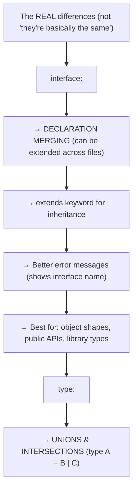
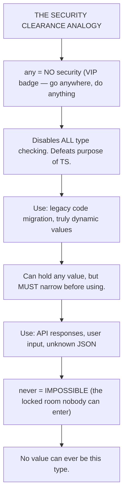
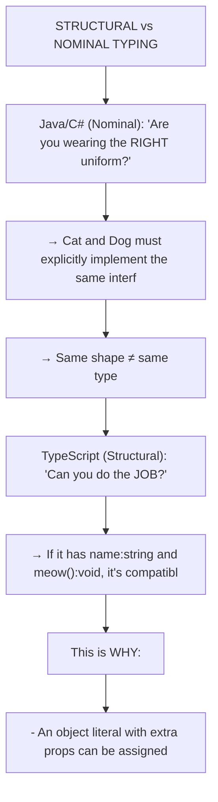
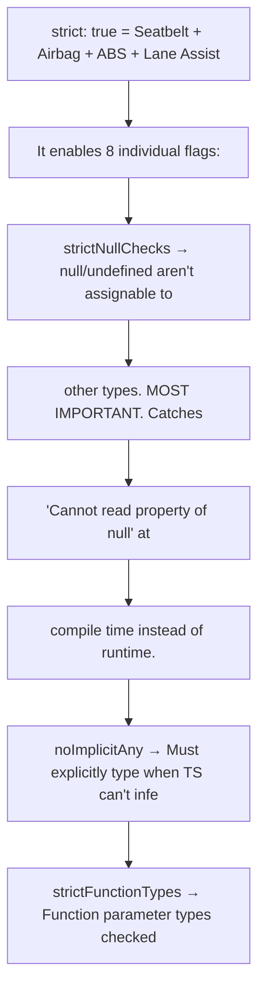
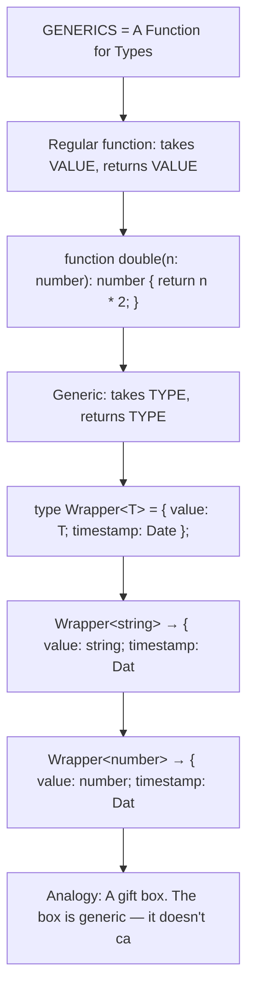
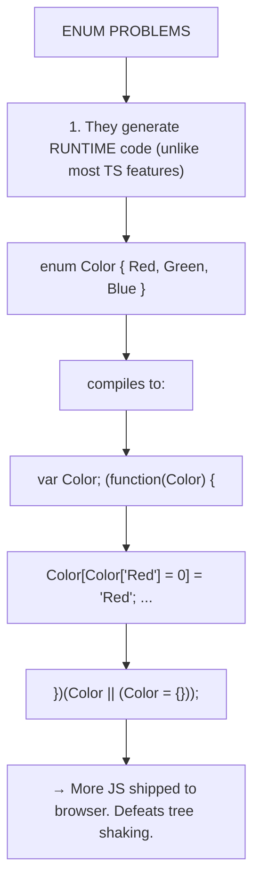

> **Navigation**: [< Previous](03_TS_Patterns_BestPractices.md) | [Back to Index](../00_MASTER_INDEX.md)

# Chapter 4 — TypeScript Deep Reasoning: The Questions That Freeze People

> **"Anyone can say 'TypeScript adds types to JavaScript.' The senior explains WHY structural typing matters, WHEN `any` is acceptable, and HOW the compiler erases everything before runtime."**

---

## Table of Contents

1. [Type Erasure: TypeScript Doesn't Exist at Runtime](#1-type-erasure-typescript-doesnt-exist-at-runtime)
2. [`type` vs `interface`: The REAL Difference](#2-type-vs-interface-the-real-difference)
3. [`any` vs `unknown` vs `never`: The Type Hierarchy](#3-any-vs-unknown-vs-never-the-type-hierarchy)
4. [Structural Typing: Why TS Doesn't Care About Names](#4-structural-typing-why-ts-doesnt-care-about-names)
5. [Why `strict: true` and What Each Flag Does](#5-why-strict-true-and-what-each-flag-does)
6. [Generics: Not Just `<T>` — The REAL Mental Model](#6-generics-not-just-t--the-real-mental-model)
7. [Enums: Why Most Seniors Avoid Them](#7-enums-why-most-seniors-avoid-them)
8. [`as const` vs `readonly` vs `Readonly<T>`](#8-as-const-vs-readonly-vs-readonlyt)
9. [Discriminated Unions: The Pattern That Replaces if/else](#9-discriminated-unions-the-pattern-that-replaces-ifelse)
10. [Why `Object.keys()` Returns `string[]`, Not `keyof T`](#10-why-objectkeys-returns-string-not-keyof-t)

---

## 1. Type Erasure: TypeScript Doesn't Exist at Runtime

### The Freeze Question
> "Can you check if a variable is a specific TypeScript type at runtime?"

### Deep Reasoning


> TYPES ARE LIKE BLUEPRINTS — The Building Analogy
>
> TypeScript types = Architectural blueprints
> Compiled JavaScript = The finished building
>
> The blueprints guide construction (development).
> Once the building is built (compiled), the blueprints are
> stored in a drawer — they're NOT embedded in the walls.
>
> You can't walk into a building and ask "show me the blueprint
> for this room." The blueprint (type) was used during
> construction (compilation) and then ERASED.


```typescript
// TypeScript (what you write):
interface User {
  name: string;
  age: number;
}

function greet(user: User) {
  console.log(user.name);
}

// Compiled JavaScript (what runs):
function greet(user) {
  console.log(user.name);
}
// ALL types are GONE. No interface, no : string, no : number.

// This means YOU CANNOT DO:
function isUser(obj: unknown): obj is User {
  return obj instanceof User; // ❌ ERROR: User is a type, not a value!
}

// You MUST check structurally:
function isUser(obj: unknown): obj is User {
  return typeof obj === 'object' && obj !== null 
    && 'name' in obj && typeof (obj as any).name === 'string'
    && 'age' in obj && typeof (obj as any).age === 'number';
}
// or use a validation library like Zod
```

**Key implications:**
- `interface` and `type` don't exist at runtime
- `enum` DOES exist at runtime (it compiles to an object) — which is why some prefer `as const`
- `class` exists at runtime (it's also a JS feature)
- You need runtime validation (Zod, io-ts) for API responses — TS can't check them

---


> 🔬 **Section Challenge — 1. Type Erasure: TypeScript Doesn't Exist at Runtime**
>>

## 2. `type` vs `interface`: The REAL Difference

### The Freeze Question
> "When should I use `type` vs `interface`?"

### Deep Reasoning

```
╔══════════════════════════════════════════════════════════════════╗
║  The REAL differences (not "they're basically the same"):        ║
║                                                                  ║
║  interface:                                                      ║
║  → DECLARATION MERGING (can be extended across files)            ║
║  → extends keyword for inheritance                               ║
║  → Better error messages (shows interface name)                  ║
║  → Best for: object shapes, public APIs, library types           ║
║                                                                  ║
║  type:                                                           ║
║  → UNIONS & INTERSECTIONS (type A = B | C)                       ║
║  → Mapped types, conditional types                               ║
║  → Can alias primitives (type ID = string)                       ║
║  → Best for: unions, computed types, utility types               ║
╚══════════════════════════════════════════════════════════════════╝
```

**Flow:**
- The REAL differences (not 'they're basically the same')
- ↓
- interface:
- ↓
- DECLARATION MERGING (can be extended across files)
- ↓
- extends keyword for inheritance
- ↓
- Better error messages (shows interface name)
- ↓
- Best for: object shapes, public APIs, library types
- ↓
- type:



```typescript
// Declaration merging — ONLY interface can do this
interface Window {
  myCustomProperty: string; // adds to existing Window interface
}
// If you're building a library, this lets users extend your types.

// type can't merge:
type Window = { myCustomProperty: string }; // ❌ Error: Duplicate identifier

// UNIONS — ONLY type can do this
type Status = 'loading' | 'success' | 'error'; // interface can't do string unions
type Result = Success | Failure;               // interface can't do unions

// INTERSECTIONS — both can, but type is cleaner
type Employee = Person & { employeeId: string };
// vs
interface Employee extends Person { employeeId: string }

// PRACTICAL RULE:
// Use interface for objects you want others to extend
// Use type for everything else (unions, computed types, primitives)
// Many teams just pick one and stay consistent — that's fine too
```

---


> 🔬 **Section Challenge — 2. `type` vs `interface`: The REAL Difference**
>>

## 3. `any` vs `unknown` vs `never`: The Type Hierarchy

### The Freeze Question
> "What's the difference between `any` and `unknown`?"

### Deep Reasoning

```
╔══════════════════════════════════════════════════════════════════╗
║  THE SECURITY CLEARANCE ANALOGY                                  ║
║                                                                  ║
║  any    = NO security (VIP badge — go anywhere, do anything)     ║
║         Disables ALL type checking. Defeats purpose of TS.       ║
║         Use: legacy code migration, truly dynamic values         ║
║                                                                  ║
║  unknown = MAXIMUM security (visitor badge — must be verified)   ║
║         Can hold any value, but MUST narrow before using.        ║
║         Use: API responses, user input, unknown JSON             ║
║                                                                  ║
║  never  = IMPOSSIBLE (the locked room nobody can enter)          ║
║         No value can ever be this type.                          ║
║         Use: exhaustive checks, impossible states                ║
║                                                                  ║
║  TYPE HIERARCHY:                                                 ║
║    any/unknown (top — accepts everything)                        ║
║         │                                                        ║
║    string, number, boolean, object... (middle)                   ║
║         │                                                        ║
║    never (bottom — accepts nothing)                              ║
╚══════════════════════════════════════════════════════════════════╝
```

**Flow:**
- THE SECURITY CLEARANCE ANALOGY
- ↓
- any = NO security (VIP badge — go anywhere, do anything
- ↓
- Disables ALL type checking. Defeats purpose of TS.
- ↓
- Use: legacy code migration, truly dynamic values
- ↓
- Can hold any value, but MUST narrow before using.
- ↓
- Use: API responses, user input, unknown JSON
- ↓
- never = IMPOSSIBLE (the locked room nobody can enter)



```typescript
// any: Compiler trusts you blindly (DANGEROUS)
const val: any = "hello";
val.toFixed(2);         // No error! But crashes at runtime ("hello".toFixed)
val.nonExistent.deep;   // No error! But crashes at runtime

// unknown: Compiler forces you to check first (SAFE)
const val: unknown = "hello";
val.toFixed(2);         // ❌ Error: Object is of type 'unknown'
if (typeof val === 'string') {
  val.toUpperCase();    // ✅ Now TS knows it's a string
}

// never: Exhaustive check (catch missed cases)
type Shape = 'circle' | 'square' | 'triangle';
function area(shape: Shape) {
  switch (shape) {
    case 'circle': return /* ... */;
    case 'square': return /* ... */;
    case 'triangle': return /* ... */;
    default:
      const _exhaustiveCheck: never = shape;
      // If you add 'pentagon' to Shape but forget this case,
      // TS ERROR: 'pentagon' is not assignable to type 'never'
      // This catches bugs at COMPILE time!
      return _exhaustiveCheck;
  }
}
```

---


> 🔬 **Section Challenge — 3. `any` vs `unknown` vs `never`: The Type Hierarchy**
>>

## 4. Structural Typing: Why TS Doesn't Care About Names

### The Freeze Question
> "Why does this code compile without error?"

```typescript
interface Cat { name: string; meow(): void; }
interface Dog { name: string; meow(): void; }

const cat: Cat = { name: 'Whiskers', meow() {} };
const dog: Dog = cat; // No error?!
```

### Deep Reasoning

```
╔══════════════════════════════════════════════════════════════════╗
║  STRUCTURAL vs NOMINAL TYPING                                    ║
║                                                                  ║
║  Java/C# (Nominal): "Are you wearing the RIGHT uniform?"         ║
║  → Cat and Dog must explicitly implement the same interface      ║
║  → Same shape ≠ same type                                        ║
║                                                                  ║
║  TypeScript (Structural): "Can you do the JOB?"                  ║
║  → If it has name:string and meow():void, it's compatible        ║
║  → TS doesn't care what you CALL yourself, only what you CAN DO  ║
║  → Like hiring: "Can you code in Java?" not "Did you go to MIT?" ║
║                                                                  ║
║  This is WHY:                                                    ║
║  - An object literal with extra props can be assigned            ║
║  - Classes from different files with same shape are compatible   ║
║  - You don't need `implements` to satisfy an interface           ║
╚══════════════════════════════════════════════════════════════════╝
```

**Flow:**
- STRUCTURAL vs NOMINAL TYPING
- ↓
- Java/C# (Nominal): 'Are you wearing the RIGHT uniform?'
- ↓
- Cat and Dog must explicitly implement the same interf
- ↓
- Same shape ≠ same type
- ↓
- TypeScript (Structural): 'Can you do the JOB?'
- ↓
- If it has name:string and meow():void, it's compatibl
- ↓
- This is WHY:



```typescript
// This is valid TS — no explicit relationship needed:
interface Printable { print(): void; }
class Document { print() { console.log('printed'); } }
const doc: Printable = new Document(); // Works! Same shape.

// But this creates a PROBLEM: accidental compatibility
interface Dollars { amount: number; }
interface Euros   { amount: number; }
const price: Dollars = { amount: 100 };
const euroPrice: Euros = price; // No error! But semantically wrong.

// FIX: Branded types (force nominal behavior)
type Dollars = number & { __brand: 'dollars' };
type Euros   = number & { __brand: 'euros' };
const usd = 100 as Dollars;
const eur: Euros = usd; // ❌ Error! Different brands.
```

---


## 5. Why `strict: true` and What Each Flag Does

### The Freeze Question
> "What does `strict: true` actually enable?"

```
╔══════════════════════════════════════════════════════════════════╗
║  strict: true = Seatbelt + Airbag + ABS + Lane Assist            ║
║                                                                  ║
║  It enables 8 individual flags:                                  ║
║                                                                  ║
║  strictNullChecks     → null/undefined aren't assignable to      ║
║                         other types. MOST IMPORTANT. Catches     ║
║                         "Cannot read property of null" at        ║
║                         compile time instead of runtime.         ║
║                                                                  ║
║  noImplicitAny        → Must explicitly type when TS can't infer ║
║                                                                  ║
║  strictFunctionTypes  → Function parameter types checked         ║
║                         contravariantly (catches subtle bugs)    ║
║                                                                  ║
║  strictBindCallApply  → bind/call/apply are correctly typed      ║
║                                                                  ║
║  strictPropertyInitialization → Class properties must be         ║
║                         initialized in constructor               ║
║                                                                  ║
║  noImplicitThis       → Must type `this` in functions            ║
║                                                                  ║
║  useUnknownInCatchVariables → catch(e) is unknown, not any       ║
║                                                                  ║
║  alwaysStrict         → Emits "use strict" in JS output          ║
╚══════════════════════════════════════════════════════════════════╝
```

**Flow:**
- strict: true = Seatbelt + Airbag + ABS + Lane Assist
- ↓
- It enables 8 individual flags:
- ↓
- strictNullChecks
- ↓
- null/undefined aren't assignable to
- ↓
- strictNullChecks
- ↓
- null/undefined aren't assignable to
- ↓
- other types. MOST IMPORTANT. Catches
- ↓
- 'Cannot read property of null' at
- ↓
- compile time instead of runtime.
- ↓
- noImplicitAny
- ↓
- Must explicitly type when TS can't infe



---

## 6. Generics: Not Just `<T>` — The REAL Mental Model

### The Freeze Question
> "Explain generics beyond just `<T>`."

```
╔══════════════════════════════════════════════════════════════════╗
║  GENERICS = A Function for Types                                 ║
║                                                                  ║
║  Regular function: takes VALUE, returns VALUE                    ║
║    function double(n: number): number { return n * 2; }          ║
║                                                                  ║
║  Generic: takes TYPE, returns TYPE                               ║
║    type Wrapper<T> = { value: T; timestamp: Date };              ║
║    Wrapper<string> → { value: string; timestamp: Date }          ║
║    Wrapper<number> → { value: number; timestamp: Date }          ║
║                                                                  ║
║  Analogy: A gift box. The box is generic — it doesn't care       ║
║  what's inside. But once you put shoes in (Wrapper<Shoes>),      ║
║  the box "knows" it contains shoes and can tell you so.          ║
╚══════════════════════════════════════════════════════════════════╝
```

**Flow:**
- GENERICS = A Function for Types
- ↓
- Regular function: takes VALUE, returns VALUE
- ↓
- function double(n: number): number { return n * 2; }
- ↓
- Generic: takes TYPE, returns TYPE
- ↓
- type Wrapper<T> = { value: T; timestamp: Date };
- ↓
- Wrapper<string>
- ↓
- { value: string; timestamp: Dat
- ↓
- Wrapper<string>
- ↓
- { value: string; timestamp: Dat
- ↓
- Wrapper<number>
- ↓
- { value: number; timestamp: Dat



```typescript
// Constraint: "T must have a length property"
function longest<T extends { length: number }>(a: T, b: T): T {
  return a.length >= b.length ? a : b;
}
longest("hello", "hi");         // ✅ string has length
longest([1, 2, 3], [1, 2]);    // ✅ array has length  
longest(10, 20);                // ❌ number doesn't have length

// Keyof constraint: "K must be a key of T"
function getProperty<T, K extends keyof T>(obj: T, key: K): T[K] {
  return obj[key];
}
getProperty({ name: "Alice", age: 25 }, "name"); // returns string
getProperty({ name: "Alice", age: 25 }, "foo");  // ❌ "foo" not in keys

// Conditional types: "If T is X, then A, else B"
type IsString<T> = T extends string ? "yes" : "no";
type A = IsString<string>;  // "yes"
type B = IsString<number>;  // "no"
```

---

## 7. Enums: Why Most Seniors Avoid Them

### The Freeze Question
> "Why do some codebases ban enums?"

```
╔══════════════════════════════════════════════════════════════════╗
║  ENUM PROBLEMS                                                   ║
║                                                                  ║
║  1. They generate RUNTIME code (unlike most TS features):        ║
║     enum Color { Red, Green, Blue }                              ║
║     compiles to:                                                 ║
║     var Color; (function(Color) {                                ║
║       Color[Color["Red"] = 0] = "Red"; ...                       ║
║     })(Color || (Color = {}));                                   ║
║     → More JS shipped to browser. Defeats tree shaking.          ║
║                                                                  ║
║  2. Numeric enums have unsafe reverse mapping:                   ║
║     Color[999] = undefined, but TS won't complain                ║
║                                                                  ║
║  3. const enum has different behavior and esbuild issues         ║
║                                                                  ║
║  ALTERNATIVE: Union types + as const                             ║
║  const COLORS = ['red', 'green', 'blue'] as const;               ║
║  type Color = typeof COLORS[number]; // 'red'|'green'|'blue'     ║
║  → No runtime code, tree-shakable, same type safety              ║
╚══════════════════════════════════════════════════════════════════╝
```

**Flow:**
- ENUM PROBLEMS
- ↓
- 1. They generate RUNTIME code (unlike most TS features)
- ↓
- enum Color { Red, Green, Blue }
- ↓
- compiles to:
- ↓
- var Color; (function(Color) {
- ↓
- Color[Color['Red'] = 0] = 'Red'; ...
- ↓
- })(Color
- ↓
- (Color = {}));



---

## 8. `as const` vs `readonly` vs `Readonly<T>`

### The Freeze Question
> "What's the difference between these three?"

```typescript
// readonly on property → prevents reassignment of ONE property
interface User {
  readonly id: string;  // can't do user.id = "new"
  name: string;         // CAN do user.name = "new"
}

// Readonly<T> → makes ALL properties readonly (shallow)
type ReadonlyUser = Readonly<User>;
// { readonly id: string; readonly name: string; }

// as const → makes EVERYTHING deeply immutable AND narrows types
const config = {
  api: 'https://example.com',
  retries: 3,
  features: ['auth', 'logging']
} as const;
// Type: { readonly api: "https://example.com"; 
//         readonly retries: 3; 
//         readonly features: readonly ["auth", "logging"]; }
// Note: values are LITERAL types, not string/number

// Without as const:
const config2 = { api: 'https://example.com', retries: 3 };
// Type: { api: string; retries: number; }  ← widened types
```

**Analogy:** `readonly` = a locked display case for ONE item. `Readonly<T>` = locking the whole display room. `as const` = casting everything in concrete (deeply frozen AND narrowed to exact values).

---

## 9. Discriminated Unions: The Pattern That Replaces if/else

### The Freeze Question
> "How do you type a value that can be multiple different shapes?"

```typescript
// THE PATTERN: One shared property (discriminant) with literal types
type ApiResponse =
  | { status: 'loading' }
  | { status: 'success'; data: User[] }
  | { status: 'error'; message: string };

function handleResponse(response: ApiResponse) {
  switch (response.status) {
    case 'loading':
      // TS knows: no data, no message
      return <Spinner />;
    case 'success':
      // TS knows: data exists (User[])
      return response.data.map(u => <UserCard user={u} />);
    case 'error':
      // TS knows: message exists (string)
      return <Alert>{response.message}</Alert>;
  }
}
// TS auto-narrows the type in each branch. No casting needed.
// If you add a new status, TS warns about unhandled case (with never check).
```

**Why this replaces `isLoading, isError` booleans:**
```typescript
// ❌ Boolean flags allow IMPOSSIBLE states
type State = { isLoading: boolean; isError: boolean; data?: User[] };
// Can be { isLoading: true, isError: true } — loading AND error?!

// ✅ Discriminated union makes impossible states unrepresentable
type State = 
  | { status: 'loading' }
  | { status: 'success'; data: User[] }
  | { status: 'error'; error: string };
// Can NEVER be loading and error at the same time
```

---


## 10. Why `Object.keys()` Returns `string[]`, Not `keyof T`

### The Freeze Question
> "Why doesn't `Object.keys(user)` return `('name' | 'age')[]`?"

### Deep Reasoning

**Because of structural typing!** An object can have MORE keys than its type declares.

```typescript
interface User { name: string; age: number; }
const user: User = { name: 'Alice', age: 25, email: 'a@b.com' } as User;
// user might have extra properties TS doesn't know about

Object.keys(user); // ['name', 'age', 'email'] at runtime
// If TS returned (keyof User)[], it would miss 'email' — unsound!
// So TS conservatively returns string[] — always correct.

// SAFE workaround when you're SURE there are no extra keys:
const keys = Object.keys(user) as (keyof User)[];
```

---


## Interview Quick-Fire: TypeScript Freeze Busters

| Freeze Question | Senior-Level Answer |
|----------------|-------------------|
| "Does TypeScript make code slower?" | No. All types are erased at compile time. The runtime JS is identical to hand-written JS. The only "cost" is compile time during development. |
| "What is type widening?" | TS infers the WIDEST type: `let x = 'hello'` → `x: string`. Use `const` or `as const` to get narrow literal types: `const x = 'hello'` → `x: "hello"`. |
| "What is type narrowing?" | Reducing a wide type to a specific one using control flow: `typeof`, `instanceof`, `in`, discriminated unions. TS tracks these checks and narrows automatically. |
| "What is declaration merging?" | Multiple declarations of same `interface` merge into one. Used by libraries (e.g., Express adds properties to Request). `type` can't merge — redeclaration is an error. |
| "What's the `infer` keyword?" | Used in conditional types to EXTRACT a type: `type ReturnType<T> = T extends (...args: any) => infer R ? R : never`. It says "figure out what R is from the structure." |
| "Why use `satisfies` over `as`?" | `as` overrides the compiler (I know better). `satisfies` validates without widening (prove you match this shape but keep the narrow type). Safer because it doesn't lie to the compiler. |

---

← Previous: [Chapter 3 — Patterns & Best Practices](03_TS_Patterns_BestPractices.md)
| [📚 Index](../00_MASTER_INDEX.md)
| Next: [CSS Deep Reasoning →](../18_CSS_Complete/05_CSS_Deep_Reasoning.md)


---


---

## 🏋️ Practice & Interview Questions — TypeScript

### Predict / Trace
**Q1.** What is the difference between `type` and `interface` in TypeScript?
<details><summary>Answer</summary>

`interface`: can be extended/implemented, supports declaration merging (multiple declarations merge), better for OOP patterns. `type`: can represent unions, intersections, primitives, tuples — more versatile. Both work for object shapes. Prefer `interface` for public API shapes, `type` for complex compositions.
</details>

**Q2.** Does this compile?
```typescript
type A = { a: string } & { a: number };
const x: A = { a: "hello" }; // ← ?
```
<details><summary>Answer</summary>

**Compile error** — the intersection requires `a` to be both `string` AND `number` simultaneously — impossible (`never` type). The type `A` is effectively `{ a: never }`.
</details>

### Coding Problems
**Q3.** ⭐ Implement `Readonly<T>` from scratch (mapped type).
<details><summary>Solution</summary>

```typescript
type MyReadonly<T> = { readonly [K in keyof T]: T[K] };
```
</details>

**Q4.** ⭐ Implement `Partial<T>` from scratch.
<details><summary>Solution</summary>

```typescript
type MyPartial<T> = { [K in keyof T]?: T[K] };
```
</details>

**Q5.** ⭐⭐ Implement `DeepReadonly<T>` — recursive.
<details><summary>Solution</summary>

```typescript
type DeepReadonly<T> = {
  readonly [K in keyof T]: T[K] extends object ? DeepReadonly<T[K]> : T[K];
};
```
</details>

**Q6.** ⭐⭐ Write a generic `Result<T, E>` type for error handling without exceptions.
<details><summary>Solution</summary>

```typescript
type Result<T, E = Error> =
  | { ok: true; value: T }
  | { ok: false; error: E };

function divide(a: number, b: number): Result<number, string> {
  if(b === 0) return { ok: false, error: "Division by zero" };
  return { ok: true, value: a / b };
}

const result = divide(10, 2);
if(result.ok) console.log(result.value); // TypeScript knows it's number
else console.log(result.error);           // TypeScript knows it's string
```
</details>

### MCQ Rapid Fire
| # | Question | Answer |
|---|---|---|
| 1 | `unknown` vs `any` | unknown: type-safe (must narrow before use); any: escape hatch (no checks) |
| 2 | `never` type means | Value that never occurs (unreachable code, empty union) |
| 3 | Discriminated union uses | Shared literal property to narrow type |
| 4 | `keyof T` | Union of T's property names |
| 5 | `T[K]` where K extends keyof T | Indexed access type — type of property K in T |
| 6 | `infer` keyword used in | Conditional types to extract nested types |
| 7 | `satisfies` keyword (TS 4.9) | Checks value satisfies type without widening the type |


> **Navigation**: [< Previous](03_TS_Patterns_BestPractices.md) | [Back to Index](../00_MASTER_INDEX.md)