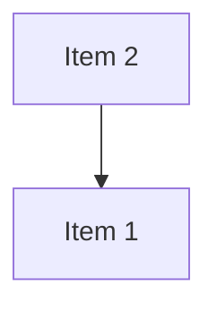
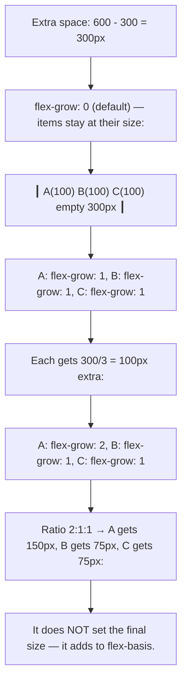
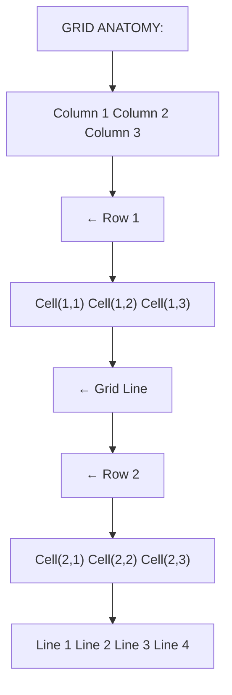
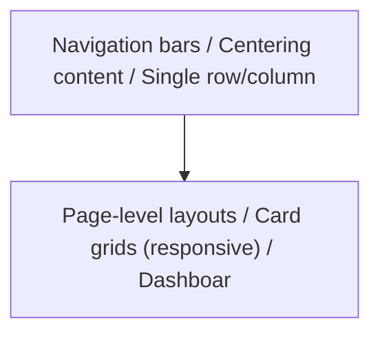
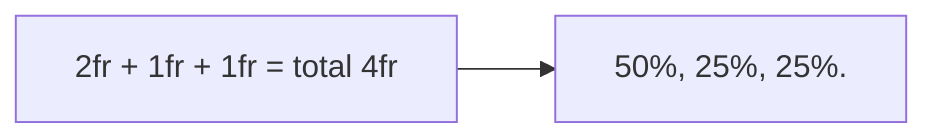

> **Navigation**: [< Previous](01_CSS_Foundations.md) | [Back to Index](../00_MASTER_INDEX.md) | [Next >](03_CSS_Responsive_Animations.md)

> **CSS Chapter 2/4** | [← Foundations](01_CSS_Foundations.md) | [Index](../00_MASTER_INDEX.md) | [Next → Responsive & Animations](03_CSS_Responsive_Animations.md)

# CSS Layout Systems — Flexbox, Grid & the Complete Toolkit

## 5W1H — Why This Chapter?


> WHAT: Flexbox = 1-dimensional layout (row OR column).
> Grid = 2-dimensional layout (rows AND columns together).
>
> WHY:  Before flex/grid, layout was done with floats and hacks.
> Centering a div was a meme. Now it's 3 lines of CSS.
> Flexbox and Grid solve 99% of all layout problems.
>
> WHO:  Every developer who builds UIs. No exceptions.
>
> WHEN: Flex: Navigation bars, card rows, alignments.
> Grid: Page layouts, dashboards, complex 2D layouts.
> BOTH: Use together! Grid for page, flex for components.
>
> HOW:  display: flex or display: grid on the PARENT container.
> Children become flex/grid items automatically.


---

## 1. Flexbox — Complete Guide

### The Two Axes

```

flex-direction: row (DEFAULT):

MAIN AXIS →→→→→→→→→→→→→→→→→→→→→→→→→→→
┌────────┐  ┌────────┐  ┌────────┐
│ Item 1 │  │ Item 2 │  │ Item 3 │
└────────┘  └────────┘  └────────┘  ↑
↕                                    │ CROSS AXIS
↕ CROSS AXIS                         ↓

flex-direction: column:

MAIN AXIS ↓↓↓
┌────────────────┐
│    Item 1      │
└────────────────┘
┌────────────────┐   CROSS AXIS →→→
│    Item 2      │
└────────────────┘
┌────────────────┐
│    Item 3      │
└────────────────┘

KEY INSIGHT: justify-content works on MAIN axis.
             align-items works on CROSS axis.
When you change direction, their effects SWAP!
```

**Flow:**
- Item 1
- ↓
- Item 2
- ↓
- Item 1



### Container Properties (Parent)

```css
.flex-container {
    display: flex;

    /* 1. DIRECTION: Which way items flow */
    flex-direction: row;           /* → Default: left to right */
    flex-direction: row-reverse;   /* ← Right to left */
    flex-direction: column;        /* ↓ Top to bottom */
    flex-direction: column-reverse;/* ↑ Bottom to top */

    /* 2. WRAP: What happens when items don't fit */
    flex-wrap: nowrap;   /* Default: squish everything on one line */
    flex-wrap: wrap;     /* Items wrap to next line */

    /* 3. JUSTIFY-CONTENT: Distribute along MAIN axis */
    justify-content: flex-start;    /* ┃■ ■ ■      ┃ */
    justify-content: flex-end;      /* ┃      ■ ■ ■┃ */
    justify-content: center;        /* ┃   ■ ■ ■   ┃ */
    justify-content: space-between; /* ┃■    ■    ■┃ */
    justify-content: space-around;  /* ┃ ■   ■   ■ ┃ */
    justify-content: space-evenly;  /* ┃  ■  ■  ■  ┃ */

    /* 4. ALIGN-ITEMS: Align along CROSS axis */
    align-items: stretch;     /* Default: fill container height */
    align-items: flex-start;  /* Top of container */
    align-items: flex-end;    /* Bottom of container */
    align-items: center;      /* Vertically centered */
    align-items: baseline;    /* Align text baselines */

    /* 5. GAP: Space between items (modern, clean) */
    gap: 16px;           /* Equal gap all around */
    gap: 16px 24px;      /* Row gap | Column gap */
    /* REASONING: gap replaces margin hacks. No margin on :last-child needed */

    /* 6. ALIGN-CONTENT: When items WRAP to multiple lines */
    align-content: flex-start;
    align-content: center;
    align-content: space-between;
}
```

### Item Properties (Children)

```css
.flex-item {
    /* 1. FLEX shorthand: grow | shrink | basis */
    flex: 1;           /* flex: 1 1 0% — grow equally, shrink equally */
    flex: 0 1 auto;    /* Default: don't grow, can shrink, natural size */
    flex: none;        /* 0 0 auto: rigid, no grow/shrink */

    /* INDIVIDUAL: */
    flex-grow: 1;    /* How much extra space to take (0 = don't grow) */
    flex-shrink: 1;  /* How much to shrink if overflow (0 = don't shrink) */
    flex-basis: 200px; /* Initial size before growing/shrinking */

    /* 2. ALIGN-SELF: Override parent's align-items for this item */
    align-self: center;  /* Vertically center just THIS item */

    /* 3. ORDER: Visual order (default 0, can be negative) */
    order: -1;  /* Move to front */
    order: 99;  /* Move to end */
}
```

### Flex-Grow Visualization

```
╔══════════════════════════════════════════════════════════════════════╗
║  Container width: 600px | Items: A(100px), B(100px), C(100px)        ║
║  Extra space: 600 - 300 = 300px                                      ║
║                                                                      ║
║  flex-grow: 0 (default) — items stay at their size:                  ║
║  ┃ A(100) │ B(100) │ C(100) │          empty 300px          ┃        ║
║                                                                      ║
║  A: flex-grow: 1, B: flex-grow: 1, C: flex-grow: 1                   ║
║  Each gets 300/3 = 100px extra:                                      ║
║  ┃   A(200)   │   B(200)   │   C(200)   ┃                            ║
║                                                                      ║
║  A: flex-grow: 2, B: flex-grow: 1, C: flex-grow: 1                   ║
║  Ratio 2:1:1 → A gets 150px, B gets 75px, C gets 75px:               ║
║  ┃    A(250)     │  B(175)  │  C(175)  ┃                             ║
║                                                                      ║
║  REASONING: flex-grow distributes EXTRA space proportionally.        ║
║  It does NOT set the final size — it adds to flex-basis.             ║
╚══════════════════════════════════════════════════════════════════════╝
```

**Flow:**
- Extra space: 600 - 300 = 300px
- ↓
- flex-grow: 0 (default) — items stay at their size:
- ↓
- ┃ A(100) B(100) C(100) empty 300px ┃
- ↓
- A: flex-grow: 1, B: flex-grow: 1, C: flex-grow: 1
- ↓
- Each gets 300/3 = 100px extra:
- ↓
- A: flex-grow: 2, B: flex-grow: 1, C: flex-grow: 1
- ↓
- Ratio 2:1:1
- ↓
- A gets 150px, B gets 75px, C gets 75px:



### Common Flex Patterns

```css
/* PATTERN 1: Perfect centering (the "holy grail") */
.center-everything {
    display: flex;
    justify-content: center;  /* Horizontal */
    align-items: center;      /* Vertical */
    min-height: 100vh;        /* Full viewport */
}

/* PATTERN 2: Navigation bar */
.navbar {
    display: flex;
    justify-content: space-between; /* Logo left, links right */
    align-items: center;
    padding: 0 2rem;
    height: 64px;
}
.nav-links {
    display: flex;
    gap: 1.5rem;
    list-style: none;
}

/* PATTERN 3: Card row (equal height, wrapping) */
.card-row {
    display: flex;
    flex-wrap: wrap;
    gap: 1.5rem;
}
.card {
    flex: 1 1 300px;  /* Grow, shrink, min 300px */
    /* Cards fill row, wrap when < 300px each */
}

/* PATTERN 4: Sidebar + Main layout */
.layout {
    display: flex;
    min-height: 100vh;
}
.sidebar {
    flex: 0 0 280px;  /* Fixed 280px, no grow/shrink */
}
.main {
    flex: 1;           /* Takes remaining space */
}

/* PATTERN 5: Footer at bottom (even with short content) */
.page {
    display: flex;
    flex-direction: column;
    min-height: 100vh;
}
.page-content {
    flex: 1; /* Pushes footer down */
}
.footer {
    /* Naturally at bottom */
}

/* PATTERN 6: Input with button */
.search-bar {
    display: flex;
    gap: 0;
}
.search-input {
    flex: 1;  /* Input takes remaining space */
}
.search-btn {
    flex: none; /* Button stays its natural size */
}
```

---

## 2. CSS Grid — Complete Guide

### Grid Terminology

```

GRID ANATOMY:

       Column 1    Column 2    Column 3
      ←───────→  ←───────→  ←───────→
┌───────────┬───────────┬───────────┐
│           │           │           │ ← Row 1
│ Cell(1,1) │ Cell(1,2) │ Cell(1,3) │
│           │           │           │
├───────────┼───────────┼───────────┤ ← Grid Line
│           │           │           │ ← Row 2
│ Cell(2,1) │ Cell(2,2) │ Cell(2,3) │
│           │           │           │
└───────────┴───────────┴───────────┘
↑           ↑           ↑           ↑
Line 1      Line 2      Line 3      Line 4

TRACK: A column or row (the space between two lines)
CELL: Intersection of a row and column
AREA: Rectangle spanning one or more cells
GAP: Space between tracks
```

**Flow:**
- GRID ANATOMY:
- ↓
- Column 1 Column 2 Column 3
- ↓
- ← Row 1
- ↓
- Cell(1,1) Cell(1,2) Cell(1,3)
- ↓
- ← Grid Line
- ↓
- ← Row 2
- ↓
- Cell(2,1) Cell(2,2) Cell(2,3)



### Container Properties

```css
.grid-container {
    display: grid;

    /* 1. DEFINE COLUMNS & ROWS: */
    grid-template-columns: 200px 1fr 200px;     /* 3 cols: fixed, flexible, fixed */
    grid-template-columns: repeat(3, 1fr);       /* 3 equal columns */
    grid-template-columns: repeat(auto-fill, minmax(300px, 1fr)); /* Responsive! */
    grid-template-columns: repeat(auto-fit, minmax(300px, 1fr));  /* Responsive! */

    grid-template-rows: 80px 1fr auto;           /* Header, content, footer */

    /* 2. THE `fr` UNIT — FRACTIONAL SPACE: */
    grid-template-columns: 1fr 2fr 1fr;
    /* Total = 4fr.  Col1 = 1/4, Col2 = 2/4, Col3 = 1/4 */

    /* 3. GAP: */
    gap: 20px;              /* Equal gaps */
    row-gap: 20px;
    column-gap: 30px;

    /* 4. ALIGNMENT (container level): */
    justify-items: stretch;  /* Default: stretch to fill cell */
    justify-items: center;   /* Center items horizontally in cells */
    align-items: center;     /* Center items vertically in cells */
    place-items: center;     /* Shorthand for both */

    /* Align the GRID ITSELF within container: */
    justify-content: center;  /* Center grid horizontally */
    align-content: center;    /* Center grid vertically */
}
```

### auto-fill vs auto-fit

```
Container: 1200px wide | Items: minmax(300px, 1fr)

auto-fill: Creates as many tracks as fit, even if empty
┌──────┐ ┌──────┐ ┌──────┐ ┌──────┐
│ Item │ │ Item │ │      │ │      │  ← Empty tracks exist
└──────┘ └──────┘ └──────┘ └──────┘
 300px    300px    300px    300px

auto-fit: Same, but COLLAPSES empty tracks → items expand
┌────────────┐ ┌────────────┐
│   Item     │ │    Item    │  ← Items stretch to fill
└────────────┘ └────────────┘
  600px           600px

USE: auto-fit for most cases (items expand to fill space).
Use auto-fill when you want consistent column widths.
```

### Item Placement

```css
.grid-item {
    /* PLACE BY LINE NUMBERS: */
    grid-column: 1 / 3;    /* Start at line 1, end at line 3 (spans 2 cols) */
    grid-row: 1 / 2;       /* Span 1 row */

    /* SPAN syntax: */
    grid-column: span 2;   /* Span 2 columns from auto-placement */
    grid-row: span 3;

    /* SHORTCUTS: */
    grid-column: 1 / -1;   /* Full width (first to last line) */

    /* SELF ALIGNMENT: */
    justify-self: center;  /* Center within cell (horizontal) */
    align-self: end;       /* Bottom of cell (vertical) */
    place-self: center;    /* Both centered */
}
```

### Grid Template Areas — The Visual Layout Tool

```css
/* THE MOST READABLE WAY TO DEFINE LAYOUTS: */
.page {
    display: grid;
    grid-template-areas:
        "header  header  header"
        "sidebar content content"
        "footer  footer  footer";
    grid-template-columns: 250px 1fr 1fr;
    grid-template-rows: 80px 1fr 60px;
    min-height: 100vh;
    gap: 0;
}

.header  { grid-area: header; }
.sidebar { grid-area: sidebar; }
.content { grid-area: content; }
.footer  { grid-area: footer; }

/* VISUALIZATION:
    ┌──────────────────────────────────────────────┐
    │                   HEADER                      │ 80px
    ├──────────┬───────────────────────────────────┤
    │          │                                    │
    │ SIDEBAR  │          CONTENT                   │ 1fr
    │  250px   │                                    │
    │          │                                    │
    ├──────────┴───────────────────────────────────┤
    │                   FOOTER                      │ 60px
    └──────────────────────────────────────────────┘
*/

/* RESPONSIVE: Change layout at breakpoints */
@media (max-width: 768px) {
    .page {
        grid-template-areas:
            "header"
            "content"
            "sidebar"
            "footer";
        grid-template-columns: 1fr;
        grid-template-rows: auto 1fr auto auto;
    }
}
/* On mobile: single column, content before sidebar */
```

### Common Grid Patterns

```css
/* PATTERN 1: Responsive Card Grid (no media queries!) */
.card-grid {
    display: grid;
    grid-template-columns: repeat(auto-fit, minmax(280px, 1fr));
    gap: 1.5rem;
}
/* WHY THIS IS MAGIC:
   - 4 cards on desktop (1200px / 280px ≈ 4)
   - 3 cards on tablet
   - 2 cards on small tablet
   - 1 card on mobile
   ALL automatically — zero media queries! */

/* PATTERN 2: Dashboard layout */
.dashboard {
    display: grid;
    grid-template-columns: repeat(4, 1fr);
    grid-template-rows: auto;
    gap: 1rem;
}
.widget-large {
    grid-column: span 2;
    grid-row: span 2;
}
.widget-wide {
    grid-column: span 2;
}

/* PATTERN 3: Magazine/Blog layout */
.magazine {
    display: grid;
    grid-template-columns: repeat(6, 1fr);
    gap: 1rem;
}
.featured { grid-column: 1 / 5; grid-row: 1 / 3; }
.side-1   { grid-column: 5 / 7; grid-row: 1; }
.side-2   { grid-column: 5 / 7; grid-row: 2; }
.regular  { grid-column: span 2; }

/* PATTERN 4: Holy Grail Layout */
.holy-grail {
    display: grid;
    grid-template:
        "header header header" auto
        "nav    main   aside"  1fr
        "footer footer footer" auto
        / 200px 1fr    200px;
    min-height: 100vh;
}

/* PATTERN 5: Overlapping elements (like a hero image with text) */
.hero {
    display: grid;
    place-items: center;
}
.hero > * {
    grid-area: 1 / 1; /* Both children occupy same cell = overlap */
}
.hero-image { z-index: 1; }
.hero-text  { z-index: 2; color: white; }
```

---

## 3. Flex vs Grid — Decision Guide

```

WHEN TO USE FLEXBOX:              WHEN TO USE GRID:
┌───────────────────────┐  ┌────────────────────────────────┐
│ Navigation bars       │  │ Page-level layouts             │
│ Centering content     │  │ Card grids (responsive)        │
│ Single row/column     │  │ Dashboard widgets              │
│ Equal-height cards    │  │ Magazine layouts               │
│ Space distribution    │  │ Form layouts                   │
│ Input + button combos │  │ Any 2D placement               │
│ Vertical centering    │  │ Overlapping elements           │
└───────────────────────┘  └────────────────────────────────┘

THE MENTAL MODEL:
• Flex: "I have items, arrange them in a LINE."
• Grid: "I have a LAYOUT, place items into it."

COMMON COMBO: Grid for page layout, Flex inside components.

.page { display: grid; ... }   ← Page structure
  .navbar { display: flex; }   ← Navbar is flex internally
  .card { display: flex; }     ← Card content is flex
  .footer { display: flex; }   ← Footer links are flex
```

**Flow:**
- Navigation bars / Centering content / Single row/column
- ↓
- Page-level layouts / Card grids (responsive) / Dashboar



---

## 4. Subgrid — Aligning Nested Grids

```css
/* PROBLEM: Cards in a grid have different content heights.
   Titles, descriptions, and buttons don't align across cards. */

/* SOLUTION: Subgrid (inherited grid tracks from parent) */
.card-grid {
    display: grid;
    grid-template-columns: repeat(auto-fill, minmax(300px, 1fr));
    gap: 1.5rem;
}

.card {
    display: grid;
    grid-template-rows: subgrid; /* Use PARENT's row tracks */
    grid-row: span 3;           /* Each card spans 3 parent rows */
    /* Now: title row, description row, button row all ALIGN across cards! */
}

/*
    Without Subgrid:                With Subgrid:
    ┌───────┐ ┌───────┐           ┌───────┐ ┌───────┐
    │ Title │ │ Long  │           │ Title │ │ Long  │
    │       │ │ Title │           │───────│ │ Title │
    │ Desc  │ │───────│    →      │ Desc  │ │───────│  ← Aligned!
    │───────│ │ Desc  │           │───────│ │ Desc  │
    │[Btn]  │ │───────│           │[Btn]  │ │───────│  ← Aligned!
    └───────┘ │[Btn]  │           └───────┘ │[Btn]  │
              └───────┘                      └───────┘
*/
```

---

## 5. Container Queries — The Future of Responsive Components

```css
/* PROBLEM: Media queries respond to VIEWPORT width.
   But a card might be in a sidebar (300px) or main area (800px).
   Same viewport, different container sizes! */

/* SOLUTION: Container queries respond to CONTAINER width. */

.card-container {
    container-type: inline-size;  /* Enable container queries */
    container-name: card-wrapper; /* Optional: name for targeting */
}

/* Respond to CONTAINER width (not viewport): */
@container (min-width: 400px) {
    .card {
        display: grid;
        grid-template-columns: 150px 1fr;
        /* Horizontal layout when container is wide */
    }
}

@container (max-width: 399px) {
    .card {
        /* Vertical stack when container is narrow */
    }
}

/* Container query units: */
.card-title {
    font-size: clamp(1rem, 3cqi, 1.5rem); /* cqi = container query inline */
}
```

---

## Interview Quick-Fire

```
Q: Center a div both horizontally and vertically?
→ display: flex; justify-content: center; align-items: center;
  OR: display: grid; place-items: center;

Q: What is the `fr` unit?
→ A fractional unit for CSS Grid. 1fr = 1 share of remaining space.
  2fr + 1fr + 1fr = total 4fr → 50%, 25%, 25%.

Q: flex: 1 means what?
→ Shorthand for flex-grow: 1; flex-shrink: 1; flex-basis: 0%.
  The item will grow to fill available space equally with siblings.

Q: How to make a responsive grid without media queries?
→ grid-template-columns: repeat(auto-fit, minmax(250px, 1fr));
  Items wrap and resize automatically based on container width.

Q: Difference between justify-content and align-items?
→ justify-content aligns on main axis (horizontal in row).
  align-items aligns on cross axis (vertical in row).
  For grid: justify = horizontal, align = vertical (always).

Q: What is auto-fit vs auto-fill?
→ Both create responsive columns. auto-fill keeps empty tracks.
  auto-fit collapses empty tracks, allowing items to stretch wider.

Q: What are container queries?
→ Like media queries but respond to CONTAINER width, not viewport.
  container-type: inline-size on parent, @container (...) for rules.
  Essential for reusable components that live in different contexts.
```

**Flow:**
- 2fr + 1fr + 1fr = total 4fr
- ↓
- 50%, 25%, 25%.



---

> [← Foundations](01_CSS_Foundations.md) | [Index](../00_MASTER_INDEX.md) | [Next → Responsive & Animations](03_CSS_Responsive_Animations.md)


---

> **Navigation**: [< Previous](01_CSS_Foundations.md) | [Back to Index](../00_MASTER_INDEX.md) | [Next >](03_CSS_Responsive_Animations.md)