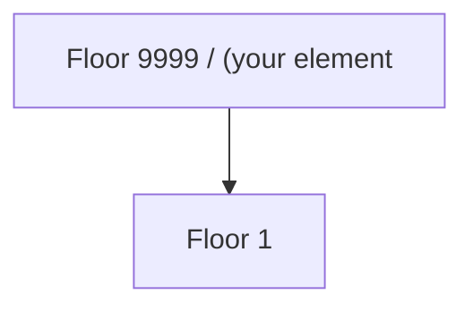
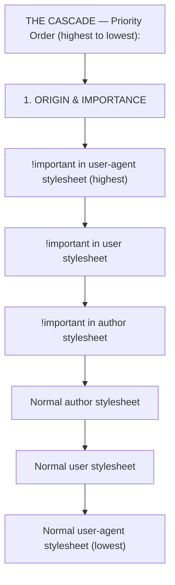
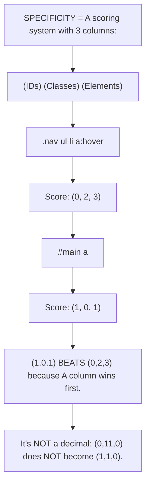
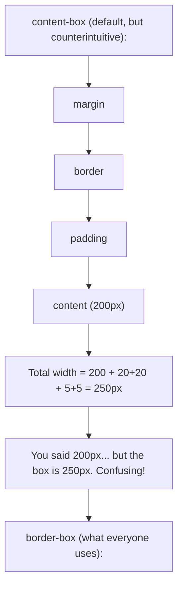
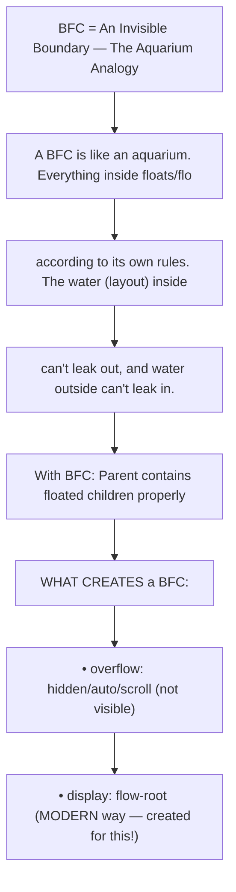
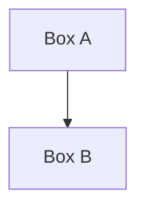
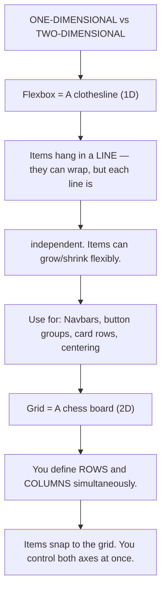
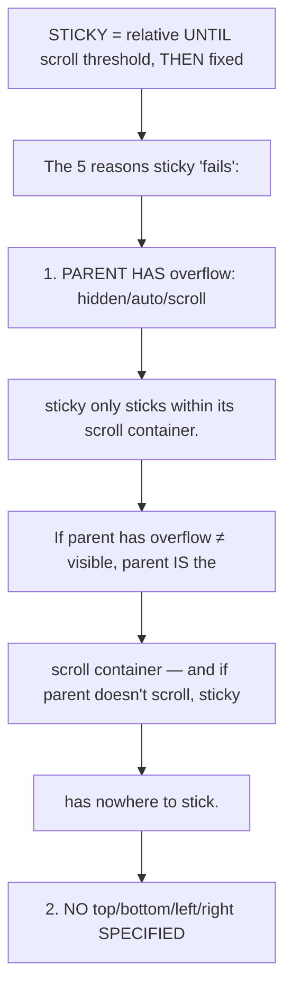
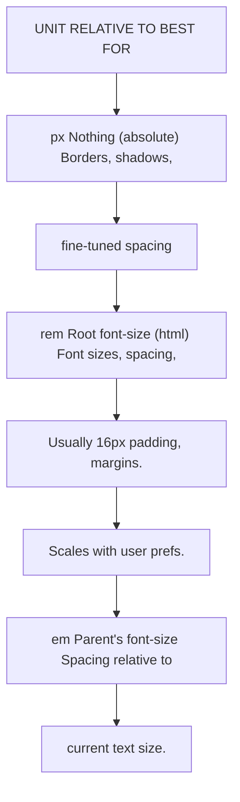
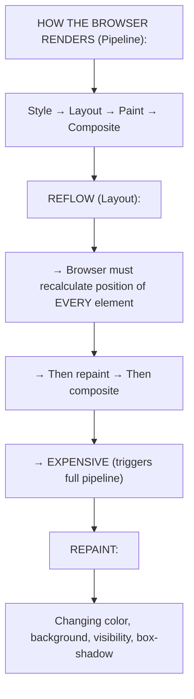

> **Navigation**: [< Previous](04_CSS_Modern_Architecture.md) | [Back to Index](../00_MASTER_INDEX.md)

# Chapter 5 — CSS Deep Reasoning: The Questions That Freeze People

> **"Anyone can center a div with Flexbox. The senior engineer explains WHY `z-index` doesn't work, WHAT creates a new stacking context, and HOW the cascade ACTUALLY resolves conflicts."**

---

## Table of Contents

1. [Why z-index "Doesn't Work": Stacking Contexts](#1-why-z-index-doesnt-work-stacking-contexts)
2. [The Cascade: How CSS ACTUALLY Decides Which Rule Wins](#2-the-cascade-how-css-actually-decides-which-rule-wins)
3. [Specificity: It's NOT Just "ID > Class > Element"](#3-specificity-its-not-just-id--class--element)
4. [Box Model: `content-box` vs `border-box` — Why Everyone Switches](#4-box-model-content-box-vs-border-box--why-everyone-switches)
5. [Block Formatting Context (BFC): The Invisible Layout Force](#5-block-formatting-context-bfc-the-invisible-layout-force)
6. [Margin Collapse: The Behavior That Confuses Everyone](#6-margin-collapse-the-behavior-that-confuses-everyone)
7. [Flexbox vs Grid: Not "Which Is Better" — When Each Shines](#7-flexbox-vs-grid-not-which-is-better--when-each-shines)
8. [`position: sticky` Gotchas: Why It Randomly Stops Working](#8-position-sticky-gotchas-why-it-randomly-stops-working)
9. [CSS Units: When to Use px, em, rem, %, vh/vw](#9-css-units-when-to-use-px-em-rem--vhvw)
10. [Reflow vs Repaint: Why Some CSS Changes Are Expensive](#10-reflow-vs-repaint-why-some-css-changes-are-expensive)

---

## 1. Why z-index "Doesn't Work": Stacking Contexts

### The Freeze Question
> "I set z-index: 9999 but my element is still behind another. Why?"

### Deep Reasoning

```
THE APARTMENT BUILDING ANALOGY

Each stacking context = a separate apartment building.
z-index = floor number WITHIN that building.

Building A (z-index: 1)    Building B (z-index: 2)
┌─────────────┐            ┌─────────────┐
│ Floor 9999  │            │ Floor 1     │
│ (your element)│          │             │
└─────────────┘            └─────────────┘

Floor 9999 of Building A is STILL below Floor 1 of
Building B — because Building A itself is below Building B.

z-index only competes WITHIN the same stacking context
(same building). You can't jump between buildings.
```

> **Flow**: Floor 9999 / (your element → Floor 1



```css
/* What CREATES a new stacking context (a new "building"): */

/* 1. position + z-index (not auto) */
.parent { position: relative; z-index: 1; } /* New context! */

/* 2. opacity < 1 */
.parent { opacity: 0.99; } /* New context! Even 0.99! */

/* 3. transform (any value) */
.parent { transform: translateZ(0); } /* New context! */

/* 4. filter, clip-path, mask */
.parent { filter: blur(0); } /* New context! */

/* 5. will-change */
.parent { will-change: transform; } /* New context! */

/* 6. position: fixed or sticky */
.parent { position: fixed; } /* New context! */

/* 7. isolation: isolate (explicitly creates one) */
.parent { isolation: isolate; } /* New context! Best practice. */
```

**Fix:** Check if your element's parent has ANY of the above properties. If so, the z-index only competes within that parent's stacking context. Move the element out, or adjust the parent's z-index.

---

## 2. The Cascade: How CSS ACTUALLY Decides Which Rule Wins

### The Freeze Question
> "Two rules target the same element. Which one wins and why?"

```
╔══════════════════════════════════════════════════════════════════╗
║  THE CASCADE — Priority Order (highest to lowest):               ║
║                                                                  ║
║  1. ORIGIN & IMPORTANCE                                          ║
║     !important in user-agent stylesheet  (highest)               ║
║     !important in user stylesheet                                ║
║     !important in author stylesheet                              ║
║     Normal author stylesheet                                     ║
║     Normal user stylesheet                                       ║
║     Normal user-agent stylesheet         (lowest)                ║
║                                                                  ║
║  2. SPECIFICITY (if same origin/importance)                      ║
║     Inline > #id > .class/[attr]/:pseudo > element               ║
║                                                                  ║
║  3. SOURCE ORDER (if same specificity)                           ║
║     Last rule wins                                               ║
║                                                                  ║
║  Most people only know step 2-3 and forget step 1 entirely.      ║
╚══════════════════════════════════════════════════════════════════╝
```

> **Flow**: THE CASCADE — Priority Order (highest to lowest): → 1. ORIGIN & IMPORTANCE | 1. ORIGIN & IMPORTANCE → !important in user-agent stylesheet (highest) | !important in user-agent stylesheet (highest) → !important in user stylesheet | !important in user stylesheet → !important in author stylesheet | !important in author stylesheet → Normal author stylesheet | Normal author stylesheet → Normal user stylesheet | ...+1 more



---

## 3. Specificity: It's NOT Just "ID > Class > Element"

### The Freeze Question
> "What's the specificity of `.nav ul li a:hover`?"

```
╔══════════════════════════════════════════════════════════════════╗
║  SPECIFICITY = A scoring system with 3 columns:                  ║
║                                                                  ║
║         A         B         C                                    ║
║       (IDs)   (Classes)  (Elements)                              ║
║                                                                  ║
║  .nav ul li a:hover                                              ║
║  A=0  B=2 (.nav, :hover)  C=3 (ul, li, a)                        ║
║  Score: (0, 2, 3)                                                ║
║                                                                  ║
║  #main a                                                         ║
║  A=1  B=0  C=1                                                   ║
║  Score: (1, 0, 1)                                                ║
║                                                                  ║
║  (1,0,1) BEATS (0,2,3) because A column wins first.              ║
║  It's NOT a decimal: (0,11,0) does NOT become (1,1,0).           ║
║  Even 100 classes can't beat 1 ID.                               ║
║                                                                  ║
║  Where each thing goes:                                          ║
║  A (IDs): #header, #main                                         ║
║  B (Classes): .nav, [type="text"], :hover, :nth-child(2)         ║
║  C (Elements): div, p, ::before, ::after                         ║
║  NONE: *, +, ~, >, :where()                                      ║
║  Special: :is(), :not() use their ARGUMENT's specificity         ║
║  Special: :where() always has 0 specificity                      ║
╚══════════════════════════════════════════════════════════════════╝
```

> **Flow**: SPECIFICITY = A scoring system with 3 columns: → (IDs) (Classes) (Elements) | (IDs) (Classes) (Elements) → .nav ul li a:hover | .nav ul li a:hover → Score: (0, 2, 3) | Score: (0, 2, 3) → #main a | #main a → Score: (1, 0, 1) | Score: (1, 0, 1) → (1,0,1) BEATS (0,2,3) because A column wins first. | ...+1 more



---

## 4. Box Model: `content-box` vs `border-box` — Why Everyone Switches

### The Freeze Question
> "If I set `width: 200px; padding: 20px; border: 5px solid`, how wide is the element?"

```
content-box (default, but counterintuitive):
┌─ margin ──────────────────────────────────┐
│ ┌─ border ──────────────────────────────┐ │
│ │ ┌─ padding ────────────────────────┐  │ │
│ │ │ ┌─ content (200px) ──────────┐   │  │ │
│ │ │ │                            │   │  │ │
│ │ │ └────────────────────────────┘   │  │ │
│ │ └──────────────────────────────────┘  │ │
│ └──────────────────────────────────────┘  │
└───────────────────────────────────────────┘
Total width = 200 + 20+20 + 5+5 = 250px
You said 200px... but the box is 250px. Confusing!

border-box (what everyone uses):
width: 200px means the WHOLE box is 200px.
Content shrinks to fit: 200 - 20 - 20 - 5 - 5 = 150px
"200px means 200px" — what you'd expect.
```

> **Flow**: content-box (default, but counterintuitive): → margin | margin → border | border → padding | padding → content (200px) | content (200px) → Total width = 200 + 20+20 + 5+5 = 250px | Total width = 200 + 20+20 + 5+5 = 250px → You said 200px... but the box is 250px. Confusing! | ...+1 more



```css
/* Universal reset — every modern project uses this: */
*, *::before, *::after {
  box-sizing: border-box;
}
```

---

## 5. Block Formatting Context (BFC): The Invisible Layout Force

### The Freeze Question
> "What is a BFC and why should I care?"

```
╔══════════════════════════════════════════════════════════════════╗
║  BFC = An Invisible Boundary — The Aquarium Analogy              ║
║                                                                  ║
║  A BFC is like an aquarium. Everything inside floats/flows       ║
║  according to its own rules. The water (layout) inside           ║
║  can't leak out, and water outside can't leak in.                ║
║                                                                  ║
║  Without BFC: Floated children escape parent (parent collapses)  ║
║  With BFC: Parent contains floated children properly             ║
║                                                                  ║
║  WHAT CREATES a BFC:                                             ║
║  • overflow: hidden/auto/scroll (not visible)                    ║
║  • display: flow-root (MODERN way — created for this!)           ║
║  • display: flex, grid, inline-block, table-cell                 ║
║  • float: left/right                                             ║
║  • position: absolute/fixed                                      ║
║                                                                  ║
║  WHAT IT DOES:                                                   ║
║  1. Contains floats (no parent collapse)                         ║
║  2. Prevents margin collapse across boundary                     ║
║  3. Excludes external floats                                     ║
╚══════════════════════════════════════════════════════════════════╝
```

> **Flow**: BFC = An Invisible Boundary — The Aquarium Analogy → A BFC is like an aquarium. Everything inside floats/flo | A BFC is like an aquarium. Everything inside floats/flo → according to its own rules. The water (layout) inside | according to its own rules. The water (layout) inside → can't leak out, and water outside can't leak in. | can't leak out, and water outside can't leak in. → With BFC: Parent contains floated children properly | With BFC: Parent contains floated children properly → WHAT CREATES a BFC: | WHAT CREATES a BFC: → • overflow: hidden/auto/scroll (not visible) | ...+1 more



```css
/* Old hack */
.clearfix::after { content: ''; display: block; clear: both; }

/* Modern solution */
.container { display: flow-root; } /* Creates BFC, no side effects */
```

---

## 6. Margin Collapse: The Behavior That Confuses Everyone

### The Freeze Question
> "I gave two elements `margin: 20px` each. Why isn't there 40px between them?"

```
MARGIN COLLAPSE — The Personal Space Analogy

Two people each want 20cm of personal space.
They don't need 40cm between them — 20cm satisfies BOTH.

Adjacent vertical margins COLLAPSE to the larger one:
┌──────────┐
│  Box A   │ margin-bottom: 30px
└──────────┘
     ↕ 30px (not 30+20=50px!)
┌──────────┐
│  Box B   │ margin-top: 20px
└──────────┘

WHEN IT HAPPENS:
✅ Vertical margins (top/bottom) of block elements
✅ Adjacent siblings
✅ Parent-child (if no padding/border between them)
✅ Empty blocks (own top and bottom margins collapse)

WHEN IT DOESN'T:
❌ Horizontal margins (left/right) — NEVER collapse
❌ Flex/Grid items — margins don't collapse
❌ Elements with BFC boundary between them
❌ Floated or absolutely positioned elements
❌ Inline-block elements
```

> **Flow**: Box A → Box B



---

## 7. Flexbox vs Grid: Not "Which Is Better" — When Each Shines

### The Freeze Question
> "Should I use Flexbox or Grid?"

```
╔══════════════════════════════════════════════════════════════════╗
║  ONE-DIMENSIONAL vs TWO-DIMENSIONAL                              ║
║                                                                  ║
║  Flexbox = A clothesline (1D)                                    ║
║  Items hang in a LINE — they can wrap, but each line is          ║
║  independent. Items can grow/shrink flexibly.                    ║
║  Use for: Navbars, button groups, card rows, centering           ║
║                                                                  ║
║  Grid = A chess board (2D)                                       ║
║  You define ROWS and COLUMNS simultaneously.                     ║
║  Items snap to the grid. You control both axes at once.          ║
║  Use for: Page layouts, dashboards, any 2D structure             ║
║                                                                  ║
║  KEY INSIGHT:                                                    ║
║  Flexbox: CONTENT drives layout (items decide their size)        ║
║  Grid: LAYOUT drives content (grid decides item size)            ║
║                                                                  ║
║  They're NOT competing. Most real layouts use BOTH:              ║
║  Grid for the page layout, Flexbox for components inside cells.  ║
╚══════════════════════════════════════════════════════════════════╝
```

> **Flow**: ONE-DIMENSIONAL vs TWO-DIMENSIONAL → Flexbox = A clothesline (1D) | Flexbox = A clothesline (1D) → Items hang in a LINE — they can wrap, but each line is | Items hang in a LINE — they can wrap, but each line is → independent. Items can grow/shrink flexibly. | independent. Items can grow/shrink flexibly. → Use for: Navbars, button groups, card rows, centering | Use for: Navbars, button groups, card rows, centering → Grid = A chess board (2D) | Grid = A chess board (2D) → You define ROWS and COLUMNS simultaneously. | ...+1 more



---

## 8. `position: sticky` Gotchas: Why It Randomly Stops Working

### The Freeze Question
> "My `position: sticky` isn't sticking. What's wrong?"

```
╔══════════════════════════════════════════════════════════════════╗
║  STICKY = relative UNTIL scroll threshold, THEN fixed            ║
║                                                                  ║
║  The 5 reasons sticky "fails":                                   ║
║                                                                  ║
║  1. PARENT HAS overflow: hidden/auto/scroll                      ║
║     sticky only sticks within its scroll container.              ║
║     If parent has overflow ≠ visible, parent IS the              ║
║     scroll container — and if parent doesn't scroll, sticky      ║
║     has nowhere to stick.                                        ║
║                                                                  ║
║  2. NO top/bottom/left/right SPECIFIED                           ║
║     You MUST set: top: 0; (or whatever offset)                   ║
║     Without it, browser doesn't know WHEN to stick.              ║
║                                                                  ║
║  3. PARENT IS TOO SHORT                                          ║
║     Sticky only sticks within parent's bounds.                   ║
║     If parent ends, sticky scrolls away with it.                 ║
║                                                                  ║
║  4. PARENT HAS flex/grid WITH align-items: stretch               ║
║     Element fills the container — no room to "stick"             ║
║     Fix: align-self: flex-start on the sticky element            ║
║                                                                  ║
║  5. ANCESTOR HAS transform, filter, or perspective               ║
║     Creates new containing block — sticky now sticks             ║
║     relative to THAT ancestor, not the viewport.                 ║
╚══════════════════════════════════════════════════════════════════╝
```

> **Flow**: STICKY = relative UNTIL scroll threshold, THEN fixed → The 5 reasons sticky 'fails': | The 5 reasons sticky 'fails': → 1. PARENT HAS overflow: hidden/auto/scroll | 1. PARENT HAS overflow: hidden/auto/scroll → sticky only sticks within its scroll container. | sticky only sticks within its scroll container. → If parent has overflow ≠ visible, parent IS the | If parent has overflow ≠ visible, parent IS the → scroll container — and if parent doesn't scroll, sticky | scroll container — and if parent doesn't scroll, sticky → has nowhere to stick. | ...+1 more



---

## 9. CSS Units: When to Use px, em, rem, %, vh/vw

### The Freeze Question
> "Which CSS unit should I use?"

```
╔══════════════════════════════════════════════════════════════════╗
║  UNIT          RELATIVE TO             BEST FOR                  ║
║  ─────────────────────────────────────────────────────────       ║
║  px            Nothing (absolute)      Borders, shadows,         ║
║                                        fine-tuned spacing        ║
║                                                                  ║
║  rem           Root font-size (html)   Font sizes, spacing,      ║
║                Usually 16px            padding, margins.         ║
║                                        Scales with user prefs.   ║
║                                                                  ║
║  em            Parent's font-size      Spacing relative to       ║
║                                        current text size.        ║
║                ⚠️ Compounds! em in em   Beware nesting!          ║
║                in em gets huge.                                  ║
║                                                                  ║
║  %             Parent's dimension      Fluid widths in layouts   ║
║                                                                  ║
║  vw/vh         1% of viewport          Full-screen sections,     ║
║                width/height            hero banners              ║
║                ⚠️ vh doesn't account                             ║
║                for mobile URL bar!                               ║
║                Use dvh instead.                                  ║
║                                                                  ║
║  ch            Width of '0' character  Input widths (20ch =      ║
║                                        roughly 20 characters)    ║
║                                                                  ║
║  RULE OF THUMB:                                                  ║
║  rem for most things → respects user accessibility prefs         ║
║  px for borders and shadows → these shouldn't scale              ║
║  % for fluid layouts → responsive by nature                      ║
║  vw for breakpoints → full-width sections                        ║
╚══════════════════════════════════════════════════════════════════╝
```

> **Flow**: UNIT RELATIVE TO BEST FOR → px Nothing (absolute) Borders, shadows, | px Nothing (absolute) Borders, shadows, → fine-tuned spacing | fine-tuned spacing → rem Root font-size (html) Font sizes, spacing, | rem Root font-size (html) Font sizes, spacing, → Usually 16px padding, margins. | Usually 16px padding, margins. → Scales with user prefs. | Scales with user prefs. → em Parent's font-size Spacing relative to | ...+1 more



---

## 10. Reflow vs Repaint: Why Some CSS Changes Are Expensive

### The Freeze Question
> "Why is animating `left` slower than `transform`?"

```
╔══════════════════════════════════════════════════════════════════╗
║  HOW THE BROWSER RENDERS (Pipeline):                             ║
║                                                                  ║
║  Style → Layout → Paint → Composite                              ║
║                                                                  ║
║  REFLOW (Layout):                                                ║
║  Changing width, height, top, left, margin, padding, font-size   ║
║  → Browser must recalculate position of EVERY element            ║
║  → Then repaint → Then composite                                 ║
║  → EXPENSIVE (triggers full pipeline)                            ║
║                                                                  ║
║  REPAINT:                                                        ║
║  Changing color, background, visibility, box-shadow              ║
║  → No layout recalculation needed                                ║
║  → But still needs to repaint pixels → Then composite            ║
║  → MODERATE cost                                                 ║
║                                                                  ║
║  COMPOSITE ONLY:                                                 ║
║  Changing transform, opacity                                     ║
║  → Skips layout AND paint                                        ║
║  → GPU handles it on its own layer                               ║
║  → CHEAP (buttery smooth 60fps)                                  ║
║                                                                  ║
║  Analogy: Moving furniture in a house                            ║
║  Reflow = Moving walls (everything shifts)                       ║
║  Repaint = Repainting walls (same layout, new look)              ║
║  Composite = Moving a picture frame (nothing else changes)       ║
╚══════════════════════════════════════════════════════════════════╝
```

> **Flow**: HOW THE BROWSER RENDERS (Pipeline): → Style → Layout → Paint → Composite | Style → Layout → Paint → Composite → REFLOW (Layout): | REFLOW (Layout): → → Browser must recalculate position of EVERY element | → Browser must recalculate position of EVERY element → → Then repaint → Then composite | → Then repaint → Then composite → → EXPENSIVE (triggers full pipeline) | → EXPENSIVE (triggers full pipeline) → REPAINT: | ...+1 more



```css
/* ❌ SLOW: Triggers reflow every frame */
.box { transition: left 0.3s; }
.box:hover { left: 100px; }

/* ✅ FAST: Composite only — GPU accelerated */
.box { transition: transform 0.3s; }
.box:hover { transform: translateX(100px); }

/* Use will-change sparingly to hint GPU layer: */
.box { will-change: transform; } /* Creates own composite layer */
/* ⚠️ Don't overuse — each layer costs GPU memory */
```

---

## Interview Quick-Fire: CSS Freeze Busters

| Freeze Question | Senior-Level Answer |
|----------------|-------------------|
| "How do you center a div?" | `display: grid; place-items: center;` — one line. Or Flexbox: `display: flex; justify-content: center; align-items: center;` |
| "What is `display: none` vs `visibility: hidden`?" | `display: none` removes from layout (takes no space, triggers reflow). `visibility: hidden` hides but KEEPS space (only repaint). Screen readers skip both. Use `opacity: 0` to hide but keep interactive. |
| "What's the difference between `em` and `rem`?" | `em` is relative to PARENT's font-size (compounds on nesting). `rem` is relative to ROOT (html) font-size (consistent everywhere). Use `rem` for predictability. |
| "What does `position: relative` do?" | Creates a positioning context for absolute children AND allows offset (top/left) from ORIGINAL position without affecting other elements' layout. |
| "Why use CSS custom properties over Sass variables?" | Custom properties are RUNTIME — they cascade, can be changed with JS, respond to media queries. Sass variables compile away (like TypeScript types). Use custom properties for theming. |

---

← Previous: [Chapter 4 — CSS Responsive & Performance](04_CSS_Responsive_Performance.md)
| [📚 Index](../00_MASTER_INDEX.md)
| Next: [Java Deep Reasoning →](../07_Modern_Java/31_Java_Deep_Reasoning.md)


---

> **Navigation**: [< Previous](04_CSS_Modern_Architecture.md) | [Back to Index](../00_MASTER_INDEX.md)