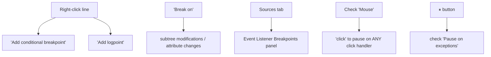
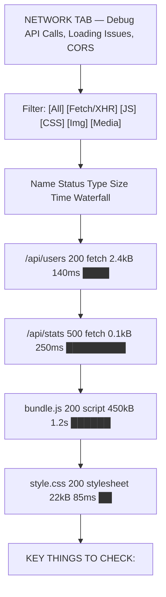
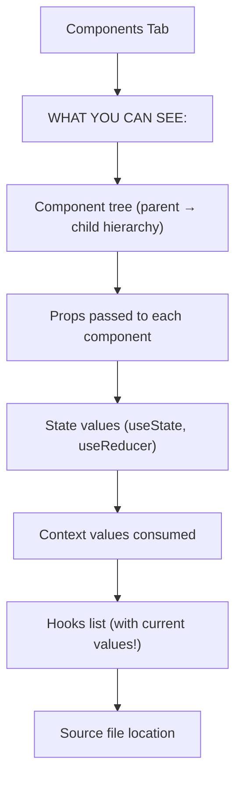
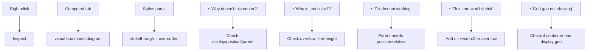
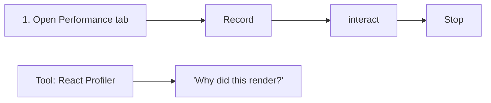
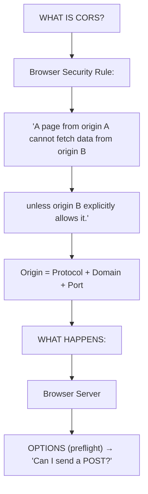
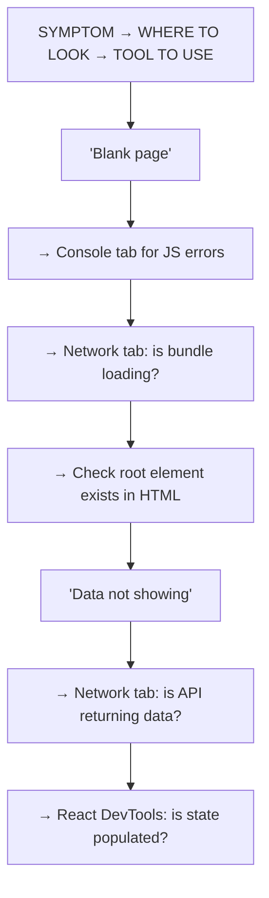
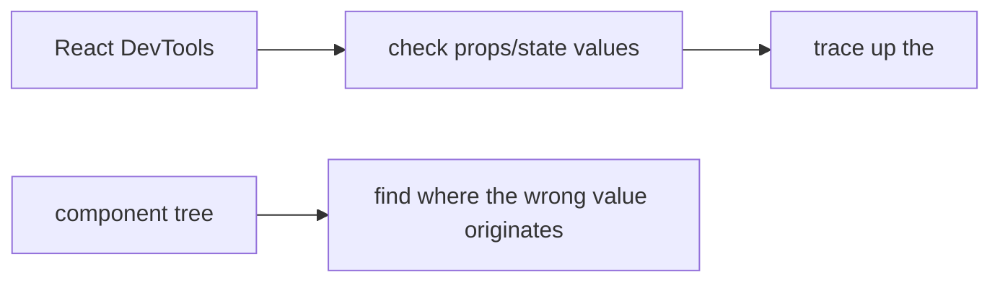

> **Navigation**: [< Previous](01_React_JS_CSS_Combined.md) | [Back to Index](../00_MASTER_INDEX.md) | [Next >](03_Build_Tools_Ecosystem.md)

> **Frontend Integration Chapter 2/4** | [← React Combined](01_React_JS_CSS_Combined.md) | [Index](../00_MASTER_INDEX.md) | [Next → Build Tools](03_Build_Tools_Ecosystem.md)

# Frontend Debugging — From Console.log to Expert

## 5W1H — Why This Chapter?


> WHAT: Systematic techniques to find and fix frontend bugs.
>
> WHY:  The average developer spends 50% of time debugging.
> Moving past console.log to DevTools mastery saves HOURS.
> Knowing WHERE to look is more valuable than knowing HOW.
>
> WHO:  Every frontend developer. Debugging IS the job.
>
> WHEN: Every day. Bugs are not exceptions, they're the norm.
>
> HOW:  Chrome DevTools → React DevTools → Network Tab →
> Performance Profiler → systematic elimination.


---

## 1. The Debugging Mindset


> THE 5-STEP DEBUGGING FRAMEWORK:
>
> 1. REPRODUCE  → Can you trigger the bug consistently?
> Write down EXACT steps to reproduce.
>
> 2. ISOLATE    → Where is the problem?
> Network? State? Rendering? CSS? Event?
>
> 3. INSPECT    → Use the RIGHT tool for the category.
> Don't guess — measure.
>
> 4. HYPOTHESIZE → "I think the bug is because X"
> Now TEST that hypothesis.
>
> 5. FIX + VERIFY → Fix the root cause, not the symptom.
> Add a test so it can't regress.
>
> GOLDEN RULE: If you can't reproduce it, you can't fix it.


---


> 🔬 **Section Challenge — 1. The Debugging Mindset**

## 2. Chrome DevTools — Beyond Console.log

### 2.1 Console Power Tools

```javascript
// ─── LEVEL 1: Basics ───
console.log("value:", variable);          // We all know this

// ─── LEVEL 2: Structured Output ───
console.table([{name: "Alice", age: 30}, {name: "Bob", age: 25}]);
// Displays a formatted table in the console!

console.group("User Flow");               // Collapsible group
console.log("Step 1: Login");
console.log("Step 2: Dashboard");
console.groupEnd();

console.time("API Call");                  // Measure time
await fetch("/api/users");
console.timeEnd("API Call");               // → "API Call: 142ms"

// ─── LEVEL 3: Debugging Helpers ───
console.trace("How did we get here?");     // Print stack trace
console.assert(user.role === "admin",      // Only logs if FALSE
    "Expected admin, got:", user.role);
console.count("render");                   // Count how many times called
console.dir(document.body);               // Show object properties (not HTML)

// ─── LEVEL 4: Styled Output ───
console.log(
    "%c IMPORTANT %c Normal text",
    "background: #e74c3c; color: white; padding: 2px 6px; border-radius: 3px;",
    ""
);
```

### 2.2 Sources Tab — Breakpoints

```
BREAKPOINT TYPES (most people only know line breakpoints):

Line Breakpoint:
├── Click line number in Sources tab
└── Code pauses at that line

Conditional Breakpoint:
├── Right-click line → "Add conditional breakpoint"
└── Only pauses if condition is true! e.g. user.id === "123"

Logpoint:
├── Right-click line → "Add logpoint"
├── Logs a message WITHOUT stopping execution
└── Like console.log without modifying code!

DOM Breakpoint:
├── Right-click an element in Elements tab
├── "Break on" → subtree modifications / attribute changes
└── Finds what code is changing the DOM!

Event Listener Breakpoint:
├── Sources tab → Event Listener Breakpoints panel
├── Check "Mouse" → "click" to pause on ANY click handler
└── Useful when you don't know which code handles an event

XHR/Fetch Breakpoint:
├── Pause when a URL containing "users" is fetched
└── Sources → XHR/fetch Breakpoints → add URL filter

Exception Breakpoint:
├── ⏸ button → check "Pause on exceptions"
└── Code pauses the moment an error is thrown
```

**Flow:**
1. Right-click line
2. 'Add conditional breakpoint'
3. Right-click line
4. 'Add logpoint'
5. 'Break on'
6. subtree modifications / attribute changes
7. Sources tab
8. Event Listener Breakpoints panel
9. Check 'Mouse'
10. 'click' to pause on ANY click handler
11. ⏸ button check 'Pause on exceptions'



### 2.3 Network Tab

```
NETWORK TAB — Debug API Calls, Loading Issues, CORS

┌──────────────────────────────────────────────────────────┐
│ Filter: [All] [Fetch/XHR] [JS] [CSS] [Img] [Media]       │
│                                                          │
│ Name        Status  Type      Size    Time   Waterfall   │
│ /api/users  200     fetch     2.4kB   140ms  ████        │
│ /api/stats  500     fetch     0.1kB   250ms  █████████   │
│ bundle.js   200     script    450kB   1.2s   ██████      │
│ style.css   200     stylesheet 22kB   85ms   ██          │
└──────────────────────────────────────────────────────────┘

KEY THINGS TO CHECK:
• Status code (200 ok, 400 bad request, 401 auth, 500 server)
• Request headers (Authorization, Content-Type)
• Response body (actual error message from server)
• Timing (DNS, connection, waiting, download)
• "Preserve log" checkbox (keeps requests across navigation)
• Throttling: simulate slow network (3G, offline)
• CORS errors: look for preflight OPTIONS request failing
```

**Flow:**
1. NETWORK TAB — Debug API Calls, Loading Issues, CORS
2. Filter: [All] [Fetch/XHR] [JS] [CSS] [Img] [Media]
3. Name Status Type Size Time Waterfall
4. /api/users 200 fetch 2.4kB 140ms ████
5. /api/stats 500 fetch 0.1kB 250ms █████████
6. bundle.js 200 script 450kB 1.2s ██████
7. style.css 200 stylesheet 22kB 85ms ██



---

## 3. React DevTools

```
REACT DEVTOOLS (Browser Extension — Components + Profiler Tab)

┌── Components Tab ───────────────────────────────────────────┐
│                                                             │
│  WHAT YOU CAN SEE:                                          │
│  ├── Component tree (parent → child hierarchy)              │
│  ├── Props passed to each component                         │
│  ├── State values (useState, useReducer)                    │
│  ├── Context values consumed                                │
│  ├── Hooks list (with current values!)                      │
│  └── Source file location                                   │
│                                                             │
│  WHAT YOU CAN DO:                                           │
│  ├── Click component → see live props/state                 │
│  ├── Edit state directly (double-click value)               │
│  ├── Search for component by name                           │
│  ├── Highlight renders (Settings → Highlight updates)       │
│  └── "Rendered by" → trace who created this component       │
└─────────────────────────────────────────────────────────────┘

┌── Profiler Tab ─────────────────────────────────────────────┐
│                                                             │
│  Record → interact → Stop → see EVERY render:               │
│  ├── Which components re-rendered and WHY                   │
│  ├── Render duration (ms)                                   │
│  ├── "Why did this render?" button                          │
│  │   └── Props changed / State changed / Parent rendered    │
│  └── Flame chart: visual timeline of renders                │
│                                                             │
│  USE THIS WHEN: app feels slow, too many re-renders,        │
│  or you need to optimize performance                        │
└─────────────────────────────────────────────────────────────┘
```

**Flow:**
1. Components Tab
2. WHAT YOU CAN SEE:
3. Component tree (parent child hierarchy)
4. Props passed to each component
5. State values (useState, useReducer)
6. Context values consumed
7. Hooks list (with current values!)



---

## 4. Common Bug Categories & Solutions

### 4.1 State Bugs

```tsx
// BUG: "State update not reflected immediately"
function Counter() {
    const [count, setCount] = useState(0);

    const handleClick = () => {
        setCount(count + 1);  // Uses STALE closure value!
        setCount(count + 1);  // Still uses same old count!
        // count is still 0 in both calls → result: 1, not 2
    };

    // FIX: Use functional update
    const handleClickFixed = () => {
        setCount(prev => prev + 1);  // prev is always fresh
        setCount(prev => prev + 1);  // chained correctly → result: 2
    };
}

// BUG: "Object/Array state not updating UI"
function UserEditor() {
    const [user, setUser] = useState({ name: "Alice", age: 30 });

    const handleBirthday = () => {
        user.age += 1;      // MUTATING directly → React can't detect change!
        setUser(user);       // Same reference → no re-render!
    };

    // FIX: Create new object
    const handleBirthdayFixed = () => {
        setUser(prev => ({ ...prev, age: prev.age + 1 }));
        // New object reference → React detects change → re-renders
    };
}

// BUG: "useEffect runs infinite loop"
useEffect(() => {
    fetchData().then(setUsers);
}, [users]); // users changes → triggers effect → fetches → updates users → INFINITE

// FIX: Empty dependency array (run once)
useEffect(() => {
    fetchData().then(setUsers);
}, []); // Run once on mount
```

### 4.2 Event Handling Bugs

```tsx
// BUG: "Click handler fires on page load, not on click"
<button onClick={handleSubmit()}>  // ← CALLS immediately!
// FIX:
<button onClick={handleSubmit}>    // Pass reference, don't call
<button onClick={() => handleSubmit(id)}>  // Wrap in arrow for args

// BUG: "Form submits and page refreshes"
const handleSubmit = (e: React.FormEvent) => {
    // MISSING: e.preventDefault();
    e.preventDefault();  // ← ALWAYS first line in form handlers
    // ... process form
};

// BUG: "Event fires on parent AND child"
<div onClick={handleParentClick}>
    <button onClick={handleChildClick}>Click me</button>
</div>
// Clicking button fires BOTH handlers (event bubbles up)
// FIX:
const handleChildClick = (e: React.MouseEvent) => {
    e.stopPropagation();  // Stop bubble
    // ... handle child click
};
```

### 4.3 CSS Debugging

```
CSS DEBUGGING IN DEVTOOLS (Elements Tab):

1. SELECT ELEMENT:
   ├── Right-click → Inspect
   └── Ctrl+Shift+C → hover to select

2. CHECK COMPUTED STYLES:
   ├── See FINAL applied value after cascade resolves
   └── Shows which rule "won" for each property

3. CHECK BOX MODEL:
   ├── Computed tab → visual box model diagram
   └── Hover to see margins, padding, border on page

4. FIND OVERRIDDEN STYLES:
   ├── Styles panel → strikethrough = overridden
   └── Click the file:line to jump to CSS source

5. TEST CHANGES LIVE:
   ├── Click any value to edit in place
   ├── Toggle properties on/off with checkbox
   └── Add new properties inline to experiment

COMMON CSS BUGS:
• "Why doesn't this center?" → Check display/position/parent
• "Why is text cut off?"    → Check overflow, line-height
• "Z-index not working"     → Parent needs position:relative
• "Flex item won't shrink"  → Add min-width:0 or overflow
• "Grid gap not showing"    → Check if container has display:grid
```

**Flow:**
1. Right-click
2. Inspect
3. Computed tab visual box model diagram
4. Styles panel strikethrough = overridden
5. • 'Why doesn't this center?' Check display/position/parent • 'Why is text cut off?' Check overflow, line-height • 'Z-index not working' Parent needs position:relative



### 4.4 Performance Debugging

```
PERFORMANCE TAB — When Page Feels Slow:

1. Open Performance tab → Record → interact → Stop

2. Look for:
   ├── Long Tasks (red bars > 50ms) = main thread blocked
   ├── Layout Thrashing = many forced reflows
   ├── Excessive Paints = too many visual updates
   └── Large JS execution time = heavy computation

REACT-SPECIFIC PERFORMANCE ISSUES:

Problem: Too many re-renders
├── Tool: React Profiler → "Why did this render?"
├── Fix: React.memo() for pure components
├── Fix: useMemo() for expensive computations
└── Fix: useCallback() for handler functions in props

Problem: Large list renders slowly
├── Fix: Virtualization (react-window or react-virtuoso)
└── Only render visible items, not all 10,000 rows

Problem: Bundle too large (slow initial load)
├── Fix: Code splitting with React.lazy() + Suspense
├── Fix: Dynamic imports for heavy libraries
└── Tool: Webpack Bundle Analyzer to see what's big
```

**Flow:**
1. Open Performance tab
2. Record interact
3. Stop
4. Tool: React Profiler
5. 'Why did this render?'



---

## 5. CORS Debugging — The Most Confusing Error

```
┌──────────────────────────────────────────────────────────────────────┐
│  WHAT IS CORS?                                                       │
│                                                                      │
│  Browser Security Rule:                                              │
│  "A page from origin A cannot fetch data from origin B               │
│   unless origin B explicitly allows it."                             │
│                                                                      │
│  Origin = Protocol + Domain + Port                                   │
│  http://localhost:3000 ≠ http://localhost:8080 (different port!)     │
│                                                                      │
│  WHAT HAPPENS:                                                       │
│                                                                      │
│  Browser                          Server                             │
│    │                                │                                │
│    │ ─── OPTIONS (preflight) ────→ │  "Can I send a POST?"           │
│    │                                │                                │
│    │ ←── Headers: Allowed ────────│  Access-Control-Allow-Origin     │
│    │     (or NO headers = CORS     │  Access-Control-Allow-Methods   │
│    │      error in console)        │                                 │
│    │                                │                                │
│    │ ─── Actual POST ────────────→ │  (only if preflight passed)     │
│    │                                │                                │
│                                                                      │
│  FIXES:                                                              │
│  1. Backend: Add CORS headers (Access-Control-Allow-Origin: *)       │
│     • Spring: @CrossOrigin or WebMvcConfigurer                       │
│     • Express: cors() middleware                                     │
│  2. Dev: Use Vite proxy → vite.config.ts server.proxy                │
│  3. NOT a fix: browser extensions (only works for you)               │
└──────────────────────────────────────────────────────────────────────┘
```

**Flow:**
1. WHAT IS CORS?
2. Browser Security Rule:
3. 'A page from origin A cannot fetch data from origin B unless origin B explicitly allows it.'
4. Origin = Protocol + Domain + Port
5. WHAT HAPPENS:
6. Browser Server



---


> 🔬 **Section Challenge — 5. CORS Debugging — The Most Confusing Error**

## 6. Debugging Checklist by Symptom

```
┌───────────────────────────────────────────────────────────────────┐
│  SYMPTOM → WHERE TO LOOK → TOOL TO USE                            │
│                                                                   │
│  "Blank page"                                                     │
│  → Console tab for JS errors                                      │
│  → Network tab: is bundle loading?                                │
│  → Check root element exists in HTML                              │
│                                                                   │
│  "Data not showing"                                               │
│  → Network tab: is API returning data?                            │
│  → React DevTools: is state populated?                            │
│  → Console: check response shape vs expected shape                │
│                                                                   │
│  "Styling broken"                                                 │
│  → Elements tab: is CSS class applied?                            │
│  → Computed tab: which rule won?                                  │
│  → Check: CSS Module import correct? Class name typo?             │
│                                                                   │
│  "Click not working"                                              │
│  → Elements tab: is element covered by another? (z-index/overlay) │
│  → Console: errors in handler?                                    │
│  → Check: onClick={fn} not onClick={fn()}                         │
│                                                                   │
│  "Infinite loop / memory leak"                                    │
│  → Console: React warning about max update depth                  │
│  → Performance tab: see what's looping                            │
│  → Check: useEffect dependencies correct? Missing cleanup?        │
│                                                                   │
│  "Works locally, broken in production"                            │
│  → Network: different API URLs? Missing env vars?                 │
│  → Console: minified error? Use source maps                       │
│  → Check: environment-specific config (.env.production)           │
└───────────────────────────────────────────────────────────────────┘
```

**Flow:**
1. SYMPTOM
2. WHERE TO LOOK
3. TOOL TO USE
4. 'Blank page'
5. Console tab for JS errors
6. Network tab: is bundle loading?
7. Check root element exists in HTML
8. 'Data not showing'
9. Network tab: is API returning data?



---


> 🔬 **Section Challenge — 6. Debugging Checklist by Symptom**

## Interview Quick-Fire

```
Q: How do you debug a component that renders but shows wrong data?
→ React DevTools → check props/state values → trace up the
  component tree → find where the wrong value originates →
  check the data transformation/fetching logic.

Q: How do you find what's causing a performance issue?
→ React Profiler: identify which component re-renders most.
  Performance tab: look for long tasks. Lighthouse: overall score.
  Then apply targeted fix: memo, virtualization, code splitting.

Q: What's the first thing you check when a page is blank?
→ Console tab for errors. 90% of blank pages = uncaught JS error
  that crashes React rendering. Then Network tab to verify
  bundle loaded correctly.

Q: How do you debug a CORS error?
→ It's a BACKEND fix, not frontend. Server must send
  Access-Control-Allow-Origin header. In development,
  use a Vite/webpack proxy to avoid CORS entirely.
```

**Flow:**
1. React DevTools check props/state values
2. trace up the component tree
3. find where the wrong value originates



---

> [← React Combined](01_React_JS_CSS_Combined.md) | [Index](../00_MASTER_INDEX.md) | [Next → Build Tools](03_Build_Tools_Ecosystem.md)


---

> **Navigation**: [< Previous](01_React_JS_CSS_Combined.md) | [Back to Index](../00_MASTER_INDEX.md) | [Next >](03_Build_Tools_Ecosystem.md)