> **Navigation**: [< Previous](02_Frontend_Debugging.md) | [Back to Index](../00_MASTER_INDEX.md) | [Next >](04_Frontend_Mental_Models_UI.md)

> **Frontend Integration Chapter 3/4** | [← Debugging](02_Frontend_Debugging.md) | [Index](../00_MASTER_INDEX.md) | [Next → Mental Models](04_Frontend_Mental_Models_UI.md)

# Build Tools Ecosystem — npm, Babel, Webpack, Vite

## 5W1H — Why This Chapter?


> WHAT: The invisible tools that transform your code into what
> the browser actually runs.
>
> WHY:  You write JSX, TypeScript, CSS Modules, ES2024+.
> Browsers understand HTML, JS (ES5+), plain CSS.
> Something must TRANSLATE your code → browser code.
> That "something" is the build tool chain.
>
> ANALOGY: You write a letter in English → translator converts
> to French → post office delivers optimized package.
> Babel = translator, Webpack/Vite = post office.
>
> WHO:  All frontend developers — even if you "just use Vite",
> understanding the chain helps debug build issues.
>
> WHEN: At build time (before deployment) and dev time.


---

## 1. The Big Picture

```
YOUR CODE                          BROWSER GETS

TypeScript (.tsx)  ─┐
JSX (<App />)      ─┼──→ BUILD TOOL ──→  bundle.js  (1 file)
CSS Modules (.css)  ─┤    CHAIN           styles.css (1 file)
ES2024+ syntax     ─┤                    index.html
npm packages       ─┘                    assets/

The BUILD TOOL CHAIN:

Source Code
    │
    ▼
┌─────────────┐    Converts TypeScript → JavaScript
│  TypeScript  │    Converts JSX → React.createElement()
│  Compiler    │    Type-checks your code
└──────┬──────┘
       ▼
┌─────────────┐    Converts ES2024+ → ES5/ES6
│   Babel /    │    Converts optional chaining → if checks
│   SWC        │    Adds polyfills for old browsers
└──────┬──────┘
       ▼
┌─────────────┐    Resolves import/export
│  Webpack /   │    Combines 1000 files → few bundles
│  Vite        │    Optimizes: tree-shake, minify, split
└──────┬──────┘    Processes CSS, images, fonts
       ▼
┌─────────────┐
│  Output:     │    Ready for browser / CDN / server
│  dist/       │
└─────────────┘
```

> **Flow**: TypeScript / Compiler → Babel / / SWC | Babel / / SWC → Webpack / / Vite | Webpack / / Vite → Output: / dist/

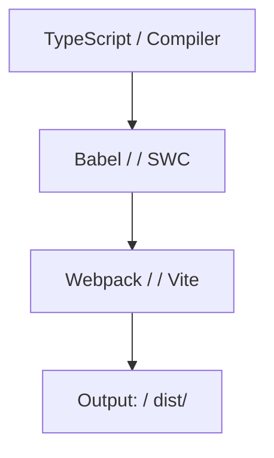

---

## 2. npm — The Package Manager

### What Is It?


> npm = Node Package Manager
>
> ANALOGY: npm is like an App Store for JavaScript code.
> - Want a date library? → npm install date-fns
> - Want React? → npm install react react-dom
> - 2 million+ packages available
>
> KEY FILES:
>
> package.json         → The "menu" (what packages you ordered)
> package-lock.json    → The "receipt" (exact versions installed)
> node_modules/        → The "kitchen" (actual code, 100s of MB)


### package.json Anatomy

```json
{
    "name": "my-app",
    "version": "1.0.0",
    "private": true,

    "scripts": {
        "dev": "vite",
        "build": "tsc && vite build",
        "preview": "vite preview",
        "lint": "eslint . --ext .ts,.tsx",
        "test": "vitest"
    },

    "dependencies": {
        "react": "^18.3.1",
        "react-dom": "^18.3.1",
        "react-router-dom": "^6.23.0",
        "@tanstack/react-query": "^5.40.0"
    },

    "devDependencies": {
        "typescript": "^5.4.0",
        "vite": "^5.2.0",
        "@types/react": "^18.3.0",
        "eslint": "^9.0.0",
        "vitest": "^1.6.0"
    }
}
```

```
dependencies vs devDependencies:

dependencies:
├── Code that runs IN YOUR APP (in the browser)
├── React, Router, Query — shipped to users
└── Included in the final bundle

devDependencies:
├── Tools that help you BUILD the app
├── TypeScript, Vite, ESLint — developer tools
└── NOT included in the final bundle

VERSIONING:
"^18.3.1" → caret: allows 18.x.x updates (minor + patch)
"~18.3.1" → tilde: allows 18.3.x updates (patch only)
"18.3.1"  → exact: only this version

COMMANDS:
npm install          → Install all dependencies from lock file
npm install react    → Add to dependencies
npm install -D vite  → Add to devDependencies
npm update           → Update within version ranges
npm run dev          → Execute the "dev" script
npx create-vite      → Run a package without installing
```

> **Flow**: '^18.3.1' → caret: allows 18.x.x updates (minor + patch) | '~18.3.1' → tilde: allows 18.3.x updates (patch only) | '18.3.1' → exact: only this version | npm install → Install all dependencies from lock file | npm install react → Add to dependencies | npm install -D vite → Add to devDependencies | ...+3 more

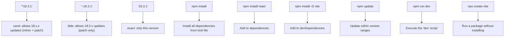

---

## 3. Babel — The Translator

```
╔══════════════════════════════════════════════════════════════════════╗
║  WHAT BABEL DOES — Translate modern JS to older JS:                  ║
║                                                                      ║
║  YOUR CODE:                        BABEL OUTPUT:                     ║
║                                                                      ║
║  const greet = (name) =>           var greet = function(name) {      ║
║      `Hello, ${name}!`;               return "Hello, " + name        ║
║                                            + "!";                    ║
║                                        };                            ║
║                                                                      ║
║  const user = data?.user;          var _data;                        ║
║                                    var user = (_data = data)         ║
║                                       !== null && _data !==          ║
║                                       void 0 ? _data.user            ║
║                                       : void 0;                      ║
║                                                                      ║
║  WHY: Older browsers (and some devices) don't support modern         ║
║  syntax. Babel ensures your code works everywhere.                   ║
║                                                                      ║
║  MODERN ALTERNATIVE: SWC (written in Rust, 20x faster)               ║
║  → Vite uses SWC/esbuild instead of Babel by default                 ║
╚══════════════════════════════════════════════════════════════════════╝
```

> **Flow**: WHAT BABEL DOES — Translate modern JS to older JS: → YOUR CODE: BABEL OUTPUT: | YOUR CODE: BABEL OUTPUT: → `Hello, ${name}!`; return 'Hello, ' + name | `Hello, ${name}!`; return 'Hello, ' + name → const user = data?.user; var _data; | const user = data?.user; var _data; → var user = (_data = data) | var user = (_data = data) → void 0 ? _data.user | void 0 ? _data.user → : void 0; | ...+1 more

```mermaid
flowchart TD
    N1["WHAT BABEL DOES — Translate modern JS to older JS:"]
    N2["YOUR CODE: BABEL OUTPUT:"]
    N3["`Hello, ${name}!`; return 'Hello, ' + name"]
    N4["const user = data?.user; var _data;"]
    N5["var user = (_data = data)"]
    N6["void 0 ? _data.user"]
    N7[": void 0;"]
    N8["WHY: Older browsers (and some devices) don't support mo"]
    N1 --> N2
    N2 --> N3
    N3 --> N4
    N4 --> N5
    N5 --> N6
    N6 --> N7
    N7 --> N8
```

### What Babel Does with JSX

```
╔══════════════════════════════════════════════════════════════════════╗
║  JSX IS NOT JAVASCRIPT. Browsers cannot run it.                      ║
║  Babel (or SWC) transforms JSX → function calls:                     ║
║                                                                      ║
║  WHAT YOU WRITE:                                                     ║
║  <div className="card">                                              ║
║      <h1>{title}</h1>                                                ║
║      <p>Hello</p>                                                    ║
║  </div>                                                              ║
║                                                                      ║
║  WHAT BROWSER RECEIVES:                                              ║
║  React.createElement("div", { className: "card" },                   ║
║      React.createElement("h1", null, title),                         ║
║      React.createElement("p", null, "Hello")                         ║
║  );                                                                  ║
║                                                                      ║
║  (React 17+ uses jsx() from react/jsx-runtime instead,               ║
║   but same concept — JSX → function calls)                           ║
╚══════════════════════════════════════════════════════════════════════╝
```

> **Flow**: JSX IS NOT JAVASCRIPT. Browsers cannot run it. → Babel (or SWC) transforms JSX → function calls: | Babel (or SWC) transforms JSX → function calls: → WHAT YOU WRITE: | WHAT YOU WRITE: → &lt;div className='card'&gt; | &lt;div className='card'&gt; → &lt;h1&gt;{title}&lt;/h1&gt; | &lt;h1&gt;{title}&lt;/h1&gt; → &lt;p&gt;Hello&lt;/p&gt; | &lt;p&gt;Hello&lt;/p&gt; → &lt;/div&gt; | ...+1 more

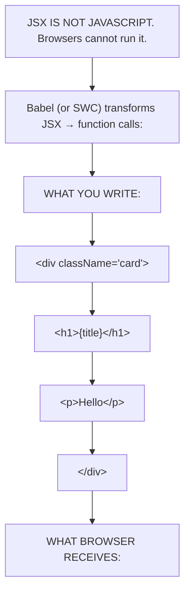

---

## 4. Bundlers — Webpack vs Vite

### The Problem Bundlers Solve

```
YOUR PROJECT:
src/
├── App.tsx              (imports Header, Router, Context)
├── components/
│   ├── Header.tsx       (imports Button, Logo, useAuth)
│   ├── Button.tsx       (imports styles)
│   └── UserCard.tsx     (imports Badge, Avatar, date-fns)
├── hooks/
│   └── useAuth.ts       (imports API client)
└── styles/
    └── global.css

+ node_modules/           (1000+ packages, 50,000+ files)

PROBLEM: Browser can't efficiently load 50,000 files.
HTTP/2 helps, but still — dependency resolution, CSS,
TypeScript, JSX... browsers don't understand any of these.

SOLUTION: Bundle everything into optimized output:
dist/
├── index.html
├── assets/
│   ├── index-abc123.js    (all JS, minified, tree-shaken)
│   ├── vendor-def456.js   (3rd party libs, cached separately)
│   └── style-ghi789.css   (all CSS, combined, minified)
└── images/ (optimized)
```

> **Flow**: src/ → App.tsx (imports Header, Router, Context) | src/ → components/ | src/ → Header.tsx (imports Button, Logo, useAuth) | src/ → Button.tsx (imports styles) | src/ → UserCard.tsx (imports Badge, Avatar, date-fns) | src/ → hooks/ | ...+9 more

```mermaid
flowchart TD
    N1["src/"]
    N2["App.tsx (imports Header, Router, Context)"]
    N3["components/"]
    N4["Header.tsx (imports Button, Logo, useAuth)"]
    N5["Button.tsx (imports styles)"]
    N6["UserCard.tsx (imports Badge, Avatar, date-fns)"]
    N7["hooks/"]
    N8["useAuth.ts (imports API client)"]
    N9["styles/"]
    N10["global.css"]
    N11["dist/"]
    N12["index.html"]
    N13["assets/"]
    N14["index-abc123.js (all JS, minified, tree-shaken)"]
    N15["vendor-def456.js (3rd party libs, cached separately)"]
    N16["style-ghi789.css (all CSS, combined, minified)"]
    N17["images/ (optimized)"]
    N1 --> N2
    N1 --> N3
    N1 --> N4
    N1 --> N5
    N1 --> N6
    N1 --> N7
    N1 --> N8
    N1 --> N9
    N1 --> N10
    N11 --> N12
    N11 --> N13
    N11 --> N14
    N11 --> N15
    N11 --> N16
    N11 --> N17
```

### Webpack — The Veteran

```
WEBPACK (2012 — still dominant in large enterprises):

HOW IT WORKS:
1. Start from entry point (src/index.tsx)
2. Follow every import/require → build dependency graph
3. Apply LOADERS to transform files:
   ├── babel-loader: .tsx/.jsx → JavaScript
   ├── css-loader: resolve @import, url() in CSS
   ├── style-loader: inject CSS into DOM
   └── file-loader: copy images, fonts
4. Apply PLUGINS for optimization:
   ├── HtmlWebpackPlugin: generate index.html
   ├── MiniCssExtractPlugin: extract CSS to files
   └── TerserPlugin: minify JavaScript
5. Output to dist/

PROS:                         CONS:
├── Extremely configurable   ├── Config is complex
├── Huge ecosystem           ├── Slow dev startup (bundles ALL)
├── Battle-tested            ├── Slow HMR on large projects
└── Works with anything      └── Steep learning curve
```

> **Flow**: 2. Follow every import/require → build dependency graph | babel-loader: .tsx/.jsx → JavaScript

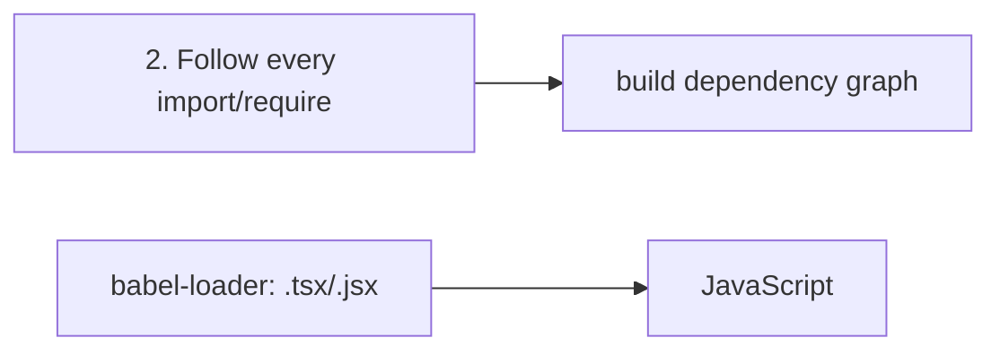

### Vite — The Modern Standard

```
VITE (2020 — by Evan You, creator of Vue):

WHY VITE IS FAST:

┌── Webpack DEV ───────────────────────────────────────────┐
│  Source → Bundle ALL files → Serve → You see page        │
│           ^^^^^^^^^^^^^^^^                               │
│           SLOW (must process everything first)           │
└──────────────────────────────────────────────────────────┘

┌── Vite DEV ──────────────────────────────────────────────┐
│  Source → Start server immediately → Transform           │
│          on request (only what browser asks for)         │
│          Uses native ESM imports in browser              │
└──────────────────────────────────────────────────────────┘

Vite DEV: files are served as individual ES modules.
Browser sees: import Button from '/src/Button.tsx'
Vite intercepts, transforms TSX→JS on the fly, serves it.

Vite BUILD: Uses Rollup under the hood for production.
Output is identical quality to Webpack — optimized bundles.

RESULT:
├── Dev server starts in <500ms (vs 10-30s for Webpack)
├── HMR updates in <50ms (vs seconds)
├── Zero config for React + TS projects
└── Production builds are fully optimized
```

> **Flow**: Source → Bundle ALL files → Serve → You see page / ^^^^ → Source → Start server immediately → Transform / on requ

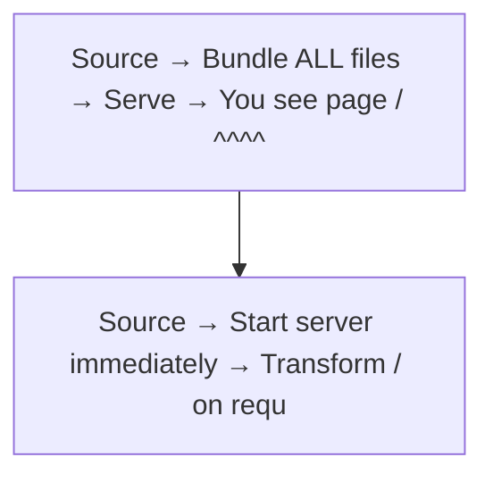

### Comparison Table

```
╔══════════════════════════════════════════════════════════════════════╗
║  Feature           │ Webpack        │ Vite                           ║
║  ──────────────────┼────────────────┼────────────────────────────    ║
║  Dev startup       │ Slow (bundles) │ Instant (native ESM)           ║
║  HMR speed         │ Seconds        │ Milliseconds                   ║
║  Config            │ Complex        │ Minimal                        ║
║  Production        │ Battle-tested  │ Uses Rollup (also solid)       ║
║  Plugin ecosystem  │ Huge           │ Growing fast, Rollup compat    ║
║  Learning curve    │ Steep          │ Low                            ║
║  TypeScript        │ Needs loader   │ Built-in                       ║
║  CSS Modules       │ Needs config   │ Built-in                       ║
║  When to use       │ Legacy/complex │ New projects (2024+)           ║
║  Used by           │ CRA, Next(old) │ Remix, Astro, SvelteKit        ║
╚══════════════════════════════════════════════════════════════════════╝
```

> **Flow**: Feature Webpack Vite → Dev startup Slow (bundles) Instant (native ESM) | Dev startup Slow (bundles) Instant (native ESM) → HMR speed Seconds Milliseconds | HMR speed Seconds Milliseconds → Config Complex Minimal | Config Complex Minimal → Production Battle-tested Uses Rollup (also solid) | Production Battle-tested Uses Rollup (also solid) → Plugin ecosystem Huge Growing fast, Rollup compat | Plugin ecosystem Huge Growing fast, Rollup compat → Learning curve Steep Low | ...+1 more

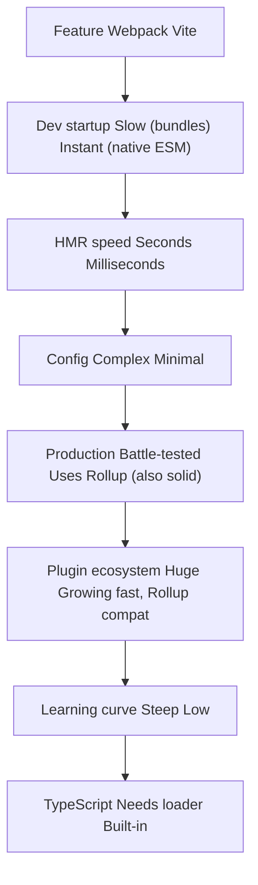

---

## 5. Key Build Concepts

### Tree Shaking

```
╔══════════════════════════════════════════════════════════════════════╗
║  TREE SHAKING — Remove unused code from bundles                      ║
║                                                                      ║
║  ANALOGY: You ordered a textbook, but you only need Chapter 3.       ║
║  Tree shaking tears out the unused chapters before shipping.         ║
║                                                                      ║
║  // utils.ts — you wrote 3 functions                                 ║
║  export function add(a, b) { return a + b; }                         ║
║  export function subtract(a, b) { return a - b; }  // unused!        ║
║  export function multiply(a, b) { return a * b; }  // unused!        ║
║                                                                      ║
║  // App.tsx — you only imported 1                                    ║
║  import { add } from './utils';                                      ║
║                                                                      ║
║  RESULT: subtract and multiply are REMOVED from final bundle.        ║
║                                                                      ║
║  REQUIRES: ES Module syntax (import/export, NOT require)             ║
║  WHY: ES modules are statically analyzable — bundler can see         ║
║       at build time what's used and what's not.                      ║
╚══════════════════════════════════════════════════════════════════════╝
```

> **Flow**: TREE SHAKING — Remove unused code from bundles → Tree shaking tears out the unused chapters before shipp | Tree shaking tears out the unused chapters before shipp → export function add(a, b) { return a + b; } | export function add(a, b) { return a + b; } → export function subtract(a, b) { return a - b; } // unu | export function subtract(a, b) { return a - b; } // unu → export function multiply(a, b) { return a * b; } // unu | export function multiply(a, b) { return a * b; } // unu → import { add } from './utils'; | import { add } from './utils'; → REQUIRES: ES Module syntax (import/export, NOT require) | ...+1 more

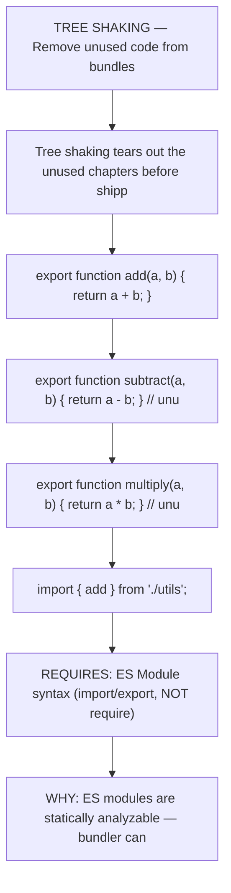

### Code Splitting

```
╔══════════════════════════════════════════════════════════════════════╗
║  CODE SPLITTING — Load only what's needed, when needed               ║
║                                                                      ║
║  WITHOUT Splitting:                                                  ║
║  User visits login page → downloads ENTIRE app (5MB)                 ║
║  Including admin dashboard, charts, reports they'll never use        ║
║                                                                      ║
║  WITH Splitting:                                                     ║
║  User visits login page → downloads login chunk (50KB)               ║
║  User navigates to dashboard → downloads dashboard chunk (200KB)     ║
║  Admin page? Only loaded if user is admin                            ║
║                                                                      ║
║  HOW IN REACT:                                                       ║
║  const Dashboard = React.lazy(() => import('./pages/Dashboard'));    ║
║  const AdminPanel = React.lazy(() => import('./pages/Admin'));       ║
║                                                                      ║
║  <Suspense fallback={<Spinner />}>                                   ║
║      <Routes>                                                        ║
║          <Route path="/dashboard" element={<Dashboard />} />         ║
║          <Route path="/admin" element={<AdminPanel />} />            ║
║      </Routes>                                                       ║
║  </Suspense>                                                         ║
║                                                                      ║
║  Each lazy import creates a SEPARATE chunk file.                     ║
║  Browser downloads it only when that route is visited.               ║
╚══════════════════════════════════════════════════════════════════════╝
```

> **Flow**: CODE SPLITTING — Load only what's needed, when needed → WITHOUT Splitting: | WITHOUT Splitting: → User visits login page → downloads ENTIRE app (5MB) | User visits login page → downloads ENTIRE app (5MB) → WITH Splitting: | WITH Splitting: → User visits login page → downloads login chunk (50KB) | User visits login page → downloads login chunk (50KB) → Admin page? Only loaded if user is admin | Admin page? Only loaded if user is admin → HOW IN REACT: | ...+1 more

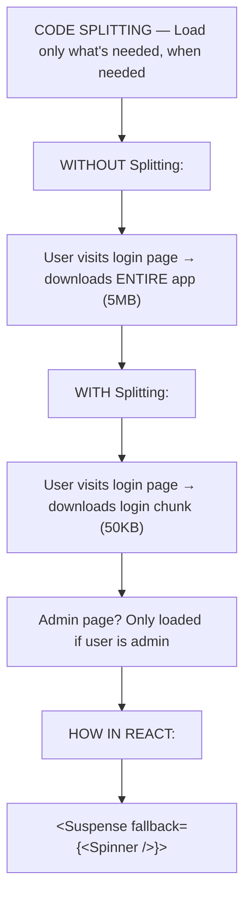

### Source Maps

```
╔══════════════════════════════════════════════════════════════════════╗
║  SOURCE MAPS — Bridge between minified and original code             ║
║                                                                      ║
║  Production bundle: (minified, unreadable)                           ║
║  var a=function(t){return t.map(function(e){return e*2})};           ║
║                                                                      ║
║  Your original:                                                      ║
║  const doubleAll = (numbers: number[]) =>                            ║
║      numbers.map(n => n * 2);                                        ║
║                                                                      ║
║  Source map (.js.map) contains the MAPPING between them.             ║
║  DevTools uses it to show YOUR code in debugging.                    ║
║                                                                      ║
║  ⚠ Don't expose source maps in production to users!                  ║
║  Use: devtool: 'hidden-source-map' (upload to error tracker)         ║
╚══════════════════════════════════════════════════════════════════════╝
```

> **Flow**: SOURCE MAPS — Bridge between minified and original code → Production bundle: (minified, unreadable) | Production bundle: (minified, unreadable) → var a=function(t){return t.map(function(e){return e*2}) | var a=function(t){return t.map(function(e){return e*2}) → Your original: | Your original: → const doubleAll = (numbers: number[]) =&gt; | const doubleAll = (numbers: number[]) =&gt; → numbers.map(n =&gt; n * 2); | numbers.map(n =&gt; n * 2); → Source map (.js.map) contains the MAPPING between them. | ...+1 more

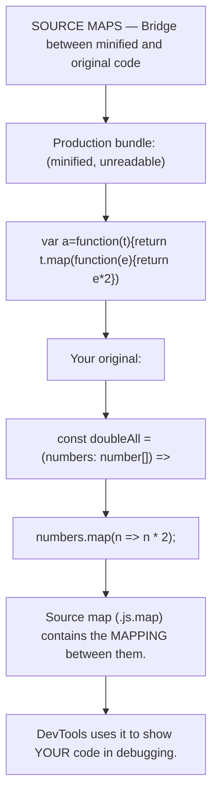

---

## 6. Vite Configuration Explained

```typescript
// vite.config.ts — Most projects need minimal config

import { defineConfig } from "vite";
import react from "@vitejs/plugin-react";

export default defineConfig({
    plugins: [react()],  // Enables JSX + Fast Refresh

    server: {
        port: 3000,      // Dev server port
        proxy: {
            // Proxy API calls to backend (avoids CORS in dev!)
            "/api": {
                target: "http://localhost:8080",
                changeOrigin: true,
            },
        },
    },

    build: {
        outDir: "dist",           // Output directory
        sourcemap: true,          // Generate source maps
        rollupOptions: {
            output: {
                // Manual chunk splitting for better caching
                manualChunks: {
                    vendor: ["react", "react-dom"],
                    router: ["react-router-dom"],
                },
            },
        },
    },

    resolve: {
        alias: {
            "@": "/src",          // @/components instead of ../../components
        },
    },
});
```

---

## Interview Quick-Fire

```
Q: What's the difference between npm install and npm ci?
→ npm install: reads package.json, resolves versions, updates lock.
  npm ci: reads ONLY package-lock.json, installs exact versions.
  CI/CD pipelines should always use npm ci for reproducible builds.

Q: Why is Vite faster than Webpack in development?
→ Webpack bundles ALL files before serving. Vite serves files
  as native ES modules and transforms on-demand. Only the file
  you actually request gets processed.

Q: What is tree shaking?
→ Removing unused exports from the final bundle. Requires ESM
  (import/export) because they're statically analyzable.
  CommonJS (require) can't be tree-shaken.

Q: What's the difference between Babel and TypeScript compiler?
→ Babel: transforms syntax (JSX, ES2024+ → ES5). No type checking.
  TSC: transforms TS → JS AND does type checking. Slower but safer.
  Vite uses esbuild/SWC for speed + TSC for type checking separately.
```

> **Flow**: Babel: transforms syntax (JSX, ES2024+ → ES5). No type checking. | TSC: transforms TS → JS AND does type checking. Slower but safer.

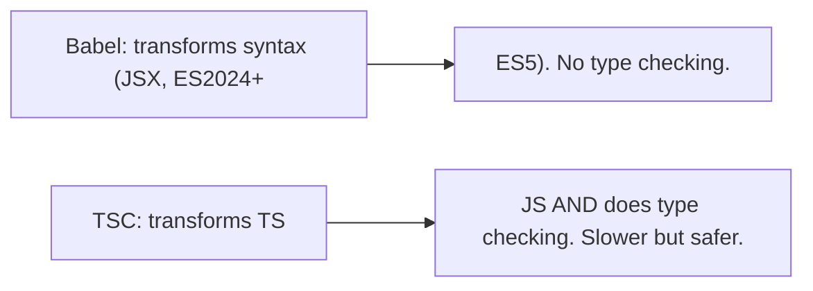

---

> [← Debugging](02_Frontend_Debugging.md) | [Index](../00_MASTER_INDEX.md) | [Next → Mental Models](04_Frontend_Mental_Models_UI.md)


---

> **Navigation**: [< Previous](02_Frontend_Debugging.md) | [Back to Index](../00_MASTER_INDEX.md) | [Next >](04_Frontend_Mental_Models_UI.md)