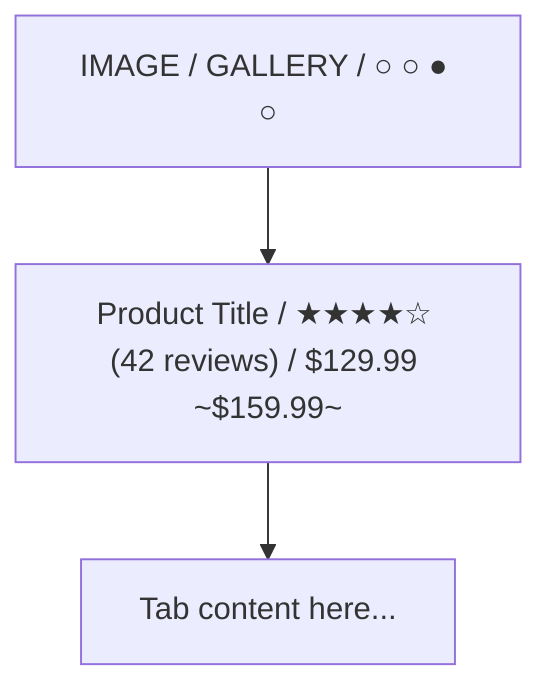
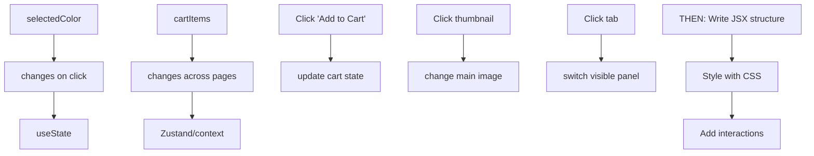
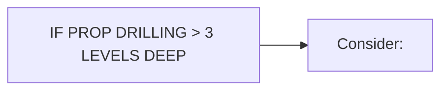
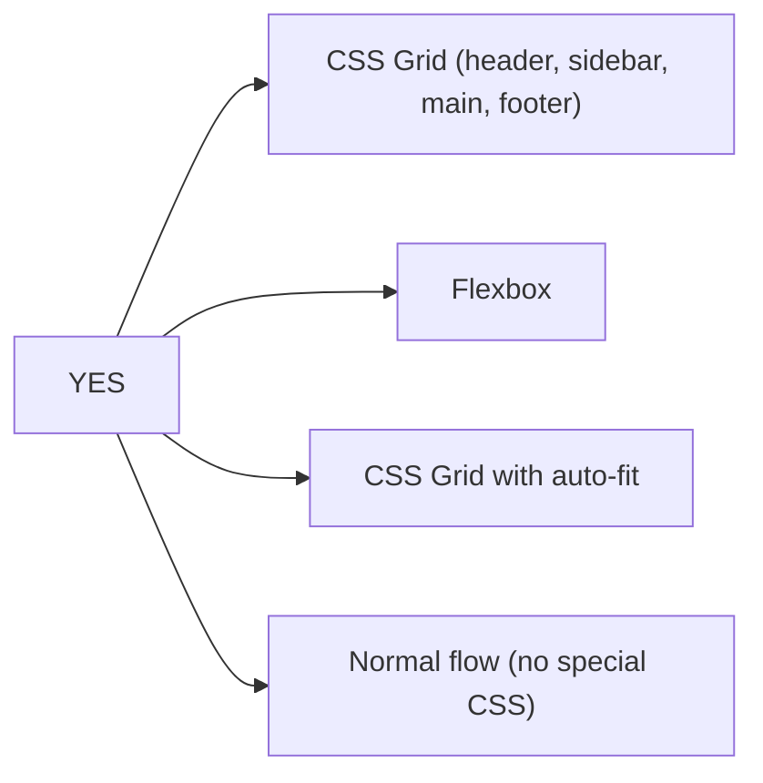
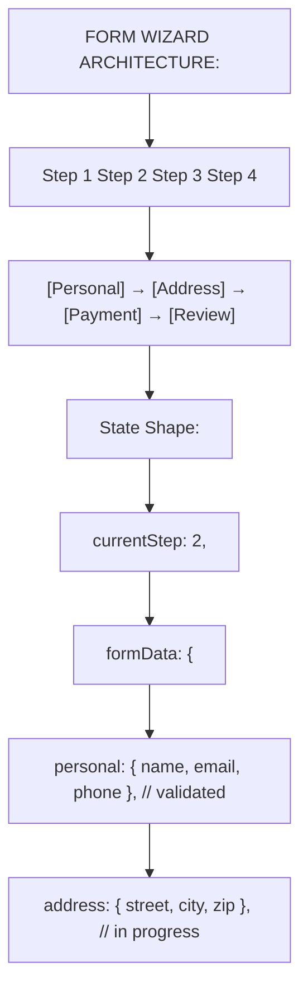
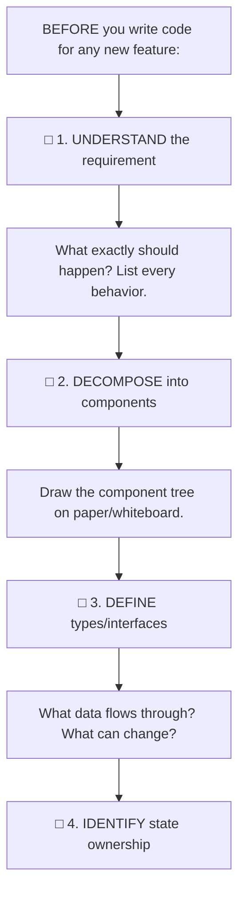
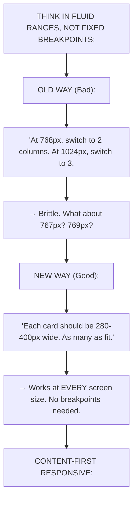
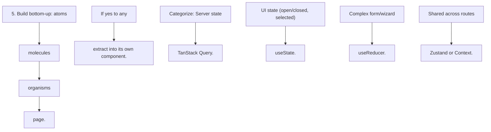

> **Navigation**: [< Previous](03_Build_Tools_Ecosystem.md) | [Back to Index](../00_MASTER_INDEX.md)

> **Frontend Integration Chapter 4/4** | [← Build Tools](03_Build_Tools_Ecosystem.md) | [Index](../00_MASTER_INDEX.md) | [Next Series → Servers & Networking](../13_Developer_Essentials/17_Servers_Ports_Networking.md)

# Frontend Mental Models — Thinking in Components & UIs

## 5W1H — Why This Chapter?


> WHAT: The thinking frameworks expert frontend developers use
> to build complex, aesthetic, maintainable UIs.
>
> WHY:  Beginners know syntax but freeze when faced with:
> "Build a dashboard with filters, tabs, modal, charts."
> Mental models turn a vague requirement into a clear plan.
>
> ANALOGY: An architect doesn't start by laying bricks.
> They:  1. Understand the purpose (office? hospital?)
> 2. Draw a blueprint (rooms, hallways, exits)
> 3. Identify materials (concrete, glass, steel)
> 4. Then build, room by room.
>
> Frontend is the same: Purpose → Blueprint → Components → Build


---

## 1. The Component Decomposition Mental Model

```
GIVEN: "Build an e-commerce product page"

STEP 1 — SQUINT TEST (look at the design blurry-eyed):
┌──────────────────────────────────────────────────────────┐
│ [HEADER / NAV]                                           │
│                                                          │
│  ┌──────────────┐  ┌───────────────────────────────┐     │
│  │              │  │ Product Title                  │    │
│  │    IMAGE     │  │ ★★★★☆ (42 reviews)           │      │
│  │   GALLERY    │  │ $129.99  ~$159.99~            │     │
│  │              │  │                                │    │
│  │  ○ ○ ● ○    │  │ Color: [Red] [Blue] [Black]   │      │
│  └──────────────┘  │ Size:  [S] [M] [L] [XL]      │      │
│                     │                                │   │
│                     │ [Add to Cart]  [♥ Wishlist]   │    │
│                     └───────────────────────────────┘    │
│                                                          │
│  [Description] [Reviews] [Shipping]  ← TABS              │
│  ┌─────────────────────────────────────────────────┐     │
│  │ Tab content here...                              │    │
│  └─────────────────────────────────────────────────┘     │
│                                                          │
│  RELATED PRODUCTS:                                       │
│  [Card] [Card] [Card] [Card]                             │
│                                                          │
│ [FOOTER]                                                 │
└──────────────────────────────────────────────────────────┘

STEP 2 — DRAW BOXES (each box = a component):

ProductPage
├── Header (shared layout)
├── ImageGallery
│   ├── MainImage
│   └── ThumbnailRow
├── ProductInfo
│   ├── StarRating
│   ├── PriceDisplay
│   ├── ColorSelector
│   ├── SizeSelector
│   └── ActionButtons (AddToCart + Wishlist)
├── TabSection
│   ├── TabList
│   └── TabPanel (Description | Reviews | Shipping)
├── RelatedProducts
│   └── ProductCard (reused from listings page!)
└── Footer (shared layout)

STEP 3 — IDENTIFY DATA FLOW:
• Product data comes from API → ProductPage fetches
• selectedColor, selectedSize → local state in ProductPage
• Cart actions → global state (context or Zustand)
• Reviews → separate API call, lazy loaded in tab
```

**Flow:**
1. IMAGE / GALLERY / ○ ○ ● ○
2. Product Title / ★★★★☆ (42 reviews) / $129.99 ~$159.99~
3. Tab content here...



---

## 2. The Data-First Approach

```
BEFORE WRITING ANY JSX, ANSWER:

1. What DATA does this component need?
   → Define the types/interfaces FIRST

2. Where does the data COME FROM?
   ├── Props (parent passes it down)
   ├── API call (this component fetches)
   ├── URL params (useParams/useSearchParams)
   ├── Local state (useState in this component)
   └── Global state (context/store)

3. What can CHANGE? (= state)
   ├── selectedColor → changes on click → useState
   ├── cartItems → changes across pages → Zustand/context
   └── productData → fetched once → TanStack Query cache

4. What EVENTS happen?
   ├── Click "Add to Cart" → update cart state
   ├── Click thumbnail → change main image
   ├── Click tab → switch visible panel
   └── Submit review → POST to API → refetch reviews

THEN: Write JSX structure → Style with CSS → Add interactions
```

**Flow:**
1. selectedColor changes on click
2. useState cartItems changes across pages
3. Zustand/context
4. Click 'Add to Cart' update cart state
5. Click thumbnail change main image



---

## 3. State Ownership Rule

```
"WHERE SHOULD STATE LIVE?" — The #1 React Architecture Question

RULE: State lives in the LOWEST COMMON ANCESTOR of all
      components that need it.

EXAMPLE: Color selector updates both the image and "add to cart"

ProductPage  ← selectedColor STATE lives here
├── ImageGallery  ← needs selectedColor to show right image
├── ProductInfo
│   ├── ColorSelector ← needs selectedColor + setSelectedColor
│   └── AddToCart     ← needs selectedColor for cart item

ProductPage is the lowest ancestor that covers all three.
So: const [selectedColor, setSelectedColor] = useState("red")
Then pass down as props.

IF PROP DRILLING > 3 LEVELS DEEP → Consider:
├── Context (for stable data like theme, auth, locale)
├── Zustand (for frequently changing shared state)
└── Composition pattern (pass components as children)
```

**Flow:**
1. IF PROP DRILLING > 3 LEVELS DEEP
2. Consider:



---

## 4. Layout Strategy Decision Tree

```
GIVEN A DESIGN, WHICH CSS LAYOUT TO USE:

Is it the OVERALL PAGE structure?
├── YES → CSS Grid (header, sidebar, main, footer)
└── NO → Is it a ROW of items?
         ├── YES → Flexbox
         │   ├── Items should wrap? → flex-wrap: wrap
         │   ├── Space between? → justify-content: space-between
         │   └── Center vertically? → align-items: center
         └── NO → Is it a GRID of cards/items?
                 ├── YES → CSS Grid with auto-fit
                 │   grid-template-columns:
                 │     repeat(auto-fit, minmax(280px, 1fr))
                 └── NO → Is it text/document flow?
                         ├── YES → Normal flow (no special CSS)
                         └── Is it overlapping/floating?
                                 └── YES → position: absolute
                                           within relative parent

GOLDEN RULES:
1. Flex for 1D (row OR column)
2. Grid for 2D (rows AND columns)
3. Both can be responsive WITHOUT media queries
4. Don't use float for layout (flex/grid replace it)
5. Position absolute ONLY for overlays/tooltips/badges
```

**Flow:**
1. YES
2. CSS Grid (header, sidebar, main, footer)
3. YES
4. Flexbox
5. YES
6. CSS Grid with auto-fit
7. YES
8. Normal flow (no special CSS)



---

## 5. Building Complex UI Patterns

### Pattern 1: Modal / Dialog


> MODAL — The most common complex UI pattern
>
> REQUIREMENTS:
> ✓ Overlay dims the background
> ✓ Content centered on screen
> ✓ Close on overlay click
> ✓ Close on Escape key
> ✓ Trap focus inside modal (accessibility)
> ✓ Prevent body scroll
> ✓ Animate open/close
> ✓ Render in portal (avoid z-index issues)


```tsx
// Modal.tsx — Complete accessible modal
import { useEffect, useRef, useCallback } from "react";
import { createPortal } from "react-dom";

interface ModalProps {
    isOpen: boolean;
    onClose: () => void;
    title: string;
    children: React.ReactNode;
}

function Modal({ isOpen, onClose, title, children }: ModalProps) {
    const modalRef = useRef<HTMLDivElement>(null);

    // Close on Escape
    useEffect(() => {
        const handleKeyDown = (e: KeyboardEvent) => {
            if (e.key === "Escape") onClose();
        };
        if (isOpen) {
            document.addEventListener("keydown", handleKeyDown);
            document.body.style.overflow = "hidden"; // Prevent scroll
        }
        return () => {
            document.removeEventListener("keydown", handleKeyDown);
            document.body.style.overflow = "";
        };
    }, [isOpen, onClose]);

    // Focus trap: focus the modal when opened
    useEffect(() => {
        if (isOpen) modalRef.current?.focus();
    }, [isOpen]);

    if (!isOpen) return null;

    // Portal: render outside component tree, at document.body
    return createPortal(
        <div
            className={styles.overlay}
            onClick={onClose}           // Close on overlay click
            role="dialog"
            aria-modal="true"
            aria-labelledby="modal-title"
        >
            <div
                ref={modalRef}
                className={styles.modal}
                onClick={e => e.stopPropagation()} // Don't close on modal click
                tabIndex={-1}
            >
                <header className={styles.header}>
                    <h2 id="modal-title">{title}</h2>
                    <button onClick={onClose} aria-label="Close">✕</button>
                </header>
                <div className={styles.body}>
                    {children}
                </div>
            </div>
        </div>,
        document.body
    );
}
```

### Pattern 2: Infinite Scroll

```tsx
// useInfiniteScroll.ts — Reusable hook
function useInfiniteScroll(callback: () => void) {
    const observer = useRef<IntersectionObserver | null>(null);

    const sentinelRef = useCallback((node: HTMLElement | null) => {
        if (observer.current) observer.current.disconnect();
        observer.current = new IntersectionObserver(entries => {
            if (entries[0].isIntersecting) {
                callback(); // Load more when sentinel is visible
            }
        });
        if (node) observer.current.observe(node);
    }, [callback]);

    return sentinelRef;
}

// Usage:
function ProductList() {
    const { data, fetchNextPage, hasNextPage, isFetchingNextPage }
        = useInfiniteQuery({
            queryKey: ["products"],
            queryFn: ({ pageParam }) => fetchProducts(pageParam),
            getNextPageParam: (lastPage) => lastPage.nextCursor,
        });

    const sentinelRef = useInfiniteScroll(() => {
        if (hasNextPage) fetchNextPage();
    });

    return (
        <div className={styles.grid}>
            {data?.pages.flatMap(page =>
                page.products.map(p => <ProductCard key={p.id} product={p} />)
            )}
            <div ref={sentinelRef} /> {/* Invisible sentinel at bottom */}
            {isFetchingNextPage && <Spinner />}
        </div>
    );
}
```

### Pattern 3: Multi-Step Form Wizard

```
┌──────────────────────────────────────────────────────────────────────┐
│  FORM WIZARD ARCHITECTURE:                                           │
│                                                                      │
│  Step 1         Step 2         Step 3         Step 4                 │
│  [Personal] → [Address]  → [Payment]  → [Review]                     │
│   ● ○ ○ ○      ● ● ○ ○      ● ● ● ○      ● ● ● ●                     │
│                                                                      │
│  State Shape:                                                        │
│  {                                                                   │
│    currentStep: 2,                                                   │
│    formData: {                                                       │
│      personal: { name, email, phone },     // validated              │
│      address: { street, city, zip },       // in progress            │
│      payment: { card, expiry, cvv },       // not started            │
│    },                                                                │
│    completedSteps: [1],                                              │
│  }                                                                   │
│                                                                      │
│  KEY DECISIONS:                                                      │
│  • Each step = separate component (code splitting friendly)          │
│  • Validate on step change (can't go forward with errors)            │
│  • Can go BACK without losing data                                   │
│  • useReducer is ideal (complex state transitions)                   │
└──────────────────────────────────────────────────────────────────────┘
```

**Flow:**
1. FORM WIZARD ARCHITECTURE:
2. Step 1 Step 2 Step 3 Step 4
3. [Personal]
4. [Address]
5. [Payment]
6. [Review]
7. State Shape: currentStep: 2, formData: { personal: { name, email, phone }, // validated



```tsx
// FormWizard.tsx — Multi-step form
type WizardState = {
    currentStep: number;
    formData: Record<string, unknown>;
};

type WizardAction =
    | { type: "NEXT" }
    | { type: "BACK" }
    | { type: "UPDATE_DATA"; payload: Record<string, unknown> }
    | { type: "GO_TO_STEP"; payload: number };

function wizardReducer(state: WizardState, action: WizardAction): WizardState {
    switch (action.type) {
        case "NEXT":
            return { ...state, currentStep: state.currentStep + 1 };
        case "BACK":
            return { ...state, currentStep: Math.max(0, state.currentStep - 1) };
        case "UPDATE_DATA":
            return { ...state, formData: { ...state.formData, ...action.payload } };
        case "GO_TO_STEP":
            return { ...state, currentStep: action.payload };
    }
}

const STEPS = [PersonalInfo, AddressForm, PaymentDetails, ReviewSubmit];

function FormWizard() {
    const [state, dispatch] = useReducer(wizardReducer, {
        currentStep: 0,
        formData: {},
    });

    const StepComponent = STEPS[state.currentStep];

    return (
        <div className={styles.wizard}>
            <StepIndicator current={state.currentStep} total={STEPS.length} />
            <StepComponent
                data={state.formData}
                onUpdate={(data) => dispatch({ type: "UPDATE_DATA", payload: data })}
                onNext={() => dispatch({ type: "NEXT" })}
                onBack={() => dispatch({ type: "BACK" })}
            />
        </div>
    );
}
```

---


## 6. The Feature Implementation Checklist

```
┌──────────────────────────────────────────────────────────────────────┐
│  BEFORE you write code for any new feature:                          │
│                                                                      │
│  □ 1. UNDERSTAND the requirement                                     │
│       What exactly should happen? List every behavior.               │
│                                                                      │
│  □ 2. DECOMPOSE into components                                      │
│       Draw the component tree on paper/whiteboard.                   │
│                                                                      │
│  □ 3. DEFINE types/interfaces                                        │
│       What data flows through? What can change?                      │
│                                                                      │
│  □ 4. IDENTIFY state ownership                                       │
│       Where does each piece of state live?                           │
│                                                                      │
│  □ 5. BUILD bottom-up                                                │
│       Start with smallest components (Button, Badge, Input).         │
│       Then compose into larger ones. Page component last.            │
│                                                                      │
│  □ 6. STYLE as you go                                                │
│       Each component gets its CSS Module right away.                 │
│       Don't "add styling later" — it never looks right.              │
│                                                                      │
│  □ 7. HANDLE edge cases                                              │
│       Loading, error, empty, too much data, mobile.                  │
│                                                                      │
│  □ 8. ADD accessibility                                              │
│       aria-labels, keyboard navigation, focus management.            │
│                                                                      │
│  □ 9. TEST                                                           │
│       Does it work? Does it break anything else?                     │
│                                                                      │
│  □ 10. REFACTOR                                                      │
│       Extract reusable pieces. Remove duplication.                   │
└──────────────────────────────────────────────────────────────────────┘
```

**Flow:**
1. BEFORE you write code for any new feature:
2. □ 1. UNDERSTAND the requirement What exactly should happen? List every behavior.
3. □ 2. DECOMPOSE into components Draw the component tree on paper/whiteboard.
4. □ 3. DEFINE types/interfaces What data flows through? What can change?



---

## 7. Responsive Design Mental Model

```
┌──────────────────────────────────────────────────────────────────────┐
│  THINK IN FLUID RANGES, NOT FIXED BREAKPOINTS:                       │
│                                                                      │
│  OLD WAY (Bad):                                                      │
│  "At 768px, switch to 2 columns. At 1024px, switch to 3."            │
│  → Brittle. What about 767px? 769px?                                 │
│                                                                      │
│  NEW WAY (Good):                                                     │
│  "Each card should be 280-400px wide. As many as fit."               │
│  → grid-template-columns: repeat(auto-fit, minmax(280px, 1fr))       │
│  → Works at EVERY screen size. No breakpoints needed.                │
│                                                                      │
│  CONTENT-FIRST RESPONSIVE:                                           │
│  1. Start with content (text, images, data)                          │
│  2. Let content determine the layout                                 │
│  3. Add breakpoints only when layout BREAKS (not at device sizes)    │
│  4. Use fluid units (rem, %, clamp()) for sizing                     │
│  5. Test by resizing browser, not by targeting devices               │
│                                                                      │
│  MOBILE MENTAL MODEL:                                                │
│  On mobile, everything stacks vertically.                            │
│  Navigation collapses to hamburger.                                  │
│  Tables become cards.                                                │
│  Side-by-side becomes top-and-bottom.                                │
│  Touch targets ≥ 44px.                                               │
└──────────────────────────────────────────────────────────────────────┘
```

**Flow:**
1. THINK IN FLUID RANGES, NOT FIXED BREAKPOINTS:
2. OLD WAY (Bad):
3. 'At 768px, switch to 2 columns. At 1024px, switch to 3. Brittle. What about 767px? 769px? NEW WAY (Good): 'Each card should be 280-400px wide. As many as fit.' Works at EVERY screen size. No breakpoints needed.



---


## Interview Quick-Fire

```
Q: How do you approach building a complex UI from a design?
→ 1. Squint test: identify major visual blocks.
  2. Draw component tree (parent-child hierarchy).
  3. Define TypeScript types for data.
  4. Identify state: what changes? where does it live?
  5. Build bottom-up: atoms → molecules → organisms → page.

Q: How do you decide what should be a separate component?
→ Single Responsibility: does it do ONE thing well?
  Reusability: will it be used elsewhere?
  Complexity: is this section getting too big to read?
  If yes to any → extract into its own component.

Q: How do you handle a page with lots of state?
→ Categorize: Server state → TanStack Query.
  UI state (open/closed, selected) → useState.
  Complex form/wizard → useReducer.
  Shared across routes → Zustand or Context.
  Never put everything in one giant useState.

Q: What makes a good component API (props)?
→ Minimal: only what's needed. Generic: work with different data.
  Consistent: follow established patterns in codebase.
  TypeScript: enforce correct usage at compile time.
  Avoid boolean overload: use variant="primary" not isPrimary, isSecondary.
```

**Flow:**
1. Build bottom-up: atoms molecules
2. organisms page.
3. If yes to any
4. extract into its own component.
5. Categorize: Server state
6. TanStack Query.
7. UI state (open/closed, selected)
8. useState.



---

> [← Build Tools](03_Build_Tools_Ecosystem.md) | [Index](../00_MASTER_INDEX.md) | [Next Series → Servers & Networking](../13_Developer_Essentials/17_Servers_Ports_Networking.md)


---

> **Navigation**: [< Previous](03_Build_Tools_Ecosystem.md) | [Back to Index](../00_MASTER_INDEX.md)