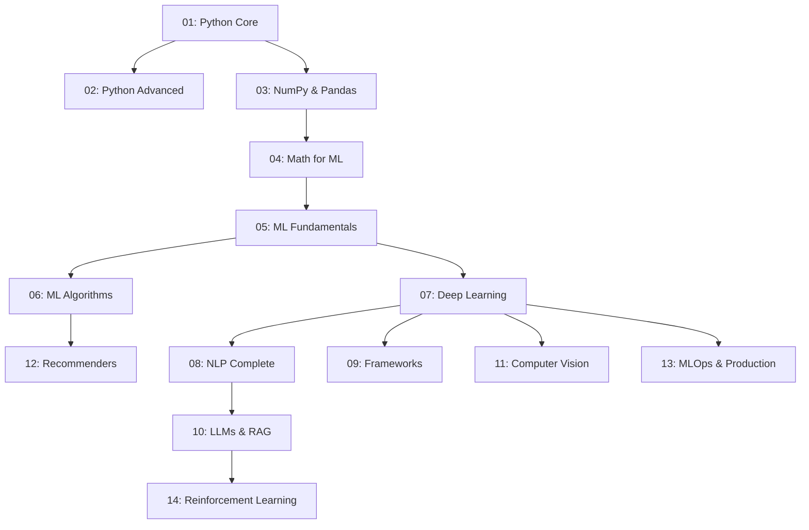

> **Navigation**: [Back to Master Index](../00_MASTER_INDEX.md)

# 🐍 Python, Machine Learning, Deep Learning & NLP — Complete Guide

> _"From Python fundamentals to training neural networks, building recommenders, deploying to production, and teaching machines to play games."_

---

## 📚 Chapter Guide

| #   | Chapter                                                         | Focus                                                                                                                                                                  | Prerequisites      |
| --- | --------------------------------------------------------------- | ---------------------------------------------------------------------------------------------------------------------------------------------------------------------- | ------------------ |
| 01  | [Python Core Fundamentals](01_Python_Core_Fundamentals.md)      | Data types, OOP, closures, decorators, generators                                                                                                                      | Programming basics |
| 02  | [Python Advanced](02_Python_Advanced.md)                        | Concurrency, GIL, asyncio, memory management                                                                                                                           | Ch 01              |
| 02b | [**Python Asyncio Internals**](02b_Python_Asyncio_Internals.md) | Event loop mechanics, coroutines vs tasks vs futures, 6 common pitfalls, FastAPI async patterns                                                                        | Ch 02              |
| 03  | [NumPy & Pandas Essentials](03_NumPy_Pandas_Essentials.md)      | ndarray, broadcasting, DataFrame, GroupBy                                                                                                                              | Ch 01              |
| 04  | [Math for ML](04_Math_For_ML.md)                                | Linear Algebra, Calculus, Probability, Optimization                                                                                                                    | High school math   |
| 04b | [**Math Behind the Code**](04b_Math_Behind_The_Code.md)         | **RIPPING THE ABSTRACTION OFF**: mean/std deviation proofs, what .fit() does step-by-step, normal equation, gradient descent, backpropagation, Adam — all from scratch | Ch 04              |
| 05  | [ML Fundamentals](05_ML_Fundamentals.md)                        | Supervised/Unsupervised, Pipeline, Bias-Variance                                                                                                                       | Ch 03, 04          |
| 06  | [ML Algorithms](06_ML_Algorithms.md)                            | Regression, Trees, SVM, KNN, Clustering, GMM, XGBoost                                                                                                                  | Ch 05              |
| 07  | [Deep Learning Fundamentals](07_Deep_Learning_Fundamentals.md)  | Neural Networks, Training Optimization, LoRA, Transfer Learning                                                                                                        | Ch 04, 05          |
| 08  | [NLP Complete](08_NLP_Complete.md)                              | Tokenization, Embeddings, Seq2Seq, Attention, BERT, GPT, RLHF                                                                                                          | Ch 07              |
| 09  | [Frameworks: PyTorch & TensorFlow](09_Frameworks_PyTorch_TF.md) | Tensors, Autograd, Training Loops, Keras                                                                                                                               | Ch 07              |
| 10  | [LLMs & RAG Applications](10_LLM_RAG_Applications.md)           | Tokenization, Decoding, Embeddings, Vector Search, RAG Pipeline                                                                                                        | Ch 07, 08          |
| 11  | [Computer Vision & CNNs](11_Computer_Vision_CNNs.md)            | Convolutions, ResNet, YOLO, U-Net, ViT, Diffusion Models                                                                                                               | Ch 07              |
| 12  | [Recommender Systems](12_Recommender_Systems.md)                | Content-based, Collaborative Filtering, SVD, Two-Tower Models                                                                                                          | Ch 06, 07          |
| 13  | [MLOps & Production](13_MLOps_Production.md)                    | Serving, Drift Detection, Feature Stores, CI/CD for ML                                                                                                                 | Ch 06-10           |
| 14  | [Reinforcement Learning](14_Reinforcement_Learning.md)          | MDPs, Q-Learning, DQN, PPO, RLHF                                                                                                                                       | Ch 07              |

---

## 🗺️ Learning Path

```
Python Core (01) ──► Python Advanced (02)
      │
      ▼
NumPy/Pandas (03) ──► Math for ML (04)
                            │
                            ▼
                     ML Fundamentals (05) ──► ML Algorithms (06)
                            │                       │
                            ▼                       ▼
                     Deep Learning (07) ──► Recommenders (12)
                        │      │                    │
                        ▼      ▼                    ▼
                     NLP (08) CV (11)         MLOps (13)
                        │
                        ▼
                  LLMs & RAG (10) ──► RL (14, via RLHF)
                        │
                        ▼
                  Frameworks (09)
```



---

## 🔗 Cross-References to Other Sections

| This Section               | Related To                                                         |
| -------------------------- | ------------------------------------------------------------------ |
| Math for ML → Optimization | [Algorithm Thinking](../03_Algorithms/01_Algorithm_Thinking.md)    |
| ML → Decision Trees        | [Trees & Heaps](../02_Data_Structures/01f_Trees_Heaps.md)          |
| ML → Clustering            | [Graph Algorithms](../03_Algorithms/05c_Graphs_Fundamentals.md)    |
| NLP → Tries                | [Advanced DS](../03_Algorithms/07a_Advanced_DS_Core.md)            |
| DL → Matrix Operations     | [2D Arrays & Matrix](../02_Data_Structures/04_2D_Arrays_Matrix.md) |
| MLOps → Containers         | [DevOps Guide](../22_DevOps/00_DevOps_Fundamentals.md)             |
