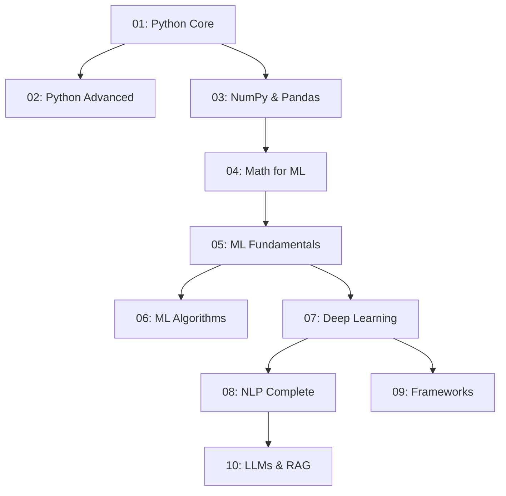

> **Navigation**: [Back to Master Index](../00_MASTER_INDEX.md)

# 🐍 Python, Machine Learning, Deep Learning & NLP — Complete Guide

> _"From Python fundamentals to training neural networks and understanding human language"_

---

## 📚 Chapter Guide

| # | Chapter | Focus | Prerequisites |
|---|---------|-------|---------------|
| 01 | [Python Core Fundamentals](01_Python_Core_Fundamentals.md) | Data types, OOP, closures, decorators, generators | Programming basics |
| 02 | [Python Advanced](02_Python_Advanced.md) | Concurrency, GIL, asyncio, memory management | Ch 01 |
| 03 | [NumPy & Pandas Essentials](03_NumPy_Pandas_Essentials.md) | ndarray, broadcasting, DataFrame, GroupBy | Ch 01 |
| 04 | [Math for ML](04_Math_For_ML.md) | Linear Algebra, Calculus, Probability, Optimization | High school math |
| 05 | [ML Fundamentals](05_ML_Fundamentals.md) | Supervised/Unsupervised, Pipeline, Bias-Variance | Ch 03, 04 |
| 06 | [ML Algorithms](06_ML_Algorithms.md) | Regression, Trees, SVM, KNN, Clustering, PCA, XGBoost | Ch 05 |
| 07 | [Deep Learning Fundamentals](07_Deep_Learning_Fundamentals.md) | Neural Networks, CNNs, RNNs, Transformers, Transfer Learning | Ch 04, 05 |
| 08 | [NLP Complete](08_NLP_Complete.md) | Tokenization, Embeddings, Seq2Seq, Attention, BERT, GPT | Ch 07 |
| 09 | [Frameworks: PyTorch & TensorFlow](09_Frameworks_PyTorch_TF.md) | Tensors, Autograd, Training Loops, Keras | Ch 07 |
| 10 | [LLMs & RAG Applications](10_LLM_RAG_Applications.md) | Tokenization, Decoding, Embeddings, Vector Search, RAG Pipeline | Ch 07, 08 |

---

## 🗺️ Learning Path

```
Python Core (01) ──► Python Advanced (02)
      │
      ▼
NumPy/Pandas (03) ──► Math for ML (04)
                            │
                            ▼
                     ML Fundamentals (05) ──► ML Algorithms (06)
                            │
                            ▼
                     Deep Learning (07) ──► NLP (08) ──► LLMs & RAG (10)
                            │
                            ▼
                     Frameworks (09)
```



---

## 🔗 Cross-References to Other Sections

| This Section | Related To |
|---|---|
| Math for ML → Optimization | [Algorithm Thinking](../03_Algorithms/01_Algorithm_Thinking.md) |
| ML → Decision Trees | [Trees & Heaps](../02_Data_Structures/01f_Trees_Heaps.md) |
| ML → Clustering | [Graph Algorithms](../03_Algorithms/05c_Graphs_Fundamentals.md) |
| NLP → Tries | [Advanced DS](../03_Algorithms/07a_Advanced_DS_Core.md) |
| DL → Matrix Operations | [2D Arrays & Matrix](../02_Data_Structures/04_2D_Arrays_Matrix.md) |
