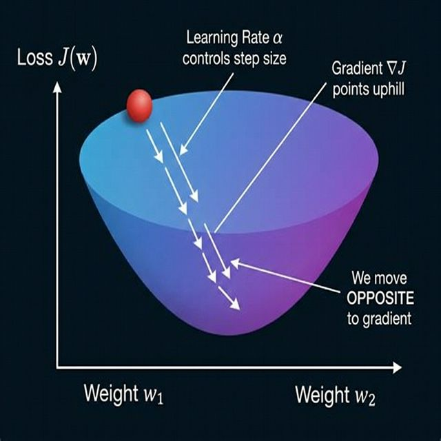

**Navigation**: [< Previous](03_NumPy_Pandas_Essentials.md) | [Back to Index](00_INDEX.md) | [Next >](05_ML_Fundamentals.md)

# 📐 Math for Machine Learning — Complete Guide

_"Every ML algorithm is just math with a fancy name. Master the math, master ML."_

---

# PART 0: The 5W+H Framework

**Mental Model:** Think of Math for ML as the grammar of a language. You can memorize phrases (use sklearn), but without grammar (math), you can't construct new sentences (design new models), debug errors (understand why a model fails), or appreciate poetry (read research papers).

| Question | Math for ML Context |
| :--- | :--- |
| **WHAT** | The mathematical foundations — Linear Algebra, Calculus, Probability, and Optimization — that underpin every machine learning algorithm. |
| **WHY** | Without math, ML is a black box. Understanding math lets you: debug failing models, tune hyperparameters intelligently, read research papers, and invent new approaches. |
| **WHEN** | Before diving into ML algorithms. You need this math to understand *why* gradient descent converges, *why* regularization prevents overfitting, and *why* PCA reduces dimensions. |
| **WHERE** | In every layer of ML: data preprocessing (statistics), model training (calculus + optimization), evaluation (probability), and feature engineering (linear algebra). |
| **WHO** | Built upon centuries of work: Gauss (statistics), Euler/Leibniz (calculus), Bayes (probability), Cauchy (optimization). Modern ML researchers (Hinton, LeCun, Bengio) applied these to neural networks. |
| **HOW** | By representing data as vectors/matrices, defining a loss function, computing gradients via calculus, and iteratively minimizing loss using optimization algorithms. |

### Where It's Used in Real World
- **Self-Driving Cars (Tesla)**: Linear algebra (coordinate transforms), calculus (trajectory optimization), probability (sensor fusion under uncertainty).
- **Recommendation Systems (Netflix)**: Matrix factorization (SVD) to find latent user-movie features from a sparse rating matrix.
- **Medical Imaging**: Convolution (calculus) applied to image matrices (linear algebra) to detect tumors with probabilistic confidence scores.
- **Financial Trading**: Stochastic calculus for option pricing, Bayesian inference for risk assessment, optimization for portfolio allocation.

### Interview Relevance

| Interview Signal | Math Concept Needed |
|---|---|
| "Why does your model overfit?" | Bias-Variance Tradeoff (Statistics) |
| "How does gradient descent work?" | Partial derivatives, Chain Rule (Calculus) |
| "Explain PCA" | Eigenvalues, Covariance Matrix (Linear Algebra) |
| "Why use log-loss?" | Maximum Likelihood Estimation (Probability) |
| "What does the learning rate do?" | Step size in optimization (Optimization) |

---

# PART 1: Linear Algebra — The Language of Data

Every dataset is a matrix. Every feature is a vector. ML *is* linear algebra.

---

## 1.1 Scalars, Vectors, and Matrices

```
SCALAR: A single number
   x = 5

VECTOR: An ordered list of numbers (1D)
   v = [3, 7, 1]     ← a point in 3D space
   
   In ML: A single data sample with 3 features
   Example: [height=170, weight=65, age=25]

MATRIX: A 2D grid of numbers (rows × columns)
   A = | 1  2  3 |    ← 2×3 matrix (2 rows, 3 columns)
       | 4  5  6 |
   
   In ML: An entire dataset
   Each ROW = one data sample
   Each COLUMN = one feature

TENSOR: An N-dimensional array (generalization of matrix)
   In ML: A batch of color images = 4D tensor
   Shape: (batch_size, height, width, channels)
   Example: (32, 224, 224, 3) = 32 images, 224×224 pixels, RGB
```

### Key Operations

| Operation | Symbol | Example | ML Use Case |
|---|---|---|---|
| **Dot Product** | `a · b` | `[1,2] · [3,4] = 1×3 + 2×4 = 11` | Neuron output = weights · inputs |
| **Matrix Multiply** | `A × B` | `(m×n) × (n×p) = (m×p)` | Forward pass in neural networks |
| **Transpose** | `Aᵀ` | Rows ↔ Columns | Normal equation: `w = (XᵀX)⁻¹Xᵀy` |
| **Inverse** | `A⁻¹` | `A × A⁻¹ = I` | Solving linear systems |
| **Determinant** | `det(A)` | Scalar from square matrix | Check if matrix is invertible |

---

## 1.2 The Dot Product — The Most Important Operation in ML

```
WHY THE DOT PRODUCT IS EVERYWHERE:

  A neuron computes:  z = w₁x₁ + w₂x₂ + w₃x₃ + b
  This IS a dot product: z = w · x + b

  For 1000 neurons with 784 inputs (28×28 image):
  Z = W · X + B
  Where W is a 1000×784 matrix, X is a 784×1 vector
  Result: 1000×1 vector (one output per neuron)

  THIS is why GPUs are fast — they do millions of dot products in parallel.

GEOMETRIC INTERPRETATION:
  a · b = |a| × |b| × cos(θ)
  
  cos(θ) = 1  → vectors point SAME direction (similar)
  cos(θ) = 0  → vectors are PERPENDICULAR (unrelated)
  cos(θ) = -1 → vectors point OPPOSITE direction (opposite)
  
  THIS is Cosine Similarity — used in:
  • Word embeddings (Word2Vec): similar words have cos ≈ 1
  • Recommendation systems: similar users have cos ≈ 1
  • Search engines: query-document similarity
```

```python
import numpy as np


# Dot product
a = np.array([1, 2, 3])
b = np.array([4, 5, 6])
print(np.dot(a, b))  # 1*4 + 2*5 + 3*6 = 32

# Matrix multiplication
X = np.array([[1, 2], [3, 4], [5, 6]])  # 3×2 (3 samples, 2 features)
W = np.array([[0.5, 0.3, 0.8],
              [0.2, 0.7, 0.1]])          # 2×3 (2 inputs, 3 neurons)
Z = X @ W  # 3×3 (3 samples, 3 neuron outputs)
print(Z.shape)  # (3, 3)

# Cosine similarity
from numpy.linalg import norm
cos_sim = np.dot(a, b) / (norm(a) * norm(b))
print(f"Cosine similarity: {cos_sim:.4f}")  # 0.9746
```

---

## 1.3 Eigenvalues & Eigenvectors — The DNA of a Matrix

```
WHAT: For a square matrix A, an eigenvector v satisfies:
      A · v = λ · v
      Where λ (lambda) is the eigenvalue.

INTUITION: 
  Most vectors change DIRECTION when multiplied by A.
  Eigenvectors only change MAGNITUDE (they scale by λ).
  They reveal the "natural axes" of a transformation.

WHY THIS MATTERS IN ML — PCA:
  PCA (Principal Component Analysis) finds eigenvectors of
  the COVARIANCE MATRIX of your data.
  
  1. Compute covariance matrix C = (1/n) × Xᵀ × X
  2. Find eigenvectors of C → these are the principal components
  3. Eigenvalues tell you HOW MUCH variance each component captures
  4. Keep top-k eigenvectors → reduce from d dimensions to k dimensions
  
  Example: 1000 features → PCA → 50 features (keeping 95% variance)
  This is DIMENSIONALITY REDUCTION.

ANALOGY:
  Imagine spinning a 3D object. The eigenvectors are the
  AXES around which it naturally spins. The eigenvalues
  tell you how "stretched" the object is along each axis.
```

```python
# PCA from scratch
import numpy as np

# Sample data: 100 samples, 5 features
X = np.random.randn(100, 5)

# Step 1: Center the data (subtract mean)
X_centered = X - X.mean(axis=0)

# Step 2: Compute covariance matrix
cov_matrix = np.cov(X_centered.T)  # 5×5

# Step 3: Find eigenvalues and eigenvectors
eigenvalues, eigenvectors = np.linalg.eig(cov_matrix)

# Step 4: Sort by eigenvalue (highest variance first)
sorted_idx = np.argsort(eigenvalues)[::-1]
eigenvalues = eigenvalues[sorted_idx]
eigenvectors = eigenvectors[:, sorted_idx]

# Step 5: Keep top 2 components
W = eigenvectors[:, :2]            # 5×2 projection matrix
X_reduced = X_centered @ W         # 100×2 (dimensionality reduced!)

# Variance explained
total_var = eigenvalues.sum()
for i, ev in enumerate(eigenvalues):
    print(f"PC{i+1}: {ev/total_var*100:.1f}% variance")
```

---

# PART 2: Calculus — How Models Learn

Calculus answers the question: *"How should I adjust my parameters to make my model better?"*

---

## 2.1 Derivatives — The Rate of Change

```
WHAT: The derivative f'(x) tells you HOW FAST f(x) changes
      as x changes by a tiny amount.
      
      f'(x) = lim(h→0) [f(x+h) - f(x)] / h

WHY IN ML:
  We have a LOSS function L(w) that measures how BAD our model is.
  We want to find the weights w that MINIMIZE L(w).
  
  The derivative ∂L/∂w tells us:
  • If ∂L/∂w > 0 → increasing w increases loss → DECREASE w
  • If ∂L/∂w < 0 → increasing w decreases loss → INCREASE w  
  • If ∂L/∂w = 0 → we're at a minimum (or maximum or saddle point)

KEY DERIVATIVES TO KNOW:
  f(x) = xⁿ       → f'(x) = n·xⁿ⁻¹
  f(x) = eˣ        → f'(x) = eˣ
  f(x) = ln(x)     → f'(x) = 1/x
  f(x) = sigmoid(x) = 1/(1+e⁻ˣ) → f'(x) = σ(x)·(1-σ(x))
  f(x) = ReLU(x) = max(0,x)      → f'(x) = 0 if x<0, 1 if x>0
```

## 2.2 Partial Derivatives & Gradients

```
WHAT: When f depends on MULTIPLE variables, the partial derivative
      ∂f/∂x tells you how f changes when ONLY x changes (others fixed).

THE GRADIENT:
  ∇f = [∂f/∂x₁, ∂f/∂x₂, ..., ∂f/∂xₙ]
  
  The gradient is a VECTOR pointing in the direction of
  STEEPEST ASCENT. To minimize, we go OPPOSITE: -∇f.

EXAMPLE:
  Loss function: L(w₁, w₂) = w₁² + w₂²
  ∂L/∂w₁ = 2w₁
  ∂L/∂w₂ = 2w₂
  ∇L = [2w₁, 2w₂]
  
  At point (3, 4): ∇L = [6, 8]
  To minimize: move in direction [-6, -8]
```


🔬 **Section Challenge — 2.2 Partial Derivatives & Gradients**

**Challenge 1 (Reasoning):** Learning rate too high vs too low — what exactly goes wrong in each case?
<details><summary>Answer</summary>

Too HIGH: overshoot the minimum, oscillate or diverge. Loss increases instead of decreasing. Extreme: NaN loss (floating point overflow). Too LOW: convergence is extremely slow. May get stuck in local minima (can't jump over small bumps). Training takes 10-100x longer. Solution: learning rate scheduling — start higher, decay over time (cosine annealing, step decay). Adam optimizer: adaptive per-parameter learning rates — less sensitive to initial LR choice.
</details>


## 2.3 The Chain Rule — Backbone of Backpropagation

```
WHAT: If y = f(g(x)), then dy/dx = f'(g(x)) · g'(x)

WHY THIS IS CRITICAL:
  A neural network IS a chain of functions:
  
  Input x → Linear(z=wx+b) → Activation(a=σ(z)) → Loss(L)
  
  To find ∂L/∂w, we use the chain rule:
  ∂L/∂w = ∂L/∂a · ∂a/∂z · ∂z/∂w
  
  This IS backpropagation!
  
  For a deep network with 100 layers:
  ∂L/∂w₁ = ∂L/∂a₁₀₀ · ∂a₁₀₀/∂z₁₀₀ · ... · ∂z₂/∂a₁ · ∂a₁/∂z₁ · ∂z₁/∂w₁
  
  Chain rule applied 100 times → "backpropagation through layers"

ANALOGY:
  A Rube Goldberg machine: ball hits lever, lever tips bucket,
  bucket fills cup. How does ball position affect cup fill level?
  Chain rule: multiply each step's effect on the next.
```

---


## 2.4 Gradient Descent — The Learning Algorithm



```
THE CORE ALGORITHM:
  
  Repeat until convergence:
      w = w - α · ∂L/∂w
  
  Where:
  • w = model weights (what we want to optimize)
  • α = learning rate (step size — typically 0.001 to 0.1)
  • ∂L/∂w = gradient of loss with respect to weights

VARIANTS:
  
  1. BATCH Gradient Descent
     Uses ALL training data to compute gradient.
     Pros: Stable convergence.  
     Cons: SLOW for large datasets (millions of samples).
  
  2. STOCHASTIC Gradient Descent (SGD)
     Uses ONE random sample per step.
     Pros: Fast, can escape local minima.  
     Cons: Noisy, erratic path.
  
  3. MINI-BATCH Gradient Descent ← STANDARD IN PRACTICE
     Uses a batch of 32-256 samples per step.
     Pros: Balance of speed and stability. GPU-efficient.
     Cons: Batch size is a hyperparameter.

LEARNING RATE INTUITION:
  Too HIGH (α=1.0): Overshoots minimum, diverges
  Too LOW (α=0.00001): Takes forever, may get stuck
  Just RIGHT (α=0.001): Converges smoothly
  
  ANALOGY: Walking downhill blindfolded.
  Big steps → you overshoot the valley and end up on the other side.
  Tiny steps → you'll get there eventually but it takes all day.
  Medium steps → you reach the bottom efficiently.
```

```python


🔬 **Section Challenge — 2.4 Gradient Descent — The Learning Algorithm**

**Challenge 1 (Reasoning):** Learning rate too high vs too low — what exactly goes wrong in each case?
<details><summary>Answer</summary>

Too HIGH: overshoot the minimum, oscillate or diverge. Loss increases instead of decreasing. Extreme: NaN loss (floating point overflow). Too LOW: convergence is extremely slow. May get stuck in local minima (can't jump over small bumps). Training takes 10-100x longer. Solution: learning rate scheduling — start higher, decay over time (cosine annealing, step decay). Adam optimizer: adaptive per-parameter learning rates — less sensitive to initial LR choice.
</details>


# Gradient Descent from scratch — Linear Regression
import numpy as np

# Generate data: y = 3x + 7 + noise
np.random.seed(42)
X = 2 * np.random.rand(100, 1)
y = 3 * X + 7 + np.random.randn(100, 1) * 0.5

# Initialize parameters
w = np.random.randn(1, 1)  # weight
b = np.zeros((1, 1))        # bias
lr = 0.1                     # learning rate
epochs = 100

for epoch in range(epochs):
    # Forward pass: prediction
    y_pred = X @ w + b                      # (100,1)
    
    # Compute loss: MSE = (1/n) Σ(y - ŷ)²
    loss = np.mean((y - y_pred) ** 2)
    
    # Compute gradients (partial derivatives)
    dw = (-2/len(X)) * X.T @ (y - y_pred)  # ∂L/∂w
    db = (-2/len(X)) * np.sum(y - y_pred)   # ∂L/∂b
    
    # Update parameters
    w -= lr * dw
    b -= lr * db
    
    if epoch % 20 == 0:
        print(f"Epoch {epoch}: Loss={loss:.4f}, w={w[0,0]:.3f}, b={b[0,0]:.3f}")

# Final: w ≈ 3.0, b ≈ 7.0 (recovered the true values!)
```

---

# PART 3: Probability & Statistics — Quantifying Uncertainty

ML models don't output *truth* — they output *probabilities*. Understanding probability is understanding ML.

---

## 3.1 Core Concepts

```
RANDOM VARIABLE: A variable whose value depends on a random outcome.
  X = "number shown on a die roll" → X ∈ {1, 2, 3, 4, 5, 6}

PROBABILITY DISTRIBUTION: How likely each outcome is.
  P(X=1) = P(X=2) = ... = P(X=6) = 1/6  (uniform)

EXPECTED VALUE: The "average" outcome over many trials.
  E[X] = Σ xᵢ · P(xᵢ) = (1+2+3+4+5+6)/6 = 3.5

VARIANCE: How "spread out" the distribution is.
  Var(X) = E[(X - E[X])²] = E[X²] - (E[X])²

STANDARD DEVIATION: σ = √Var(X)
  68% of data within ±1σ, 95% within ±2σ, 99.7% within ±3σ
```

## 3.2 Bayes' Theorem — The Foundation of Probabilistic ML

```
FORMULA:
  P(A|B) = P(B|A) · P(A) / P(B)

IN ENGLISH:
  posterior = (likelihood × prior) / evidence

EXAMPLE — SPAM DETECTION:
  P(spam | "free money") = P("free money" | spam) · P(spam) / P("free money")
  
  P(spam) = 0.3             (30% of emails are spam — prior)
  P("free money"|spam) = 0.8 (80% of spam emails contain "free money" — likelihood)
  P("free money") = 0.3      (30% of all emails contain "free money" — evidence)
  
  P(spam | "free money") = 0.8 × 0.3 / 0.3 = 0.8
  
  → 80% chance it's spam given it contains "free money"!
  
  This is exactly how Naive Bayes classifiers work.

WHY "NAIVE"?
  Naive Bayes assumes features are INDEPENDENT given the class.
  P(x₁, x₂ | spam) = P(x₁|spam) · P(x₂|spam)
  This is almost never true in reality, but it works surprisingly well!
```

## 3.3 Key Distributions

| Distribution | Type | Parameters | ML Use Case |
|---|---|---|---|
| **Bernoulli** | Discrete | p (success prob) | Binary classification output |
| **Binomial** | Discrete | n, p | Number of successes in n trials |
| **Gaussian (Normal)** | Continuous | μ, σ² | Everywhere — data normalization, weight init, noise |
| **Uniform** | Continuous | a, b | Random weight initialization |
| **Poisson** | Discrete | λ (rate) | Count data (events per time) |
| **Softmax** | Continuous | logits | Multi-class classification outputs |

```
THE GAUSSIAN (NORMAL) DISTRIBUTION:

  f(x) = (1 / √(2πσ²)) · exp(-(x-μ)² / (2σ²))

  WHY IT'S EVERYWHERE IN ML:
  1. Central Limit Theorem: averages of ANY distribution → Gaussian
  2. Maximum entropy: if you only know mean and variance, Gaussian
     is the "least biased" assumption
  3. Weight initialization: weights ~ N(0, 0.01) to break symmetry
  4. Batch Normalization: forces activations to N(0, 1) per layer
  5. Gaussian noise: regularization technique
```

## 3.4 Maximum Likelihood Estimation (MLE)

```
WHAT: Find the parameters θ that make the observed data MOST PROBABLE.

  θ* = argmax P(data | θ)

EXAMPLE — LINEAR REGRESSION:
  Assume: y = wx + b + ε, where ε ~ N(0, σ²) (Gaussian noise)
  
  P(yᵢ | xᵢ, w, b) = (1/√(2πσ²)) · exp(-(yᵢ - wxᵢ - b)² / (2σ²))
  
  Log-likelihood: ℓ = Σ log P(yᵢ | xᵢ, w, b)
                     = -n/2 · log(2πσ²) - (1/2σ²) · Σ(yᵢ - wxᵢ - b)²
  
  Maximizing ℓ ⟺ Minimizing Σ(yᵢ - wxᵢ - b)² ⟺ MSE Loss!
  
  INSIGHT: Minimizing Mean Squared Error IS Maximum Likelihood
  under the assumption of Gaussian noise. This is WHY we use MSE.

CROSS-ENTROPY LOSS:
  For classification with Bernoulli distribution:
  Maximizing likelihood ⟺ Minimizing -Σ[yᵢ·log(ŷᵢ) + (1-yᵢ)·log(1-ŷᵢ)]
  This IS Binary Cross-Entropy loss!
```

---

# PART 4: Optimization — Making Models Learn

Optimization is the *engine* of ML. Everything else is the car; optimization makes it move.

---

## 4.1 The Optimization Landscape

```
THE GOAL: Find w* = argmin L(w)

CHALLENGES:
  1. LOCAL MINIMA: A low point that isn't the lowest. SGD noise helps escape.
  2. SADDLE POINTS: Minimum in one direction, maximum in another. 
     Common in high dimensions. Momentum helps escape.
  3. PLATEAUS: Flat regions where gradient ≈ 0. Adam's adaptive LR helps.
  4. RAVINES: Long, narrow valleys. Momentum helps navigate.

CONVEX vs NON-CONVEX:
  Convex (e.g., Linear Regression): ONE global minimum, guaranteed to find it.
  Non-Convex (Neural Networks): MANY local minima, no guarantees.
  
  In practice: for deep nets, most local minima are nearly as good as
  the global minimum. The real problem is saddle points.
```

## 4.2 Optimizers — Advanced Gradient Descent

```
SGD WITH MOMENTUM:
  v_t = β·v_{t-1} + ∂L/∂w        (accumulate velocity)
  w = w - α·v_t                    (update with momentum)
  
  β = 0.9 typically. Like a ball rolling downhill — 
  it picks up speed in consistent directions.

RMSProp:
  s_t = β·s_{t-1} + (1-β)·(∂L/∂w)²  (accumulate squared gradients)
  w = w - α·(∂L/∂w) / (√s_t + ε)      (normalize by history)
  
  Adapts learning rate PER PARAMETER. Parameters with large gradients
  get smaller steps; parameters with small gradients get larger steps.

ADAM (Adaptive Moment Estimation) ← MOST POPULAR:
  m_t = β₁·m_{t-1} + (1-β₁)·g_t          (1st moment: mean of gradients)
  v_t = β₂·v_{t-1} + (1-β₂)·g_t²         (2nd moment: variance of gradients)
  m̂_t = m_t / (1-β₁ᵗ)                     (bias correction)
  v̂_t = v_t / (1-β₂ᵗ)                     (bias correction)
  w = w - α · m̂_t / (√v̂_t + ε)           (update)
  
  Default: β₁=0.9, β₂=0.999, ε=10⁻⁸, α=0.001
  
  Combines Momentum + RMSProp. Works well out-of-the-box for most problems.
```

```python


🔬 **Section Challenge — 4.2 Optimizers — Advanced Gradient Descent**

**Challenge 1 (Reasoning):** Learning rate too high vs too low — what exactly goes wrong in each case?
<details><summary>Answer</summary>

Too HIGH: overshoot the minimum, oscillate or diverge. Loss increases instead of decreasing. Extreme: NaN loss (floating point overflow). Too LOW: convergence is extremely slow. May get stuck in local minima (can't jump over small bumps). Training takes 10-100x longer. Solution: learning rate scheduling — start higher, decay over time (cosine annealing, step decay). Adam optimizer: adaptive per-parameter learning rates — less sensitive to initial LR choice.
</details>


# Comparing optimizers
import numpy as np

# Rosenbrock function (famous test function)
def rosenbrock(x, y):
    return (1 - x)**2 + 100 * (y - x**2)**2

def grad_rosenbrock(x, y):
    dx = -2*(1-x) - 400*x*(y - x**2)
    dy = 200*(y - x**2)
    return np.array([dx, dy])

# SGD
def sgd(lr=0.0001, epochs=10000):
    w = np.array([-1.0, 1.0])
    for _ in range(epochs):
        g = grad_rosenbrock(w[0], w[1])
        w -= lr * g
    return w

# Adam
def adam(lr=0.001, epochs=10000, b1=0.9, b2=0.999, eps=1e-8):
    w = np.array([-1.0, 1.0])
    m = np.zeros(2)
    v = np.zeros(2)
    for t in range(1, epochs+1):
        g = grad_rosenbrock(w[0], w[1])
        m = b1*m + (1-b1)*g
        v = b2*v + (1-b2)*g**2
        m_hat = m / (1-b1**t)
        v_hat = v / (1-b2**t)
        w -= lr * m_hat / (np.sqrt(v_hat) + eps)
    return w

print(f"SGD result:  {sgd()}")    # Slow convergence
print(f"Adam result: {adam()}")    # Fast convergence → [1.0, 1.0]
```

---

## 4.3 Regularization — Preventing Overfitting

```
THE PROBLEM: A model that memorizes training data perfectly
but fails on new data. This is OVERFITTING.

BIAS-VARIANCE TRADEOFF:
  Total Error = Bias² + Variance + Irreducible Noise
  
  High Bias (Underfitting): Model is too simple → misses patterns
  High Variance (Overfitting): Model is too complex → memorizes noise
  
  Goal: Find the sweet spot between bias and variance.

L1 REGULARIZATION (Lasso):
  L_total = L_data + λ · Σ|wᵢ|
  
  Effect: Drives some weights to EXACTLY ZERO → feature selection!
  Use when: You suspect many features are irrelevant.

L2 REGULARIZATION (Ridge):
  L_total = L_data + λ · Σwᵢ²
  
  Effect: Shrinks ALL weights toward zero (but never exactly zero).
  Use when: All features are potentially relevant but you want smaller weights.

DROPOUT (Neural Networks):
  During training, randomly set some neurons to 0 (probability p=0.5).
  Effect: Forces network to learn redundant representations.
  At test time: use all neurons but scale outputs by (1-p).
  
  ANALOGY: A team where random members are absent each day.
  No one person becomes a single point of failure — the team
  becomes robust because everyone learns multiple roles.
```

---


🔬 **Section Challenge — 4.3 Regularization — Preventing Overfitting**

**Challenge 1 (Reasoning):** Training accuracy 99%, validation accuracy 70%. What exactly is overfitting and what are 5 ways to fix it?
<details><summary>Answer</summary>

Overfitting: model memorized training data including noise — it doesn't generalize. Fixes: (1) More training data (more examples → harder to memorize). (2) Dropout — randomly zero neurons during training (prevents co-adaptation). (3) L1/L2 regularization — penalize large weights in loss function. (4) Reduce model complexity (fewer layers/parameters). (5) Early stopping — stop training when validation loss stops improving. (6) Data augmentation — create variant training examples.
</details>


# Quick Reference — Key Formulas

| Concept | Formula | ML Connection |
|---|---|---|
| Dot Product | `a·b = Σaᵢbᵢ` | Neuron output |
| Matrix Multiply | `(AB)ᵢⱼ = Σ Aᵢₖ·Bₖⱼ` | Forward pass |
| Derivative | `f'(x) = lim[f(x+h)-f(x)]/h` | Gradient computation |
| Chain Rule | `∂L/∂w = ∂L/∂a · ∂a/∂z · ∂z/∂w` | Backpropagation |
| Gradient Descent | `w = w - α·∂L/∂w` | Parameter update |
| Bayes' Theorem | `P(A|B) = P(B|A)·P(A)/P(B)` | Naive Bayes, MAP |
| Gaussian | `f(x) = exp(-(x-μ)²/2σ²)/√(2πσ²)` | Weight init, BN |
| MSE Loss | `L = (1/n)Σ(yᵢ-ŷᵢ)²` | Regression |
| Cross-Entropy | `L = -Σ[y·log(ŷ) + (1-y)·log(1-ŷ)]` | Classification |
| Softmax | `P(class_i) = exp(zᵢ)/Σexp(zⱼ)` | Multi-class output |
| Cosine Similarity | `cos(θ) = (a·b)/(‖a‖·‖b‖)` | Text similarity |

---


---

## 🏋️ Practice & Interview Questions — Python

### Predict / Trace
**Q1.** What prints?
```python
x = [1,2,3]
y = x
y.append(4)
print(x)
```
<details><summary>Answer</summary>

`[1, 2, 3, 4]` — `y = x` copies the **reference**, not the list. Both point to the same object. Python lists are mutable. **Fix**: `y = x.copy()` or `y = x[:]` for shallow copy.
</details>

**Q2.** What is the GIL and how does it affect threading in Python?
<details><summary>Answer</summary>

**Global Interpreter Lock**: allows only ONE thread to execute Python bytecode at a time per process. CPU-bound threads don't run truly in parallel — only I/O-bound threads benefit (GIL released during I/O). For CPU parallelism: use `multiprocessing` (separate processes, separate GILs) or Go/Java. CPython 3.13 has experimental free-threaded mode (GIL disabled).
</details>

### Coding Problems
**Q3.** ⭐ FizzBuzz in Python — most Pythonic way.
<details><summary>Solution</summary>

```python
for i in range(1, 101):
    print("FizzBuzz" if i%15==0 else "Fizz" if i%3==0 else "Buzz" if i%5==0 else i)
```
</details>

**Q4.** ⭐ Flatten a nested list recursively.
<details><summary>Solution</summary>

```python
def flatten(lst):
    result = []
    for item in lst:
        if isinstance(item, list): result.extend(flatten(item))
        else: result.append(item)
    return result
# or with generator:
# def flatten(lst): yield from (flatten(x) if isinstance(x,list) else [x] for x in lst)
```
</details>

**Q5.** ⭐⭐ Implement LRU Cache using `functools.lru_cache` vs manual implementation.
<details><summary>Solution</summary>

```python
# Built-in:
from functools import lru_cache
@lru_cache(maxsize=128)
def fib(n): return n if n<2 else fib(n-1)+fib(n-2)

# Manual with OrderedDict:
from collections import OrderedDict
class LRUCache:
    def __init__(self, cap): self.cap=cap; self.cache=OrderedDict()
    def get(self, key):
        if key not in self.cache: return -1
        self.cache.move_to_end(key); return self.cache[key]
    def put(self, key, val):
        self.cache[key]=val; self.cache.move_to_end(key)
        if len(self.cache)>self.cap: self.cache.popitem(last=False)
```
</details>

### MCQ Rapid Fire
| # | Question | Answer |
|---|---|---|
| 1 | List vs Tuple | List: mutable; Tuple: immutable, hashable |
| 2 | `is` vs `==` | `is`: identity (same object); `==`: equality (same value) |
| 3 | Python `dict` ordering (3.7+) | Insertion order (guaranteed) |
| 4 | Generator vs list comprehension | Generator: lazy, O(1) memory; list: eager, O(N) memory |
| 5 | `*args` vs `**kwargs` | *args: positional varargs tuple; **kwargs: keyword varargs dict |
| 6 | `__slots__` purpose | Prevents instance `__dict__`, reduces memory per object |
| 7 | `asyncio` is true parallelism? | ❌ Cooperative concurrency (single thread, yields on await) |


---

## 🧠 Deep Conceptual Questions — Python Internals

**C1. How does Python's GIL work internally, and why hasn't it been removed?**
<details><summary>Deep Answer</summary>

GIL = a mutex in CPython's interpreter. Every Python thread must hold the GIL to execute bytecode. Released during: I/O (blocking syscalls), C extensions (NumPy, pandas release it during computation). Acquired every 100 bytecode instructions or yielded to other threads. WHY NOT REMOVED: CPython's memory management (reference counting) is not thread-safe. Without GIL: `ob_refcnt` (object reference count) must be protected by locks everywhere → massive overhead in single-threaded code. Every `del`, every function call return would need a lock. Previous removal attempts degraded single-threaded code by 30-50%. PyPy, Jython don't have GIL. CPython 3.13 enables experimental "no-GIL" mode (`python -X=nogil`) with per-object locks.
</details>

**C2. What is Python's memory model for integers and why does `is` fail for large ints?**
<details><summary>Deep Answer</summary>

CPython caches small integers (-5 to 256) as singletons. `a = 5; b = 5; a is b` → True (same object). `a = 1000; b = 1000; a is b` → False (new objects). This is CPython-specific optimization — not guaranteed by the language spec. String interning: short strings/identifiers often interned. NEVER use `is` for value comparison (use `==`). `is` tests identity (same object in memory). The integer cache exists because small ints are used everywhere; caching them saves millions of allocations in a typical program.
</details>

**C3. Generators: why are they memory-efficient and how does `yield` work internally?**
<details><summary>Deep Answer</summary>

A generator function returns a generator object. The function body doesn't execute at call time. Each `next()` call: resumes execution from the last `yield` point. Generator saves its stack frame between calls — it's a "suspended stack frame." Memory: generates values one at a time (O(1)) vs list comprehension generating all at once (O(N)). `yield from` (PEP 380): delegates to a sub-generator, chains yields through. Generators ARE the basis of `asyncio`: `async def` functions compile to coroutines which are generators under the hood. `await` ≈ `yield` to the event loop, "I'm waiting for something, run other tasks."
</details>

**C4. Decorators: what pattern underlies them and how do you preserve the wrapped function's metadata?**
<details><summary>Deep Answer</summary>

```python
@decorator
def func(): pass
# Same as: func = decorator(func)
```
Decorator = higher-order function. Problem: `@decorator` replaces `func` with wrapper — `func.__name__` becomes `"wrapper"`, `func.__doc__` is lost. Fix: `@functools.wraps(original_func)` on the wrapper copies `__name__`, `__doc__`, `__annotations__`, `__module__`. Without wraps: debugging is hell, introspection libraries break, Flask/FastAPI route registration may fail. Parameterized decorator: an outer function returning the actual decorator:
```python
def retry(n): return lambda fn: lambda *args: ... # 3 levels!
```
</details>

**C5. `asyncio`: why does `async/await` NOT use threads and how is it still concurrent?**
<details><summary>Deep Answer</summary>

`asyncio` is **cooperative multitasking** on a SINGLE thread. Event loop runs coroutines. A coroutine runs until it hits `await` — this is a VOLUNTARY yield to the event loop. Event loop picks the next ready coroutine. No preemption: if a coroutine runs CPU-bound code without awaiting, it blocks the ENTIRE event loop (other coroutines starve). Concurrency: while coroutine A awaits an HTTP response, coroutine B runs. Both "in flight" simultaneously on one thread. Why no threads: reduce context-switching overhead, simpler shared state (no locks — only one coroutine runs at a time per event loop), better for I/O-bound workloads (10,000 concurrent HTTP requests = 10,000 coroutines, not 10,000 threads).
</details>


**Navigation**: [< Previous](03_NumPy_Pandas_Essentials.md) | [Back to Index](00_INDEX.md) | [Next >](05_ML_Fundamentals.md)
