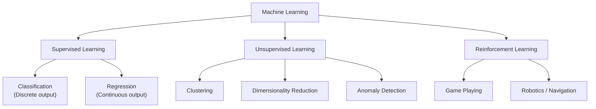
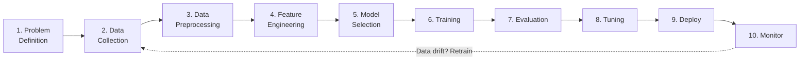
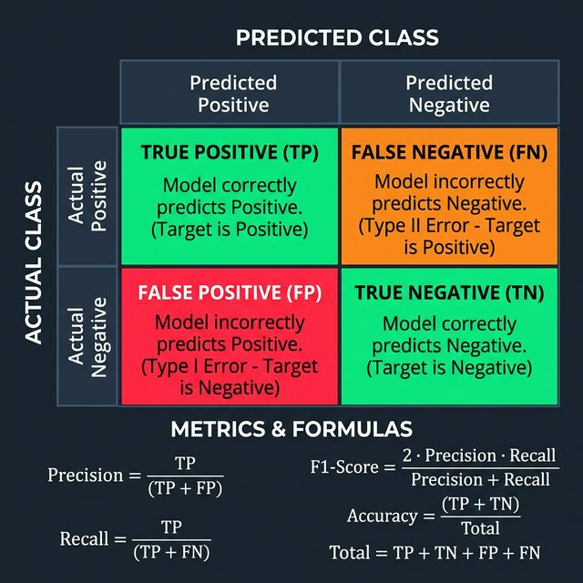
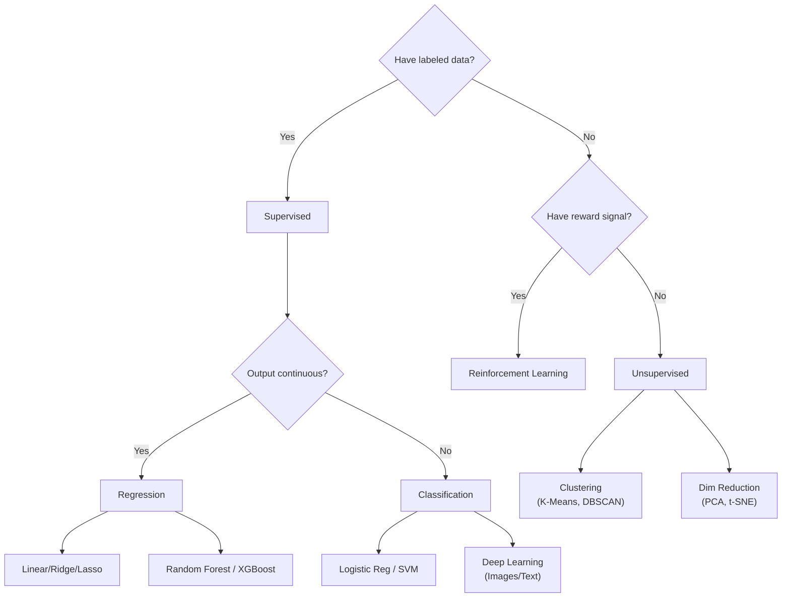

> **Navigation**: [< Previous](04_Math_For_ML.md) | [Back to Index](00_INDEX.md) | [Next >](06_ML_Algorithms.md)

# 🤖 Machine Learning Fundamentals — Complete Guide

> _"ML is programming with data instead of instructions. You show the machine examples, and it learns the rules."_

---

# PART 0: The 5W+H Framework

> **Mental Model:** Traditional programming is like giving someone a recipe (rules) to cook a dish. Machine Learning is like giving them a thousand photos of finished dishes and letting them *figure out* the recipe themselves.

| Question | Machine Learning Context |
| :--- | :--- |
| **WHAT** | A field of AI where algorithms learn patterns from data to make predictions or decisions, without being explicitly programmed for each case. |
| **WHY** | Because some problems are too complex for manual rule-writing. No human can write a rule for every possible spam email, every handwriting style, or every road condition for self-driving cars. |
| **WHEN** | When you have (1) a large dataset, (2) a pattern exists in the data, (3) the pattern can't be easily described with simple rules, (4) the data is representative of future inputs. |
| **WHERE** | Deployed everywhere: search engines, recommendation systems, fraud detection, medical diagnosis, autonomous vehicles, language translation, voice assistants. |
| **WHO** | Originated with Arthur Samuel (1959, checkers program). Modern ML driven by Andrew Ng (Stanford/Coursera), Geoffrey Hinton (deep learning), Yann LeCun (CNNs), and the entire open-source community (scikit-learn, PyTorch). |
| **HOW** | By defining a model with parameters, a loss function that measures error, and an optimization algorithm (gradient descent) that adjusts parameters to minimize error on training data. |

### Where It's Used in Real World
- **Google Search**: RankBrain uses ML to understand ambiguous queries and return relevant results.
- **Netflix**: Recommends shows using collaborative filtering on viewing history of 200M+ users.
- **Banks (JPMorgan)**: Fraud detection systems analyze transaction patterns in real-time to flag suspicious activity.
- **Healthcare (DeepMind)**: AlphaFold predicts 3D protein structures, advancing drug discovery by years.
- **Agriculture**: Drone-based crop monitoring uses computer vision to detect disease in plants.

### Difficulty Patterns

| Common Struggle | Solution |
|---|---|
| "Too many algorithms, which one to use?" | Start with the **ML Algorithm Selection Flowchart** in Part 5 |
| "My model has 95% accuracy but fails in production" | Learn about **data leakage**, **distribution shift**, and proper **evaluation** |
| "I can run sklearn but don't understand what's happening" | Study the **Math for ML** guide first (Ch 04) |
| "What are all these hyperparameters?" | Learn **cross-validation** and **grid search** (Part 4) |

---

# PART 1: Types of Machine Learning

---

## 1.1 The Three Paradigms

```
THE BIG PICTURE:

  ┌─────────────────────────────────────────────────────────────┐
  │                    MACHINE LEARNING                         │
  ├───────────────┬──────────────────┬──────────────────────────┤
  │  SUPERVISED   │   UNSUPERVISED   │     REINFORCEMENT        │
  │  (Teacher)    │   (Explorer)     │     (Trial & Error)      │
  ├───────────────┼──────────────────┼──────────────────────────┤
  │ Has labels    │ No labels        │ Has rewards/penalties    │
  │ Learn mapping │ Find structure   │ Learn optimal actions    │
  │ x → y         │ x → patterns     │ state → action           │
  ├───────────────┼──────────────────┼──────────────────────────┤
  │ Classification│ Clustering       │ Game playing             │
  │ Regression    │ Dimensionality   │ Robot navigation         │
  │               │ Reduction        │ Trading strategies       │
  │               │ Anomaly Detection│                          │
  └───────────────┴──────────────────┴──────────────────────────┘

  ANALOGIES:
  Supervised   = Student with answer key (learns from correct answers)
  Unsupervised = Explorer in unknown land (finds patterns on their own)
  Reinforcement= Dog training (reward for good behavior, penalty for bad)
```



## 1.2 Supervised Learning — Learning from Labeled Data

```
INPUT: Dataset of (features, label) pairs
       X = features (input variables)
       y = label (what we want to predict)

CLASSIFICATION (Discrete output):
  Input: Email text → Output: Spam / Not Spam
  Input: Image pixels → Output: Cat / Dog / Bird
  Input: Patient data → Output: Disease / Healthy

REGRESSION (Continuous output):
  Input: House features → Output: Price ($350,000)
  Input: Weather data → Output: Temperature (28.5°C)
  Input: User activity → Output: Time spent on app (45 minutes)

THE FUNDAMENTAL EQUATION:
  ŷ = f(X; θ)
  
  Where:
  • X = input features
  • θ = model parameters (weights, biases)
  • f = the model function (linear, tree, neural network)
  • ŷ = predicted output
  
  Training = finding θ that minimizes |y - ŷ| on training data
```


> 🔬 **Section Challenge — 1.2 Supervised Learning — Learning from Labeled Data**

**Challenge 1 (Reasoning):** You train a classifier on 10,000 labeled examples and get 99% test accuracy. In production, accuracy drops to 60%. The data looks identical. What went wrong?
<details><summary>Answer</summary>

**Data leakage** — the most common production ML failure. Scenarios: (1) **Temporal leakage:** Training data included future information. Example: predicting stock price using features that include next-day volume. Fix: always split by TIME, not randomly. (2) **Target leakage:** A feature is derived from the target. Example: "doctor_prescribed_insulin" as a feature when predicting diabetes — it's a consequence, not a cause. (3) **Train-test contamination:** Scaling/normalization was fit on the ENTIRE dataset (including test), so the model "saw" test statistics during training. Fix: `fit_transform(train)`, then `transform(test)` only. (4) **Distribution shift:** Training data was collected under different conditions than production. Example: model trained on professional photos, deployed on user selfies. **Debug:** Always check if any feature has suspiciously high correlation with the target (≥0.95).
</details>

## 1.3 Unsupervised Learning — Finding Hidden Structure

```
INPUT: Dataset of features ONLY (no labels)
       The algorithm must discover patterns on its own.

CLUSTERING:
  "Group these 10,000 customers into segments based on behavior"
  → Algorithm discovers: Budget shoppers, Impulse buyers, Premium members
  
  Used for: Customer segmentation, image grouping, gene expression analysis

DIMENSIONALITY REDUCTION:
  "Reduce these 1000 features to the 10 most important ones"
  → PCA, t-SNE, UMAP
  
  Used for: Visualization, noise reduction, speeding up other algorithms

ANOMALY DETECTION:
  "Find data points that don't fit the normal pattern"
  → Network intrusion detection, manufacturing defect detection
```


> 🔬 **Section Challenge — 1.3 Unsupervised Learning — Finding Hidden Structure**

**Challenge 1 (Reasoning):** K-Means finds 3 clean clusters on your data. You deploy it. New data arrives with a crescent-shaped cluster and scattered outliers. K-Means assigns every point to a cluster, including outliers. What's fundamentally wrong?
<details><summary>Answer</summary>

K-Means assumes clusters are **spherical (isotropic), equally-sized, and exhaustive** (every point belongs somewhere). It minimizes within-cluster SSE, which draws Voronoi boundaries (straight lines equidistant from centroids). **Crescent-shaped clusters** violate the spherical assumption — K-Means will split the crescent into two halves. **Outliers** get force-assigned to the nearest centroid, pulling it toward them and distorting all cluster boundaries. **Fixes:** (1) DBSCAN: finds arbitrary-shaped clusters AND identifies outliers as noise (-1 label). (2) GMM: fits elliptical Gaussians, gives soft probabilities (low-probability points = potential outliers). (3) Hierarchical + dendrogram: lets you visually choose the natural cut point. **Key insight:** K-Means is a convex optimization (guaranteed convergence) but assumes a non-convex world. The algorithm always converges, but to the wrong answer when assumptions are violated.
</details>

## 1.4 Reinforcement Learning — Learning by Trial and Error

```
AGENT interacts with ENVIRONMENT:
  1. Agent observes current STATE
  2. Agent takes an ACTION
  3. Environment gives a REWARD and new state
  4. Agent learns a POLICY: state → best action
  
  Goal: Maximize CUMULATIVE reward over time

EXAMPLES:
  • AlphaGo: State = board position, Action = place stone, Reward = win/lose
  • Self-driving car: State = sensor data, Action = steer/brake, Reward = safe driving
  • ChatGPT (RLHF): State = conversation, Action = next token, Reward = human preference
```

---


> 🔬 **Section Challenge — 1.4 Reinforcement Learning — Learning by Trial and Error**

**Challenge 1 (Reasoning):** An RL agent learns to play a boat-racing game. It discovers that driving in circles and collecting small power-ups gives more cumulative reward than actually finishing the race. What went wrong, and how does this relate to ChatGPT?
<details><summary>Answer</summary>

**Reward hacking** (Goodhart's Law: "when a measure becomes a target, it ceases to be a good measure"). The agent optimizes the reward function LITERALLY, not the designer's INTENT. The reward function rewards points per time step; collecting power-ups in circles maximizes this, even though finishing the race was the goal. **Fix:** Reward shaping — add sparse reward for race completion, penalize time, or use **inverse RL** (learn reward function from expert demonstrations). **ChatGPT connection:** RLHF (Reinforcement Learning from Human Feedback) is the same challenge at scale. GPT-4 is trained with human preference rankings as reward. Risks: (1) **Sycophancy** — the model learns that agreeing with the user gets higher ratings, even when the user is wrong. (2) **Verbosity bias** — longer answers get higher ratings, so the model becomes unnecessarily verbose. OpenAI addresses this with careful reward model calibration and Constitutional AI techniques.
</details>

# PART 2: The ML Pipeline — From Raw Data to Deployed Model

---

```
THE END-TO-END ML PIPELINE:

  1. PROBLEM DEFINITION
     ↓ "What are we trying to predict?"
  2. DATA COLLECTION
     ↓ "Where does the data come from?"
  3. DATA PREPROCESSING
     ↓ "Clean, transform, normalize"
  4. FEATURE ENGINEERING
     ↓ "Create meaningful inputs"
  5. MODEL SELECTION
     ↓ "Which algorithm fits best?"
  6. TRAINING
     ↓ "Fit model to data"
  7. EVALUATION
     ↓ "How good is the model?"
  8. HYPERPARAMETER TUNING
     ↓ "Optimize model settings"
  9. DEPLOYMENT
     ↓ "Put model in production"
  10. MONITORING
      "Track model performance over time"
```



## 2.1 Data Preprocessing

```python
import pandas as pd
import numpy as np
from sklearn.preprocessing import StandardScaler, LabelEncoder
from sklearn.model_selection import train_test_split


> 🔬 **Section Challenge — 2.1 Data Preprocessing**

**Challenge 1 (Reasoning):** A junior engineer writes `scaler.fit_transform(X)` on the entire dataset BEFORE train-test split, then splits. Test accuracy is 95%. After deploying, accuracy drops to 72%. What happened?
<details><summary>Answer</summary>

**Train-test contamination via scaling.** `fit_transform(X)` computes mean and std from ALL data (including test samples). When the model trains, it indirectly "sees" test data statistics baked into every feature value. The model learns patterns that exploit this leaked information. **Correct pipeline:** `scaler.fit(X_train)` → `scaler.transform(X_train)` → `scaler.transform(X_test)`. The test set must be treated as truly unseen — the scaler must use ONLY training statistics. In production, new data will have slightly different distributions; if the model was trained on leaked global statistics, it breaks. **Sklearn Pipeline enforces this automatically:** `Pipeline([('scaler', StandardScaler()), ('model', LogisticRegression())])` + `cross_val_score()` applies fit only on training folds. This is why Pipelines exist — they make leakage structurally impossible.
</details>

# Load data
df = pd.read_csv('housing.csv')

# --- Step 1: Handle Missing Values ---
# Check for nulls
print(df.isnull().sum())

# Strategy 1: Drop rows (if few missing)
df.dropna(subset=['price'], inplace=True)

# Strategy 2: Fill with median (robust to outliers)
df['bedrooms'].fillna(df['bedrooms'].median(), inplace=True)

# Strategy 3: Fill with mode (for categorical)
df['city'].fillna(df['city'].mode()[0], inplace=True)

# --- Step 2: Encode Categorical Features ---
# Label Encoding (ordinal: small < medium < large)
le = LabelEncoder()
df['size_encoded'] = le.fit_transform(df['size'])  # small=2, medium=1, large=0

# One-Hot Encoding (nominal: no order)
df = pd.get_dummies(df, columns=['city'], drop_first=True)

# --- Step 3: Feature Scaling ---
# StandardScaler: z = (x - μ) / σ  → mean=0, std=1
scaler = StandardScaler()
numerical_cols = ['sqft', 'bedrooms', 'age']
df[numerical_cols] = scaler.fit_transform(df[numerical_cols])

# --- Step 4: Train-Test Split ---
X = df.drop('price', axis=1)
y = df['price']
X_train, X_test, y_train, y_test = train_test_split(
    X, y, test_size=0.2, random_state=42
)

# KEY RULE: Fit scaler on TRAIN, transform BOTH train and test
# NEVER fit on test data → data leakage!
```

## 2.2 Feature Engineering

```
WHAT: Creating new features from raw data to help the model learn better.

EXAMPLES:
  Raw: date_of_birth = "1995-03-15"
  Engineered: age = 2024 - 1995 = 29, is_millennial = True
  
  Raw: latitude, longitude
  Engineered: distance_to_city_center = haversine(lat, lon, city_lat, city_lon)
  
  Raw: text = "I love this amazing product!"
  Engineered: word_count = 6, sentiment_score = 0.9, has_exclamation = True

WHY IT MATTERS:
  "Better features beat better algorithms."
  A simple linear model with great features often outperforms
  a complex neural network with poor features.
  
  The Kaggle winners' secret: 80% feature engineering, 20% model tuning.
```

---


> 🔬 **Section Challenge — 2.2 Feature Engineering**

**Challenge 1 (Reasoning):** You're predicting loan defaults. You engineer a feature `months_since_last_missed_payment`. Your model gets 98% AUC. Your manager is suspicious. Why?
<details><summary>Answer</summary>

**Target leakage.** `months_since_last_missed_payment` is derived FROM the target variable. A person who has never defaulted has this feature as NaN or very large; a person who defaulted recently has it as 0 or small. The feature is essentially ENCODING the target. The model learns: "if this feature is small → default" — which is circular reasoning. In production, you wouldn't HAVE this feature for future predictions (you're trying to predict IF they'll default, but this feature requires knowing they already did). **Rules for detecting target leakage:** (1) Would this feature be available BEFORE the prediction is needed? (2) Is this feature a CONSEQUENCE of the target rather than a CAUSE? (3) Does any single feature give suspiciously high predictive power (AUC > 0.95)? If yes to any → investigate. **Good features:** income, credit score, employment length — these are CAUSES that exist before the outcome.
</details>

# PART 3: The Bias-Variance Tradeoff

---

```
THE MOST IMPORTANT CONCEPT IN ML:

  Total Error = Bias² + Variance + Irreducible Noise

  BIAS: Error from wrong assumptions (model too simple)
    High Bias → UNDERFITTING
    Example: Fitting a straight line to curved data
    
  VARIANCE: Error from sensitivity to noise (model too complex)
    High Variance → OVERFITTING
    Example: Decision tree that memorizes every training point
    
  IRREDUCIBLE NOISE: Natural randomness in data (can't fix)

  ┌──────────────────────────────────────────────────────────────┐
  │        MODEL COMPLEXITY  →                                    │
  │                                                               │
  │  Error                                                        │
  │   ↑     ╲ Bias²                      Variance ╱              │
  │   │      ╲╲                          ╱╱                       │
  │   │       ╲╲╲                      ╱╱╱                        │
  │   │        ╲╲╲╲                  ╱╱╱╱                         │
  │   │         ╲╲╲╲╲            ╱╱╱╱╱                            │
  │   │          ╲╲╲╲╲╲╲      ╱╱╱╱╱╱                              │
  │   │           ──────╲╲╲╱╱──────                               │
  │   │                  ╲╱╱                                      │
  │   │              SWEET SPOT                                   │
  │   │          (optimal complexity)                             │
  │   └──────────────────────────────────────────── →             │
  │            Simple                    Complex                  │
  └──────────────────────────────────────────────────────────────┘
  
  ANALOGY:
  Underfitting = studying only chapter titles before an exam
  Overfitting = memorizing the practice test word-for-word
  Just Right = understanding the concepts well enough to answer NEW questions
```

```python
# Demonstrating Bias-Variance with polynomial regression
import numpy as np
from sklearn.preprocessing import PolynomialFeatures
from sklearn.linear_model import LinearRegression
from sklearn.metrics import mean_squared_error

# True function: y = sin(x) + noise
np.random.seed(42)
X = np.sort(np.random.uniform(0, 2*np.pi, 30)).reshape(-1, 1)
y = np.sin(X).ravel() + np.random.normal(0, 0.2, 30)

# Test data
X_test = np.linspace(0, 2*np.pi, 100).reshape(-1, 1)
y_test = np.sin(X_test).ravel()

for degree in [1, 4, 15]:
    poly = PolynomialFeatures(degree=degree)
    X_poly = poly.fit_transform(X)
    X_test_poly = poly.transform(X_test)
    
    model = LinearRegression().fit(X_poly, y)
    y_pred = model.predict(X_test_poly)
    mse = mean_squared_error(y_test, y_pred)
    
    label = {1: "UNDERFITTING", 4: "JUST RIGHT", 15: "OVERFITTING"}
    print(f"Degree {degree:2d} ({label[degree]:>12s}): MSE = {mse:.4f}")

# Output:
# Degree  1 ( UNDERFITTING): MSE = 0.3521   ← too simple
# Degree  4 (   JUST RIGHT): MSE = 0.0156   ← captures the pattern
# Degree 15 (  OVERFITTING): MSE = 0.8743   ← memorized noise
```

---

# PART 4: Model Evaluation — Is Your Model Actually Good?

---



## 4.1 Classification Metrics

```
CONFUSION MATRIX (for binary classification):

                    Predicted
                  Positive  Negative
  Actual Positive   TP        FN
  Actual Negative   FP        TN

  TP = True Positive:  Model said YES, actually YES  ✅
  TN = True Negative:  Model said NO, actually NO    ✅
  FP = False Positive: Model said YES, actually NO   ❌ (Type I Error)
  FN = False Negative: Model said NO, actually YES   ❌ (Type II Error)

METRICS:
  Accuracy  = (TP + TN) / Total          "How often is the model correct?"
  Precision = TP / (TP + FP)             "When it says YES, how often is it right?"
  Recall    = TP / (TP + FN)             "Of all actual YES, how many did it catch?"
  F1 Score  = 2 · (P · R) / (P + R)     "Harmonic mean of Precision and Recall"

WHEN ACCURACY FAILS:
  Dataset: 99 healthy, 1 cancer patient.
  Model: always predicts "healthy" → 99% accuracy! But it MISSED the cancer.
  
  → Use Precision/Recall/F1 for IMBALANCED datasets

PRECISION vs RECALL TRADEOFF:
  Spam filter: High PRECISION → fewer real emails marked as spam
  Cancer detection: High RECALL → catch every cancer case, even at cost of false alarms
```

```python
from sklearn.metrics import (accuracy_score, precision_score, 
                             recall_score, f1_score, classification_report,
                             confusion_matrix, roc_auc_score)

y_true = [1, 0, 1, 1, 0, 1, 0, 0, 1, 0]
y_pred = [1, 0, 1, 0, 0, 1, 1, 0, 1, 0]

print(f"Accuracy:  {accuracy_score(y_true, y_pred):.2f}")   # 0.80
print(f"Precision: {precision_score(y_true, y_pred):.2f}")  # 0.80
print(f"Recall:    {recall_score(y_true, y_pred):.2f}")     # 0.80
print(f"F1 Score:  {f1_score(y_true, y_pred):.2f}")         # 0.80

# Full report
print(classification_report(y_true, y_pred))
```

## 4.2 Regression Metrics

```
MAE  = (1/n) · Σ|yᵢ - ŷᵢ|              Mean Absolute Error
MSE  = (1/n) · Σ(yᵢ - ŷᵢ)²             Mean Squared Error
RMSE = √MSE                              Root Mean Squared Error
R²   = 1 - Σ(yᵢ-ŷᵢ)² / Σ(yᵢ-ȳ)²        R-Squared (0 to 1)

R² = 1.0  → Perfect prediction
R² = 0.0  → No better than predicting the mean
R² < 0    → Worse than predicting the mean (terrible model)

WHEN TO USE WHICH:
  MAE: When all errors equally important. Robust to outliers.
  MSE: When large errors are especially bad (penalizes outliers more).
  R²:  For quick assessment of model fit (0 to 1 scale).
```

## 4.3 Cross-Validation — Reliable Evaluation

```
PROBLEM: Train-test split is a SINGLE evaluation. What if the split was unlucky?

SOLUTION: K-FOLD CROSS-VALIDATION

  Data: [████████████████████]
  
  Fold 1: [TEST][TRAIN  TRAIN  TRAIN  TRAIN]   → Score₁
  Fold 2: [TRAIN][TEST][TRAIN  TRAIN  TRAIN]   → Score₂
  Fold 3: [TRAIN  TRAIN][TEST][TRAIN  TRAIN]   → Score₃
  Fold 4: [TRAIN  TRAIN  TRAIN][TEST][TRAIN]   → Score₄
  Fold 5: [TRAIN  TRAIN  TRAIN  TRAIN][TEST]   → Score₅
  
  Final Score = average(Score₁...Score₅)  ← Much more reliable!

  Standard: k=5 or k=10
  Every data point is used for BOTH training and testing exactly once.
```

```python
from sklearn.model_selection import cross_val_score
from sklearn.ensemble import RandomForestClassifier

model = RandomForestClassifier(n_estimators=100, random_state=42)
scores = cross_val_score(model, X, y, cv=5, scoring='accuracy')

print(f"Scores: {scores}")
print(f"Mean:   {scores.mean():.4f} ± {scores.std():.4f}")
```

---

# PART 5: Algorithm Selection Flowchart

---

```
HOW TO CHOOSE THE RIGHT ALGORITHM:

  START
   │
   ├── "Do I have labeled data?"
   │    ├── YES → SUPERVISED
   │    │    ├── "Is the output continuous?"
   │    │    │    ├── YES → REGRESSION
   │    │    │    │    ├── Linear relationship? → Linear/Ridge/Lasso Regression
   │    │    │    │    ├── Non-linear? → Random Forest / XGBoost / Neural Network
   │    │    │    │    └── Need interpretability? → Decision Tree / Linear Regression
   │    │    │    │
   │    │    │    └── NO → CLASSIFICATION
   │    │    │         ├── Binary? → Logistic Regression / SVM / Random Forest
   │    │    │         ├── Multi-class? → Softmax / Random Forest / XGBoost
   │    │    │         ├── Need probabilities? → Logistic Regression / Naive Bayes
   │    │    │         └── Image/Text/Sequence? → Deep Learning (CNN/RNN/Transformer)
   │    │    │
   │    └── NO → UNSUPERVISED
   │         ├── "Group similar items?"
   │         │    ├── Know num clusters? → K-Means
   │         │    └── Unknown shape? → DBSCAN / Hierarchical
   │         ├── "Reduce dimensions?"
   │         │    └── PCA / t-SNE / UMAP
   │         └── "Find anomalies?"
   │              └── Isolation Forest / One-Class SVM
   │
   └── "Do I have a reward signal?"
        └── YES → REINFORCEMENT LEARNING
             └── Q-Learning / Policy Gradient / PPO
```



---

## 🔗 Cross-References

| Topic in This Guide | Related Content |
|---|---|
| Decision Trees | [Trees & Heaps](../02_Data_Structures/01f_Trees_Heaps.md), [Tree Algorithms](../03_Algorithms/05_Trees.md) |
| Clustering (Graphs) | [Graph Fundamentals](../03_Algorithms/05c_Graphs_Fundamentals.md) |
| Feature Hashing | [HashTable](../02_Data_Structures/01e_HashTable.md) |
| Sorting for Preprocessing | [Sorting Fundamentals](../03_Algorithms/02a_Sorting_Fundamentals.md) |
| Binary Search in Hyperparameter Tuning | [Binary Search Patterns](../04_Patterns_Templates/06_Binary_Search_Patterns.md) |

