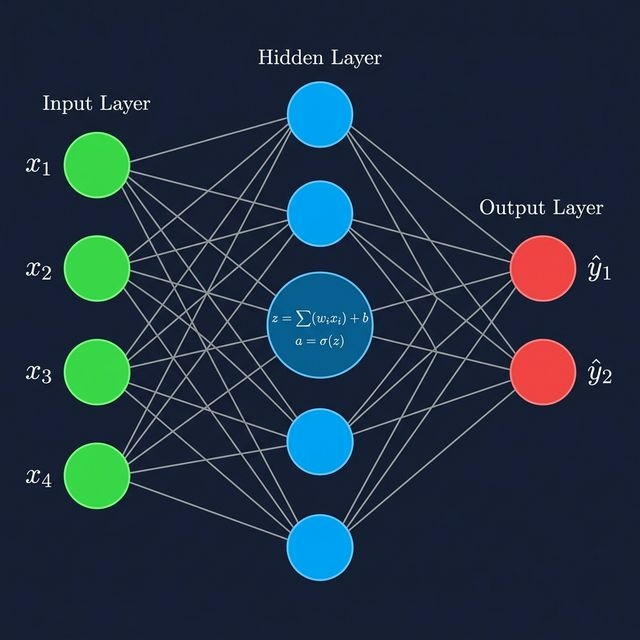
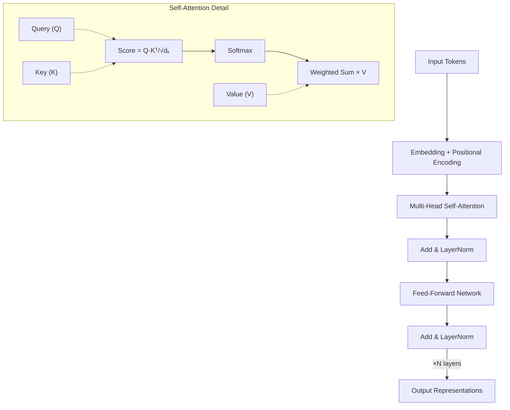

**Navigation**: [< Previous](06_ML_Algorithms.md) | [Back to Index](00_INDEX.md) | [Next >](08_NLP_Complete.md)

# 🧠 Deep Learning Fundamentals — Complete Guide

_"Deep Learning is just linear algebra + calculus + a lot of compute. The concepts are surprisingly simple; the magic is in the scale."_

---

# PART 0: The 5W+H Framework

**Mental Model:** If Machine Learning is learning to recognize a cat by measuring tail length and ear shape (manual features), Deep Learning is handing a neural network a million cat photos and letting it _discover its own features_ — edges → textures → faces → entire cats.

| Question  | Deep Learning Context                                                                                                                                                                                                             |
| :-------- | :-------------------------------------------------------------------------------------------------------------------------------------------------------------------------------------------------------------------------------- |
| **WHAT**  | A subset of ML that uses artificial neural networks with multiple layers ("deep" networks) to automatically learn hierarchical representations from raw data.                                                                     |
| **WHY**   | Because traditional ML requires _manual feature engineering_. For images, audio, and text, human-designed features are inferior to features learned directly by deep networks. DL removes the human bottleneck.                   |
| **WHEN**  | When you have: (1) large datasets (10K+ samples), (2) complex patterns (images, speech, language), (3) access to GPUs/TPUs, (4) manual features aren't good enough.                                                               |
| **WHERE** | Self-driving cars (computer vision), voice assistants (speech recognition), ChatGPT/Gemini (language models), AlphaFold (protein folding), DALL-E/Midjourney (image generation).                                                  |
| **WHO**   | Pioneers: Frank Rosenblatt (Perceptron, 1958), Geoffrey Hinton (backprop/deep belief nets), Yann LeCun (CNNs), Yoshua Bengio (RNNs), Andrej Karpathy (popularizer).                                                               |
| **HOW**   | Stack layers of neurons. Each layer transforms input → output. Forward pass computes predictions. Loss function measures error. Backpropagation computes gradients. Optimizer updates weights. Repeat for millions of iterations. |

### Where It's Used in Real World

- **ChatGPT/Gemini**: Transformer-based language models with 175B+ parameters generating human-quality text.
- **Tesla Autopilot**: CNNs processing camera images at 36 FPS to detect lanes, cars, pedestrians.
- **Google Translate**: Encoder-decoder transformers translating between 100+ languages in real-time.
- **Spotify**: Deep learning recommendation system analyzing audio features + listening patterns.
- **Drug Discovery**: Graph neural networks predicting molecular properties to accelerate drug design.

### Historical Timeline

| Year | Milestone                           | Impact                                               |
| ---- | ----------------------------------- | ---------------------------------------------------- |
| 1958 | Perceptron (Rosenblatt)             | First neural network — simple linear classifier      |
| 1969 | AI Winter begins                    | Minsky proved perceptrons can't learn XOR            |
| 1986 | Backpropagation (Rumelhart, Hinton) | Made training multi-layer networks possible          |
| 1998 | LeNet-5 (LeCun)                     | First successful CNN for digit recognition           |
| 2012 | AlexNet (Krizhevsky, Hinton)        | Won ImageNet by a huge margin → DL revolution        |
| 2014 | GANs (Goodfellow)                   | Generative adversarial networks for image generation |
| 2017 | Transformer (Vaswani et al.)        | "Attention Is All You Need" → modern NLP foundation  |
| 2020 | GPT-3 (OpenAI)                      | 175B parameters, few-shot learning capabilities      |
| 2022 | ChatGPT                             | Brought LLMs to the mainstream                       |

---

# PART 1: The Neuron — Building Block of Neural Networks

---



## 1.1 From Biology to Math

```
BIOLOGICAL NEURON:
  Dendrites (inputs) → Cell body (processing) → Axon (output)

  If total input exceeds a THRESHOLD → neuron FIRES (sends signal)
  If below threshold → neuron stays quiet

ARTIFICIAL NEURON:
  inputs × weights + bias → activation function → output

  z = w₁x₁ + w₂x₂ + ... + wₙxₙ + b    (weighted sum)
  z = w · x + b                           (dot product form)
  a = σ(z)                                (activation function)

  WHERE:
  • x = input features
  • w = weights (learned parameters — HOW IMPORTANT each input is)
  • b = bias (learned parameter — shifts the activation threshold)
  • σ = activation function (introduces non-linearity)
  • a = output (activation)
```

## 1.2 Activation Functions

```
WHY WE NEED ACTIVATION FUNCTIONS:
  Without them: output = w₁(w₂·x + b₂) + b₁ = w₁w₂·x + (w₁b₂+b₁)
  This is STILL a linear function! No matter how many layers,
  it collapses to y = ax + b. Useless for complex patterns.

  Activation functions introduce NON-LINEARITY → networks can
  learn curves, boundaries, and complex shapes.

SIGMOID:  σ(z) = 1 / (1 + e⁻ᶻ)
  Output: (0, 1) — good for probabilities
  Problem: Vanishing gradients (σ'(z) max = 0.25 → gradients shrink)
  Use for: Output layer of binary classification

ReLU:     f(z) = max(0, z)
  Output: [0, ∞) — simple, fast
  Problem: "Dead neurons" (if z < 0 always → gradient = 0 → never learns)
  Use for: Hidden layers (DEFAULT choice)

Leaky ReLU:  f(z) = max(0.01z, z)
  Fixes dead neuron problem. Small negative slope (0.01) instead of 0.

TANH:     f(z) = (eᶻ - e⁻ᶻ) / (eᶻ + e⁻ᶻ)
  Output: (-1, 1) — zero-centered (better than sigmoid)
  Use for: RNN hidden states

SOFTMAX:  P(class_i) = exp(zᵢ) / Σexp(zⱼ)
  Output: probability distribution (sums to 1)
  Use for: Output layer of MULTI-CLASS classification
```

```python
import numpy as np

def sigmoid(z):
    return 1 / (1 + np.exp(-z))

def relu(z):
    return np.maximum(0, z)

def softmax(z):
    exp_z = np.exp(z - np.max(z))  # subtract max for numerical stability
    return exp_z / exp_z.sum()


🔬 **Section Challenge — 1.2 Activation Functions**

**Challenge 1 (Reasoning):** A network with 100 ReLU hidden neurons trains normally. After 1000 epochs, you check and find 40 neurons output EXACTLY 0 for every input in the dataset. What happened, and why doesn't this happen with Leaky ReLU?
<details><summary>Answer</summary>

**Dying ReLU problem.** ReLU(z) = max(0, z). If a neuron's weights shift such that `z = w·x + b < 0` for ALL training inputs, its output is permanently 0 and its gradient is also 0. Zero gradient → no weight update → the neuron is "dead" forever. This typically happens when: (1) Learning rate is too high → weights get a large negative update. (2) Poor initialization pushes biases very negative. **Leaky ReLU fix:** `f(z) = max(0.01z, z)`. For z < 0, the output is 0.01z (not 0), so the gradient is 0.01 (not 0). The neuron can still learn and "come back to life." **Other fixes:** (1) PReLU: learns the leak coefficient as a parameter. (2) ELU: `exp(z)-1` for z<0 (smooth, zero-centered). (3) GELU (used in Transformers): smooth approximation that weights inputs by their probability under a Gaussian. **Why 40% died:** It's a cascade — once some neurons die, the remaining ones must compensate, leading to larger gradients that kill more neurons.
</details>


# Example
z = np.array([-2, -1, 0, 1, 2])
print(f"Sigmoid: {sigmoid(z)}")   # [0.12, 0.27, 0.50, 0.73, 0.88]
print(f"ReLU:    {relu(z)}")      # [0, 0, 0, 1, 2]

logits = np.array([2.0, 1.0, 0.5])
print(f"Softmax: {softmax(logits)}")  # [0.59, 0.24, 0.13] — sums to 1.0
```

---

# PART 2: Feedforward Neural Networks

---

## 2.1 Architecture

```
INPUT LAYER → HIDDEN LAYER(S) → OUTPUT LAYER

  Layer 1 (Input):   receives raw features (e.g., 784 pixel values)
  Layer 2 (Hidden):  learns intermediate representations
  Layer 3 (Hidden):  learns higher-level patterns
  Layer N (Output):  produces prediction (e.g., 10 digit probabilities)

FORWARD PASS (prediction):
  z₁ = W₁ · x + b₁         (linear transform)
  a₁ = ReLU(z₁)             (activation)
  z₂ = W₂ · a₁ + b₂        (linear transform)
  a₂ = ReLU(z₂)             (activation)
  z₃ = W₃ · a₂ + b₃        (linear transform)
  ŷ  = softmax(z₃)          (final output)

PARAMETER COUNT:
  Input: 784, Hidden1: 256, Hidden2: 128, Output: 10

  W₁: 784×256 = 200,704 parameters
  b₁: 256 parameters
  W₂: 256×128 = 32,768 parameters
  b₂: 128 parameters
  W₃: 128×10 = 1,280 parameters
  b₃: 10 parameters

  Total: ~235,000 learnable parameters!
  GPT-3 has 175 BILLION. GPT-4 has ~1.8 TRILLION.
```

## 2.2 Loss Functions

```
REGRESSION:
  MSE = (1/n) · Σ(yᵢ - ŷᵢ)²

BINARY CLASSIFICATION:
  Binary Cross-Entropy = -[y·log(ŷ) + (1-y)·log(1-ŷ)]

MULTI-CLASS CLASSIFICATION:
  Categorical Cross-Entropy = -Σ yᵢ · log(ŷᵢ)

  For class k: L = -log(ŷₖ)  where k is the true class
  If model is confident and correct: ŷₖ ≈ 1 → L ≈ 0  (low loss)
  If model is wrong:               ŷₖ ≈ 0 → L → ∞   (high loss)
```

🔬 **Section Challenge — 2.2 Loss Functions**

**Challenge 1 (Reasoning):** For binary classification, why is Cross-Entropy loss used instead of MSE? Both penalize wrong predictions. What makes MSE specifically BAD with sigmoid outputs?

<details><summary>Answer</summary>

**Gradient saturation.** MSE loss with sigmoid: `L = (y - σ(z))²`. The gradient is `∂L/∂z = 2(y-σ(z)) · σ'(z)`. Sigmoid's derivative `σ'(z)` has maximum value 0.25 (at z=0) and approaches 0 for large |z|. When the model is CONFIDENTLY WRONG (z is very negative but y=1), σ(z) ≈ 0 and σ'(z) ≈ 0 → gradient ≈ 0 → the model can't learn to correct its worst mistakes! **Cross-entropy fix:** `L = -y·log(σ(z))`. The gradient simplifies to `∂L/∂z = σ(z) - y`. When confidently wrong: σ(z) ≈ 0, y=1 → gradient = -1 (large!). The loss function SCREAMS when the model is confidently wrong, producing a large gradient for fast correction. Also, cross-entropy creates a CONVEX loss surface with sigmoid (guaranteed global minimum), while MSE creates a non-convex surface with multiple local minima. **Key insight:** The choice of loss function determines the gradient landscape, not just the error measurement.

</details>

## 2.3 Backpropagation — How Networks Learn

```
THE ALGORITHM:

  1. FORWARD PASS: Compute prediction ŷ
  2. COMPUTE LOSS: L = loss(y, ŷ)
  3. BACKWARD PASS: Compute ∂L/∂w for EVERY weight using chain rule
  4. UPDATE: w = w - α · ∂L/∂w

FOR A SIMPLE 2-LAYER NETWORK:
  Forward:  z = Wx + b → a = σ(z) → L = loss(y, a)

  Backward (chain rule):
  ∂L/∂a = -(y/a) + (1-y)/(1-a)              (derivative of loss)
  ∂a/∂z = σ(z) · (1-σ(z))                    (derivative of sigmoid)
  ∂z/∂W = x                                    (derivative of linear)

  ∂L/∂W = ∂L/∂a · ∂a/∂z · ∂z/∂W             (chain rule!)
         = (a-y) · x                           (simplified)

  Update: W = W - α · (a-y) · x

WHY THIS WORKS:
  Each weight gets a gradient proportional to its contribution to the error.
  Weights that caused more error get bigger updates.
  Over thousands of iterations, the network converges to good weights.

THE VANISHING GRADIENT PROBLEM:
  In deep networks (50+ layers), gradients are multiplied at each layer.
  If each layer's gradient < 1 (e.g., sigmoid max = 0.25):
  0.25 × 0.25 × 0.25 × ... × 0.25 = 0.25⁵⁰ ≈ 10⁻³⁰ → gradient vanishes!

  SOLUTIONS:
  • ReLU activation (gradient = 1 for positive values)
  • Batch Normalization (normalize activations per layer)
  • Residual Connections (skip connections in ResNet)
  • Better initialization (Xavier/He initialization)
```

```python


🔬 **Section Challenge — 2.3 Backpropagation — How Networks Learn**

**Challenge 1 (Reasoning):** In a 50-layer network with sigmoid activations, the gradient at layer 1 is 0.25⁵⁰ ≈ 10⁻³⁰. With ReLU, the gradient is either 1⁵⁰ = 1 or 0⁵⁰ = 0. ResNet adds skip connections. How do skip connections solve BOTH vanishing AND exploding gradients simultaneously?
<details><summary>Answer</summary>

**ResNet's residual block:** `output = F(x) + x`. During backprop, the gradient flows through TWO paths: (1) Through F(x) — the learned transformation (may vanish). (2) Through x — the identity shortcut (gradient = 1, always). The total gradient is: `∂L/∂x = ∂L/∂output · (∂F/∂x + 1)`. The `+1` ensures the gradient is at LEAST 1·∂L/∂output, even if ∂F/∂x vanishes. **Why it doesn't explode:** The `+1` is additive, not multiplicative. Without skip connections: gradient = product of all layer gradients (exponential growth/decay). With skip connections: gradient = SUM of paths through different numbers of layers. Sums don't explode the way products do. **Why F(x) learns RESIDUALS:** If the optimal transformation is close to identity, learning F(x) = 0 (do nothing) is easy. Without skip connections, learning the identity function requires W = I perfectly — hard to optimize. ResNet makes "do nothing" the easy default. This is why 152 layers work but 50 layers without skip connections don't.
</details>

# Neural Network from SCRATCH (no PyTorch/TF)
import numpy as np

class SimpleNeuralNetwork:
    def __init__(self, input_size, hidden_size, output_size):
        # Xavier initialization
        self.W1 = np.random.randn(input_size, hidden_size) * np.sqrt(2/input_size)
        self.b1 = np.zeros((1, hidden_size))
        self.W2 = np.random.randn(hidden_size, output_size) * np.sqrt(2/hidden_size)
        self.b2 = np.zeros((1, output_size))

    def relu(self, z):
        return np.maximum(0, z)

    def relu_derivative(self, z):
        return (z > 0).astype(float)

    def sigmoid(self, z):
        return 1 / (1 + np.exp(-np.clip(z, -500, 500)))

    def forward(self, X):
        self.z1 = X @ self.W1 + self.b1      # linear
        self.a1 = self.relu(self.z1)           # activation
        self.z2 = self.a1 @ self.W2 + self.b2  # linear
        self.a2 = self.sigmoid(self.z2)        # output
        return self.a2

    def backward(self, X, y, lr=0.01):
        m = X.shape[0]

        # Output layer gradient
        dz2 = self.a2 - y                          # (a2 - y)
        dW2 = (1/m) * self.a1.T @ dz2
        db2 = (1/m) * np.sum(dz2, axis=0, keepdims=True)

        # Hidden layer gradient (chain rule!)
        da1 = dz2 @ self.W2.T
        dz1 = da1 * self.relu_derivative(self.z1)
        dW1 = (1/m) * X.T @ dz1
        db1 = (1/m) * np.sum(dz1, axis=0, keepdims=True)

        # Update weights
        self.W2 -= lr * dW2
        self.b2 -= lr * db2
        self.W1 -= lr * dW1
        self.b1 -= lr * db1

    def train(self, X, y, epochs=1000, lr=0.01):
        for epoch in range(epochs):
            y_pred = self.forward(X)
            loss = -np.mean(y * np.log(y_pred + 1e-8) +
                           (1-y) * np.log(1-y_pred + 1e-8))
            self.backward(X, y, lr)
            if epoch % 200 == 0:
                print(f"Epoch {epoch}: Loss = {loss:.4f}")

# XOR problem (impossible for single perceptron!)
X = np.array([[0,0], [0,1], [1,0], [1,1]])
y = np.array([[0], [1], [1], [0]])

nn = SimpleNeuralNetwork(2, 8, 1)
nn.train(X, y, epochs=2000, lr=0.5)
print(f"\nPredictions: {nn.forward(X).round(2).flatten()}")
# [0.02, 0.98, 0.98, 0.02] ← Learned XOR!
```

---

# PART 3: Convolutional Neural Networks (CNNs)

---

```
WHAT: Neural networks designed for GRID-STRUCTURED data (images, audio).
      Instead of fully-connected layers, CNNs use CONVOLUTION operations
      that slide a small filter across the input.

WHY:  A 224×224 RGB image has 150,528 pixels.
      Fully connected: 150,528 × 1000 = 150M parameters per layer!
      CNN with 3×3 filter: 3×3×3 = 27 parameters per filter.

      CNNs exploit SPATIAL LOCALITY: nearby pixels are related.
      The same edge detector works everywhere in the image.
      This is WEIGHT SHARING.

HOW CONVOLUTION WORKS:
  Input:  5×5 image
  Filter: 3×3 kernel (learned weights)

  Slide filter across image, compute dot product at each position:

  Image:              Filter:         Output:
  ┌─┬─┬─┬─┬─┐       ┌─┬─┬─┐        ┌─┬─┬─┐
  │1│0│1│0│1│       │1│0│1│        │4│3│4│
  ├─┼─┼─┼─┼─┤       ├─┼─┼─┤        ├─┼─┼─┤
  │0│1│0│1│0│       │0│1│0│        │2│4│3│
  ├─┼─┼─┼─┼─┤       ├─┼─┼─┤        ├─┼─┼─┤
  │1│0│1│0│1│       │1│0│1│        │4│3│4│
  ├─┼─┼─┼─┼─┤       └─┴─┴─┘        └─┴─┴─┘
  │0│1│0│1│0│                    (3×3 output)
  ├─┼─┼─┼─┼─┤
  │1│0│1│0│1│
  └─┴─┴─┴─┴─┘

OUTPUT SIZE = (Input - Filter + 2·Padding) / Stride + 1
  (5 - 3 + 0) / 1 + 1 = 3

POOLING: Downsample to reduce size
  Max Pooling 2×2: take maximum of each 2×2 region
  Reduces spatial dimensions by half → less computation
```

## CNN Architecture Progression

```
LENET-5 (1998, LeCun):
  Input(32×32) → Conv → Pool → Conv → Pool → FC → FC → Output(10)
  ~60K parameters. Used for digit recognition (ZIP codes).

ALEXNET (2012, Krizhevsky):
  Input(224×224×3) → Conv5(96) → Pool → Conv5(256) → Pool →
  Conv3(384) → Conv3(384) → Conv3(256) → Pool → FC(4096) → FC(4096) → Output(1000)
  ~60M parameters. Won ImageNet. Started the DL revolution.
  Key innovations: ReLU, Dropout, Data Augmentation, GPU training.

VGG-16 (2014):
  All 3×3 convolutions, very deep (16 layers). ~138M parameters.
  Showed: deeper = better (up to a point).

RESNET (2015, He):
  Innovation: SKIP CONNECTIONS (residual connections)

  Normal: output = F(x)
  ResNet: output = F(x) + x       ← ADD input to output!

  This solves vanishing gradients: gradient always has a path through 'x'.
  ResNet-152: 152 layers, won ImageNet with 3.57% error (superhuman!).

  ANALOGY: Skip connections are like shortcuts in a city.
  If the main road (layers) is congested (vanishing gradients),
  the highway (skip connection) still carries traffic (gradients).
```

---

# PART 4: Recurrent Neural Networks (RNNs)

---

```
WHAT: Neural networks for SEQUENTIAL data (text, time series, audio).
      They have a MEMORY (hidden state) that carries information
      from previous steps.

WHY:  Feedforward networks treat each input independently.
      But in "I love _____", the prediction depends on CONTEXT.
      RNNs process one word at a time, updating their hidden state.

HOW:
  At each time step t:
  h_t = tanh(W_hh · h_{t-1} + W_xh · x_t + b)    (update hidden state)
  y_t = W_hy · h_t + b_y                            (output)

PROBLEM: VANISHING GRADIENTS (again!)
  For long sequences (100+ tokens), gradients through time steps
  multiply at each step → vanish or explode.

  RNN can't learn: "The cat, which sat on the mat and ate the fish, ___"
  By the time it reaches "___", the information about "cat" has vanished.

SOLUTION: LSTM (Long Short-Term Memory)
  Uses GATES to control information flow:

  Forget Gate:  f_t = σ(W_f · [h_{t-1}, x_t] + b_f)    "What to forget?"
  Input Gate:   i_t = σ(W_i · [h_{t-1}, x_t] + b_i)    "What new info to add?"
  Output Gate:  o_t = σ(W_o · [h_{t-1}, x_t] + b_o)    "What to output?"
  Cell State:   C_t = f_t ⊙ C_{t-1} + i_t ⊙ tanh(...)  "Long-term memory"
  Hidden State: h_t = o_t ⊙ tanh(C_t)                    "Short-term memory"

  The cell state C_t is like a CONVEYOR BELT — information flows through
  with minimal modification. Gates ADD or REMOVE information selectively.

GRU (Gated Recurrent Unit) — Simplified LSTM:
  Only 2 gates (reset + update) instead of 3.
  Similar performance, fewer parameters, trains faster.
```

---

# PART 5: The Transformer — The Architecture Behind Modern AI

---

```
WHY TRANSFORMERS REPLACED RNNs:
  1. RNNs are SEQUENTIAL — can't parallelize (slow training)
  2. RNNs struggle with LONG-RANGE dependencies (>100 tokens)
  3. Transformers process ALL tokens SIMULTANEOUSLY (parallel!)
  4. Transformers use ATTENTION to look at ANY position directly

THE SELF-ATTENTION MECHANISM:

  "The animal didn't cross the street because it was too tired"

  What does "it" refer to? "animal" or "street"?

  Self-attention computes RELEVANCE between every pair of words:

  For each word, create three vectors:
  Q (Query):  "What am I looking for?"
  K (Key):    "What do I contain?"
  V (Value):  "What information do I carry?"

  Attention(Q, K, V) = softmax(Q · Kᵀ / √d_k) · V

  Q · Kᵀ → similarity score between each pair of words
  softmax → normalize to probabilities
  × V    → weighted sum of values

  "it" Q × "animal" K = HIGH score → "it" attends to "animal"
  "it" Q × "street" K = LOW score → "it" ignores "street"

MULTI-HEAD ATTENTION:
  Instead of one attention, compute MULTIPLE attentions in parallel.
  h=8 heads: each head learns to attend to different things:
  Head 1: syntactic relationships (subject-verb)
  Head 2: semantic relationships (synonyms)
  Head 3: positional relationships (nearby words)

TRANSFORMER ARCHITECTURE:

  ENCODER (understanding input):
  Input → Embedding + Positional Encoding
       → Multi-Head Self-Attention → Add & Norm
       → Feed-Forward Network      → Add & Norm
       → (repeat N times)

  DECODER (generating output):
  Output → Embedding + Positional Encoding
        → Masked Multi-Head Self-Attention → Add & Norm
        → Cross-Attention (attend to encoder) → Add & Norm
        → Feed-Forward Network               → Add & Norm
        → (repeat N times)
        → Linear → Softmax → next token prediction

POSITIONAL ENCODING:
  Transformers have NO concept of order (unlike RNNs).
  Positional encoding adds position information:
  PE(pos, 2i) = sin(pos / 10000^(2i/d))
  PE(pos, 2i+1) = cos(pos / 10000^(2i/d))
  This lets the model learn relationships like "3 words apart".
```



---

# PART 6: Training Optimization — Making Networks Learn Faster

_MIT 6.S191-style: understanding WHY each optimizer exists and the math behind it_

---

## 6.1 Gradient Descent Variants

```
STOCHASTIC GRADIENT DESCENT (SGD):
  The foundation. At each step, estimate gradient from a MINI-BATCH
  (typically 32-256 samples) instead of the full dataset.

  θ = θ - α · ∇L(θ; x_batch, y_batch)

  PROBLEM: noisy gradients → zig-zagging → slow convergence

SGD WITH MOMENTUM:
  Like a ball rolling downhill with inertia.
  Accumulates past gradients → smooths out noise.

  v_t = β · v_{t-1} + ∇L(θ)            (velocity = momentum × old + gradient)
  θ = θ - α · v_t                        (update params)

  β = 0.9 typical. The velocity "remembers" 90% of previous direction.

  WHY: without momentum, gradient oscillates in ravines (steep walls).
  With momentum, it builds speed in the consistent direction.

ADAM (Adaptive Moment Estimation):
  THE DEFAULT OPTIMIZER. Combines momentum + adaptive learning rates.

  m_t = β₁ · m_{t-1} + (1-β₁) · g_t    (1st moment: mean of gradients)
  v_t = β₂ · v_{t-1} + (1-β₂) · g_t²   (2nd moment: variance of gradients)

  m̂_t = m_t / (1 - β₁ᵗ)                (bias correction — critical early on!)
  v̂_t = v_t / (1 - β₂ᵗ)

  θ = θ - α · m̂_t / (√v̂_t + ε)         (update: scale by inverse std)

  Defaults: α=0.001, β₁=0.9, β₂=0.999, ε=10⁻⁸

  WHY BIAS CORRECTION?
  At t=1: m₁ = 0.1 · g₁ (if β₁=0.9)
  This underestimates the true mean! Correction: m̂₁ = m₁ / 0.1 = g₁

  INTUITION: Each parameter gets its own adaptive learning rate.
  Parameters with large gradients → smaller effective LR (don't overshoot)
  Parameters with small gradients → larger effective LR (don't get stuck)

ADAMW (Adam with Decoupled Weight Decay):
  Standard L2 regularization in Adam doesn't work as intended.
  AdamW separates weight decay from gradient update:

  θ = θ - α · (m̂_t / (√v̂_t + ε) + λ · θ)

  This is the optimizer used by BERT, GPT, and most modern models.
```

🔬 **Section Challenge — 6.1 Gradient Descent Variants**

**Challenge 1 (Reasoning):** Modern Transformer training uses "warmup + cosine decay" for learning rate scheduling. Why do we INCREASE the learning rate at the start (warmup) when the model has random weights and high loss? Shouldn't we start slow?

<details><summary>Answer</summary>

**Counterintuitive but mathematically justified.** At step 0, weights are random → Adam's `v_t` (second moment / gradient variance estimate) is initialized to 0. With no history, Adam has NO information about the scale of gradients for each parameter. If you use a large LR immediately, Adam divides by `√(v̂_t) ≈ 0` → enormous effective step → NaN. **Warmup gives Adam time to calibrate.** During warmup (small LR, 5-10% of training): gradients are large but steps are small; `v_t` accumulates enough history to produce reliable variance estimates. After warmup, Adam has accurate per-parameter scaling → safe to use full LR. **Cosine decay rationale:** Early training needs large LR (coarse search for good region). Late training needs small LR (fine-tune within the good region). Cosine is smooth (no discontinuities like step decay), which prevents loss spikes. **Practical:** Without warmup, Transformer training often diverges in the first 100 steps. With warmup, the same hyperparameters converge stably.

</details>

## 6.2 Learning Rate Scheduling

```
THE MOST IMPORTANT HYPERPARAMETER IS THE LEARNING RATE.
  Too high: loss diverges → NaN → training fails
  Too low:  loss decreases painfully slowly → stuck in local minimum

  Rule: START high(ish), then DECAY over time.

WARMUP + COSINE DECAY (modern standard):
  Phase 1 — Warmup (first ~5% of training):
    LR ramps linearly from 0 to target LR
    WHY: at the start, random weights → huge gradients → need small LR

  Phase 2 — Cosine Decay:
    LR = LR_min + ½(LR_max - LR_min)(1 + cos(π · t/T))
    Smoothly decays from LR_max to LR_min following a cosine curve

  This is what GPT, BERT, and most Transformers use.

  Other schedules:
  • Step decay: halve LR every N epochs (old school)
  • Exponential decay: LR = LR₀ · exp(-k·t)
  • 1cycle: ramp up then down in one cycle (fast convergence, Leslie Smith)

LR FINDER (practical trick):
  Before training, sweep LR from 10⁻⁷ to 1 over 100 steps.
  Plot loss vs LR. Pick LR where loss decreases fastest (steepest slope).
```

---

# PART 7: Regularization — Preventing Overfitting

_The art of making networks generalize to UNSEEN data_

---

## 7.1 Dropout

```
WHAT: During training, randomly SET NEURONS TO ZERO with probability p.

FORWARD PASS (training):
  mask = Bernoulli(p=0.5)   → [1, 0, 1, 1, 0, ...]
  a = relu(Wx + b) ⊙ mask   (elementwise multiply by mask)
  a = a / (1 - p)            (scale up remaining neurons)

  WHY SCALE UP?
  If we drop 50% of neurons, the surviving neurons carry 2× the weight.
  At test time, ALL neurons are active → we need to match expected values.
  "Inverted dropout": scale during training → no change at test time.

FORWARD PASS (inference):
  a = relu(Wx + b)   ← NO dropped, NO scaling. Full network.

WHY DROPOUT WORKS:
  1. ENSEMBLE EFFECT: Each training step uses a DIFFERENT sub-network
     (there are 2ⁿ possible sub-networks for n neurons!)
     The final model is an AVERAGE of all these sub-networks.

  2. REDUNDANCY: No neuron can rely on another being there.
     Forces neurons to learn INDEPENDENT features.

  3. SIMILAR TO: Bagging in random forests
     Each "tree" (sub-network) is trained on a random subset.

TYPICAL VALUES:
  Dropout = 0.1-0.3 for Transformers
  Dropout = 0.5 for dense layers (original paper value)
  Dropout = 0.0 for convolutional layers (use batch norm instead)
```

## 7.2 Batch Normalization — Internal Covariate Shift

```
PROBLEM: "Internal Covariate Shift"
  Each layer's input distribution changes during training
  (because the previous layer's weights changed).
  Layer N learns to expect inputs in range [-1, 1],
  but layer N-1 suddenly outputs [-10, 10] → layer N confused!

SOLUTION: Normalize each layer's inputs to zero mean, unit variance.

  μ_B = (1/m) Σ xᵢ                    (batch mean)
  σ²_B = (1/m) Σ (xᵢ - μ_B)²         (batch variance)
  x̂ᵢ = (xᵢ - μ_B) / √(σ²_B + ε)     (normalize)
  yᵢ = γ · x̂ᵢ + β                     (scale and shift — LEARNABLE!)

  γ (gamma) and β (beta) are LEARNED parameters.
  WHY? Pure normalization might remove useful information.
  γ and β let the network learn to UNDO the normalization if needed.

DURING INFERENCE:
  Use RUNNING mean and variance computed during training
  (not the batch statistics — batch size might be 1 at inference!)

LAYER NORMALIZATION (used in Transformers):
  Normalize across FEATURES instead of across batch.
  Why? In NLP, batch sizes vary, sequences have different lengths.
  LayerNorm is batch-size-independent.

  BatchNorm: normalize each feature across the batch
  LayerNorm: normalize each sample across its features
```

## 7.3 Data Augmentation

```
IDEA: Can't get more data? TRANSFORM existing data!
  Artificially increases dataset size without collecting new samples.

IMAGE AUGMENTATIONS:
  • Random crop + resize (shift invariance)
  • Horizontal flip (symmetry invariance)
  • Color jitter (brightness, contrast, saturation)
  • Random rotation (±15°)
  • Cutout/CutMix: randomly mask/replace parts of image
  • MixUp: blend two images + their labels

TEXT AUGMENTATIONS:
  • Synonym replacement: "happy" → "joyful"
  • Random insertion/deletion/swap of words
  • Back-translation: English → French → English (paraphrase)
  • EDA (Easy Data Augmentation): all of above combined

AUGMENTATION IS FREE REGULARIZATION:
  • No extra data needed, no extra parameters
  • Makes model invariant to transformations
  • Most impactful technique after getting more real data
```

---

# PART 8: Transfer Learning & Fine-tuning

_How modern AI works: don't train from scratch, transfer knowledge._

---

```
THE PARADIGM SHIFT:
  Before (2012): Train each model from scratch on task-specific data
  After (2018):  Pre-train on MASSIVE general data → fine-tune on YOUR data

  Pre-training: GPT-3 trained on 570GB of internet text (45TB compute)
  Fine-tuning: YOUR task with 1000 examples in 30 minutes on 1 GPU

  Transfer learning is like EDUCATION:
  Pre-training = general education (K-12, college)
  Fine-tuning = specialization (medical school, law school)
  You don't start from scratch for each new skill!

TWO APPROACHES:

1. FEATURE EXTRACTION (freeze base, train head):
   Pre-trained model → FREEZE all weights → Add new output layer → Train only new layer

   Use when: your dataset is SMALL (< 1000 samples)
   Why: pre-trained features are already good, don't overfit to small data

2. FINE-TUNING (unfreeze some/all layers):
   Pre-trained model → UNFREEZE last N layers → Train with small LR

   Use when: your dataset is MEDIUM (1000-100K samples)
   Why: task-specific adaptation captures nuances

   DISCRIMINATIVE LEARNING RATES:
   Later layers (near output): higher LR (task-specific)
   Earlier layers (near input): lower LR (general features)

   Example: [1e-5, 3e-5, 1e-4]  for [early, middle, late] layers
```

```python
# Transfer Learning with PyTorch
import torch
import torch.nn as nn
from torchvision import models

# Load pre-trained ResNet
model = models.resnet50(pretrained=True)

# Freeze all layers
for param in model.parameters():
    param.requires_grad = False

# Replace last layer for YOUR task (e.g., 10 classes)
model.fc = nn.Linear(model.fc.in_features, 10)
# Only model.fc is trainable now!

# For fine-tuning: unfreeze last few layers
for param in model.layer4.parameters():
    param.requires_grad = True

# Different learning rates
optimizer = torch.optim.Adam([
    {'params': model.layer4.parameters(), 'lr': 1e-4},
    {'params': model.fc.parameters(), 'lr': 1e-3},
])
```

### 8.1 Parameter-Efficient Fine-Tuning (PEFT)

```
PROBLEM: GPT-3 has 175B parameters. Fine-tuning ALL of them is:
  • Expensive (needs multiple A100 GPUs)
  • Storage-heavy (save 175B params per task)
  • Risk of catastrophic forgetting

LORA (Low-Rank Adaptation):
  Instead of updating W (d×d matrix), learn a LOW-RANK update:
  W' = W + ∆W = W + B·A

  Where: W is frozen (original weights)
         A: d×r matrix, B: r×d matrix (r << d, e.g., r=8)

  Original params: d² (millions)
  LoRA params: 2·d·r (thousands!) → 0.1% of original

  Performance: ~95-99% of full fine-tuning quality

  Used by: LLaMA fine-tunes, Stable Diffusion fine-tunes

QLORA: Quantize base model to 4-bit + LoRA
  Fine-tune a 65B parameter model on a single consumer GPU!
```

---

# Quick Reference — Practical Deep Learning

---

```
TRAINING RECIPE:
  1. Start with a PRE-TRAINED model (don't train from scratch)
  2. Optimizer: AdamW (lr=1e-3 to 1e-5)
  3. Scheduler: warmup + cosine decay
  4. Regularization: dropout + weight decay
  5. Monitor: train loss AND validation loss + early stopping
  6. Debug: if loss doesn't decrease →
     a. Check data pipeline (visualize inputs + labels)
     b. Overfit on 1 batch first (sanity check)
     c. Reduce model size or increase regularization

WEIGHT INITIALIZATION:
  ❌ All zeros: all neurons learn the same thing (symmetry problem)
  ❌ Random large: activations explode → NaN
  ✅ Xavier/Glorot: W ~ N(0, √(2/(n_in + n_out)))   — for sigmoid/tanh
  ✅ He:           W ~ N(0, √(2/n_in))               — for ReLU

COMMON ARCHITECTURES CHEAT SHEET:
  Images      → CNN (ResNet, EfficientNet)
  Text/NLP    → Transformer (BERT, GPT)
  Sequences   → LSTM/GRU or Transformer
  Generation  → GAN, Diffusion Model, VAE
  Graphs      → GNN (Graph Neural Network)
  Audio       → 1D CNN or Transformer (Whisper)
  Tabular     → XGBoost/LightGBM (DL rarely wins on tabular!)
```

---

## 🔗 Cross-References

| Topic                                        | Related Content                                                    |
| -------------------------------------------- | ------------------------------------------------------------------ |
| Matrix Operations (forward pass)             | [2D Arrays & Matrix](../02_Data_Structures/04_2D_Arrays_Matrix.md) |
| Optimization math (calculus, linear algebra) | [Math for ML](04_Math_For_ML.md)                                   |
| Transformers → NLP applications              | [NLP Complete](08_NLP_Complete.md)                                 |
| Graph Neural Networks                        | [Graph Algorithms](../03_Algorithms/05c_Graphs_Fundamentals.md)    |
| LLMs → RAG Applications                      | [LLM & RAG Guide](10_LLM_RAG_Applications.md)                      |
| PyTorch / TensorFlow implementation          | [Frameworks](09_Frameworks_PyTorch_TF.md)                          |
