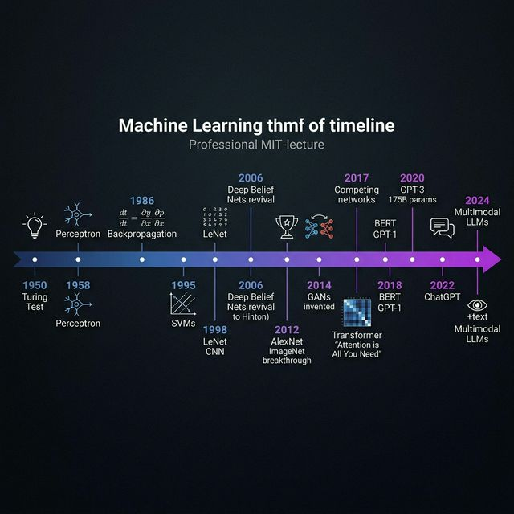
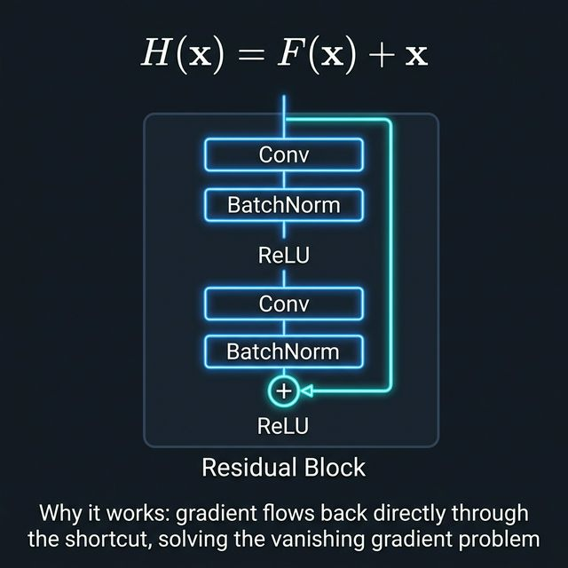

> **Navigation**: [← NLP Complete](08_NLP_Complete.md) | [Back to Index](00_INDEX.md) | [Next → Recommender Systems](12_Recommender_Systems.md)

# 👁️ Computer Vision & CNNs — Progressive Mastery Guide

> _"A picture is worth a thousand words — but to a computer, it's a matrix of numbers. CNN's genius is learning which patterns in those numbers matter."_

---



# PART 0: The 5W+H Framework

| Question | Computer Vision Context |
| :--- | :--- |
| **WHAT** | Teaching computers to interpret and understand images/videos. The goal is to replicate human visual understanding. |
| **WHY** | Cameras are everywhere — medical scans, satellites, phones. Manual analysis is impossible at scale. CV automates it. |
| **WHEN** | Wherever you have pixel data: images, video frames, medical imaging, autonomous driving, quality control. |
| **WHERE** | PyTorch/TensorFlow for training; ONNX/TensorRT for production deployment; OpenCV for preprocessing. |
| **WHO** | LeNet (LeCun 1998) → AlexNet (Krizhevsky 2012) → ResNet (He 2015) → YOLO (Redmon 2016) → ViT (Dosovitskiy 2021). |
| **HOW** | Convolutional layers learn hierarchical features: edges → textures → parts → objects. |

---

# PART 1: How Computers See — The Foundation

---

```
WHAT IS AN IMAGE TO A COMPUTER?

A grayscale 4×4 image = a 4×4 matrix of pixel values (0-255):
  [[  0,  50, 200, 255],
   [ 30,  80, 190, 240],
   [ 10,  60, 170, 220],
   [  5,  40, 150, 210]]
  0 = black, 255 = white

An RGB color image = 3 stacked matrices (Height × Width × 3 channels):
  Shape: (H, W, 3)   e.g., a 224×224 photo = 224×224×3 = 150,528 numbers!

THE PROBLEM WITH FLAT (MLP) APPROACH:
  If we flatten 224×224×3 = 150,528 features and feed to a dense layer
  with 1000 hidden units → 150,528 × 1000 = 150M parameters! 
  And we lose ALL spatial information (neighbors don't "know" each other).
  
  CNN SOLUTION:
  • Use small local filters that slide over the image (spatial locality)
  • Share the SAME filter weights everywhere (parameter sharing)
  • Build hierarchy: local → global features
```

---

# PART 2: Convolution — The Core Operation

---

```
ANALOGY: A convolution filter is like a FLASHLIGHT scanning a dark room.
  The flashlight (filter) illuminates one small area at a time.
  You record what you see (the dot product).
  Then slide the flashlight a bit to the right (stride).
  After scanning everything, you have a "feature map" — a summary of
  where the flashlight found what it was looking for (e.g., an edge).

MATHEMATICAL DEFINITION:
  For a 2D image f and filter g:
  (f ★ g)[i,j] = Σₘ Σₙ f[i+m, j+n] · g[m, n]

  This is a DOT PRODUCT between the filter weights and the local image patch.
  
STEP-BY-STEP EXAMPLE:
  Image (5×5):          Filter (3×3):
  [1, 2, 3, 0, 1]       [1, 0, -1]
  [0, 1, 2, 3, 1]       [2, 0, -2]
  [1, 0, 1, 2, 0]       [1, 0, -1]   ← This is the Sobel filter (detects vertical edges!)
  [2, 1, 0, 1, 2]
  [1, 0, 2, 1, 0]
  
  At position (0,0):
  Output[0,0] = 1×1 + 2×0 + 3×(-1) +
                0×2 + 1×0 + 2×(-2) +
                1×1 + 0×0 + 1×(-1)
              = 1 + 0 - 3 + 0 + 0 - 4 + 1 + 0 - 1 = -6
  
  Slide filter right by 1 (stride=1):
  At position (0,1):
  Output[0,1] = 2×1 + 3×0 + 0×(-1) +
                1×2 + 2×0 + 3×(-2) +
                0×1 + 1×0 + 2×(-1) = ...
  
  OUTPUT SIZE FORMULA:
  Output = floor((Input - Filter + 2×Padding) / Stride) + 1
  
  For 5×5 input, 3×3 filter, no padding, stride=1:
  Output = floor((5 - 3 + 0) / 1) + 1 = 3  →  Output is 3×3

PADDING:
  'valid': no padding (output shrinks with every conv)
  'same':  pad with zeros to keep output size = input size
  
WHAT FILTERS LEARN:
  Early layers (low-level):     Edges, corners, lines, color blobs
  Middle layers (mid-level):    Textures, patterns, parts (eyes, wheels)
  Deep layers (high-level):     Faces, objects, scenes
  
  The network learns WHAT FILTERS TO USE from data — we don't hand-craft them!
  A single trained CNN has hundreds of filters per layer, each detecting
  a different visual property.
```

```python
import torch
import torch.nn as nn
import torch.nn.functional as F

# Manual convolution to see what's happening
image = torch.tensor([[[[1., 2., 3., 0., 1.],  # 1×1×5×5 (batch×channels×H×W)
                         [0., 1., 2., 3., 1.],
                         [1., 0., 1., 2., 0.],
                         [2., 1., 0., 1., 2.],
                         [1., 0., 2., 1., 0.]]]])

# Sobel filter (vertical edge detector)
sobel_v = torch.tensor([[[[1., 0., -1.],
                           [2., 0., -2.],
                           [1., 0., -1.]]]])

output = F.conv2d(image, sobel_v, padding=0, stride=1)
print(f"Output shape: {output.shape}")  # [1, 1, 3, 3]
print(output)

# ── Defining a conv layer (learns its own filters from data) ──
conv = nn.Conv2d(
    in_channels=3,    # RGB input
    out_channels=64,  # 64 different filters to learn
    kernel_size=3,    # each filter is 3×3
    stride=1,
    padding=1         # 'same' padding to keep spatial size
)
# Parameters: 64 × (3 × 3 × 3) + 64 biases = 1,792  ← MUCH fewer than MLP!
print(f"Conv params: {sum(p.numel() for p in conv.parameters()):,}")
```

---

# PART 3: Pooling & Receptive Fields

---

```
MAX POOLING: Take the MAXIMUM value in each local region.
  "Did THIS feature appear ANYWHERE in this region?"
  
  2×2 max pool over 4×4 input → 2×2 output:
  [1, 3, 2, 4]        [3, 4]
  [5, 2, 1, 2]  →     [5, 3]
  [5, 1, 3, 1]
  [2, 0, 1, 2]
  
  (Top-left quadrant max = max(1,3,5,2) = 5, etc.)
  
PURPOSE:
  ✅ Reduces spatial dimensions (less computation downstream)
  ✅ Translation invariance: if a feature shifts slightly, still detected
  ✅ Expands the RECEPTIVE FIELD (each output neuron "sees" more of input)

RECEPTIVE FIELD — A Critical Concept:
  Receptive field = the portion of the ORIGINAL input that influences
  one output neuron at a given layer.
  
  After conv1 (3×3): each output pixel "sees" 3×3 pixels
  After conv2 (3×3): each output pixel "sees" 5×5 of original
  After conv3 (3×3): each output pixel "sees" 7×7 of original
  
  Deeper networks → larger receptive fields → capture more global context
  This is why depth matters in vision models!

ALTERNATIVES TO MAX POOLING:
  Average Pooling: average instead of max (smoother, less sharp)
  Global Average Pooling: average across entire spatial map → 1 number per channel
  Adaptive Pooling: pool to a fixed output size (any input size → fixed output)
  Strided Conv: use stride=2 in conv layer itself (learned downsampling)
```

---

# PART 4: The Architecture Evolution — How We Got Here

---

```
THE STORY OF DEEP LEARNING IN VISION:
  Why did deep networks fail before 2012? 
  → Vanishing gradients, not enough data, slow hardware
  
  What changed?
  → ReLU activations (no vanishing gradient)
  → GPUs (1000× faster than CPUs for matrix ops)
  → ImageNet (1.4M labeled images)
  → Better regularization (dropout)

LENET-5 (LeCun, 1998) — The Pioneer
  Used for handwritten digit recognition (MNIST)
  Architecture: Conv(6) → Pool → Conv(16) → Pool → FC → FC → Softmax
  Input: 32×32 grayscale images  →  Output: 10 digit classes
  Parameters: ~60,000
  Historical context: This was the first successful CNN, but it was slow 
  to train and couldn't scale to real-world images with 1990s hardware.

ALEXNET (Krizhevsky, 2012) — The Revolution
  WON ImageNet competition with 15.3% error (runners-up: 26%)
  This 10.5% gap was HISTORIC — it launched the deep learning era.
  
  Key innovations:
  • ReLU instead of sigmoid (5-6× faster to train)
  • Dropout (0.5) to prevent overfitting
  • Data augmentation (random crops, flips, color jitter)
  • GPU training (2× GTX 580)
  • Local Response Normalization
  
  Architecture: Conv→Pool→Conv→Pool→Conv→Conv→Conv→Pool→FC→FC→Softmax
  Parameters: 60 million  Input: 224×224×3

VGG-16 (Simonyan, 2014) — Simplicity Wins
  Key insight: Small (3×3) filters stacked in depth beat one big filter.
  Two 3×3 convs have the same receptive field as one 5×5 conv,
  but FEWER parameters and more non-linearities!
  138 million parameters — too heavy for many applications but clean design.

RESNET (He et al., 2015) — Solving the Depth Problem
  Before ResNet: adding more layers made training WORSE (not better!)
  This was puzzling — more capacity should help.
  
  ROOT CAUSE: Vanishing gradients multiply through many layers.
  
  INSIGHT: Learn RESIDUALS instead of direct mappings.
  Instead of: learn H(x) directly
  Learn:      F(x) = H(x) - x   (the residual/change)
  Then:       H(x) = F(x) + x   (add the shortcut/identity)
```



```
RESNET CONTINUED:
  WHY SKIP CONNECTIONS WORK:
  1. Gradient highway: ∂L/∂x flows DIRECTLY through the shortcut.
     Gradient doesn't vanish because there's always the identity path!
  2. Training 152-layer networks became possible (won ImageNet 2015).
  3. If the conv layers aren't useful → they converge to F(x) = 0 → identity.
     So skip connections make it easy to ADD depth without hurting.
  
  ResNet variants:
  ResNet-18/34:  BasicBlocks (two 3×3 convs + shortcut)
  ResNet-50/101: Bottleneck blocks (1×1 → 3×3 → 1×1 + shortcut)
  
  The 1×1 convolution = "dimension changer": reduce channels → conv → expand
  This cuts parameters by 4× vs naive approach.
```

```python
# Complete ResNet-style Block in PyTorch
class ResidualBlock(nn.Module):
    def __init__(self, channels):
        super().__init__()
        self.conv1 = nn.Conv2d(channels, channels, 3, padding=1, bias=False)
        self.bn1   = nn.BatchNorm2d(channels)
        self.conv2 = nn.Conv2d(channels, channels, 3, padding=1, bias=False)
        self.bn2   = nn.BatchNorm2d(channels)
        self.relu  = nn.ReLU(inplace=True)

    def forward(self, x):
        identity = x                         # ← the skip connection
        out = self.relu(self.bn1(self.conv1(x)))
        out = self.bn2(self.conv2(out))
        out = out + identity                 # ← add residual: H(x) = F(x) + x
        return self.relu(out)

# A Simple CNN for CIFAR-10 classification
class SimpleCNN(nn.Module):
    def __init__(self, num_classes=10):
        super().__init__()
        self.features = nn.Sequential(
            nn.Conv2d(3, 32, 3, padding=1), nn.BatchNorm2d(32), nn.ReLU(),
            nn.Conv2d(32, 64, 3, padding=1), nn.BatchNorm2d(64), nn.ReLU(),
            nn.MaxPool2d(2),                     # 32×32 → 16×16
            ResidualBlock(64),
            nn.Conv2d(64, 128, 3, padding=1), nn.BatchNorm2d(128), nn.ReLU(),
            nn.MaxPool2d(2),                     # 16×16 → 8×8
            ResidualBlock(128),
        )
        self.classifier = nn.Sequential(
            nn.AdaptiveAvgPool2d(1),             # 8×8 → 1×1 (global avg pool)
            nn.Flatten(),
            nn.Linear(128, num_classes)
        )

    def forward(self, x):
        return self.classifier(self.features(x))

# Count parameters
model = SimpleCNN()
total = sum(p.numel() for p in model.parameters())
print(f"Total parameters: {total:,}")  # ~200K — very compact!
```

---

# PART 5: Object Detection — YOLO

---

```
ANALOGY: Object Detection is like a security guard at a mall.
  Classification asks: "Is there a person in this photo?" (yes/no)
  Detection asks:      "WHERE are all the people, and WHAT are they doing?"
  
  The guard doesn't just say "yes there's a person" — they say:
  "Person at northeast corner, bag near west exit, car at entrance."
  Detection gives you LOCATION (bounding box) + CATEGORY + CONFIDENCE.

TWO-STAGE DETECTORS (R-CNN family):
  Stage 1: PROPOSE candidate regions (region proposals)
  Stage 2: CLASSIFY each region
  
  R-CNN (2013) → Fast R-CNN (2015) → Faster R-CNN (2015, RPN)
  Accurate but SLOW (seconds per image — not real-time)

ONE-STAGE DETECTORS (YOLO family):
  "You Only Look Once" — Process the entire image in ONE PASS.
  
  HOW YOLO WORKS:
  1. Divide image into an S×S grid (e.g., 7×7)
  2. Each cell predicts B bounding boxes + confidence + C class probabilities
  3. Each bounding box: (x, y, w, h, confidence)
     x,y: center of box relative to cell
     w,h: box size relative to image
     confidence: P(object) × IoU(pred, truth)
  
  OUTPUT TENSOR: S × S × (B×5 + C)
  For S=7, B=2, C=20 (Pascal VOC):  7×7×30 = 1,470 values per image!
  
  KEY INNOVATION: Treats detection as REGRESSION problem.
  No region proposals → ONE forward pass → real-time (45 FPS on GPU)!

INTERSECTION OVER UNION (IoU):
  Measures how much predicted box overlaps with ground truth:
  
  IoU = Area(Predicted ∩ Ground Truth) / Area(Predicted ∪ Ground Truth)
  
  IoU = 1.0 → perfect overlap
  IoU = 0.0 → no overlap
  IoU > 0.5 → usually considered a correct detection
  
NON-MAXIMUM SUPPRESSION (NMS):
  Problem: YOLO predicts many overlapping boxes for the same object.
  Solution: Keep only the box with highest confidence,
            suppress (remove) all other boxes with IoU > threshold.
  This is applied after inference, per class.

YOLO EVOLUTION:
  YOLOv1 (2016): First real-time detector, 45 FPS
  YOLOv3 (2018): Multi-scale prediction (detects small objects better)
  YOLOv5 (2020): PyTorch, easy to use, industry standard
  YOLOv8 (2023): Best accuracy/speed tradeoff, anchor-free
  
  TODAY: YOLOv8/v9 used everywhere — cameras, drones, phones, warehouses.
```

---

# PART 6: Semantic Segmentation — U-Net

---

```
ANALOGY: Segmentation is like coloring a MAP.
  Detection draws RECTANGLES around things.
  Segmentation colors every PIXEL with its category label.
  
  A medical scan doesn't just need "tumor detected" — the surgeon needs
  to know EXACTLY which pixels are tumor vs healthy tissue.
  That's why U-Net was invented.

U-NET ARCHITECTURE (Ronneberger 2015):
  The "U" shape has two paths:
  
  ENCODER (contracting path, going DOWN the U):
    → Repeated: Conv → Conv → MaxPool
    → Resolution HALVES, channels DOUBLE at each step
    → Extracts WHAT (semantic features), loses WHERE (spatial)
  
  DECODER (expanding path, going UP the U):
    → Repeated: Upsample → Concatenate with skip → Conv → Conv
    → Resolution DOUBLES, channels HALVE at each step
    → Recovers WHERE using information from encoder
  
  SKIP CONNECTIONS (the horizontal bridges across the U):
    Directly connect encoder features to decoder at same resolution.
    This is what lets U-Net produce SHARP, PRECISE segmentation masks!
    Without these: output would be blurry (decoder lacks fine spatial info).
  
  ANALOGY: Encoder = reading a book to understand the plot (semantic content).
           Decoder = re-reading to recall the exact sentence locations.
           Skip connections = sticky notes you placed the first time.

U-Net OUTPUT:
  Input:  (H, W, 3)    RGB image
  Output: (H, W, C)    One probability map per class
  Final:  argmax across C → each pixel gets a class label

WHERE U-Net IS USED TODAY:
  • Medical imaging: tumor segmentation, organ delineation
  • Satellite imagery: building detection, land cover mapping
  • Autonomous driving: road, lane, pedestrian segmentation
  • The core of DIFFUSION MODELS (Stable Diffusion uses a U-Net!)
```

---

# PART 7: Vision Transformers (ViT) — Attention for Images

---

```
BACKGROUND: Transformers dominated NLP (2017+). Can they work on images?
  
INSIGHT (Dosovitskiy et al., "An Image is Worth 16×16 Words", 2021):
  Divide an image into PATCHES, treat each patch as a "word token",
  run through a standard Transformer encoder!
  
HOW ViT WORKS:
  1. SPLIT: Divide 224×224 image into 14×14 grid of 16×16 patches
     → 196 patches total (each patch = 16×16×3 = 768 values)
  
  2. EMBED: Linearly project each patch to a D-dimensional embedding
     (learnable linear layer, like token embedding in NLP)
  
  3. ADD POSITIONAL ENCODING:
     Patches don't have inherent order, so add position embeddings.
     These are LEARNED (not fixed sinusoidal like original Transformer).
  
  4. PREPEND [CLS] TOKEN:
     Special class token — its final representation = image representation
  
  5. STANDARD TRANSFORMER ENCODER:
     Multi-Head Self-Attention → Add & Norm → FFN → repeat L times
     Each patch attends to every other patch (global context!)
  
  6. CLASSIFY:
     Take [CLS] token output → MLP head → class probabilities

WHY ViT WINS AT SCALE (but needs massive data):
  CNN: inductive biases built-in (locality, translation equivariance)
  → Learns well with limited data, but caps out
  
  ViT: no such biases — learns everything from data
  → Needs MUCH more data (JFT-300M, ImageNet-21k)
  → At scale: OUTPERFORMS CNNs (better global context)
  
  HYBRID: Combine CNN backbone + Transformer head → best of both worlds
  (Swin Transformer, ConvNeXt)

ATTENTION IN IMAGES:
  Self-attention lets the model say:
  "To understand this patch (the dog's eye), I should look at
   THESE other patches (the dog's snout, ears) — not just neighbors."
  
  CNNs can only look at a LOCAL neighborhood.
  ViT sees the GLOBAL picture from the very first layer!
```

---

# PART 8: Generative Models — Diffusion and GANs

---

```
HOW DID WE GO FROM CLASSIFICATION TO GENERATING IMAGES?

HISTORY:
  2014: GANs (Goodfellow) — two networks fight each other
  2015: VAEs (Kingma) — encode → decode with probabilistic latent space
  2020: DDPM (Ho) — diffusion models, slow but high quality
  2022: Stable Diffusion — latent diffusion, practical and fast
  2023: DALL-E 3, Midjourney v5 — text-to-image at scale

GANS (Generative Adversarial Networks):
  ANALOGY: A FORGER vs a DETECTIVE.
  
  Generator (G): Forger — creates fake images
  Discriminator (D): Detective — judges real vs fake
  
  Training loop:
  1. Train D: show real images (label=1) and G's fakes (label=0)
     → D improves at distinguishing
  2. Train G: make D call its fakes real
     → G improves at fooling D
  3. Equilibrium: G fakes are indistinguishable (D outputs 0.5 for everything)
  
  LOSS:
  D: maximize log D(x) + log(1 - D(G(z)))  (binary cross-entropy)
  G: minimize log(1 - D(G(z)))  OR maximize log D(G(z))  (non-saturating)
  
  PROBLEMS: Mode collapse, unstable training, difficult balance.
  
DIFFUSION MODELS (The Modern Standard):
  ANALOGY: Destroying and recreating a sandcastle.
  
  FORWARD PROCESS (destroying): Gradually add Gaussian noise over T steps.
  t=0: clean image
  t=T: pure Gaussian noise (completely random)
  
  q(xₜ | xₜ₋₁) = N(xₜ; √(1-β) · xₜ₋₁, β·I)
  (Each step: scale down by √(1-β), add noise with variance β)
  
  Reparameterization trick (sample any step directly):
  q(xₜ | x₀) = N(xₜ; √ᾱₜ · x₀, (1-ᾱₜ)·I)
  where ᾱₜ = ∏ₛ₌₁ᵗ (1 - βₛ)
  
  REVERSE PROCESS (regenerating): Train a U-Net to PREDICT THE NOISE!
  Given noisy xₜ, predict the noise ε that was added:
  L = E[‖ε - εθ(xₜ, t)‖²]   (simple mean squared error loss!)
  
  INFERENCE (generating a new image):
  1. Start with pure noise xT ~ N(0, I)
  2. Use the U-Net to predict noise, subtract it slightly
  3. Repeat T steps (T=1000 typically) → clean image!
  
  STABLE DIFFUSION TRICK (LATENT DIFFUSION):
  Instead of diffusing in pixel space (expensive!) — encode to latent space first:
  Encoder → 8× compressed latent → diffuse in latent space → Decoder
  This makes it 10-30× faster without quality loss!
  
  TEXT CONDITIONING (how text → image works):
  CLIP encodes the text prompt → cross-attention in U-Net conditions each step.
  The U-Net sees both the noisy image AND "what we want" at every step.
```

```python
# A complete training loop for a tiny diffusion model
import torch
import torch.nn as nn

class SimpleUNet(nn.Module):
    """Tiny U-Net noise predictor for demonstration"""
    def __init__(self, channels=64):
        super().__init__()
        # Encoder
        self.enc1 = nn.Sequential(nn.Conv2d(1, channels, 3, padding=1), nn.ReLU())
        self.enc2 = nn.Sequential(nn.Conv2d(channels, channels*2, 3, padding=1, stride=2), nn.ReLU())
        # Decoder
        self.dec2 = nn.Sequential(nn.ConvTranspose2d(channels*2, channels, 4, stride=2, padding=1), nn.ReLU())
        self.dec1 = nn.Conv2d(channels*2, 1, 3, padding=1)  # predict noise
        # Time embedding
        self.time_embed = nn.Linear(1, channels)

    def forward(self, x, t):
        t_emb = self.time_embed(t.unsqueeze(-1).float())  # time conditioning
        e1 = self.enc1(x)
        e2 = self.enc2(e1)
        d2 = self.dec2(e2)
        out = self.dec1(torch.cat([d2, e1], dim=1))  # skip connection
        return out

# Forward diffusion (adding noise)
def q_sample(x0, t, betas):
    alphas = 1 - betas
    alphas_cumprod = torch.cumprod(alphas, dim=0)
    sqrt_alphas_cumprod = alphas_cumprod[t].sqrt()
    sqrt_one_minus = (1 - alphas_cumprod[t]).sqrt()
    noise = torch.randn_like(x0)
    return sqrt_alphas_cumprod.view(-1,1,1,1) * x0 + \
           sqrt_one_minus.view(-1,1,1,1) * noise, noise

# Training step
def train_step(model, x0, betas, optimizer):
    model.train()
    T = len(betas)
    t = torch.randint(0, T, (x0.shape[0],))     # random timestep
    noisy_x, true_noise = q_sample(x0, t, betas)
    pred_noise = model(noisy_x, t.float() / T)   # predict the noise
    loss = F.mse_loss(pred_noise, true_noise)     # simple MSE!
    optimizer.zero_grad(); loss.backward(); optimizer.step()
    return loss.item()
```

---

# PART 9: Computer Vision in Production — 2024 Landscape

---

```
DATA AUGMENTATION (Making Small Datasets Work):
  Basic:   horizontal_flip, vertical_flip, random_rotation, color_jitter
  Advanced: CutMix (mix two images + their labels), MixUp, RandAugment
  
  MODERN APPROACH — AugMax / AutoAugment:
  Learn the optimal augmentation policy from the data itself.
  Search over 25+ transforms to find which combination improves accuracy most.

PRETRAINED BACKBONES (Don't Train From Scratch!):
  USE pretrained CNN/ViT backbones, then fine-tune:
  
  Model family               Top-1 ImageNet  Speed    Use when
  ──────────────────────────────────────────────────────────────
  MobileNetV3-Small         67.4%           ★★★★★   Mobile/edge
  EfficientNet-B0           77.1%           ★★★★    Balanced
  ResNet-50                 76.1%           ★★★★    General purpose
  EfficientNet-B7           84.3%           ★★      High accuracy
  ViT-Base/16               81.8%           ★★★     Large datasets
  ViT-Huge/14               88.6%           ★       SOTA accuracy

TRANSFER LEARNING RECIPE (practical playbook):
  1. Load pretrained backbone (e.g., from torch.hub or HuggingFace)
  2. Freeze ALL backbone weights
  3. Replace final classification head with your task's head
  4. Train ONLY the new head for a few epochs (fast)
  5. Unfreeze top few layers of backbone, fine-tune at very low LR (1e-5)
  6. Optionally: unfreeze entire network at 1e-6 for final polish

```

```python
import torchvision.models as models

# Using a pretrained ResNet-50 for custom classification (e.g., 5 flower classes)
model = models.resnet50(weights='IMAGENET1K_V2')  # 80.9% top-1

# Step 1: Freeze all layers
for param in model.parameters():
    param.requires_grad = False

# Step 2: Replace head for our task
model.fc = nn.Sequential(
    nn.Dropout(0.3),
    nn.Linear(2048, 5)   # 5 flower classes
)
# Only model.fc is trainable now → very fast training!

# Step 3: After a few epochs, unfreeze layer4 for fine-tuning
for param in model.layer4.parameters():
    param.requires_grad = True

optimizer = torch.optim.AdamW([
    {'params': model.layer4.parameters(), 'lr': 1e-5},  # very low LR for pretrained
    {'params': model.fc.parameters(),     'lr': 1e-3},  # higher LR for new head
])
```

---

# Quick Reference — CV Architecture Cheatsheet

| Model | Year | Key Innovation | Best For |
|---|---|---|---|
| **LeNet-5** | 1998 | First CNN | Digit recognition (historical) |
| **AlexNet** | 2012 | ReLU + GPU + Dropout | Launched DL era |
| **VGG-16** | 2014 | Deep + small filters | Feature extractor |
| **ResNet-50** | 2015 | Skip connections | General-purpose backbone |
| **YOLO v8** | 2023 | Single-stage detection | Real-time object detection |
| **U-Net** | 2015 | Encoder-decoder + skips | Medical/satellite segmentation |
| **ViT-B/16** | 2021 | Patches as tokens | Large-scale classification |
| **Stable Diffusion** | 2022 | Latent diffusion + U-Net | Text-to-image generation |

---

## 🔗 Cross-References

| Topic | Related Content |
|---|---|
| **Transformers (base)** | [NLP Complete](08_NLP_Complete.md) — Attention mechanism |
| **Transfer Learning math** | [Deep Learning](07_Deep_Learning_Fundamentals.md) — LoRA, fine-tuning |
| **Diffusion → RAG** | [LLM & RAG](10_LLM_RAG_Applications.md) — Multimodal RAG |
| **Matrix operations** | [Math for ML](04_Math_For_ML.md) — Linear algebra |
| **PyTorch training loops** | [Frameworks](09_Frameworks_PyTorch_TF.md) |

