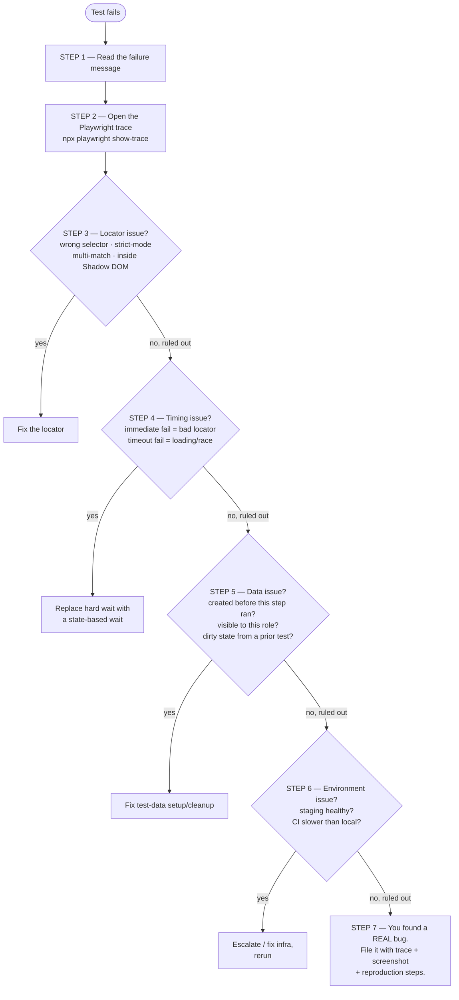
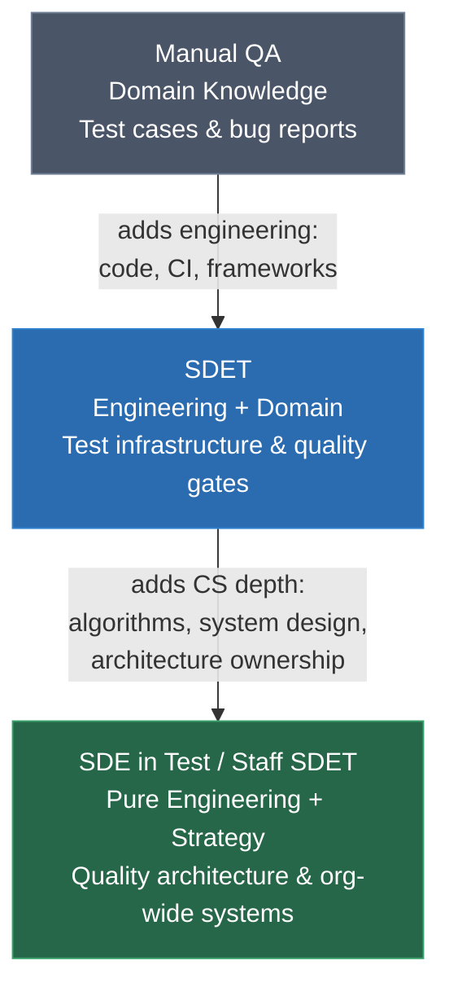

# 00. SDET Foundations & Mindset — The Mental Model That Changes Everything

**Navigation**: [Index](../00_INDEX.md) | [Next: Playwright & TypeScript Basics →](./01_Playwright_TS_Basics.md)

---

## 5W1H — Why This Chapter Exists

- **WHAT**: The mental models, vocabulary, and professional frameworks that separate a script-runner from a Software Development Engineer in Test.
- **WHY**: The fastest path to becoming a great SDET is not learning more Playwright APIs — it is **changing how you think about problems**. Engineers who understand WHY before HOW write frameworks that last years. Engineers who only learn HOW write scripts that break in weeks.
- **WHO**: Anyone transitioning from Manual QA, from a different language, or from "I know how to automate clicks" to "I can design a scalable test infrastructure."
- **WHEN**: Before touching any code. Return here every 3 months — your understanding of these principles will deepen with experience.
- **HOW**: By internalising the Testing Pyramid, the three pillars of reliability, and the professional vocabulary that lets you speak the same language as developers and architects.

---

## 1. The Actual Definition of an SDET

The most damaging misconception in QA automation:

> "An SDET is someone who uses Playwright (or Selenium, or Cypress) to automate test cases."

This is like saying "A civil engineer is someone who uses AutoCAD." The tool is incidental.

**The real definition:**

> An SDET (Software Development Engineer in Test) is a software engineer whose product is the **quality infrastructure** of the application — the test framework, CI pipeline, observability tooling, and processes that give the engineering team confidence to ship every day.

```
Comparison:

Product Engineer     →  writes code that users run
SDET                 →  writes code that product engineers rely on

The "user" of an SDET's code is another engineer.
That changes everything about how you design it:
  - Your "product" must be maintainable by multiple people
  - Your "product" runs 50 times a day unattended in CI
  - Failures in your "product" block deployments
  - The quality of your code determines the reliability of every release
```

### The Manual QA → SDET → SDE Progression

| Dimension          | Manual QA                 | SDET                                  | SDE (target)                         |
| ------------------ | ------------------------- | ------------------------------------- | ------------------------------------ |
| **Output**         | Test cases, bug reports   | Test framework, CI pipeline           | Production features                  |
| **Thinking**       | "What might break?"       | "How do I prove this works at scale?" | "How do I build this to be correct?" |
| **Core skill**     | Domain knowledge          | Engineering + domain                  | Engineering                          |
| **Daily question** | "Did this scenario pass?" | "Is my test suite trustworthy?"       | "Is my system correct?"              |
| **Failure mode**   | Miss edge cases           | Flaky tests, slow CI                  | Bugs in production                   |

The SDET who also thinks like an SDE is rare and extremely valuable. That is the target of this curriculum.

---

## 2. The Testing Pyramid — The Most Important Mental Model

The Testing Pyramid (originally described by Mike Cohn in _Succeeding with Agile_, 2009) is the foundational framework for all test strategy decisions.

```
                     ╔══════════════╗
                     ║   E2E / UI   ║  ← Few, Slow, Expensive, High Confidence
                     ║   (5-10%)    ║    "Does the complete user journey work?"
                     ╚══════════════╝
                ╔══════════════════════╗
                ║   Integration / API  ║  ← Some, Medium Speed, Reliable
                ║      (20-30%)        ║    "Do the services talk correctly?"
                ╚══════════════════════╝
           ╔══════════════════════════════╗
           ║       Unit / Component       ║  ← Many, Fast, Cheap, Focused
           ║          (60-70%)            ║    "Does this function do the right thing?"
           ╚══════════════════════════════╝
```

### The 3 Layers Explained

**Layer 1 — Unit Tests (the foundation)**

- Written by: developers
- What they test: a single function, class, or component in complete isolation
- Mocking: everything external is mocked (database, network, time)
- Speed: milliseconds per test
- Example: "Does `calculateFineAmount(days: 5, rate: 10)` return `50`?"
- Your role as SDET: review them, sometimes write them for shared utilities

**Layer 2 — Integration / API Tests (the middle)**

- Written by: SDETs and developers
- What they test: two or more real components interacting (API + database, service A + service B)
- Mocking: minimal — you want to test real interactions
- Speed: hundreds of milliseconds to a few seconds
- Example: "Does `POST /api/v2/citations` actually insert a row in the database with the correct data?"
- Your role as SDET: own this layer — it gives the highest ROI

**Layer 3 — E2E / UI Tests (the tip)**

- Written by: SDETs
- What they test: the complete user journey through a real browser
- Mocking: none (tests real system) or minimal (isolate third parties)
- Speed: seconds to minutes
- Example: "Can a customer log in, create a citation, pay it, and see 'PAID' status?"
- Your role as SDET: design these carefully — they are expensive

### The Anti-Pattern — The Ice Cream Cone

```
                ╔══════════════╗
                ║   E2E / UI   ║  ← Hundreds of UI tests
                ║   (80-90%)   ║
                ╚══════════════╝
           ╔══════════════════════╗
           ║   Integration / API  ║  ← A few
           ╚══════════════════════╝
      ╔══════════════════════════════╗
      ║          Manual tests        ║  ← Most of the actual testing
      ╚══════════════════════════════╝
```

This is how most companies start. The consequences:

- CI pipeline takes 4 hours on every PR
- Tests fail 30% of the time due to timing issues
- A single DOM change breaks 50 tests
- Developers stop trusting the test results ("the tests are always broken")
- No one knows which failures are real bugs vs infrastructure noise

**Your job as SDET: move testing DOWN the pyramid, not up.**

If you can answer "does the citation status update correctly?" with a 200ms API test instead of a 15-second UI test, you MUST use the API test. Reserve UI tests for the journeys only humans care about: the screens, the visual state, the interactions.

---

## 3. The Three Pillars of Reliable Automation

Every flaky test, every "it works on my machine" failure, every mysteriously passing test that misses real bugs — traces back to a violation of one of these three principles.

### Pillar 1 — Idempotency (a test can run N times and always give the same result)

**Definition:** A test is idempotent if running it once gives the same result as running it 100 times. The test does not depend on any state left by a previous run.

**The violation:**

```typescript
// ❌ NOT idempotent — fails on second run
test("Create a citation for customer John Doe", async () => {
  await citationsClient.create({ customerId: "USR-FIXED-001", amount: 150 });
  // Run 1: creates CIT-001 for USR-FIXED-001 → passes
  // Run 2: USR-FIXED-001 already has a citation → duplicate error → fails
  // Run 3: database constraint blocks → fails
});
```

**The fix — unique identity + cleanup:**

```typescript
// ✅ Idempotent — passes every time regardless of how many times it's run
test("Create a citation", async ({ account, citationsClient }) => {
  // account.userId is unique per test run — no collision possible
  const citation = await citationsClient.create(
    PayloadsCitation.pending({ customerId: account.userId }),
  );
  expect(citation.citationId).toMatch(/^CIT-/);
  // Cleanup happens in the fixture's finally block — slate is clean for next run
});
```

**Why unique identity:** `account.userId` is created fresh for this test run. Even if you run 10 workers in parallel, each gets their own account. No collision possible.

**Why cleanup:** Even if a test fails halfway through, the `try/finally` in the fixture deletes the data. Next run starts clean.

### Pillar 2 — Isolation (each test is an island)

**Definition:** A test must not depend on any state created, modified, or deleted by another test. The ORDER tests run in must not matter.

**The violation:**

```typescript
// ❌ Test B depends on Test A having run first
test("A: Create citation CIT-SHARED", async () => {
  await db.insert("citations", { id: "CIT-SHARED", status: "PENDING" });
});

test("B: Dispute citation CIT-SHARED", async () => {
  await page.goto("/citations/CIT-SHARED"); // what if A ran second?
  await disputeForm.submit("Wrong amount"); // what if A failed?
  await expect(statusBadge).toHaveText("DISPUTED");
});
```

Run tests in random order → Test B fails. Run tests in parallel → both tests operate on the same record → race condition. Move Test A to a different file → Test B breaks immediately.

**The fix:**

```typescript
// ✅ Each test creates its own data
test("Dispute a pending citation", async ({
  account,
  citationsClient,
  page,
}) => {
  // Create MY OWN citation — don't share with other tests
  const citation = await citationsClient.create(
    PayloadsCitation.pending({ customerId: account.userId }),
  );
  // Now test against MY citation — cannot be affected by any other test
  await page.goto(`/citations/${citation.citationId}`);
  await disputeForm.submit("Wrong amount");
  await expect(statusBadge).toHaveText("DISPUTED");
});
```

**Playwright's implementation of isolation:** By default, Playwright gives every test a fresh `BrowserContext` — its own isolated cookie store, localStorage, and sessionStorage. No cookies from Test A leak to Test B. This is the browser-level isolation.

The test-data isolation (unique per-test data) is YOUR responsibility as SDET — Playwright cannot do this for you.

### Pillar 3 — Wait for State, Not Time

**Definition:** Never use `page.waitForTimeout(N)`. Instead, wait for the application to reach a specific observable state.

**The violation:**

```typescript
// ❌ Hard sleep — the silent killer of test reliability
await page.click("#saveBtn");
await page.waitForTimeout(3000); // "the page usually loads in 2s, so 3s should work"
await expect(page.locator(".success")).toBeVisible();

// What happens:
// Normal day: save takes 1.2s → you wait 1.8s unnecessarily (slow)
// Heavy load: save takes 3.5s → you check at 3s → fails (false failure)
// Your network is fast: save takes 0.8s → you wait 2.2s unnecessarily (very slow)
// CI server: save takes 5s → you check at 3s → always fails in CI
```

**The fix — wait for observable state:**

```typescript
// ✅ Wait for what the user would observe
await page.click("#saveBtn");

// Wait for: loading spinner to disappear (D365 pattern)
await expect(page.locator(".ms-Spinner")).toHaveCount(0, { timeout: 30_000 });

// Wait for: success notification to appear
await expect(page.locator(".notification-success")).toBeVisible({
  timeout: 15_000,
});

// Wait for: navigation to complete (SPA pattern)
await page.waitForURL("**/citations/*/detail", { timeout: 15_000 });

// Wait for: API call to complete (network-level wait)
const [saveResponse] = await Promise.all([
  page.waitForResponse(
    (res) =>
      res.url().includes("/api/citations") && res.request().method() === "POST",
  ),
  page.click("#saveBtn"),
]);
expect(saveResponse.status()).toBe(201);
```

**The hierarchy of wait strategies (best to worst):**

```
1. expect(locator).toBeVisible()        — auto-retrying, reads state, BEST
2. page.waitForURL()                    — navigation-specific, very reliable
3. page.waitForResponse()               — network-level, perfect for API-driven apps
4. page.waitForLoadState('networkidle') — waits for network quiet, fragile for SPAs
5. page.waitForSelector()              — lower-level, avoid if possible
6. page.waitForTimeout(n)              — NEVER USE unless debugging
```

---

## 4. The Professional Vocabulary — Talking Like an SDET

Knowing these terms lets you communicate precisely with developers, architects, and your own tests.

### Test Pyramid Terms

```
Flakiness:    A test that produces different results across runs without application changes.
              "This test is flaky" = "I don't trust this test result."

Idempotency:  A test can be run N times with the same result.

Determinism:  Given the same input, always produce the same output.
              A deterministic test has no randomness, timing dependence, or shared state.

Test Isolation: Each test runs independently — order doesn't matter.

State:        The current values stored in a system (database rows, cookies, localStorage).
              "Dirty state" = state left over from a previous test.

Test Data:    The data created or used by a test. Must be unique per test run.
```

### Architecture Terms

```
Fixture:      A function that sets up (and tears down) the preconditions for a test.
              Playwright fixtures provide page, context, account, apiClient etc.

POM:          Page Object Model. A class that represents one page/component of the UI.
              Encapsulates locators and interactions — tests don't contain raw locators.

Factory:      A function that creates objects with sensible defaults.
              PayloadsCitation.pending() is a factory.

Seeding:      Creating test data before a test runs (via API, DB, or UI).

Teardown:     Deleting or restoring test data after a test runs.

Contract:     An agreed API shape between consumer and provider.
              "The API contract says status must be one of: PENDING|PAID|DISPUTED"

Assertion:    A check that verifies the application's state matches expectations.
              Hard assertion: throws immediately on failure.
              Soft assertion: collects failures and reports all at the end.
```

### Timing Terms (Critical for D365)

```
Race Condition:   Two operations compete for the same resource and the outcome
                  depends on which finishes first. Tests should never have race conditions.

Two-Phase Render: React/D365 pattern where the container renders immediately (empty)
                  and then the data arrives asynchronously (filling in the container).
                  Text appears to "be there" but is still loading. Your wait must
                  wait for the SPECIFIC TEXT, not just the element's existence.

Network Idle:     All network requests have been idle for 500ms. Indicates page load is done.
                  Fragile for apps that poll (heartbeat requests keep network from being idle).

DOMContentLoaded: HTML is parsed and DOM is constructed. CSS/images may still be loading.
                  `loadState('domcontentloaded')` is faster but less complete than 'load'.
```

---

## 5. The Debugging Pipeline — From Failure to Root Cause in 5 Minutes

When a test fails, you must diagnose it systematically. Do NOT make random changes hoping something works. The sequence matters — each step either resolves the failure or rules out a category of cause, narrowing what's left:



```
STEP 1: Read the failure message carefully.
  - "Expected 'PENDING' but got 'undefined'" → element exists but text not loaded (two-phase render)
  - "Timeout waiting for element to be visible" → element doesn't exist or wrong locator
  - "Target closed" → page navigated away before assertion ran
  - "403 Forbidden" → auth token expired or test account doesn't have permission
  - "Connection refused" → environment/URL is wrong, service is down

STEP 2: Open the Playwright trace.
  npx playwright show-trace test-results/[test-name]/trace.zip
  → Shows every action, every screenshot, every network request
  → You can see EXACTLY what the page looked like at the moment of failure
  → You can see if the element existed, if the text was loaded, if the button was enabled

STEP 3: Check if it's a locator issue.
  → In DevTools: $('[data-testid="submit-btn"]') — does it return the right element?
  → Is there more than one match? (Playwright strict mode throws on multiple matches)
  → Is the element inside a Shadow DOM? (XPath won't find it)

STEP 4: Check if it's a timing issue.
  → Did the test fail IMMEDIATELY (locator not found) or after a timeout (element found but waited too long)?
  → Immediate failure = wrong locator OR element doesn't exist
  → Timeout failure = element exists intermittently (timing/loading issue)

STEP 5: Check if it's a data issue.
  → Was the test data created before this step ran?
  → Is the data visible to this user's role/permission?
  → Did a previous test run leave dirty state?

STEP 6: Check the environment.
  → Is the staging environment healthy?
  → Are there any deployment alerts or environment issues?
  → Does the test pass locally but fail in CI? (Timing difference — CI is slower)

STEP 7: If all of the above are fine:
  → YOU FOUND A REAL BUG. File it with the trace, screenshot, and reproduction steps.
```

---

## 6. Test Confidence Levels — What Are You Actually Testing?

Not all tests give you the same type of confidence. Know what each test proves:

```
UI TEST ("The citation form appears and saves correctly"):
  Proves: the HTML renders, buttons are clickable, form submits, navigation works
  Does NOT prove: data was saved correctly in the DB, email was sent, other services were notified

API TEST ("POST /api/v2/citations returns 201 with correct body"):
  Proves: the API accepted the request and returned the expected shape
  Does NOT prove: the UI shows the citation correctly, the DB row is correct

DB TEST ("SELECT from citations WHERE id = ..."):
  Proves: data was persisted with correct values at the database level
  Does NOT prove: the API returns the data correctly, the UI renders it

THREE-LAYER TEST (UI + API + DB):
  Proves: the entire flow — UI submits → API processes → DB stores → UI displays
  This is the gold standard for critical paths (Ch30)

UNDERSTANDING THE GAPS:
  A test can pass even when things are wrong at other layers.
  "Success theatre" — the UI shows ✓ but the backend silently failed.
  Your assertion strategy determines whether you catch real bugs or just UI rendering.
```

---

## 7. The Professional SDET Checklist — Before You Write Any Test

Run through this mental checklist before writing your first line of code:

```
□ What is the MINIMUM level of the pyramid this test can live at?
  → If it can be an API test, don't make it a UI test.

□ Is the test idempotent?
  → Can it be run 100 times in a row with the same result?

□ Is the test isolated?
  → Can it be run in any order, in parallel, on any worker?

□ What is my test data strategy?
  → Where does the data come from? Who creates it? Who cleans it up?

□ What am I actually asserting?
  → Am I checking UI state, API state, or DB state? Is that sufficient?

□ What do I need to WAIT for?
  → What observable state tells me the action is complete?

□ What are the failure modes?
  → What will the error message say when this breaks? Will I be able to diagnose it?

□ Am I testing business behaviour or implementation detail?
  → Testing that a button exists = implementation detail (breaks when button is renamed)
  → Testing that a citation can be created and retrieved = business behaviour (stable)
```

---

## 🏋️ Practice — Deep Understanding Questions

### Q1. [Fundamental] Why is "test order independence" critically important in CI?

<details><summary>Answer</summary>

In CI, Playwright runs tests in parallel across multiple workers. There is no guarantee that Test A runs before Test B — they may run simultaneously on different machines. If Test B depends on state created by Test A, and they run on separate workers, Test B will see no data and fail.

Additionally, CI often runs tests in a different order than your local machine. `playwright.config.ts` can randomise test order. If tests are order-dependent, the suite is non-deterministic — it passes sometimes and fails sometimes with no code changes. This breaks trust in the entire test suite.

The fix: every test creates ALL the data it needs (setup in `beforeEach` or fixtures) and cleans up in `afterEach` or fixture teardown. No test should rely on another test's side effects.

</details>

---

### Q2. [Mental Model] A test passes locally but fails in CI 50% of the time. Walk through your debugging process.

<details><summary>Answer</summary>

This is a **flaky test** — likely a timing issue or shared state problem. Systematic approach:

**1. Check CI vs local differences:**

- CI machines are slower (less CPU, shared I/O) → timeouts that work locally might not hold in CI
- Increase assertion timeouts to 30s for network-dependent assertions

**2. Check for shared state:**

- Is the test using a shared account or shared test data?
- Do parallel workers write to the same record?
- Does the test depend on data from a previous test?

**3. Check for race conditions:**

- Is there a `Promise.all` where the listener might miss the event?
- Is the test checking a value that might still be loading (two-phase render)?

**4. Use `--repeat-each=20` to reproduce locally:**

```bash
npx playwright test tests/specs/myflakytest.spec.ts --repeat-each=20
```

Run it 20 times in a row. If it fails even once → race condition. Examine the failures.

**5. Check the trace:**

```bash
npx playwright test --trace on
```

The trace shows the page state at every step. You can see if the element existed but wasn't yet text-filled, or if the page navigated away.

**6. Fix strategies by flakiness type:**

- Timing: replace `waitForTimeout` with `expect(locator).toHaveText(value, { timeout: 30_000 })`
- Shared state: give each test a unique account and unique data
- Race condition: use `Promise.all([listener, action])` pattern
</details>

---

### Q3. [Architecture] Your manager asks you to "automate all 300 manual regression test cases in Playwright." What do you say?

<details><summary>Answer</summary>

"I won't automate all 300 in Playwright, because that would give us the most expensive, slowest, and most fragile test suite possible. Here's my proposal instead:"

**Step 1 — Classify the 300 tests by pyramid layer:**

- Which test cases are verifying business logic? → API test (10x faster, 10x more reliable)
- Which test cases are verifying data persistence? → DB test or API + DB test
- Which test cases are verifying UI rendering of known data? → Playwright
- Which test cases are verifying complete user journeys? → Playwright

**Step 2 — Estimate the split:**
Typically: 120 cases can become API tests, 60 become DB verifications, 80 become UI tests, 40 require manual testing (exploratory, UX judgment calls).

**Step 3 — Prioritise the UI tests by risk:**
Which 20 UI tests, if broken, would cause a production incident? Automate those first. Don't automate low-risk admin screens that change monthly.

**Result:** 80 fast, reliable automated tests that catch 95% of regressions, instead of 300 slow, brittle UI tests that catch 60% of regressions after a 4-hour CI run.

</details>

---

## 8. Visual Mental Model — The SDET Role Map

Understanding where you stand on the progression from Manual QA to engineering lets you target the right gaps.



**What each transition requires:**

| Transition         | You Must Learn                                                                                  | You Must Stop Doing                                                                          |
| ------------------ | ----------------------------------------------------------------------------------------------- | -------------------------------------------------------------------------------------------- |
| Manual QA → SDET   | TypeScript, Playwright, Git, CI/CD, POM design, API testing                                     | Writing test cases in spreadsheets, manual execution, "it works on my machine"               |
| SDET → SDE in Test | Algorithms, system design, type systems, architectural patterns, cross-team framework ownership | Copy-pasting test patterns, avoiding code reviews, treating the test repo as "not real code" |

---

## 9. Anti-Patterns Catalogue — What Bad SDET Work Looks Like

Every item below is something working SDETs do in production. Knowing these will save you months of debugging.

| #   | Anti-Pattern                              | What It Looks Like                                                                                                                  | Why It Fails                                                                                                                                                                                                                              | Fix                                                                                                                                                                                                       |
| --- | ----------------------------------------- | ----------------------------------------------------------------------------------------------------------------------------------- | ----------------------------------------------------------------------------------------------------------------------------------------------------------------------------------------------------------------------------------------- | --------------------------------------------------------------------------------------------------------------------------------------------------------------------------------------------------------- |
| 1   | **Test-Order Dependency**                 | Test B relies on Test A creating data first. Tests pass locally in file order, fail in parallel CI.                                 | Playwright runs tests in parallel across workers. No ordering guarantee exists. Workers don't share memory.                                                                                                                               | Each test creates ALL its own data via fixtures. No test reads another test's side effects.                                                                                                               |
| 2   | **Hardcoded Sleeps**                      | `await page.waitForTimeout(5000)` scattered throughout the test suite. CI runs take 45 minutes.                                     | Sleeps are either too short (flaky on slow CI) or too long (waste minutes per test × hundreds of tests). They encode YOUR machine's timing, not the application's actual state.                                                           | `expect(locator).toBeVisible()`, `page.waitForURL()`, `page.waitForResponse()` — wait for observable state, not clock time.                                                                               |
| 3   | **Global Shared Test Accounts**           | All 200 tests use `user: 'test-admin@company.com'`. Two workers log in simultaneously — cookie collision, 50% flakiness.            | Shared accounts create race conditions: Worker 1 changes a setting, Worker 2 sees it mid-test. Password changes break everything. Session conflicts cause random 401s.                                                                    | One unique account per worker (worker-scoped fixture). Account credentials stored in environment config, not hardcoded.                                                                                   |
| 4   | **Assertion-Less Tests**                  | `test('Create citation', async () => { await page.goto(url); await form.fill(); await form.submit(); });` — no `expect()` anywhere. | The test passes even when the form submission silently fails. It tests "does the code run without throwing?" not "does the feature work correctly?" A 500 error from the server won't fail this test unless it causes a navigation error. | Every test must have at least one `expect()` that verifies business-meaningful state: `expect(statusBadge).toHaveText('PAID')`.                                                                           |
| 5   | **Testing Implementation, Not Behaviour** | `expect(page.locator('.css-1a2b3c.MuiButton-root')).toBeVisible()` — asserting on generated CSS class names.                        | The CSS class changes every build (CSS Modules, Styled Components). The test breaks even though the feature still works perfectly. You tested the framework's internal naming, not the user's experience.                                 | Assert on behaviour: `expect(page.getByRole('button', { name: 'Save' })).toBeEnabled()`. Assert on visible text: `expect(heading).toHaveText('Citation Created')`. Never assert on generated class names. |
| 6   | **Mega Test Files**                       | A single `spec.ts` file with 40 tests covering login, citations, payments, and admin. Takes 8 minutes.                              | One failure requires re-running all 40 tests. Can't parallelise within a file. Can't skip unrelated tests when only the login flow changed. Merge conflicts are constant.                                                                 | One spec file per feature area. Max 8-10 tests per file. Group by business domain, not by "what I wrote this week."                                                                                       |
| 7   | **Copy-Paste Locators**                   | The same `page.locator('[data-testid="citation-grid"]')` appears in 15 test files. Grid redesign breaks all 15.                     | Violates DRY (Don't Repeat Yourself). The fix for a locator change touches 15 files instead of 1. Review burden multiplies.                                                                                                               | POM or Component Object: `citationsPage.grid` encapsulates the locator. Change it in one place, all 15 tests work.                                                                                        |

---

## 10. The SDET Interview Litmus Test — 5 Questions That Reveal Your Level

These are the questions senior engineers ask to gauge whether a candidate truly understands quality engineering or just knows how to record and replay.

### Q1: "What is a flaky test?"

**Poor answer:** "A test that sometimes fails."

**Great answer:** "A flaky test is a test whose result is **non-deterministic** — it produces different outcomes across runs without any application code changes. The four root cause categories are: (1) **timing dependence** — the test relies on hard sleeps or races against async operations, (2) **shared state** — multiple tests or workers read/write the same data, (3) **test-order dependence** — test B relies on test A's side effects, (4) **environment differences** — the test encodes assumptions about machine speed, network latency, or timezone. Flakiness is measured as failure rate: 3 failures in 20 runs = 15% flake rate. Above 5%, the test must be fixed or quarantined."

---

### Q2: "Why shouldn't you automate every manual test case as a UI test?"

**Poor answer:** "Because UI tests are slow."

**Great answer:** "Because the Testing Pyramid tells us that each test should live at the **lowest pyramid layer that can verify the behaviour**. A test that checks 'does the API correctly calculate a fine amount?' should be an API test (200ms, zero flakiness) not a UI test (15 seconds, locator and timing risk). UI tests should be reserved for verifying things only visible in a browser: rendering, navigation, and user interaction flows. If you put 300 tests in the UI layer, your CI takes 4 hours, flakiness hits 30%, and developers stop trusting the results. The correct approach is to classify the 300 cases by pyramid layer, push 60-70% down to API/unit, and keep only the critical user journeys as UI tests."

---

### Q3: "How do you make a test idempotent?"

**Poor answer:** "Clean up data after the test."

**Great answer:** "Idempotency requires two guarantees: **unique identity** and **reliable cleanup**. Unique identity means every test run creates data with a unique identifier (UUID or `worker-${workerId}-${timestamp}`) so that parallel runs never collide. Reliable cleanup means the test's fixture uses `try/finally` — the finally block deletes the data even if the test throws on line 3. Both together mean: run 100 times, serially or in parallel, and get the same result. I also ensure idempotency at the database level — if the test creates 'Citation A', the system should handle it gracefully whether 'Citation A' already exists or not."

---

### Q4: "Your test passes locally but fails in CI. What do you do?"

**Poor answer:** "Increase the timeouts."

**Great answer:** "I follow a systematic debugging pipeline. Step 1: check the CI trace (`npx playwright show-trace`) — this shows the exact page state at failure. Step 2: compare CI timing vs local — CI machines are slower (shared CPU, network latency), so a 5s timeout that works locally might need 15-30s in CI. Step 3: check for shared state — are parallel workers using the same test account or data? Step 4: reproduce locally with `--repeat-each=20` — if it fails even once locally, it's a race condition, not a CI issue. Step 5: check environment — is the staging server healthy? DNS issues? Expired certificates? The fix depends on the root cause: timing → increase timeout AND switch from `waitForTimeout` to state-based waits. Shared state → unique data per worker. Environment → add retry + environment health check in CI."

---

### Q5: "Explain the Page Object Model and when you'd choose NOT to use it."

**Poor answer:** "POM is when you put locators in a separate file."

**Great answer:** "The Page Object Model is a design pattern where each page (or significant component) of the application is represented by a class. The class encapsulates locators as private fields and exposes interactions as public methods. Tests call `citationsPage.searchByAmount(150)` — they never see raw locators. The benefit is maintainability: when a locator changes, you fix it in one class, not 30 tests.

When I'd choose NOT to use it: (1) for a one-off test that will never be expanded — the overhead of creating a POM class isn't justified for a single test, (2) for visual regression or screenshot tests where the test is asserting on pixels, not interactions, (3) when the page is so dynamic that components are more useful than pages — in that case I'd use the **Component Object Model**, where each reusable UI component (grid, search panel, modal) has its own class, and page objects compose those components."

---

## 📚 References & Further Reading

### Official Documentation

- [Playwright Best Practices](https://playwright.dev/docs/best-practices) — Playwright's own guide to writing stable, reliable tests
- [Playwright Test Assertions](https://playwright.dev/docs/test-assertions) — Auto-retrying vs one-shot assertions explained
- [Playwright Test Retries](https://playwright.dev/docs/test-retries) — How retry mechanisms work and when to use them
- [Playwright Trace Viewer](https://playwright.dev/docs/trace-viewer-intro) — Debug failed tests with full page state replay

### Foundational Articles

- [The Test Pyramid — Martin Fowler](https://martinfowler.com/bliki/TestPyramid.html) — The original description of the testing pyramid concept by the person who popularised it
- [The Practical Test Pyramid — Ham Vocke](https://martinfowler.com/articles/practical-test-pyramid.html) — A modern, detailed walkthrough of each pyramid layer with real code examples
- [Testing Library Query Priority](https://testing-library.com/docs/queries/about/#priority) — The semantic locator priority hierarchy that Playwright's `getByRole` strategy is based on

### Books

- _Succeeding with Agile_ — Mike Cohn (2009) — Chapter 16 introduces the Testing Pyramid
- _Software Engineering at Google_ — Winters, Manshreck, Wright (2020) — Chapter 11 "Testing Overview" covers test flakiness, test size, and pyramid strategy at scale

---

**Navigation**: [Index](../00_INDEX.md) | [Next: Playwright & TypeScript Basics →](./01_Playwright_TS_Basics.md)


---

## Reality Check

**"SDETs are just manual testers who learned to code"**→ SDETs are software engineers who specialize in quality infrastructure: building test frameworks, CI/CD pipelines, and observability tools. The coding bar for SDET interviews at companies like Microsoft, Google, and Amazon is equivalent to SDE interviews minus system design depth. An SDET who cannot write production-grade code (clean architecture, error handling, performance awareness) will fail modern SDET interviews.

**"Test automation means automating manual test cases"**→ Translating manual test scripts into automated scripts produces brittle, slow, and hard-to-maintain automation. Effective test automation starts with: what assertions are critical? What data states need verification? What can only be verified programmatically (race conditions, memory leaks, API contract compliance)? Automation enables testing that is IMPOSSIBLE manually, not just faster.

**"100 percent automation is the goal"**→ Some tests are inherently manual: visual aesthetics, user experience intuitiveness, accessibility with real assistive technology, and exploratory testing for undiscovered scenarios. The goal is automating REPEATABLE verification so humans focus on CREATIVE testing. A team with 80 percent automation coverage and skilled exploratory testers finds more bugs than one with 100 percent brittle automation and no exploratory testing.

**"SDETs do not need to understand the product"**→ Writing effective assertions requires understanding business logic. A login test that only checks the URL changed misses: session token creation, user preferences loading, audit log entry, and analytics event. Domain knowledge determines assertion DEPTH. An SDET who understands the product writes tests that catch business logic regressions, not just UI rendering issues.

**"Framework-first thinking produces good automation"**→ Starting with the framework (let us use POM with fixtures and custom reporters) before understanding what needs testing produces over-engineered infrastructure for simple test needs. Start with: what are the critical user journeys? What breaks most often? What takes the longest to test manually? Then build exactly enough framework to automate those scenarios efficiently.
