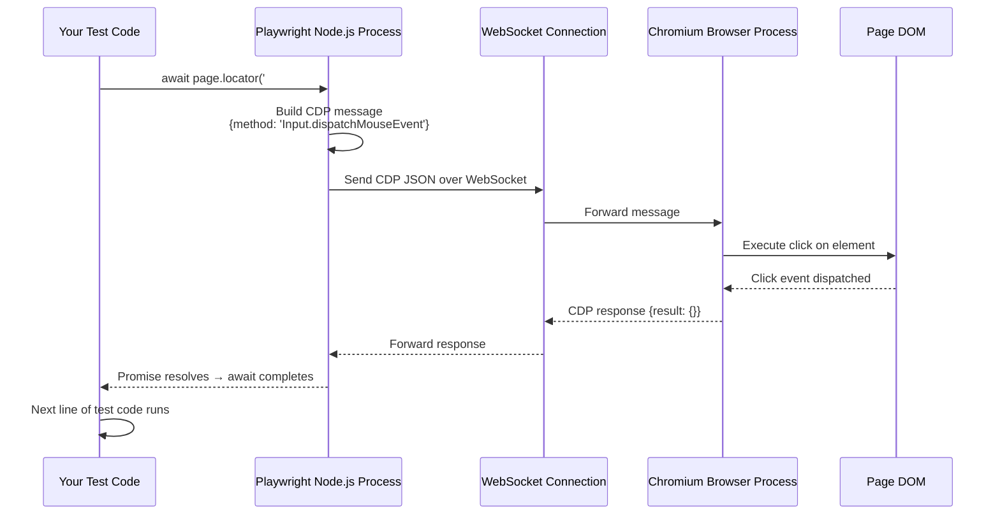
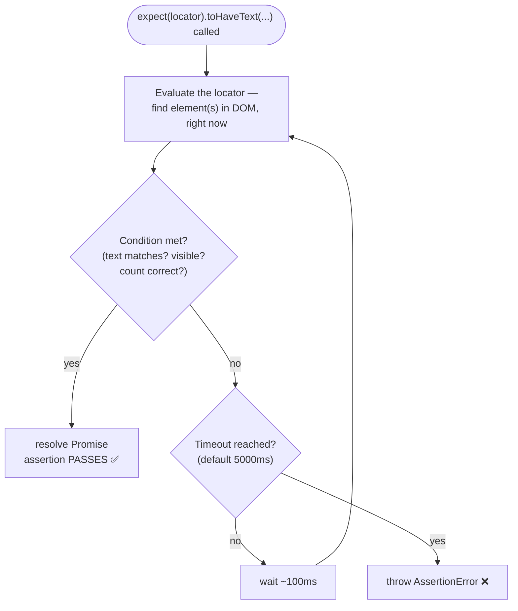

# 01. Playwright & TypeScript — How Everything Actually Works

**Navigation**: [← Foundations](./00_SDET_Foundations_Mindset.md) | [Index](../00_INDEX.md) | [→ Enterprise Locators](./02_Enterprise_Locators_XPath.md)

---

## 5W1H

- **WHAT**: A deep understanding of async/await in JavaScript/TypeScript and how Playwright's architecture (Browser → Context → Page → Locator) maps to real browser behaviour.
- **WHY**: Every mysterious Playwright failure traces back to one of two root causes: (1) not understanding `async/await` and Promises, or (2) not understanding what the `page` object actually represents and how it communicates with the browser. Once you understand the internals, you stop guessing and start reasoning.
- **WHO**: SDETs who know what Playwright does but not why it works the way it does.
- **WHEN**: Before debugging any timing-related failure. Before writing custom fixtures.
- **HOW**: By going one level deeper than "add `await` before everything."

---

## 1. The JavaScript Event Loop — Why Async Exists at All

Before Playwright makes sense, you need to understand WHY JavaScript is asynchronous.

JavaScript runs in a single thread. There is only ever one piece of JavaScript executing at any moment. This is a fundamental constraint — JavaScript cannot do two things at once.

So how does it handle things that take time (network requests, file reads, user input)?

```
The Event Loop model:

  Call Stack                Message Queue
  ─────────────             ─────────────────────
  │ main()     │            │ response received  │
  │ await fetch│ ────────── │ setTimeout done    │  ← waiting events
  │            │            │                    │
  └────────────┘            └────────────────────┘
         │                            │
         └──────── Event Loop ─────────┘
                    (picks next message when call stack is empty)

When you write:
  const result = await fetch('https://api.example.com/data');

JavaScript does NOT block and wait.
It registers a callback ("call me when the HTTP response arrives")
and immediately removes itself from the call stack → other code can run.
When the HTTP response arrives → the callback is added to the queue →
the Event Loop picks it up → your code resumes where it left off.

The `await` keyword is syntactic sugar that hides this complexity.
You write code that LOOKS synchronous but IS asynchronous underneath.
```

**Why this matters for Playwright:**

Every time you write `await page.locator('#button').click()`, Playwright:

1. Sends a CDP (Chrome DevTools Protocol) message over a WebSocket to the browser
2. Returns a Promise (execution is suspended here — `await` suspends your code)
3. The browser receives the message, performs the click
4. The browser sends back a CDP confirmation
5. The Promise resolves → your code resumes

**This is two data structures you already know, not new theory.** The diagram's own labels are the giveaway: the **Call Stack** is a real Stack (LIFO) — `main()` pushes `await fetch(...)` on top, and only the top frame can be popped; JavaScript cannot skip down to a frame in the middle. The **Message Queue** is a real Queue (FIFO) — the response callback goes in at the back and comes out at the front, in the order events actually arrived, not the order your code happens to reference them. The event loop's entire job is one rule: *pop the stack until it's empty, then dequeue the next queued callback and push it onto the (now-empty) stack.* Every "why did my `await` resolve in this order and not that one" question in Playwright debugging is answerable by tracing which structure — stack or queue — the thing you're waiting on actually lives in. (Full Stack/Queue mechanics, incl. why cleanup code runs in reverse of creation order: [Ch33 Section 3](../08_SDET_to_SDE_Bridge/33_SDET_to_SDE_CS_Thinking.md#3-queues-and-stacks--cleanup-order-and-event-ordering).)

If you forget `await`:

```typescript
// ❌ Without await:
page.locator("#button").click(); // sends CDP message, returns Promise, immediately proceeds
expect(page.locator(".success")).toBeVisible(); // checks NOW, before click response arrived
// Result: success message not visible yet → assertion fails

// ✅ With await:
await page.locator("#button").click(); // waits for CDP round-trip to complete
await expect(page.locator(".success")).toBeVisible(); // now checks AFTER click completed
```

---

## 2. Promises — The Contract Underneath Every Playwright Action

§1 established the constraint: JavaScript has one thread, so it can never sit and wait for the browser to answer. This section derives what that constraint *forces* the language to give you, and what `await` is actually doing when you type it.

### 2.1 The problem Promises were invented to solve

Before Promises, "call me when it's done" was expressed with a callback:

```typescript
// The pre-2015 world. Read this and find the two structural problems.
sendToBrowser("click #login", function (err, result) {
  if (err) return handleError(err);
  sendToBrowser("waitFor .dashboard", function (err, result) {
    if (err) return handleError(err);
    sendToBrowser("textContent h1", function (err, text) {
      if (err) return handleError(err);
      console.log(text); // finally
    });
  });
});
```

Two problems, and the second is the one that matters:

1. **Nesting** — each step indents further. Cosmetic; annoying but survivable.
2. **You cannot `return` a result out of a callback.** ← *this* is the structural defect.

Look closely at problem 2. The `text` exists only *inside* the innermost function. The outer `sendToBrowser` call already returned — long ago, with nothing. There is no expression you can write whose value is "the text that will arrive later." So you cannot store it in a variable, cannot return it from a function, cannot pass it to something else. Every consumer must be dragged *inside* the callback.

**A Promise is the fix for exactly that.** It is an object you can have *right now* that stands in for a value that does not exist yet. Because it is an ordinary object, it can be returned, stored in a variable, put in an array, and passed to a function — all before the value arrives.

```typescript
// Now the future value has a name and can be handled like any other value.
const pending = page.locator("h1").textContent(); // an object, available immediately
// `pending` is real. The string inside it is not — yet.
```

### 2.2 What a Promise actually *is* (the object, not the metaphor)

"Represents a future value" is a description, not a mechanism. Mechanically, a Promise is a small **state machine** with three fields:

| Field | Holds |
| --- | --- |
| `state` | `"pending"` → `"fulfilled"` **or** `"rejected"` |
| `value` | the result (once fulfilled) or the error (once rejected) — empty while pending |
| `callbacks` | the list of functions to run when it settles |

Two rules govern it, and both matter in practice:

- **It settles at most once.** Once fulfilled or rejected, the state is frozen forever. A second `resolve()` is silently ignored.
- **Transitions are one-way.** `pending → fulfilled` or `pending → rejected`. Never back, never between.

Here is the whole idea in ~20 lines. Once you have read this, Promises stop being magic:

```typescript
class TinyPromise<T> {
  private state: "pending" | "fulfilled" | "rejected" = "pending";
  private value?: T;
  private callbacks: Array<(v: T) => void> = [];

  // Called by whoever is doing the async work, when the answer arrives.
  resolve(v: T) {
    if (this.state !== "pending") return; // settle-once rule
    this.state = "fulfilled";
    this.value = v;
    this.callbacks.forEach((cb) => cb(v)); // wake everyone who was waiting
    this.callbacks = [];
  }

  // Called by whoever wants the answer.
  then(cb: (v: T) => void) {
    if (this.state === "fulfilled") cb(this.value!); // already done → run now
    else this.callbacks.push(cb); // not yet → get in the queue
  }
}
```

That is genuinely it. `then` either runs your callback immediately (if the answer already arrived) or files it for later. **A Promise is a subscription list plus a value slot.** Everything else — `async`, `await`, `.catch`, `Promise.all` — is built on those two moves.

### 2.3 What `await` actually does

People say `await` "unwraps" the Promise or "waits for it." Both are metaphors that predict the wrong behaviour. Here is the mechanism:

> **`await` SUSPENDS the async function and RETURNS control to the event loop. It does not block the thread.**

Concretely, when the engine reaches `await somePromise`:

1. It **pauses the current function**, remembering exactly where it stopped (the local variables, the line number — the *continuation*).
2. It calls `somePromise.then(resumeHere)` — registering the rest of your function as a callback (§2.2).
3. It **returns control to the caller immediately.** The thread is now free to run other code — including Playwright's own internal work.
4. When the Promise settles, the continuation is queued on the **microtask queue** and the event loop (§1) resumes your function at the exact line it stopped on.

Two consequences that are invisible if you only know the "waits for it" metaphor:

```typescript
async function getTitle(page: Page) {
  console.log("A");
  const t = await page.title(); // ← function SUSPENDS here, caller resumes
  console.log("C"); // ← this runs later, from the microtask queue
  return t;
}

console.log("start");
getTitle(page); // returns a Promise IMMEDIATELY — does not wait
console.log("B");

// Prints: start → A → B → C
//                        ^^^ B runs BEFORE C, because await released the thread
```

**Consequence 1: an `async` function always returns a Promise to *its* caller, immediately** — at the first `await`, not at the `return`. That is why a test function must itself be `async`, and why forgetting `await` on a helper you wrote silently returns a pending Promise instead of the value.

**Consequence 2: `await` is not a barrier for the whole program** — only for the function containing it. Other code keeps running. This is what makes `Promise.all([...])` possible and is why the [Ch12 new-tab race](../04_Cross_Site_Patterns_And_D365/12_CrossSite_Pattern2_NewTab_SharedContext.md) has to start the listener *before* the click.

### 2.4 The three kinds of Playwright calls

The distinction below is the single most useful thing in this chapter, because **it tells you where `await` goes**. Playwright methods come in exactly three shapes:

| Kind | Returns | Do you `await` it? | You await it for… |
| --- | --- | --- | --- |
| **1. Action** | `Promise<void>` | ✅ yes | its **side effect** on the page |
| **2. Query** | `Promise<value>` | ✅ yes | the **data** it brings back |
| **3. Locator builder** | `Locator` (not a Promise!) | ❌ **no** | nothing — it is a *description* |

```typescript
// ── Kind 1: ACTION — await for the SIDE EFFECT, the value is void ──────
await page.locator("#btn").click(); // Promise<void>  — effect: the button got clicked
await page.locator("#input").fill("text"); // Promise<void>  — effect: the field now holds text
await page.goto("/dashboard"); // Promise<void>  — effect: navigation happened

// ── Kind 2: QUERY — await for the DATA it returns ─────────────────────
const text = await page.locator("h1").textContent(); // string | null  ← note the null!
const count = await page.locator(".row").count(); // number
const isVis = await page.locator("#btn").isVisible(); // boolean
const attr = await page.locator("#btn").getAttribute("data-id"); // string | null

// ── Kind 3: LOCATOR BUILDER — NO await. Nothing has happened yet. ─────
const btn = page.locator("#btn"); // Locator — synchronous
const heading = page.getByRole("heading"); // Locator — synchronous
const submit = page.getByText("Submit"); // Locator — synchronous
```

> **On the selectors in this chapter.** The `#id` selectors in the examples (`#btn`, `#email`, `#loginBtn`) are placeholders that keep the *mechanism* visible — they are not a locator recommendation. In a real suite you reach for `getByRole`, `getByLabel` or `getByTestId` first and fall back to CSS only when those cannot express the element ([Ch02 locator priority](./02_Enterprise_Locators_XPath.md#2-the-locator-priority-hierarchy--best-to-worst)). Every action here is written in the locator form `page.locator(sel).click()`, not the string-selector form `page.click(sel)`: the installed typings (`@playwright/test` 1.60 and 1.64.1, checked in `types.d.ts`) mark the string-selector `page.click()` / `page.fill()` family with a "Use locator-based `locator.click()` instead" note, and `page.type()` as `@deprecated`.

> **On the `| null`:** `textContent()` and `getAttribute()` return `string | null` because the element may exist while the thing you asked for does not. TypeScript forces you to handle that — either `?? ""` for a default, or `!` if you can justify that it cannot be null. Writing `const t: string = await ...textContent()` **does not compile**, and that is the type system doing its job ([Ch08 §8](#8-typescript-types-you-must-know)).

### 2.5 Why locators are lazy — the design decision that defines Playwright

Kind 3 above is not a quirk. It is *the* architectural choice that separates Playwright from Selenium, and it is worth deriving rather than accepting.

**A `Locator` is not an element. It is a stored recipe for finding an element.** `page.locator("#btn")` creates an object that remembers the string `"#btn"` and the page it belongs to. No CDP message is sent. The browser is not consulted. Nothing is searched.

The search happens *at the moment you act*:

```typescript
const btn = page.locator("#btn"); // t=0ms   — recipe stored, browser untouched
await someSlowSetup(); // t=0-3000ms — page re-renders completely
await btn.click(); // t=3000ms — NOW it searches, and finds the CURRENT #btn
```

**Why this is the right design — the counterfactual.** Suppose locators were *eager* and grabbed the element immediately (this is what Selenium's `WebElement` does). Then:

```typescript
const btn = await page.$("#btn"); // ❌ ElementHandle API (§12): grabs THIS node now — the typings steer you to locators
await page.locator("#refresh").click(); // React re-renders — the old DOM node is discarded
await btn?.click(); // 💥 the node we grabbed is no longer in the document
```

That failure has a name — **stale element reference** — and it is the single most common source of flaky tests in eager frameworks. Every Selenium user has written a retry wrapper for it.

Laziness eliminates the entire bug class *by construction*: there is nothing to go stale, because nothing was ever held. The recipe is re-run on every use, so it always resolves against the DOM as it exists *now*.

**Laziness also enables auto-waiting** (§11). Because the lookup happens at action time, Playwright can retry the lookup for up to the timeout — "find `#btn`; not there yet; wait 100ms; try again" — until it appears *and* is actionable. An eagerly-grabbed element cannot be retried; it was either found at grab time or it was not.

> **The one-line version:** locators are lazy so that they describe *what to find*, not *what was found* — which makes them immune to staleness and able to auto-retry. Two of Playwright's headline reliability features fall out of this single decision.

### 2.6 What actually happens when you forget `await`

This is the number-one Playwright bug, and it is worth understanding mechanically rather than as "you forgot a keyword."

```typescript
page.locator("#submit").click(); // ❌ no await
await expect(page.locator(".success")).toBeVisible();
```

Step by step, using §2.3:

1. `locator.click()` starts the CDP round-trip and **returns a pending Promise immediately**.
2. Nobody awaits it, so execution **does not pause** — the next line runs while the click is still in flight.
3. The assertion begins checking for `.success` *before the click has been processed by the browser*.
4. The orphaned Promise settles later, with nobody listening.

The outcome depends on timing, which is what makes it insidious:

| What happens | Why it is bad |
| --- | --- |
| Assertion fails | **Best case** — it is loud, you find it immediately |
| Assertion passes anyway (auto-retry outlasted the click) | **Worst case** — the test is green *for the wrong reason* and will flake later on a slower CI machine |
| Test ends while the click is in flight | Playwright may tear down the page mid-operation → confusing `Target closed` errors |
| The forgotten Promise rejects | An **unhandled rejection**, attributed to no test — or a crash, depending on Node's settings |

Note the second row carefully: **the missing `await` frequently does not fail.** Playwright's auto-retrying assertions are generous enough to hide it locally, and it surfaces months later as an unreproducible CI flake — which is precisely the [Ch26 flakiness](../06_CI_CD_And_Reliability/26_Flakiness_Diagnosis_and_Fixing.md) timing class.

**How to stop writing it:** enable the lint rule, which catches it at author time rather than at 2 AM:

```jsonc
// .eslintrc — eslint-plugin-playwright
{
  "rules": {
    "playwright/missing-playwright-await": "error",
    "@typescript-eslint/no-floating-promises": "error" // catches ALL un-awaited promises
  }
}
```

`no-floating-promises` is the stronger of the two and the one worth insisting on in review: it flags *any* Promise whose result is discarded, including ones in your own helper functions.

> **The rule to internalize:** the only Playwright calls you do **not** await are the Kind-3 locator builders (§2.4). If it is Kind 1 or Kind 2 and there is no `await`, it is a bug — even when the test is green.

---

## 3. The Architecture — Browser, Context, Page, Locator

These four objects form a strict hierarchy. Each one is created from the one above it.

```
Browser (the engine — Chromium/Firefox/WebKit)
   │
   │  browser.newContext()
   ▼
BrowserContext (isolated session — like an incognito window)
   │  → Has its own: cookies, localStorage, sessionStorage, certificate overrides
   │  → Tests are isolated because each gets a fresh context
   │
   │  context.newPage()
   ▼
Page (a single tab)
   │  → Has its own: URL, DOM, JavaScript heap, network state
   │  → Communicates with the browser via Chrome DevTools Protocol (CDP)
   │
   │  page.locator(), page.getByRole() etc.
   ▼
Locator (a DESCRIPTION of where to find an element — lazy evaluation)
   │  → Does NOT find the element immediately — lazy evaluation
   │  → Element is found each time you ACT on the locator
   │  → If the element doesn't exist yet, Playwright waits until it does (with timeout)
```

**Notice this is a tree, not a chain.** One `Browser` can have many `BrowserContext`s (that's how parallel workers share one browser process); one `BrowserContext` can have many `Page`s (that's how the New Tab pattern works — [Ch12](../04_Cross_Site_Patterns_And_D365/12_CrossSite_Pattern2_NewTab_SharedContext.md)); one `Page` has many `Locator`s. Drawn with the branching made explicit: `Browser → [Context₁, Context₂, ...] → [Page₁, Page₂, ...] → [Locator₁, Locator₂, ...]`. Isolation is a direct consequence of the tree shape, not a separate feature bolted on: two `Page`s under *different* `Context` subtrees share no state by construction (different cookie jars, different storage), while two `Page`s under the *same* `Context` deliberately share that context's state — which is exactly what the New Tab pattern relies on. "Which level of the tree do I isolate at" is the real question behind "should this be a new context or a new page," not a memorized rule.

### Why the Context is the Unit of Isolation

```typescript
// Each test gets a fresh context:
test("Test A", async ({ page }) => {
  // page is in its own context
  await page.goto("/login");
  await page.locator("#user").fill("admin");
  await page.locator("#pass").fill("password");
  await page.locator("#login").click();
  // admin cookie is set in THIS context's cookie store
});

test("Test B", async ({ page }) => {
  // page is in a DIFFERENT fresh context
  // Test B's context has NO cookies from Test A
  // Test B must log in itself (or use storageState)
  await page.goto("/dashboard");
  // Result: redirected to /login because no auth cookie exists
});
```

The context isolation is why Playwright tests are independent by default. You don't need to log out between tests or clear cookies — each test's context starts completely empty.

### How CDP Communication Works

```
Your test code                 Playwright Node.js            Chromium browser
     │                               │                              │
     │ await btn.click()              │                              │
     │ ─────────────────────────────►│                              │
     │                               │  CDP: {method: 'Input.        │
     │                               │  dispatchMouseEvent',         │
     │                               │  params: {x: 100, y: 50}}     │
     │                               │ ─────────────────────────────►│
     │                               │                               │ performs click
     │                               │      CDP: {result: {}}        │
     │                               │ ◄─────────────────────────────│
     │  Promise<void> resolves        │                              │
     │ ◄─────────────────────────────│                              │
     │ (await completes)              │                              │

This is why every action needs await — the CDP round trip takes time.
Without await, you send the message and immediately check the result
before the browser has had time to execute the action.
```

---

## 4. Locators — Lazy Evaluation and Auto-Retry

This is the most misunderstood concept in Playwright. A `Locator` is NOT an element.

```typescript
// This does NOT look for the element:
const btn = page.locator("#submit-btn");
// btn is a Locator OBJECT — a description of how to find the element later
// At this point, Playwright has NOT touched the DOM

// The element is only sought when you do something with the locator:
await btn.click(); // NOW Playwright looks for #submit-btn → clicks it
const text = await btn.textContent(); // NOW Playwright looks for #submit-btn → reads text
await expect(btn).toBeVisible(); // NOW Playwright looks for #submit-btn → checks visibility
```

**Why lazy evaluation is powerful:**

```typescript
// In a POM constructor:
class LoginPage {
  readonly usernameInput: Locator;
  readonly passwordInput: Locator;
  readonly loginButton: Locator;

  constructor(private readonly page: Page) {
    // These are created when the POM is constructed (synchronously, no await)
    // The elements don't need to exist yet — they'll be found when used
    this.usernameInput = page.locator("#username");
    this.passwordInput = page.locator("#password");
    this.loginButton = page.locator('[data-testid="login-btn"]');
  }

  async login(email: string, password: string): Promise<void> {
    // Elements are NOW looked for (and waited for if not yet in DOM)
    await this.usernameInput.fill(email);
    await this.passwordInput.fill(password);
    await this.loginButton.click();
  }
}
```

**Auto-retry built into locators:**

```typescript
// When you write:
await expect(page.locator(".notification")).toHaveText("Citation saved");

// Playwright does NOT just check once.
// Internal algorithm:
//   1. Find .notification in DOM → found? check text → matches? → resolve ✅
//   2. Not found yet? → wait 100ms → try again
//   3. Found, text doesn't match yet? → wait 100ms → try again
//   4. ... repeats until timeout (default: 5000ms in expect, 30000ms in toHaveText)
//   5. Timeout reached → throw descriptive error

// This is WHY you should always use expect(locator).toHaveText() over:
const text = await locator.textContent(); // gets text at THIS INSTANT
expect(text).toBe("Citation saved"); // might be '' if still loading!
```

### Locator Strict Mode

```typescript
// Playwright throws if a locator matches MORE THAN ONE element (strict mode):
await page.locator(".save-btn").click();
// Error if there are 2 .save-btn elements on the page:
// "strict mode violation: page.locator('.save-btn') resolved to 2 elements"

// Fix: scope the locator
await page.locator(".action-panel .save-btn").click(); // only in action-panel

// Or: use nth()
await page.locator(".save-btn").first().click();
await page.locator(".save-btn").nth(0).click(); // same as first()

// Or: use filter()
await page.locator(".save-btn").filter({ hasText: "Save Citation" }).click();
```

---

## 5. The `test` Function — What Actually Happens When a Test Runs

```typescript
import { test, expect } from "@playwright/test";

test("User can log in", async ({ page }) => {
  await page.goto("/login");
  await page.locator("#email").fill("test@example.com");
  await page.locator("#password").fill("password123");
  await page.locator("#loginBtn").click();
  await expect(page.getByRole("heading", { name: "Dashboard" })).toBeVisible();
});
```

What happens when Playwright runs this:

```
1. Playwright launches Chromium (or reuses an existing browser instance)

2. Playwright calls browser.newContext() → creates a fresh isolated session
   → At this point, there are NO cookies, no localStorage, no session data

3. Playwright calls context.newPage() → creates a new tab (Page object)
   → This is what { page } in the test function argument refers to

4. Playwright runs your test function:
   a. goto('/login') → CDP: navigate to URL → Promise resolves when navigated
   b. locator('#email').fill() → CDP: find input, set value → Promise resolves
   c. locator('#password').fill() → CDP: find input, set value → Promise resolves
   d. locator('#loginBtn').click() → CDP: click → Promise resolves
   e. expect(...).toBeVisible() → polling: find element, check visibility, retry

5. If all assertions pass → test marked PASSED
   If any assertion throws → test marked FAILED, error is captured

6. Playwright calls context.close() → context is destroyed (cookies gone, localStorage gone)
   → This cleanup happens even if the test fails (finally block internally)

7. Next test gets a fresh context (step 2 again)
```

### `test.describe` and `beforeEach`

```typescript
test.describe("Citation creation", () => {
  // beforeEach runs before EVERY test in this describe block
  // The { page } here is the SAME page object that each test gets
  test.beforeEach(async ({ page }) => {
    await page.goto("/citations/new");
    await page.waitForLoadState("domcontentloaded");
  });

  test("Required fields are marked correctly", async ({ page }) => {
    // page has already navigated to /citations/new
    await expect(page.locator('[aria-required="true"]')).toHaveCount(3);
  });

  test("Can submit with valid data", async ({ page }) => {
    // page has already navigated to /citations/new
    await page.locator("#amount").fill("150");
    await page.locator("#submit").click();
    await expect(page).toHaveURL(/\/citations\/CIT-/);
  });
});

// IMPORTANT: beforeEach does NOT share state between tests.
// Test 1's { page } and Test 2's { page } are DIFFERENT objects.
// The page in beforeEach IS the same object as the page in the test.
```

---

## 6. `expect` — Two Different Things With the Same Name

There is a critical difference between `expect(value)` and `expect(locator)`:

```typescript
// Type 1: expect(non-Playwright-value) — standard Jest-style assertion
// Does NOT retry. Checks once and passes or fails immediately.
expect(42).toBe(42); // immediate
expect("PENDING").toMatch(/PENDING/); // immediate
expect([1, 2, 3]).toHaveLength(3); // immediate
expect(apiResponse.status).toBe("PAID"); // immediate — checks NOW

// Type 2: expect(Playwright-locator) — Playwright auto-retrying assertion
// DOES retry. Keeps checking until condition is met or timeout.
await expect(page.locator(".status")).toHaveText("PAID"); // retries
await expect(page.locator(".spinner")).toBeHidden(); // retries
await expect(page.locator(".modal")).toBeVisible({ timeout: 30_000 }); // retries for 30s
await expect(page).toHaveURL("**/dashboard"); // retries (page locator)

// The rule:
// If the first argument to expect() is a Playwright Locator or Page → retrying assertion
// If the first argument is any other value → immediate assertion (no retry)
```

**The common mistake:**

```typescript
// ❌ Reads text ONCE, immediately — fails if page is still loading
const statusText = await page.locator(".status").textContent();
expect(statusText).toBe("PAID"); // if status is '' (still loading) → fails immediately

// ✅ Retries until text matches OR timeout
await expect(page.locator(".status")).toHaveText("PAID"); // waits for 'PAID' to appear
```

---

## 7. `async/await` Error Handling in Tests

```typescript
// Tests that throw errors are marked FAILED automatically
// But you need to understand how errors propagate

test("Error propagation", async ({ page }) => {
  await page.goto("/login");

  // Scenario 1: Element not found → Error thrown → test fails with clear message
  await page.locator("#nonexistent").click();
  // Error: "locator.click: Timeout 30000ms exceeded"

  // Scenario 2: Assertion fails → Error thrown → test fails
  await expect(page.locator("h1")).toHaveText("Wrong text");
  // Error: "Expected: 'Wrong text', Received: 'Dashboard'"

  // Scenario 3: Network error → Error thrown → test fails
  const response = await page.goto("https://nonexistent-url.invalid");
  // Error: "net::ERR_NAME_NOT_RESOLVED"
});

// How to handle EXPECTED errors (negative testing):
test("Login with wrong password shows error", async ({ page }) => {
  await page.goto("/login");
  await page.locator("#email").fill("test@example.com");
  await page.locator("#password").fill("wrongpassword");
  await page.locator("#loginBtn").click();

  // We EXPECT the login to fail — assert the error state
  await expect(page.locator(".error-message")).toHaveText(
    "Invalid credentials",
  );
  await expect(page).toHaveURL("**/login"); // still on login page
});

// For API calls that should fail:
test("API returns 401 for unauthorized request", async ({ request }) => {
  const response = await request.get("/api/v2/citations");
  // request.get() does NOT throw on non-2xx status codes
  expect(response.status()).toBe(401); // assert the expected failure
});
```

---

## 8. TypeScript Types You MUST Know

You don't need to be a TypeScript expert to write Playwright tests. But you must know these types:

```typescript
import type {
  Page, // a single browser tab — the main object you interact with
  BrowserContext, // an isolated browser session (like incognito)
  Locator, // a lazy reference to a DOM element
  APIRequestContext, // Playwright's HTTP client (for API tests)
  APIResponse, // the response from an API call
  Request, // an intercepted browser HTTP request
  Response, // an intercepted browser HTTP response
  TestInfo, // metadata about the currently running test
  FullConfig, // the Playwright config (used in globalSetup)
  Browser, // the browser engine itself (rarely used in tests directly)
} from "@playwright/test";

// The ones you'll use in 90% of your code:
// Page — for UI interactions
// Locator — for elements within a page
// APIRequestContext — for API-only tests
// APIResponse — checking API response status/body
```

**Optional chaining and nullability — the patterns you'll use constantly:**

```typescript
// Playwright methods that return null (you must handle null):
const text = await page.locator("h1").textContent();
// text is: string | null  (null if element not found)

// Safe patterns:
const safeText = (await page.locator("h1").textContent()) ?? ""; // default empty string
const safeText2 = (await page.locator("h1").textContent())?.trim(); // trim if non-null

// API response body (might be any shape):
const body = (await response.json()) as { status: string; amount: number };
// Cast with 'as' — you're telling TypeScript the shape
// If the actual response doesn't match the type → runtime error, not compile error
// Use proper typed interfaces for important APIs (see Ch27)

// The typed approach (better):
interface CitationApiResponse {
  citationId: string;
  status: "PENDING" | "PAID" | "OVERDUE" | "DISPUTED";
  amount: number;
}
const citation = (await response.json()) as CitationApiResponse;
citation.status; // TypeScript knows this is one of the 4 values — no typos possible
```

---

## 9. `playwright.config.ts` — What Each Setting Actually Does

```typescript
// playwright.config.ts
import { defineConfig, devices } from "@playwright/test";

export default defineConfig({
  testDir: "./tests", // where Playwright looks for *.spec.ts files

  fullyParallel: true, // run ALL tests in parallel (different workers)
  // false: tests within a file run sequentially

  retries: process.env.CI ? 2 : 0,
  // retries: if a test fails, try again this many times before marking as FAILED
  // In CI: 2 retries catches transient environment failures
  // Locally: 0 — you want to see failures immediately for debugging
  // WARNING: retries hide flaky tests! Fix the test, don't rely on retries.

  workers: process.env.CI ? 4 : undefined,
  // workers: number of parallel processes
  // CI: 4 workers = 4 tests running simultaneously
  // Local: undefined = Playwright decides based on your CPU count

  timeout: 30_000, // GLOBAL test timeout — each test must complete in 30s
  // If exceeded: "Test timeout of 30000ms exceeded"

  expect: {
    timeout: 10_000, // HOW LONG each individual expect() assertion will retry
    // Default: 5000ms. For slow apps (D365): increase to 15-30s
  },

  use: {
    baseURL: process.env.BASE_URL ?? "http://localhost:3000",
    // baseURL: lets you write page.goto('/login') instead of full URL

    trace: "on-first-retry",
    // trace: 'off'            → no trace (fastest, no debugging info)
    // trace: 'on-first-retry' → trace only when test is being retried (CI recommendation)
    // trace: 'on'             → always trace (slowest, most debugging info)
    // trace: 'retain-on-failure' → trace for failed tests (good balance)

    screenshot: "only-on-failure",
    // screenshot: takes a screenshot automatically
    // 'only-on-failure': screenshot when test fails (attach to report)

    video: "retain-on-failure",
    // video: record a video of the test
    // 'retain-on-failure': keep video only when test fails

    actionTimeout: 15_000, // timeout for individual page actions (click, fill, etc.)
    // separate from the global test timeout
  },

  projects: [
    {
      name: "chromium",
      use: { ...devices["Desktop Chrome"] },
    },
    // Add more browsers for cross-browser testing:
    // { name: 'firefox', use: { ...devices['Desktop Firefox'] } },
    // { name: 'webkit',  use: { ...devices['Desktop Safari'] } },
    // Mobile emulation:
    // { name: 'mobile-chrome', use: { ...devices['Pixel 5'] } },
  ],

  reporter: [
    ["html"], // generates HTML report: npx playwright show-report
    ["json", { outputFile: "results.json" }], // machine-readable for CI
    ["line"], // minimal console output during test run
  ],
});
```

---

## 🏋️ Practice — Understanding Questions

### Q1. [Deep] What is the difference between these two lines?

```typescript
const text1 = await page.locator("h1").textContent();
await expect(page.locator("h1")).toHaveText("Dashboard");
```

<details><summary>Answer</summary>

**Line 1:** `textContent()` is a Playwright method that returns a `Promise<string | null>`. `await` resolves the Promise immediately — it reads the current text of `h1` at this exact moment. If `h1` says '' (still loading), `text1` will be `''` or `null`. It does NOT retry.

**Line 2:** `expect(locator).toHaveText()` is a Playwright auto-retrying assertion. It continuously evaluates the locator and checks if the text matches 'Dashboard', retrying every ~100ms until it matches or the timeout (default 5s, or the value you set in `expect.timeout`) is reached. If the text changes from '' to 'Dashboard' within the timeout, the assertion passes.

**The practical difference:**

```typescript
// Scenario: you click a button, and the heading changes to 'Dashboard' after 2 seconds

await page.locator("#goToDashboard").click();

const text1 = await page.locator("h1").textContent();
expect(text1).toBe("Dashboard"); // FAILS — reads '' immediately after click

await expect(page.locator("h1")).toHaveText("Dashboard"); // PASSES — waits 2 seconds
```

**When to use which:**

- Use `textContent()` only when you're confident the value is already final (e.g., after a successful `await expect(...).toHaveText()` has already confirmed the text)
- Use `expect(locator).toHaveText()` whenever you're waiting for a value that might still be changing
</details>

---

### Q2. [Architecture] Why does Playwright create a new BrowserContext for each test instead of reusing the same one?

<details><summary>Answer</summary>

**Reason 1 — Cookie and storage isolation:**
Auth cookies, localStorage tokens, sessionStorage data from Test A must not be visible to Test B. If they were, Test B could accidentally use Test A's login session (or worse, no session at all if Test A logged out). A fresh context starts with zero cookies, zero localStorage.

**Reason 2 — No cross-test DOM state:**
If Test A modified something on the page (set a value, triggered a JS mutation), those changes are in that page's JavaScript heap. A fresh context has a fresh heap — no contamination.

**Reason 3 — Parallelism:**
Multiple workers run simultaneously. Each worker runs a test in its own context on the same browser instance. The browser can run many contexts simultaneously, just like a browser can run many incognito windows simultaneously.

**Performance note:**
Creating a context is fast (milliseconds) — it's far cheaper than launching a new browser. This is why Playwright reuses the browser but creates fresh contexts. It's the right tradeoff between isolation and speed.

**The exception — storageState:**
When you use `storageState` (to avoid re-logging in on every test), Playwright creates a new context BUT pre-populates it with cookies from a saved file. The context is still fresh (not shared with other tests), but it starts with auth already established.

</details>

---

### Q3. [TypeScript] Why is `await page.locator('#btn').click()` valid but `await page.locator('#btn')` is not useful?

<details><summary>Answer</summary>

`page.locator('#btn')` returns a `Locator` object synchronously — it does NOT return a Promise. There is nothing to `await`.

The `Locator` is a lazy descriptor — it describes HOW to find the element, but doesn't actually look for it. It's like writing an address on an envelope — the letter hasn't been delivered yet.

```typescript
const locator = page.locator("#btn"); // immediately returns Locator — no await needed
// locator is: { selector: '#btn', frame: ..., page: ... }
// No DOM lookup has happened yet

await locator.click(); // NOW the DOM lookup happens + the click
await locator.fill("x"); // NOW the DOM lookup happens again + fill
// Every time you act on the locator, it re-finds the element in the DOM
// This is why locators are called "lazy" — they always re-evaluate
```

The re-evaluation is actually a feature: if the element is replaced by a React re-render between two actions, the locator finds the NEW element (not a stale reference). This is very different from Selenium's `findElement()` which gives you a reference to a specific DOM node that can become stale after a re-render.

</details>

---

## 10. Under the Hood — Why `await` Works in Playwright

The ASCII diagram in Section 3 showed the CDP flow conceptually. Here is the precise sequence for every single Playwright action:



**What this diagram teaches you:**

1. **Every Playwright action is a network round-trip.** Your test code and the browser are in _separate OS processes_. They communicate over a WebSocket using the Chrome DevTools Protocol (CDP). This is fundamentally different from Selenium, where the driver injects JavaScript directly into the page.

2. **`await` is not optional — it is mechanical.** Without `await`, your code sends the CDP message and immediately moves to the next line. The browser hasn't even received the message yet, let alone executed it. The assertion that follows will check the page _before_ the click happened.

3. **The latency varies.** On your machine, the round-trip is <1ms. On a CI server with shared CPU, it might be 10-50ms. On a remote browser grid, it might be 100-500ms. This is why timeouts that work locally can fail in CI.

4. **`fill()` does not type character by character — and that is a deliberate trade-off, not an implementation detail.** `await page.locator('#input').fill('hello')` sends a small, fixed sequence of CDP commands: focus the element, clear it, set its value directly, then dispatch one synthetic `input` event (and `change`) so frameworks like React see the update. No `keydown`/`keypress`/`keyup` ever fires.

   That is *fast* — one round-trip regardless of string length — but it is invisible to any code listening for real keystrokes: input masks, autocomplete-on-keyup, a "field is dirty" indicator wired to `keydown`. For those, Playwright has a second method, `locator.pressSequentially(text)`, which dispatches a genuine key event per character — proportionally slower (N round-trips for N characters), but indistinguishable from a user typing.

   **The rule this derives:** default to `fill()` for ordinary form-filling — it is what you want almost always. Reach for `pressSequentially()` only when the test is specifically about keystroke-driven behaviour, and expect it to cost real time in your suite.

---

## 11. The Retryability Engine — How Playwright Auto-Waits

This is the single most important thing to understand about Playwright's assertion model. There are **two completely different assertion systems** that look syntactically similar.

### Auto-Retrying Assertions (Playwright-specific)

```typescript
// These ALL retry automatically until timeout:
await expect(page.locator(".status")).toHaveText("PAID"); // re-polls ~every 100ms
await expect(page.locator(".spinner")).toBeHidden(); // re-polls
await expect(page.locator(".row")).toHaveCount(5); // re-polls
await expect(page).toHaveURL("**/dashboard"); // re-polls
await expect(page.locator("#btn")).toBeEnabled(); // re-polls
await expect(page.locator("img")).toHaveAttribute("src", /logo/); // re-polls
```

**How the retry loop works internally** — this is a genuine loop, not a linear sequence, which is why it can either resolve early or run for the full timeout:



The key: **both the locator query AND the condition check are re-evaluated on every retry**. If the DOM changes between retries (React re-render, async data load), Playwright picks up the new state automatically.

**This flowchart is an algorithm with a name: bounded polling with a termination condition.** `toHaveText()`'s built-in loop uses a fixed ~100ms interval, but `expect.poll()`'s own `intervals: [500, 1000, 2000]` option — used further down this section — is a hand-written exponential backoff sequence, the exact pattern [Ch34 Section 8](../08_SDET_to_SDE_Bridge/34_Algorithms_in_Test_Automation.md#8-dynamic-programming--optimal-retry-backoff) derives from first principles and grounds in AWS's real "Exponential Backoff and Jitter" engineering post. The reason to know the name now, this early: the moment you're polling something *shared* — a queue depth, a feature flag service, anything many parallel test workers hit simultaneously rather than one isolated per-test locator — a fixed or naively-exponential interval is exactly the pattern that AWS's post warns synchronizes retries into a "thundering herd." A single test's `expect.poll()` against its own isolated data, as used here, doesn't have that problem; a polling helper reused across hundreds of parallel workers hitting the same backend might.

### One-Shot Methods (No retry)

```typescript
// These execute ONCE and return immediately:
const text = await page.locator(".status").textContent(); // reads text NOW — no retry
const visible = await page.locator(".btn").isVisible(); // checks visibility NOW — no retry
const count = await page.locator(".row").count(); // counts NOW — no retry
const checked = await page.locator("#agree").isChecked(); // checks NOW — no retry
```

### When to Use Which — The Decision Rule

```typescript
// WRONG — one-shot then immediate assertion (race condition):
const statusText = await page.locator(".status").textContent();
expect(statusText).toBe("PAID"); // if status is still 'PENDING', fails immediately

// RIGHT — auto-retrying assertion (waits for state):
await expect(page.locator(".status")).toHaveText("PAID"); // waits up to 5s for 'PAID'

// THE EXCEPTION — use one-shot when you KNOW the value is already final:
await expect(page.locator(".status")).toHaveText("PAID"); // first, WAIT for it
const finalText = await page.locator(".status").textContent(); // THEN read the exact value
// finalText is guaranteed to be 'PAID' here because the expect above already confirmed it
```

**Rule:** If you're checking a value that might still be changing → use `await expect(locator)`. If you need to read a value that's already been confirmed → use `await locator.textContent()`.

### Customising Retry Behaviour

```typescript
// Increase timeout for slow operations (D365 form save):
await expect(page.locator(".notification")).toBeVisible({ timeout: 30_000 });

// Use expect.poll() for custom conditions that aren't locator-based:
await expect
  .poll(
    async () => {
      const response = await request.get("/api/citations/CIT-001");
      const body = await response.json();
      return body.status;
    },
    {
      message: "Citation status should become PAID",
      intervals: [500, 1000, 2000], // poll every 500ms, then 1s, then 2s, then 2s...
      timeout: 30_000,
    },
  )
  .toBe("PAID");
```

---

## 12. Locator vs ElementHandle — Why Locators Always Win

Playwright has two ways to reference DOM elements. One is modern and resilient. The other is legacy and fragile.

### ElementHandle (Legacy — Avoid)

```typescript
// ElementHandle is a DIRECT POINTER to a specific DOM node
const handle = await page.$("#submit-btn"); // finds the node RIGHT NOW
// handle points to: <button id="submit-btn">Save</button> at memory address 0x7f3a...

// If React re-renders the form (component unmounts and remounts):
// → The OLD <button> is destroyed (memory address 0x7f3a is freed)
// → A NEW <button> is created (memory address 0x8b2c)
// → handle STILL points to the destroyed node (0x7f3a)
// → handle.click() → ERROR: "elementHandle.click: Element is not attached to the DOM"
```

### Locator (Modern — Always Use)

```typescript
// Locator is a QUERY that re-runs every time you use it
const locator = page.locator("#submit-btn"); // stores the query, NOT a node reference

// First use:
await locator.click(); // runs query → finds <button> at 0x7f3a → clicks it

// React re-renders (old button destroyed, new button created):

// Second use:
await locator.click(); // runs query AGAIN → finds NEW <button> at 0x8b2c → clicks it
// No error — locator found the new element automatically
```

### Why This Matters for D365 and React Apps

D365 uses React (or a React-like framework) internally. Components re-render frequently:

- Opening a form tab triggers re-render
- Saving a record triggers re-render
- Expanding a grid row triggers re-render
- Two-phase render means the component renders twice in quick succession

With ElementHandle, every re-render risks an "Element is not attached to the DOM" error. With Locator, the query re-runs on every action and always finds the current element.

**The only time you need ElementHandle:** When you're doing advanced CDP operations that require a direct node reference (e.g., `elementHandle.evaluateHandle()`). This is rare — most SDETs will never need it.

---

## 13. `page.evaluate()` — Sending Code Across the Same Boundary, Not Just Commands

Every action this chapter has traced so far — `click()`, `fill()`, `goto()` — sends one fixed CDP command across the WebSocket boundary between your Node.js process and the browser (§3, §10). `page.evaluate()` crosses that exact same boundary, but instead of a canned command, it sends **your own function, as source code**, to be compiled and run inside the browser's own JavaScript engine.

**The mechanism, precisely:** when you write `await page.evaluate(fn, arg)`, Playwright takes `fn`, converts it to its source-text representation, and ships that string across CDP to the browser. The browser compiles and executes it *there* — in the page's own V8 context, with real access to `window` and `document` — not in Node's. Whatever `fn` returns is serialized and shipped back across the same boundary, and `await` resumes your test with that value, using the exact suspend/resume mechanism §2.3 already derived.

```typescript
// Runs in Node.js — has access to your test's variables, no DOM.
const testUserId = "USR-042";

// This function's SOURCE TEXT is what actually crosses the boundary.
const heading = await page.evaluate(() => {
  // Runs in the BROWSER — has `document`, has no idea what `testUserId` is.
  return document.querySelector("h1")?.textContent ?? null;
});
```

**Why closures over your test's variables silently fail.** The temptation is to reference `testUserId` directly inside the callback, since it's right there in scope:

```typescript
// ❌ Looks like it should work — testUserId is "in scope"
await page.evaluate(() => {
  console.log(testUserId); // ReferenceError, INSIDE the browser
});
```

It fails because only the function's *source text* crosses the boundary, not its closure bindings — `testUserId` is a name that exists in Node's memory, and the browser executing that string has never heard of it. The fix, verified against Playwright's own evaluate contract, is the one this chapter's earlier sections already model for crossing any process boundary: pass the value explicitly, as data, through the second argument:

```typescript
// ✅ testUserId is serialized and handed to the function as a real parameter
const result = await page.evaluate((userId) => {
  return document.querySelector(`[data-user-id="${userId}"]`)?.textContent ?? null;
}, testUserId);
```

**What actually survives the crossing — verified precisely, not "JSON-serializable" hand-waved.** Arguments and return values both travel as a serialized copy, a superset of JSON: plain objects, arrays, strings, numbers, booleans, and `null` cross cleanly, and Playwright additionally preserves several values plain `JSON.stringify` would silently drop or corrupt — `undefined`, `NaN`, `Infinity`, `-Infinity`, `-0`, `BigInt`, and `Date`. What does **not** survive: functions, `Map`, `Set`, `RegExp`, and circular references (all throw or are dropped); `Error` objects and class instances arrive as plain data — stripped of their prototype, so `instanceof` and any methods are gone. **DOM nodes are the one every SDET hits eventually**: `return document.querySelector('#btn')` from `evaluate()` does not give you back a clickable element — structured serialization can't ship a live DOM node out of the browser process, so what you get is, at best, a plain data snapshot. If you need a real, actionable reference to that node back in Node, that's what `evaluateHandle()` returns instead — a handle *to* the browser-side object, not a serialized copy of it.

---

## 📚 References & Further Reading

### Official Documentation — Playwright

- [Playwright Locators Guide](https://playwright.dev/docs/locators) — Complete guide to locator types, best practices, and filtering
- [Locator Class API](https://playwright.dev/docs/api/class-locator) — Every Locator method with signatures and examples
- [Test Assertions](https://playwright.dev/docs/test-assertions) — Auto-retrying assertions vs one-shot — the most important distinction in Playwright
- [Page Object Model (Playwright)](https://playwright.dev/docs/pom) — Playwright's official POM guidance
- [Evaluating JavaScript](https://playwright.dev/docs/evaluating) — `page.evaluate()`, `page.addInitScript()`, and passing data between Node.js and the browser

### Chrome DevTools Protocol

- [CDP Protocol Reference](https://chromedevtools.github.io/devtools-protocol/) — Full specification of every CDP domain and command Playwright uses under the hood

### MDN Web Docs

- [Structured Clone Algorithm](https://developer.mozilla.org/en-US/docs/Web/API/Web_Workers_API/Structured_clone_algorithm) — How data is serialised between `page.evaluate()` and your Node.js test (explains why you can't pass functions or DOM nodes)

### Articles

- [Playwright Best Practices](https://playwright.dev/docs/best-practices) — Official guide to writing stable, maintainable tests

---

**Navigation**: [← Foundations](./00_SDET_Foundations_Mindset.md) | [Index](../00_INDEX.md) | [→ Enterprise Locators](./02_Enterprise_Locators_XPath.md)


---

## Reality Check

**"Playwright tests are slow because they run a real browser"** → Playwright launches a real Chromium/Firefox/WebKit browser — but headless mode (no GUI rendering) is substantially faster than headed. The bottleneck is almost never the browser itself — it is network latency to your app, app server startup, and database operations in the test setup. Optimise fixtures and app startup time before blaming Playwright.

**"Each test file gets a fresh browser context automatically"** → Playwright gives each *test* a fresh browser context by default (isolated cookies, storage, permissions). The *browser process* is shared across tests within a worker for efficiency. This distinction matters: browser-level state (installed extensions, GPU settings) is shared; page/session-level state is isolated. Most tests only need page isolation, which the default provides.

**"page.goto() waits for the page to be fully loaded before continuing"** → `goto()` waits until the `load` event fires (default `waitUntil: 'load'`). But SPAs often fire `load` before the JavaScript framework has initialised and rendered the content. Do not "fix" that with `waitUntil: 'networkidle'` — ❌ Playwright's own typings mark it **DISCOURAGED** and say to rely on web assertions to assess readiness instead. The reason is mechanical: "no network connections for at least 500 ms" is a guess about a quiet network, not a statement about your UI (a long-poll, analytics beacon or websocket keeps it from ever firing; a fast app can look idle before it has rendered). Wait for the specific thing that signals readiness: `await expect(page.locator("[data-ready]")).toBeVisible()`.

**"Playwright's auto-waiting means I never need explicit waits"** → Playwright's built-in auto-wait covers: element visible, enabled, stable, attached to DOM, actionable. It does NOT cover: API response arrival, data appearing after an async operation, animation completing before screenshot, third-party iframe loading, WebSocket message arrival. For these, use `waitForResponse()`, `waitForFunction()`, `locator.waitFor()`, or a web-first `expect(locator)` assertion (the typings steer `page.waitForSelector()` users the same way: web assertions or `locator.waitFor()` instead).

**"Test IDs in HTML are only needed for Playwright tests"** → `data-testid` attributes benefit more than just testing. They are used in analytics (tracking user interactions), feature flag targeting (LaunchDarkly targets elements), A/B testing frameworks, monitoring tools (Datadog RUM), and accessibility audits. They are low-cost additions to the DOM that provide high value across tooling. Add them during feature development, not as an afterthought.
