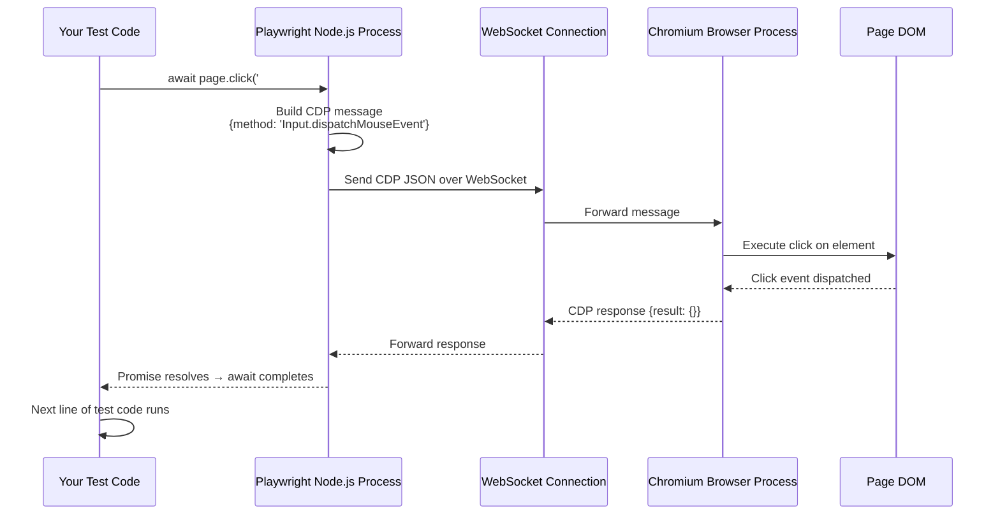

# 01. Playwright & TypeScript — How Everything Actually Works

**Navigation**: [← Foundations](./00_SDET_Foundations_Mindset.md) | [Index](../00_INDEX.md) | [→ Enterprise Locators](./02_Enterprise_Locators_XPath.md)

---

## 5W1H

- **WHAT**: A deep understanding of async/await in JavaScript/TypeScript and how Playwright's architecture (Browser → Context → Page → Locator) maps to real browser behaviour.
- **WHY**: Every mysterious Playwright failure traces back to one of two root causes: (1) not understanding `async/await` and Promises, or (2) not understanding what the `page` object actually represents and how it communicates with the browser. Once you understand the internals, you stop guessing and start reasoning.
- **WHO**: SDETs who know what Playwright does but not why it works the way it does.
- **WHEN**: Before debugging any timing-related failure. Before writing custom fixtures.
- **HOW**: By going one level deeper than "add `await` before everything."

---

## 1. The JavaScript Event Loop — Why Async Exists at All

Before Playwright makes sense, you need to understand WHY JavaScript is asynchronous.

JavaScript runs in a single thread. There is only ever one piece of JavaScript executing at any moment. This is a fundamental constraint — JavaScript cannot do two things at once.

So how does it handle things that take time (network requests, file reads, user input)?

```
The Event Loop model:

  Call Stack                Message Queue
  ─────────────             ─────────────────────
  │ main()     │            │ response received  │
  │ await fetch│ ────────── │ setTimeout done    │  ← waiting events
  │            │            │                    │
  └────────────┘            └────────────────────┘
         │                            │
         └──────── Event Loop ─────────┘
                    (picks next message when call stack is empty)

When you write:
  const result = await fetch('https://api.example.com/data');

JavaScript does NOT block and wait.
It registers a callback ("call me when the HTTP response arrives")
and immediately removes itself from the call stack → other code can run.
When the HTTP response arrives → the callback is added to the queue →
the Event Loop picks it up → your code resumes where it left off.

The `await` keyword is syntactic sugar that hides this complexity.
You write code that LOOKS synchronous but IS asynchronous underneath.
```

**Why this matters for Playwright:**

Every time you write `await page.click('#button')`, Playwright:

1. Sends a CDP (Chrome DevTools Protocol) message over a WebSocket to the browser
2. Returns a Promise (execution is suspended here — `await` suspends your code)
3. The browser receives the message, performs the click
4. The browser sends back a CDP confirmation
5. The Promise resolves → your code resumes

If you forget `await`:

```typescript
// ❌ Without await:
page.click("#button"); // sends CDP message, returns Promise, immediately proceeds
expect(page.locator(".success")).toBeVisible(); // checks NOW, before click response arrived
// Result: success message not visible yet → assertion fails

// ✅ With await:
await page.click("#button"); // waits for CDP round-trip to complete
await expect(page.locator(".success")).toBeVisible(); // now checks AFTER click completed
```

---

## 2. Promises — The Contract Underneath Every Playwright Action

A Promise is an object representing an operation that will complete (or fail) in the future.

```typescript
// A Promise has three states:
// Pending: the operation hasn't finished yet
// Fulfilled: the operation completed successfully (gives you a value)
// Rejected: the operation failed (gives you an error)

// Every Playwright method returns a Promise:
const clickPromise: Promise<void> = page.click("#btn");
const textPromise: Promise<string> = page.locator("h1").textContent();
const navPromise: Promise<void> = page.goto("https://example.com");

// await unwraps the Promise — waits for it to resolve, gives you the value:
const text: string = (await page.locator("h1").textContent()) ?? "";
//          ^^^^^^ the actual string value — NOT a Promise
```

### Why Promises Chain

```typescript
// These are equivalent:
const text1 = await page.locator("h1").textContent();

// Without async/await (raw Promise chaining — harder to read):
const text2 = page
  .locator("h1")
  .textContent()
  .then((text) => text ?? "");

// The key insight: Playwright is NOT doing magic.
// Every action is an HTTP request (WebSocket message) to the browser.
// Promises are just the standard way to handle async HTTP in JavaScript.
```

### The Two Types of Playwright Methods

```typescript
// Type 1: Returns a Promise<void> — you await it for its SIDE EFFECT
await page.click("#btn"); // Promise<void> — side effect: button is clicked
await page.fill("#input", "text"); // Promise<void> — side effect: input is filled
await page.goto("/dashboard"); // Promise<void> — side effect: navigation happened

// Type 2: Returns a Promise<value> — you await it for the DATA
const text = await page.locator("h1").textContent(); // Promise<string | null>
const count = await page.locator(".row").count(); // Promise<number>
const isVis = await page.locator("#btn").isVisible(); // Promise<boolean>
const attrs = await page.locator("#btn").getAttribute("data-id"); // Promise<string | null>

// Type 3: Returns a LOCATOR (NOT a Promise — no await needed!)
const locator = page.locator("#btn"); // NO await — returns a Locator object synchronously
const heading = page.getByRole("heading"); // NO await — synchronous
const button = page.getByText("Submit"); // NO await — synchronous
// These just DESCRIBE what to find. They don't actually look for the element yet.
// The element is only found when you ACT on the locator (click, fill, textContent...)
```

---

## 3. The Architecture — Browser, Context, Page, Locator

These four objects form a strict hierarchy. Each one is created from the one above it.

```
Browser (the engine — Chromium/Firefox/WebKit)
   │
   │  browser.newContext()
   ▼
BrowserContext (isolated session — like an incognito window)
   │  → Has its own: cookies, localStorage, sessionStorage, certificate overrides
   │  → Tests are isolated because each gets a fresh context
   │
   │  context.newPage()
   ▼
Page (a single tab)
   │  → Has its own: URL, DOM, JavaScript heap, network state
   │  → Communicates with the browser via Chrome DevTools Protocol (CDP)
   │
   │  page.locator(), page.getByRole() etc.
   ▼
Locator (a DESCRIPTION of where to find an element — lazy evaluation)
   │  → Does NOT find the element immediately — lazy evaluation
   │  → Element is found each time you ACT on the locator
   │  → If the element doesn't exist yet, Playwright waits until it does (with timeout)
```

### Why the Context is the Unit of Isolation

```typescript
// Each test gets a fresh context:
test("Test A", async ({ page }) => {
  // page is in its own context
  await page.goto("/login");
  await page.fill("#user", "admin");
  await page.fill("#pass", "password");
  await page.click("#login");
  // admin cookie is set in THIS context's cookie store
});

test("Test B", async ({ page }) => {
  // page is in a DIFFERENT fresh context
  // Test B's context has NO cookies from Test A
  // Test B must log in itself (or use storageState)
  await page.goto("/dashboard");
  // Result: redirected to /login because no auth cookie exists
});
```

The context isolation is why Playwright tests are independent by default. You don't need to log out between tests or clear cookies — each test's context starts completely empty.

### How CDP Communication Works

```
Your test code                 Playwright Node.js            Chromium browser
     │                               │                              │
     │ await page.click('#btn')       │                              │
     │ ─────────────────────────────►│                              │
     │                               │  CDP: {method: 'Input.        │
     │                               │  dispatchMouseEvent',         │
     │                               │  params: {x: 100, y: 50}}     │
     │                               │ ─────────────────────────────►│
     │                               │                               │ performs click
     │                               │      CDP: {result: {}}        │
     │                               │ ◄─────────────────────────────│
     │  Promise<void> resolves        │                              │
     │ ◄─────────────────────────────│                              │
     │ (await completes)              │                              │

This is why every action needs await — the CDP round trip takes time.
Without await, you send the message and immediately check the result
before the browser has had time to execute the action.
```

---

## 4. Locators — Lazy Evaluation and Auto-Retry

This is the most misunderstood concept in Playwright. A `Locator` is NOT an element.

```typescript
// This does NOT look for the element:
const btn = page.locator("#submit-btn");
// btn is a Locator OBJECT — a description of how to find the element later
// At this point, Playwright has NOT touched the DOM

// The element is only sought when you do something with the locator:
await btn.click(); // NOW Playwright looks for #submit-btn → clicks it
const text = await btn.textContent(); // NOW Playwright looks for #submit-btn → reads text
await expect(btn).toBeVisible(); // NOW Playwright looks for #submit-btn → checks visibility
```

**Why lazy evaluation is powerful:**

```typescript
// In a POM constructor:
class LoginPage {
  readonly usernameInput: Locator;
  readonly passwordInput: Locator;
  readonly loginButton: Locator;

  constructor(private readonly page: Page) {
    // These are created when the POM is constructed (synchronously, no await)
    // The elements don't need to exist yet — they'll be found when used
    this.usernameInput = page.locator("#username");
    this.passwordInput = page.locator("#password");
    this.loginButton = page.locator('[data-testid="login-btn"]');
  }

  async login(email: string, password: string): Promise<void> {
    // Elements are NOW looked for (and waited for if not yet in DOM)
    await this.usernameInput.fill(email);
    await this.passwordInput.fill(password);
    await this.loginButton.click();
  }
}
```

**Auto-retry built into locators:**

```typescript
// When you write:
await expect(page.locator(".notification")).toHaveText("Citation saved");

// Playwright does NOT just check once.
// Internal algorithm:
//   1. Find .notification in DOM → found? check text → matches? → resolve ✅
//   2. Not found yet? → wait 100ms → try again
//   3. Found, text doesn't match yet? → wait 100ms → try again
//   4. ... repeats until timeout (default: 5000ms in expect, 30000ms in toHaveText)
//   5. Timeout reached → throw descriptive error

// This is WHY you should always use expect(locator).toHaveText() over:
const text = await locator.textContent(); // gets text at THIS INSTANT
expect(text).toBe("Citation saved"); // might be '' if still loading!
```

### Locator Strict Mode

```typescript
// Playwright throws if a locator matches MORE THAN ONE element (strict mode):
await page.locator(".save-btn").click();
// Error if there are 2 .save-btn elements on the page:
// "strict mode violation: page.locator('.save-btn') resolved to 2 elements"

// Fix: scope the locator
await page.locator(".action-panel .save-btn").click(); // only in action-panel

// Or: use nth()
await page.locator(".save-btn").first().click();
await page.locator(".save-btn").nth(0).click(); // same as first()

// Or: use filter()
await page.locator(".save-btn").filter({ hasText: "Save Citation" }).click();
```

---

## 5. The `test` Function — What Actually Happens When a Test Runs

```typescript
import { test, expect } from "@playwright/test";

test("User can log in", async ({ page }) => {
  await page.goto("/login");
  await page.fill("#email", "test@example.com");
  await page.fill("#password", "password123");
  await page.click("#loginBtn");
  await expect(page.getByRole("heading", { name: "Dashboard" })).toBeVisible();
});
```

What happens when Playwright runs this:

```
1. Playwright launches Chromium (or reuses an existing browser instance)

2. Playwright calls browser.newContext() → creates a fresh isolated session
   → At this point, there are NO cookies, no localStorage, no session data

3. Playwright calls context.newPage() → creates a new tab (Page object)
   → This is what { page } in the test function argument refers to

4. Playwright runs your test function:
   a. goto('/login') → CDP: navigate to URL → Promise resolves when navigated
   b. fill('#email') → CDP: find input, set value → Promise resolves
   c. fill('#password') → CDP: find input, set value → Promise resolves
   d. click('#loginBtn') → CDP: click → Promise resolves
   e. expect(...).toBeVisible() → polling: find element, check visibility, retry

5. If all assertions pass → test marked PASSED
   If any assertion throws → test marked FAILED, error is captured

6. Playwright calls context.close() → context is destroyed (cookies gone, localStorage gone)
   → This cleanup happens even if the test fails (finally block internally)

7. Next test gets a fresh context (step 2 again)
```

### `test.describe` and `beforeEach`

```typescript
test.describe("Citation creation", () => {
  // beforeEach runs before EVERY test in this describe block
  // The { page } here is the SAME page object that each test gets
  test.beforeEach(async ({ page }) => {
    await page.goto("/citations/new");
    await page.waitForLoadState("domcontentloaded");
  });

  test("Required fields are marked correctly", async ({ page }) => {
    // page has already navigated to /citations/new
    await expect(page.locator('[aria-required="true"]')).toHaveCount(3);
  });

  test("Can submit with valid data", async ({ page }) => {
    // page has already navigated to /citations/new
    await page.fill("#amount", "150");
    await page.click("#submit");
    await expect(page).toHaveURL(/\/citations\/CIT-/);
  });
});

// IMPORTANT: beforeEach does NOT share state between tests.
// Test 1's { page } and Test 2's { page } are DIFFERENT objects.
// The page in beforeEach IS the same object as the page in the test.
```

---

## 6. `expect` — Two Different Things With the Same Name

There is a critical difference between `expect(value)` and `expect(locator)`:

```typescript
// Type 1: expect(non-Playwright-value) — standard Jest-style assertion
// Does NOT retry. Checks once and passes or fails immediately.
expect(42).toBe(42); // immediate
expect("PENDING").toMatch(/PENDING/); // immediate
expect([1, 2, 3]).toHaveLength(3); // immediate
expect(apiResponse.status).toBe("PAID"); // immediate — checks NOW

// Type 2: expect(Playwright-locator) — Playwright auto-retrying assertion
// DOES retry. Keeps checking until condition is met or timeout.
await expect(page.locator(".status")).toHaveText("PAID"); // retries
await expect(page.locator(".spinner")).toBeHidden(); // retries
await expect(page.locator(".modal")).toBeVisible({ timeout: 30_000 }); // retries for 30s
await expect(page).toHaveURL("**/dashboard"); // retries (page locator)

// The rule:
// If the first argument to expect() is a Playwright Locator or Page → retrying assertion
// If the first argument is any other value → immediate assertion (no retry)
```

**The common mistake:**

```typescript
// ❌ Reads text ONCE, immediately — fails if page is still loading
const statusText = await page.locator(".status").textContent();
expect(statusText).toBe("PAID"); // if status is '' (still loading) → fails immediately

// ✅ Retries until text matches OR timeout
await expect(page.locator(".status")).toHaveText("PAID"); // waits for 'PAID' to appear
```

---

## 7. `async/await` Error Handling in Tests

```typescript
// Tests that throw errors are marked FAILED automatically
// But you need to understand how errors propagate

test("Error propagation", async ({ page }) => {
  await page.goto("/login");

  // Scenario 1: Element not found → Error thrown → test fails with clear message
  await page.locator("#nonexistent").click();
  // Error: "locator.click: Timeout 30000ms exceeded"

  // Scenario 2: Assertion fails → Error thrown → test fails
  await expect(page.locator("h1")).toHaveText("Wrong text");
  // Error: "Expected: 'Wrong text', Received: 'Dashboard'"

  // Scenario 3: Network error → Error thrown → test fails
  const response = await page.goto("https://nonexistent-url.invalid");
  // Error: "net::ERR_NAME_NOT_RESOLVED"
});

// How to handle EXPECTED errors (negative testing):
test("Login with wrong password shows error", async ({ page }) => {
  await page.goto("/login");
  await page.fill("#email", "test@example.com");
  await page.fill("#password", "wrongpassword");
  await page.click("#loginBtn");

  // We EXPECT the login to fail — assert the error state
  await expect(page.locator(".error-message")).toHaveText(
    "Invalid credentials",
  );
  await expect(page).toHaveURL("**/login"); // still on login page
});

// For API calls that should fail:
test("API returns 401 for unauthorized request", async ({ request }) => {
  const response = await request.get("/api/v2/citations");
  // request.get() does NOT throw on non-2xx status codes
  expect(response.status()).toBe(401); // assert the expected failure
});
```

---

## 8. TypeScript Types You MUST Know

You don't need to be a TypeScript expert to write Playwright tests. But you must know these types:

```typescript
import type {
  Page, // a single browser tab — the main object you interact with
  BrowserContext, // an isolated browser session (like incognito)
  Locator, // a lazy reference to a DOM element
  APIRequestContext, // Playwright's HTTP client (for API tests)
  APIResponse, // the response from an API call
  Request, // an intercepted browser HTTP request
  Response, // an intercepted browser HTTP response
  TestInfo, // metadata about the currently running test
  FullConfig, // the Playwright config (used in globalSetup)
  Browser, // the browser engine itself (rarely used in tests directly)
} from "@playwright/test";

// The ones you'll use in 90% of your code:
// Page — for UI interactions
// Locator — for elements within a page
// APIRequestContext — for API-only tests
// APIResponse — checking API response status/body
```

**Optional chaining and nullability — the patterns you'll use constantly:**

```typescript
// Playwright methods that return null (you must handle null):
const text = await page.locator("h1").textContent();
// text is: string | null  (null if element not found)

// Safe patterns:
const safeText = (await page.locator("h1").textContent()) ?? ""; // default empty string
const safeText2 = (await page.locator("h1").textContent())?.trim(); // trim if non-null

// API response body (might be any shape):
const body = (await response.json()) as { status: string; amount: number };
// Cast with 'as' — you're telling TypeScript the shape
// If the actual response doesn't match the type → runtime error, not compile error
// Use proper typed interfaces for important APIs (see Ch27)

// The typed approach (better):
interface CitationApiResponse {
  citationId: string;
  status: "PENDING" | "PAID" | "OVERDUE" | "DISPUTED";
  amount: number;
}
const citation = (await response.json()) as CitationApiResponse;
citation.status; // TypeScript knows this is one of the 4 values — no typos possible
```

---

## 9. `playwright.config.ts` — What Each Setting Actually Does

```typescript
// playwright.config.ts
import { defineConfig, devices } from "@playwright/test";

export default defineConfig({
  testDir: "./tests", // where Playwright looks for *.spec.ts files

  fullyParallel: true, // run ALL tests in parallel (different workers)
  // false: tests within a file run sequentially

  retries: process.env.CI ? 2 : 0,
  // retries: if a test fails, try again this many times before marking as FAILED
  // In CI: 2 retries catches transient environment failures
  // Locally: 0 — you want to see failures immediately for debugging
  // WARNING: retries hide flaky tests! Fix the test, don't rely on retries.

  workers: process.env.CI ? 4 : undefined,
  // workers: number of parallel processes
  // CI: 4 workers = 4 tests running simultaneously
  // Local: undefined = Playwright decides based on your CPU count

  timeout: 30_000, // GLOBAL test timeout — each test must complete in 30s
  // If exceeded: "Test timeout of 30000ms exceeded"

  expect: {
    timeout: 10_000, // HOW LONG each individual expect() assertion will retry
    // Default: 5000ms. For slow apps (D365): increase to 15-30s
  },

  use: {
    baseURL: process.env.BASE_URL ?? "http://localhost:3000",
    // baseURL: lets you write page.goto('/login') instead of full URL

    trace: "on-first-retry",
    // trace: 'off'            → no trace (fastest, no debugging info)
    // trace: 'on-first-retry' → trace only when test is being retried (CI recommendation)
    // trace: 'on'             → always trace (slowest, most debugging info)
    // trace: 'retain-on-failure' → trace for failed tests (good balance)

    screenshot: "only-on-failure",
    // screenshot: takes a screenshot automatically
    // 'only-on-failure': screenshot when test fails (attach to report)

    video: "retain-on-failure",
    // video: record a video of the test
    // 'retain-on-failure': keep video only when test fails

    actionTimeout: 15_000, // timeout for individual page actions (click, fill, etc.)
    // separate from the global test timeout
  },

  projects: [
    {
      name: "chromium",
      use: { ...devices["Desktop Chrome"] },
    },
    // Add more browsers for cross-browser testing:
    // { name: 'firefox', use: { ...devices['Desktop Firefox'] } },
    // { name: 'webkit',  use: { ...devices['Desktop Safari'] } },
    // Mobile emulation:
    // { name: 'mobile-chrome', use: { ...devices['Pixel 5'] } },
  ],

  reporter: [
    ["html"], // generates HTML report: npx playwright show-report
    ["json", { outputFile: "results.json" }], // machine-readable for CI
    ["line"], // minimal console output during test run
  ],
});
```

---

## 🏋️ Practice — Understanding Questions

### Q1. [Deep] What is the difference between these two lines?

```typescript
const text1 = await page.locator("h1").textContent();
await expect(page.locator("h1")).toHaveText("Dashboard");
```

<details><summary>Answer</summary>

**Line 1:** `textContent()` is a Playwright method that returns a `Promise<string | null>`. `await` resolves the Promise immediately — it reads the current text of `h1` at this exact moment. If `h1` says '' (still loading), `text1` will be `''` or `null`. It does NOT retry.

**Line 2:** `expect(locator).toHaveText()` is a Playwright auto-retrying assertion. It continuously evaluates the locator and checks if the text matches 'Dashboard', retrying every ~100ms until it matches or the timeout (default 5s, or the value you set in `expect.timeout`) is reached. If the text changes from '' to 'Dashboard' within the timeout, the assertion passes.

**The practical difference:**

```typescript
// Scenario: you click a button, and the heading changes to 'Dashboard' after 2 seconds

await page.click("#goToDashboard");

const text1 = await page.locator("h1").textContent();
expect(text1).toBe("Dashboard"); // FAILS — reads '' immediately after click

await expect(page.locator("h1")).toHaveText("Dashboard"); // PASSES — waits 2 seconds
```

**When to use which:**

- Use `textContent()` only when you're confident the value is already final (e.g., after a successful `await expect(...).toHaveText()` has already confirmed the text)
- Use `expect(locator).toHaveText()` whenever you're waiting for a value that might still be changing
</details>

---

### Q2. [Architecture] Why does Playwright create a new BrowserContext for each test instead of reusing the same one?

<details><summary>Answer</summary>

**Reason 1 — Cookie and storage isolation:**
Auth cookies, localStorage tokens, sessionStorage data from Test A must not be visible to Test B. If they were, Test B could accidentally use Test A's login session (or worse, no session at all if Test A logged out). A fresh context starts with zero cookies, zero localStorage.

**Reason 2 — No cross-test DOM state:**
If Test A modified something on the page (set a value, triggered a JS mutation), those changes are in that page's JavaScript heap. A fresh context has a fresh heap — no contamination.

**Reason 3 — Parallelism:**
Multiple workers run simultaneously. Each worker runs a test in its own context on the same browser instance. The browser can run many contexts simultaneously, just like a browser can run many incognito windows simultaneously.

**Performance note:**
Creating a context is fast (milliseconds) — it's far cheaper than launching a new browser. This is why Playwright reuses the browser but creates fresh contexts. It's the right tradeoff between isolation and speed.

**The exception — storageState:**
When you use `storageState` (to avoid re-logging in on every test), Playwright creates a new context BUT pre-populates it with cookies from a saved file. The context is still fresh (not shared with other tests), but it starts with auth already established.

</details>

---

### Q3. [TypeScript] Why is `await page.locator('#btn').click()` valid but `await page.locator('#btn')` is not useful?

<details><summary>Answer</summary>

`page.locator('#btn')` returns a `Locator` object synchronously — it does NOT return a Promise. There is nothing to `await`.

The `Locator` is a lazy descriptor — it describes HOW to find the element, but doesn't actually look for it. It's like writing an address on an envelope — the letter hasn't been delivered yet.

```typescript
const locator = page.locator("#btn"); // immediately returns Locator — no await needed
// locator is: { selector: '#btn', frame: ..., page: ... }
// No DOM lookup has happened yet

await locator.click(); // NOW the DOM lookup happens + the click
await locator.fill("x"); // NOW the DOM lookup happens again + fill
// Every time you act on the locator, it re-finds the element in the DOM
// This is why locators are called "lazy" — they always re-evaluate
```

The re-evaluation is actually a feature: if the element is replaced by a React re-render between two actions, the locator finds the NEW element (not a stale reference). This is very different from Selenium's `findElement()` which gives you a reference to a specific DOM node that can become stale after a re-render.

</details>

---

## 10. Under the Hood — Why `await` Works in Playwright

The ASCII diagram in Section 3 showed the CDP flow conceptually. Here is the precise sequence for every single Playwright action:



**What this diagram teaches you:**

1. **Every Playwright action is a network round-trip.** Your test code and the browser are in _separate OS processes_. They communicate over a WebSocket using the Chrome DevTools Protocol (CDP). This is fundamentally different from Selenium, where the driver injects JavaScript directly into the page.

2. **`await` is not optional — it is mechanical.** Without `await`, your code sends the CDP message and immediately moves to the next line. The browser hasn't even received the message yet, let alone executed it. The assertion that follows will check the page _before_ the click happened.

3. **The latency varies.** On your machine, the round-trip is <1ms. On a CI server with shared CPU, it might be 10-50ms. On a remote browser grid, it might be 100-500ms. This is why timeouts that work locally can fail in CI.

4. **Playwright batches intelligently.** When you write `await page.fill('#input', 'hello')`, Playwright sends multiple CDP commands (focus element, clear existing value, dispatch key events for each character) — but it handles the orchestration. You just see one `await`.

---

## 11. The Retryability Engine — How Playwright Auto-Waits

This is the single most important thing to understand about Playwright's assertion model. There are **two completely different assertion systems** that look syntactically similar.

### Auto-Retrying Assertions (Playwright-specific)

```typescript
// These ALL retry automatically until timeout:
await expect(page.locator(".status")).toHaveText("PAID"); // re-polls ~every 100ms
await expect(page.locator(".spinner")).toBeHidden(); // re-polls
await expect(page.locator(".row")).toHaveCount(5); // re-polls
await expect(page).toHaveURL("**/dashboard"); // re-polls
await expect(page.locator("#btn")).toBeEnabled(); // re-polls
await expect(page.locator("img")).toHaveAttribute("src", /logo/); // re-polls
```

**How the retry loop works internally:**

```
Step 1: Evaluate the locator → find element(s) in DOM
Step 2: Check the condition (text matches? visible? count correct?)
Step 3: Condition met? → resolve Promise → assertion PASSES ✅
Step 4: Condition NOT met? → wait ~100ms → go to Step 1
Step 5: Timeout reached (default 5000ms)? → throw AssertionError ❌
```

The key: **both the locator query AND the condition check are re-evaluated on every retry**. If the DOM changes between retries (React re-render, async data load), Playwright picks up the new state automatically.

### One-Shot Methods (No retry)

```typescript
// These execute ONCE and return immediately:
const text = await page.locator(".status").textContent(); // reads text NOW — no retry
const visible = await page.locator(".btn").isVisible(); // checks visibility NOW — no retry
const count = await page.locator(".row").count(); // counts NOW — no retry
const checked = await page.locator("#agree").isChecked(); // checks NOW — no retry
```

### When to Use Which — The Decision Rule

```typescript
// WRONG — one-shot then immediate assertion (race condition):
const statusText = await page.locator(".status").textContent();
expect(statusText).toBe("PAID"); // if status is still 'PENDING', fails immediately

// RIGHT — auto-retrying assertion (waits for state):
await expect(page.locator(".status")).toHaveText("PAID"); // waits up to 5s for 'PAID'

// THE EXCEPTION — use one-shot when you KNOW the value is already final:
await expect(page.locator(".status")).toHaveText("PAID"); // first, WAIT for it
const finalText = await page.locator(".status").textContent(); // THEN read the exact value
// finalText is guaranteed to be 'PAID' here because the expect above already confirmed it
```

**Rule:** If you're checking a value that might still be changing → use `await expect(locator)`. If you need to read a value that's already been confirmed → use `await locator.textContent()`.

### Customising Retry Behaviour

```typescript
// Increase timeout for slow operations (D365 form save):
await expect(page.locator(".notification")).toBeVisible({ timeout: 30_000 });

// Use expect.poll() for custom conditions that aren't locator-based:
await expect
  .poll(
    async () => {
      const response = await request.get("/api/citations/CIT-001");
      const body = await response.json();
      return body.status;
    },
    {
      message: "Citation status should become PAID",
      intervals: [500, 1000, 2000], // poll every 500ms, then 1s, then 2s, then 2s...
      timeout: 30_000,
    },
  )
  .toBe("PAID");
```

---

## 12. Locator vs ElementHandle — Why Locators Always Win

Playwright has two ways to reference DOM elements. One is modern and resilient. The other is legacy and fragile.

### ElementHandle (Legacy — Avoid)

```typescript
// ElementHandle is a DIRECT POINTER to a specific DOM node
const handle = await page.$("#submit-btn"); // finds the node RIGHT NOW
// handle points to: <button id="submit-btn">Save</button> at memory address 0x7f3a...

// If React re-renders the form (component unmounts and remounts):
// → The OLD <button> is destroyed (memory address 0x7f3a is freed)
// → A NEW <button> is created (memory address 0x8b2c)
// → handle STILL points to the destroyed node (0x7f3a)
// → handle.click() → ERROR: "Element is detached from the DOM"
```

### Locator (Modern — Always Use)

```typescript
// Locator is a QUERY that re-runs every time you use it
const locator = page.locator("#submit-btn"); // stores the query, NOT a node reference

// First use:
await locator.click(); // runs query → finds <button> at 0x7f3a → clicks it

// React re-renders (old button destroyed, new button created):

// Second use:
await locator.click(); // runs query AGAIN → finds NEW <button> at 0x8b2c → clicks it
// No error — locator found the new element automatically
```

### Why This Matters for D365 and React Apps

D365 uses React (or a React-like framework) internally. Components re-render frequently:

- Opening a form tab triggers re-render
- Saving a record triggers re-render
- Expanding a grid row triggers re-render
- Two-phase render means the component renders twice in quick succession

With ElementHandle, every re-render risks a "detached from DOM" error. With Locator, the query re-runs on every action and always finds the current element.

**The only time you need ElementHandle:** When you're doing advanced CDP operations that require a direct node reference (e.g., `elementHandle.evaluateHandle()`). This is rare — most SDETs will never need it.

---

## 📚 References & Further Reading

### Official Documentation — Playwright

- [Playwright Locators Guide](https://playwright.dev/docs/locators) — Complete guide to locator types, best practices, and filtering
- [Locator Class API](https://playwright.dev/docs/api/class-locator) — Every Locator method with signatures and examples
- [Test Assertions](https://playwright.dev/docs/test-assertions) — Auto-retrying assertions vs one-shot — the most important distinction in Playwright
- [Page Object Model (Playwright)](https://playwright.dev/docs/pom) — Playwright's official POM guidance
- [Evaluating JavaScript](https://playwright.dev/docs/evaluating) — `page.evaluate()`, `page.addInitScript()`, and passing data between Node.js and the browser

### Chrome DevTools Protocol

- [CDP Protocol Reference](https://chromedevtools.github.io/devtools-protocol/) — Full specification of every CDP domain and command Playwright uses under the hood

### MDN Web Docs

- [Structured Clone Algorithm](https://developer.mozilla.org/en-US/docs/Web/API/Web_Workers_API/Structured_clone_algorithm) — How data is serialised between `page.evaluate()` and your Node.js test (explains why you can't pass functions or DOM nodes)

### Articles

- [Playwright Best Practices](https://playwright.dev/docs/best-practices) — Official guide to writing stable, maintainable tests

---

**Navigation**: [← Foundations](./00_SDET_Foundations_Mindset.md) | [Index](../00_INDEX.md) | [→ Enterprise Locators](./02_Enterprise_Locators_XPath.md)
