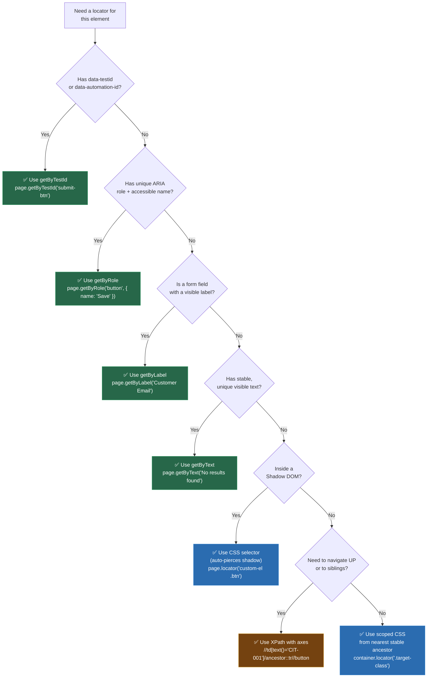

# 02. Enterprise Locators — XPath, CSS, and the DOM as a Problem Space

**Navigation**: [← Playwright Basics](./01_Playwright_TS_Basics.md) | [Index](../00_INDEX.md) | [→ Browser Console Scripting](./03_Browser_Console_Scripting.md)

---

## 5W1H

- **WHAT**: A systematic framework for finding ANY element in ANY DOM — from clean React apps with perfect accessibility attributes to the generated `<div>` soup of Dynamics 365, Salesforce, SAP, and legacy JSP/ASPX apps.
- **WHY**: Brittle locators are the single largest cause of test maintenance burden. A test that breaks every time a developer changes a class name or rearranges the DOM is worse than no test — it creates noise and erodes trust. You must write locators that are **stable** (survive DOM changes), **specific** (match exactly one element), and **readable** (another engineer can understand them in 30 seconds).
- **WHO**: All SDETs. The locator strategy is where most automation experience actually lives.
- **WHEN**: Before writing any POM. Bad locators written early spread through an entire framework.
- **HOW**: By understanding the DOM as a tree, XPath as a navigation language over that tree, and Playwright's filter system as a higher-level abstraction over XPath.

---

## 1. The DOM Is a Tree — Think in Relationships, Not Absolute Paths

Every HTML page is a tree. The browser parses your HTML and creates a Document Object Model (DOM) — a tree of `Element` nodes. Your locator is a **path query** over this tree.

```
document
└── html
    ├── head
    └── body
        └── div.crm-container
            ├── header.ms-CommandBar
            │   └── button[data-id="newRecord"]  "New Citation"
            └── main
                └── div.ms-DetailsList
                    ├── div.ms-DetailsList-headerWrapper
                    │   └── div[role="row"]
                    │       ├── div[role="columnheader"] "Citation ID"
                    │       └── div[role="columnheader"] "Status"
                    └── div.ms-DetailsList-contentWrapper
                        ├── div[role="row"][aria-rowindex="1"]
                        │   ├── div[role="gridcell"] "CIT-001"
                        │   └── div[role="gridcell"] "PENDING"
                        └── div[role="row"][aria-rowindex="2"]
                            ├── div[role="gridcell"] "CIT-002"
                            └── div[role="gridcell"] "PAID"
```

**The mental model for any locator problem:**

```
1. Find an anchor — an element with stable, unique identifying properties
   (a data-testid, a known text label, a stable aria attribute)

2. Navigate from the anchor to your target
   (go up to a common ancestor, then down to the target)

3. Scope the search — never query the entire document if you can query a subtree
   (page.locator('.citation-grid').locator('[role="row"]') — searches ONLY inside the grid)
```

**Name what this actually is: a rooted tree, and the 3-step mental model is a real tree-search pattern.** `document` is the root; every element has exactly one parent (except the root) and zero or more children — that's the formal definition of a tree, not a loose metaphor. "Find an anchor, navigate to the target, scope the search" is the general shape of *every* tree query: locate a node with a known property, then bound your search to the smallest subtree that's guaranteed to contain what you actually want, instead of re-scanning the whole tree from the root every time. (Full tree terminology and traversal algorithms: [Ch33 Section 4](../06_SDET_to_SDE_Bridge/33_SDET_to_SDE_CS_Thinking.md#4-trees--dom-structure-and-pom-hierarchy), [`03_Algorithms/05_Trees.md`](../../03_Algorithms/05_Trees.md).)

---

## 2. The Locator Priority Hierarchy — Best to Worst

Playwright's [locator best practices](https://playwright.dev/docs/locators#best-practices) define this priority. Use the highest one that works for your app:

### Priority 1 — Role + Name (Most Semantic, Most Stable)

```typescript
// Uses ARIA roles and accessible names — the same attributes screen readers use
// These survive DOM restructuring because they describe FUNCTION, not POSITION

page.getByRole("button", { name: "Submit" });
page.getByRole("textbox", { name: "Customer Email" });
page.getByRole("heading", { name: "Citation Details", level: 2 });
page.getByRole("combobox", { name: "Status filter" });
page.getByRole("row", { name: "CIT-001" }); // in a grid/table

// Why these are stable:
// A developer can move the Submit button to a different <div>,
// change its class name, change its ID — but as long as its accessible name
// is still "Submit" and its role is still "button", your locator works.
```

**What is a "role"?**
Every HTML element has a default role:

- `<button>` → role: button
- `<input>` → role: textbox (or combobox for selects)
- `<a>` → role: link
- `<h1>-<h6>` → role: heading
- `<table>` → role: table
- `<tr>` → role: row

You can also set ARIA roles explicitly: `<div role="dialog">`, `<div role="alert">`.

### Priority 2 — data-testid (Explicit Test Hook)

```typescript
// data-testid is an attribute added by developers specifically for testing
// It is the most reliable locator — it changes ONLY when the developer
// intentionally changes the test hook (which should trigger a test update)

page.getByTestId("submit-btn");
// Equivalent to:
page.locator('[data-testid="submit-btn"]');

// Works because:
// - Survives CSS changes (class is irrelevant)
// - Survives DOM restructuring (position is irrelevant)
// - Survives text changes (content is irrelevant)
// - Only breaks if developer intentionally removes it
```

**Configuring your test-id attribute (if not `data-testid`):**

```typescript
// playwright.config.ts
use: {
  testIdAttribute: 'data-automation-id',  // D365 uses this attribute
}
// Now page.getByTestId('fieldName') searches for data-automation-id="fieldName"
```

### Priority 3 — Label / Text / Placeholder

```typescript
// Good for form inputs where labels are visible and stable
page.getByLabel("Email address"); // finds input with <label>Email address</label>
page.getByPlaceholder("Enter citation ID"); // finds input with placeholder text
page.getByText("No citations found"); // finds any element with this exact text
page.getByAltText("Company logo"); // finds image with alt text
```

### Priority 4 — CSS Selector (Use When Higher Options Fail)

```typescript
// CSS selectors — faster than XPath, supported natively by browsers
// Use for elements with stable class names or structure

page.locator(".ms-DetailsList"); // class selector
page.locator("[data-automation-key]"); // attribute selector (has the attribute, any value)
page.locator('[data-col-id="status"]'); // attribute with specific value
page.locator("div.ms-DetailsRow:nth-child(2)"); // nth child
page.locator("#citationForm input[required]"); // scoped: required inputs in citationForm

// CSS pseudo-classes Playwright supports:
page.locator(':text("Submit")'); // contains this text (Playwright extension)
page.locator(':text-is("Submit")'); // exact text match
page.locator(':has-text("CIT-001")'); // has descendant with this text
page.locator(':has([data-testid="btn"])'); // has descendant matching selector
page.locator(":enabled"); // enabled form elements
page.locator(":disabled"); // disabled form elements
page.locator(":checked"); // checked checkboxes/radio buttons
page.locator(":visible"); // visible elements only
page.locator(":nth-match(button, 2)"); // second button on the page
```

### Priority 5 — XPath (Power Tool for Complex DOM Relationships)

```typescript
// XPath is the most powerful but most verbose
// Use when CSS cannot express the relationship you need
// (most commonly: ancestor traversal — CSS cannot go UP the tree)

page.locator('//button[text()="Submit"]'); // text match
page.locator('//input[@type="email"]'); // attribute match
page.locator('//*[contains(@class, "btn")]'); // partial class match
page.locator('//div[@id="form"]//input'); // nested: input inside #form
```

---

## 3. XPath — The Full Language

XPath (XML Path Language, W3C spec: https://www.w3.org/TR/xpath-31/) is a query language for selecting nodes in an XML/HTML document. The DOM IS an XML document for XPath's purposes.

### Step 1 — The Basic Syntax

```
// SYNTAX:  axis::nodeTest[predicate]

// axis:      which direction to travel (child, parent, ancestor, following-sibling...)
// nodeTest:  what to look for (div, button, *, etc.)
// predicate: a condition in [] to filter results

// The most common shorthand: // means "descendant-or-self"
// //button  =  descendant-or-self::button  =  find any button anywhere in the doc

// Examples:
//button                                    find any button anywhere
//button[@id="submit"]                      button with id="submit"
//button[contains(@id, "submit")]           button where id CONTAINS "submit"
//button[text()="Submit"]                   button with exact text "Submit"
//button[normalize-space(text())="Submit"]  button with text "Submit" (trim whitespace)
//button[contains(text(), "Submit")]        button where text contains "Submit"
//div[@class="row"][3]                      third div.row (positional)
//*[@data-testid="btn"]                     any element with data-testid="btn"
```

### Step 2 — Text Functions (Critical for Dynamic Apps)

```
text()                  Exact text of the element: //span[text()='PENDING']
contains(text(), 'val') Text contains the value: //span[contains(text(), 'PEND')]
normalize-space()       Strips leading/trailing whitespace and collapses inner whitespace
                        //span[normalize-space()='PENDING']  — matches even with extra spaces
translate()             Character transformation (for case-insensitive matching)
string()                Gets the string value of a node
```

**D365 real scenario — status badge text has invisible whitespace:**

```typescript
// The DOM: <span class="status-badge">  PENDING  </span>
// (has extra spaces from D365's rendering)

// ❌ Fails because text() returns "  PENDING  " (with spaces)
page.locator('//span[text()="PENDING"]');

// ✅ Works — normalize-space removes extra whitespace
page.locator('//span[normalize-space()="PENDING"]');

// Or: Playwright's toHaveText() trims automatically
await expect(page.locator(".status-badge")).toHaveText("PENDING"); // works
```

### Step 3 — Axes (Navigation in ALL Directions)

```
self::              The current node itself
child::             Direct children of the current node
parent::            Direct parent of the current node
ancestor::          All ancestors (parent, grandparent, great-grandparent...)
ancestor-or-self::  Current node + all ancestors
descendant::        All descendants (children, grandchildren...)
descendant-or-self: Current node + all descendants (this is what // uses)
following-sibling:: Elements after the current node, at the same level
preceding-sibling:: Elements before the current node, at the same level
following::         All elements AFTER in document order (different levels too)
preceding::         All elements BEFORE in document order (different levels too)
attribute::         Attributes of the current node (shorthand: @)
```

**When to use each axis:**

```typescript
// parent:: — go up ONE level
'//span[@class="status"]/parent::td'; // the <td> containing this span

// ancestor:: — go up N levels to a specific ancestor
'//span[@class="status"]/ancestor::tr'; // the <tr> containing this span (anywhere up)
'//span[@class="status"]/ancestor::div[@id="row-container"]'; // specific ancestor

// following-sibling:: — horizontal navigation (after)
'//label[text()="Email"]/following-sibling::input'; // input after the Email label
'//td[text()="CIT-001"]/following-sibling::td[2]'; // third cell in same row as CIT-001

// preceding-sibling:: — horizontal navigation (before)
'//button[text()="Delete"]/preceding-sibling::span'; // span before Delete button

// descendant:: — go into subtree
'//div[@id="searchPanel"]//input'; // all inputs inside #searchPanel

// REAL POWER: Chain them for complex navigation
'//td[text()="CIT-001"]/ancestor::tr//button[text()="Approve"]';
// Step 1: Find td containing "CIT-001"
// Step 2: Go UP to the ancestor tr (the full row)
// Step 3: Inside that row, find the Approve button
// Result: The Approve button for the CIT-001 row specifically
```

**These axes are the two directions of tree traversal, with a name for the chained pattern.** `child::`/`descendant::` walk DOWN into a subtree — the same direction a depth-first search explores. `parent::`/`ancestor::` walk UP toward the root — the same direction you'd walk to find where two nodes' paths-to-root first meet. `following-sibling::`/`preceding-sibling::` move sideways at a fixed depth. The chained pattern just above — go up from a known node to find a shared container, then search back down from there — is a real, named algorithm: it's a **Lowest Common Ancestor** query (`//td[text()="CIT-001"]` and the `Approve` button are two nodes; `ancestor::tr` finds the nearest node whose subtree contains both), reduced to a single XPath step because you only need the *first* qualifying ancestor, not the formal LCA of two independently-specified nodes. The general algorithm — and why a naive "walk up from both nodes and compare parent chains" is O(depth) per query while precomputed binary lifting makes repeated LCA queries O(log n) — is derived in [`03_Algorithms/05_Trees.md`](../../03_Algorithms/05_Trees.md#lowest-common-ancestor-lca).

### Step 4 — Predicates (Filters)

```typescript
// Multiple predicates — AND logic (both must be true):
'//input[@type="text"][@required]'; // text input that is required

// OR logic:
'//button[@id="submit" or @id="save"]'; // submit OR save button

// Positional predicates:
'//div[@class="row"][1]'; // first matching row (1-indexed in XPath!)
'//div[@class="row"][last()]'; // last matching row
'//div[@class="row"][position()>2]'; // rows after position 2

// Existence predicates:
"//div[child::span]"; // div that has a child span
"//div[not(@disabled)]"; // div without disabled attribute
'//input[not(@readonly) and @type="text"]'; // text input not readonly

// Count predicates:
"//ul[count(li)=3]"; // ul with exactly 3 li children
```

---

## 4. Playwright Filter System — Higher-Level Than XPath

While XPath is powerful, Playwright's `.filter()` system is often cleaner and automatically handles Shadow DOM:

### `.filter()` — Narrow Down a Locator Set

```typescript
// Start broad, then filter
const allRows = page.locator(".ms-DetailsRow");

// Filter by text content anywhere in the element
const cit001Row = allRows.filter({ hasText: "CIT-001" });

// Filter by presence of a specific child locator
const pendingRows = allRows.filter({
  has: page.locator('[data-col-id="status"]', { hasText: "PENDING" }),
});

// Filter by ABSENCE of a child (Playwright v1.33+)
const nonErrorRows = allRows.filter({
  hasNot: page.locator(".error-indicator"),
});

// Chain filters — rows that have CIT- text AND PENDING status:
const pendingCitations = allRows
  .filter({ hasText: "CIT-" })
  .filter({ has: page.locator(':text("PENDING")') });

// Count the matching rows
const count = await pendingCitations.count();
console.log(`${count} pending citations visible`);
```

### `.nth()`, `.first()`, `.last()` — Positional Selection

```typescript
const rows = page.locator(".ms-DetailsRow");

await rows.first().click(); // first row
await rows.last().click(); // last row
await rows.nth(2).click(); // third row (0-indexed)
await rows.nth(-1).click(); // last row (negative index from Playwright v1.33+)

// Count all rows
const rowCount = await rows.count();

// Iterate all rows
for (let i = 0; i < rowCount; i++) {
  const rowText = (await rows.nth(i).textContent()) ?? "";
  console.log(`Row ${i}: ${rowText}`);
}

// Or: using all() to get an array of Locator objects
const allRows = await rows.all();
for (const row of allRows) {
  const id = await row.locator('[data-col="citationId"]').textContent();
  console.log(id);
}
```

### `locator().locator()` — Scope Narrowing (The Most Important Pattern)

```typescript
// NEVER do this for grids with multiple tables:
page.locator('[role="row"]'); // matches ALL rows in ALL tables — ambiguous

// ALWAYS scope to the specific container first:
const citationsGrid = page.locator('[data-testid="citations-grid"]');
const rows = citationsGrid.locator('[role="row"]'); // ONLY rows inside THIS grid

// This pattern applies everywhere:
const form = page.locator("#citationForm");
const requiredInputs = form.locator("input[required]"); // ONLY inputs inside form
const submitBtn = form.locator('button[type="submit"]'); // ONLY submit inside form

// D365 example: the same selector appears in multiple panels
const searchPanel = page.locator('.ms-Panel[data-testid="searchPanel"]');
const customerSearch = searchPanel.locator(".ms-TextField"); // input inside search panel
// vs:
const detailPanel = page.locator('.ms-Panel[data-testid="detailPanel"]');
const notesField = detailPanel.locator(".ms-TextField"); // input inside detail panel
// Both use .ms-TextField but are scoped to different panels — no ambiguity
```

---

## 5. The D365/Enterprise Locator Playbook

Dynamics 365 generates a unique DOM with specific stable attributes. Know these:

```typescript
// D365-specific stable attributes (don't use the auto-generated IDs):

// 1. data-id — stable field identifiers in D365 forms
page.locator('[data-id="citation_status.fieldControl-text-box-text"]');
// Format: [entityName_fieldName.controlType]

// 2. data-automation-key — stable in D365 Command Bar (buttons)
page.locator('[data-automation-key="CreateNewRecord"]');

// 3. aria-label — often set by D365 on interactive controls
page.locator('[aria-label="Status"]');
page.locator('[aria-label="Save (CTRL+S)"]');

// 4. title attribute — on field containers
page.locator('[title="Status"]');

// 5. data-col-id — in D365 views/grids (the column identifier)
page.locator('[data-col-id="statuscode"]');

// 6. Stable class prefixes in Fluent UI (D365's UI framework)
page.locator(".ms-DetailsList"); // the grid container
page.locator(".ms-DetailsRow"); // a single row in the grid
page.locator(".ms-CommandBar"); // the top command bar
page.locator(".ms-Panel"); // a side panel
page.locator(".ms-Dialog"); // a modal dialog
page.locator(".ms-Spinner"); // the loading spinner (wait for count=0)
page.locator(".ms-TextField-field"); // the actual input inside a Fluent text field
```

### The D365 Loading Pattern

```typescript
// D365 has TWO loading phases (Two-Phase Render from Ch17):
// Phase 1: Shell renders — containers visible but empty
// Phase 2: CDS/OData data arrives — content populates

// ❌ Wrong — waits for element to exist (might be empty shell)
await page.locator('[data-id="customerName"]').waitFor({ state: "visible" });
const name = await page.locator('[data-id="customerName"]').textContent();
// name might be '' — element existed but was empty when you read it

// ✅ Right — wait for the ACTUAL CONTENT to appear
await expect(page.locator('[data-id="customerName"]')).not.toHaveText("", {
  timeout: 30_000,
});
const name = await page.locator('[data-id="customerName"]').textContent();
// name is guaranteed non-empty — content has loaded

// Even better — wait for SPECIFIC expected content:
await expect(page.locator('[data-id="customerName"]')).toHaveText("John Doe", {
  timeout: 30_000,
});
```

---

## 6. Shadow DOM — Why Some Elements Are Invisible to XPath (and What Playwright Does About It)

Salesforce LWC, some D365 components, and every native web component put their internal DOM inside a **shadow root**. This section derives *why* that breaks XPath, why it does not break Playwright's CSS locators, and what "piercing" actually means at the DOM API level.

### Step 1 — Why Shadow DOM exists at all

A page hosts hundreds of third-party components: a date picker, a chart, a login widget. Without isolation, the page's global CSS (`.button { padding: 20px }`) would leak into every widget's internals and break their layout. Component authors need a way to say *"my `<button>` uses my styles, not yours."*

The browser gives them this by letting a custom element attach a **shadow root** — a separate DOM tree that hangs off the custom element but is not part of the main document tree:

```javascript
class MyWidget extends HTMLElement {
  connectedCallback() {
    const shadow = this.attachShadow({ mode: "open" }); // ← creates a shadow root
    shadow.innerHTML = `<style>button { background: red }</style>
                        <button>Submit</button>`;
  }
}
customElements.define("my-widget", MyWidget);
```

After this runs, the DOM has two trees:

```
Main document tree                Shadow tree (owned by my-widget)
─────────────────                 ─────────────────
<html>                            <style>button { background: red }</style>
  <body>                          <button>Submit</button>
    <my-widget>  ────shadowRoot──►
```

The `<button>` is *not* a descendant of `<body>` in the main tree. It lives in a separate rooted tree that is *attached* to `<my-widget>` via the special `shadowRoot` property.

### Step 2 — Why `document.querySelector('button')` misses the shadow button

`document.querySelectorAll(selector)` is defined by the DOM spec as: *"traverse the subtree rooted at `document` and return every element matching `selector`."* It only walks nodes reachable via the normal `childNodes` / `firstChild` relations. **Shadow roots are not reachable that way** — they are only accessible via the special `.shadowRoot` property, which the traversal does not follow.

So `document.querySelector('button')` never sees the shadow `<button>`. The same limit applies to `document.evaluate(xpath, ...)` — the XPath engine walks the exact same tree.

This is the encapsulation the widget author wanted: outside code cannot accidentally reach into the widget's internals.

### Step 3 — Why XPath cannot pierce, even when you want it to

`document.evaluate` (the browser's XPath API) predates Shadow DOM by more than a decade and was never updated to cross shadow boundaries. There is no XPath axis like `shadow::` in any standard. When Playwright forwards an XPath string to the browser, the browser's XPath engine only sees the main tree. If your target is inside a shadow root, the query returns zero matches — not because the element does not exist, but because the engine cannot reach it.

That is a hard limit of the XPath API, not something Playwright can work around.

### Step 4 — Why Playwright's CSS locators *can* pierce

Playwright does **not** just delegate CSS selectors to `document.querySelectorAll`. Its selector engine is a custom tree walker written in JavaScript that traverses the DOM element-by-element. When the walker meets a node that has a non-null `shadowRoot` property, it recursively descends into that shadow root as if it were part of the same tree, then continues matching the selector from there. That extra step — the code path `if (node.shadowRoot) walk(node.shadowRoot)` — is exactly what "piercing" means. There is no magic; it is a for-loop that follows one extra pointer.

**In formal terms, a page with shadow roots is a forest, not a single tree — and piercing is plain depth-first search across it.** Section 1 established the main document as one rooted tree; each shadow root is a *second, independent* rooted tree, connected to the main one only by the non-containment `shadowRoot` pointer (not a real parent-child edge). Standard tree traversal (`querySelectorAll`, XPath) only follows real containment edges, so it never crosses into the second tree. Playwright's walker is a DFS that treats `shadowRoot` as one more edge to follow: visit a node, check its children, and — the one extra rule — check `shadowRoot` too, recursing into that tree exactly as if it were a child subtree. Same algorithm as searching a normal tree; one additional edge type in the traversal rule.

That is why:

```typescript
// ✅ Works — Playwright's walker sees my-widget, then descends into its shadowRoot
await page.locator("my-widget button").click();

// ✅ Works — getByRole is implemented on top of the same walker
await page.getByRole("button", { name: "Submit" }).click();

// ❌ Fails — Playwright hands the XPath string to document.evaluate,
//    which never crosses the shadow boundary
await page.locator('//button[text()="Submit"]').click();
```

### Step 5 — The one thing that stops even Playwright

Piercing only works when `element.shadowRoot` is non-null, and it is non-null only for **open** shadow roots (`attachShadow({ mode: 'open' })`). If a component uses `mode: 'closed'`, the browser stores the shadow root internally but exposes `element.shadowRoot === null` to *any* JavaScript, including Playwright's walker. No test framework can reach inside a closed shadow root — the browser itself refuses to hand out the pointer. In practice, closed shadow roots are rare (most component libraries choose `open` because their own devtools need to inspect them), but if you find one, the only options are: ask the vendor to open it, or drive the component through its public API instead of clicking its internals.

### Diagnostic — how to tell if an element is in Shadow DOM

```typescript
// In DevTools Elements panel: shadow hosts show a #shadow-root (open) child node.
// In test code:
const shadowInfo = await page.evaluate(() => {
  const host = document.querySelector("my-widget");
  return {
    hostExists: !!host,
    shadowRootExists: !!host?.shadowRoot,
    mode: host?.shadowRoot?.mode ?? "closed-or-none",
  };
});
// If shadowRootExists === false but hostExists === true, the shadow root is closed.
```

---

## 7. Debugging Locators — Finding the Right One in 5 Minutes

### Method 1 — Browser DevTools Console

```javascript
// Open DevTools (F12) → Console tab
// Test your locator before writing it in code:

// CSS:
$$(".ms-DetailsRow"); // returns array of all matching elements
$$('[data-testid="submitBtn"]'); // how many match?
$$(".ms-DetailsRow")[0].textContent; // what's in the first one?

// XPath:
$x('//button[text()="Submit"]'); // returns array of matching elements
$x('//td[text()="CIT-001"]/ancestor::tr'); // navigate to row containing CIT-001
```

### Method 2 — Playwright Inspector

```bash
# Launch Playwright in inspect mode — pause before each action
# and get a visual locator explorer
npx playwright test --debug

# Or add pause in your test:
await page.pause();  // opens Playwright Inspector
```

In the Playwright Inspector:

- Click any element to get Playwright's suggested locator
- Test your locator in the "Pick locator" box
- See how many elements it matches

### Method 3 — `page.locator().count()` in Test Code

```typescript
test.only("debug locator", async ({ page }) => {
  await page.goto("/citations");

  // Test your locator:
  const count = await page.locator(".ms-DetailsRow").count();
  console.log(`Found ${count} rows`); // how many?

  const text = await page.locator(".ms-DetailsRow").first().textContent();
  console.log(`First row: ${text}`); // what's in it?

  // If 0 matches: wrong selector
  // If multiple matches: need to scope or filter
  // If 1 match: perfect
});
```

### Method 4 — Read the Error Message

```
Playwright error messages tell you exactly what happened:

"strict mode violation: locator('.save-btn') resolved to 2 elements"
→ Your locator matches 2 elements — use .first(), .nth(), or scope it

"locator.click: Timeout 30000ms exceeded"
→ Zero elements matched — wrong selector, or element not yet in DOM

"locator.click: Error: Element is not visible"
→ Element exists in DOM but is hidden (display:none, visibility:hidden, opacity:0)

"locator.fill: Error: Element is not an input..."
→ You targeted the label or container, not the actual input field

"locator.click: Error: Element is outside the viewport"
→ Element exists but is scrolled out of view — Playwright should scroll automatically
→ If not: await locator.scrollIntoViewIfNeeded() first
```

---

## 8. The Locator Anti-Patterns — Never Do These

```typescript
// ❌ AUTO-GENERATED IDs — change every build or session
page.locator("#DynCtrl_99837_wrapper"); // will fail after next D365 release
page.locator("#ext-gen-1045"); // generated Ext.js ID

// ❌ ABSOLUTE XPATH — breaks if any ancestor is restructured
page.locator("/html/body/div[2]/div[1]/div[3]/button"); // terrible

// ❌ POSITIONAL CSS without context — brittle
page.locator("button:nth-child(3)"); // which 3rd button? could be anything

// ❌ OVERLY BROAD SELECTORS — matches too many things
page.locator("button"); // matches ALL buttons on the page
page.locator("input"); // matches ALL inputs on the page
page.locator("div"); // absolutely meaningless

// ❌ CHECKING VISIBILITY THEN READING — race condition
const isVisible = await locator.isVisible(); // immediate check
if (isVisible) {
  const text = await locator.textContent(); // might have changed!
}
// Better: await expect(locator).toBeVisible(); then read text

// ❌ STRING-BASED TIMEOUTS AS WAITS
await page.waitForTimeout(3000); // NEVER - use state-based waits

// ✅ PATTERNS TO USE INSTEAD:
await expect(locator).toBeVisible({ timeout: 15_000 }); // wait for visibility
await expect(locator).toHaveText("Expected", { timeout: 30_000 }); // wait for text
await page.waitForURL("**/dashboard", { timeout: 15_000 }); // wait for navigation
```

---

## 🏋️ Practice — Real Locator Problems

### Q1. [Write It] The Citation Grid

The D365 citation grid has this structure:

```html
<div class="ms-DetailsList" data-testid="citations-grid">
  <div class="ms-DetailsRow" aria-rowindex="1">
    <div data-col-id="citationId" class="ms-DetailsCell">CIT-001</div>
    <div data-col-id="status" class="ms-DetailsCell">PENDING</div>
    <div data-col-id="amount" class="ms-DetailsCell">£150.00</div>
    <div data-col-id="actions">
      <button data-automation-key="dispute">Dispute</button>
      <button data-automation-key="pay">Pay Now</button>
    </div>
  </div>
  <div class="ms-DetailsRow" aria-rowindex="2">
    <div data-col-id="citationId" class="ms-DetailsCell">CIT-002</div>
    <div data-col-id="status" class="ms-DetailsCell">PAID</div>
    ...
  </div>
</div>
```

Write a Playwright locator to click **"Dispute"** for **CIT-001 specifically**. Two approaches: XPath and Playwright filter.

<details><summary>Answer — XPath approach</summary>

```typescript
// XPath approach:
// 1. Find the cell containing 'CIT-001'
// 2. Go UP to its ancestor .ms-DetailsRow
// 3. Go DOWN to the Dispute button within that row

await page
  .locator(
    '//div[@data-testid="citations-grid"]' + // scope to this grid
      '//div[@data-col-id="citationId" and text()="CIT-001"]' + // find the CIT-001 cell
      '/ancestor::div[contains(@class,"ms-DetailsRow")]' + // go up to the row
      '//button[@data-automation-key="dispute"]', // find Dispute in that row
  )
  .click();

// Shorter if data-testid scope is not needed:
await page
  .locator(
    '//div[@data-col-id="citationId" and text()="CIT-001"]' +
      '/ancestor::div[contains(@class,"ms-DetailsRow")]' +
      '//button[@data-automation-key="dispute"]',
  )
  .click();
```

</details>

<details><summary>Answer — Playwright filter approach (preferred)</summary>

```typescript
// Playwright filter approach — cleaner, Shadow DOM compatible:
const grid = page.locator('[data-testid="citations-grid"]');
const cit001Row = grid
  .locator(".ms-DetailsRow")
  .filter({
    has: page.locator('[data-col-id="citationId"]', { hasText: "CIT-001" }),
  });

await cit001Row.locator('[data-automation-key="dispute"]').click();

// This is equivalent but more readable than the XPath version.
// Breaking it down:
// 1. grid: scope to the citations grid (avoids matching other grids)
// 2. .locator('.ms-DetailsRow'): all rows within the grid
// 3. .filter({has: ...}): keep only rows containing a citationId cell with text 'CIT-001'
// 4. .locator('[data-automation-key="dispute"]'): the Dispute button within that row
```

</details>

---

### Q2. [Spot the Anti-Pattern] What is wrong with each of these locators?

```typescript
// A:
page.locator("button").click();

// B:
page.locator("#DynCtrl_fieldControl_99838_submit");

// C:
page.locator("/html/body/div[2]/div[3]/div[1]/button[2]");

// D:
const isVis = await page.locator(".status-badge").isVisible();
expect(isVis).toBeTruthy();
```

<details><summary>Answer</summary>

**A:** Overly broad — matches EVERY button on the page. In D365, there might be 20+ buttons. Playwright's strict mode throws "resolved to N elements". Fix: `page.locator('[data-automation-key="submit"]')` or scope it.

**B:** Auto-generated D365 ID — `DynCtrl_99838` changes with every release or session. This test will fail after the next D365 update. Fix: find a stable attribute like `data-id`, `data-automation-key`, or `aria-label`.

**C:** Absolute XPath — if any ancestor `<div>` is added, removed, or restructured by a developer (which happens constantly), this breaks. Position-based paths are the most brittle locators possible. Fix: find a meaningful anchor and use relative XPath or Playwright filters.

**D:** `isVisible()` is an IMMEDIATE check — it returns false if the element is still loading. The test might fail on slower connections or CI. Fix: `await expect(page.locator('.status-badge')).toBeVisible()` — this retries until visible or timeout.

</details>

---

### Q3. [Deep] Explain why XPath cannot find elements inside Shadow DOM but Playwright's CSS locators can.

<details><summary>Answer</summary>

**XPath** operates on the DOM tree that the browser exposes to the XML/XPath engine. Shadow DOM creates a separate, encapsulated tree (the shadow root) that is NOT part of the main document tree. The XPath engine sees the shadow host element (`<custom-element>`) but its shadow root and contents are invisible to the XPath tree traversal. This is by design — Shadow DOM's purpose is encapsulation.

**Playwright's CSS locators** are implemented differently. Playwright does NOT just call `document.querySelectorAll()`. Playwright's locator resolution algorithm explicitly traverses shadow roots. When it encounters a shadow host, it continues the CSS selector search inside the shadow root. This is a Playwright-specific extension to standard CSS selector behaviour (standard CSS in browsers ALSO cannot pierce Shadow DOM without `::slotted()` or open shadow roots).

**The practical consequence:**

```typescript
// Element: <custom-button> → #shadow-root → <button class="inner-btn">Submit</button>

// ❌ XPath — cannot pierce shadow root
page.locator('//button[text()="Submit"]'); // finds nothing

// ✅ CSS — Playwright pierces automatically
page.locator("custom-button .inner-btn"); // finds the button
page.locator("custom-button button"); // also finds it
page.getByText("Submit"); // also finds it

// Verify something is in Shadow DOM:
// DevTools → Elements → look for #shadow-root markers in the element tree
```

</details>

---

## 9. Locator Strategy Decision Tree — Which Approach to Use

When you're staring at a DOM element and need to write a locator, run through this flowchart:



**Key insight:** The top of the tree (green) gives you the most stable locators. The bottom (yellow) gives you the most powerful but most maintenance-heavy locators. Always try from the top down.

---

## 10. XPath Axes Deep Dive — Enterprise Real-World Use Cases

Section 3 introduced XPath axes conceptually. Here are the real enterprise scenarios where each axis becomes necessary — when no simpler locator can do the job.

| Axis                  | What It Does                                         | D365 / Enterprise Use Case                                                            | Example XPath                                                                      |
| --------------------- | ---------------------------------------------------- | ------------------------------------------------------------------------------------- | ---------------------------------------------------------------------------------- |
| `following-sibling::` | Moves to the next element at the same tree level     | The input field has no ID, but its label does. Navigate from label → input.           | `//label[text()='Amount']/following-sibling::input`                                |
| `preceding-sibling::` | Moves to the previous element at the same tree level | The "Delete" button in a row, but you need the citation ID from the cell before it.   | `//button[text()='Delete']/preceding-sibling::div[@data-col-id='citationId']`      |
| `ancestor::`          | Moves UP to any ancestor matching the criteria       | You found a cell with text "CIT-001" but need the entire row to click "Dispute".      | `//div[text()='CIT-001']/ancestor::div[contains(@class,'ms-DetailsRow')]`          |
| `parent::`            | Moves UP exactly one level                           | The Fluent UI `<input>` is wrapped in a `<div>` and you need the wrapper's `data-id`. | `//input[@aria-label='Status']/parent::div`                                        |
| `descendant::`        | Moves DOWN into entire subtree                       | You have a form panel and need any input inside it, regardless of nesting depth.      | `//div[@data-id='formSection_general']//input` (shorthand for `descendant::input`) |
| `child::`             | Moves to DIRECT children only (not grandchildren)    | D365 grid where row `<div>` contains direct `<div>` cells — not nested ones.          | `//div[contains(@class,'ms-DetailsRow')]/child::div[@data-col-id]`                 |

### Real D365 Chain — Finding the "Approve" Button for a Specific Citation

```typescript
// Problem: The grid has 20 rows. You need to click "Approve" for CIT-007 specifically.
// The "Approve" button has no unique identifier other than being in the same row as CIT-007.

// XPath chain — read it step by step:
const approveXPath = [
  '//div[@data-testid="citations-grid"]', // Step 1: scope to this grid
  '//div[@data-col-id="citationId"]', // Step 2: find citation ID cells
  '[normalize-space()="CIT-007"]', // Step 3: filter to the CIT-007 cell
  '/ancestor::div[contains(@class,"ms-DetailsRow")]', // Step 4: go UP to the full row
  '//button[@data-automation-key="approve"]', // Step 5: find Approve button in row
].join("");

await page.locator(approveXPath).click();

// Equivalent Playwright filter (preferred when possible):
const grid = page.locator('[data-testid="citations-grid"]');
await grid
  .locator(".ms-DetailsRow")
  .filter({
    has: page.locator('[data-col-id="citationId"]', { hasText: "CIT-007" }),
  })
  .locator('[data-automation-key="approve"]')
  .click();
```

### When XPath Axes Are Necessary (CSS Cannot Do This)

```typescript
// 1. ANCESTOR TRAVERSAL — CSS has no "go up" capability
// "Find the form that contains this error message"
// XPath: //span[@class='error-message']/ancestor::form
// CSS: impossible — CSS selectors only go DOWN the tree

// 2. SIBLING NAVIGATION with conditions
// "Find the input AFTER the label that says 'Customer'"
// XPath: //label[text()='Customer']/following-sibling::input[1]
// CSS: label ~ input (approximate, but cannot filter label by text)

// 3. POSITIONAL among filtered siblings
// "Find the second row that has PENDING status"
// XPath: (//div[contains(@class,'ms-DetailsRow')]//div[@data-col-id='status' and text()='PENDING']/ancestor::div[contains(@class,'ms-DetailsRow')])[2]
// CSS: no equivalent (nth-child doesn't filter by content first)
```

---

## 📚 References & Further Reading

### Official Documentation

- [Playwright Locators Guide](https://playwright.dev/docs/locators) — Complete guide including `getByRole`, `getByTestId`, filtering, and Shadow DOM piercing
- [Locator Class API](https://playwright.dev/docs/api/class-locator) — Every method available on a Playwright Locator object
- [Playwright Best Practices](https://playwright.dev/docs/best-practices) — Official locator priority and anti-pattern guidance

### W3C Standards

- [XPath 3.1 Specification — W3C](https://www.w3.org/TR/xpath-31/) — The full XPath language standard; Section 3 covers Axes and path expressions
- [ARIA Roles — W3C WAI-ARIA](https://www.w3.org/TR/wai-aria-1.2/#role_definitions) — Every ARIA role definition — understand what `getByRole` searches for
- [Accessible Name Computation — W3C](https://www.w3.org/TR/accname-1.2/) — How browsers compute the "accessible name" that `getByRole({name})` matches against

### Complementary Guides

- [Testing Library Query Priority](https://testing-library.com/docs/queries/about/#priority) — The locator priority hierarchy that Playwright's `getByRole`-first strategy is modelled on
- [MDN: XPath Reference](https://developer.mozilla.org/en-US/docs/Web/XPath) — Readable reference for all XPath functions and axes
- [MDN: CSS Selectors](https://developer.mozilla.org/en-US/docs/Web/CSS/CSS_selectors) — CSS selector syntax reference for non-XPath locators

---

**Navigation**: [← Playwright Basics](./01_Playwright_TS_Basics.md) | [Index](../00_INDEX.md) | [→ Browser Console Scripting](./03_Browser_Console_Scripting.md)


---

## Reality Check

**"XPath is more powerful than CSS selectors — use it for everything"** → XPath allows upward traversal (finding a parent from a child) and more complex predicates. CSS selectors cannot traverse upward (no parent selector in traditional CSS). However, Playwright's `:has()` and `:near()` pseudo-selectors cover most "find parent" use cases. XPath is verbose, slower to parse, and harder to read. Use CSS or Playwright's `getBy*` methods as the default; reach for XPath only when you need parent/ancestor traversal.

**"Text locators are the most stable because they're visible in the UI"** → Text content changes with copy edits, translations, and A/B tests. A button labelled "Add to Cart" becomes "Add to Basket" after a copy review and your tests fail. `data-testid` attributes change only when a developer intentionally modifies them. Text locators are human-readable but fragile for long-term test maintenance in applications with active UX writing.

**"page.locator('#id') is always fast because IDs are unique"** → ID-based selectors are fast in the browser's DOM engine but require the ID to exist and be unique. In SPAs and component frameworks (React, Angular), IDs are often generated dynamically (`id="input-123"` where 123 is a counter) — they change between renders. Component libraries (Material UI, Ant Design) often generate their own IDs. Use `data-testid` for elements you control.

**"If an element is visible on screen, Playwright can click it"** → "Visible" in the CSS sense (opacity > 0, display not none) and "actionable" in Playwright's sense differ. An element might be visible but covered by another element (z-index overlay, sticky header), disabled via pointer-events: none, or inside a scrollable area not scrolled into view. Playwright's `click()` waits for the element to be actionable — including receiving pointer events — and scrolls it into view automatically.

**"Strict mode causes false failures when there are duplicate elements"** → Strict mode (`locator.strict()` or the default in Playwright 1.14+) throws `Error: strict mode violation` when a locator matches multiple elements. This is a *feature*, not a bug — it prevents silently clicking the wrong element. Fix: make your locator more specific (scope to a container, add an attribute), not by disabling strict mode. The error tells you your locator is ambiguous.
