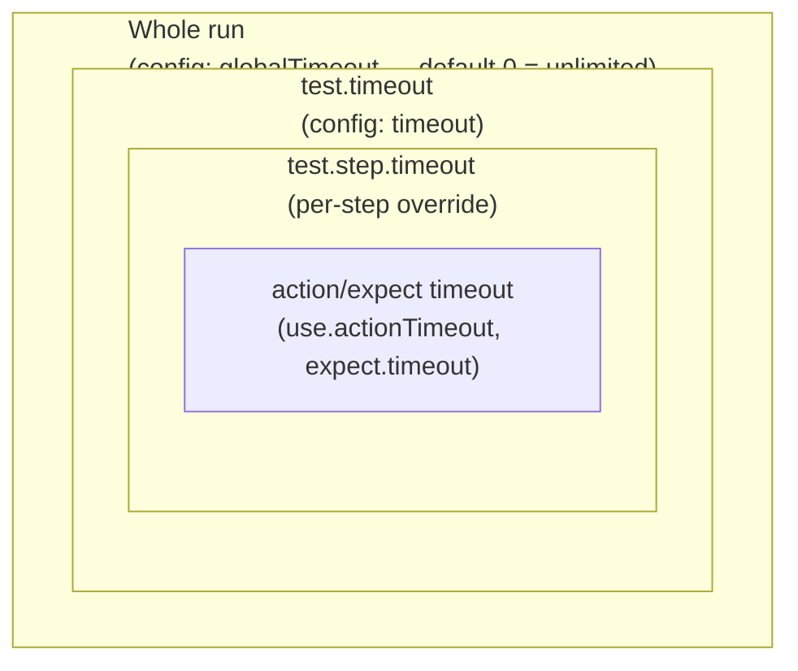
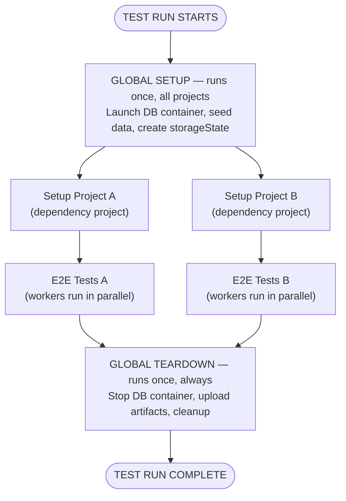

# 56. Playwright Config Deep-Dive — Every Field, In Context

**Navigation**: [← 55. Inspector & Trace Viewer](./55_Inspector_TraceViewer_UIMode_Walkthrough.md) | [Index](../00_INDEX.md) | [→ 57. Login Taxonomy](../03_Real_World_Scenarios/57_Login_Taxonomy_OAuth_OIDC_SAML_MFA_mTLS.md)

---

> ### 📍 This is the canonical config chapter
>
> The former "Config Theory Catalog" companion was merged into this file (its material is now §12 and Appendices A–C); Ch57 is now the Login Taxonomy chapter, not a config companion.
>
> This chapter walks the real [`framework/playwright.config.ts`](../framework/playwright.config.ts) field-by-field. Everything below was checked against `@playwright/test` **1.64.1** (typings, `npx playwright test --help`, and runs). Options that changed after 1.60 are summarised in [Ch69](../07_Specialised_Testing/69_Whats_New_Playwright_1_57_to_1_64.md) — this chapter links there instead of repeating them.

---

## 5W1H

- **WHAT**: Every field of `playwright.config.ts` — what it does, when it matters, what defaults break in CI, and how the existing [`framework/playwright.config.ts`](../framework/playwright.config.ts) wires it all together.
- **WHY**: The config file is the single biggest source of "works on my machine" pain. A misconfigured `retries`, `workers`, or `trace` masks bugs in CI; the wrong `projects[]` structure makes cross-browser runs impossible; missing `reporter` entries break downstream dashboards.
- **WHO**: Anyone who has typed `npx playwright test` and hit something they didn't expect — different timing, missing report, surprise retry, mystery flake. Especially: anyone wiring Playwright into a real CI pipeline for the first time.
- **WHEN**: Before you start writing the third test. Config debt compounds — fix the shape before the suite is 200 specs deep.
- **HOW**: Read the worked example top-to-bottom (Section 2), then jump to the field you care about. Each subsection ends with a ❌/✅ pair so you can grep the file for the mistake you're making.

---

## 1. The honest pitch

`playwright.config.ts` is a TypeScript module that exports a `PlaywrightTestConfig` via `defineConfig({...})`. That's it. There is no magic — every behaviour you see in `npx playwright test` is driven by a field in this object.

The trap: the defaults are tuned for a single developer running tests on a laptop. They are **not** tuned for CI. If you ship the default config to GitHub Actions, you get:

- Workers = **half the logical CPU cores** (measured: 12 cores → 6; a 2-vCPU CI runner → 1, which is where "slow" comes from)
- 0 retries (every flake is a build failure)
- Trace `off` (no debugging artifacts when CI fails)
- Reporter `dot` when the `CI` env var is set (`list` locally) — no JUnit for the CI test tab, no HTML for humans

This chapter walks the existing [`framework/playwright.config.ts`](../framework/playwright.config.ts) field-by-field so you understand why each line is there, then catalogues the fields you'll _also_ need as the suite grows.

---

## 2. The worked example — `framework/playwright.config.ts`

Here's the file in production, **abridged** (the real one also reads `PLAYWRIGHT_RETRIES` / `PLAYWRIGHT_WORKERS` / shard env vars, timestamps its report folders, optionally adds Allure, and defines six more projects — `file-io`, `mobile-chromium`, `visual`, `a11y`, `perf`):

```typescript
import { defineConfig, devices } from "@playwright/test";
import { envConfig } from "./config/env.loader";
import { Timeouts } from "./constants/timeouts";

export default defineConfig({
  testDir: "./tests",

  fullyParallel: true,
  forbidOnly: !!process.env.CI,
  retries: process.env.CI ? 2 : 0,
  workers: process.env.CI ? 4 : undefined,

  timeout: Timeouts.SIXTY_SECONDS,
  expect: { timeout: Timeouts.TEN_SECONDS },

  reporter: [
    ["list"],
    ["html", { outputFolder: "playwright-report", open: "never" }],
    ["junit", { outputFile: "test-results/junit.xml" }],
    ["json", { outputFile: "test-results/results.json" }],
  ],

  use: {
    actionTimeout: Timeouts.FIFTEEN_SECONDS,
    navigationTimeout: Timeouts.THIRTY_SECONDS,
    headless: envConfig.headless,
    trace: "on-first-retry",
    screenshot: "only-on-failure",
    video: "retain-on-failure",
    viewport: { width: 1440, height: 900 },
  },

  projects: [
    {
      name: "orangehrm",
      testDir: "./tests/orangehrm",
      use: {
        ...devices["Desktop Chrome"],
        baseURL: envConfig.orangehrm.baseUrl,
      },
    },
    {
      name: "api",
      testDir: "./tests",
      testMatch: /.*\.api\.spec\.ts$/,
      use: { baseURL: envConfig.api.baseUrl },
    },
    {
      name: "firefox-ci",
      testDir: "./tests/orangehrm",
      use: {
        ...devices["Desktop Firefox"],
        baseURL: envConfig.orangehrm.baseUrl,
      },
      grep: /@cross-browser/,
    },
  ],
});
```

Three things to notice up front:

1. **No hardcoded URLs or credentials.** `envConfig` is a typed env-loader; URLs come from `.env`. Compare your real config: every URL should chase a `process.env.*`.
2. **`process.env.CI` switches behaviour.** Retries, workers, and (elsewhere) trace mode all change in CI. This is the single most important pattern in the file.
3. **`projects[]` is the unit of scaling.** Three projects = three independent suites (UI smoke, API, cross-browser) that share `use:` defaults but override the bits that differ.

The rest of this chapter explains why each section is shaped that way.

---

## 3. `testDir` and discovery

```typescript
testDir: './tests',
```

The root for test discovery. By default, Playwright picks up every file matching `testMatch` (default glob `**/*.@(spec|test).?(c|m)[jt]s?(x)` — i.e. `.spec`/`.test` with `.js/.ts/.mjs/.cjs/.mts/.cts/.jsx/.tsx`) under this directory.

You can override per-project (see `projects[]` below). The `api` project sets a stricter `testMatch: /.*\.api\.spec\.ts$/` so it only picks up API-shaped files, even though it shares the same `testDir`.

❌ **Wrong** — single sprawling test directory with mixed UI and API specs:

```typescript
testDir: './tests',
// 200 specs, half UI, half API, no way to run just one half
```

✅ **Right** — narrow per-project `testDir` or `testMatch`:

```typescript
projects: [
  { name: "ui", testDir: "./tests/ui" },
  { name: "api", testDir: "./tests/api", testMatch: /.*\.api\.spec\.ts$/ },
];
```

---

## 4. `fullyParallel`, `workers`, `retries`, `forbidOnly`

These four fields determine the **runtime shape** of a test run.

### `fullyParallel: true`

By default, Playwright parallelizes **file-level only** — tests within a file run serially. With `fullyParallel: true`, **every test** in the suite parallelizes across the worker pool.

The cost: any module-level mutable state shared between tests in the same file is now a parallelism bug. (Ch 09 has the full taxonomy.)

### `workers: process.env.CI ? 4 : undefined`

`undefined` means "use the default": **half the logical CPU cores** (measured on a 12-core machine: `testInfo.config.workers` reported `6`; the banner shows fewer only when there are fewer parallel units than workers). The option also accepts a percentage string, `workers: '50%'` (typings: `number | string`), and `--workers`/`-j` takes the same. On a laptop that's usually 4–8; on a 2-vCPU CI runner it is **1** — too few.

The pattern in `framework/playwright.config.ts` pins CI to **4 workers** and lets the laptop pick. If the CI runner has more cores, bump it; if it's RAM-constrained (D365-style heavy pages), drop it. Rough formula from Ch 09: `workers = min(CPUs, RAM_GB / 1.5)`. `workers: 0` or a negative number is a config error since 1.60 ([Ch69 §6](../07_Specialised_Testing/69_Whats_New_Playwright_1_57_to_1_64.md#6-breaking-changes-and-deprecations-150--164--what-touches-this-module)) — beware `Number(process.env.W)` yielding `0`.

❌ **Wrong** — same worker count locally and in CI:

```typescript
workers: 8,  // your laptop is fine; CI runner has 2 cores and dies
```

✅ **Right** — CI-aware:

```typescript
workers: process.env.CI ? 4 : undefined,
```

### `retries: process.env.CI ? 2 : 0`

The most contentious field in the config.

**`retries: 0` locally** is non-negotiable — if a test is flaky on your laptop, fix it before pushing. Retries hide the signal.

**`retries: 2` in CI** is pragmatic — network blips, browser-version mismatches, and provider degradation cause one-shot failures that aren't worth blocking a PR over. But **track the retry rate** (Ch 26 has the metrics script). If retries > 5% of test count, you have a real flakiness problem; freeze new tests until it's < 2%.

❌ **Wrong** — using retries to mask known bugs:

```typescript
retries: 5,  // "the team will look at it later" — they won't
```

✅ **Right** — minimum retries needed to absorb infra noise, with a metric that pages someone if retries spike:

```typescript
retries: process.env.CI ? 2 : 0,
```

**A test that fails once and passes on retry is reported `flaky` — and the run still exits 0.** Measured with `retries: 2` and a test that throws on `testInfo.retry < 1`: summary `1 flaky`, exit code `0`. If you want flakiness to be a build signal rather than a log line, set `failOnFlakyTests: true` (CLI: `--fail-on-flaky-tests`); the same run then exits `1`. A common compromise: keep it `false` on PR builds and `true` on the nightly. Two related options (both in `PlaywrightTestConfig` on 1.64.1): `retryStrategy: 'isolated'` re-runs failures one-by-one in a single worker after everything else finished, to separate "flaky" from "disturbed by neighbours" — see [Ch69 §1.1](../07_Specialised_Testing/69_Whats_New_Playwright_1_57_to_1_64.md#11-isolated-retries--retrystrategy-isolated-162); and `--shuffle` ([Ch69 §1.4](../07_Specialised_Testing/69_Whats_New_Playwright_1_57_to_1_64.md#14---shuffle-and-projectdefault-164)) flushes out order dependence.

### `forbidOnly: !!process.env.CI`

`test.only(...)` is a developer convenience that **must never reach CI** — it silently skips the rest of the suite. `forbidOnly: true` makes the CI build fail if any `test.only` slips through. The `!!process.env.CI` pattern leaves `forbidOnly` off locally (so `test.only` still works for focused debugging) and on in CI.

---

## 5. The `timeout` cascade

There are **four** timeout fields (plus the suite-wide `globalTimeout`), and they nest — each one has to fit INSIDE its parent's remaining budget, which is why this is a containment relationship, not a sequence:



**How to read this diagram.** Read it from the outside in: the whole run (`globalTimeout`) contains each test (`timeout`), which contains each step (`test.step.timeout`), which contains the individual action and expect timeouts. Notice that each inner budget has to fit inside its parent's remaining budget.

The framework example sets:

| Field                   | Value (via `Timeouts` constants) | Purpose                                        |
| ----------------------- | -------------------------------- | ---------------------------------------------- |
| `timeout`               | 60s                              | Maximum runtime for any single test            |
| `expect.timeout`        | 10s                              | Maximum for `await expect(locator)...` retries |
| `use.actionTimeout`     | 15s                              | Maximum for `click`, `fill`, etc.              |
| `use.navigationTimeout` | 30s                              | Maximum for `goto`, `waitForURL`, etc.         |

The defaults these override (1.64.1 typings): `timeout` **30 000 ms**, `expect.timeout` **5 000 ms**, `actionTimeout` **0 (no limit)**, `navigationTimeout` **0 (no limit)**. With the last two at `0`, a stuck `click()` or `goto()` is only stopped by the test `timeout`, which burns the *whole* test budget on one stuck action. Measured with a `click()` on a missing button and `timeout: 3000`: with `actionTimeout: 0` the error is `Test timeout of 3000ms exceeded` (after the full 3s); with `actionTimeout: 1000` it is `TimeoutError: locator.click: Timeout 1000ms exceeded` — a fast, action-scoped failure that leaves budget for the test's own cleanup. That is the reason to set them.

Why is the action timeout (15s) *larger* than the assertion timeout (10s) in this file? An `expect(locator).toHaveText(...)` is a polling check on state you expect to be reached quickly, so a short budget keeps red runs fast; an action first waits for actionability (visible, stable, enabled, receives events) and may legitimately wait through a spinner. If a click takes longer than 15s, something is fundamentally wrong (modal blocking, navigation pending, etc.).

❌ **Wrong** — one giant timeout everywhere:

```typescript
timeout: 5 * 60 * 1000,  // 5 minutes per test — flaky tests hang the suite
use: { actionTimeout: 60_000 },
```

✅ **Right** — tight action timeouts, generous test budget:

```typescript
timeout: Timeouts.SIXTY_SECONDS,
expect: { timeout: Timeouts.TEN_SECONDS },
use: { actionTimeout: Timeouts.FIFTEEN_SECONDS, navigationTimeout: Timeouts.THIRTY_SECONDS },
```

---

## 6. The `reporter` matrix

```typescript
reporter: [
  ['list'],
  ['html', { outputFolder: 'playwright-report', open: 'never' }],
  ['junit', { outputFile: 'test-results/junit.xml' }],
  ['json', { outputFile: 'test-results/results.json' }],
],
```

Each reporter serves a different audience:

| Reporter | Who reads it                                         | Format                                                     |
| -------- | ---------------------------------------------------- | ---------------------------------------------------------- |
| `list`   | The human running `npx playwright test`              | Streaming terminal output                                  |
| `html`   | The human investigating a CI failure                 | Static HTML with embedded traces and screenshots           |
| `junit`  | The CI system's test-results view (Azure DevOps `PublishTestResults`, GitLab `artifacts:reports:junit`, Jenkins) | XML — what those UIs parse for per-test pass/fail |
| `json`   | Custom dashboards, the analytics capstone CAP_C3     | Machine-readable run summary                               |

**`open`:** the HTML reporter's default is `'on-failure'`. Read from the 1.64.1 source: it opens (by starting a local server that holds the terminal until Ctrl+C) only when the `CI` env var is **unset**, stdin is a TTY, and the run failed. So on a normal CI runner it never opens — but a pipeline that doesn't set `CI` (a bare Docker `-t` run, some Jenkins setups) *can* hang on it. `open: 'never'` removes the question; env override: `PLAYWRIGHT_HTML_OPEN=never`.

**All three file reporters (`html`, `json`, `junit`) emit in `onEnd`** (checked in the source) — nothing is written while tests run. If CI kills the job at its own time limit, you get **no** report from them; set `globalTimeout` (§12) *below* the CI job limit so Playwright ends the run itself and still writes them (measured: `globalTimeout: 3000` with one 20 s test → `Timed out waiting 3s for the test suite to run`, exit 1, and both `r.json` and `j.xml` were written, with the unfinished test counted as `skipped`). The HTML reporter also deletes and recreates its output folder on every run, and errors out if that folder is inside `outputDir` (§11).

Other reporters you'll see in the wild (full list in the 1.64.1 typings: `list | dot | line | github | json | junit | null | html | blob | perfetto`): `dot` (one character per test — the **default when `CI` is set**), `line` (one continuously rewritten `[n/total] last-finished-test` line, with failures printed when they occur — measured), `github` (failure annotations in GitHub Actions; every other reporter also works there but without annotations — [reporters docs](https://playwright.dev/docs/test-reporters)), `blob` (for sharded runs, merged with `npx playwright merge-reports`), and custom reporters (Ch 47 Allure, CAP_C2 Custom Reporter capstone).

❌ **Wrong** — single reporter, no machine-readable output:

```typescript
reporter: 'list',  // no JUnit/JSON for the CI test tab or dashboards; no HTML for post-mortems
```

✅ **Right** — one reporter per audience:

```typescript
reporter: [
  ['list'],          // humans live
  ['html', ...],     // humans post-mortem
  ['junit', ...],    // CI gate
  ['json', ...],     // dashboards
]
```

---

## 7. The `use:` block — what every test inherits

`use:` is the **default** for everything in `projects[]`. Project-level `use:` blocks override or extend it (see `...devices['Desktop Chrome']` below).

### `actionTimeout` & `navigationTimeout`

Covered in Section 5.

### `headless`

```typescript
headless: envConfig.headless,
```

In CI it's always `true`. Locally it's a choice — `false` is invaluable when debugging. Don't hardcode either; let `envConfig` read the env var.

### `trace`

```typescript
trace: 'retain-on-failure',
```

The trace is a `.zip` file containing the DOM, network log, console, screenshots, and timing data for every step. You open it in Trace Viewer (Ch 55) and time-travel through the failure.

| Mode                              | Recorded for                  | Kept when                                                         |
| --------------------------------- | ----------------------------- | ----------------------------------------------------------------- |
| `'off'` (default)                 | —                             | Never — fine locally, painful the first time CI fails              |
| `'on'`                            | every run                     | Always — disk-heavy; use only for debugging                        |
| `'on-first-retry'`                | first retry only              | The first retry is recorded, so the *original* failure has no trace (the framework's choice; the default in `npm init playwright`) |
| `'on-all-retries'`                | every retry                   | Every retry                                                       |
| `'retain-on-failure'`             | every run                     | The run failed (even if a later retry passes) — recording cost on every test |
| `'retain-on-first-failure'`       | first run only, not retries   | The first run failed                                              |
| `'retain-on-failure-and-retries'` | every run                     | The run failed **or** was a retry                                 |

(Source: the `TraceMode` doc comment in 1.64.1's `test.d.ts`. The last two are newer than 1.60; `video` accepts the same seven modes. `--trace <mode>` on the CLI accepts all seven.)

The trade-off in one line: `'on-first-retry'` costs nothing on green runs *and* nothing on the first run (recording only starts on retry), but needs `retries >= 1` and misses the first failure; `'retain-on-failure'` records every run (tracing overhead on green tests) but always has the trace of the first failure. With `retries: 0` — e.g. local — `'on-first-retry'` never records anything. `trace` also takes an object (`{ mode, snapshots, screenshots, sources, attachments }`) to shrink traces.

### `screenshot` & `video`

```typescript
screenshot: 'only-on-failure',
video: 'retain-on-failure',
```

Both default to `'off'`. The framework keeps them on-failure: no artifacts for green runs, evidence for red. `screenshot` modes are `'off' | 'on' | 'only-on-failure' | 'on-first-failure'`; `video` also accepts an object (`{ mode, size, fps, show }`).

### `viewport`

```typescript
viewport: { width: 1440, height: 900 },
```

Default is `1280×720`. Production apps often have layouts that break above the fold at 720 (sidebar overlaps content, hamburger menu activates). `1440×900` matches a 14" MacBook — close enough to real users that you catch real layout bugs.

---

## 8. `projects[]` — the scaling unit

```typescript
projects: [
  { name: 'orangehrm', testDir: './tests/orangehrm', use: { ...devices['Desktop Chrome'], baseURL: envConfig.orangehrm.baseUrl } },
  { name: 'api',       testDir: './tests', testMatch: /.*\.api\.spec\.ts$/, use: { baseURL: envConfig.api.baseUrl } },
  { name: 'firefox-ci', testDir: './tests/orangehrm', use: { ...devices['Desktop Firefox'], baseURL: envConfig.orangehrm.baseUrl }, grep: /@cross-browser/ },
],
```

**A `project` is a named (sub-)suite with its own `use:` merge, its own `testDir`/`testMatch`, and its own `grep`.** Three patterns to learn:

### Pattern 1 — Browser × suite matrix

```typescript
{ name: 'chromium', use: { ...devices['Desktop Chrome'] } },
{ name: 'firefox',  use: { ...devices['Desktop Firefox'] } },
{ name: 'webkit',   use: { ...devices['Desktop Safari'] } },
```

Run all three: `npx playwright test`. Run one: `npx playwright test --project=chromium`.

### Pattern 2 — Tagged subset for cross-browser

The `framework`'s `firefox-ci` project uses `grep: /@cross-browser/`. Only tests tagged `@cross-browser` in their title run on Firefox; the rest run chromium-only. This is the **80/20 cross-browser strategy** — run everything on chromium fast, run the 20 truly-browser-sensitive tests on the others.

### Pattern 3 — `setup` + `dependencies`

```typescript
projects: [
  { name: 'setup',    testMatch: /global\.setup\.ts/ },
  { name: 'chromium', dependencies: ['setup'], use: { ...devices['Desktop Chrome'], storageState: 'auth/admin.json' } },
],
```

This is how [`projects/starter-playwright-ts/playwright.config.ts`](../projects/starter-playwright-ts/playwright.config.ts) wires the auth setup. The `setup` project runs `global.setup.ts`, writes a `storageState` JSON, and the `chromium` project loads that state — so every test starts authenticated, with no per-test login overhead.

❌ **Wrong** — using `globalSetup` (the older API) when `dependencies` is available:

```typescript
globalSetup: './auth.ts',  // runs ONCE, opaque to the test runner, no per-project control
```

✅ **Right** — `dependencies: ['setup']` makes setup a first-class project with its own retries, traces, and parallelism:

```typescript
{ name: 'setup', testMatch: /global\.setup\.ts/ },
{ name: 'chromium', dependencies: ['setup'], use: { storageState: 'auth/admin.json' } },
```

(There are still cases where `globalSetup` is the right tool — see Section 10.)

---

## 9. Device emulation — `devices[...]`

```typescript
use: { ...devices['Desktop Chrome'] }
```

`devices` is a built-in dictionary of preset `use:` blocks. Each preset bundles:

- `userAgent`
- `viewport`
- `screen` (new in 1.64 for the presets that define it — `window.screen` and screen media queries now see the emulated screen; see [Ch69 §6](../07_Specialised_Testing/69_Whats_New_Playwright_1_57_to_1_64.md#6-breaking-changes-and-deprecations-150--164--what-touches-this-module))
- `deviceScaleFactor`
- `isMobile`
- `hasTouch`
- `defaultBrowserType`

Common picks:

| Preset                                                      | What you're testing      |
| ----------------------------------------------------------- | ------------------------ |
| `'Desktop Chrome'`, `'Desktop Firefox'`, `'Desktop Safari'` | Standard desktop layouts |
| `'iPhone 13'`, `'iPhone 14 Pro'`, `'iPad Pro 11'`          | Mobile responsive        |
| `'Pixel 7'`, `'Galaxy S9+'`                                 | Android responsive       |

Spread them with `...devices['...']` so you can still override fields (e.g., `viewport` for a custom canvas).

⚠️ **A misspelled preset name fails silently.** `devices` is a plain string-keyed map, so `devices['iPad Pro']` (no such key — it is `'iPad Pro 11'`) is `undefined`, `{ ...undefined }` spreads nothing, and the project quietly runs as desktop Chromium with default viewport — it compiles and passes. Measured: `Object.keys({ ...devices['iPad Pro'] })` → `[]`. List the real names with `Object.keys(devices)`.

⚠️ **Device presets are emulation, not actual mobile testing.** They change `userAgent`, viewport, and touch — they do **not** run on the real mobile browser, do **not** test the real iOS Safari rendering quirks. Real mobile testing needs Appium or a device farm. Ch 60 covers the trade-offs.

---

## 10. `globalSetup` vs `dependencies: [setup]`

|                   | `globalSetup`                                                                                            | `dependencies: ['setup']`                |
| ----------------- | -------------------------------------------------------------------------------------------------------- | ---------------------------------------- |
| Runs              | Once before any project                                                                                  | As a real project, before its dependents, on every run (skip with `--no-deps`) |
| Visible in report | No                                                                                                       | Yes — shows up as a test                 |
| Retries           | None (one shot)                                                                                          | Honours project `retries`                |
| Trace on failure  | No                                                                                                       | Yes                                      |
| Per-project       | No (truly global)                                                                                        | Yes (different setup per project)        |
| When to use       | Spinning up a docker network, seeding a DB, writing a single shared state file consumed by every project | Per-project auth (most cases)            |

**Rule of thumb**: if the setup writes a file that one specific project loads, use `dependencies`. If it's truly shared infrastructure (DB seeded once), `globalSetup`.

Measured on 1.64.1 (`retries: 1`, projects `setup` → `app`, `setup.teardown = 'cleanup'`, plus `globalSetup`/`globalTeardown`):

- Order: `GLOBAL SETUP` → `setup` test → `app` test → `cleanup` project → `GLOBAL TEARDOWN`.
- A failing `setup` test **is retried** (`retry #1` ran), and when it still fails the `app` project reports `1 did not run` — dependents are blocked, not run against missing state.
- The per-project counterpart of `globalTeardown` is the project property **`teardown: 'cleanup'`** — a normal project that runs after every project depending on `setup` has finished. It still ran when `setup` failed.
- `globalTeardown` ran even when `globalSetup` itself threw.
- `globalSetup`/`globalTeardown` also accept an **array** of paths in 1.64.1 (`string | string[]`).

---

## 11. Honest mistakes I see often

❌ **`baseURL` hardcoded in `use:`**

```typescript
use: { baseURL: "https://staging.example.com" },
```

Now every developer runs against staging. PR previews are unreachable.

✅ Pull it from env:

```typescript
use: { baseURL: process.env.BASE_URL ?? "http://localhost:3000" },
```

❌ **`testIdAttribute` not set** — your team uses `data-test-id` but Playwright's `getByTestId` looks for `data-testid`:

```typescript
// Tests do: page.getByTestId('save-btn')
// HTML has:  <button data-test-id="save-btn">
// Result:    locator times out
```

✅ Tell Playwright what attribute you use — **inside `use`**, not at the top level (a top-level `testIdAttribute` is rejected by the `Config` type, TS2769; verified with `tsc` against 1.64.1):

```typescript
use: { testIdAttribute: "data-test-id" },
```

❌ **Treating `outputDir` as a place to keep things.** The default is `<package.json-directory>/test-results` (when there is no `package.json`, the run's working directory — measured), and the typings are explicit: *"This directory is cleaned at the start."* Measured: a hand-placed `test-results/mine.txt` was gone after the next run. Corollaries:

- Put long-lived output (HTML report, merged reports, `storageState` files, downloaded fixtures) **outside** it. The HTML reporter even refuses to cooperate: with `['html', { outputFolder: 'test-results/html' }]` the run prints `Configuration Error: HTML reporter output folder clashes with the tests output folder` ("will lead to the artifact loss").
- Per-test files go through `testInfo.outputPath('name.txt')` — a unique `<outputDir>/<file>-<title>` folder per test, safe under parallelism.
- The `json`/`junit` files may sit in `test-results/` (as in the framework) because reporters write at the *end* of the run, after the clean-up — but then they exist only for the most recent run.

❌ **`grep` believed to match "the title only"** — the regex is tested against one joined string of **project name, file name, `describe` titles, test title and tags** (typings, 1.64.1). Measured: `--grep smoke` selected both tests of `smoke/smoke.spec.ts` although neither title contains "smoke", and `--grep mychrome` matched every test of a project named `mychrome`:

```typescript
grep: /smoke/, // also matches tests in smoke.spec.ts, in a "smoke-eu" project, and under describe("smoke …")
```

Anchor tags (`/@smoke/`) instead of bare words. To decide **which files are loaded at all**, use `testMatch`/`testIgnore` (path-based, applied before any test code runs):

```typescript
testMatch: /.*smoke.spec.ts$/,
```

❌ **Per-test `test.use({ video: 'on' })` for debugging that gets committed** — slows everyone down forever.

✅ Set per-run: trace has a CLI flag, video does **not** (`npx playwright test --video on` → `error: unknown option '--video'`, verified on 1.64.1; the only recording flag is `--trace <mode>`). Drive video from the config via an env var:

```typescript
// playwright.config.ts
use: { video: process.env.VIDEO === "on" ? "on" : "retain-on-failure" },
```

```bash
npx playwright test --trace on          # CLI override of use.trace
VIDEO=on npx playwright test           # env-driven override of use.video
```

---

## 12. The full field reference (cheat sheet)

Fields you'll actually use (most are optional):

```typescript
defineConfig({
  // ───── Discovery ─────
  testDir: "./tests",
  testMatch: /.*\.(spec|test)\.(ts|js)$/,
  testIgnore: ["**/fixtures/**"],

  // ───── Runtime ─────
  fullyParallel: true,
  workers: process.env.CI ? 4 : undefined,
  retries: process.env.CI ? 2 : 0,
  forbidOnly: !!process.env.CI,
  maxFailures: process.env.CI ? 10 : 0, // stop suite after N failures

  // ───── Timeouts ─────
  timeout: 60_000,
  expect: { timeout: 10_000 },
  globalTimeout: 30 * 60 * 1000, // whole suite cap

  // ───── Output ─────
  outputDir: "./test-results",
  reporter: [["list"], ["html"], ["junit", { outputFile: "junit.xml" }]],
  preserveOutput: "failures-only",
  quiet: false,

  // ───── Defaults for every test ─────
  use: {
    actionTimeout: 15_000,
    navigationTimeout: 30_000,
    baseURL: process.env.BASE_URL,
    headless: true,
    trace: "retain-on-failure",
    screenshot: "only-on-failure",
    video: "retain-on-failure",
    viewport: { width: 1440, height: 900 },
    locale: "en-GB",
    timezoneId: "Europe/London",
    permissions: ["clipboard-read"],
    storageState: "auth/state.json",
    extraHTTPHeaders: { "X-Test-Run": "true" },
    ignoreHTTPSErrors: true, // self-signed certs in dev
    bypassCSP: true, // when you need to inject scripts
    colorScheme: "dark",
    reducedMotion: "reduce",
    testIdAttribute: "data-testid", // a `use` option, NOT a top-level config key
  },

  // ───── Projects ─────
  projects: [
    { name: "setup", testMatch: /.*\.setup\.ts$/ },
    {
      name: "chromium",
      dependencies: ["setup"],
      use: { ...devices["Desktop Chrome"] },
    },
  ],

  // ───── Global hooks ─────
  globalSetup: require.resolve("./global-setup"),
  globalTeardown: require.resolve("./global-teardown"),

  // ───── Web server (Playwright starts your app) ─────
  webServer: {
    command: "npm run start",
    url: "http://localhost:3000",
    reuseExistingServer: !process.env.CI,
    timeout: 120_000,
  },
});
```

The whole block above compiles under `strict` + `noUncheckedIndexedAccess` against `@playwright/test` 1.64.1 (`require.resolve` targets are runtime-only; the two files must exist when you run it).

**Fields not in the sheet that you will meet** (all in 1.64.1's `PlaywrightTestConfig`): `failOnFlakyTests` (§4), `retryStrategy`, `updateSnapshots` (**unset default is `'default'` since 1.64**; `'missing'` now writes baselines *and passes*), `snapshotPathTemplate`, `repeatEach`, `shard: { current, total }` (1-based), `tag`, `metadata`, `captureGitInfo`, `ignoreSnapshots`, `respectGitIgnore`, `tsconfig`, `reportSlowTests: { max, threshold }`, and per-project `default: false` and `teardown`. `--shuffle`, `project.default`, `updateSnapshots` semantics and `webServer.wait` are demonstrated in [Ch69 §1.4–1.5 and §5.3](../07_Specialised_Testing/69_Whats_New_Playwright_1_57_to_1_64.md); don't re-learn them here.

Cross-reference: every field above is documented at <https://playwright.dev/docs/test-configuration>.

---

## 13. Practice

<details>
<summary><strong>Practice 1 — Why 4 reporters?</strong></summary>

The framework uses `list + html + junit + json`. Could you collapse them to just `html`?

**No.** Each serves a different audience:

- `list` — humans watching the run
- `html` — humans investigating a failure
- `junit` — the CI system parsing for the PR check
- `json` — downstream dashboards (the CAP_C3 capstone consumes this)

Removing `junit` breaks the GitHub Actions check. Removing `json` breaks the analytics dashboard. Removing `list` makes local runs silent. Removing `html` removes the trace browser.

</details>

<details>
<summary><strong>Practice 2 — Pick the right trace mode</strong></summary>

You have a 200-test suite, run in CI 50× per day. Disk space is constrained. You also need to be able to debug any failure.

Pick: `'off'` / `'on'` / `'on-first-retry'` / `'retain-on-failure'` / `'retain-on-first-failure'`.

**`'retain-on-failure'`** — trace is captured for every test, but only kept when the test failed. Zero disk cost on green runs, full forensics on red. `'on-first-retry'` is also defensible if you want even smaller artifacts and accept that the _first_ failure (before retry) loses its trace.

</details>

<details>
<summary><strong>Practice 3 — Spot the bug</strong></summary>

```typescript
projects: [
  { name: 'auth-setup', testMatch: /auth\.setup\.ts/ },
  { name: 'chromium', use: { storageState: 'auth/state.json' } },
],
```

A reader reports: "Tests fail on the very first run because `auth/state.json` doesn't exist."

**Bug**: `chromium` doesn't declare `dependencies: ['auth-setup']`, so the two projects run in parallel — `chromium` tries to load the state file before `auth-setup` has written it.

**Fix**:

```typescript
{ name: 'chromium', dependencies: ['auth-setup'], use: { storageState: 'auth/state.json' } }
```

</details>

<details>
<summary><strong>Practice 4 — Convert `globalSetup` to `dependencies`</strong></summary>

Convert this:

```typescript
globalSetup: require.resolve('./auth.global.ts'),
projects: [{ name: 'chromium', use: { storageState: 'auth/state.json' } }],
```

…to use the `dependencies` pattern.

**Solution**:

```typescript
projects: [
  { name: 'auth-setup', testMatch: /auth\.setup\.ts/ },
  { name: 'chromium', dependencies: ['auth-setup'], use: { storageState: 'auth/state.json' } },
],
```

And rename `auth.global.ts` → `auth.setup.ts`, wrapping its content in a `test('authenticate', ...)` call so it's a real Playwright test. You now get retries, trace, and a visible row in the report when auth breaks.

</details>

---

## Appendix A — Lifecycle Diagram (globalSetup vs Dependencies vs globalTeardown)



**How to read this diagram.** Follow the arrows top to bottom: global setup runs once for all projects, the two dependency setup projects each feed their own E2E tests (workers in parallel), and both E2E groups converge on a single global teardown. Notice that teardown is the shared join point and runs once, always, before the run completes.

| Feature | Global Setup | Global Teardown | Dependencies |
|---------|-------------|----------------|-------------|
| Scope | All projects | All projects | Specific projects |
| Runs when | Once before all | Once after all | Per dependent group |
| Failure behaviour | Aborts entire run | Always runs | Blocks dependents |
| Best for | DB containers, shared auth seeding | Cleanup, artifact upload | Per-project auth, data setup |

---

## Appendix B — 9 Common Config Mistakes

### 1. `actionTimeout` outside `use`

```typescript
// ❌ Ignored — must be inside use:{}
export default defineConfig({ actionTimeout: 5000 });

// ✅
export default defineConfig({ use: { actionTimeout: 5000 } });
```

### 2. Missing `forbidOnly` in CI

```typescript
forbidOnly: !!process.env.CI  // ✅ — prevents .only() from silently skipping the suite
```

### 3. `trace: 'on'` in CI

Produces gigabytes of artifacts daily. Use `'on-first-retry'` instead. `'on'` is local-debug only.

### 4. Leaving `workers` at the default on a small CI runner

The default is *half the logical cores* (not 1), so a 2-vCPU runner silently gets **1** worker and a parallel suite runs serially, while your 12-core laptop got 6 — the same suite looks 6× slower in CI with no config change to blame. Pin it explicitly for CI: `workers: process.env.CI ? 4 : undefined` (or `'100%'` on a runner you own), sized from CPU and RAM (Ch 09).

### 5. Hardcoded `baseURL`

Breaks when switching to staging. Use `process.env.BASE_URL || 'http://localhost:3000'`.

### 6. Missing `reuseExistingServer: !process.env.CI` in webServer

In CI you want a fresh server; locally you want to reuse the running dev server. Always make this conditional.

### 7. Same config everywhere

Retries, workers, trace, and reporter should all be `CI ? x : y`. One size serves no environment well.

### 8. `screenshot: 'off'` in CI

Blind debugging. Set `'only-on-failure'` — no storage cost for passing tests, full evidence when it breaks.

### 9. `webServer.timeout` left at default while the app cold-starts slowly

This is the mistake behind the CI error `Error: Timed out waiting 60000ms from config.webServer` — so let's remove the abstraction and trace exactly what that timeout measures.

What Playwright actually does with a `webServer` block, step by step:

1. Runs `command` as a child process (in `cwd`, with your `env`).
2. Starts polling the `url` (or, with `port`, just checking the socket accepts connections) — a GET with back-off: waits of 100, 250, 500 ms, then **every 1 s** (read from `waitFor` in the 1.64.1 runner; measured polls at 176, 707, 1726, 2739 ms…).
3. Only certain statuses count as "up": the typings say the `url` must return **2xx, 3xx (redirects are followed), 400, 401, 402 or 403**. Measured with a server on a fixed port: 200 and 401 → tests start; **404 and 500 → `Error: Timed out waiting 4000ms from config.webServer.`** (a 404 also makes Playwright probe `/index.html`). So a server answering `500` on `/` while its DB is down does **not** pass the wait — but one answering `401`/`403` for an auth-gated `/` does. Point `url` at a route that returns 2xx only when truly ready.
4. If that doesn't happen within `timeout` (default **60 000 ms**), it kills the child process and fails the whole run before a single test executes.

So the timeout must cover the **worst cold start**, which in CI includes things your laptop never does: `npm run build` inside the start command, database migrations, JIT/bundler warm-up on a 2-vCPU runner. The tuning procedure, not a guess:

```typescript
webServer: {
  command: 'npm run start:test',
  url: 'http://localhost:3000/healthz',   // a route that only answers when ACTUALLY ready
  reuseExistingServer: !process.env.CI,
  timeout: 120_000,                        // = measured worst CI cold start × 2
  stdout: 'pipe',                          // ← the diagnostic: see WHAT the server printed
  stderr: 'pipe',                          //    while Playwright was waiting
},
```

- **Measure, then double**: time `npm run start:test` until first response on three cold CI runs; set `timeout` to twice the slowest. Twice — because CI runners have noisy neighbors, and a timeout that fires on the p99 cold start costs you a full pipeline re-run to "fix" nothing.
- **Point `url` at a readiness route**, not `/`. Because of step 3 above, `/` answering 2xx during boot (some frameworks serve a splash/loading page early) ends the wait *before* the API behind it is ready — and your first three tests fail with connection errors that look like flake. A `/healthz` that returns 200 only after DB connect closes that hole.
- **`stdout: 'pipe'` when diagnosing**: `stdout` defaults to `'ignore'` (and `stderr` to `'pipe'`, so the `stderr: 'pipe'` line above is only for explicitness). The timeout error alone tells you nothing; the piped server log (each line prefixed `[WebServer]` — measured) tells you whether the app crashed (stack trace), is still compiling (bundler output), or bound to the wrong port (the second most common cause: the app read `PORT` from an env you didn't pass — the server is healthy on 3001 while Playwright polls 3000 forever).
- **No suitable URL? Wait on the log line instead**: `webServer.wait: { stdout: /Listening on port (?<my_server_port>d+)/ }` (1.57+) — see [Ch69 §5.3](../07_Specialised_Testing/69_Whats_New_Playwright_1_57_to_1_64.md#53-a-batch-of-small-verified-additions). Also available: `gracefulShutdown` (SIGTERM-then-SIGKILL; ignored on Windows) and `webServer` accepts an **array** for several servers.

---

## Appendix C — Team-Size Decision Matrix

| Team | Test Count | Workers | Projects | Retries | Trace | Reporter |
|------|-----------|---------|---------|---------|-------|---------|
| Solo dev | < 50 | default | 1 (chromium) | 0 | `on` locally | `list` + `html` |
| Small team | 50–200 | 4 | 2 (chromium, webkit) | 1 in CI | `on-first-retry` | `line` + `html` |
| Mid-size | 200–1000 | 6–8 | 4+ (browsers + mobile) | 2 in CI | `on-first-retry` | `junit` + `blob` |
| Enterprise | 1000+ | 50% or shard | 6+ (browsers, roles, staging) | 2 in CI | `on-first-retry` | `blob` + custom |

### Config decision tree

```
Does the suite run in CI?
├── No (local only)
│   ├── trace: 'on'
│   ├── screenshot: 'on'
│   ├── workers: default
│   └── reporter: ['list', 'html']
└── Yes (CI)
    ├── forbidOnly: true
    ├── retries: 1–2
    ├── trace: 'on-first-retry'
    ├── screenshot: 'only-on-failure'
    ├── video: 'retain-on-failure'
    ├── workers: based on runner CPU
    ├── reporter: ['blob'] or ['junit']
    └── shard if tests > 500
        ├── total shards = ceil(test_count / 250)
        └── merge with: npx playwright merge-reports
```

---

## What's next

- **Ch 09** — Parallel Execution & Workers. The runtime model behind `fullyParallel`, `workers`, and project parallelism.
- **Ch 25** — CI/CD Integration. How the `junit` and `html` reporters wire into GitHub Actions / Azure DevOps.
- **Ch 26** — Flakiness. The metrics script that catches when your `retries: 2` is masking real bugs.
- **Ch 55** — Inspector & Trace Viewer. How to actually use the trace files this config produces.
- **Ch 57** — Login Taxonomy. Where the `storageState` pattern fits into the bigger auth picture.
- **Ch 59** — Docker for Playwright. Where the config has to change for container runs (`/dev/shm`, headless, browser deps).

**Navigation**: [← 55. Inspector & Trace Viewer](./55_Inspector_TraceViewer_UIMode_Walkthrough.md) | [Index](../00_INDEX.md) | [→ 57. Login Taxonomy](../03_Real_World_Scenarios/57_Login_Taxonomy_OAuth_OIDC_SAML_MFA_mTLS.md)


---

## Reality Check

**"One playwright.config.ts works for all environments"**→ Different environments require different configs: baseURL changes per environment, timeout values differ between local (fast) and CI (needs longer timeouts), browser count differs between development (one) and cross-browser verification (three), and workers count depends on CI runner CPU count. Use environment variables and config spread patterns to handle multiple environments from one config file.

**"Default timeouts are appropriate"**→ In the test runner, `navigationTimeout` and `actionTimeout` default to **0 (no limit)** — only the 30-second test `timeout` bounds them — and assertions default to 5 seconds (`expect.timeout`; §5, 1.64.1 typings). On slow CI runners, 5 seconds may not be enough for dynamic content. On fast local machines, a 30-second test budget masks slow page loads that should be optimized. Set timeouts based on your application performance requirements: if a page should load in 2 seconds, set navigation timeout to 5 seconds, not "unlimited".

**"Running all browsers in CI catches more bugs"**→ For applications built on standard HTML and CSS, most failures are not browser-specific, so running 3 browsers roughly triples CI time and cost for a minority of findings (measure this on your own history — there is no universal percentage). Run Chromium in every CI pipeline for speed, and schedule weekly cross-browser runs to catch rendering and behavior differences without paying the daily cost.

**"testDir should point to the root"**→ A testDir pointing to the project root makes Playwright scan every .spec.ts file in the entire project, including unit tests, component tests, and utility files. Set testDir to a specific directory like tests/e2e. Use the projects config to separate E2E, API, and visual tests with different configurations.

**"Reporter configuration does not affect test execution"**→ The `html`, `json` and `junit` reporters produce nothing until the run ends (all three write in `onEnd`, checked in the 1.64.1 source), while `list`/`dot`/`line` stream as tests finish. Keep a streaming reporter alongside them so a killed CI job still leaves a log, and set `globalTimeout` below the job limit so the file reporters still get written (§6). The HTML report also needs artifact storage — plan for its size (traces and videos are copied into it).
