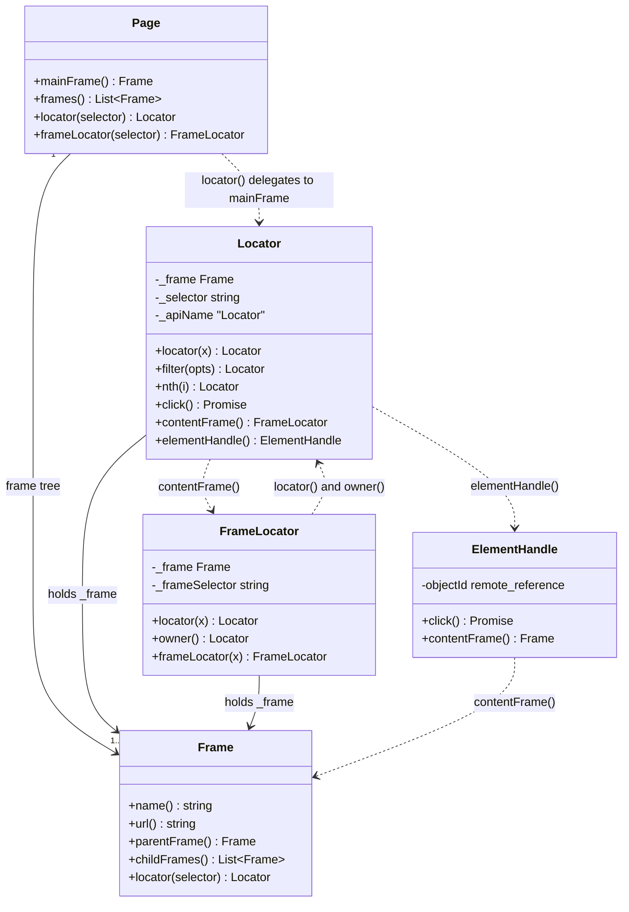
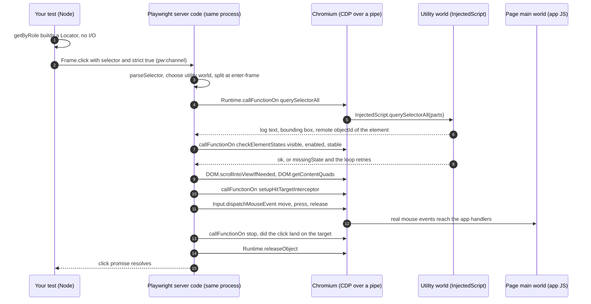
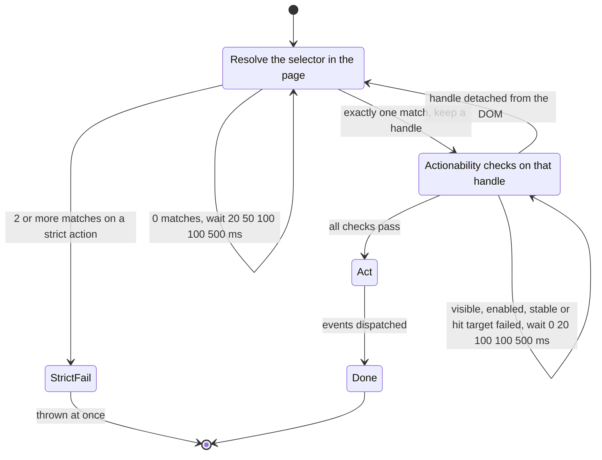
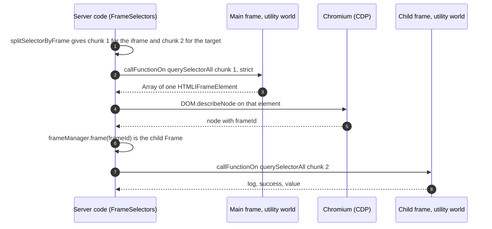
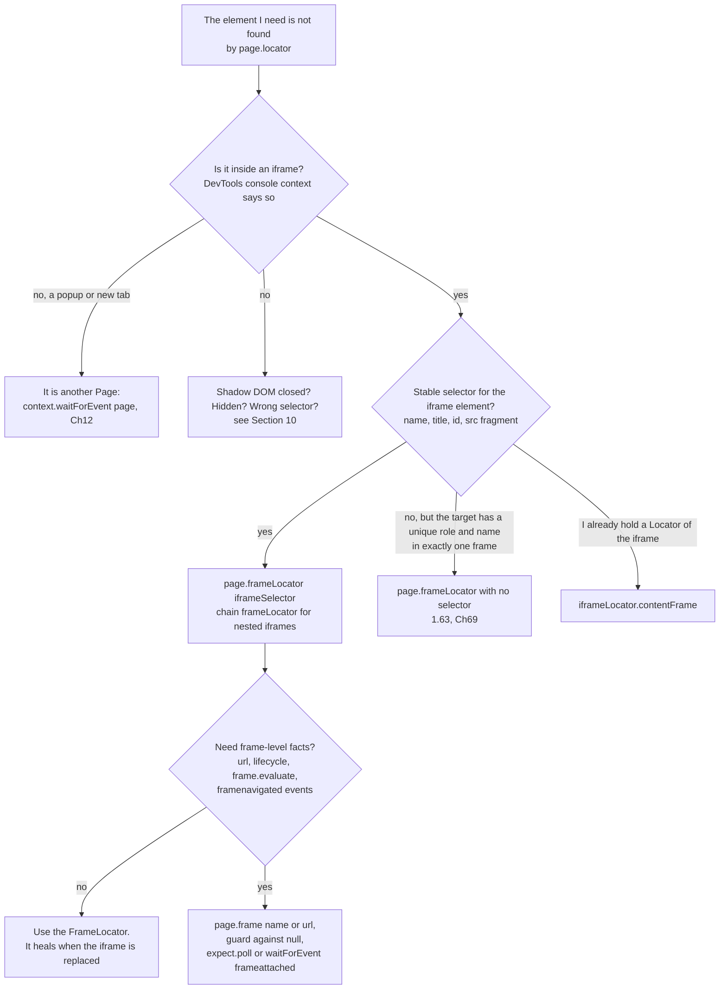

# 70. Locators, Frames, and How Playwright Finds Elements

**Navigation**: [← Ch02 Enterprise Locators](./02_Enterprise_Locators_XPath.md) | [Index](../00_INDEX.md) | [→ Ch03 Browser Console Scripting](./03_Browser_Console_Scripting.md)

---

> **Verified on** — every output block below was produced by scripts run for this chapter against **`@playwright/test` / `playwright-core` 1.64.1**, Node 22.13.0, Windows 11, **Chromium headless shell 156.0.8078.4** (and the full `chromium` channel, same version, where Section 7.6 says so). Pages were tiny `node:http` servers on random ports in 20000-60000. Firefox and WebKit were **not** run. Source citations name the function inside `node_modules/playwright-core/lib/coreBundle.js` — Playwright 1.64 ships its server and client code as one bundle, so there are no per-file paths to open; Section 3.3 shows how to extract the in-page script and read it yourself.

---

## 5W1H

- **WHAT**: What a `Locator` really is (a few bytes of Node-side data, not an element), what a *frame* is and when you must name one, what "dynamic locator" means, and the exact path from `page.getByRole(...)` to a DOM node and back.
- **WHY**: [Ch02](./02_Enterprise_Locators_XPath.md) tells you *which* locator to write. It cannot tell you why `page.locator('#card')` returns `0` for an element you can see, why a locator keeps working after the page re-renders while an `ElementHandle` does not, or why a click "hangs" for half a second after the button appeared. Those are all consequences of the mechanism in this chapter.
- **WHO**: Anyone who has hit "strict mode violation", "element is not attached", or an iframe that "can't be found" — and wants to fix the cause instead of adding `.first()`.
- **WHEN**: After Ch02. Read Sections 1-4 before you debug your first flaky wait; read Section 7 the first time an iframe appears; Section 8 the first time a locator takes a value from data.
- **HOW**: By measuring. Every claim is either a run (output shown) or a read of the installed source (function named). Where Playwright's own docs say something different from what 1.64.1 does, the run wins and the difference is called out.

**Builds on** (not repeated here): [Ch02 §2](./02_Enterprise_Locators_XPath.md#2-the-locator-priority-hierarchy--best-to-worst) (which locator to prefer) and Ch02 (role map section: which HTML maps to which role) · [Ch02 §6](./02_Enterprise_Locators_XPath.md#6-shadow-dom--why-some-elements-are-invisible-to-xpath-and-what-playwright-does-about-it) (shadow DOM) · [Ch08 §9](../02_Test_Architecture/08_Browser_Internals_for_SDETs.md#9-actionability-checks--what-playwright-does-before-every-action) (the per-action actionability table) · [Ch64](../02_Test_Architecture/64_Dynamic_Locators_And_Data_Structures_In_POMs.md) (parsing and comparing *data* before it reaches a locator) · [Ch69 §2](../07_Specialised_Testing/69_Whats_New_Playwright_1_57_to_1_64.md#2-locators) (`within()`, `visible()`, `frameLocator()` with no selector).

---

## 1. A Locator Is Not an Element

Most confusion about Playwright disappears once you accept one sentence: **a `Locator` is a recipe, not a result.** It is a small object living in your Node process holding exactly two things — *which frame to look in* and *a selector string* — and it does nothing until you ask it to act.

### 1.1 Prove it: creating one does no I/O

```typescript
import { chromium } from "@playwright/test";

const browser = await chromium.launch();
const page = await browser.newPage();
await page.goto(appUrl); // a page with a single <button>Login</button>

const t0 = performance.now();
const ghost = page.getByRole("button", { name: "Does Not Exist" });
console.log("created in ms:", (performance.now() - t0).toFixed(3));
console.log("toString():", ghost.toString());
console.log("count():", await ghost.count());

const t1 = performance.now();
for (let i = 0; i < 1000; i++) page.locator(`#x${i}`).filter({ hasText: "a" }).first();
console.log("1000 chained locators, ms:", (performance.now() - t1).toFixed(2));
console.log("own keys:", Object.keys(ghost));
```

```text
created in ms: 1.482            <- first call, cold JIT; no error although no such button exists
toString(): getByRole('button', { name: 'Does Not Exist' })
count(): 0                      <- THIS is the first call that talks to the browser (~55 ms here)
1000 chained locators, ms: 3.52 <- ~3.5 microseconds each: pure string work
own keys: [ '_apiName', '_frame', '_selector' ]
```

Three things to notice:

1. **No error for a non-existent element.** Nothing was looked up, so nothing could fail. This is why a *typo'd* locator only fails when you use it — and why you can build locators at class-construction time in a Page Object, before any page exists.
2. **Three own properties.** `_frame` (which frame), `_selector` (a string) and `_apiName` (a type tag, Section 1.3). The `Locator` class in `coreBundle.js` is just `constructor(frame, selector, options)` plus dozens of methods that forward `this._selector` to the frame.
3. **Every method is a forward, not a lookup.** `click()` is literally `return await this._frame.click(this._selector, { strict: true, ...options })`; `count()` is `this._frame._queryCount(this._selector)`; `textContent()` is `this._frame.textContent(this._selector, { strict: true, ... })`. The element is found *again, from scratch, inside the browser, on every call*. That is the entire reason locators survive re-renders (Section 6).

### 1.2 What each object is

| Object | What it holds | Created by | Talks to the browser on creation? | Survives a re-render? |
| --- | --- | --- | --- | --- |
| `Locator` | `frame` + selector string | `page.locator()`, `getBy*()`, `.filter()`, `.first()`, ... | **No** | **Yes** — re-resolved on every use |
| `FrameLocator` | `frame` + selector of an `<iframe>` *element* | `page.frameLocator()`, `locator.contentFrame()` | **No** | **Yes** |
| `Frame` | one browsing context in the frame tree (a real thing in the browser) | `page.mainFrame()`, `page.frame()`, `page.frames()` | Already exists | Same object across navigations; becomes *detached* if its `<iframe>` is removed |
| `ElementHandle` | a **remote reference** (a CDP `objectId`) to one live DOM node | `locator.elementHandle()`, `page.$()`, `evaluateHandle` | **Yes** — resolves immediately | **No** — points at one specific node |
| `JSHandle` | a remote reference to *any* JS value in the page (array, Map, `window`, a node) | `page.evaluateHandle()` | **Yes** | No |

`ElementHandle extends JSHandle` (the server-side `ElementHandle = class extends JSHandle` in `coreBundle.js`); `Locator` extends nothing. They are different families.

### 1.3 How Playwright "knows" something is a Locator

There is no conversion step from DOM element to Locator, so the question has two honest answers — one for the compiler, one for the runtime.

**Compile time.** `Locator` is a TypeScript `interface` in `playwright-core/types/types.d.ts`. At runtime the package does not export a class by that name — the exports of `@playwright/test` are `expect`, `test`, `defineConfig`, `chromium`, `devices`, `selectors`, ... so `import { Locator } from "@playwright/test"` is **type-only** and is erased. `value instanceof Locator` is impossible.

**Run time.** Playwright tags its own objects with a plain string. The `Locator` constructor sets `this._apiName = "Locator"`, and `expect(x).toBeVisible()` starts with `expectTypes(receiver, ["Locator"], "toBeVisible")` (in `playwright/lib/matchers/expect.js`), which checks `types.includes(receiver._apiName)`. Run it:

```typescript
import { expect, type Locator } from "@playwright/test";

const loc = page.getByRole("button");
const fl = page.frameLocator("iframe");
const handle = await loc.elementHandle();

const tag = (o: object): unknown => (o as { _apiName?: string })._apiName; // private field, read via a cast
console.log(tag(loc), tag(fl), tag(handle));
await expect(handle as unknown as Locator).toBeVisible({ timeout: 500 });  // wrong type on purpose
await expect(fl as unknown as Locator).toBeVisible({ timeout: 500 });
await expect(fl.owner()).toBeVisible();                                   // the right way
await expect({ _apiName: "Locator" } as unknown as Locator).toBeVisible({ timeout: 500 });
```

```text
Locator._apiName       : Locator
FrameLocator._apiName  : undefined
ElementHandle._apiName : undefined | ElementHandle._type: ElementHandle
expect(ElementHandle).toBeVisible  -> toBeVisible can be only used with Locator object, was called with _ElementHandle <ref *1> _ElementHandle {
expect(FrameLocator).toBeVisible   -> toBeVisible can be only used with Locator object, was called with _FrameLocator _FrameLocator {
expect(frameLocator.owner()).toBeVisible() passes
expect({_apiName:'Locator'}).toBeVisible -> locator._expect is not a function
```

So Playwright recognises a Locator by **duck-typing on a string tag**. A hand-made `{ _apiName: "Locator" }` gets past the type check and dies one line later at `locator._expect`. The practical takeaways: you cannot `expect()` a `FrameLocator` (use `.owner()` for the `<iframe>` element, or a normal locator *inside* the frame), and `expect(elementHandle)` is not supported — a Locator is what auto-retrying assertions need.

### 1.4 How an HTML element becomes "a type" — it becomes a handle, never a Locator

When the browser hands a DOM node back to Node, CDP describes it as a *remote object*. From the `Runtime.callFunctionOn` reply captured in Section 3:

```text
{"type":"object","subtype":"node","className":"HTMLButtonElement","description":"button","objectId":"-4954269000065944136.4.4"}
```

The Chromium adapter (`createHandle` in `coreBundle.js`, the `crExecutionContext` module) is two lines of logic: `if (remoteObject.subtype === "node") return new ElementHandle(context, objectId); else return new JSHandle(...)`. That is the whole "element → type" conversion: **a node becomes an `ElementHandle` because CDP says `subtype: "node"`.** The page keeps the real node alive under that `objectId` until Playwright sends `Runtime.releaseObject` (visible in the log in Section 3.2) — which is also why handles must be disposed and locators never need to be.

The only path from an element *back* to a locator is `locator.normalize()` (1.64): the server asks the page to *generate* the best selector string for that element and wraps the string in a new Locator. Section 9 uses it.

---

## 2. The Selector String — What a Locator Actually Contains

Every locator reduces to a string of **engine=body** parts joined by `>>`. You can see it three ways, in increasing order of "official":

| How to see it | Gives you | Status |
| --- | --- | --- |
| `locator.toString()` | the *friendly* form: `getByRole('button', { name: 'Login' })` (generated *back* from the internal string by `asLocatorDescription`) | public |
| `DEBUG=pw:api` / the "Call log" in errors | the same friendly form, as `waiting for getByRole(...)` | public |
| `DEBUG=pw:channel` | the **raw string** exactly as sent to the server | public env var |
| `locator._selector` | the raw string, in your code | private — fine for learning, never ship it |
| the trace (`trace.trace`, the `before` event for `Frame.click`) | `params.selector`, raw | public file format |

```text
pw:channel SEND> {"guid":"frame@3a19…","method":"click","params":{"selector":"internal:role=button[name=\"Login\"i]","strict":true}}
```

That one line is the whole contract between your test and the Playwright server: **a frame id, a method name, and a selector string.** Not an element, not an id, not a path.

### 2.1 The catalogue, measured

```typescript
const sel = (l: Locator): string => (l as unknown as { _selector: string })._selector;
show(page.getByRole("button", { name: "Login" }));          // prints l.toString() ==> sel(l)
```

```text
getByRole('button', { name: 'Login' })                  ==> internal:role=button[name="Login"i]
getByRole('button', { name: 'Login', exact: true })     ==> internal:role=button[name="Login"s]
getByRole('button', { name: /log/i })                   ==> internal:role=button[name=/log/i]
getByText('Apple')                                      ==> internal:text="Apple"i
getByText('Apple', { exact: true })                     ==> internal:text="Apple"s
getByLabel('User')                                      ==> internal:label="User"i
getByPlaceholder('name')                                ==> internal:attr=[placeholder="name"i]
getByTestId('user-input')                               ==> internal:testid=[data-testid="user-input"s]
locator('#list').locator('li').first()                  ==> #list >> li >> nth=0
locator('#list li').last()                              ==> #list li >> nth=-1
locator('li').filter({ hasText: 'Banana' })             ==> li >> internal:has-text="Banana"i
locator('li').filter({ hasNotText: 'red' })             ==> li >> internal:has-not-text="red"i
locator('li').filter({ has: locator('b') })             ==> li >> internal:has="b"
locator('li').filter({ hasNot: locator('b') })          ==> li >> internal:has-not="b"
getByRole('button').and(getByText('Login'))             ==> internal:role=button >> internal:and="internal:text=\"Login\"i"
getByRole(...Login).or(getByRole(...Cancel))            ==> internal:role=button[name="Login"i] >> internal:or="internal:role=button[name=\"Cancel\"i]"
locator('li').visible()                                 ==> li >> visible=true
locator('li').locator(locator('b'))                     ==> li >> internal:chain="b"
locator('li').describe('fruit rows')                    ==> li >> internal:describe="fruit rows"
locator('//ul/li')                                      ==> //ul/li
locator('#pay').contentFrame().getByRole('button')      ==> #pay >> internal:control=enter-frame >> internal:role=button
```

How to read the suffixes (from `getByRoleSelector` / `escapeForAttributeSelector` / `getByTextSelector` in the bundle): `"Login"i` is a **case-insensitive substring** match; `"Login"s` is **case-sensitive and exact** (that is what `exact: true` means); `/log/i` is a regular expression. A nested locator is embedded as a **JSON string** (`internal:has="b"`) — a selector inside a selector.

### 2.2 Everything just appends

The methods on `Locator` are, in the bundle, one-liners over `this._selector`:

| Method | What it does to the string |
| --- | --- |
| `locator(css)` | `this._selector + " >> " + css` |
| `locator(otherLocator)` | `+ " >> internal:chain=" + JSON.stringify(other._selector)` |
| `getByRole/Text/Label/...` | `this.locator(getByXSelector(...))` — the same `>>` append |
| `filter({hasText, has, hasNot, hasNotText, visible})` | the constructor **appends** `>> internal:has-text=...`, `>> internal:has=...`, `>> visible=...` |
| `first()` / `last()` / `nth(i)` | `+ " >> nth=0"` / `" >> nth=-1"` / `` ` >> nth=${i}` `` |
| `and(l)` / `or(l)` | `+ " >> internal:and=" + JSON.stringify(l._selector)` (or `:or=`) |
| `contentFrame()` | `new FrameLocator(frame, this._selector)` — then `FrameLocator.locator(x)` makes `frameSelector + " >> internal:control=enter-frame >> " + x` |

Locators are **immutable**: each call returns a *new* `Locator` and never touches the old one. And because it is all string concatenation, you can write the "compiled" form by hand and Playwright cannot tell the difference:

```typescript
await page.locator('internal:role=button[name="Login"i]').count();      // 1  — same as getByRole('button', { name: 'Login' })
await page.locator('internal:role=button[name="login"s]').count();      // 0  — s = exact, case-sensitive
await page.locator("ul >> li >> nth=1").textContent();                  // "a2"
await page.locator("nope=foo").count();       // Error: Unknown engine "nope" while parsing selector nope=foo
await page.locator("internal:control=enter-frame").count();
// Error: Selector cannot start with entering frame, select the iframe first
```

> **Use `internal:` selectors to learn, not to write tests.** Prefixed `internal:` engines are implementation details and may change between versions. `toString()` is the stable, public rendering of the same information.

### 2.3 The structure, as a picture



**How to read this diagram.** *What it shows:* the five types you meet around locators, and which ones hold *state* versus which ones merely *refer*. *Question it answers:* "what exactly is `page.locator()` attached to?" *Walk-through:* (1) a `Page` owns a tree of one or more `Frame`s — the first is the main frame. (2) `page.locator(x)` is shorthand for `page.mainFrame().locator(x)` — in the bundle, `Page.locator` is `return this.mainFrame().locator(selector, options)`. (3) A `Locator` stores a `Frame` and a string; that is its whole state. (4) `FrameLocator` stores a `Frame` and the selector of an `<iframe>` *element*; its `locator()` returns an ordinary `Locator` whose string has an `enter-frame` hop spliced in. (5) `locator.contentFrame()` and `frameLocator.owner()` are the two directions of the same conversion. (6) `ElementHandle` is the odd one out: it holds a remote reference to one node, not a recipe. *What people get wrong:* thinking a `Locator` is bound to a *page* or an *element*. It is bound to a **frame**, and that is exactly why a plain `page.locator()` cannot see inside an iframe (Section 7.2).

### 2.4 How the browser evaluates the string

The string is cut on `>>` into parts; the in-page script walks the parts left to right, keeping a **set of current roots**:

```mermaid
flowchart LR
    S["selector string<br/>#list >> li >> nth=1"] --> P["parseSelector<br/>3 parts"]
    P --> R0["roots = { document }"]
    R0 --> A["part 1: css #list<br/>run engine once per root"]
    A --> R1["roots = { ul#list }"]
    R1 --> B["part 2: css li<br/>run engine once per root, union the results"]
    B --> R2["roots = { li, li, li }<br/>in DOM order"]
    R2 --> C["part 3: nth=1<br/>keep one element of the whole set"]
    C --> R3["roots = { 2nd li }"]
    R3 --> OUT["return the array<br/>count = length<br/>strict action: length must be 1"]
```



**How to read this diagram.** *What it shows:* `InjectedScript.querySelectorAll` (in the injected script, Section 3.3) processing a three-part selector. *Question:* "what does each `>>` mean?" *Walk-through:* (1) start with `document` as the only root. (2) For each part, run that part's *engine* (`css`, `xpath`, `internal:role`, `internal:text`, ...) once for every current root and **union** the results. (3) The union becomes the roots for the next part. (4) `nth`, `internal:and` and `internal:or` are handled specially: they operate on the *whole accumulated set*, not per parent. (5) The final set is returned to Node; `count()` reports its length and a strict action demands exactly one. *What people get wrong:* `page.locator("ul").locator("li").nth(1)` is the **second `li` of all lists combined**, not the second `li` of each list — measured with two `<ul>`s: `ul >> li >> nth=1` returned `a2` (one element) and `nth=-1` returned `b2` (the last of the other list). If you want "the second cell of *every* row", that is `Locator.within()` — [Ch69 §2.1](../07_Specialised_Testing/69_Whats_New_Playwright_1_57_to_1_64.md#21-locatorwithin-164).

---

## 3. The Journey: From `page.getByRole().click()` to a DOM Node

### 3.1 The cast

| Actor | What it really is (checked) |
| --- | --- |
| **Your test + `Locator`** | Node code; the `Locator` client class from Section 1 |
| **Playwright server code** | In the **same Node process** for the JS library and `@playwright/test`: `createInProcessPlaywright()` in the bundle wires a client `Connection` to a `DispatcherConnection`, and `isClientCollocatedWithServer: true`. (The other language bindings talk to the same server code through a separate Node "driver" process — documented architecture, not run for this chapter.) Messages still cross a message boundary (`setImmediate`) — that is what `DEBUG=pw:channel` prints. |
| **Chromium** | A child process. Its command line, read with `Get-CimInstance Win32_Process`: `chrome-headless-shell.exe --headless --no-sandbox --user-data-dir=… --remote-debugging-pipe`. CDP JSON travels over **pipes**. ([Ch08 §7](../02_Test_Architecture/08_Browser_Internals_for_SDETs.md#7-chrome-devtools-protocol-cdp--how-playwright-actually-talks-to-the-browser) draws a WebSocket on port 9222; that is `connectOverCDP` / remote browsers, not what `launch()` does. The messages are the same JSON either way.) |
| **Page main world** | The app's own JavaScript globals. Your `page.evaluate` callbacks run here. |
| **Utility world** | An **isolated world** Playwright creates in every frame with `Page.createIsolatedWorld` (name `__playwright_utility_world_<pageGuid>`; `type: "isolated"` in `Runtime.executionContextCreated`). Same DOM as the page, **separate JavaScript globals**. The injected script lives here. |

### 3.2 One `click()`, traced

```typescript
await page.getByRole("button", { name: "Login" }).click();
```



**How to read this diagram.** *What it shows:* every hop between your `await` and the real mouse event, in order, with the real CDP method names. *Question it answers:* "who actually looks for the element, and who clicks it?" *Walk-through:* (1)-(2) the locator is built locally, then `click()` sends **one** message carrying a frame id and the selector string. (3) The server parses the string into parts and decides which world runs it (utility, unless a custom engine needs the main world). (4)-(6) it asks Chromium to call a function in the utility world; the injected script runs `querySelectorAll` on the parts and returns a log line, the bounding box, and a **remote object id** for the node. (7)-(8) visibility, enabled state and stability are checked *inside the page* — "stable" waits for the box to be identical on consecutive animation frames. (9)-(10) scroll, compute the click point, and install a hit-target interceptor that will report if another element swallows the click. (11)-(12) **the click is a real input event** (`Input.dispatchMouseEvent`) at x/y coordinates, not `element.click()`; the app's handlers run in the main world. (13)-(15) the interceptor is asked "did the target receive it?", the node reference is released, and the promise resolves. *What people get wrong:* believing Playwright "clicks the element". It computes a *point* from the element's box and sends mouse events to the browser at that point — which is why an overlay on top of the point makes the click fail even though the element is "there".

The same journey as the logs show it — `DEBUG=pw:api,pw:protocol,pw:channel` on a warm page (JSON abbreviated with `…`; timestamps are seconds within one minute, 19 CDP commands in 65 ms):

```text
29.354 pw:api      => locator.click started
29.354 pw:channel  SEND> {"guid":"frame@982f…","method":"click","params":{"selector":"internal:role=button[name=\"Login\"i]","strict":true}}
29.355 pw:api      waiting for getByRole('button', { name: 'Login' })
29.357 pw:protocol SEND Runtime.evaluate  {"expression":"…var __commonJS…  new (module.exports.InjectedScript())(globalThis, {…"stableRafCount":1,"browserName":"chromium","isUtilityWorld":true…}) …","contextId":4}
29.376 pw:protocol RECV {"result":{"type":"object","className":"InjectedScript",…}}
29.378 pw:protocol RECV {"result":{"className":"UtilityScript",…}}
29.379 pw:protocol SEND Runtime.callFunctionOn {"functionDeclaration":"(utilityScript, ...args) => utilityScript.evaluate(...args)",…}
29.386 pw:protocol RECV {"result":{"value":{"o":[{"k":"log","v":"  locator resolved to <button onclick=…>Login</button>"},{"k":"success","v":true},{"k":"box",…
29.386 pw:api        locator resolved to <button onclick="document.title='clicked'">Login</button>
29.388 pw:protocol RECV {"result":{"type":"object","subtype":"node","className":"HTMLButtonElement","objectId":"-4954…4.4"}}
29.388 pw:api      attempting click action
29.388 pw:api        waiting for element to be visible, enabled and stable
29.411 pw:api        element is visible, enabled and stable
29.411 pw:protocol SEND DOM.scrollIntoViewIfNeeded {"objectId":"-4954…4.4"}
29.412 pw:protocol SEND DOM.getContentQuads        {"objectId":"-4954…4.4"}  → {"quads":[[8,8,56.625,8,56.625,29,8,29]]}
29.414 pw:api        performing click action
29.414 pw:protocol SEND Input.dispatchMouseEvent {"type":"mouseMoved","x":32.31,"y":18.5,…}
29.415 pw:protocol SEND Input.dispatchMouseEvent {"type":"mousePressed","button":"left","clickCount":1,…}
29.415 pw:protocol SEND Input.dispatchMouseEvent {"type":"mouseReleased","button":"left","clickCount":1}
29.417 pw:api        click action done
29.418 pw:api        navigations have finished
29.419 pw:api     <= locator.click succeeded
```

Two details worth pausing on:

- **`contextId: 4` is the isolated world, not the page.** The `Runtime.executionContextCreated` events in the same log list context 3 as `{"isDefault":true,"type":"default"}` (the page) and context 4 as `{"name":"__playwright_utility_world_page@…","isDefault":false,"type":"isolated"}`. The injected script is built *only* in context 4, with `isUtilityWorld: true`.
- **The click point is `(32.31, 18.5)`**: the centre of the quad `[8,8 → 56.625,29]` that `DOM.getContentQuads` returned. 8 + 48.625/2 = 32.31 and 8 + 21/2 = 18.5.

> **Cold-start note (measured once, one machine).** On a freshly launched headless shell the *first* `click()` on the *first* page took 1633 ms; the same click on pages 2-4 took 73-110 ms. The extra time sat in "waiting for element to be visible, enabled and stable": the stability check is driven by `requestAnimationFrame`, and a brand-new browser delays its first frame. If your first test on a cold CI box is mysteriously slow, that is where the time goes, not the selector.

### 3.3 Reading the injected script yourself

The script Playwright injects (328,349 characters, 8,576 lines in 1.64.1) is embedded in `coreBundle.js` as one string literal. This extracts it to a readable file:

```javascript
// extract.mjs — node extract.mjs   (run from a folder where `playwright-core` resolves)
import fs from "node:fs";
import path from "node:path";
import { createRequire } from "node:module";

const require = createRequire(import.meta.url);
const root = path.dirname(require.resolve("playwright-core/package.json"));
const bundle = fs.readFileSync(path.join(root, "lib", "coreBundle.js"), "utf8").split("\n");
const line = bundle.find((l) => /^\s*source5 = '/.test(l));
if (!line) throw new Error("injected script literal not found - bundle layout changed");
const injected = new Function("return " + line.trim().replace(/^source5 = /, "").replace(/;$/, ""))();
fs.writeFileSync("injected.js", injected);
console.log(injected.length, "chars;", injected.split("\n").length, "lines");
```

(`source5` is a bundler-generated name and **will** change between versions; the stable thing to search for is `class InjectedScript`.) Inside, the functions that matter for this chapter:

| In `injected.js` | What it does |
| --- | --- |
| `InjectedScript` constructor, the `this._engines.set(...)` list | The engine registry: `css`, `xpath`, `role`, `text`, `id`, `data-testid`, `nth`, `visible`, `internal:control`, `internal:has`, `internal:has-not`, `internal:has-text`, `internal:has-not-text`, `internal:and`, `internal:or`, `internal:chain`, `internal:label`, `internal:text`, `internal:attr`, `internal:testid`, `internal:role`, `internal:describe`, `aria-ref`, `aria-template` |
| `querySelectorAll(selector, root)` | The roots-set loop from Section 2.4 |
| `querySelector(selector, root, strict)` | `querySelectorAll`, then `strictModeViolationError` if `strict` and more than one |
| `createRoleEngine` / `queryRole` | `getByRole`: walks the tree, computes each element's ARIA role and accessible name (Ch02 §11) |
| `elementState(node, state, frameVisible)` | `visible`, `hidden`, `enabled`, `disabled`, `editable`, `checked`, ... |
| `checkElementStates` + `_checkElementIsStable` | the stable check: compares the box on `requestAnimationFrame` ticks |
| `expectHitTarget`, `setupHitTargetInterceptor` | "`<div id="cover"></div>` intercepts pointer events" |
| `generateSelector` | what codegen, the Inspector, `normalize()` and the `aka` hints in strict errors all use (Section 9) |

### 3.4 Why an isolated world matters (and the methods that leave it)

The utility world exists so that **the app cannot break Playwright and Playwright cannot be seen by the app.** Measured, with a page whose own script sabotages the DOM API before Playwright runs:

```html
<script>
  const boom = () => { throw new Error('app broke querySelectorAll'); };
  Document.prototype.querySelectorAll = boom; Element.prototype.querySelectorAll = boom;
  Document.prototype.querySelector = boom;    Element.prototype.querySelector = boom;
  Element.prototype.matches = boom;           Array.prototype.filter = boom;  Array.from = boom;
</script>
```

```text
main world  : THREW app broke querySelectorAll          <- page.evaluate(() => document.querySelectorAll("button"))
locator     : 1 | css: 4                                <- getByRole(...).count(), locator("ul li").count()
click worked, title = clicked
main world sees injected script? undefined               <- typeof window.__injectedScript

count()                4
textContent()          "a1"
isVisible()            true
elementHandles()       4
locator.evaluate()     "LI"
allTextContents()      THREW locator.allTextContents: Error: app broke querySelectorAll
evaluateAll()          THREW locator.evaluateAll: Error: app broke querySelectorAll
```

Locator resolution survives a hostile page. The last two lines are the surprise: **`allTextContents()`, `allInnerTexts()` and `evaluateAll()` run their query in the main world** (`Locator.allTextContents` → `frame.$$eval` → `FrameSelectors.queryArrayInMainWorld`, which calls `callOnSelectorHandle({ mainWorld: true, ... })`), so they are exposed to anything the app has monkey-patched. Everything else — `count`, `textContent`, `isVisible`, `click`, `fill`, `elementHandles`, even `locator.evaluate` (query in the utility world, then the node is *adopted* into the main world to run your callback) — resolves in the utility world. Real apps rarely patch `querySelectorAll`, but legacy prototype-extending libraries do exist; if `allTextContents()` fails where `count()` passes, this is the first place to look. Your own `evaluate(fn)` callbacks always run in the main world.

---

## 4. The Retry Loop: What "Auto-Waiting" Actually Is

[Ch08 §9](../02_Test_Architecture/08_Browser_Internals_for_SDETs.md#9-actionability-checks--what-playwright-does-before-every-action) lists *which* checks run before each action. This section is about *how the waiting is structured*, because that is what you need to predict timing and flakiness. There are **two nested loops** — read from `retryWithProgressAndBackoff`, `_retryWithProgressIfNotConnected`, and `ElementHandle._retryAction` in the bundle.



**How to read this diagram.** *What it shows:* the two loops inside one `locator.click()`. *Question:* "when does Playwright look for the element again, and when does it just keep waiting on the one it has?" *Walk-through:* (1) **Resolve** runs the selector in the page. Zero matches loops back with a growing delay: `[20, 50, 100, 100, 500]` ms and then 500 ms forever (from `retryWithProgressAndBackoff`; delays larger than `timeout / 5` are dropped, so a 1.2 s timeout polls every 100 ms). (2) Two or more matches on a *strict* action leaves the loop immediately with the strict-mode error. (3) Exactly one match gives Playwright a **handle** and moves to **Checks**. (4) For a click, Checks fail for four reasons — not visible, not enabled, not stable, or another element covers the click point (`fill` swaps in "editable") — and loop on the *same handle* with delays `[0, 20, 100, 100, 500]`. (5) If, while waiting, the handle's node is removed from the DOM, the check reports `error:notconnected` and control goes **back to Resolve** — the selector is run again and finds the *new* node. (6) All checks pass: act. *What people get wrong:* thinking each retry re-queries the selector. Only **Resolve** queries; **Checks** keeps polling the node it already holds, and goes back to Resolve only if that node was detached. This is how a locator survives a framework re-render. It also means Playwright never "hops" to a different match while waiting: a node that is attached but invisible is waited on until it becomes visible or the timeout expires.

### 4.1 Watch both loops run

A page whose `<button disabled>` is replaced by a **new** button at +400 ms, whose new button becomes enabled at +800 ms, and whose full-screen overlay disappears at +1200 ms. The click was started at +0 (log trimmed to the lines that show each loop):

```text
.234 locator.click started
.235 waiting for getByRole('button', { name: 'Login' })
.258   locator resolved to <button id="b" disabled>Login</button>                 <- Resolve (old node)
.261   waiting for element to be visible, enabled and stable
.275   element is not enabled          .275 retrying click action                 <- Checks loop, same handle
.308   waiting 20ms    ...  waiting 100ms  ...  waiting 100ms  ...  waiting 500ms  <- [0, 20, 100, 100, 500]
.085   waiting for element to be visible, enabled and stable                      <- +851 ms; the old node is gone
.091 element was detached from the DOM, retrying                                    <- back to Resolve
.118   locator resolved to <button id="b">Login</button>                          <- the NEW, enabled node
.130   <div id="cover"></div> intercepts pointer events                           <- hit-target check, Checks loop again
.163   ... intercepts pointer events  (waiting 20ms, 100ms, ...)
         ... performing click action  ...  locator.click succeeded                <- after the overlay was removed
```

Three runs took 1279, 1281 and 1310 ms for a page that needed 1200 ms: the retry cadence adds the remainder.

### 4.2 The cadence is observable: up to 500 ms of lag

Because Resolve polls at most every 500 ms in the steady state, an element that appears at time *T* is noticed anywhere from 0 to 500 ms later. Measured: 14 trials each, element created at a known instant 1000-1500 ms after the call, latency from creation to resolution:

```text
waitFor  latency (ms): 14 60 61 88 157 188 209 248 312 339 361 430 454 455   max 455
expect   latency (ms): 10 32 82 90 105 174 211 244 284 317 347 400 439 481   max 481
```

Uniformly spread over 0-500 ms — the signature of a 500 ms poll. The schedule is the running sum of `[0, 20, 50, 100, 100, 500, 500, …]`: polls at **0, 20, 70, 170, 270, 770, 1270 ms…** after the call, so an element that appears at 500-800 ms is found at 770 ms or 1270 ms, and one that appears early is found within a few tens of ms. With an explicit `timeout: 1000` the cap becomes `1000 / 5 = 200 ms`, the 500 ms entry is dropped, and 14 trials showed latency 11-121 ms; with `timeout: 5000` the 500 ms entry stays. Web-first assertions use the *same* `retryWithProgressAndBackoff` (`Frame.expect`), and the assertion failure shows the poll count:

```text
Call log:
  - Expect "toHaveText" locator('#s') with timeout 1200ms
    7 × locator resolved to <p id="s">PENDING</p>
      - unexpected value "PENDING"
    5 × locator resolved to <p id="s">PAID</p>
```

Twelve polls in 1.2 s (the 1.2 s timeout shrank the cap to 100 ms). Practical consequences: a test that "waits for something that takes 2 s" is never exactly 2 s; a *tight* `timeout` makes polling **faster** (and costlier); and nothing here needs `waitForTimeout`.

---

## 5. Strict Mode: What Fails, What Doesn't

*Strict* means "this action targets one element, so more than one match is an error." Measured on a page with two `button.save` elements ("Save", "Save as"):

```text
count()                      => 2
all().length                 => 2
first().textContent()        => "Save"
allTextContents()            => ["Save","Save as"]
elementHandles()             => 2
expect(two).toHaveCount(2)   => passes
expect(two).toHaveText(["Save","Save as"]) => passes
textContent()                THREW  strict mode violation
click()                      THREW  strict mode violation
isVisible()                  THREW  strict mode violation   <- yes, even a boolean query
waitFor()                    THREW  strict mode violation
evaluate()                   THREW  strict mode violation
elementHandle()              THREW  strict mode violation
expect(two).toBeVisible()    THREW  strict mode violation
page.$("button.save")        => "Save"   (non-strict: returns the first)
page.click("button.save")    ok          (non-strict: clicks the first)
```

The exact error — note the `aka` hints:

```text
locator.click: Error: strict mode violation: locator('button.save') resolved to 2 elements:
    1) <button class="save">Save</button> aka getByRole('button', { name: 'Save', exact: true })
    2) <button class="save">Save as</button> aka getByRole('button', { name: 'Save as' })
```

Rules this shows:

1. **Singular actions and singular queries are strict**: `click`, `fill`, `textContent`, `isVisible`, `getAttribute`, `waitFor`, `evaluate`, `elementHandle`, `expect(...).toBeVisible()` and every other single-element assertion.
2. **Plural queries are not**: `count`, `all`, `allTextContents`, `allInnerTexts`, `evaluateAll`, `elementHandles`, `expect(...).toHaveCount()`, and the *array* forms of `toHaveText` / `toHaveClass`.
3. **The `page.click(selector)` family and `page.$` are non-strict by default** (they take the first match; the browser-context option `strictSelectors` flips that). `locator.*` is always strict. This is one of the reasons to migrate off string-selector `page.*` calls.
4. **The error is thrown immediately, not after the timeout.** With `timeout: 5000`, a strict violation surfaced after **13 ms**: the injected script *throws*, and `isNonRetriableError` treats a JavaScript error inside the evaluate as final.
5. **Zero matches behaves differently by method**: `isVisible()` returns `false` at once, `count()` returns `0`, `expect(loc).toHaveCount(0)` passes, but `textContent()` / `click()` wait the full timeout ("`Timeout 1000ms exceeded … waiting for locator('#nope')`").
6. **The `aka` suggestions are free codegen.** They are produced by `strictModeViolationError` calling the same `generateSelector` the Inspector uses (Section 9) — copy one of them instead of adding `.first()`.

---

## 6. Locator vs `ElementHandle` vs `JSHandle`: Lifetimes and Staleness

A handle is a *name for one specific node* (CDP `objectId`); a locator is *a way to find a node*. Measured: take both for the same button, then replace the DOM subtree the way a framework re-render does.

```typescript
const locator = page.locator("#b");
const handle = await locator.elementHandle();          // resolves NOW, to the current node
await page.evaluate(() => { document.getElementById("root")!.innerHTML = '<button id="b">Count v2</button>'; });  // what a re-render does

console.log(await handle.evaluate((e) => e.isConnected));   // false
console.log(await handle.textContent());                    // still the OLD text
console.log(await locator.textContent());                   // the NEW text
await handle.click({ timeout: 1500 });                      // throws
await locator.click();                                      // works
```

```text
before rerender: handle text = Count | locator text = Count
after rerender: handle.isConnected = false
after rerender: handle.textContent() = Count      <- the detached node still holds the OLD text
after rerender: locator.textContent() = Count v2
handle.click THREW after 36 ms: elementHandle.click: Element is not attached to the DOM
locator.click OK
```

The handle keeps working on a node nobody can see; reads quietly return stale data, and actions fail *at once* (36 ms — there is no Resolve loop to fall back to, because a handle has no selector). The locator re-resolved. The same applies after navigation: an `ElementHandle` into a document that was replaced throws `Execution context was destroyed, most likely because of a navigation`.

Two more lifetime facts:

- **Handles are leaks until disposed.** The page keeps the node alive under its `objectId` until `Runtime.releaseObject` is sent (visible in the Section 3.2 log). Locator methods dispose the handle they create internally (`_withElement` ends in `handle.dispose()`); handles *you* create are yours to `dispose()`.
- **A `JSHandle` is for values that cannot be serialised.** `page.evaluateHandle(() => document.querySelectorAll("button"))` returns a handle to the live `NodeList`; `handle.jsonValue()` on it produced `{"0":"ref: <Node>"}` — JSON cannot carry nodes.

**When a handle is still the right tool:**

| Need | Use |
| --- | --- |
| Pass a DOM node *into* page code: `page.evaluate((el) => ..., handle)` | handle — but `locator.evaluate((el) => ...)` does it without one, and re-resolves |
| Keep a reference to a non-serialisable page value across calls (a `Map`, a `MutationObserver`, `window.__store`) | `evaluateHandle` |
| Convert an `<iframe>` element to its `Frame` | `elementHandle.contentFrame()` (typed `Promise<null \| Frame>`) |
| Anything involving "the thing on screen" that may re-render | **Locator** |

---

## 7. Frames

### 7.1 What a frame is

A **frame** is a *browsing context*: a window with its own document, its own DOM tree, its own JavaScript global object. The page you navigate with `goto()` is the **main frame**. Every `<iframe>` (or `<frame>`) element in any document creates a child frame holding a *separate* document. The `<iframe>` element itself lives in the **parent's** DOM; the content lives in the **child's**. The two trees are linked by one non-containment pointer — the same "forest" picture [Ch02 §6](./02_Enterprise_Locators_XPath.md#6-shadow-dom--why-some-elements-are-invisible-to-xpath-and-what-playwright-does-about-it) drew for shadow roots, with the opposite crossing policy: Playwright's selector walker pierces open shadow roots automatically and **never** crosses an iframe boundary by itself.

Playwright exposes the frame tree directly. A page with a payment iframe that itself contains a 3-D-Secure iframe:

```typescript
const dump = (f: Frame, depth = 0): void => {
  console.log(`${"  ".repeat(depth)}frame name=${JSON.stringify(f.name())} url=${f.url()} parent=${f.parentFrame() ? JSON.stringify(f.parentFrame()?.name()) : "null"}`);
  for (const c of f.childFrames()) dump(c, depth + 1);
};
dump(page.mainFrame());
console.log("page.frames().length =", page.frames().length);
```

```text
frame name="" url=/ parent=null
  frame name="payframe" url=/pay?v=1 parent=""
    frame name="three-ds" url=/threeds parent="payframe"
page.frames().length = 3
```

`frame.name()` is the `<iframe name="...">` **attribute** (the `id` never appears), `frame.url()` is the frame's *current document* URL, and `page.frames()` is a flat list in tree order starting with the main frame. For how a Page Object's `this.page` relates to these roots, see [Ch05 §14](../02_Test_Architecture/05_POM_Architecture_Deep_Dive.md#14-the-missing-dimension-which-document-is-thispage-actually-rooted-in).

### 7.2 Why `page.locator()` does not see inside an iframe

`Page.locator(x)` in the bundle is `return this.mainFrame().locator(x)`; the resulting `Locator` carries `_frame = mainFrame`, and the injected script in the **main frame's** utility world runs `querySelectorAll` over the **main frame's document**. The iframe's document is a different tree in a different execution context, so it is simply not searched:

```text
page.getByRole('button', {name:'Pay now'}).count() = 0     <- the button exists, inside #pay
page.getByRole('button', {name:/pay/i}).count()   = 1     <- only the host page's own "Pay (host page)" button
page.locator('#card').count() = 0
```

Notice the failure mode: **no error, just 0** — and an action on it waits out the whole timeout. If a locator that works in DevTools finds nothing in Playwright, check "is it inside an `<iframe>`?" before anything else (DevTools: select the element; the console context dropdown shows the frame).

### 7.3 Four ways in — and the conversions between them

```typescript
// 1. frameLocator: lazy, selector of the <iframe> element. The default choice.
const pay = page.frameLocator("#pay");
await pay.getByRole("button", { name: "Pay now" }).click();

// 2. you already hold a Locator for the <iframe> element
await page.locator("iframe#pay").contentFrame().getByRole("button", { name: "Pay now" }).click();

// 3. ...and the opposite direction: FrameLocator -> Locator of the <iframe> element
console.log(await pay.owner().getAttribute("name"));        // "payframe"
await expect(pay.owner()).toBeVisible();                     // FrameLocator itself is not assertable

// 4. a Frame object (eager) - when you need frame-level APIs
const frame = page.frame({ url: /\/pay\?v=1/ });             // or page.frame({ name: "payframe" })
await frame?.locator("#card").fill("4242");
```

All four returned `count() = 1` for the same button. The full conversion table (types checked against `types.d.ts`):

| You have | You want | Call | Lazy or eager? |
| --- | --- | --- | --- |
| `Page`, `Locator` or `FrameLocator` | something inside an iframe | `.frameLocator(iframeSelector)` | lazy — the iframe need not exist yet |
| `Locator` of an `<iframe>` | the same, as a FrameLocator | `locator.contentFrame()` → `FrameLocator` | lazy |
| `FrameLocator` | the `<iframe>` element | `frameLocator.owner()` → `Locator` | lazy |
| `Page` | a `Frame` object | `page.frame({ name })`, `page.frame({ url })`, `page.frames()`, `page.mainFrame()` | **eager snapshot** — `null` if absent *now* |
| `Frame` | a locator inside it | `frame.locator()`, `frame.getByRole()` | lazy, but pinned to that exact `Frame` |
| `Frame` | its `<iframe>` element | `frame.frameElement()` → `ElementHandle` | eager |
| `ElementHandle` of an `<iframe>` | the `Frame` | `handle.contentFrame()` → `Promise<Frame \| null>` | eager |

Note the name trap: `Locator.contentFrame()` returns a **`FrameLocator`**, while `ElementHandle.contentFrame()` returns a **`Frame`**. Same word, different type.

### 7.4 How `frameLocator` compiles: a selector that hops

Look at the nested example from the catalogue in Section 2:

```typescript
const approve = page.frameLocator("#pay").frameLocator("iframe[name=three-ds]").getByRole("button", { name: "Approve" });
console.log(approve.toString());
console.log(sel(approve));
```

```text
locator('#pay').contentFrame().locator('iframe[name=three-ds]').contentFrame().getByRole('button', { name: 'Approve' })
#pay >> internal:control=enter-frame >> iframe[name=three-ds] >> internal:control=enter-frame >> internal:role=button[name="Approve"i]
```

A `FrameLocator` is not "a handle to an iframe". It is **a selector prefix** (`_frameSelector`); asking it for `locator(x)` returns an ordinary `Locator` with `<prefix> >> internal:control=enter-frame >> x` (the bundle's `FrameLocator._childSelector`). So everything in Section 2 — immutability, laziness, `toString()` — applies unchanged. The new ingredient is the `enter-frame` marker, and it is *not* executed by the page: the in-page engine `internal:control` returns an empty list for `enter-frame`. The **server** splits the string at each marker (`splitSelectorByFrame`) and walks the frame tree itself (`FrameSelectors._resolveChainedSelector`):



**How to read this diagram.** *What it shows:* how one selector string is evaluated in **two different documents** by the server, with a CDP lookup in between. *Question:* "how can one `await` reach into a different frame?" *Walk-through:* (1) the server cuts `#pay >> internal:control=enter-frame >> internal:role=…` into chunks. (2)-(3) chunk 1 runs in the *current* frame's utility world and must return `<iframe>`/`<frame>` elements — anything else throws `Selector "…" resolved to <div>, <iframe> was expected`; (4)-(5) `DOM.describeNode` on the iframe element returns its `frameId`, which names the child browsing context; (6) the server looks that id up in its frame manager; (7)-(8) the final chunk runs in the child frame's own utility world, and the answer comes back. The real log shows it: the first `Runtime.callFunctionOn` targets `objectId` `…4.2` (the parent frame's `UtilityScript`) and the last targets `…6.2` — a different object in a different execution context, the child document's own utility world (in the first log of Section 3.2 the middle number equals the `contextId`, 4). *What people get wrong:* thinking Playwright "switches into" the frame the way Selenium's `switchTo().frame()` does. There is no persistent current-frame state: **every action re-walks the chain from the top**, which is why a `FrameLocator` locator never goes stale.

What follows from "re-walked on every poll":

- **Lazy to the point of absurdity.** `page.frameLocator("#late").getByRole("button", { name: "Late" })` created *before* the iframe was inserted resolved to `1` after it was.
- **The iframe selector is strict too.** Two matching iframes: `strict mode violation: locator('iframe.dup') resolved to 2 elements: … aka locator('iframe').nth(1)`. (Without a selector, `page.frameLocator()` instead throws `frameLocator() matched elements in multiple frames` — [Ch69 §2.3](../07_Specialised_Testing/69_Whats_New_Playwright_1_57_to_1_64.md#23-framelocator-with-no-selector-163).)
- **Frame visibility is part of actionability.** A `click` inside an iframe with `display:none` that became visible at +1200 ms resolved after 1393 ms. With a CSS locator (`frameLocator("#hid").locator("button")`) the log repeats `locator resolved to <button>Pay now</button>` / `element is inside a hidden frame, retrying` (string in `_retryWithProgressIfNotConnected`) — the element *exists*, its frame is not visible. With `getByRole(...)` that log never appears: the role engine skips hidden subtrees, so the *Resolve* step itself keeps finding nothing. Same wait, different loop.
- **Bare `internal:control=enter-frame`** is rejected: `Selector cannot start with entering frame, select the iframe first`.

### 7.5 Frame objects vs FrameLocators when the iframe changes

Measured on one page, an iframe `#pay` loaded from `/pay?v=1`:

```typescript
const frame = page.frame({ name: "payframe" })!;
const viaFrame = frame.getByRole("button", { name: "Pay now" });
const viaLocator = page.frameLocator("#pay").getByRole("button", { name: "Pay now" });

// (a) iframe reloads with a new src
//     both locators still work; the input inside is empty (a NEW document); the SAME Frame object
//     now reports url "/pay?v=2"; an ElementHandle taken before the reload throws
//     "Execution context was destroyed, most likely because of a navigation"

// (b) the <iframe> element is REMOVED, then a fresh <iframe id="pay"> is appended
document.getElementById("pay")?.remove();
```

```text
frame.isDetached(): true
detached Frame locator count() THREW: locator.count: Frame was detached
frameLocator-based count(): 0 (no iframe -> 0, not an error)
frameLocator after new iframe appears: 1
old Frame-based locator THREW: locator.count: Frame was detached
page.frame({name}) is a different object now: true
```

**A `Frame` object dies with its `<iframe>` element; a `FrameLocator` is a selector and heals.** Navigating *inside* an iframe keeps the same `Frame`; removing and re-adding the element (which SPA frameworks do on route changes) produces a *new* `Frame`. Locators derived from the old one throw `Frame was detached` forever. This is the strongest argument for `frameLocator()` as the default.

`page.frame()` has a second weakness: it is a point-in-time lookup. `page.frame({ name: "later" })` immediately after inserting that iframe returned `null`, while `page.frameLocator("iframe[name=later]").locator("p").textContent()` returned `"x"` (auto-waiting).

### 7.6 Cross-origin iframes and out-of-process frames

"Cross-origin" means scheme, host **or port** differs. The browser's *same-origin policy* then forbids the parent's JavaScript from reaching into the frame — and yet Playwright fills the input. Two local ports, one page embedding the other:

```text
=== same-site, cross-origin: host 127.0.0.1:36458, iframe 127.0.0.1:36075 ===
frameLocator fill worked, value: 4242
page JS reading iframe.contentWindow.document -> BLOCKED: SecurityError
```

Playwright is not "page JavaScript", so the same-origin policy does not apply to it. Each frame has its own injected script in its own utility world and the server stitches the chain together from outside (Section 7.4). **The API is identical for same-origin and cross-origin frames.**

What *does* change is the browser's process model. Chromium's **site isolation** puts cross-*site* frames into a separate renderer process — an *out-of-process iframe* (OOPIF) with its own CDP target. Playwright handles that inside the Chromium adapter (`CRPage`/`FrameSession._onAttachedToTarget` for `targetInfo.type === "iframe"`, and `_sessionForFrame` choosing which CDP session to talk to). You can ask the browser directly, because `context.newCDPSession(frame)` is only allowed for out-of-process frames:

```text
                                    headless shell 156            full chromium channel 156
same-site (127.0.0.1:A -> :B)       not a separate session        not a separate session
cross-site (127.0.0.1 -> localhost) not a separate session  (!)   OK: own CDP session (OOPIF)
```

(`This frame does not have a separate CDP session, it is a part of the parent frame's session` is the "no" answer.) Findings: a **port-only** difference is cross-origin but **same-site**, so a two-port test server never exercises OOPIFs; **headless shell does not split even cross-site frames** here, while full Chromium does. In all four rows `frameLocator(...).fill(...)` behaved identically. So: your test code does not change; but if a bug only reproduces in headed Chrome with a real third-party domain, remember your CI browser may have run that iframe in-process.

### 7.7 Which API for which iframe situation



**How to read this diagram.** *What it shows:* the decision from "my locator finds nothing" to the right frame API. *Question:* "which of the four ways in do I pick?" *Walk-through:* (1) First rule out that the target is in a *popup* (a different `Page`, not a frame) or simply is not an iframe. (2) If it is an iframe and you can name the `<iframe>` element, use `page.frameLocator(selector)` — chaining one `frameLocator` per nesting level. (3) If the iframe has no stable attribute but the thing inside it has a unique role/name across all frames, the selector-less `frameLocator()` (1.63) searches every frame and fails loudly if two match. (4) If you already hold a `Locator` for the `<iframe>` (say, from a Page Object), `contentFrame()` converts it. (5) Only when you need *frame-level* information — its URL, load state, a `framenavigated` listener, `frame.evaluate` — go to `page.frame()`, and treat `null` as a real outcome. *What people get wrong:* reaching for `page.frame({ name })` first because it "looks like Selenium's switchTo". It is eager, it returns `null` before the iframe loads, and the object dies when the iframe element is replaced.

**Decision rules**

1. **Default to `frameLocator`.** Lazy, auto-waiting, self-healing (Sections 7.4-7.5).
2. **Use a `Frame` object for frame-level questions**, not for finding elements: `frame.url()`, `frame.waitForLoadState()`, listening to `page.on("framenavigated")`, attaching to a frame the app creates with a known URL.
3. **Don't `frame.evaluate` when a locator works.** `evaluate` runs in the main world with no auto-wait, no retry and no actionability; a locator action has all three. Use it for reading values the DOM API cannot express, not for clicking.
4. **Genuinely frame-shaped features**: payment widgets (Stripe/Adyen-style hosted fields), CAPTCHA and consent widgets, rich-text editors (TinyMCE), embedded video players, SSO login frames, and **legacy shells such as Dynamics 365 classic forms**, where the content area is an iframe like `iframe[name="contentIFrame0"]` ([Ch10 §1](../04_Cross_Site_Patterns_And_D365/10_Dynamics365_CRM_Testing.md#1-d365-dom-anatomy--the-unified-client-interface-uci)).
5. **Name the iframe in one place.** Put `readonly pay = this.page.frameLocator("#pay")` in the Page Object and build everything from it (Ch05 §14 explains what `this.page` is rooted in).
6. **Don't use `waitForTimeout` to "let the iframe load".** The inner locator already waits for the iframe element, its visibility, and its content (Section 4).

### 7.8 Shadow DOM, in one paragraph

Open shadow roots need no special API; closed ones are unreachable. Measured:

```text
open  : getByRole = 1 | css "my-open button" = 1
closed: getByRole = 0 | css "my-closed button" = 0
selector for the open one: my-open button    (no special syntax: the css engine pierces)
```

Why, and what to do about closed roots: [Ch02 §6](./02_Enterprise_Locators_XPath.md#6-shadow-dom--why-some-elements-are-invisible-to-xpath-and-what-playwright-does-about-it).

---

## 8. Dynamic Locators

A **static** locator is a constant: `page.getByRole("button", { name: "Save" })`. A **dynamic** locator is *built from a value that exists only at run time* — a record id from test data, a customer name from an API call, a row index, a count. Everything in Sections 1-2 still holds (it is still a string of engine parts), but now a **data value** is about to be spliced into **query syntax**, and that is where the bugs live.

| | Static | Dynamic |
| --- | --- | --- |
| Built from | literals in the source | a parameter: id, name, index, a list of expected values |
| Lives in a Page Object as | `readonly saveButton = page.getByRole(...)` | a method / arrow function: `rowFor(id)`, `tab(name)` |
| Typical failure | the UI changed (selector rot) | quoting and escaping, substring collisions, positional drift, a stale snapshot |
| Use when | exactly one such element per page/region | rows, tabs, menu items, dialogs, anything *identified by data* |
| Wrong choice shows up as | a hard-coded index that "works on my seed data" | string-concatenated CSS/XPath that breaks on `O'Brien` |

### 8.1 The rule: pass data to a parameter, never into syntax

```typescript
// Four ways to say "the row for this name". Data: O'Brien's Account / Smith "Ltd".
await page.locator(`//td[text()='${name}']`).count();            // XPath, string-built
await page.locator(`[data-testid="${id}"]`).count();             // CSS, string-built, id = a"b
await page.getByTestId(id).count();                              // parameterised
await rows.filter({ hasText: name }).count();                    // parameterised
```

```text
XPath string-built with apostrophe  THREW: locator.count: SyntaxError: Failed to execute 'evaluate' on 'Document':
                                          The string '//td[text()='O'Brien's Account']' is not a valid XPath expression.
CSS attr string-built with quote    THREW: locator.count: Unexpected token "" while parsing css selector "[data-testid="a"b"]".
                                          Did you mean to CSS.escape it?
getByTestId('a"b')                  => 1        (internal: internal:testid=[data-testid="a\"b"s])
name with apostrophe via filter     => 1
name with double quote via filter   => 1
```

The first failure is the one [Ch64 §3](../02_Test_Architecture/64_Dynamic_Locators_And_Data_Structures_In_POMs.md#3-why-just-interpolate-it-into-xpath-is-a-second-separate-trap) derives in full; the new information is the *third* line. `getByTestId("a\"b")` works because the `getBy*` helpers call `escapeForAttributeSelector` / `escapeForTextSelector` for you — look at the internal string, which contains `\"` — so the data is carried as **a quoted string literal inside the selector**, not as raw syntax. That is the mechanism behind "parameterised APIs are safe": the quoting is done once, correctly, by the library.

### 8.2 `getByRole` with a variable name: substring, exact, and the regex trap

`name` given as a string is a **case-insensitive substring** match (`"Save"i`); `exact: true` makes it case-sensitive and whole-string (`"Save"s`). Measured on buttons `Save`, `Save as`, `Save (draft)`, `Save draft`:

```text
name: 'Save'                          => ["Save","Save as","Save (draft)","Save draft"]
name: 'Save', exact: true             => ["Save"]
name: 'Save (draft)'                  => ["Save (draft)"]
name: new RegExp('Save (draft)')      => ["Save draft"]            <- WRONG button
name: new RegExp('^' + escapeRegExp('Save (draft)') + '$')  => ["Save (draft)"]
```

`new RegExp(data)` treats the parentheses as a capture group, so the pattern means "Save draft"; it matched the *wrong* element silently. A data value has two options: **a string** (with `exact: true` when it names one thing) or **a regex you escaped yourself**:

```typescript
export const escapeRegExp = (s: string): string => s.replace(/[.*+?^${}()|[\]\\]/g, "\\$&");

const exactName = (name: string): RegExp => new RegExp(`^${escapeRegExp(name)}$`);
page.getByRole("button", { name: "Save (draft)", exact: true });   // simplest
page.getByRole("button", { name: exactName("Save (draft)") });      // when you need a RegExp (e.g. to combine with flags)
```

The same substring rule applies to `filter({ hasText })` — `hasText: "CIT-001"` also matched `CIT-0010` (count 2). Parsing and comparing the *data* before it reaches a locator is [Ch64 §2](../02_Test_Architecture/64_Dynamic_Locators_And_Data_Structures_In_POMs.md#2-the-fix--parse-before-you-compare)'s subject; this chapter's job is the locator side of the boundary.

### 8.3 Rows by data: `filter({ has })`

```typescript
import type { Locator, Page } from "@playwright/test";

export class CitationGrid {
  readonly rows: Locator;
  constructor(private readonly page: Page) {
    this.rows = page.locator("#grid tbody tr");
  }
  /** The row whose ID cell is exactly `id`. */
  rowFor(id: string): Locator {
    return this.rows.filter({ has: this.page.getByRole("cell", { name: id, exact: true }) });
  }
  action(id: string, name: string): Locator {
    return this.rowFor(id).getByRole("button", { name, exact: true });
  }
}
// await grid.action("CIT-001", "Dispute").click();
```

```text
rowFor('CIT-001') count                      => 1
filter({hasText:'CIT-001'}) count            => 2         <- also matches CIT-0010
rowFor('CIT-0010') -> status cell            => "PENDING"
selector for rowFor('CIT-001'):  #grid tbody tr >> internal:has="internal:role=cell[name=\"CIT-001\"s]"
```

**The `has` locator is evaluated relative to each candidate row**, not to the document. In the injected script, `internal:has` is `!!this.querySelector(body.parsed, root, false)` with `root` = the candidate. That has a sharp edge, measured:

```typescript
const cell = rows.getByRole("cell", { name: "PAID" });          // starts with '#grid tbody tr >> ...'
await rows.filter({ has: cell }).getByRole("button").textContent({ timeout: 1500 });
// TimeoutError after 1512 ms:  "rows inside a row" never exists

await rows.filter({ has: page.getByRole("cell", { name: "PAID" }) }).getByRole("button").count();   // 1
```

Build the inner locator from **`page`** (no ancestor prefix), never from the same chain you are filtering. Two more constraints from the `Locator` constructor: inner and outer locators must belong to the **same frame** (`Inner "has" locator must belong to the same frame.`), and `hasNot` / `hasNotText` are the inverses.

`and` / `or` combine whole locators: `getByRole("button").and(getByText("Quote"))` — one element that satisfies both (count 1); `getByRole(…"reverse").or(getByRole(…"prepend"))` — the union (count 2, which a strict action would reject).

### 8.4 `nth()` is a position; `filter()` is an identity

```text
first() text: alpha | filter beta: beta
after reverse -> first(): gamma | filter beta: beta          (nth moved; the filter followed the data)
```

Use `nth()` / `first()` / `last()` only when position **is** the requirement ("the newest item is at the top"). When the requirement is "the item named beta", position is incidental and will drift the moment sorting, pagination or an extra row changes.

### 8.5 `all()` is not a snapshot of elements

```text
all() selectors: [ '#q li >> nth=0', '#q li >> nth=1', '#q li >> nth=2' ]
snapshot[1] text: beta
after prepend, snapshot length is still 3 but snapshot[1] now -> gamma | live count: 4
```

`Locator.all()` in the bundle is `new Array(await this.count()).fill(0).map((e, i) => this.nth(i))`. **The count is a snapshot; the elements are not** — each entry is a lazy `nth(i)` locator that re-resolves by *position* at use time. After a row was prepended, `snapshot[1]` pointed at a different element. Rules: never act on an `all()` array across anything that changes the list; if you must iterate and mutate (deleting rows), loop `while (await rows.count() > 0) await rows.first().…`; if you need identity, read the *data* first (`allTextContents()`) and act through `filter`.

### 8.6 Waiting for a number: `count()` vs `toHaveCount`

```text
count() right after goto (toasts appear at +800ms): 0          <- one-shot, no waiting
toHaveCount(3) waited, then count() = 3                        <- retries until 3 or timeout
```

`count()` is a single evaluation of the selector; `expect(locator).toHaveCount(n)` runs the Section 4 loop. Use `count()` for *decisions* (`if (await banner.count())`) and `toHaveCount` for *waits*.

### 8.7 Going up and sideways from a locator

```typescript
const cell = rows.getByRole("cell", { name: "PAID" });
cell.locator("..");                           // selector: ... >> ..    (a part starting with ".." is parsed as XPath: `parseSelector`)
cell.locator("xpath=ancestor::tr");           // explicit XPath axis
rows.filter({ has: page.getByRole("cell", { name: "PAID" }) });   // preferred: describe the row, don't climb to it
```

Climbing (`..`, `ancestor::`) is fine for one-offs but encodes the DOM *shape*; `filter({ has })` encodes the *relationship* ("the row that contains…") and survives a wrapper `<div>` being added. For "the second cell of **every** row", use `Locator.within()` ([Ch69 §2.1](../07_Specialised_Testing/69_Whats_New_Playwright_1_57_to_1_64.md#21-locatorwithin-164)).

### 8.8 Quick chooser

| Need | Prefer | Avoid |
| --- | --- | --- |
| One named control | static `getByRole(..., { name, exact })` | CSS classes |
| A row/card/tab identified by data | `rows.filter({ has: page.getByRole(...) })` | `nth(i)` computed from a loop variable |
| A value containing quotes, `(`, `/`, `"` | a `getBy*`/`filter` parameter, `exact: true` | template-literal CSS/XPath; `new RegExp(value)` |
| "How many?" as a decision | `await loc.count()` | — |
| "Wait until there are N" | `await expect(loc).toHaveCount(n)` | polling `count()` in a loop with `waitForTimeout` |
| Iterate and mutate | re-query each time (`rows.first()`) | `for (const r of await rows.all())` while deleting |
| Virtualised grid (rows not in the DOM) | [Ch64 §6](../02_Test_Architecture/64_Dynamic_Locators_And_Data_Structures_In_POMs.md#6-virtualised-grids--infinite-scroll--when-most-rows-arent-in-the-dom) | scrolling blindly |

---

## 9. How Codegen and the Inspector Choose a Locator

`npx playwright codegen`, the Inspector's *Pick locator*, the `aka` hints in strict-mode errors, and `locator.normalize()` (new in 1.64) all call the **same function**: `generateSelector` in the injected script. Because `normalize()` exposes it as public API, you can interrogate it without opening a browser UI:

```typescript
for (const css of ["#a1 button", "#a2 button", "#a3 input", "#a4 input", "#a5 .msg", "#box7", "#a8 img", "#a9 a"]) {
  console.log(css.padEnd(14), "->", (await page.locator(css).normalize()).toString());
}
```

```text
#a1 button  -> getByTestId('save-btn')                          <button data-testid="save-btn" class="btn primary">Save</button>
#a2 button  -> getByRole('button', { name: 'Submit order' })    <button id="submit-x9" class="btn">  (an id exists, but scores worse)
#a3 input   -> getByRole('textbox', { name: 'Email' })          <label>Email <input name="email"></label>  (label exists; role+name wins)
#a4 input   -> getByRole('textbox', { name: 'Search products' })<input placeholder="Search products">
#a5 .msg    -> getByText('Order confirmed')                     <span class="msg">
#box7       -> locator('#box7')                                 <div class="box" id="box7">  (nothing semantic: CSS id)
#a8 img     -> getByRole('img', { name: 'Company logo' })
#a9 a       -> getByRole('link', { name: 'Help centre' })       <a title="Help centre"><svg/></a>  (name from title)
```

The algorithm (`generateSelectorFor`): build candidate selectors for the element, **sort by score, lowest first**, and take the first candidate that matches *only that element*; if none is unique, add ancestors or an `nth`. The scores, copied from the constants in the injected script:

| Score | Candidate | Note |
| --- | --- | --- |
| 1 | the configured **test id** attribute (`testIdAttribute`) | wins whenever present |
| 2 | other test-id attributes (`data-test-id`, `data-test`) | |
| 100 | `getByRole(role, { name })` | `+5` penalty when `exact` is needed |
| 120 | placeholder | |
| 140 | label | |
| 160 | alt text | |
| 180 | visible text | |
| 200 | `title` | |
| 250 | text as regex | |
| 500 | CSS `#id` | |
| 510 | role without a name | |
| 520 | `input[name=…]` | |
| 530 | bare tag name | |
| 10,000 | `nth` | a position index is the last resort |
| 10,000,000 | CSS fallback path (`#a7 > div:nth-child(2)`) | `#a7 .box >> nth=1` normalised to exactly this |

Two behaviours worth knowing: asking for a `<span>` *inside* a button makes the generator climb to the **button** (`generateSelector` prefers the closest visible interactive ancestor; measured: `<button><span class="ic">★</span> Star</button>` gave `getByRole('button', { name: '★ Star' })`); and the order above is **not** "role, then text, then test id, then CSS" as often repeated — a test id outranks role+name, and CSS is last.

**Why role first when you write one by hand** ([Ch02 §2](./02_Enterprise_Locators_XPath.md#2-the-locator-priority-hierarchy--best-to-worst)): the role+name pair is what a user (or a screen reader) perceives — it breaks when the *product* changes, not when the markup does. A test id is the most stable *and* the least meaningful: it passes on an element that is visually broken or unlabelled. Use both deliberately: role+name for what users interact with, test ids where there is no accessible name to say. Use `normalize()` when you inherit a pile of `div.btn-x9 > span` selectors and want the replacement for each.

---

## 10. Pitfalls Checklist and Debugging Playbook

### 10.1 Pitfalls

| # | Symptom | Cause | Fix |
| --- | --- | --- | --- |
| 1 | `count()` is 0 but you can see the element | inside an `<iframe>` (7.2), a *closed* shadow root (7.8), or not rendered yet (`count()` does not wait) | `frameLocator`; `expect(...).toHaveCount` |
| 2 | `strict mode violation` | the selector matches 2+ elements | scope it, `filter`, `exact: true`; copy an `aka` hint; not `.first()` as a reflex (Section 5) |
| 3 | `filter({ has })` times out | inner locator built from the same chain (8.3) | build it from `page` |
| 4 | "Element is not attached to the DOM" | an `ElementHandle` kept across a re-render (6) | use a Locator |
| 5 | wrong row acted on after the list changed | `all()` / `nth(i)` held across mutations (8.4, 8.5) | filter by identity |
| 6 | `SyntaxError` / `Unexpected token` from a locator | data spliced into CSS/XPath (8.1) | `getBy*` / `filter` parameters |
| 7 | a regex locator matches the wrong element | `new RegExp(data)` with `( ) . + ?` (8.2) | string + `exact: true`, or `escapeRegExp` |
| 8 | `page.frame(...)` is `null` | point-in-time lookup before the iframe attached (7.5) | `frameLocator` |
| 9 | `Frame was detached` | `Frame`-based locator after an iframe was removed and re-added (7.5) | `frameLocator` |
| 10 | `frame.evaluate(el => el.click())` "works" but skips checks | main-world script bypasses actionability (7.7) | `frameLocator(...).locator(...).click()` |
| 11 | `isVisible()` returns `false` immediately | it never waits; its `timeout` option is `@deprecated This option is ignored.` in `types.d.ts` (measured: `false` after 24 ms with `timeout: 3000`) | `expect(loc).toBeVisible()` |
| 12 | `allTextContents()` throws where `count()` works | those methods query in the main world (3.4) | check the page for patched prototypes |
| 13 | first test on a cold CI browser is slow in "stable" | first `requestAnimationFrame` of a new browser (3.2) | warm-up page, or accept ~1.5 s once |
| 14 | `getByRole` finds nothing inside an iframe that is still `display:none` | role engine skips hidden subtrees (7.4) | wait for the iframe, or assert it first |

### 10.2 Debugging playbook

| Step | Command | What it tells you |
| --- | --- | --- |
| 1. Read the failure | the **Call log** in the error | every failed run already includes the `waiting for …`, `locator resolved to …`, `element is not enabled`, `<div> intercepts pointer events`, `element was detached from the DOM, retrying` lines from Section 4 — read it before running anything else |
| 2. Print what you built | `console.log(locator.toString())` | the friendly form; add `(locator as any)._selector` once to see the raw string |
| 3. Count and look | `await locator.count()`, `await locator.allTextContents()`, `await locator.highlight()` (returns a `Disposable`; `await locator.hideHighlight()` to clear) | how many matches, what they contain, where they are on screen (headed) |
| 4. Where is the frame? | `page.frames().map(f => [f.name(), f.url()])` | whether the element is in a child frame |
| 5. What would codegen write? | `await locator.normalize()` | the best-practice locator for the same element (Section 9) |
| 6. Watch the loops | PowerShell `$env:DEBUG="pw:api"; npx playwright test x.spec.ts` · bash `DEBUG=pw:api npx playwright test x.spec.ts` | the same log, live, with timestamps; add `pw:channel` for raw selectors, `pw:protocol` for every CDP command |
| 7. Step through | `npx playwright test --debug`, or `await page.pause()` | opens the Inspector: *Pick locator* and live match counts ([Ch55](./55_Inspector_TraceViewer_UIMode_Walkthrough.md)); interactive, **not run for this chapter** |
| 8. Look back in time | `trace: "on-first-retry"` → `npx playwright show-trace` | each action with its locator (the trace stores `Frame.click` + the raw `selector`, measured) and DOM snapshots |
| 9. Read the source | Section 3.3's `extract.mjs` | the actual engines and checks that ran |

---

## 🏋️ Practice Challenges

### Q1. [Predict] What is the internal selector string?

Write the string for each (without running it), then verify with `_selector`:

```typescript
page.getByRole("row").filter({ hasText: "CIT-001" }).getByRole("button", { name: "Dispute" });
page.frameLocator("#pay").getByLabel("Card number");
page.locator("li").nth(2).locator("b");
```

<details><summary>Answer</summary>

```text
internal:role=row >> internal:has-text="CIT-001"i >> internal:role=button[name="Dispute"i]
#pay >> internal:control=enter-frame >> internal:label="Card number"i
li >> nth=2 >> b
```

`filter({ hasText })` appends `internal:has-text` (case-insensitive substring, `i`), `getByRole` appends `internal:role=…[name="…"i]`, `frameLocator(...).getBy*()` inserts `enter-frame`, and `.nth(2)` is just `>> nth=2` on the set accumulated so far. Nothing was sent to a browser to produce any of these.

</details>

### Q2. [Debug] The invisible card field

```typescript
await page.goto("/checkout");
await page.getByLabel("Card number").fill("4242 4242 4242 4242"); // TimeoutError after 30 s
```

DevTools finds the field with `$('input[name="cardnumber"]')`... only when the console context is set to "payframe". Diagnose and fix, and say which Playwright mechanism produced "waiting" instead of an error.

<details><summary>Answer</summary>

The field is in an `<iframe name="payframe">`. `page.getByLabel(...)` is `mainFrame().locator('internal:label="Card number"i')`, evaluated by the injected script over the **main frame's document** only (7.2), where it matches 0 elements. Zero matches is not an error in the Resolve loop (Section 4): it polls at 0/20/70/170/270/770… ms until the timeout. Fix:

```typescript
const pay = page.frameLocator('iframe[name="payframe"]');
await pay.getByLabel("Card number").fill("4242 4242 4242 4242");
```

Confirm the diagnosis with `page.frames().map((f) => [f.name(), f.url()])`.

</details>

### Q3. [Fix] The customer with an apostrophe

```typescript
function customerRow(page: Page, name: string): Locator {
  return page.locator(`//tr[td[contains(text(), '${name}')]]`);
}
await customerRow(page, "O'Brien Ltd").getByRole("button", { name: "Open" }).click();
```

Why does it fail for one customer only, and rewrite it so it also does not match `O'Brien Ltd (closed)`.

<details><summary>Answer</summary>

The apostrophe terminates the XPath string literal: `contains(text(), 'O'Brien Ltd')` → `SyntaxError: … is not a valid XPath expression` (8.1). Pass the value as data and make the name exact:

```typescript
function customerRow(page: Page, name: string): Locator {
  return page.getByRole("row").filter({ has: page.getByRole("cell", { name, exact: true }) });
}
```

`exact: true` compiles to `"O'Brien Ltd"s` — case-sensitive and whole-string — so `O'Brien Ltd (closed)` no longer matches; the quote is escaped inside the selector by `escapeForAttributeSelector`, not by you.

</details>

### Q4. [Predict] Stale list

```typescript
// <ul id="q"> alpha, beta, gamma </ul>   — a button prepends "delta" to the list
const items = page.locator("#q li");
const snapshot = await items.all();
await page.getByRole("button", { name: "prepend" }).click();
console.log(snapshot.length, await snapshot[1]?.textContent(), await items.count());
```

<details><summary>Answer</summary>

`3 alpha 4`. Before the click, `snapshot[1]` is `beta`. `all()` returned three `nth(i)` locators (`#q li >> nth=0/1/2`) built from the count at that moment; the click prepended `delta`, so the list is now delta, alpha, beta, gamma and `nth=1` resolves to `alpha`. The array length is stale (3 vs 4 live) and each entry follows its **position**, not its element. Safer: read the data you need first (`allTextContents()`), then act through `filter({ hasText })`.

</details>

### Q5. [Design] A payment iframe that gets rebuilt

A checkout embeds a cross-origin payment iframe (`<iframe name="pay" src="https://pay.example/…">`). After a declined card the SPA removes it and appends a new one. Inside, a 3-D-Secure `<iframe name="three-ds">` can appear. Write the Page Object members, and explain what would break with `page.frame({ name: "pay" })`.

<details><summary>Answer</summary>

```typescript
import type { FrameLocator, Locator, Page } from "@playwright/test";

export class PaymentWidget {
  private readonly pay: FrameLocator;
  readonly card: Locator;
  readonly submit: Locator;
  readonly approve: Locator;

  constructor(page: Page) {
    this.pay = page.frameLocator('iframe[name="pay"]');
    this.card = this.pay.getByLabel("Card number");
    this.submit = this.pay.getByRole("button", { name: "Pay", exact: true });
    this.approve = this.pay.frameLocator('iframe[name="three-ds"]').getByRole("button", { name: "Approve" });
  }
}
```

Everything is a selector string with `enter-frame` hops, re-walked on every poll (7.4), so it survives the remove-and-append (7.5) and works cross-origin (7.6). With `page.frame({ name: "pay" })` you get an eager `Frame` that is `null` if the iframe is not there yet and, after the SPA replaces the element, a detached object: every locator derived from it throws `Frame was detached` for the rest of the test.

</details>

### Q6. [Measure] How late can Playwright notice?

An element is added to the DOM at an unpredictable moment. With the default settings, what is the worst-case delay between "it exists" and "`waitFor()` returns", and how does passing `timeout: 1000` change it? Why?

<details><summary>Answer</summary>

Polls run at 0, 20, 70, 170, 270, 770, 1270 ms… (running sum of `[0, 20, 50, 100, 100, 500, 500, …]`). In the steady state the gap is **500 ms**, so the worst case is just under 500 ms (measured max 455 and 481 ms over 14 trials each). `retryWithProgressAndBackoff` drops backoff entries larger than `timeout / 5`: with `timeout: 1000` the limit is 200 ms, the 500 entry is removed, the steady gap becomes **100 ms**, and 14 trials showed 11-121 ms. The trade-off: a short timeout polls more often (more CDP round trips) but also gives up sooner.

</details>

---

## 📚 References & Further Reading

### Official Documentation

- [Locators](https://playwright.dev/docs/locators) · [Locator API](https://playwright.dev/docs/api/class-locator) · [FrameLocator API](https://playwright.dev/docs/api/class-framelocator) · [Frame API](https://playwright.dev/docs/api/class-frame) · [Frames guide](https://playwright.dev/docs/frames) — the public contract
- [Auto-waiting / actionability](https://playwright.dev/docs/actionability) — the checks listed in [Ch08 §9](../02_Test_Architecture/08_Browser_Internals_for_SDETs.md#9-actionability-checks--what-playwright-does-before-every-action)
- [Debugging tests](https://playwright.dev/docs/debug) · [Trace viewer](https://playwright.dev/docs/trace-viewer) — `DEBUG=pw:api`, the Inspector, `page.pause()`
- [Chrome DevTools Protocol: Runtime, DOM, Input, Target](https://chromedevtools.github.io/devtools-protocol/) — the methods in the Section 3 log

### Browser background

- [MDN: `<iframe>`](https://developer.mozilla.org/en-US/docs/Web/HTML/Element/iframe) · [MDN: Same-origin policy](https://developer.mozilla.org/en-US/docs/Web/Security/Same-origin_policy)
- [Chromium: Site Isolation](https://www.chromium.org/Home/chromium-security/site-isolation/) — why cross-site frames become out-of-process iframes (Section 7.6)

### In this module

- [Ch02 Enterprise Locators](./02_Enterprise_Locators_XPath.md) · [Ch08 Browser Internals](../02_Test_Architecture/08_Browser_Internals_for_SDETs.md) · [Ch64 Dynamic Locators in POMs](../02_Test_Architecture/64_Dynamic_Locators_And_Data_Structures_In_POMs.md) · [Ch05 POM §14](../02_Test_Architecture/05_POM_Architecture_Deep_Dive.md#14-the-missing-dimension-which-document-is-thispage-actually-rooted-in) · [Ch10 D365](../04_Cross_Site_Patterns_And_D365/10_Dynamics365_CRM_Testing.md) · [Ch69 What's New 1.57-1.64](../07_Specialised_Testing/69_Whats_New_Playwright_1_57_to_1_64.md)

---

**Navigation**: [← Ch02 Enterprise Locators](./02_Enterprise_Locators_XPath.md) | [Index](../00_INDEX.md) | [→ Ch03 Browser Console Scripting](./03_Browser_Console_Scripting.md)

---

## Reality Check

**"A Locator points at an element"** → It points at a *recipe*: a frame plus a selector string (Section 1). Nothing is looked up until you act, so a Locator cannot go stale — and `await locator.elementHandle()` is the moment you trade that for a pinned, stale-able node.

**"`page.locator()` searches the whole page, including iframes"** → It searches the *main frame's document*. Iframes are separate documents; they need `frameLocator()` (Section 7). Playwright pierces open shadow DOM automatically and iframes never.

**"Auto-waiting retries the query until it works"** → There are two loops. *Resolve* re-runs the selector only while nothing matches (or after the matched node is detached); *Checks* keeps polling the node it already has (Section 4). Strict-mode violations are not retried at all — they surfaced after 13 ms.

**"`count()` and `all()` give me a stable list"** → `count()` is a one-shot, non-waiting evaluation, and `all()` returns `nth(i)` locators that re-resolve by position (Section 8.5). For waiting use `toHaveCount`; for identity use `filter`.

**"Cross-origin iframes need a different approach"** → Playwright's API is identical; the same-origin policy constrains *page JavaScript*, not CDP. What differs is the browser's process model (OOPIFs), and the headless shell did not even split cross-site frames in 1.64.1 (Section 7.6).

**"Codegen prefers role, then text, then test id"** → The generator scores a configured test id (1) above role+name (100), then placeholder, label, alt, text, title, `#id`, tag, `nth` (Section 9). Hand-written locators should still put role+name first, for the reasons in Ch02 §2.

