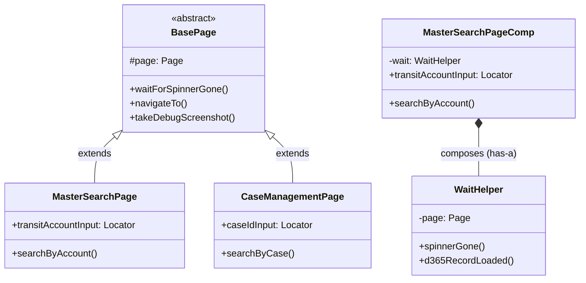

# 05. Page Object Model — Architecture Deep Dive

**Navigation**: [← Previous: JS/TS For Automation](../01_Foundations/04_JS_TS_For_Automation.md) | [Index](../../00_MASTER_INDEX.md) | [Next: Custom Fixtures →](./06_Custom_Fixtures_Architecture.md)

**Cross-links:**

- [`17_TypeScript/01_TS_Foundations.md`](../../17_TypeScript/01_TS_Foundations.md) — Classes, access modifiers, `readonly`
- [`17_TypeScript/02_TS_Advanced_Types.md`](../../17_TypeScript/02_TS_Advanced_Types.md) — `as const`, interfaces, literal types
- [`15_React_Frontend/07_React_Testing.md`](../../15_React_Frontend/07_React_Testing.md) — Page Object patterns from a developer perspective

---

## 5W1H — Why This Chapter?

- **WHAT**: A deep analysis of the Page Object Model (POM) pattern, using your real `MasterSearchPage` and `CustomerDetailsTab` as the primary examples.
- **WHY**: Your codebase mixes two different POM styles in the same class. Without understanding _why_ each style exists and _when_ each is correct, you will keep writing tests that are hard to maintain and flaky.
- **WHO**: SDETs who can write a POM class but aren't sure if they're doing it "right."
- **WHEN**: Before scaling up your POM library or onboarding another engineer to the codebase.
- **HOW**: By dissecting real code, explaining every design decision, and showing how to evolve it into a clean, typed, maintainable architecture.

---

## 1. What is the Page Object Model?

The **Page Object Model** is a design pattern that says: **keep your locators and page interactions separate from your test logic.**

Without POM:

```typescript
// ❌ Test file doing everything — a maintenance nightmare
test("search by citation", async ({ page }) => {
  await page.goto("https://crm.dynamics.com/master-search");
  await page
    .locator("#MasterSearchDropdown-option")
    .waitFor({ state: "visible", timeout: 60000 });
  await page.locator("#transit-account-number-bank-card").fill("ACC-001");
  await page.getByRole("button", { name: "Search" }).nth(2).click();
  await expect(page.locator(".result-row")).toBeVisible();
});
// If the dropdown ID changes, you must find EVERY test that uses it and update each one.
```

With POM:

```typescript
// ✅ Locators in one place — tests stay clean
test("search by citation", async ({ page }) => {
  const masterSearch = new MasterSearchPage(page);
  await masterSearch.waitForPageLoad();
  await masterSearch.searchByTransitAccount("ACC-001");
  await masterSearch.verifyResultsAreVisible();
});
// If the dropdown ID changes, you update ONE file: MasterSearchPage.ts
```

**The core rule:** Your test file should read like a user story. Your POM file contains the implementation details.

---

## 2. Your `MasterSearchPage` — Full Dissection

Here is a clean reconstruction of your class with annotations on every design decision:

```typescript
import { type Page, type Locator } from "@playwright/test";

export class MasterSearchPage {
  // ─── STATIC CONSTANTS ─────────────────────────────────────────────────────
  // Static: belongs to the CLASS itself, not any instance.
  // readonly: can never be reassigned after declaration.
  // Why: avoids the magic string 'button' scattered across the file.
  static readonly BUTTON_ROLE = "button" as const;
  //                                       ↑ "as const" makes it the literal
  //                                         type "button", not plain string.
  //                                         Required by Playwright's ARIA role types.

  // ─── INSTANCE PROPERTIES ──────────────────────────────────────────────────
  // These are typed but not initialised here — TypeScript's "definite assignment"
  // rule means the constructor must assign them.
  readonly page: Page;

  // Style 1 — Typed Locator objects
  // These are Playwright Locator instances (lazy — not queried yet).
  readonly cardTextLocator: Locator;
  readonly smartcardTextLocator: Locator;
  readonly transitAccountLocator: Locator;
  readonly resetButtonLocator: Locator;
  readonly SearchButtonInMasterSearch: Locator;
  readonly thirdSearchButtonInMasterSearch: Locator;

  // Style 2 — Raw selector string dictionary
  // These are plain strings (and some descriptor objects).
  // Converted to actual Locators by calling page.locator(this.locators.xxx) at use time.
  readonly locators: {
    masterSearchDropdown: string;
    orderInputField: string;
    customerSearchButton: {
      role: typeof MasterSearchPage.BUTTON_ROLE;
      name: string;
    };
    // ... etc.
  };

  constructor(page: Page) {
    this.page = page;

    // ─── STYLE 1 ASSIGNMENTS ────────────────────────────────────────────────
    // All of these create Locator objects immediately.
    // The DOM is NOT queried here. A Locator is just a "recipe" for finding elements.
    this.cardTextLocator = this.page.getByText("Card", { exact: true });
    this.smartcardTextLocator = this.page.getByText("Smartcard");

    // Why both getByRole AND locator('#id') for the same thing?
    // Because one of them was added later and the comment "// Updated Locator"
    // shows the original was replaced. The old one wasn't cleaned up.
    // This is technical debt — exactly one should be kept.
    this.transitAccountLocator = this.page.locator(
      "#transit-account-number-bank-card",
    );

    this.resetButtonLocator = this.page.getByRole("button", { name: "Reset" });
    this.SearchButtonInMasterSearch = this.page.getByRole("button", {
      name: "Search",
    });

    // .nth(2) = "the third element" (0-indexed)
    // Risk: if a new button is added above, this index shifts and the test breaks.
    this.thirdSearchButtonInMasterSearch = this.page
      .getByRole("button", { name: "Search" })
      .nth(2);

    // ─── STYLE 2 ASSIGNMENTS ────────────────────────────────────────────────
    this.locators = {
      masterSearchDropdown: "#MasterSearchDropdown-option",
      orderInputField: "#orderNumberId",
      // ...
    };
  }
}
```

---

## 3. The Two POM Styles — Why Both Exist and When to Use Each

Your class uses both styles. This is common in large codebases where different engineers contributed at different times. Understanding both is critical.

### Style 1 — Typed `Locator` Properties

```typescript
readonly cardTextLocator: Locator;
// In constructor:
this.cardTextLocator = this.page.getByText('Card', { exact: true });
// In usage:
await this.cardTextLocator.click();
await expect(this.cardTextLocator).toBeVisible();
```

**Advantages:**

- Fully typed — TypeScript knows this is a `Locator` and gives you autocomplete on `.click()`, `.fill()`, `.isVisible()`, etc.
- Playwright's lazy evaluation means defining it in the constructor is free — no DOM query happens at that point.
- Can chain Playwright methods directly: `this.cardTextLocator.filter({ visible: true })`.

**Disadvantages:**

- Dynamic locators (those that take parameters) can't be class properties:

  ```typescript
  // ❌ Can't do this as a property — it needs a parameter at use time
  readonly customerRow: Locator; // Which customer? Unknown at construction time.

  // ✅ Must be a method instead:
  customerRow(customerName: string): Locator {
    return this.page.locator(`//div[contains(@data-automation-key, 'customerSearchResults')
      and contains(text(), '${customerName}')]`);
  }
  ```

### Style 2 — `this.locators` Dictionary of Selector Strings

```typescript
this.locators = {
  masterSearchDropdown: "#MasterSearchDropdown-option",
  orderInputField: "#orderNumberId",
  customerSearchButton: { role: MasterSearchPage.BUTTON_ROLE, name: "Search" },
};
// In usage:
await this.page
  .locator(this.locators.masterSearchDropdown)
  .waitFor({ state: "visible" });
```

**Advantages:**

- Centralised — all selectors in one place, easy to scan.
- Works well for CSS selector strings where you don't need chaining.
- The object structure naturally groups related locators (e.g., all Customer Search locators together).

**Disadvantages:**

- Not typed as `Locator` — you lose Playwright-specific autocomplete until you call `page.locator(...)`.
- Mixed types in the same dictionary (some are strings, some are `{ role, name }` descriptor objects) makes the TypeScript interface harder to write.
- You have to remember to call `this.page.locator(this.locators.xxx)` every time — more verbose at usage sites.

### The Recommendation — Clean Hybrid

```typescript
export class MasterSearchPage {
  readonly page: Page;

  // ── Group 1: Stable, frequently used — typed Locator properties ──
  readonly transitAccountInput: Locator;
  readonly resetButton: Locator;
  readonly masterSearchDropdown: Locator;

  // ── Group 2: Dynamic (parameterised) — methods returning Locator ──
  customerRow(customerName: string): Locator {
    return this.page.locator(
      `//div[contains(@data-automation-key, 'customerSearchResults') 
        and contains(text(), '${customerName}')]`,
    );
  }

  searchButton(index = 0): Locator {
    // No more fragile .nth(2) scattered around — controlled in one place
    return this.page.getByRole("button", { name: "Search" }).nth(index);
  }

  constructor(page: Page) {
    this.page = page;
    this.transitAccountInput = page.locator(
      "#transit-account-number-bank-card",
    );
    this.resetButton = page.getByRole("button", { name: "Reset" });
    this.masterSearchDropdown = page.locator("#MasterSearchDropdown-option");
  }
}
```

---

## 4. The Lazy Evaluation Superpower — Why Constructor Assignment Is Safe

This is one of the most misunderstood things about Playwright locators.

```typescript
// New engineers often ask: "If we assign locators in the constructor,
// and the DOM isn't loaded yet, why doesn't this throw an error?"

constructor(page: Page) {
  // This does NOT query the DOM right now:
  this.cardTextLocator = this.page.getByText('Card', { exact: true });
  // What it actually does: creates a Locator OBJECT that DESCRIBES how to find
  // an element with text 'Card'. Like writing a search query but not running it yet.
}

// The DOM is only queried when you INTERACT with the locator:
await this.cardTextLocator.click();         // NOW it queries the DOM
await this.cardTextLocator.isVisible();     // NOW it queries the DOM
await expect(this.cardTextLocator).toBeVisible(); // NOW it queries the DOM
```

**The practical implication:** You can create your `MasterSearchPage` object before the page has even navigated. The locators are just descriptions. They evaluate lazily, exactly when you use them.

### 4.1 A trap: field initializers that read `this.page`

"Locators are lazy" does not mean *where* you create them is free. A class-field initializer runs **before** the constructor body, so it cannot see anything the constructor assigns. Measured on Playwright 1.64.1 / TypeScript 5.9.3 with `target: ES2022` and the framework's strict flags, running the same three Page Objects under `tsc` and under `playwright test`:

```typescript
// ❌ A. page declared, assigned in the body — the initializer runs first, so this.page is undefined
class DeclaredField {
  readonly page: Page;
  readonly heading = this.page.getByRole('heading');
  constructor(page: Page) { this.page = page; }
}

// ❌ B. parameter property + field initializer — looks right, reads right
class ParamProperty {
  readonly heading = this.page.getByRole('heading');
  constructor(private readonly page: Page) {}
}

// ✅ C. assign in the constructor body (this is what §2 and the framework do)
class CtorAssign {
  readonly heading: Locator;
  constructor(private readonly page: Page) { this.heading = this.page.getByRole('heading'); }
}

// ✅ D. a getter — also gives you a fresh Locator on every access
class Getter {
  constructor(private readonly page: Page) {}
  get heading() { return this.page.getByRole('heading'); }
}
```

| Form | `tsc --noEmit` | `playwright test` |
| --- | --- | --- |
| A — declared field + initializer | `TS2729: Property 'page' is used before its initialization` | **fails at runtime** — `TypeError`, `this.page` is `undefined` |
| B — parameter property + initializer | `TS2729` (same error) | passes — Playwright's own transform assigns the parameter property first |
| C — constructor-body assignment | clean | passes |
| D — getter | clean | passes |

B is the dangerous one: it *runs*, so nobody notices — until the project adds a `typecheck` gate (the framework has one: `npm run typecheck`), or the class is compiled by anything other than Playwright's loader. Use C or D. If a snippet elsewhere in the course shows `readonly x = this.page…` as a field initializer, read it as pseudocode for C.

---

## 5. The `.nth(2)` Problem — And How to Fix It

Your codebase has this pattern:

```typescript
this.thirdSearchButtonInMasterSearch = this.page
  .getByRole("button", { name: "Search" })
  .nth(2);
this.caseSearchButton = this.page
  .getByRole("button", { name: "Search" })
  .nth(2);
```

**Why this is fragile:** If a developer adds a new "Search" button above the one you're targeting, `.nth(2)` now points to the wrong button. Your test fails. The DOM didn't break — your locator assumption broke.

**Strategies to fix it:**

```typescript
// Strategy 1: Use a more specific parent context
// Instead of finding the 3rd Search button on the page,
// find the Search button INSIDE the Case Search section:
readonly caseSearchButton: Locator;
// In constructor:
this.caseSearchButton = this.page
  .locator('#caseSearchSection')          // scope to the case search container
  .getByRole('button', { name: 'Search' }); // now there's only one

// Strategy 2: Use a data-testid or data-automation-key attribute
// Ask the dev team to add: data-testid="case-search-button"
this.caseSearchButton = this.page.locator('[data-testid="case-search-button"]');

// Strategy 3: Use XPath with a known ancestor
this.caseSearchButton = this.page.locator(
  '//div[@id="CaseSearch"]//button[text()="Search"]'
);

// Strategy 4: If you must use nth(), make the intent explicit with a method
caseSearchButton(): Locator {
  // The comment becomes part of the code
  return this.page.getByRole('button', { name: 'Search' }).nth(2);
}
```

---

## 6. The `as const` Requirement — Fully Explained

Your `CustomerDetailsTab` uses this:

```typescript
phonesTab: { role: 'tab' as const, options: { name: 'Phones' } }
```

Here is exactly why `as const` is required:

```typescript
// Playwright's getByRole signature (simplified):
getByRole(role: AriaRole, options?: { name?: string }): Locator;

// Where AriaRole is a union of specific string literals:
type AriaRole = 'button' | 'tab' | 'textbox' | 'checkbox' | 'menuitem' | ...;
// It is NOT just "string" — it is a specific set of allowed values.

// When you write:
const role = 'tab';
// TypeScript infers: type is string (it could be reassigned to any string later)

// When you write:
const role = 'tab' as const;
// TypeScript infers: type is the literal "tab" (it can ONLY ever be "tab")

// This matters for your locators dictionary:
const locators = {
  phonesTab: { role: 'tab' },          // role is typed as: string
  //           ↑ TypeScript error when passed to getByRole — string ≠ AriaRole

  phonesTab: { role: 'tab' as const }, // role is typed as: "tab" (the literal)
  //           ↑ Compiles correctly — "tab" IS part of AriaRole
};
```

**The practical rule:** Any time you store an ARIA role string in a variable, object property, or dictionary, you MUST use `as const`.

---

## 7. The `verifyMasterSearchPageElementsAreVisible` Method — Analysed

Your method checks visibility of multiple elements and returns a boolean:

```typescript
async verifyMasterSearchPageElementsAreVisible(): Promise<boolean> {
  // First: wait for the dropdown (slow D365 two-phase render)
  await this.page.locator(this.locators.masterSearchDropdown).waitFor({
    state: 'visible',
    timeout: 60000  // 60 seconds — D365 can take this long
  });

  // Then: check each element's visibility
  const cardVisible = await this.cardTextLocator.isVisible();
  const smartcardVisible = await this.smartcardTextLocator.isVisible();
  // ...

  // The .catch(() => false) pattern:
  const transitAccountVisible = await this.transitAccountLocator
    .filter({ visible: true })
    .first()
    .isVisible()
    .catch(() => false);
  // Why: if the locator finds 0 elements, .first().isVisible() throws.
  // .catch(() => false) converts that throw into a safe "false" return.

  return cardVisible && smartcardVisible && ...;
}
```

**Design issue with this approach:** Returning a `boolean` from a verification method means the test file must check it:

```typescript
const isValid = await masterSearch.verifyMasterSearchPageElementsAreVisible();
expect(isValid).toBeTruthy(); // if false, the error says "expected false to be truthy" — not helpful
```

**Better pattern:** Assert directly inside the POM method using Playwright's `expect`:

```typescript
async verifyMasterSearchPageElementsAreVisible(): Promise<void> {
  await this.page.locator(this.locators.masterSearchDropdown).waitFor({
    state: 'visible',
    timeout: 60000
  });

  // These auto-retry AND give clear error messages on failure:
  await expect(this.cardTextLocator).toBeVisible();
  await expect(this.smartcardTextLocator).toBeVisible();
  await expect(this.transitAccountLocator.first()).toBeVisible();
  await expect(this.resetButtonLocator).toBeVisible();

  const searchButtonCount = await this.page.getByRole('button', { name: 'Search' }).count();
  expect(searchButtonCount).toBeGreaterThan(0);
}
// When this fails now: "Expected element to be visible, locator: getByText('Card')"
// — immediately tells you WHICH element failed.
```

---

## 8. Typing the `this.locators` Dictionary

Currently your `this.locators` object has no TypeScript interface, which means:

- No autocomplete when you type `this.locators.` in a method.
- Typos in property names (`this.locators.mastersearchdropdown`) fail at runtime, not compile time.

Here is how to add typing:

```typescript
// Define an interface for the dictionary shape:
interface MasterSearchLocators {
  masterSearchDropdown: string;
  orderInputField: string;
  orderTypeDropdown: string;
  statusDropdown: string;
  // For role-based descriptors, use a specific type:
  customerSearchButton: {
    role: "button"; // literal type, not string
    name: string;
  };
  // For parameterised XPaths:
  customerSearchDetailsRow: (customerName: string) => string;
}

export class MasterSearchPage {
  readonly locators: MasterSearchLocators;

  constructor(page: Page) {
    this.locators = {
      masterSearchDropdown: "#MasterSearchDropdown-option",
      orderInputField: "#orderNumberId",
      orderTypeDropdown: "#OrderTypeDropdown",
      statusDropdown: "#StatusDropdown",
      customerSearchButton: { role: "button", name: "Search" },
      customerSearchDetailsRow: (customerName: string) =>
        `//div[contains(@data-automation-key, 'customerSearchResults') 
          and contains(text(), '${customerName}')]`,
    };
  }
}

// Now: this.locators. → autocomplete shows all keys
// And: this.locators.mastersearchdropdown → TypeScript error: property does not exist
```

**`this.locators` was a HashMap the whole time — the interface just makes the key set explicit.** [Ch33 Section 2](../08_SDET_to_SDE_Bridge/33_SDET_to_SDE_CS_Thinking.md#2-hash-maps--test-data-lookup) covers `Record<K, V>`/`Map<K, V>` as O(1)-lookup-by-key for test *data*; this section is the identical structure holding *selectors* instead — same reasoning, different payload. The bug this section actually fixes (`this.locators.mastersearchdropdown` typo, silently `undefined` at runtime) is the general hash-map-without-a-schema risk: an untyped object literal lets you ask for a key that was never set and get `undefined` back instead of an error. The `MasterSearchLocators` interface is what turns that from a runtime KeyError-equivalent into a compile-time one — the map's key set becomes part of the type, not just a convention in someone's head.

---

## 9. Recommended POM Folder Structure

For a multi-app codebase like yours (CRM + JSP + ASPX + multiple websites):

```
tests/
├── fixtures/
│   ├── index.ts          ← barrel export of all fixtures
│   ├── auth.fixture.ts   ← login/auth fixture
│   └── db.fixture.ts     ← database connection fixture
│
├── pages/
│   ├── crm/
│   │   ├── MasterSearchPage.ts
│   │   ├── CustomerDetailsTab.ts
│   │   └── CaseManagementPage.ts
│   ├── legacy-jsp/
│   │   └── InvoicePortalPage.ts
│   └── aspx/
│       └── AdminDashboardPage.ts
│
├── utils/
│   ├── APIUtils.ts
│   ├── DBUtils.ts
│   └── DateUtils.ts
│
├── data/
│   ├── endpoints.ts      ← all API endpoints
│   ├── headers/
│   │   ├── HeadersCrm.ts
│   │   └── HeadersLegacy.ts
│   └── payloads/
│       ├── PayloadCrm.ts
│       └── PayloadLegacy.ts
│
└── specs/                ← actual test files
    ├── crm/
    └── legacy-jsp/
```

---

## 10. Inheritance vs Composition — The Critical Design Decision

This is the most debated POM architecture question in interviews. Know both sides:

### Architecture Visualisation



**This diagram is drawing two different shapes, and that's the real reason one scales and the other doesn't.** The inheritance half is a tree — TypeScript/JavaScript classes have exactly one `extends` target, so every class has exactly one parent, the same one-parent constraint [Ch01](../01_Foundations/01_Playwright_TS_Basics.md) and [Ch02](../01_Foundations/02_Enterprise_Locators_XPath.md) already established for the DOM. The composition half is a graph, not a tree: `WaitHelper` has no such restriction — the exact same `WaitHelper` instance-shape can be composed into `MasterSearchPage`, `CaseManagementPage`, and a dozen others simultaneously, each holding its own reference to it. A tree structurally cannot express "this node has two unrelated parents"; a graph can. That's the precise, structural reason a "God Base Page" happens under inheritance and not under composition: cramming an unrelated capability into `BasePage` forces it onto *every* class in the tree below it (there's only one path down), while adding a new helper under composition only touches the classes that actually construct it — you're adding a node to a graph, not growing every branch of a tree.

```typescript
// ── INHERITANCE approach ──────────────────────────────────────────────────
// Extend a base class that provides shared behaviour

export abstract class BasePage {
  constructor(protected readonly page: Page) {}

  // Shared across ALL pages:
  async waitForSpinnerGone(timeout = 30_000): Promise<void> {
    await expect(this.page.locator(".ms-Spinner")).toHaveCount(0, { timeout });
  }

  async navigateTo(path: string): Promise<void> {
    await this.page.goto(path);
    await this.waitForSpinnerGone();
  }

  async takeDebugScreenshot(name: string): Promise<void> {
    await this.page.screenshot({ path: `debug-${name}.png`, fullPage: true });
  }
}

// Specific page extends BasePage:
export class MasterSearchPage extends BasePage {
  readonly transitAccountInput: Locator;

  constructor(page: Page) {
    super(page);
    this.transitAccountInput = page.locator(
      "#transit-account-number-bank-card",
    );
  }

  async searchByAccount(number: string): Promise<void> {
    await this.waitForSpinnerGone(); // inherited
    await this.transitAccountInput.fill(number);
    await this.page.getByRole("button", { name: "Search" }).click();
  }
}

// When inheritance works:
//   ✅ Every page genuinely NEEDS the same base behaviour (waitForSpinner, navigate)
//   ✅ Codebase is small enough that a single base class covers all pages
//   ✅ Base class never changes shape (stable interface)

// When inheritance FAILS:
//   ❌ Different page types need DIFFERENT base behaviours (IFrame pages vs regular pages)
//   ❌ Base class becomes a catch-all and grows to 50 methods ("God Base Page" anti-pattern)
//   ❌ You need to compose behaviour from MULTIPLE sources (TypeScript is single-inheritance)
```

```typescript
// ── COMPOSITION approach ───────────────────────────────────────────────────
// Inject shared helpers as constructor dependencies

export class WaitHelper {
  constructor(private readonly page: Page) {}

  async spinnerGone(timeout = 30_000) {
    await expect(this.page.locator(".ms-Spinner")).toHaveCount(0, { timeout });
  }

  async d365RecordLoaded(fieldKey: string, timeout = 30_000) {
    await this.spinnerGone(timeout);
    await expect(
      this.page.locator(`[data-automation-key="${fieldKey}"]`),
    ).not.toHaveText("", { timeout });
  }
}

export class MasterSearchPage {
  readonly transitAccountInput: Locator;
  private readonly wait: WaitHelper;

  constructor(page: Page) {
    this.transitAccountInput = page.locator(
      "#transit-account-number-bank-card",
    );
    this.wait = new WaitHelper(page);
  }

  async searchByAccount(number: string): Promise<void> {
    await this.wait.spinnerGone(); // composed — not inherited
    await this.transitAccountInput.fill(number);
    await this.page.getByRole("button", { name: "Search" }).click();
  }
}

// When composition works:
//   ✅ You have MULTIPLE helper domains (wait helpers, assertion helpers, API helpers)
//   ✅ Some pages need some helpers but not others
//   ✅ Helpers can be tested independently
//   ✅ Scales better in large codebases

// Rule of thumb:
//   < 5 page classes + shared behaviour is simple → use inheritance
//   5+ page classes or complex shared behaviour → use composition
```

---

## 11. Real-World Enterprise War Stories: Modal Scoping & Traps

When automating complex enterprise applications (like Dynamics 365, Salesforce, or ServiceNow) with modern React frontends, standard locator strategies often break down. Here are the most common real-world traps and exactly how to solve them.

### War Story 1: The `.nth(1)` Modal Trap (A Classic D365 Issue)

**The Scenario:**
You are testing a flow in D365 where a modal pops up. You enter details, submit, and a "Success" modal appears with a "Close" button. However, there is _another_ "Close" button in the background UI, outside the modal.
A previous engineer wrote this in the POM:
`closeButton = this.page.getByRole('button', { name: 'Close' })`
And the test uses `await page.closeButton.nth(1).click()` to target the modal's button.

**The Failure:**
In a slightly different flow, the background "Close" button doesn't render. Now, the modal's button is the _only_ one on the page. `nth(1)` (which asks for the second button) fails because there is only one button (at index `nth(0)`). The test crashes.

**The Fix — Modal Scoping:**
Never use `.nth()` to resolve component overlap. Instead, **scope the locator to the active component's container** (the modal/dialog).

```typescript
// ❌ The fragile nth() approach:
this.closeButton = this.page.getByRole("button", { name: "Close" });
// await this.closeButton.nth(1).click();

// ✅ The robust scoped approach (Playwright Filter):
const activeModal = this.page.getByRole("dialog"); // Or .locator('.ms-Dialog') in Fluent UI
this.modalCloseButton = activeModal.getByRole("button", {
  name: "Close",
  exact: true,
});

// ✅ The robust scoped approach (XPath):
this.modalCloseButtonXPath = this.page.locator(
  '//div[@role="dialog"]//button[normalize-space()="Close"]',
);
```

By explicitly scoping to `getByRole('dialog')` (or the specific modal container class), Playwright completely ignores any buttons in the background layer. If the background button disappears, the test still works perfectly.

### War Story 2: The Two-Phase Render "Empty Text" Trap

**The Scenario:**
D365 grids often load in two phases. Phase 1 renders the grid shell and empty cells. Phase 2 loads the data via XHR and fills the cells.
Your POM has: `statusCell = this.page.locator('[data-col-id="status"]')`
Your test checks: `const status = await statusCell.textContent(); expect(status).toBe('PAID');`

**The Failure:**
The test fails randomly in CI, reporting `Expected: "PAID", Received: ""`. The locator found the cell during Phase 1 before the data arrived.

**The Fix — Auto-retrying Assertions:**

```typescript
// ❌ Fails if data is still loading
const status = await statusCell.textContent();
expect(status).toBe("PAID");

// ✅ Waits for Phase 2 to complete automatically
await expect(statusCell).toHaveText("PAID", { timeout: 15_000 });
```

### War Story 3: The "Save" vs "Save & Close" Ambiguity

**The Scenario:**
Fluent UI command bars often contain buttons with similar names. You want to click "Save", but there's also a "Save & Close" button.
`await this.page.getByText('Save').click()`

**The Failure:**
Playwright throws a strict mode violation: `strict mode violation: resolved to 2 elements`.

**The Fix — Exact Matching:**

```typescript
// ❌ Matches both "Save" and "Save & Close"
this.saveBtn = this.page.getByText("Save");

// ✅ Matches ONLY the exact word "Save"
this.saveBtn = this.page.getByText("Save", { exact: true });

// ✅ Or use aria-labels (Fluent UI usually sets these)
this.saveBtn = this.page.locator('[aria-label="Save (CTRL+S)"]');
```

---

## 12. POM Anti-Patterns Hall of Shame

```typescript
// Anti-pattern 1: ‘God POM’ — one class for everything
export class AppPage {
  // 47 methods covering 12 different pages — untestable, unreadable
  async loginAsAdmin() { ... }
  async searchCitation() { ... }
  async createCustomer() { ... }
  async configurePaymentGateway() { ... }
  // ... 43 more methods
}
// Fix: split into page-specific classes (MasterSearchPage, CustomerPage, etc.)

// Anti-pattern 2: Assertions in locator getters
export class BadPage {
  async getStatus(): Promise<string> {
    const text = await this.statusField.textContent();
    // ❌ Assertion inside a GETTER — hides the failure point
    expect(text).not.toBeNull();
    return text ?? '';
  }
}
// Fix: getters return data. Tests contain assertions.
// async getStatus(): Promise<string> { return (await this.statusField.textContent()) ?? ''; }

// Anti-pattern 3: Hardcoded waits inside POM methods
export class SlowPage {
  async clickSaveAndWait(): Promise<void> {
    await this.saveButton.click();
    await this.page.waitForTimeout(5000); // ❌ NEVER do this in POM — a guess, not a signal (typings: debugging only)
  }
}
// Fix: wait for a specific observable condition
// await expect(this.saveConfirmationBanner).toBeVisible({ timeout: 15_000 });

// Anti-pattern 4: POM methods that call each other's internals
export class CustomerPage {
  private readonly nameField: Locator;
  async fillName(name: string) { await this.nameField.fill(name); }
}
export class TestFile {
  async badTest({ page }) {
    const customer = new CustomerPage(page);
    // ❌ Directly accessing POM internals from the test
    await customer['nameField'].fill('John');  // bypasses the POM method
  }
}
// Fix: all interactions through POM methods. Mark internals as `private` or `readonly`.
```

---

## 13. Fixture-Integrated POM — Modern Playwright Pattern

Rather than constructing POM objects manually in every test, expose them as fixtures:

```typescript
// fixtures/pages.fixture.ts
import { test as base } from "@playwright/test";
import { MasterSearchPage } from "../pages/crm/MasterSearchPage";
import { CustomerDetailsTab } from "../pages/crm/CustomerDetailsTab";

type PageFixtures = {
  masterSearch: MasterSearchPage;
  customerDetails: CustomerDetailsTab;
};

export const test = base.extend<PageFixtures>({
  masterSearch: async ({ page }, use) => {
    const searchPage = new MasterSearchPage(page);
    // Navigate to the page automatically before handing it to the test:
    await searchPage.navigateTo("/master-search");
    await use(searchPage);
    // Optional teardown: take screenshot on failure
  },

  customerDetails: async ({ page }, use) => {
    await use(new CustomerDetailsTab(page));
    // No auto-navigation: test decides when to navigate to a specific record
  },
});

export { expect } from "@playwright/test";

// ── Usage in test file ─────────────────────────────────────────────────────
// import { test, expect } from '../fixtures/pages.fixture';
//
// test('search by transit account', async ({ masterSearch }) => {
//   // masterSearch is already navigated to /master-search and loaded
//   await masterSearch.searchByAccount('ACC-001');
//   await masterSearch.verifyResultsAreVisible();
// });
//
// Benefits:
//   - No 'new MasterSearchPage(page)' boilerplate in every test
//   - Navigation is automatic — DRY
//   - Type-safe: 'masterSearch' is typed as MasterSearchPage
//   - Can add shared setup/teardown in one place
```

---

## 14. The Missing Dimension: Which Document Is `this.page` Actually Rooted In?

Every locator built so far in this chapter comes off `this.page` — `this.page.getByText(...)`, `this.page.locator(...)`. That is only correct if every element the class cares about lives in the same document `this.page` represents. [Ch10 §1](../04_Cross_Site_Patterns_And_D365/10_Dynamics365_CRM_Testing.md#1-d365-dom-anatomy--the-unified-client-interface-uci) already established that D365's UCI does **not** guarantee this: the CommandBar and top navigation sit on the main page, but the entire Entity Form — every field, every sub-grid, every Quick View — renders inside `contentIFrame0`, a second, independent document tree that `page.locator()` cannot see into at all. [Ch02 §6](../01_Foundations/02_Enterprise_Locators_XPath.md#6-shadow-dom--why-some-elements-are-invisible-to-xpath-and-what-playwright-does-about-it) already derived why this boundary behaves differently from Shadow DOM: there's no automatic piercing for IFrames the way there is for shadow roots — crossing one is an explicit, mandatory context switch, not an implementation detail Playwright papers over.

That means a real D365 page object has a design decision to make that a plain-web page object never does: **which locators belong to `this.page`'s own document, and which belong to a `FrameLocator`'s document instead?** Get it wrong and the symptom isn't a compile error — it's `this.someLocator.click()` throwing "element not found" against a page where you can see the element sitting right there in DevTools, because the locator was never looking at the right document to begin with.

**The fix is structural, not per-locator.** Playwright's `FrameLocator` exposes the same locator-creation methods as `Page` — `.locator()`, `.getByRole()`, `.getByText()`, `.getByTestId()`, and so on all exist on both (verified directly against `playwright-core`'s own type declarations, not assumed from the name). That means a page object doesn't need a different *shape* depending on where its elements live — it needs a different *root* passed into the same constructor pattern already established in Section 2:

```typescript
import { type Page, type FrameLocator, type Locator } from "@playwright/test";

// A page that lives ENTIRELY inside the content IFrame — the common case per Ch10 §1:
export class EntityFormPage {
  private readonly root: FrameLocator;
  readonly saveConfirmationBanner: Locator;

  constructor(page: Page) {
    // The ONE place this class admits it's inside an IFrame:
    this.root = page.frameLocator('iframe[name="contentIFrame0"]');
    this.saveConfirmationBanner = this.root.locator(".success-banner");
  }
  // Every other locator in this class is built off `this.root`, never `page` directly.
}

// A page that STRADDLES the boundary — CommandBar (outside) + Entity Form (inside),
// exactly the D365 UCI layout Ch10 §1 diagrams:
export class RecordPage {
  private readonly frame: FrameLocator;
  readonly saveButton: Locator; // outside the IFrame — CommandBar
  readonly accountNameField: Locator; // inside the IFrame — Entity Form

  constructor(page: Page) {
    // `page` is only needed transiently here, to build `frame` and `saveButton` —
    // it isn't stored as a field, because nothing else in this class reads it again.
    this.frame = page.frameLocator('iframe[name="contentIFrame0"]');
    this.saveButton = page.getByRole("button", { name: "Save" }); // ← from `page`
    this.accountNameField = this.frame.locator('[data-id="name.fieldControl"]'); // ← from `frame`
  }
}
```

`RecordPage` is the honest version of what a real D365 page object looks like: two different locator-construction roots living side by side in the same class, because the DOM itself has two roots. Style 1 vs. Style 2 (Section 3) was about *how* you store a reference to an element. This is about *where that element's document even is* — a question that has to be answered before Style 1 vs. Style 2 becomes relevant at all, and one the `MasterSearchPage` walkthrough earlier in this chapter left implicit by only ever showing `this.page.locator(...)`.

**One consequence worth naming:** if `EntityFormPage` above gets composed into a larger page (Section 10's composition approach) alongside a `WaitHelper`, that `WaitHelper` also needs to know which root to wait against — a `WaitHelper` built to take a `Page` in its constructor silently can't see anything inside `contentIFrame0`. The same "does this need `page` or `frame`?" question that shapes a page object's own locators shapes every collaborator it hands work off to as well.

---

## 🏋️ Practice Challenges

**Challenge 1 (Lazy Evaluation):** In your `MasterSearchPage` constructor, you have:

```typescript
this.transitAccountLocator = this.page.locator(
  "#transit-account-number-bank-card",
);
this.fillTransitAccountInputField = this.page.locator(
  "#transit-account-number-bank-card",
);
```

Both reference the same selector. What is the correct way to handle this? Is there any bug risk from having two separate Locator objects for the same element?

<details><summary>Answer</summary>

No bug risk — each call to `page.locator()` creates a new Locator object that describes the same element. They are both lazy and will query the DOM independently when used. However, having two properties pointing to the same selector is duplication (technical debt). The correct fix: remove `fillTransitAccountInputField` and use `transitAccountLocator` everywhere, or rename `transitAccountLocator` to `transitAccountInput` to better describe its purpose. Keep one, delete the other.

</details>

**Challenge 2 (`as const` Application):** Your `locators` dictionary has this entry:

```typescript
customerSearchButton: { role: MasterSearchPage.BUTTON_ROLE, name: 'Search' }
```

`BUTTON_ROLE` is declared as `static readonly BUTTON_ROLE = 'button'`. Will this compile correctly when passed to `page.getByRole()`? Why or why not?

<details><summary>Answer</summary>

It depends on how `BUTTON_ROLE` is declared. If declared as `static readonly BUTTON_ROLE = 'button'` without `as const`, TypeScript infers its type as `string`. When used in the locators object, `role` will be `string`, which is not assignable to `AriaRole`. Fix: declare it as `static readonly BUTTON_ROLE = 'button' as const` — then its type is the literal `"button"`, which IS assignable to `AriaRole`.

</details>

**Challenge 3 (Method Extraction):** Convert this property into a parameterised method:

```typescript
// Current: works only for the 3rd search button
readonly thirdSearchButtonInMasterSearch: Locator;
// In constructor:
this.thirdSearchButtonInMasterSearch = this.page.getByRole('button', { name: 'Search' }).nth(2);
```

<details><summary>Answer</summary>

```typescript
// Remove the property and constructor assignment entirely.
// Add a method:
searchButton(index = 0): Locator {
  return this.page.getByRole('button', { name: 'Search' }).nth(index);
}
// Usage: await masterSearch.searchButton(2).click();  ← clear intent
// Old usage of thirdSearchButtonInMasterSearch → masterSearch.searchButton(2)
// Default index 0 covers the most common single-button case
```

</details>

---

**Challenge 4 [Architecture Decision]:** Your team has 3 page classes: `MasterSearchPage`, `CustomerDetailsTab`, and `CaseManagementPage`. All three need a `waitForSpinnerGone()` method and a `takeDebugScreenshot()` method. You're considering inheritance (`extends BasePage`) vs composition (`WaitHelper` injected in constructor). When would you choose each, and what's the deciding factor?

<details><summary>Answer</summary>

**Choose inheritance if:**

- All three pages ALWAYS need both methods
- The shared behaviour is stable (BasePage won't grow beyond 5-6 utility methods)
- You want the simplest possible code (< 100 lines per class)

**Choose composition if:**

- Any page needs a DIFFERENT wait strategy (e.g., IFrame pages have different spinner selectors)
- You anticipate adding more helper domains (API helpers, assertion helpers, date helpers)
- You want to test the helpers independently

**The deciding factor**: Is the `is-a` relationship true? A `MasterSearchPage` IS a `Page` — inheritance is valid. But if BasePage grows to 20+ methods, switch to composition. Most large enterprise test suites end up with composition at scale.

**Concrete recommendation for your codebase**: Start with inheritance (it's simpler, your codebase is small), but extract `WaitHelper` as a separate class that BasePage itself uses internally. This gives you the clean API of inheritance with the composability of helpers.

</details>

**Challenge 5 [Anti-Pattern Fix]:** This POM method has 3 anti-patterns. Identify and fix them:

```typescript
async submitCitationForm(amount: string): Promise<boolean> {
  await this.page.locator('#amount').fill(amount);
  await this.page.waitForTimeout(2000); // ❌ anti-pattern 1: fixed sleep
  await this.page.locator('[aria-label="Submit"]').click();
  await this.page.waitForTimeout(3000); // ❌ anti-pattern 1 again
  const banner = this.page.locator('.success-banner');
  const visible = await banner.isVisible();
  expect(visible).toBe(true);   // assertion inside POM method
  return visible;
}
```

<details><summary>Answer</summary>

3 anti-patterns:

1. **Hardcoded waits** (`waitForTimeout`) — replace with content-based waits
2. **Assertion inside POM method** (`expect(visible).toBe(true)`) — POMs return data, tests assert
3. **Returning boolean that duplicates the assertion** — if you've asserted, the return value is redundant

Fixed version:

```typescript
async submitCitationForm(amount: string): Promise<void> {
  await this.page.locator('#amount').fill(amount);
  await this.page.locator('[aria-label="Submit"]').click();
  // Wait for the observable result of the action (not a fixed time):
  await this.page.locator('.success-banner').waitFor({ state: 'visible', timeout: 15_000 });
  // No assertion here — test decides whether to assert
}

// In the test:
const citationPage = new CitationPage(page);
await citationPage.submitCitationForm('150.00');
// Test asserts the observable outcome:
await expect(citationPage.successBanner).toBeVisible();
await expect(citationPage.successBanner).toContainText('Citation submitted successfully');
```

</details>

---

## 📚 References & Further Reading

### Official Documentation — Playwright

- [Page Object Model (Playwright Docs)](https://playwright.dev/docs/pom) — Official documentation and simple examples of POM
- [Fixtures in Playwright](https://playwright.dev/docs/test-fixtures) — How to pass POM objects automatically to tests via fixtures
- [Locators and strict mode](https://playwright.dev/docs/locators) — Why exact matching and specific filters are critical for reliable POMs

### Articles & Advanced Patterns

- [Martin Fowler: Page Object](https://martinfowler.com/bliki/PageObject.html) — The original definition and intent of the Page Object pattern
- [Component Object Model vs Page Object Model](https://playwright.dev/docs/pom) — Playwright's perspective on component-level vs page-level objects
- [TypeScript `as const` assertions](https://www.typescriptlang.org/docs/handbook/release-notes/typescript-3-4.html#const-assertions) — Why ARIA roles require `as const` in dictionaries

---

**Navigation**: [← Previous: JS/TS For Automation](../01_Foundations/04_JS_TS_For_Automation.md) | [Index](../../00_MASTER_INDEX.md) | [Next: Custom Fixtures →](./06_Custom_Fixtures_Architecture.md)


---

## Reality Check

**"Page Object Model means one class per URL"** → POM maps to *logical components*, not necessarily pages. A complex page might have Header, Sidebar, DataGrid, and Modal as separate page objects. A wizard spanning 5 URLs might be one page object representing the workflow. Organise by user-facing functionality, not URL structure.

**"Page objects should have assertions inside them"** → There are two schools of thought. Classic POM: page objects are *actions only* (no assertions — the test file asserts). Screen Object / Screenplay pattern: components include expect calls. The argument against assertions in page objects: they make page objects opinionated about what the test verifies, reducing reusability. The argument for: encapsulating complex assertion logic. Dominant convention in enterprise Playwright projects: keep assertions in test files, page objects in actions.

**"Reusing a page object instance across tests saves initialisation time"** → Sharing page object instances across tests shares browser context state — cookies, localStorage, page URL. If Test A leaves the page in a certain state and Test B reuses the same page object (same page instance), Test B inherits that state. Always create fresh page objects per test (or at most per test file with a beforeEach setup). The initialisation cost is negligible compared to test isolation benefits.

**"A large page object with 50 methods is fine — it's still one class per page"** → A page object with 50+ methods is a God Object anti-pattern. Symptoms: no clear single responsibility, test methods scroll for minutes, adding one feature touches the same class as unrelated features. Split by widget/section: `UserFormSection`, `UserTableSection`, `UserFiltersSection` as separate classes, composed inside `UsersPage`. Each focused section is more readable and maintainable.

**"Fixtures and page objects serve the same purpose"** → Fixtures (Playwright's `test.extend()`) handle *test infrastructure*: setting up database state, creating authenticated sessions, providing configuration. Page objects handle *UI interactions*: navigating to pages, filling forms, clicking buttons, reading displayed data. Fixtures create and inject page objects into tests. They complement each other — fixtures are the "before each" layer; page objects are the "how to interact" layer.
