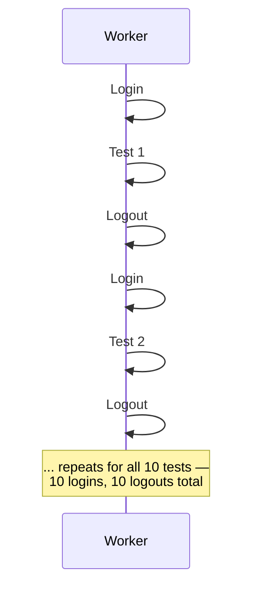
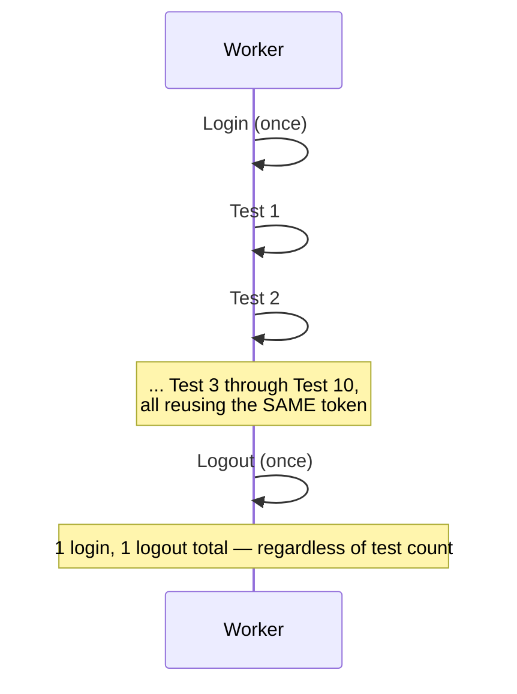

# 06. Custom Fixtures — Architecture Deep Dive

**Navigation**: [← Chapter 05: POM Architecture](./05_POM_Architecture_Deep_Dive.md) | [Index](../00_INDEX.md) | [→ Chapter 07: E2E Test Architecture](./07_test_step_E2E_Architecture.md)

**Cross-links:**

- [`17_TypeScript/01_TS_Foundations.md`](../../17_TypeScript/01_TS_Foundations.md) — Generics (`test.extend<T>()`)
- [`16_JavaScript/04_JS_Async_Promises.md`](../../16_JavaScript/04_JS_Async_Promises.md) — Generator functions and `yield`
- [`06_OOP_Design/02_Design_Patterns.md`](../../06_OOP_Design/02_Design_Patterns.md) — Dependency Injection pattern

---

## 5W1H — Why This Chapter?

- **WHAT**: Playwright's built-in Dependency Injection system — how `{ page, request, account }` gets automatically provided to every test, and how to build your own custom fixtures.
- **WHY**: Without fixtures, every test file manually creates page objects, sets up authentication, and manages teardown — duplicating hundreds of lines. Fixtures solve this at the framework level.
- **WHO**: Any SDET who writes tests with `async ({ page, request }) => {}` but doesn't know where those objects come from or how to add more.
- **WHEN**: As soon as you have two or more test files that need the same setup (auth, a DB connection, a pre-built page object).
- **HOW**: By understanding `test.extend()`, fixture scope, and the `yield` teardown pattern.

---

## 1. What Is a Fixture?

A fixture is a **managed dependency** — Playwright creates it, injects it into your test, and cleans it up after the test finishes.

You've been using built-in fixtures since day one:

```typescript
test("example", async ({ page, request, browser, context }) => {
  //                     ↑     ↑       ↑        ↑
  //                     These are all Playwright's built-in fixtures.
  //                     You never wrote "const page = await browser.newPage()".
  //                     Playwright created it, injected it, and will close it after.
});
```

**The problem fixtures solve:**

```typescript
// ❌ Without fixtures — repeated in every test file
test.beforeEach(async ({ page }) => {
  await page.goto("/login");
  await page.locator("#username").fill(process.env.TEST_USER!);
  await page.locator("#password").fill(process.env.TEST_PASSWORD!);
  await page.locator("#loginButton").click();
  await page.waitForURL("**/dashboard");
});

// If 30 test files need this, you have 30 copies of this code.
// If the login flow changes, you update 30 files.
```

```typescript
// ✅ With a fixture — written once, used everywhere
test("my test", async ({ authenticatedPage }) => {
  // authenticatedPage is already logged in — fixture handled it
  await authenticatedPage.goto("/master-search");
});
```

---

## 2. The Dependency Injection Mental Model

You don't need to know all of DI theory. The mental model is simple:

```
Your test says: "I need a { page } and an { account }."
Playwright's fixture system says: "I know how to make those."
Playwright creates them, hands them to your test, and cleans up when done.
```

This is exactly like a restaurant that provides plates, cutlery, and napkins — you don't go to the kitchen and get them yourself; they're set up at your table before you sit down.

---

## 3. `test.extend<T>()` — Creating Your Own Fixtures

Playwright lets you extend the base `test` object with your own custom fixtures.

### Basic Structure

```typescript
// fixtures/index.ts

import { test as base, type Page } from "@playwright/test";
import { MasterSearchPage } from "../pages/crm/MasterSearchPage";

// Define the shape of your custom fixtures
interface CustomFixtures {
  masterSearchPage: MasterSearchPage;
  authToken: string;
}

// Extend the base test with your custom fixtures
export const test = base.extend<CustomFixtures>({
  // ── Fixture 1: masterSearchPage ────────────────────────────────────────
  masterSearchPage: async ({ page }, use) => {
    // SETUP: create the page object
    const masterSearch = new MasterSearchPage(page);

    // INJECT: hand it to the test
    // "use" is a function provided by Playwright. Calling it with your value
    // gives that value to the test as "masterSearchPage".
    await use(masterSearch);

    // TEARDOWN: anything after "use" runs AFTER the test completes.
    // For a page object, there's nothing to tear down — Playwright handles the page.
  },

  // ── Fixture 2: authToken ───────────────────────────────────────────────
  authToken: async ({ request }, use) => {
    // SETUP: get a token from the auth API
    const response = await request.post("/api/auth/token", {
      data: {
        username: process.env.TEST_USER,
        password: process.env.TEST_PASSWORD,
      },
    });
    const body = await response.json();
    const token = body.access_token as string;

    // INJECT
    await use(token);

    // TEARDOWN: (optional) invalidate the token
    await request.post("/api/auth/logout", {
      headers: { Authorization: `Bearer ${token}` },
    });
  },
});

// Re-export expect so test files only need to import from one place
export { expect } from "@playwright/test";
```

### Using Your Custom Fixture

```typescript
// tests/specs/crm/masterSearch.spec.ts

import { test, expect } from "../../fixtures"; // ← import YOUR extended test
//                               ↑ not '@playwright/test' — your version

test.describe("Master Search", () => {
  test("search by transit account", async ({
    page,
    masterSearchPage,
    authToken,
  }) => {
    //                                              ↑               ↑
    //                                              your custom fixtures!

    await page.goto(process.env.APP_URL!);
    await masterSearchPage.waitForPageLoad();
    await masterSearchPage.searchByTransitAccount("ACC-001");
    await masterSearchPage.verifyResultsAreVisible();
  });
});
```

### Fixture Dependency Resolution — How Playwright Determines Order

Playwright resolves fixture dependencies by building a Directed Acyclic Graph (DAG) from declarations:

```
// Given:
// masterSearchPage depends on: page, account
// account depends on: request
// page is a built-in
// request is a built-in

Resolution order (topological sort):
1. request   (built-in, no dependencies)
2. page      (built-in, no dependencies)
3. account   (worker-scoped, depends on request) ← runs ONCE per worker
4. masterSearchPage (test-scoped, depends on page + account)
5. YOUR TEST BODY RUNS
6. masterSearchPage teardown
7. page teardown (Playwright closes page)
8. [after all worker tests]: account teardown, request cleanup

Rules:
- Worker-scoped fixtures always set up BEFORE test-scoped fixtures
- Teardown runs in REVERSE setup order
- If fixture A depends on fixture B, B is set up first and torn down last
- Built-in fixtures (page, request, browser, context) are always available
```

**This chapter shows the successful half of the DAG; [Ch33 Section 5](../08_SDET_to_SDE_Bridge/33_SDET_to_SDE_CS_Thinking.md#5-graph-algorithms--test-dependency-graphs) shows the failure-detection half.** `request → page → account → masterSearchPage` above IS a topological sort — the exact algorithm Ch33 §5 derives abstractly (its own example: `testC, testB, testA, testD`) and confirms is what Playwright's `test.extend()` actually runs: a DFS over the declared fixture dependencies, in real Playwright source. That other section also covers what THIS chapter's "Rules" box doesn't: what happens if `fixtureA` and `fixtureB` depend on each other — no valid topological order exists for a cycle, and Playwright's own DFS detects the back edge and throws `"circular fixture dependency"` rather than hanging or silently picking a wrong order.

**"Teardown runs in REVERSE setup order" is the Stack (LIFO) discipline again** — the same one [Ch01](../01_Foundations/01_Playwright_TS_Basics.md) named in the JS call stack and [Ch33 §3](../08_SDET_to_SDE_Bridge/33_SDET_to_SDE_CS_Thinking.md) named in `TestDataManager.cleanup()`. The topological sort only guarantees *a* valid linear order for setup (dependencies before dependents); reversing that exact sequence for teardown is what guarantees `account`'s cleanup (revoking its token) doesn't run before `masterSearchPage`'s cleanup, which might still need that token. Push on setup, pop on teardown — same rule, third context this curriculum has hit it in.

```typescript
// You can inspect the order at runtime:
myFixture: async ({ page, account, request }, use, testInfo) => {
  console.log(`[${testInfo.title}] myFixture setup — worker ${testInfo.workerIndex}`);
  await use(value);
  console.log(`[${testInfo.title}] myFixture teardown`);
},
```

---

## 4. The `yield` Pattern — Setup and Teardown in One Place

The `yield` keyword (used in generator functions) lets you split a fixture into a "before" and "after" phase in a single function:

```typescript
authToken: async ({ request }, use) => {
  // ── BEFORE (setup) ───────────────────────────────────────
  const response = await request.post('/api/auth/token', { ... });
  const token = response.json().access_token;

  await use(token);  // ← "yield" point — test runs HERE

  // ── AFTER (teardown) ─────────────────────────────────────
  // This runs AFTER the test (and after any test.afterEach hooks)
  await request.post('/api/auth/logout', { headers: { Authorization: `Bearer ${token}` } });
}
```

**Visualised:**

```
Fixture setup (before test)
    ↓
  await use(value)  ← test runs here
    ↓
Fixture teardown (after test)
    ↓
Playwright closes page/context
```

---

## 5. Fixture Scope — The Performance Difference

This is critical for expensive operations like logging in.

### `scope: 'test'` (default)

The fixture runs **once per test**. Fresh state for every test.

```typescript
// The plain function form defaults to test scope:
authToken: async ({ request }, use) => { ... }

// The tuple form — [fn, options] — lets you set scope, timeout, and auto explicitly.
// Below is the exact equivalent of the plain form above:
authToken: [async ({ request }, use) => { ... }, { scope: 'test' }]

// Change 'test' to 'worker' to switch scope; there is no separate "async: true" flag.
```

Timeline with 10 tests — the fixture's setup/teardown wraps EVERY single test:



**How to read this diagram.** Read it top to bottom as one worker's timeline: every test is wrapped by its own Login and Logout, so ten tests mean ten logins and ten logouts. Notice that this repeated cycle is exactly the cost of per-test scope.

**Use when:** The test needs a guaranteed fresh auth state (e.g., a test that logs out as part of its steps, or tests that run as different users).

### `scope: 'worker'`

The fixture runs **once per Worker process**, shared across ALL tests in that worker.

```typescript
export const test = base.extend<{}, { sharedAuthToken: string }>({
  //                              ↑ worker fixtures go in the second type parameter

  sharedAuthToken: [async ({ request }, use) => {
    const response = await request.post('/api/auth/token', { ... });
    const token = response.json().access_token;

    await use(token);

    // Teardown runs ONCE after all tests in this worker finish
    await request.post('/api/auth/logout', { headers: { Authorization: `Bearer ${token}` } });
  }, { scope: 'worker' }],  // ← specify scope here
});
```

Timeline with 10 tests and 1 worker — the fixture's setup/teardown wraps the ENTIRE worker's test run, once:



**How to read this diagram.** Read it top to bottom: one Login at the start, every test reusing the same token, and one Logout at the end. Notice the contrast with the per-test timeline above: one login and one logout in total, regardless of test count.

**Use when:** All tests in a worker run as the same user and you want to avoid the overhead of logging in before every single test. This is the right choice for the vast majority of enterprise test suites.

---

## 6. Building Your `account` Fixture — The Real Pattern

Your tests use `{ page, request, account }`. Here is how to build the `account` fixture:

```typescript
// types.ts — define what account data looks like
export interface AccountData {
  userId: string;
  accessToken: string;
  refreshToken: string;
  email: string;
  role: "ADMIN" | "AGENT" | "SUPERVISOR";
}

// fixtures/index.ts
import { test as base } from "@playwright/test";
import { MasterSearchPage } from "../pages/crm/MasterSearchPage";
import type { AccountData } from "../types";

interface TestFixtures {
  masterSearchPage: MasterSearchPage;
  customerDetailsTab: CustomerDetailsTab;
}

interface WorkerFixtures {
  account: AccountData;
}

export const test = base.extend<TestFixtures, WorkerFixtures>({
  // ── Worker-scoped: login once per worker ─────────────────────────────
  account: [
    async ({ request }, use) => {
      const response = await request.post(
        `${process.env.AUTH_URL}/api/auth/token`,
        {
          data: {
            username: process.env.TEST_AGENT_USER,
            password: process.env.TEST_AGENT_PASSWORD,
            grant_type: "password",
          },
          headers: { "Content-Type": "application/x-www-form-urlencoded" },
        },
      );

      expect(response.status()).toBe(200);
      const body = await response.json();

      const accountData: AccountData = {
        userId: body.user_id,
        accessToken: body.access_token,
        refreshToken: body.refresh_token,
        email: body.email,
        role: body.role,
      };

      await use(accountData);

      // Teardown: revoke token after all worker tests finish
      await request.post(`${process.env.AUTH_URL}/api/auth/revoke`, {
        data: { token: accountData.refreshToken },
      });
    },
    { scope: "worker" },
  ],

  // ── Test-scoped: inject authenticated state into the browser ─────────
  // This uses the worker-scoped "account" fixture
  masterSearchPage: async ({ page, account }, use) => {
    // Inject the auth token into the browser context's extra headers
    await page.setExtraHTTPHeaders({
      Authorization: `Bearer ${account.accessToken}`,
    });

    // OR: set cookies if the app uses cookie-based auth
    await page.context().addCookies([
      {
        name: "auth_token",
        value: account.accessToken,
        domain: new URL(process.env.APP_URL!).hostname,
        path: "/",
      },
    ]);

    const masterSearch = new MasterSearchPage(page);
    await use(masterSearch);
  },
});

export { expect } from "@playwright/test";
```

### Fixture Error Handling — Fail Fast with Clear Messages

When fixture setup fails, the error propagates to the test as a setup failure — not as a test failure. Make this explicit:

```typescript
account: [async ({ request }, use) => {
  // ✅ Validate env vars before hitting the network
  if (!process.env.AUTH_URL)   throw new Error('[account fixture] AUTH_URL env var is not set');
  if (!process.env.TEST_AGENT_USER) throw new Error('[account fixture] TEST_AGENT_USER env var is not set');

  const response = await request.post(`${process.env.AUTH_URL}/api/auth/token`, {
    data: { username: process.env.TEST_AGENT_USER, password: process.env.TEST_AGENT_PASSWORD }
  });

  // ✅ Clear error message if login fails — tells you WHY, not just THAT
  if (!response.ok()) {
    const body = await response.text();
    throw new Error(
      `[account fixture] Login failed: HTTP ${response.status()}\n` +
      `URL: ${process.env.AUTH_URL}/api/auth/token\n` +
      `Response: ${body.substring(0, 500)}`
    );
  }

  const body = await response.json();

  // ✅ Validate required fields in response
  if (!body.access_token) throw new Error('[account fixture] Login response missing access_token');
  if (!body.user_id)      throw new Error('[account fixture] Login response missing user_id');

  await use({
    userId:       body.user_id,
    accessToken:  body.access_token,
    refreshToken: body.refresh_token,
    email:        body.email,
    role:         body.role,
  });

  // ✅ Teardown: don't let cleanup failures mask the real test result
  try {
    await request.post(`${process.env.AUTH_URL}/api/auth/revoke`, {
      data: { token: body.refresh_token }
    });
  } catch (e) {
    console.warn(`[account fixture] Token revoke failed (non-fatal): ${e}`);
    // Don't rethrow — teardown failures should warn, not fail the test
  }

}, { scope: 'worker' }],
```

### Using It in a Test File

```typescript
import { test, expect } from "../../fixtures";

test.describe("Master Search — Citation Flow", () => {
  // account fixture: automatically logged in (worker-scoped, no re-login per test)
  // masterSearchPage: already authenticated, pre-built POM object
  test("Agent can search by transit account", async ({
    masterSearchPage,
    account,
    request,
  }) => {
    console.log(`Running test as: ${account.email} (${account.role})`);

    await test.step("Navigate to Master Search", async () => {
      await masterSearchPage.waitForPageLoad();
    });

    await test.step("Search by transit account number", async () => {
      await masterSearchPage.searchByTransitAccount("ACC-001");
    });

    await test.step("Verify results appear", async () => {
      await masterSearchPage.verifyResultsAreVisible();
    });
  });
});
```

---

## 7. The DB Connection Fixture

Since you do both API-based AND direct SQL DB verification:

```typescript
// fixtures/db.fixture.ts
import * as sql from "mssql";

interface DBFixtures {
  dbPool: sql.ConnectionPool;
}

export const dbTest = base.extend<{}, DBFixtures>({
  dbPool: [
    async ({}, use) => {
      // SETUP: create connection pool once per worker
      const pool = await sql.connect({
        server: process.env.DB_HOST!,
        database: process.env.DB_NAME!,
        user: process.env.DB_USER!,
        password: process.env.DB_PASSWORD!,
        options: { encrypt: true, trustServerCertificate: false },
      });

      await use(pool);

      // TEARDOWN: close pool after all tests in this worker
      await pool.close();
    },
    { scope: "worker" },
  ],
});
```

```typescript
// In a test:
import { test } from '../../fixtures/db.fixture';

test('verify citation written to DB', async ({ request, dbPool }) => {
  // Make API call
  const response = await request.post('/api/citations', { data: { ... } });
  const body = await response.json();
  const citationId = body.citationId;

  // Verify it actually landed in the DB
  const result = await dbPool.request()
    .input('citationId', sql.NVarChar, citationId)
    .query('SELECT status, amount FROM Citations WHERE citation_id = @citationId');

  expect(result.recordset).toHaveLength(1);
  expect(result.recordset[0].status).toBe('PAID');
});
```

---

## 8. Combining Multiple Fixture Files — `mergeTests`

As your suite grows, you'll have separate fixture files for different concerns. Merge them:

```typescript
// fixtures/index.ts — the single import point for all tests

import { mergeTests } from "@playwright/test";
import { test as authFixtures } from "./auth.fixture";
import { test as dbFixtures } from "./db.fixture";
import { test as apiFixtures } from "./api.fixture";
import { test as pageFixtures } from "./page.fixture";

// Merge all fixture sets into one `test` object
export const test = mergeTests(
  authFixtures,
  dbFixtures,
  apiFixtures,
  pageFixtures,
);
export { expect } from "@playwright/test";

// Now tests get ALL fixtures:
test("full stack test", async ({
  page,
  account,
  dbPool,
  citationsClient,
  masterSearchPage,
}) => {
  // page           → from Playwright built-in
  // account        → from auth.fixture (worker-scoped login)
  // dbPool         → from db.fixture (worker-scoped DB connection)
  // citationsClient → from api.fixture
  // masterSearchPage → from page.fixture
  // Everything composed cleanly
});
```

```
// fixture file organization:
fixtures/
  auth.fixture.ts      → account, adminAccount, supervisorAccount
  db.fixture.ts        → dbPool, dbClient (typed query helper)
  api.fixture.ts       → citationsClient, usersClient, paymentsClient
  page.fixture.ts      → masterSearchPage, citationDetailPage, customerPage
  visual.fixture.ts    → screenshotStable
  index.ts             → mergeTests(...all fixtures above)
```

---

## 9. Overriding Built-in Fixtures

You can override Playwright's built-in fixtures to inject behavior for all tests:

```typescript
// Override the built-in `page` fixture to auto-inject auth headers
export const test = base.extend<{ page: Page }>({
  page: async ({ page }, use) => {
    // Inject auth headers before every test's page usage
    await page.setExtraHTTPHeaders({
      'x-test-correlation-id': `playwright-${Date.now()}`,
      'x-test-worker':         String(test.info().workerIndex),
    });

    // Inject error tracking — capture console errors for every test
    const consoleErrors: string[] = [];
    page.on('console', msg => {
      if (msg.type() === 'error') consoleErrors.push(msg.text());
    });
    page.on('pageerror', err => consoleErrors.push(err.message));

    await use(page);

    // After test: warn if console errors occurred
    if (consoleErrors.length > 0) {
      console.warn(`[page fixture] ${consoleErrors.length} console error(s) during test:\n` +
        consoleErrors.map(e => `  - ${e}`).join('\n'));
    }
  },
});

// Override `request` to add default headers to ALL API calls.
// Note: this must be composed alongside the page override in ONE extend call
// (a single module can only export one `test`). Merge them via extend({ page: ..., request: ... }).
export const testWithRequest = base.extend<{ request: APIRequestContext }>({
  request: async ({ request }, use) => {
    // Playwright doesn't allow mutating the built-in request context directly,
    // but you can create a new one with defaults:
    const authedRequest = await request.newContext({
      extraHTTPHeaders: {
        'Authorization':  `Bearer ${process.env.DEFAULT_TEST_TOKEN}`,
        'x-test-marker':  'playwright-automation',
      },
    });
    await use(authedRequest as unknown as APIRequestContext);
    await authedRequest.dispose();
  },
});
```

---

## 10. Fixture Timeout Configuration

Some fixtures (especially DB connections or multi-step logins) can be slow. Configure their timeout:

Playwright has two separate timeout budgets that apply here, and mixing them up is a common source of confusion:

- `use.actionTimeout` in `playwright.config.ts` bounds a single Playwright *action* (`click`, `fill`, `waitFor`) — it never bounds your fixture setup.
- The `timeout` option in a fixture's tuple `[fn, { scope, timeout }]` bounds the entire fixture *setup + teardown*. If your fixture is worker-scoped and does a slow login sequence, this is the knob you want.

```typescript
// playwright.config.ts
export default defineConfig({
  use: {
    actionTimeout: 30_000,     // per-action timeout (click, fill, etc.) — NOT for fixtures
  },
});

// In the fixture: use the tuple's `timeout` to bound the whole setup+teardown block.
// A Promise.race inside the body is only needed when you want a sub-step timeout
// with a specific, human-readable error message (as below).
account: [async ({ request }, use) => {
  const LOGIN_TIMEOUT_MS = 60_000;

  const loginPromise = performLogin(request);
  const timeoutPromise = new Promise<never>((_, reject) =>
    setTimeout(
      () => reject(new Error(`[account fixture] Login timed out after ${LOGIN_TIMEOUT_MS}ms`)),
      LOGIN_TIMEOUT_MS,
    ),
  );

  const account = await Promise.race([loginPromise, timeoutPromise]);
  await use(account);
}, { scope: 'worker', timeout: 120_000 }],   // ← the fixture-wide budget Playwright enforces
```

The outer `timeout: 120_000` is the hard stop Playwright enforces on the whole fixture; the inner `Promise.race` gives you a friendlier message if just the login step drags. Use one, both, or neither depending on how loudly you need the failure to speak.

---

## 11. The Global Setup Pattern

For operations that run ONCE before the entire test suite (not per worker, but once total), use `globalSetup`:

```typescript
// playwright.config.ts
export default defineConfig({
  globalSetup: "./fixtures/global.setup.ts",
  use: {
    baseURL: process.env.APP_URL,
    extraHTTPHeaders: {
      "x-correlation-id": "PLAYWRIGHT-TEST-RUN",
    },
  },
});

// fixtures/global.setup.ts
import { chromium } from "@playwright/test";

export default async function globalSetup() {
  // This runs ONCE before any test
  // Common use: save auth state to a file so all workers can reuse it

  const browser = await chromium.launch();
  const page = await browser.newPage();

  await page.goto(process.env.APP_URL + "/login");
  await page.locator("#username").fill(process.env.TEST_USER!);
  await page.locator("#password").fill(process.env.TEST_PASSWORD!);
  await page.locator("#loginButton").click();
  await page.waitForURL("**/dashboard");

  // Save auth state (cookies + localStorage) to a file
  await page.context().storageState({ path: "fixtures/auth-state.json" });
  await browser.close();
}

// playwright.config.ts — use the saved state in all tests
export default defineConfig({
  use: {
    storageState: "fixtures/auth-state.json", // Every test starts pre-authenticated!
  },
});
```

---

## 12. The Context-Pooling Trap — Why You Can't Just Share a `page` Fixture

§6 made `account` worker-scoped and it was completely safe. The natural next question: if login is the expensive part, why not go further and make the **`page` itself** worker-scoped too — one browser context, shared by every test in the worker, saving the ~50-100ms context-creation cost on top of the login cost?

```typescript
// ❌ THE TEMPTING BUT BROKEN VERSION
export const test = base.extend<{}, { sharedPage: Page }>({
  sharedPage: [
    async ({ browser }, use) => {
      const context = await browser.newContext();
      const page = await context.newPage();
      await page.goto('/login');
      // ...perform login...
      await use(page); // ← every test in this worker gets the SAME page object
      await context.close();
    },
    { scope: 'worker' },
  ],
});
```

**This is the exact same shared-mutable-state mistake [Ch09 §3–§4](./09_Parallel_Execution_Workers.md#3-the-data-collision-problem) and [Ch33 §10](../08_SDET_to_SDE_Bridge/33_SDET_to_SDE_CS_Thinking.md#10-concurrency--test-race-conditions-and-parallel-execution) already established — the fourth context this curriculum has hit it in ([§3](#3-testextendt--creating-your-own-fixtures) named the third, the Stack/LIFO teardown rule).** There, the shared resource was a JS variable or a database row; here it's a *browser context's own cookies, localStorage, and DOM*. Test A adds an item to a cart — that mutates the shared page's real browser state. Test B, reusing the identical `page` object, now starts with Test A's cart already populated, sees Test A's leftover toast notification mid-fade, or fails outright because Test A left a modal open. The bug shape is identical to Ch09's module-level `authToken`: correctness now depends on execution order, which Playwright's own worker scheduling does not guarantee.

**Why `account` was safe but `sharedPage` isn't: read-only vs. mutable.** `account` is credentials — every test *reads* `account.accessToken`, none of them *write* to it. A shared browser context is mutable *by construction* — every `click`, every `fill`, every navigation changes its state, and that's the entire point of using a browser. Worker-scoping is safe exactly when nothing a test does can change what the next test observes; a live page fails that test by design.

**The real resolution — pool the *expensive result*, not the *stateful object*.** Do the login once per worker (worker-scoped, expensive), but capture the outcome as data — `context.storageState()`, called with no `path`, returns the session as an in-memory object (cookies + a localStorage snapshot per origin; IndexedDB is opt-in via `{ indexedDB: true }`, not captured by default) rather than only writing to disk. That data is exactly as safe to share as `account.accessToken` was, because it's a snapshot, not a live, mutable object. Then give every test a **fresh** context seeded from that snapshot:

```typescript
// ✅ Worker pays for login ONCE; every test still gets an ISOLATED, fresh context
type CapturedStorageState = Awaited<ReturnType<BrowserContext['storageState']>>;

export const test = base.extend<{}, { workerStorageState: CapturedStorageState }>({
  workerStorageState: [
    async ({ browser }, use) => {
      // Expensive part — runs once per worker, exactly like `account` in §6
      const setupContext = await browser.newContext();
      const setupPage = await setupContext.newPage();
      await setupPage.goto(process.env.APP_URL + '/login');
      await setupPage.locator('#username').fill(process.env.TEST_USER!);
      await setupPage.locator('#password').fill(process.env.TEST_PASSWORD!);
      await setupPage.locator('#loginButton').click();
      await setupPage.waitForURL('**/dashboard');

      const state = await setupContext.storageState(); // in-memory object, no file I/O
      await setupContext.close(); // this throwaway context is done — never reused

      await use(state);
    },
    { scope: 'worker' },
  ],
});

// Override the built-in `page` to be seeded from that state — but stay TEST-scoped,
// so every single test still gets its own fresh, isolated context underneath.
export const testWithFreshAuthedPage = test.extend<{ page: Page }>({
  page: async ({ browser, workerStorageState }, use) => {
    const context = await browser.newContext({ storageState: workerStorageState });
    const page = await context.newPage();
    await use(page);
    await context.close(); // closed after EVERY test — nothing survives to leak into the next one
  },
});
```

This is a genuinely different pattern from both extremes already in this chapter: §6's `account` fixture shares raw *credentials* and leaves each test to manually inject them (via headers or cookies) into its own page; §11's `globalSetup` shares a *file* written once for the whole run, before any worker starts. This pattern shares an in-memory *snapshot*, captured per worker, with a fresh context built from it before every test — one login per worker (the speed of worker-scoping) and zero shared mutable browser state (the correctness of test-scoping). It costs one extra `browser.newContext()` per test over the raw-shared-page version — call it 50-100ms — which is the price of not needing to reason about test execution order at all.

---

## 🏋️ Practice Challenges

**Challenge 1 (Scope Selection):** You have 50 test files. Each test needs a valid auth token. The token expires after 8 hours. Your test suite runs in 45 minutes. Should the auth fixture be `scope: 'test'` or `scope: 'worker'`? What changes if tokens expire after 5 minutes?

<details><summary>Answer</summary>

With an 8-hour expiry and a 45-minute suite, use `scope: 'worker'` — one login per worker, shared across all tests in that worker. The token won't expire during the run, so no risk of auth failure.

If tokens expire after 5 minutes, you need `scope: 'test'` — each test gets a fresh token. Alternatively, you could use a refresh-token mechanism inside the worker-scoped fixture to extend the session. The key consideration is always: does the token survive the test run duration?

</details>

**Challenge 2 (Teardown):** Write a fixture called `testCustomer` that creates a test customer record via the API in setup, provides the customer ID to the test, and DELETES the customer record in teardown. Why is this pattern important for test idempotency?

<details><summary>Answer</summary>

```typescript
testCustomer: async ({ request }, use) => {
  // Setup: create the customer
  const createResponse = await request.post("/api/customers", {
    data: { name: `Test-${Date.now()}`, email: `test-${Date.now()}@test.com` },
  });
  const { customerId } = await createResponse.json();

  // Inject the ID into the test
  await use(customerId);

  // Teardown: delete the customer (runs even if the test fails)
  await request.delete(`/api/customers/${customerId}`);
};
```

This is critical for idempotency: every test run starts with no test data and ends with no test data. Tests can run in any order, any number of times, without accumulating stale records or conflicting with each other.

</details>

**Challenge 3 (Fixture Composition):** You need a fixture `adminPage` that:

1. Uses the `account` fixture (worker-scoped, already built).
2. Navigates to the admin dashboard.
3. Returns a `AdminDashboardPage` POM object.
Write the fixture definition (the structure, not every implementation detail).
<details><summary>Answer</summary>

```typescript
adminPage: async ({ page, account }, use) => {
  // "account" fixture is automatically resolved first by Playwright
  await page.setExtraHTTPHeaders({ Authorization: `Bearer ${account.accessToken}` });
  await page.goto(process.env.ADMIN_URL + '/dashboard');
  // Wait for dashboard to load (D365-style wait)
  await page.locator('.admin-dashboard-header').waitFor({ state: 'visible' });
  const adminDashboard = new AdminDashboardPage(page);
  await use(adminDashboard);
  // No teardown needed — page is cleaned up by Playwright
},
```

Playwright resolves fixture dependencies automatically. Because `adminPage` declares `account` in its arguments, Playwright guarantees `account` is set up before `adminPage` runs.

</details>

---

**Challenge 4 [mergeTests]:** You have two fixture files: `auth.fixture.ts` (exports `test` with `account` fixture) and `api.fixture.ts` (exports `test` with `citationsClient` fixture). Write the `fixtures/index.ts` that combines both so a test can use `{ page, account, citationsClient }` in one import.

<details><summary>Answer</summary>

```typescript
// fixtures/index.ts
import { mergeTests } from "@playwright/test";
import { test as authFixtures } from "./auth.fixture";
import { test as apiFixtures } from "./api.fixture";

// Merge both fixture sets
export const test = mergeTests(authFixtures, apiFixtures);
export { expect } from "@playwright/test";

// Usage in a test file:
// import { test, expect } from '../../fixtures';
// test('example', async ({ page, account, citationsClient }) => { ... });
```

**Key rule**: `mergeTests` requires that no two fixture files define a fixture with the SAME name (other than overriding built-ins). If both `auth.fixture.ts` and `api.fixture.ts` tried to define an `account` fixture, `mergeTests` would throw a conflict error. Keep fixture names unique across files.

</details>

---

**Challenge 5 [Spot the Bug]:** What is wrong with this worker-scoped fixture teardown, and what happens if 5 tests run using it?

```typescript
account: [async ({ browser }, use) => {
  const context = await browser.newContext();
  const page    = await context.newPage();
  await page.goto('/login');
  await page.locator('#user').fill('test@test.com');
  await page.locator('#pass').fill('password');
  await page.locator('#submit').click();
  await page.waitForURL('/dashboard');

  const token = await page.evaluate(() => localStorage.getItem('token'));
  await use({ token });  // provide token to all tests

  // No cleanup!
}, { scope: 'worker' }],
```

<details><summary>Answer — 3 bugs</summary>

**Bug 1: Context leak** — `context` is created but never closed. After all 5 tests finish, the browser context and its page remain open. Over a large test suite, this leaks memory. Fix: `await context.close()` after `use()`.

**Bug 2: Token is `null` if localStorage is not set** — `localStorage.getItem('token')` returns `null` if the key doesn't exist (app uses cookie-based auth, or the login didn't complete). `{ token: null }` is passed to tests silently. Fix: add assertion `if (!token) throw new Error('[account] No token in localStorage after login')`.

**Bug 3: No validation that login succeeded** — `page.waitForURL('/dashboard')` passes if the URL contains `/dashboard` BUT the app might show an error on the dashboard. Fix: assert on a dashboard-specific element after navigation.

**Fixed version:**

```typescript
account: [async ({ browser }, use) => {
  const context = await browser.newContext();
  try {
    const page = await context.newPage();
    await page.goto('/login');
    await page.locator('#user').fill('test@test.com');
    await page.locator('#pass').fill('password');
    await page.locator('#submit').click();
    await page.waitForURL('/dashboard');
    await expect(page.locator('.user-menu')).toBeVisible({ timeout: 15_000 });

    const token = await page.evaluate(() => localStorage.getItem('token'));
    if (!token) throw new Error('[account] No token found in localStorage');

    await use({ token });
  } finally {
    await context.close();  // always close, even on failure
  }
}, { scope: 'worker' }],
```

</details>

---

**Challenge 6 [Multi-Role Fixture]:** Your test must verify that an AGENT can create a citation but cannot DELETE it (only ADMINs can delete). Write the fixture pattern that provides BOTH roles in one test without logging in twice simultaneously.

<details><summary>Answer</summary>

```typescript
// fixtures/multiRole.fixture.ts
import { test as base } from "@playwright/test";
import type { AccountData } from "../types";

interface MultiRoleFixtures {
  agentAccount: AccountData;
  adminAccount: AccountData;
}

export const test = base.extend<{}, MultiRoleFixtures>({
  // Agent account — worker-scoped, created once
  agentAccount: [
    async ({ request }, use) => {
      const res = await request.post("/api/auth/token", {
        data: {
          username: process.env.AGENT_USER,
          password: process.env.AGENT_PASS,
        },
      });
      const body = await res.json();
      await use({
        userId: body.user_id,
        accessToken: body.access_token,
        role: "AGENT",
      });
    },
    { scope: "worker" },
  ],

  // Admin account — worker-scoped, created once
  adminAccount: [
    async ({ request }, use) => {
      const res = await request.post("/api/auth/token", {
        data: {
          username: process.env.ADMIN_USER,
          password: process.env.ADMIN_PASS,
        },
      });
      const body = await res.json();
      await use({
        userId: body.user_id,
        accessToken: body.access_token,
        role: "ADMIN",
      });
    },
    { scope: "worker" },
  ],
});

// In the test:
test("Agent creates, Admin deletes", async ({
  request,
  agentAccount,
  adminAccount,
}) => {
  // Step 1: Agent creates a citation (API call as agent)
  const createRes = await request.post("/api/citations", {
    headers: { Authorization: `Bearer ${agentAccount.accessToken}` },
    data: { customerId: "USR-001", amount: 150, status: "PENDING" },
  });
  expect(createRes.status()).toBe(201);
  const { citationId } = await createRes.json();

  // Step 2: Agent cannot delete (should be 403)
  const agentDeleteRes = await request.delete(`/api/citations/${citationId}`, {
    headers: { Authorization: `Bearer ${agentAccount.accessToken}` },
  });
  expect(agentDeleteRes.status()).toBe(403);

  // Step 3: Admin can delete
  const adminDeleteRes = await request.delete(`/api/citations/${citationId}`, {
    headers: { Authorization: `Bearer ${adminAccount.accessToken}` },
  });
  expect(adminDeleteRes.status()).toBe(204);
});
```

Key: both accounts are worker-scoped (one login each per worker, not per test). The test uses `request` directly with different auth headers — no browser context needed for API-only RBAC tests.

</details>

---

## 📚 References & Further Reading

### Official Documentation — Playwright

- [Fixtures Guide](https://playwright.dev/docs/test-fixtures) — The official Playwright guide covering test vs worker scope, override patterns, and automatic dependency resolution
- [Test API: `test.extend`](https://playwright.dev/docs/api/class-test#test-extend) — API reference for the fixture extension system
- [mergeTests API](https://playwright.dev/docs/api/class-test#test-merge-tests) — How to combine multiple fixture files into a single export
- [Global Setup and Teardown](https://playwright.dev/docs/test-global-setup-teardown) — When to use `globalSetup` instead of a worker-scoped fixture

### Core Concepts

- [Dependency Injection in JS/TS](https://blog.logrocket.com/dependency-injection-node-js/) — General concepts of DI that Playwright's fixture system implements
- [Idempotence in Testing](https://martinfowler.com/articles/nonDeterminism.html) — Martin Fowler's discussion on non-determinism and why setup/teardown (which fixtures provide) is critical for stable tests

---

**Navigation**: [← Chapter 05: POM Architecture](./05_POM_Architecture_Deep_Dive.md) | [Index](../00_INDEX.md) | [→ Chapter 07: E2E Test Architecture](./07_test_step_E2E_Architecture.md)


---

## Reality Check

**"Playwright fixtures are similar to JUnit's @BeforeEach"** → Both provide setup/teardown. Key differences: Playwright fixtures are composable (fixture A can use fixture B), scoped (test vs worker scope), injectable into specific tests rather than running for all tests in a suite, and typed (TypeScript knows the fixture's type in the test function). JUnit's `@BeforeEach` runs for every test in the class; Playwright fixtures run only for tests that declare them. The composability enables: an `authenticatedPage` fixture that depends on a `loginUser` fixture which depends on a `testUser` fixture — clean dependency injection.

**"Worker-scoped fixtures are always faster than test-scoped"** → Worker-scoped fixtures (created once per worker, shared across tests in that worker) are faster when: setup is expensive (e.g., cold browser launch, database seeding). But: worker-scoped fixtures must be stateless between tests or explicitly reset. If a test modifies worker-scoped state (e.g., adds items to a shared cart), the next test in the same worker sees that state. Test-scoped fixtures guarantee clean state at the cost of more frequent setup. Profile your suite: if setup is fast, test-scoped is safer. If setup is expensive and state can be reset, worker-scoped is worth the complexity.

**"Auto-use fixtures are equivalent to test.beforeAll()"** → `{ auto: true }` fixtures run for every test in the scope without being declared in test parameters. `test.beforeAll()` runs once per test file (suite). Auto-use fixtures can be worker-scoped (once per worker, across multiple files) or test-scoped (before each test). Auto-use fixtures are composable and can depend on other fixtures; `beforeAll` cannot use fixtures. For cross-cutting concerns (request tracing, performance logging, screenshot on failure): auto-use test-scoped fixtures are the idiomatic Playwright approach.

**"Fixture teardown always runs even if the test fails"** → Playwright fixtures use the async generator pattern: everything after `await use(fixture)` is teardown, which runs after the test body (regardless of pass or fail). This guarantees cleanup. But: if the FIXTURE SETUP itself throws (before `use()` is called), the cleanup code after `use()` does NOT run. Structure sensitive setup: wrap the setup in try-catch if cleanup is needed even when setup partially fails. Standard pattern: `let resource; try { resource = await create(); await use(resource); } finally { await resource?.cleanup(); }`.

**"Extending test with multiple fixture files requires one global extend"** → You can chain extends: `import { test as base } from '@playwright/test'; const test1 = base.extend<{fixture1}>(...)({...}); const test2 = test1.extend<{fixture2}>()({...})`. Each extend wraps the previous, adding fixtures cumulatively. In large projects: create a central `fixtures/index.ts` that imports and merges all fixture extensions, then all test files import from there. If test files import from different fixture files, they get different `test` functions and can't share fixtures — centralized extension prevents this fragmentation.
