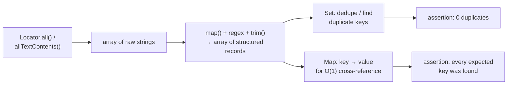

# 64. Dynamic Locators & Data Structures Inside POM Methods

**Navigation**: [← Chapter 63: Static Analysis — ESLint](../05_Enterprise_Framework/63_Static_Analysis_ESLint_TypeScript_Playwright.md) | [Index](../00_INDEX.md) | [→ Chapter 65: Chaos Engineering](../06_CI_CD_And_Reliability/65_Chaos_Engineering_For_Playwright.md)

**Cross-links:**

- [`02_Enterprise_Locators_XPath.md`](../01_Foundations/02_Enterprise_Locators_XPath.md) — the locator syntax this chapter builds parameterized selection on top of
- [`34_Algorithms_in_Test_Automation.md`](../08_SDET_to_SDE_Bridge/34_Algorithms_in_Test_Automation.md) — Big-O technique patterns (sliding window, two pointers, heaps for triage, Union-Find for failure clustering); this chapter is the everyday-container layer underneath those
- [`04_JS_TS_For_Automation.md`](../01_Foundations/04_JS_TS_For_Automation.md) — the async/TypeScript fundamentals these POM methods are written in
- [`30_Database_Verification_Direct_SQL.md`](../03_Real_World_Scenarios/30_Database_Verification_Direct_SQL.md) — the DB-side half of the UI-vs-source-of-truth cross-reference pattern in Section 4

---

## 5W1H

- **WHAT**: How to write a POM method that takes a raw value — `"5.066"` — and reliably finds the one matching element on a page full of near-duplicates, using string parsing and the same data structures (arrays, `Map`, `Set`) you'd reach for in a DSA interview, applied to real scraped DOM text instead of a LeetCode input array.
- **WHY**: `page.locator(...).filter({ hasText: "5.066" })` looks like an exact match. It is not — it is a substring match, and `"$15.066"` contains `"5.066"` as a substring. This chapter derives that failure from real output, then builds the actual fix.
- **WHO**: Any SDET writing a POM method that selects from a dropdown, grid, or list using a value computed at runtime rather than hardcoded in the test.
- **WHEN**: The moment your selector takes a parameter instead of a literal string — `selectAmount(value: string)` instead of `page.click("#opt-5")`.
- **HOW**: Scrape the candidate text into a plain array, parse each entry with `String` methods and a regex into a structured record, and use exact equality (or a `Map`/`Set` for lookup and dedup) — never trust substring matching on formatted display text.

---

## 1. The Problem, Reproduced for Real

Say a dropdown renders currency amounts with a pass/fail suffix:

```html
<ul id="amount-list">
  <li>$5.066 (pass)</li>
  <li>$5.066 (fail)</li>
  <li>$15.066 (pass)</li>
  <li>$105.066 (fail)</li>
</ul>
```

Your test only has the raw number: `"5.066"`. You need to click the one `<li>` whose visible amount equals it. The obvious first attempt:

```typescript
const option = page.locator("#amount-list li").filter({ hasText: "5.066" });
```

Run that against the real page above and count what it matches, rather than assuming:

```text
=== naive hasText:'5.066' ===
count: 4
matched: [
  '$5.066 (pass)',
  '$5.066 (fail)',
  '$15.066 (pass)',
  '$105.066 (fail)'
]
```

All four. `hasText`, when given a plain string, matches if the element's normalized text **contains** that string, case-insensitively — it's `String.prototype.includes`, not `===`. `"15.066"` contains `"5.066"` as a substring (`1` + `5.066`), and so does `"105.066"` (`10` + `5.066`). The bug isn't in Playwright — `hasText` is documented as substring matching precisely so it works for "click the button containing the word Submit" without needing the whole sentence. The bug is treating a formatted currency display string as if it were a data key. `$5.066 (pass)` was never a key; it's a rendering of one.

## 2. The Fix — Parse Before You Compare

The element's text is not the data. The data is a number and a status, formatted for display. So extract that structure back out before comparing anything:

```typescript
type ParsedAmount = { raw: string; amount: number | null; status: string | null };

async function parseAmountOptions(list: Locator): Promise<ParsedAmount[]> {
  const rawTexts = await list.allTextContents();
  return rawTexts.map((text) => {
    const trimmed = text.trim();
    const amountMatch = trimmed.match(/\$([\d.]+)/);
    const statusMatch = trimmed.match(/\(([a-z]+)\)/i);
    return {
      raw: trimmed,
      amount: amountMatch ? parseFloat(amountMatch[1]) : null,
      status: statusMatch ? statusMatch[1].toLowerCase() : null,
    };
  });
}
```

Every piece here is an ordinary `String`/`Number` method doing one job: `.trim()` removes the whitespace Playwright's `innerText`/`textContent` can leave around block elements; `.match(/\$([\d.]+)/)` pulls the digits-and-dot run after the `$` into a capture group; `parseFloat` turns that capture into a comparable number instead of a string (`"5.066" === "5.0660"` is `false`; `5.066 === 5.0660` is `true` — this matters the moment upstream formatting changes trailing zeros); `.match(/\(([a-z]+)\)/i)` pulls the word out of the parentheses the same way.

Run it against the real four-item list:

```text
=== all raw option texts ===
[ '$5.066 (pass)', '$5.066 (fail)', '$15.066 (pass)', '$105.066 (fail)' ]

=== parsed into {amount, status} ===
[
  { raw: '$5.066 (pass)',   amount: 5.066,   status: 'pass' },
  { raw: '$5.066 (fail)',   amount: 5.066,   status: 'fail' },
  { raw: '$15.066 (pass)',  amount: 15.066,  status: 'pass' },
  { raw: '$105.066 (fail)', amount: 105.066, status: 'fail' }
]
```

Now filter on the **parsed number with strict equality**, not the display string:

```text
=== exact numeric match for 5.066 (amount only) ===
[
  { raw: '$5.066 (pass)', amount: 5.066, status: 'pass' },
  { raw: '$5.066 (fail)', amount: 5.066, status: 'fail' }
]
```

Two, not four — `15.066 === 5.066` is `false`, `105.066 === 5.066` is `false`. Numeric equality doesn't have a substring problem because numbers don't have substrings; `15.066` was never "close to" `5.066`, it just *printed* with those digits inside it. But two candidates still remain, because `$5.066` legitimately appears twice with different statuses — the amount alone doesn't uniquely identify a row here, and no amount of smarter locator syntax fixes that; the test needs a second piece of the record:

```text
=== exact match for 5.066 AND status=pass ===
[ { raw: '$5.066 (pass)', amount: 5.066, status: 'pass' } ]
```

One. The POM method this produces:

```typescript
async function selectAmountOption(
  page: Page,
  amount: number,
  status: "pass" | "fail" = "pass",
): Promise<void> {
  const list = page.locator("#amount-list li");
  const parsed = await parseAmountOptions(list);
  const index = parsed.findIndex((p) => p.amount === amount && p.status === status);
  if (index === -1) {
    throw new Error(
      `No option matched amount=${amount} status=${status}. Available: ${JSON.stringify(parsed)}`,
    );
  }
  await list.nth(index).click();
}
```

The explicit `throw` with the full parsed list in the message is deliberate, not decoration — see [Chapter 26's flakiness taxonomy](../06_CI_CD_And_Reliability/26_Flakiness_Diagnosis_and_Fixing.md#1-the-flakiness-taxonomy--9-types): a `findIndex` that silently returns `-1` and gets passed straight to `.nth(-1)` fails with a confusing Playwright error three lines away from the real cause. Failing loudly, at the point where you still have the parsed data in scope, turns a 20-minute trace-viewer investigation into a 10-second log read.

## 3. Why "Just Interpolate It Into XPath" Is a Second, Separate Trap

A different naive fix for Section 1's bug is to skip `.filter({ hasText })` entirely and build an exact-match XPath by hand:

```typescript
const xpath = `//li[contains(text(), '${value}')]`;
```

This looks more precise than `hasText`, and for `value = "5.066"` it has exactly the same substring problem. But it has a second, independent failure mode that has nothing to do with substrings: **the value becomes part of a string literal in a query language**, and ordinary data breaks it. Not attacker-supplied data — ordinary customer names:

```typescript
const realWorldValue = "O'Brien's Account"; // an apostrophe. Nothing exotic.
const xpath = `//li[contains(text(), '${realWorldValue}')]`;
// constructed XPath: //li[contains(text(), 'O'Brien's Account')]
```

Run this against a real page with that exact text present:

```text
=== naive single-quoted XPath string interpolation ===
constructed XPath: //li[contains(text(), 'O'Brien's Account')]
THREW: locator.count: SyntaxError: Failed to execute 'evaluate' on 'Document':
  The string '//li[contains(text(), 'O'Brien's Account')]' is not a valid XPath expression.
```

A real `SyntaxError`, on a row that unquestionably exists on the page. The apostrophe in `O'Brien's` closed the XPath string literal early, and everything after it became malformed query syntax instead of data. This is the same class of bug as SQL injection — untrusted (or in this case just *ordinary*) data being concatenated directly into a query language's syntax — except here there's no attacker; test data with an apostrophe, a name like `O'Brien`, or even Playwright's own D365 example data (`ms-DetailsRow`-class fields commonly hold user-entered free text) is enough to trigger it. Any locator strategy built by string-interpolating a variable into XPath or CSS syntax carries this risk, proportional to how unconstrained the input is.

Compare `.filter({ hasText })` on the identical value:

```typescript
const safeLoc = page.locator("#names li").filter({ hasText: realWorldValue });
```

```text
=== same value via .filter({ hasText }) ===
count: 1 matched: [ "O'Brien's Account — $5.066 (pass)" ]
```

Correct, no escaping, no error. The mechanical reason: `.filter({ hasText })` never builds a query-language string at all. The value is passed as *data* to Playwright's own text-matching engine, which compares it against the DOM's `textContent` directly (a JS string comparison, not a parsed expression) — there is no string-literal delimiter for an apostrophe to prematurely close, because no string literal is ever constructed. The rule this generalizes to: **when a locator needs to incorporate a runtime value, prefer an API that accepts the value as a parameter (`hasText`, `getByText`, `getByRole({ name })`) over one that requires you to interpolate it into query syntax yourself.** If you must build XPath dynamically, use Playwright's own escaping (or at minimum, switch string-literal delimiters based on which quote character is present in the value) rather than naive template-literal interpolation — but reaching for a parameterized API removes the problem instead of managing it.

## 4. The Everyday Data Structures — Scraping a Grid Into Something You Can Actually Verify

**The structures** (from [`../../02_Data_Structures/01e_HashTable.md`](../../02_Data_Structures/01e_HashTable.md) — `Map`/`Set` are both hash-table-backed): Section 2 used an array and `.findIndex()` to solve a single-value lookup. Real POM work usually scrapes a whole table, and the two structures that come up constantly are `Set` (uniqueness) and `Map` (lookup) — not because they're exotic, but because "does the UI show any duplicates" and "does every row the API expects actually appear" are both O(1)-per-item questions if you reach for the right container, and O(n²) messes of nested loops if you don't. (Worth knowing before leaning on that O(1): [Chapter 33 Section 2](../08_SDET_to_SDE_Bridge/33_SDET_to_SDE_CS_Thinking.md#2-hash-maps--test-data-lookup) covers the documented 2011 real-world case where hash-table lookup degraded to O(n) under adversarial input — not a concern for scraped UI data specifically, but the reason "O(1) average" and "O(1) always" aren't the same claim.)



A grid with two real, independent bugs — a duplicated row (a common symptom of a websocket-driven re-render firing twice) and a row the API says should exist but the UI silently dropped:

```html
<table id="orders">
  <tr class="row"><td class="id">ORD-1001</td><td class="amt">$5.066 (pass)</td></tr>
  <tr class="row"><td class="id">ORD-1002</td><td class="amt">$15.066 (pass)</td></tr>
  <tr class="row"><td class="id">ORD-1002</td><td class="amt">$15.066 (pass)</td></tr>
  <tr class="row"><td class="id">ORD-1003</td><td class="amt">$105.066 (fail)</td></tr>
</table>
```

```typescript
// Step 1 — scrape into an array of structured records. Every field goes
// through the same trim()/regex/parseFloat pipeline as Section 2.
const rowLocators = page.locator("#orders tr.row");
const rowCount = await rowLocators.count();
const uiRows: { orderId: string; amount: number }[] = [];
for (let i = 0; i < rowCount; i++) {
  const row = rowLocators.nth(i);
  const orderId = (await row.locator(".id").innerText()).trim();
  const amtRaw = (await row.locator(".amt").innerText()).trim();
  const amount = parseFloat(amtRaw.match(/\$([\d.]+)/)![1]);
  uiRows.push({ orderId, amount });
}
```

```text
=== scraped UI rows (array of records) ===
[
  { orderId: 'ORD-1001', amount: 5.066 },
  { orderId: 'ORD-1002', amount: 15.066 },
  { orderId: 'ORD-1002', amount: 15.066 },
  { orderId: 'ORD-1003', amount: 105.066 }
]
```

**`Set` — is anything rendered twice?** A `Set` only ever holds one copy of each value; trying to `.add()` a value it already has is a no-op. That's exactly "have I seen this ID before":

```typescript
const seen = new Set<string>();
const duplicates = new Set<string>();
for (const r of uiRows) {
  if (seen.has(r.orderId)) duplicates.add(r.orderId);
  seen.add(r.orderId);
}
```

```text
=== duplicate IDs found via Set ===
[ 'ORD-1002' ]
```

Caught, in one pass over the array, with no nested loop comparing every row against every other row.

**`Map` — does the UI match a source of truth?** The API's expected rows, keyed by `orderId`, turn a "does this ID exist among the UI rows" check from an `O(n)` linear scan (`uiRows.find(...)`, repeated for every expected row — `O(n·m)` overall) into an `O(1)` lookup per row:

```typescript
const expectedFromApi = [
  { orderId: "ORD-1001", amount: 5.066 },
  { orderId: "ORD-1002", amount: 15.066 },
  { orderId: "ORD-1003", amount: 105.066 },
  { orderId: "ORD-1004", amount: 8.5 },
];
const apiById = new Map(expectedFromApi.map((r) => [r.orderId, r.amount]));

const missingFromUi: string[] = [];
const amountMismatches: { orderId: string; expectedAmount: number; uiAmount: number }[] = [];
for (const [orderId, expectedAmount] of apiById) {
  const uiRow = uiRows.find((r) => r.orderId === orderId);
  if (!uiRow) missingFromUi.push(orderId);
  else if (uiRow.amount !== expectedAmount) {
    amountMismatches.push({ orderId, expectedAmount, uiAmount: uiRow.amount });
  }
}
```

```text
=== rows in API but missing from UI ===
[ 'ORD-1004' ]

=== amount mismatches (API vs UI) ===
[]
```

Two real, independent, structurally different bugs, both surfaced by the same 15 lines: `ORD-1002` renders twice (a `Set` catches it), `ORD-1004` never renders at all (a `Map` cross-reference catches it). A test that only asserted `rowCount === expectedFromApi.length` (`4 === 4`) would have passed — the duplicate silently compensated for the missing row in the raw count. This is the actual argument for reaching for these structures instead of ad-hoc counting: they check the *right invariant* (every expected ID appears exactly once), not a proxy for it (the totals happen to match).

## 5. String Methods Quick Reference — What Each One Is Actually For

Every demo above used a small, fixed set of `String`/`Number` operations. What each is for, so the choice is deliberate rather than copy-pasted:

| Method | Answers | Used above for |
|---|---|---|
| `.trim()` | "strip leading/trailing whitespace" | Cleaning `innerText`, which can carry block-element padding whitespace |
| `.match(/regex/)` | "extract a substructure, or `null`" | Pulling `5.066` out of `$5.066 (pass)`; pulling `pass` out of the parens |
| `.replace(/regex/, "")` | "strip a known substring/pattern" | An alternative to `.match()` when you want to delete the `$` rather than capture the digits |
| `.split(sep)` | "break one string into an array on a delimiter" | Turning `"CIT-001,CIT-002"` (a comma-joined cell) into `["CIT-001", "CIT-002"]` |
| `.includes(sub)` | "does this contain that, as a substring" | What `hasText` does internally — useful directly when you *want* substring semantics, e.g. checking an error banner contains a code |
| `parseFloat(str)` | "string → number, stop at the first non-numeric character" | `"5.066 USD"` → `5.066` — tolerant of trailing text |
| `Number(str)` | "string → number, `NaN` if ANY character isn't valid" | Stricter than `parseFloat`; use when you want malformed input to fail loudly instead of silently truncating |

The `parseFloat` vs `Number` distinction is worth being deliberate about: `parseFloat("5.066 (pass)")` returns `5.066` — it reads until it hits `" "`, then stops, silently discarding the rest. `Number("5.066 (pass)")` returns `NaN` — the whole string must be numeric. Section 2's parser used a regex capture group (`\$([\d.]+)`) specifically to avoid relying on either's truncation behavior — the regex says exactly which characters count as the amount, rather than hoping the parser stops in the right place.

## Section Challenge

<details>
<summary><strong>Q1.</strong> A teammate "fixes" Section 1's bug with <code>page.locator("li").filter({ hasText: new RegExp(`^\\$${value}\\s`) })</code> instead of the parse-and-compare approach — anchoring the match to the start of the string with <code>^</code>. For <code>value = "5.066"</code>, does this correctly exclude <code>"$15.066 (pass)"</code>? Does it fully solve the chapter's problem?</summary>

Yes, it excludes `$15.066` — `^\$5\.066\s` requires the match to start at the very beginning of the string with literally `$5.066` followed by whitespace, and `$15.066 (pass)` starts with `$15.066`, which doesn't match `^\$5\.066`. So the substring bug from Section 1 is fixed by this regex.

But it does **not** fully solve the chapter's problem: it still returns two elements for the fixture in Section 2 — `$5.066 (pass)` and `$5.066 (fail)` both start with `$5.066 ` followed by more text, and the regex has no opinion about status. It also reintroduces a smaller version of Section 3's fragility: `value` is being interpolated into a regex, and regex special characters (`.`, `$`, `(`, `)`, etc.) in the value would need escaping — a `.` in `value` matches "any character," not a literal dot, so `5x066` would also match `5.066`'s anchored pattern. The parse-into-`{amount, status}` approach from Section 2 avoids both problems: it compares parsed *values* (a number, a string) with `===`, which has no special characters to escape and no ambiguity about what "matches" means, and it makes room to filter on the second field (status) that the anchored-string approach still can't express without further escaping and concatenation.

</details>

<details>
<summary><strong>Q2.</strong> Section 4's <code>Map</code>-based cross-reference used <code>uiRows.find(...)</code> inside the loop over <code>apiById</code> — an <code>O(n)</code> scan of the UI array for every expected row, giving <code>O(n·m)</code> overall, not true <code>O(n)</code>. How would you fix that, and does it matter for a typical grid?</summary>

Build a `Map` from `uiRows` too, keyed the same way as `apiById`, then look up by key instead of scanning:

```typescript
const uiById = new Map(uiRows.map((r) => [r.orderId, r.amount]));
for (const [orderId, expectedAmount] of apiById) {
  const uiAmount = uiById.get(orderId);
  if (uiAmount === undefined) missingFromUi.push(orderId);
  else if (uiAmount !== expectedAmount) amountMismatches.push({ orderId, expectedAmount, uiAmount });
}
```

This is `O(n + m)` — one pass to build `uiById`, one pass over `apiById` doing `O(1)` `.get()` calls — instead of `O(n·m)`.

Whether it matters in practice: for a typical UI grid (tens to low hundreds of rows, since a human has to scroll it), `O(n·m)` and `O(n+m)` are both effectively instant — the `.find()` version is not a real performance problem at that scale, and it reads slightly more directly. It starts to matter if this same pattern gets reused to cross-reference a paginated API export against thousands of scraped rows (a data-migration verification test, for instance) — at that scale the `O(n·m)` version's quadratic blowup becomes measurable, and the `Map`-based version is the one that should be reached for by default once the pattern is established, since it costs nothing extra to write correctly the first time.

</details>

<details>
<summary><strong>Q3.</strong> You scrape a price column with <code>await cell.innerText()</code> and get back <code>"$1,234.50"</code> (a comma thousands-separator). <code>parseFloat("$1,234.50")</code> returns <code>NaN</code> — <code>parseFloat</code> stops at the first non-numeric character, and <code>$</code> is the very first one. Using only the string methods from Section 5's table, write the extraction that correctly returns <code>1234.50</code> as a number.</summary>

Two defensible approaches, both using only Section 5's methods:

```typescript
// Approach A — strip everything that isn't a digit or a decimal point, then parse.
const cleaned = "$1,234.50".replace(/[^0-9.]/g, ""); // "1234.50"
const amount = parseFloat(cleaned); // 1234.50
```

```typescript
// Approach B — capture the numeric run with a regex, strip commas from the capture.
const match = "$1,234.50".match(/\$([\d,]+\.\d+)/); // match[1] === "1,234.50"
const amount = parseFloat(match![1].replace(/,/g, "")); // 1234.50
```

Both work; Approach A is shorter but silently accepts malformed input (e.g., `"$1,,234..50"` would still produce *something*, just wrong) since it doesn't validate structure, only strips characters. Approach B's regex enforces a shape (digits/commas, a literal dot, digits) before extraction, so genuinely malformed text fails to match at all (`match` returns `null`) rather than silently producing a wrong number — closer to Section 2's `throw` when nothing is found, which surfaces bad data instead of quietly computing garbage from it.

</details>

---

## Chapter Summary

| Concept | The wrong instinct | The verified fix |
|---|---|---|
| Matching a formatted value (`"5.066"` against `"$5.066 (pass)"`) | `.filter({ hasText: value })` — substring match | Parse both sides into structured data (number, status), compare with `===` |
| A value with an apostrophe breaking XPath | Template-literal interpolation into a query-language string | Use a parameterized API (`hasText`, `getByText`) that takes the value as data, not syntax |
| "Is anything on screen duplicated?" | Nested loop comparing every row to every other row | `Set` — O(n), one pass, `.has()` before `.add()` |
| "Does the UI match the API's expected rows?" | `.find()` inside a loop — O(n·m) | `Map` keyed by ID — O(n+m), O(1) lookup per row |
| Extracting a number from formatted text | `parseFloat` on the raw string directly | Regex capture group first (validates shape), `parseFloat`/`Number` on the captured piece only |

## Where We Go Next

This chapter is the connective layer between two chapters that already exist: [Chapter 2](../01_Foundations/02_Enterprise_Locators_XPath.md) taught locator *syntax*; [Chapter 34](../08_SDET_to_SDE_Bridge/34_Algorithms_in_Test_Automation.md) taught algorithmic *technique* (sliding windows, two pointers) for larger-scale test problems. Everyday `Array`/`Map`/`Set`/string-method usage inside a POM method is what sits between them in almost every real page object — reach for it before reaching for a fancier algorithm, and reach for parsed structured comparison before reaching for a cleverer locator string.

---

## Reality Check

**"`hasText` is basically `===` on the element's text"** → It's `.includes()`, not `===` — a case-insensitive substring check on normalized text content. This chapter's Section 1 demo showed it directly: `hasText: "5.066"` matched all of `$5.066`, `$15.066`, and `$105.066` against a real four-item list, because all three strings contain `"5.066"`. Use `hasText` when substring semantics are genuinely what you want (a button containing a word); parse-and-compare when you need exact-value equality.

**"If it's not user input, string interpolation into a locator is safe"** → Section 3's `SyntaxError` came from `"O'Brien's Account"` — ordinary test data, not an attack. Any value with a quote character breaks a naively-interpolated XPath or CSS string literal regardless of where the value came from. The risk isn't "is this untrusted" — it's "does this string get concatenated into query syntax at all." Parameterized APIs (`hasText`, `getByRole({ name })`) sidestep the question entirely by never building that syntax from the value.

**"Counting rows (`rowCount === expected.length`) is enough to catch missing/duplicate data"** → Section 4's fixture had exactly 4 UI rows and exactly 4 expected API rows — the counts matched — while one ID was duplicated and a different one was completely missing. A duplicate silently compensates for a missing row in a raw count. `Set`-based dedup checking and `Map`-based per-ID cross-referencing check the actual invariant (every expected ID present exactly once); a count comparison checks a proxy for it that can pass while the real thing fails.

**"`parseFloat` and `Number` are interchangeable ways to convert a string to a number"** → `parseFloat("5.066 (pass)")` returns `5.066`, silently stopping at the first non-numeric character. `Number("5.066 (pass)")` returns `NaN`, rejecting the whole string. Neither is universally "more correct" — `parseFloat` is right when trailing text is expected and irrelevant; `Number` is right when you want malformed input to fail loudly. Section 2 avoided relying on either's stopping behavior by using a regex capture group to say precisely which characters counted as the number in the first place.

---

**Navigation**: [← Chapter 63: Static Analysis — ESLint](../05_Enterprise_Framework/63_Static_Analysis_ESLint_TypeScript_Playwright.md) | [Index](../00_INDEX.md) | [→ Chapter 65: Chaos Engineering](../06_CI_CD_And_Reliability/65_Chaos_Engineering_For_Playwright.md)
