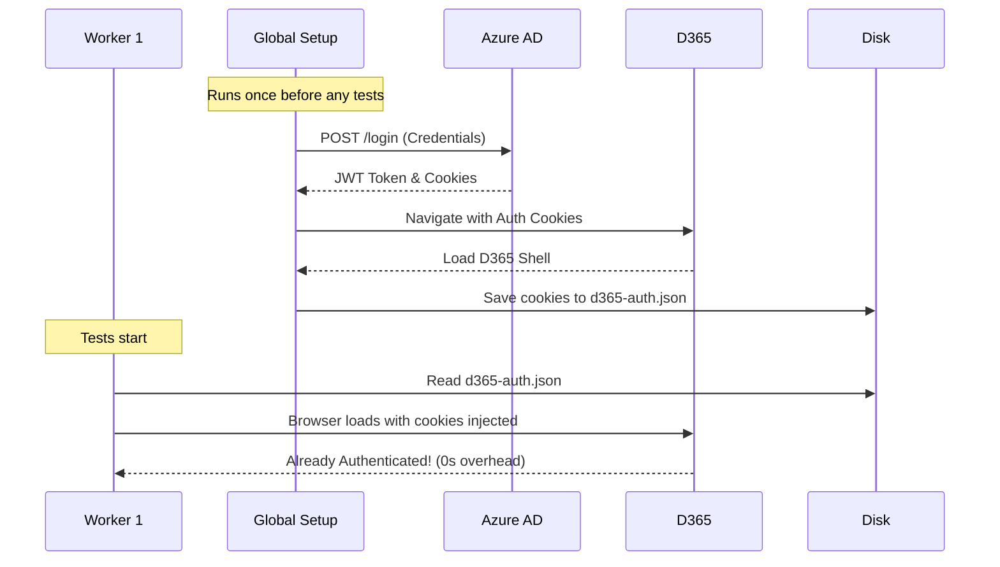

# 10. Dynamics 365 CRM — The Complete Testing Guide

**Navigation**: [← Previous: Parallel Execution](../02_Core_Architecture/09_Parallel_Execution_Workers.md) | [Index](../00_INDEX.md) | [Index](../../00_MASTER_INDEX.md)

**Cross-links:**
- [`18_CSS_Complete/01_CSS_Foundations.md`](../../18_CSS_Complete/01_CSS_Foundations.md) — CSS selector specificity
- [`15_React_Frontend/01_React_Fundamentals.md`](../../15_React_Frontend/01_React_Fundamentals.md) — React rendering that powers D365 components
- [`16_JavaScript/05_JS_DOM_BrowserAPIs.md`](../../16_JavaScript/05_JS_DOM_BrowserAPIs.md) — DOM traversal for console scripts
- [`21_SDET/08_Browser_Internals_for_SDETs.md`](../02_Core_Architecture/08_Browser_Internals_for_SDETs.md) — The 4 browser trees (prerequisite)

---

## 5W1H — Why This Chapter?

- **WHAT**: Everything specific to testing Dynamics 365 CRM applications with Playwright — including IFrame navigation, Microsoft Fluent UI `.ms-*` selectors, the `menuitem` vs `button` ARIA trap, two-phase render waits, and browser console scripts for D365.
- **WHY**: D365 is built on Microsoft Fluent UI and React. It renders differently from a regular web app. Locators that work everywhere else fail here. You need a specialised toolkit.
- **WHO**: SDETs testing any Dynamics 365 application — CRM modules, customer portals, agent dashboards.
- **WHEN**: Every time you start testing a new D365 page.
- **HOW**: Through a complete reference of D365-specific selectors, wait strategies, and debugging techniques — with real examples from your codebase.

---

## 1. D365 DOM Anatomy — The Unified Client Interface (UCI)

Modern Dynamics 365 uses the **Unified Client Interface (UCI)**. Unlike legacy web clients, UCI is a single-page application (SPA) built entirely on React and Microsoft's Fluent UI. Understanding its internal structure is the key to reliable locators.

### The UCI Layer Stack

D365 is NOT just a regular web page. The UCI architecture renders a deeply nested component tree with distinct boundaries:

```
Browser Tab
└── Main Page (https://crm.dynamics.com/*)
    ├── App Header (.crmAppHeader) — App picker, Settings gear, User avatar
    ├── Top Navigation Bar (not inside an IFrame)
    ├── CommandBar (.ms-CommandBar) — "Edit", "Save", "Delete" (NOT inside IFrame)
    └── Main Content IFrame
        └── (iframe src="/main.aspx#...") — The historical boundary
            ├── Entity Form (.pa-EntityForm)
            │   ├── Form Header (.pa-FormHeader) — Read-only summary fields
            │   ├── Form Body (.pa-FormBody)
            │   │   ├── Form Sections (.pa-FormSection)
            │   │   ├── Sub-grids (tables of related records)
            │   │   └── Quick View Forms
            │   └── Form Footer (Save buttons on older forms)
            └── Dashboard Pages
```

**Practical impact:** If your locator works in the browser console on the main page but Playwright can't find it, the element is probably INSIDE the IFrame or blocked by a Shadow DOM boundary.

### The Frame Context Problem

```typescript
// ❌ WRONG — looking on the main page for something inside the IFrame
await page.locator('.ms-TextField-field').fill('John'); // 0 elements found

// ✅ CORRECT — switch context to the IFrame first
const mainFrame = page.frameLocator('iframe[name="contentIFrame0"]');
//                                   ↑ Find the IFrame by name attribute
await mainFrame.locator('.ms-TextField-field').fill('John'); // ✅ works

// Alternative IFrame selectors (check which one your D365 uses):
page.frameLocator('iframe[name="contentIFrame0"]')  // most common
page.frameLocator('iframe[title="Main Content"]')
page.frameLocator('#contentIFrame0')
page.frameLocator('iframe[src*="main.aspx"]')
```

### How to Find IFrames on Your D365 Instance

Run this in the browser console on any D365 page:
```javascript
// List all IFrames on the page with their key attributes
document.querySelectorAll('iframe').forEach((f, i) => {
  console.log(`IFrame ${i}: name="${f.name}" id="${f.id}" title="${f.title}" src="${f.src.substring(0, 80)}"`);
});
```

---

## 2. The Microsoft Fluent UI `.ms-*` CSS Class Reference

D365 uses Microsoft's Fluent UI component library. These classes are stable across D365 versions and make excellent selectors when `getByRole` fails.

> Cross-link: [`18_CSS_Complete/01_CSS_Foundations.md`](../../18_CSS_Complete/01_CSS_Foundations.md) for CSS specificity rules.

### Complete Stable Selector Reference

| Component | Stable CSS Selector | Notes |
|---|---|---|
| **Any button** | `.ms-Button` | All buttons including icon-only |
| **Primary button** | `.ms-Button--primary` | Save, Submit, Create |
| **Default button** | `.ms-Button--default` | Cancel, Discard |
| **Icon button** | `.ms-Button--icon` | Toolbar icon buttons |
| **Text field wrapper** | `.ms-TextField` | The outer container |
| **Text field input** | `.ms-TextField-field` | The actual `<input>` to type into |
| **Dropdown container** | `.ms-Dropdown` | The outer container |
| **Dropdown title** | `.ms-Dropdown-title` | Shows currently selected value |
| **Dropdown item** | `.ms-Dropdown-item` | Each option in the list |
| **CommandBar** | `.ms-CommandBar` | The top action bar |
| **CommandBar button** | `.ms-CommandBar-item` | Individual CommandBar items |
| **DetailsListrow** | `.ms-DetailsList-row` | Table/grid rows |
| **DetailsListcell** | `.ms-DetailsRow-cell` | Individual cells in a row |
| **Pivot (tabs)** | `.ms-Pivot` | Tab strip container |
| **Pivot tab** | `.ms-Pivot-tab` | Individual tab link |
| **Spinner** | `.ms-Spinner` | Loading indicator |
| **Dialog** | `.ms-Dialog` | Modal dialog boxes |
| **Dialog title** | `.ms-Dialog-title` | Dialog header text |
| **Panel** | `.ms-Panel` | Side panel / drawer |
| **Persona** | `.ms-Persona` | User avatar + name display |
| **Toggle** | `.ms-Toggle` | On/Off toggle switch |
| **Toggle checked** | `.ms-Toggle.is-checked` | Verified toggle is ON |
| **Checkbox** | `.ms-Checkbox` | Checkbox container |
| **Checkbox checked** | `.ms-Checkbox.is-checked` | Verified checkbox is ticked |

### CSS Specificity for D365

```typescript
// More specific = more reliable. These are ranked from most to least reliable:

// 1. data-automation-key (Microsoft's own testing hook) — MOST RELIABLE
page.locator('[data-automation-key="customerName"]')

// 2. data-testid (if your D365 customisation added these)
page.locator('[data-testid="save-button"]')

// 3. Specific ms- class + text combination
page.locator('.ms-Button--primary').filter({ hasText: 'Save' })

// 4. Specific ms- class alone
page.locator('.ms-TextField-field').first()

// 5. Generic ms- class (fragile — may match many elements)
page.locator('.ms-Button') // could match 20+ buttons

// 6. XPath with text (for when all else fails)
page.locator('//button[contains(@class, "ms-Button") and text()="Edit"]')
```

---

## 3. The `menuitem` vs `button` ARIA Role Trap

**This is the most common D365 locator problem.** You see a button on screen but `getByRole('button')` returns 0 elements.

### Why It Happens

D365's CommandBar is built as:
```html
<ul role="menubar">
  <li role="menuitem" aria-label="Edit">    ← Accessibility tree sees: MENUITEM
    <button class="ms-Button">             ← This is just a visual child
      <span>Edit</span>
    </button>
  </li>
  <li role="menuitem" aria-label="Save">
    <button class="ms-Button ms-Button--primary">
      <span>Save</span>
    </button>
  </li>
</ul>
```

The accessibility tree (which `getByRole` queries) sees the `<li>` as the interactive element, not the `<button>` inside it.

### The Fix

```typescript
// ❌ What you try first (and it fails):
await page.getByRole('button', { name: 'Edit' }).click();

// ✅ Use menuitem role:
await page.getByRole('menuitem', { name: 'Edit' }).click();

// ✅ Or use the CSS selector as a reliable fallback:
await page.locator('.ms-CommandBar-item').filter({ hasText: 'Edit' }).click();

// ✅ Or XPath if the above don't work:
await page.locator('//li[@role="menuitem"]//span[text()="Edit"]').click();
```

### How to Discover the Real ARIA Role

```
Method 1: Chrome DevTools Accessibility Panel
1. Right-click the element on screen
2. Inspect Element
3. In DevTools: Elements panel → right side → "Accessibility" tab
4. Read the "Role" field exactly as shown

Method 2: Browser Console Script
```
```javascript
// Run in browser console — finds the ARIA role of any element you can describe by text
const text = 'Edit'; // the visible text of the button
const elements = [...document.querySelectorAll('[role]')]
  .filter(el => el.textContent.trim().includes(text));
elements.forEach(el => {
  console.log(`Tag: ${el.tagName}, Role: ${el.getAttribute('role')}, Text: "${el.textContent.trim().substring(0, 30)}"`);
});
```

### Complete D365 CommandBar ARIA Roles

| Visual Element | Expected `getByRole()` | Fallback |
|---|---|---|
| New / Create button | `menuitem` | `.ms-CommandBar-item:first-child` |
| Edit button | `menuitem` | `[aria-label="Edit"]` |
| Save button | `menuitem` | `.ms-Button--primary` |
| Delete button | `menuitem` | `[aria-label="Delete"]` |
| Activate/Deactivate | `menuitem` | `[data-id="deactivateButton"]` |
| More actions (`...`) | `button` | `.ms-CommandBar-overflowButton` |
| Export to Excel | `menuitem` (in overflow) | `[data-id="ExportToExcelButton"]` |

---

## 4. The Two-Phase Render Wait Patterns for D365

> Build on: [`21_SDET/08_Browser_Internals_for_SDETs.md`](../02_Core_Architecture/08_Browser_Internals_for_SDETs.md) section 3.

### Phase Detection

```typescript
// How to know if D365 is still in Phase 1 (shell) or Phase 2 (data):

// Spinner present = Phase 1 still loading
const spinnerCount = await page.locator('.ms-Spinner').count();
// If spinnerCount > 0: D365 is still fetching data

// Skeleton/shimmer present = Phase 1 still loading (some D365 versions use shimmer)
const shimmerCount = await page.locator('.ms-Shimmer').count();
```

### Wait Pattern 1 — Wait for Spinner to Disappear

```typescript
// Most reliable general-purpose D365 wait
async function waitForD365DataLoad(page: Page, timeout = 45000): Promise<void> {
  // First: wait for spinner to appear (confirms a data fetch started)
  try {
    await page.locator('.ms-Spinner').waitFor({ state: 'visible', timeout: 5000 });
  } catch {
    // Spinner might have appeared and disappeared too fast — that's fine
  }
  // Then: wait for spinner to disappear (confirms data fetch finished)
  await expect(page.locator('.ms-Spinner')).toHaveCount(0, { timeout });
}
```

### Wait Pattern 2 — Wait for Specific Data Content

```typescript
// More precise — waits for actual data, not just absence of spinner
async function waitForGridToLoad(page: Page, expectedMinRows = 1): Promise<void> {
  // Wait for spinner to go away
  await expect(page.locator('.ms-Spinner')).toHaveCount(0, { timeout: 30000 });
  
  // Wait for at least one data row (not just an empty grid shell)
  await expect(
    page.locator('.ms-DetailsList-row')
  ).toHaveCount({ minimum: expectedMinRows }, { timeout: 30000 });
}
```

### Wait Pattern 3 — Wait for a Specific Field Value

```typescript
// After a Save operation: wait for the form to confirm the save
async function waitForSaveConfirmation(page: Page, expectedValue: string): Promise<void> {
  // D365 shows a status bar notification after save
  await expect(
    page.locator('.ms-MessageBar').filter({ hasText: 'Saved' })
  ).toBeVisible({ timeout: 15000 });
  
  // Then wait for the field to show the saved value
  await expect(
    page.locator('.ms-TextField-field').first()
  ).toHaveValue(expectedValue, { timeout: 10000 });
}
```

### Wait Pattern 4 — Sub-Grid Loading

```typescript
// Sub-grids (related records tables) have their own loading lifecycle
async function waitForSubGridToLoad(page: Page, subGridTitle: string): Promise<void> {
  // Find the sub-grid container by its title
  const subGrid = page.locator('.ms-DetailsList')
    .filter({ has: page.locator(`[aria-label="${subGridTitle}"]`) });
  
  // Wait for it to be visible
  await subGrid.waitFor({ state: 'visible', timeout: 20000 });
  
  // Wait for spinner inside the sub-grid to disappear
  await expect(subGrid.locator('.ms-Spinner')).toHaveCount(0, { timeout: 20000 });
  
  // Wait for at least a header row (even empty grids have headers)
  await expect(subGrid.locator('.ms-DetailsHeader')).toBeVisible();
}
```

---

## 5. Tab Navigation in D365

Your `CustomerDetailsTab` class handles this. Here is the complete pattern:

```typescript
// D365 tabs use Fluent UI Pivot component
// The tab strip: <div class="ms-Pivot" role="tablist">
//   <button class="ms-Pivot-tab" role="tab" aria-selected="true/false">Tab Name</button>

// Clicking a tab:
await page.getByRole('tab', { name: 'Phones' }).click();

// Verifying the tab is active:
await expect(
  page.getByRole('tab', { name: 'Phones' })
).toHaveAttribute('aria-selected', 'true');

// Verifying the tab content loaded (the key wait — SPA renders, no navigation):
await expect(
  page.locator('.phone-list-container') // or whatever marks this tab's content
).toBeVisible({ timeout: 15000 });

// ---- Your CustomerDetailsTab pattern ----
// Your code checks "selectedAttribute: 'aria-selected', selectedValue: 'true'"
// This is the correct approach for D365 Pivot tabs.
```

### Handling Tab Content That Takes Time to Render

```typescript
async function clickTabAndWait(
  page: Page,
  tabName: string,
  contentSelector: string
): Promise<void> {
  await page.getByRole('tab', { name: tabName }).click();

  // Step 1: Confirm tab is active
  await expect(
    page.getByRole('tab', { name: tabName })
  ).toHaveAttribute('aria-selected', 'true', { timeout: 5000 });

  // Step 2: Wait for spinner inside tab content (if any)
  // Small delay to allow D365 to START loading tab content
  await page.waitForTimeout(500); // only here because D365 tab triggers are async

  // Step 3: Wait for actual content
  await expect(
    page.locator(contentSelector)
  ).toBeVisible({ timeout: 20000 });
}
```

---

## 6. `data-automation-key` — Microsoft's Testing Hook

Microsoft includes `data-automation-key` attributes on most D365 elements specifically for test automation. These are MORE stable than CSS classes.

Your locator pattern:
```typescript
// From your MasterSearchPage:
`//div[contains(@data-automation-key, 'customerSearchResults') and contains(text(), '${customerName}')]`
```

This is exactly right. `data-automation-key` is Microsoft's intended automation interface.

### Finding `data-automation-key` Values

```javascript
// Browser console script — dump all data-automation-key values on the page
const elements = document.querySelectorAll('[data-automation-key]');
console.log(`Found ${elements.length} elements with data-automation-key:`);
elements.forEach(el => {
  const key = el.getAttribute('data-automation-key');
  const text = el.textContent?.trim().substring(0, 40) ?? '';
  const tag = el.tagName;
  console.log(`  [${tag}] key="${key}" text="${text}"`);
});
```

### Common D365 `data-automation-key` Values

```typescript
// Record lookup fields
page.locator('[data-automation-key="ownerid.fieldControl-LookupResultsDropdown"]')

// Form header values
page.locator('[data-automation-key="header_statuscode"]') // Status field in header
page.locator('[data-automation-key="header_process"]')    // Business process stage

// Timeline section
page.locator('[data-automation-key="notescontrol-create"]') // Add note button

// Subgrid
page.locator('[data-automation-key="Contacts.fieldControl-Contacts"]')
```

---

## 7. D365-Specific Browser Console Scripts

These scripts run in the browser DevTools console while on a D365 page. They dramatically speed up locator discovery.

### Script 1: Full Page Locator Dump

```javascript
// Paste in browser console — dumps every useful locator on the page
(function dumpD365Locators() {
  const results = [];

  // All data-automation-key elements
  document.querySelectorAll('[data-automation-key]').forEach(el => {
    results.push({
      type: 'data-automation-key',
      value: `[data-automation-key="${el.getAttribute('data-automation-key')}"]`,
      text: el.textContent?.trim().substring(0, 30),
      tag: el.tagName,
    });
  });

  // All role="menuitem" elements (CommandBar buttons)
  document.querySelectorAll('[role="menuitem"]').forEach(el => {
    const label = el.getAttribute('aria-label') || el.textContent?.trim();
    results.push({
      type: 'menuitem',
      value: `getByRole('menuitem', { name: '${label}' })`,
      text: label?.substring(0, 30),
    });
  });

  // All role="tab" elements
  document.querySelectorAll('[role="tab"]').forEach(el => {
    const label = el.textContent?.trim() || el.getAttribute('aria-label');
    results.push({
      type: 'tab',
      value: `getByRole('tab', { name: '${label}' })`,
      text: label?.substring(0, 30),
      selected: el.getAttribute('aria-selected'),
    });
  });

  // All IFrames
  document.querySelectorAll('iframe').forEach((f, i) => {
    results.push({
      type: 'iframe',
      value: `frameLocator('iframe[name="${f.name}"]')`,
      name: f.name,
      id: f.id,
    });
  });

  console.table(results);
  return results;
})();
```

### Script 2: XPath Generator

```javascript
// Get XPath for any element — call with a CSS selector
function getXPath(cssSelector) {
  const el = document.querySelector(cssSelector);
  if (!el) { console.log('Element not found'); return; }

  function getPath(element) {
    if (element.id) return `//*[@id="${element.id}"]`;
    if (element === document.body) return '/html/body';

    const siblings = [...element.parentNode.children];
    const sameTagSiblings = siblings.filter(s => s.tagName === element.tagName);
    const idx = sameTagSiblings.indexOf(element) + 1;
    const position = sameTagSiblings.length > 1 ? `[${idx}]` : '';

    return `${getPath(element.parentNode)}/${element.tagName.toLowerCase()}${position}`;
  }

  const xpath = getPath(el);
  console.log('XPath:', xpath);
  console.log('Playwright locator: page.locator(\'' + xpath + '\')');
  return xpath;
}

// Usage:
getXPath('.ms-CommandBar-item:first-child');
getXPath('#MasterSearchDropdown-option');
```

### Script 3: Check Accessibility Tree Role

```javascript
// Find the real ARIA role of any visible element by its text content
function findAriaRole(visibleText) {
  const allElements = document.querySelectorAll('*');
  const matches = [];

  allElements.forEach(el => {
    if (el.children.length === 0 || el.getAttribute('role')) {
      const text = el.textContent?.trim();
      if (text && text.includes(visibleText)) {
        const role = el.getAttribute('role') ||
                     el.tagName.toLowerCase();
        const ariaLabel = el.getAttribute('aria-label');
        matches.push({
          tag: el.tagName,
          role,
          ariaLabel,
          text: text.substring(0, 40),
          class: el.className?.substring(0, 50),
        });
      }
    }
  });

  console.table(matches.slice(0, 15)); // top 15 matches
}

// Usage: findAriaRole('Edit')
// Shows you the real role attribute on elements containing "Edit"
```

---

## 8. Multi-App Testing — D365 + JSP + ASPX Side by Side

Since your environment spans three different app types, here is a quick comparison of the key differences per app type:

| | D365 (React SPA) | JSP / Servlet | ASPX (WebForms) |
|---|---|---|---|
| **Navigation** | Hash-based, no full reload | Full page reload | Mostly full reload, UpdatePanel partial |
| **Wait strategy** | Content-based (`toHaveText`) | `waitForNavigation` | `waitForResponse` to UpdatePanel endpoint |
| **Best locators** | `data-automation-key`, `.ms-*`, `getByRole('menuitem')` | IDs (`#field1`), standard HTML roles | ASP.NET control IDs (`#ctl00_Main_btnSave`) |
| **Loading signal** | `.ms-Spinner` disappears | New page HTML loaded | `#UpdateProgress1` disappears |
| **Tab switching** | `aria-selected` changes, no navigation | New page loads | UpdatePanel partial refresh |
| **IFrames** | Common (`contentIFrame0`) | Rare | Sometimes (embedded forms) |
| **Form submit** | API call, React state update | `<form>` POST, page reload | `__doPostBack()`, UpdatePanel |

---

## 🏋️ Practice Challenges

**Challenge 1 (IFrame Context):** You are testing a D365 form that has a text field for "Account Name". `page.locator('.ms-TextField-field')` finds 0 elements. How do you diagnose and fix this?
<details><summary>Answer</summary>

1. Run the IFrame detection script in the console to find all IFrames and their names.
2. The field is likely inside `contentIFrame0` (or similar).
3. Fix:
```typescript
const frame = page.frameLocator('iframe[name="contentIFrame0"]');
await frame.locator('.ms-TextField-field').filter({ hasText: '' }).first().fill('Acme Corp');
// OR be more specific:
await frame.locator('[data-automation-key="name.fieldControl-text-box-text"]').fill('Acme Corp');
```
</details>

**Challenge 2 (menuitem trap):** Write the correct Playwright locator for each of these D365 CommandBar buttons. Assume they are in the CommandBar (not inside an IFrame):
1. "New" (create a new record)
2. "Save & Close"
3. "Delete"
<details><summary>Answer</summary>

```typescript
// Method 1: getByRole('menuitem')
await page.getByRole('menuitem', { name: 'New' }).click();
await page.getByRole('menuitem', { name: 'Save & Close' }).click();
await page.getByRole('menuitem', { name: 'Delete' }).click();

// Method 2: CSS fallback (more reliable if name matching is tricky)
await page.locator('.ms-CommandBar-item').filter({ hasText: 'New' }).click();
await page.locator('[data-id="saveAndCloseBtn"]').click();       // if data-id is available
await page.locator('[aria-label="Delete"]').click();             // if aria-label is set
```
</details>

**Challenge 3 (Tab + Content Wait):** Write a reusable function `navigateToTab(page, tabName, contentReadySelector)` that:
1. Clicks a D365 tab by role name
2. Verifies `aria-selected="true"` on the clicked tab
3. Waits for the content under the tab to be visible
<details><summary>Answer</summary>

```typescript
async function navigateToTab(
  page: Page,
  tabName: string,
  contentReadySelector: string,
  timeout = 20000
): Promise<void> {
  // 1. Click the tab
  await page.getByRole('tab', { name: tabName }).click();

  // 2. Verify it's active
  await expect(
    page.getByRole('tab', { name: tabName })
  ).toHaveAttribute('aria-selected', 'true', { timeout: 5000 });

  // 3. Wait for spinner (if any) to go away
  await expect(page.locator('.ms-Spinner')).toHaveCount(0, { timeout: 10000 });

  // 4. Wait for content
  await expect(
    page.locator(contentReadySelector)
  ).toBeVisible({ timeout });
}

// Usage:
await navigateToTab(page, 'Phones', '.phone-list-container');
await navigateToTab(page, 'Addresses', '.address-list-container');
```
</details>

---

## 9. The "Unsaved Changes" Dialog Trap — #1 D365 Flakiness Source

This dialog appears when a test navigates away from a form that D365 thinks has unsaved changes. It blocks ALL subsequent interactions silently.

```
Test flow:
  1. Open Customer record
  2. Fill in a field (even accidentally via a hover)
  3. Test tries to navigate to next record
  4. D365 shows: "You have unsaved changes. Do you want to discard them?"
  5. Playwright looks for the next page — but the dialog is blocking
  6. Locator timeouts everywhere — test is "flaky" for no obvious reason
```

```typescript
// ── Detection: check for the dialog before navigation ──────────────────────
async function handleUnsavedChangesDialog(page: Page): Promise<void> {
  const dialog = page.locator('.ms-Dialog').filter({ hasText: 'unsaved changes' });
  const dialogVisible = await dialog.isVisible().catch(() => false);

  if (dialogVisible) {
    // Click "Discard" to dismiss (or "Save" if you want to preserve changes)
    await page.getByRole('button', { name: 'Discard' }).click();
    // Wait for dialog to close
    await expect(dialog).toHaveCount(0, { timeout: 5000 });
  }
}

// ── Prevention: don't touch fields you don't need ──────────────────────────
// D365 marks a form "dirty" when ANY input element changes value.
// This includes: autofill from browser, accidental .fill() on wrong locator,
// and in some versions, even scrolling into certain sections.

// ── Prevention: use keyboard shortcut to discard before navigation ──────────
async function safeNavigateAway(page: Page, targetUrl: string): Promise<void> {
  await handleUnsavedChangesDialog(page);
  await page.goto(targetUrl);
  // If D365 blocks goto with dialog, handle it again:
  await handleUnsavedChangesDialog(page);
}

// ── Prevention: use afterEach to clean up dialog state ─────────────────────
test.afterEach(async ({ page }) => {
  // Dismiss any leftover dialogs so they don't bleed into the next test
  await handleUnsavedChangesDialog(page);
});
```

```typescript
// ── The root cause: accidentally filling the wrong field ────────────────────
// ❌ This sets the form dirty even if you immediately clear it:
await page.locator('.ms-TextField-field').first().fill('test');
await page.locator('.ms-TextField-field').first().clear();
// D365 still marks the form dirty because the `change` event fired!

// ✅ Only interact with the EXACT field you need, with a precise locator:
await page.locator('[data-automation-key="telephone1.fieldControl-text-box-text"]').fill('555-0100');
```

---

## 10. D365 Authentication — storageState Pattern

D365 uses Microsoft OAuth (Azure AD). Logging in through the UI every test is slow (15-30 seconds per login). The `storageState` approach lets you login once and reuse the session:



```typescript
// global.setup.ts — runs ONCE before all tests
import { chromium, expect } from '@playwright/test';
import * as path from 'path';

export default async function globalSetup() {
  const authFile = path.resolve('./fixtures/d365-auth.json');

  const browser = await chromium.launch({ headless: true });
  const page    = await browser.newPage();

  // Navigate to D365 login (Microsoft redirects through Azure AD)
  await page.goto(process.env.CRM_URL!);

  // Azure AD login page
  await page.fill('input[type="email"]',    process.env.ADMIN_EMAIL!);
  await page.click('input[type="submit"]');  // "Next"
  await page.fill('input[type="password"]', process.env.ADMIN_PASSWORD!);
  await page.click('input[type="submit"]');  // "Sign in"

  // Handle "Stay signed in?" prompt (common with Azure AD)
  const staySignedIn = page.getByRole('button', { name: 'Yes' });
  if (await staySignedIn.isVisible({ timeout: 5000 }).catch(() => false)) {
    await staySignedIn.click();
  }

  // Wait for D365 shell to load (the navigation bar is a good signal)
  await expect(page.locator('.ms-AppBar')).toBeVisible({ timeout: 45_000 });

  // Save the auth state (cookies + localStorage + sessionStorage)
  await page.context().storageState({ path: authFile });
  await browser.close();

  console.log('[globalSetup] D365 auth state saved to:', authFile);
}
```

```typescript
// playwright.config.ts — use saved auth state in all tests
export default defineConfig({
  globalSetup: './fixtures/global.setup.ts',

  use: {
    storageState: './fixtures/d365-auth.json',
    // Every test now starts with a valid D365 session!
    // No login time per test.
  },

  // Important: gitignore the auth file (contains real session tokens)
  // .gitignore: fixtures/d365-auth.json
});
```

```typescript
// For tests that need DIFFERENT roles (admin vs agent):
// Run a separate globalSetup per role and store to different files:
export default defineConfig({
  projects: [
    {
      name: 'admin-tests',
      use: { storageState: './fixtures/admin-auth.json' },
      testMatch: '**/*.admin.spec.ts',
    },
    {
      name: 'agent-tests',
      use: { storageState: './fixtures/agent-auth.json' },
      testMatch: '**/*.agent.spec.ts',
    },
  ],
  // globalSetup creates both auth files
});
```

```typescript
// Token refresh: D365 sessions last 1 hour by default.
// If your nightly suite runs longer than 1 hour:
// ── Option A: re-run globalSetup mid-suite (not built-in, requires workaround)
// ── Option B: configure Azure AD token lifetime to 8 hours for test service accounts
// ── Option C: use API tokens (client credentials flow) instead of UI login:

// fixtures/apiAuth.fixture.ts — Azure AD client credentials (no UI needed)
account: [async ({ request }, use) => {
  const tokenRes = await request.post(
    `https://login.microsoftonline.com/${process.env.TENANT_ID}/oauth2/v2.0/token`,
    {
      form: {
        grant_type:    'client_credentials',
        client_id:     process.env.CLIENT_ID!,
        client_secret: process.env.CLIENT_SECRET!,
        scope:         `${process.env.CRM_URL}/.default`,
      },
    }
  );
  const { access_token } = await tokenRes.json();
  await use({ accessToken: access_token });
}, { scope: 'worker' }],
// This token lasts 1 hour and can be refreshed programmatically.
```

---

## 11. War Story: The Multiple Modal Close Button Trap

**The Scenario:**
You are automating a D365 React component flow. A modal pops up to enter details. After submitting, a *second* "Success" modal appears over the first one. Your POM has this locator:
```typescript
readonly closeButton = this.page.getByRole('button', { name: 'Close' });
```
When you call `this.closeButton.nth(1).click()`, it works because the first modal has a Close button (index 0) and the second modal has a Close button (index 1).

**The Trap:**
A week later, you reuse the POM for a similar flow, but this time, the *first* modal doesn't have a close button! Now, `.nth(1)` targets a non-existent element and breaks the code. 

**The Solution:**
Never use `.nth()` to target UI elements that dynamically fluctuate in count across the DOM. `.nth()` depends on global DOM ordering, which is highly brittle in D365. 

Instead, **scope locators to their parent container (the specific modal)**.

```typescript
// ✅ CORRECT: Find the specific modal first, then find the close button INSIDE it
const successModal = this.page.locator('//div[contains(@class, "ms-Modal") and contains(., "successfully completed")]');
const modalCloseButton = successModal.getByRole('button', { name: 'Close' });

await modalCloseButton.click();
```
By anchoring to the specific modal's text or unique attributes, you guarantee you click the correct button regardless of how many other "Close" buttons exist in the background DOM.

---

## 🏋️ Practice Challenges

**Challenge 1 (IFrame Context):** You are testing a D365 form that has a text field for "Account Name". `page.locator('.ms-TextField-field')` finds 0 elements. How do you diagnose and fix this?
<details><summary>Answer</summary>

1. Run the IFrame detection script in the console to find all IFrames and their names.
2. The field is likely inside `contentIFrame0` (or similar).
3. Fix:
```typescript
const frame = page.frameLocator('iframe[name="contentIFrame0"]');
await frame.locator('.ms-TextField-field').filter({ hasText: '' }).first().fill('Acme Corp');
// OR be more specific:
await frame.locator('[data-automation-key="name.fieldControl-text-box-text"]').fill('Acme Corp');
```
</details>

**Challenge 2 (menuitem trap):** Write the correct Playwright locator for each of these D365 CommandBar buttons. Assume they are in the CommandBar (not inside an IFrame):
1. "New" (create a new record)
2. "Save & Close"
3. "Delete"
<details><summary>Answer</summary>

```typescript
// Method 1: getByRole('menuitem')
await page.getByRole('menuitem', { name: 'New' }).click();
await page.getByRole('menuitem', { name: 'Save & Close' }).click();
await page.getByRole('menuitem', { name: 'Delete' }).click();

// Method 2: CSS fallback (more reliable if name matching is tricky)
await page.locator('.ms-CommandBar-item').filter({ hasText: 'New' }).click();
await page.locator('[data-id="saveAndCloseBtn"]').click();       // if data-id is available
await page.locator('[aria-label="Delete"]').click();             // if aria-label is set
```
</details>

**Challenge 3 (Tab + Content Wait):** Write a reusable function `navigateToTab(page, tabName, contentReadySelector)` that:
1. Clicks a D365 tab by role name
2. Verifies `aria-selected="true"` on the clicked tab
3. Waits for the content under the tab to be visible
<details><summary>Answer</summary>

```typescript
async function navigateToTab(
  page: Page,
  tabName: string,
  contentReadySelector: string,
  timeout = 20000
): Promise<void> {
  await page.getByRole('tab', { name: tabName }).click();
  await expect(
    page.getByRole('tab', { name: tabName })
  ).toHaveAttribute('aria-selected', 'true', { timeout: 5000 });
  await expect(page.locator('.ms-Spinner')).toHaveCount(0, { timeout: 10000 });
  await expect(page.locator(contentReadySelector)).toBeVisible({ timeout });
}
```
</details>

**Challenge 4 [Unsaved Changes]:** A test that opens a D365 Customer record, scrolls to the Phones tab, and then tries to navigate to a second record fails intermittently with timeout errors — but only when the suite runs in parallel. No error message mentions a dialog. What is the most likely cause and how do you fix it?

<details><summary>Answer</summary>

**Cause**: D365 marks the form "dirty" when another parallel test running in the same browser context accidentally triggers a `change` event on a field (or the test itself scrolls into a lazy-loaded field that auto-populates). When the test tries to navigate away (`page.goto(secondRecordUrl)`), D365 intercepts the navigation and shows the "Unsaved Changes" dialog. Playwright's `goto()` doesn't know about the dialog — it just times out waiting for navigation to complete.

**Why it's parallel-specific**: In serial mode, each test gets a fresh context. In parallel mode with `scope: 'worker'`, tests within a worker share the browser context (depending on setup), so dirty state from one test can bleed into the next.

**Fix**:
```typescript
// 1. Always use a fresh browser context per test (default Playwright behaviour)
//    — confirm test.use({ storageState: '...' }) rather than sharing context

// 2. Add afterEach guard in the D365 base page class:
test.afterEach(async ({ page }) => {
  const dialog = page.locator('.ms-Dialog').filter({ hasText: 'unsaved changes' });
  if (await dialog.isVisible().catch(() => false)) {
    await page.getByRole('button', { name: 'Discard' }).click();
  }
});

// 3. Wrap all D365 navigation in a safeNavigate helper that pre-checks for the dialog
// 4. Use the most specific possible locators to avoid accidentally touching wrong fields
```
</details>

**Challenge 5 [Auth Strategy]:** Your D365 suite has 80 tests. Currently every test logs in through the UI (Azure AD, ~20 seconds). The suite takes 45 minutes with 4 workers. After implementing `storageState`, what is the theoretical maximum time saved, and what is the real-world speedup you should expect?

<details><summary>Answer</summary>

**Theoretical max saved**: 80 tests × 20s per login = 1,600 seconds = 26.7 minutes saved.

With 4 workers and `scope: 'worker'`: only 4 logins needed instead of 80. So 76 logins eliminated × 20s = 1,520s = 25.3 minutes.

**Theoretical new run time**: 45 min − 25 min = ~20 minutes.

**Real-world speedup**: Expect ~15-18 minutes, not 20. The reasons the savings are slightly less:
- `globalSetup` runs the login once (adds ~30s upfront)
- storageState loading adds ~1-2s per test (reading the JSON file)
- The tests themselves may need slightly longer initial waits as D365 re-establishes the authenticated session from stored cookies

**Actual improvement**: ~40-50% reduction in suite time, making the implementation a high-ROI change. For 80 tests going from 45 min → 20 min, this is the single most impactful optimisation available.
</details>

---

## 📚 References & Further Reading

### Official Documentation
- [Unified Client Interface (UCI) Overview](https://learn.microsoft.com/en-us/power-apps/maker/model-driven-apps/about-unified-interface) — Microsoft's documentation on the UCI architecture
- [Playwright IFrames](https://playwright.dev/docs/frames) — Handling `frameLocator` contexts
- [Fluent UI React Components](https://developer.microsoft.com/en-us/fluentui#/controls/web) — The component library powering D365; excellent for finding stable `.ms-*` classes
- [Playwright `storageState`](https://playwright.dev/docs/auth) — Official guide on global setup and session reuse

### Deep Dives
- [Dynamics 365 Client API Reference](https://learn.microsoft.com/en-us/power-apps/developer/model-driven-apps/clientapi/reference) — Useful for building custom `page.evaluate()` console scripts to interact with the `Xrm` object

---

**Navigation**: [← Previous: Parallel Execution](../02_Core_Architecture/09_Parallel_Execution_Workers.md) | [Index](../00_INDEX.md) | [Master Index](../../00_MASTER_INDEX.md)
