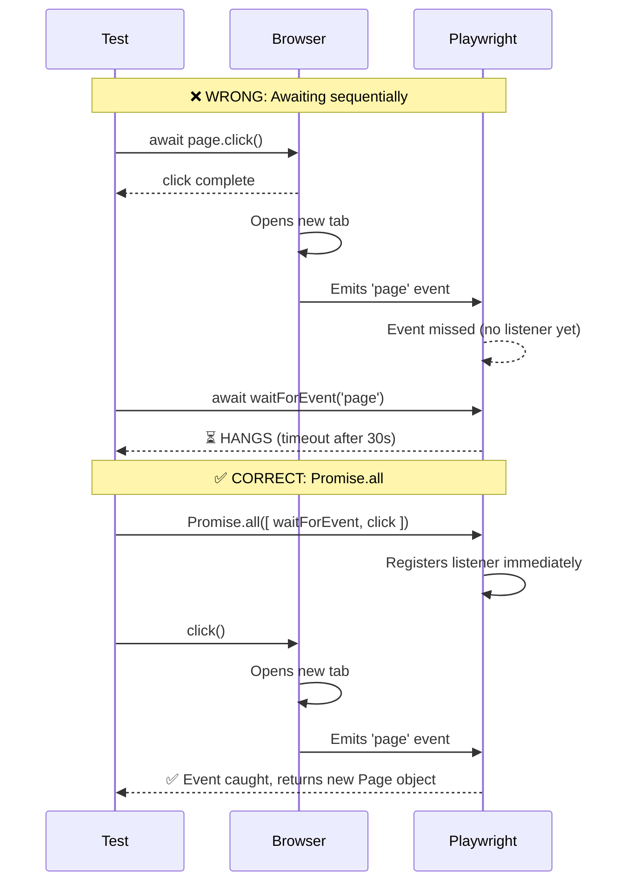

# 12. Cross-Website Pattern 2 — New Tab with Shared Context

**Navigation**: [← Chapter 11: Sequential Flow](./11_CrossSite_Pattern1_Sequential_Flow.md) | [Index](../00_INDEX.md) | [→ Chapter 13: Dual Browser Context](./13_CrossSite_Pattern3_Dual_BrowserContext.md)

**Cross-links:**

- [`07_test_step_E2E_Architecture.md`](../02_Core_Architecture/07_test_step_E2E_Architecture.md) — `Promise.all` for new tab events
- [`08_Browser_Internals_for_SDETs.md`](../02_Core_Architecture/08_Browser_Internals_for_SDETs.md) — BrowserContext vs Page
- [`10_Dynamics365_CRM_Testing.md`](./10_Dynamics365_CRM_Testing.md) — D365 tab load timing

---

## 5W1H

- **WHAT**: How to handle the case where a user action (a click) opens a second browser tab — capturing that new tab as a Playwright `Page` object and automating it alongside the original.
- **WHY**: Enterprise apps frequently open sub-systems in new tabs: "Track Order" opens the logistics platform, "View Invoice" opens the billing portal, "Edit in CRM" opens D365. If you don't capture the new tab, your test loses control of it.
- **WHO**: Any SDET whose app has links or buttons with `target="_blank"`.
- **WHEN**: Any time clicking something opens a new tab instead of navigating the current tab.
- **HOW**: By registering a `'page'` event listener on the `BrowserContext` BEFORE triggering the click, using `Promise.all` to prevent the race condition.

---

## 1. The Critical Distinction: Context vs Page

```
BrowserContext (the browser "profile")
├── Cookies:           Shared across ALL pages in this context
├── LocalStorage:      Shared per origin across ALL pages
├── SessionStorage:    Each Page has its OWN session storage
│
├── Page 1 (the original tab)
│   └── DOM, URL, navigation state — ISOLATED to this Page
│
└── Page 2 (the new tab)
    └── DOM, URL, navigation state — ISOLATED to this Page
    └── But: reads the SAME cookies as Page 1
```

**Key rule:** Same `BrowserContext` = cookies are shared. New tab doesn't need to log in again IF the app uses cookies for auth (most enterprise apps do).

### What Exactly Is Shared vs Isolated

```typescript
// What is SHARED between Page 1 and Page 2 (same BrowserContext):
// ✅ Cookies (for matching domain + path + SameSite)
// ✅ localStorage (per origin — if both tabs on the same origin)
// ✅ Permissions granted (camera, geolocation, notifications)
// ✅ Network routing / proxy settings
// ✅ Certificate overrides
// ✅ HTTP authentication cache

// What is ISOLATED per Page:
// ❌ sessionStorage (per tab, not shared)
// ❌ JavaScript heap (variables, event listeners)
// ❌ DOM (completely separate documents)
// ❌ Active WebSocket connections
// ❌ Service Worker registrations (in some browser versions)
// ❌ Navigation history (back/forward stack)

// How to verify the session is actually shared:
const newTabCookies = await newTab.context().cookies();
const originalCookies = await page.context().cookies();
// Should be identical (same context → same cookie jar)
expect(newTabCookies.some((c) => c.name === "sessionid")).toBe(true);
```

---

## 2. The Race Condition — Why Order Matters

This is the most common mistake when handling new tabs:

```typescript
// ❌ WRONG — race condition
await page.click("#openOrderInNewTab");
// What if the new tab opens and the 'page' event fires BETWEEN these two lines?
// Then waitForEvent never catches it and hangs until timeout!
const newTab = await page.context().waitForEvent("page");
```

**The race visualised:**



### Why This Is a True Race

The event loop processes microtasks before the next I/O callback. When you `await page.click()`, control returns to the event loop while Playwright handles the CDP click command. The browser may process the click and emit the `page` event in the same I/O cycle — before your next `await page.context().waitForEvent()` line even runs. This is a genuine race condition, not a "usually works" issue.

---

## 3. The Correct Pattern — Always Use `Promise.all`

```typescript
// ✅ CORRECT — Promise.all guarantees listener starts before click
const [newTab] = await Promise.all([
  page.context().waitForEvent("page"), // start listening FIRST
  page.click("#openOrderInNewTab"), // then trigger the click
]);

// newTab is a Page object — same API as page
await newTab.waitForLoadState("domcontentloaded");
```

### Why `Promise.all` works

`Promise.all` starts ALL its promises SIMULTANEOUSLY. Both the `waitForEvent` and the `click` are handed to Playwright at the same instant. The listener is registered before the click executes, so even if the new tab opens in 1ms, the listener catches it.

### Alternative: context.on('page') for persistent listeners

```typescript
// When you need to listen for ANY new tab throughout the entire test:
const openedTabs: Page[] = [];

context.on("page", (newPage) => {
  openedTabs.push(newPage);
  console.log(`New tab opened: ${newPage.url()}`);
});

// Now click — the listener is already registered
await page.click("#openOrderInNewTab");

// Wait for at least one tab to open
await expect.poll(() => openedTabs.length).toBeGreaterThan(0);
const orderTab = openedTabs[0];
await orderTab.waitForLoadState("domcontentloaded");

// Cleanup
context.removeAllListeners("page");
```

### The `waitForEvent` Timeout and Predicate

```typescript
// With timeout:
const [newTab] = await Promise.all([
  page.context().waitForEvent("page", { timeout: 30_000 }),
  page.click("#openInNewTab"),
]);

// With predicate — wait for a SPECIFIC new tab (when multiple might open):
const [invoiceTab] = await Promise.all([
  page.context().waitForEvent("page", {
    predicate: (page) => page.url().includes("billing.company.com"),
    timeout: 30_000,
  }),
  page.click("#viewInvoice"),
]);
// This resolves only when a new tab matching the URL predicate opens
// Other new tabs opened simultaneously are ignored
```

---

## 4. After the New Tab Opens — Complete Workflow

```typescript
test("order tracking opens in new tab", async ({ page, context }) => {
  const customerPortal = new CustomerPortalPage(page);
  await customerPortal.goto();
  await customerPortal.login(testAccount);

  // Get the order ID we'll track — store in accumulator
  const data = {
    orderId: null as string | null,
    newTabPage: null as import("@playwright/test").Page | null,
    orderStatus: null as string | null,
  };

  await test.step("Navigate to orders list", async () => {
    await customerPortal.navigateToOrders();
    data.orderId = await customerPortal.getFirstOrderId();
    expect(data.orderId).not.toBeNull();
  });

  await test.step('Click "Track Order" — opens Order Portal in new tab', async () => {
    const [orderTab] = await Promise.all([
      context.waitForEvent("page"),
      customerPortal.clickTrackOrder(data.orderId!),
    ]);

    // Store the new tab's Page object for later steps
    data.newTabPage = orderTab;

    // Wait for the new tab to load
    // D365: use spinner wait; JSP: use domcontentloaded
    await orderTab.waitForLoadState("domcontentloaded");

    // For D365-based order portal:
    await expect(orderTab.locator(".ms-Spinner")).toHaveCount(0, {
      timeout: 30000,
    });
  });

  await test.step("New tab shows correct order ID", async () => {
    const orderTracking = new OrderTrackingPage(data.newTabPage!);
    await orderTracking.waitForLoad();
    await expect(orderTracking.orderIdDisplay).toHaveText(data.orderId!);
  });

  await test.step("New tab: user is already logged in (session shared via cookies)", async () => {
    const orderTracking = new OrderTrackingPage(data.newTabPage!);
    // No login required — cookies are shared with the original page
    await expect(orderTracking.userNameDisplay).toBeVisible();
    await expect(orderTracking.logoutButton).toBeVisible();
    // If this fails: the sites use different domains/auth systems → see Pattern 3
  });

  await test.step("Extract order status from new tab", async () => {
    const orderTracking = new OrderTrackingPage(data.newTabPage!);
    data.orderStatus = await orderTracking.getStatus();
    expect(["PROCESSING", "SHIPPED", "DELIVERED"]).toContain(data.orderStatus);
  });

  // Always clean up new tabs
  await data.newTabPage?.close();
});
```

---

## 5. The `OrderTrackingPage` POM — Wrapping the New Tab

```typescript
// websites/order-portal/pages/OrderTrackingPage.ts

import { type Page, type Locator, expect } from "@playwright/test";

export class OrderTrackingPage {
  private readonly page: Page;
  readonly orderIdDisplay: Locator;
  readonly statusBadge: Locator;
  readonly userNameDisplay: Locator;
  readonly logoutButton: Locator;
  readonly trackingTimeline: Locator;
  readonly estimatedDelivery: Locator;

  constructor(page: Page) {
    // This constructor receives the new tab's Page object — same API, different DOM
    this.page = page;
    this.orderIdDisplay = page.locator('[data-testid="order-id-display"]');
    this.statusBadge = page.locator(".order-status-badge");
    this.userNameDisplay = page.locator(".user-name-header");
    this.logoutButton = page.locator("#logoutBtn");
    this.trackingTimeline = page.locator(".tracking-timeline");
    this.estimatedDelivery = page.locator(".estimated-delivery-date");
  }

  async waitForLoad(): Promise<void> {
    await this.orderIdDisplay.waitFor({ state: "visible", timeout: 20000 });
  }

  async getStatus(): Promise<string> {
    await expect(this.statusBadge).toBeVisible();
    return ((await this.statusBadge.textContent()) ?? "").trim();
  }

  async getEstimatedDelivery(): Promise<string> {
    await expect(this.estimatedDelivery).toBeVisible();
    return ((await this.estimatedDelivery.textContent()) ?? "").trim();
  }

  async close(): Promise<void> {
    if (!this.page.isClosed()) {
      await this.page.close();
    }
  }
}
```

---

## 6. Multi-Tab Test — 3 Tabs Simultaneously

When a user might have 3 tabs open at the same time:

```typescript
test("user manages 3 open tabs simultaneously", async ({ page, context }) => {
  const data = {
    ordersTab: page, // original tab
    orderDetailTab: null as import("@playwright/test").Page | null,
    supportChatTab: null as import("@playwright/test").Page | null,
  };

  await test.step("Open order detail in tab 2", async () => {
    const [tab2] = await Promise.all([
      context.waitForEvent("page"),
      page.click("#viewOrderDetail"),
    ]);
    data.orderDetailTab = tab2;
    await tab2.waitForLoadState("domcontentloaded");
  });

  await test.step("Open support chat in tab 3", async () => {
    // Click on the ORIGINAL tab (data.ordersTab), not the detail tab
    const [tab3] = await Promise.all([
      context.waitForEvent("page"),
      data.ordersTab.click("#openSupportChat"),
    ]);
    data.supportChatTab = tab3;
    await tab3.waitForLoadState("domcontentloaded");
  });

  await test.step("Interact with tab 2 (order detail)", async () => {
    // Bring tab 2 into focus for Playwright (optional — Playwright doesn't require focus)
    await data.orderDetailTab!.bringToFront();
    const orderDetail = new OrderDetailPage(data.orderDetailTab!);
    await expect(orderDetail.orderStatus).toBeVisible();
  });

  await test.step("Interact with tab 3 (support chat)", async () => {
    await data.supportChatTab!.bringToFront();
    const chat = new SupportChatPage(data.supportChatTab!);
    await chat.sendMessage("I need help with my order");
  });

  // Teardown — always close all extra tabs
  await data.orderDetailTab?.close();
  await data.supportChatTab?.close();
});
```

---

## 7. Related: Handling Popups (window.open vs target="\_blank")

`target="_blank"` opens a new tab. `window.open()` may open a popup window (a separate, smaller browser window). Both emit the `'page'` event on the context:

```typescript
// Same Pattern — works for both new tabs AND popup windows
const [popup] = await Promise.all([
  page.context().waitForEvent("page"),
  page.locator("#openPaymentPopup").click(),
]);

// Check what type it is (tab vs popup)
const popupViewport = popup.viewportSize();
if (popupViewport && popupViewport.width < 800) {
  console.log("This is a popup window, not a tab");
}

// Playwright provides a convenience method for popups:
// page.waitForEvent('popup') — equivalent to context.waitForEvent('page')
// But context.waitForEvent('page') works for both tabs AND popups
// page.waitForEvent('popup') only fires for popups opened FROM that specific page
```

```typescript
// page.waitForEvent('popup') — fires on the PAGE that triggers the popup:
const [popup] = await Promise.all([
  page.waitForEvent("popup"), // listens on the triggering PAGE
  page.click("#openTermsAndConditions"),
]);

// context.waitForEvent('page') — fires on the CONTEXT for ANY new page:
const [newPage] = await Promise.all([
  context.waitForEvent("page"), // catches tabs opened by ANY page in the context
  page.click("#openTermsAndConditions"),
]);

// Which to use?
// page.waitForEvent('popup') → when you know exactly which page opens the popup
// context.waitForEvent('page') → when multiple pages might open new tabs
//                               → when the tab opener might be a different page
// Both are correct for simple cases; context.waitForEvent is more flexible
```

---

## 8. Related: File Downloads

When clicking a button triggers a file download (not a new tab), use `page.waitForEvent('download')`:

```typescript
// Pattern: wait for download BEFORE click
const [download] = await Promise.all([
  page.waitForEvent("download"), // ← same race condition applies
  page.locator('[data-testid="export-csv"]').click(),
]);

// Get download info
const suggestedFilename = download.suggestedFilename(); // 'citations-export-2026-05-28.csv'
expect(suggestedFilename).toMatch(/^citations-export-.*\.csv$/);

// Save the file to disk (in a temp location)
const downloadPath = `./test-results/downloads/${suggestedFilename}`;
await download.saveAs(downloadPath);

// Verify file content
import { readFileSync } from "fs";
const csvContent = readFileSync(downloadPath, "utf-8");
const lines = csvContent.split("\n");
expect(lines[0]).toContain("Citation ID,Customer ID,Status,Amount"); // header row
expect(lines.length).toBeGreaterThan(1); // at least one data row

// Or: read without saving
const stream = await download.createReadStream();
// process the stream...

// Failure case:
const failure = await download.failure();
if (failure) throw new Error(`Download failed: ${failure}`);

// Cleanup
await download.delete(); // remove from Playwright's temp storage
```

---

## 9. D365-Specific: New Tab Takes 10 Seconds

D365 new tabs are notoriously slow because each new tab re-initialises the entire React + Fluent UI stack:

```typescript
// ❌ Naive wait — too early, D365 shell loads but data isn't there
await newTab.waitForLoadState("load"); // ~1s

// ✅ Correct D365 new tab wait:
await newTab.waitForLoadState("domcontentloaded"); // DOM structure ready (~1-2s)

// Wait for spinner to appear (confirms data fetch started)
try {
  await newTab
    .locator(".ms-Spinner")
    .waitFor({ state: "visible", timeout: 3000 });
} catch {
  // Spinner appeared and disappeared before we checked — that's fine
}

// Wait for spinner to disappear (confirms data fetch finished)
await expect(newTab.locator(".ms-Spinner")).toHaveCount(0, { timeout: 45000 });

// Wait for actual data to appear
await expect(newTab.locator(".ms-DetailsList-row").first()).toBeVisible({
  timeout: 30000,
});
```

### D365 Tab Timing by Action Type

```
Action                                  Shell Load   Data Load   Total
Open entity record from grid row        1-2s         5-10s       6-12s
Open in new tab via right-click         1-2s         5-10s       6-12s
Open from email/notification link       2-4s         5-12s       7-16s
Open related entity (subgrid click)     1-2s         4-8s        5-10s
Open form in dialog (NOT new tab)       0.5-1s       2-5s        2.5-6s

Strategy: Always use 30s-45s timeout for D365 data assertions in new tabs.
Never use: waitForLoadState('networkidle') — D365 has background polling
```

---

## 10. Tab Management via `afterEach` — Prevent Tab Leaks

```typescript
test.describe("New Tab Tests", () => {
  let newTabPages: import("@playwright/test").Page[] = [];

  test.afterEach(async () => {
    // Close all new tabs opened during the test
    for (const tab of newTabPages) {
      if (!tab.isClosed()) {
        await tab.close();
      }
    }
    newTabPages = [];
  });

  test("track order in new tab", async ({ page, context }) => {
    const [orderTab] = await Promise.all([
      context.waitForEvent("page"),
      page.click("#trackOrder"),
    ]);
    newTabPages.push(orderTab); // register for cleanup
    // ... rest of test
  });
});
```

### Better: Use a Fixture for Tab Management

```typescript
// fixtures/tab-manager.fixture.ts

import { test as base } from "@playwright/test";
import type { Page } from "@playwright/test";

interface TabManager {
  /** Open a new tab by clicking a locator. Auto-registers for cleanup. */
  click: (
    triggerPage: Page,
    locatorOrAction: import("@playwright/test").Locator | (() => Promise<void>),
    opts?: { timeout?: number; urlPattern?: string },
  ) => Promise<Page>;

  /** All tabs opened through this manager */
  all: Page[];
}

export const test = base.extend<{ tabManager: TabManager }>({
  tabManager: async ({ context }, use) => {
    const openedTabs: Page[] = [];

    const click = async (
      triggerPage: Page,
      locatorOrAction:
        | import("@playwright/test").Locator
        | (() => Promise<void>),
      opts: { timeout?: number; urlPattern?: string } = {},
    ): Promise<Page> => {
      const action =
        typeof locatorOrAction === "function"
          ? locatorOrAction
          : () => locatorOrAction.click();

      const predicate = opts.urlPattern
        ? (p: Page) => p.url().includes(opts.urlPattern!)
        : undefined;

      const [newTab] = await Promise.all([
        context.waitForEvent("page", {
          predicate,
          timeout: opts.timeout ?? 30_000,
        }),
        action(),
      ]);

      openedTabs.push(newTab);
      await newTab.waitForLoadState("domcontentloaded");
      return newTab;
    };

    await use({ click, all: openedTabs });

    // Teardown: close all tracked tabs
    for (const tab of openedTabs) {
      if (!tab.isClosed()) await tab.close().catch(() => {});
    }
  },
});

// Usage:
test("order tracking", async ({ page, tabManager }) => {
  const orderTab = await tabManager.click(
    page,
    page.locator('[data-testid="track-order-btn"]'),
    { urlPattern: "order-portal.company.com" },
  );

  const orderPage = new OrderTrackingPage(orderTab);
  await expect(orderPage.statusBadge).toHaveText("SHIPPED");
  // No manual cleanup needed — fixture handles it
});
```

---

## 11. All Context-Level Events — Complete Reference

```typescript
// BrowserContext emits these events:
context.on("page", (page) => {
  /* new tab or popup opened */
});
context.on("backgroundpage", (page) => {
  /* Chrome extension background page */
});
context.on("serviceworker", (worker) => {
  /* service worker registered */
});
context.on("request", (request) => {
  /* any request from any page in the context */
});
context.on("response", (response) => {
  /* any response to any page in the context */
});
context.on("requestfailed", (request) => {
  /* any failed request */
});
context.on("requestfinished", (request) => {
  /* request completed */
});
context.on("close", () => {
  /* context closed */
});

// Page emits these events:
page.on("popup", (popup) => {
  /* popup opened FROM THIS page */
});
page.on("download", (download) => {
  /* download started from this page */
});
page.on("dialog", (dialog) => {
  /* alert/confirm/prompt dialog opened */
});
page.on("filechooser", (chooser) => {
  /* file input dialog opened */
});
page.on("framenavigated", (frame) => {
  /* frame navigated */
});
page.on("load", () => {
  /* page load event */
});
page.on("domcontentloaded", () => {
  /* DOMContentLoaded fired */
});
page.on("close", () => {
  /* page closed */
});
page.on("crash", () => {
  /* page crashed */
});
page.on("console", (msg) => {
  /* console.log/warn/error in the page */
});
page.on("pageerror", (error) => {
  /* uncaught exception in the page */
});
page.on("requestfailed", (request) => {
  /* request failed on THIS page */
});
page.on("websocket", (ws) => {
  /* WebSocket opened on THIS page */
});
```

### Listening for Console Errors in the New Tab

```typescript
// Common need: verify no console errors appear in the new tab
const newTabErrors: string[] = [];

const [newTab] = await Promise.all([
  context.waitForEvent("page"),
  page.click("#openReport"),
]);

// Start listening immediately after we have the tab reference
newTab.on("pageerror", (error) => {
  newTabErrors.push(error.message);
});
newTab.on("console", (msg) => {
  if (msg.type() === "error") newTabErrors.push(msg.text());
});

await newTab.waitForLoadState("domcontentloaded");
await expect(newTab.locator(".report-content")).toBeVisible({
  timeout: 30_000,
});

// Assert no errors occurred
expect(
  newTabErrors,
  `Console errors in new tab: ${newTabErrors.join(", ")}`,
).toHaveLength(0);
```

---

## 🏋️ Practice Challenges

### Challenge 1 [MCQ] — Race Condition

Which code correctly handles a new tab opening?

```
A) const newTab = await context.waitForEvent('page');
   await page.click('#openNewTab');

B) await page.click('#openNewTab');
   const [newTab] = await Promise.all([context.waitForEvent('page')]);

C) const [newTab] = await Promise.all([
     context.waitForEvent('page'),
     page.click('#openNewTab'),
   ]);

D) const newTab = await page.waitForEvent('page');
```

<details><summary>Answer</summary>

**C** — The only correct pattern. `Promise.all` ensures `waitForEvent` starts listening BEFORE `click()` fires. Option A has the race condition (click before listener). Option B fires click first then starts listening. Option D is wrong — `page` doesn't emit `'page'` events, `context` does. `page` emits `'popup'` events.

</details>

---

### Challenge 2 [Spot the Bug]

```typescript
const [newTab] = await Promise.all([
  page.context().waitForEvent("page"),
  page.locator("#openDetails").click(),
]);

await newTab.waitForLoadState("networkidle"); // waiting for network idle

const details = new OrderDetailsPage(newTab);
await expect(details.titleLocator).toBeVisible();
```

<details><summary>Answer</summary>

`waitForLoadState('networkidle')` waits for no network activity for 500ms. On D365 or any SPA with background polling (session keep-alive, telemetry, real-time updates), `networkidle` NEVER fires because there's always some background request. The test will hang until timeout.

Fix:

```typescript
await newTab.waitForLoadState("domcontentloaded");
await expect(newTab.locator(".ms-Spinner")).toHaveCount(0, { timeout: 30000 });
// Then assert on actual content:
await expect(details.titleLocator).toBeVisible({ timeout: 30000 });
```

</details>

---

### Challenge 3 [Write It Yourself]

A billing portal page has a button that downloads a CSV export. Write a test that:

1. Clicks the export button
2. Captures the download
3. Asserts the filename matches `citations-export-YYYY-MM-DD.csv`
4. Saves and reads the file
5. Asserts the first line is the expected CSV header

<details><summary>Answer</summary>

```typescript
test("Citations CSV export downloads correctly", async ({ page }) => {
  await page.goto("/billing/citations");
  await expect(page.locator(".citations-grid")).toBeVisible();

  const [download] = await Promise.all([
    page.waitForEvent("download"),
    page.locator('[data-testid="export-csv-btn"]').click(),
  ]);

  // 1. Verify filename format
  const filename = download.suggestedFilename();
  expect(filename).toMatch(/^citations-export-\d{4}-\d{2}-\d{2}\.csv$/);

  // 2. Verify no download error
  const failure = await download.failure();
  expect(failure, `Download failed: ${failure}`).toBeNull();

  // 3. Save and read content
  const savePath = `./test-results/downloads/${filename}`;
  await download.saveAs(savePath);

  const { readFileSync } = await import("fs");
  const csvContent = readFileSync(savePath, "utf-8");
  const lines = csvContent.trim().split("\n");

  // 4. Assert header row
  expect(lines[0]).toBe(
    "Citation ID,Customer ID,Status,Amount,Issue Date,Due Date",
  );
  expect(lines.length, "CSV must have at least 1 data row").toBeGreaterThan(1);

  // 5. Assert first data row structure
  const firstDataRow = lines[1].split(",");
  expect(firstDataRow[0]).toMatch(/^CIT-/); // Citation ID format
  expect(firstDataRow[2]).toMatch(/^(PENDING|PAID|OVERDUE|DISPUTED)$/); // Valid status
});
```

</details>

---

### Challenge 4 [Deep Understanding]

Explain why `sessionStorage` is NOT shared between two tabs in the same `BrowserContext`, even though cookies and `localStorage` are.

<details><summary>Answer</summary>

`sessionStorage` is defined by the Web Storage specification as being **tab-scoped** (more precisely: "browsing context"-scoped). Each browser tab is a separate browsing context and gets its own `sessionStorage` namespace, even if they share the same origin.

This is by design — `sessionStorage` was intended for single-tab workflows (e.g., a multi-step form) where you don't want the data leaking to other tabs of the same site.

In contrast:

- **Cookies** are sent by the browser with every HTTP request to the matching domain — they're tied to the network layer, not to any specific tab
- **localStorage** is a persistent, origin-level store explicitly designed to be shared across all browsing contexts for that origin

**Practical implication for tests:**
If your app uses `sessionStorage` to track a user flow state (e.g., `sessionStorage.setItem('onboardingStep', '3')`), that state is NOT in the new tab. The new tab starts with empty `sessionStorage`. This can cause bugs where:

- Tab 1: user is on step 3 of onboarding
- Tab 2: user opens a new tab → sees step 1 (sessionStorage is empty)

Tests should verify this behavior explicitly if the app uses sessionStorage for state management.

</details>

---

## 12. Concurrent Dual-Tab Interaction — Agent + Customer Scenario

The hardest new-tab pattern: you need to interact with Tab 1 and Tab 2 in an interleaved sequence. A real example: the agent creates a note in the CRM tab, and the customer sees it immediately in the portal tab (testing real-time sync).

```typescript
test("Real-time sync: agent adds note → customer sees it within 3s", async ({
  page, // Tab 1: Agent CRM tab
  context,
}) => {
  const data = {
    noteId: null as string | null,
    noteText: `Sync test note ${Date.now()}`,
    customerTab: null as import("@playwright/test").Page | null,
  };

  // ── Tab 1: Agent logs into CRM and opens customer record ──────────────────
  const agentCRM = new AgentCRMPage(page);
  await agentCRM.goto();
  await agentCRM.searchCustomer("CUST-001");
  await agentCRM.openCustomerRecord();

  // ── Tab 2: Open customer portal in a second tab ────────────────────────────
  // We manually open the second tab (not via a click) because we're simulating
  // the customer opening their portal independently:
  const customerTab = await context.newPage();
  data.customerTab = customerTab;
  const customerPortal = new CustomerPortalPage(customerTab);
  await customerPortal.goto();
  await customerPortal.loginWith(data.email!, data.tempPassword!);

  // ── Tab 1 (Agent): Add a note to the customer record ──────────────────────
  await test.step("Agent adds note in CRM (Tab 1)", async () => {
    const agentNotes = new AgentNotesComponent(page);
    await agentNotes.addNote(data.noteText);
    data.noteId = await agentNotes.getLastNoteId();
    expect(data.noteId).not.toBeNull();
  });

  // ── Tab 2 (Customer): Note should appear within 3 seconds ─────────────────
  await test.step("Customer sees note in portal within 3s (Tab 2)", async () => {
    const customerNotifications = new CustomerNotificationsComponent(
      customerTab,
    );

    // poll() retries the condition until it's true or times out
    await expect
      .poll(
        async () => {
          const latestNote = await customerNotifications.getLatestNoteText();
          return latestNote;
        },
        {
          message: `Expected note "${data.noteText}" to appear within 3s`,
          timeout: 3_000,
          intervals: [200, 500, 1_000], // check every 200ms, then 500ms, then 1s
        },
      )
      .toContain(data.noteText);
  });

  // Cleanup
  await data.customerTab?.close();
});
```

```typescript
// context.newPage() vs waiting for 'page' event:
//
// context.newPage()        → YOU open a new tab programmatically (no click needed)
// context.waitForEvent('page') → The APP opens a new tab (via target="_blank" or window.open)
//
// Use context.newPage() when:
//   - You want to simulate a second user opening the app in a new tab
//   - You need to test multi-user scenarios (agent + customer) in one test
//   - The second tab is NOT opened by a click in the first tab

// The new tab from context.newPage() still shares cookies with the original:
const newTab = await context.newPage();
const cookies = await newTab.context().cookies();
// cookies === (same as page.context().cookies()) ← yes, shared
```

---

**Challenge 5 [bringToFront]:** You have two tabs: `agentTab` and `customerTab`. You call `await agentTab.bringToFront()` before interacting with it. Is this required for Playwright to automate the tab? What is `bringToFront()` actually for?

<details><summary>Answer</summary>

**Not required for automation.** Playwright does NOT require a tab to be in the foreground to interact with it. All Playwright commands are sent directly via the CDP (Chrome DevTools Protocol) to the specific page object — regardless of which tab the user is "looking at" in the browser window.

`bringToFront()` does two things:

1. Brings the tab to the foreground in the actual browser window (makes it the active/visible tab)
2. Triggers the `visibilitychange` browser event on that page (fires `document.visibilityState === 'visible'`)

**When you NEED it:**

- Your app has code that pauses activity when the tab is in the background (`document.addEventListener('visibilitychange', ...)`) — common in video players, real-time dashboards, chat apps
- You are recording a video and want to show which tab is active
- A component uses the Page Visibility API and only renders in the foreground tab

**When you DON'T need it:**

- Almost all standard form interactions, clicks, and API calls
- Reading text, asserting visibility, filling inputs

```typescript
// ✅ This works WITHOUT bringToFront():
await agentTab.locator("#noteInput").fill("Test note");
await agentTab.locator("#saveNote").click();

// bringToFront() is only needed if the app pauses when backgrounded:
await agentTab.bringToFront(); // triggers visibilitychange → app resumes
await agentTab.locator("#liveDataFeed").waitFor({ state: "visible" });
```

</details>

---

## 13. The SharePoint Redirect Pattern (A War Story)

**The Scenario:**
Enterprise apps often integrate with SharePoint. A user clicks "View Document" in D365, which opens a new tab to `company.sharepoint.com`. Because SharePoint uses Microsoft SSO, the user is authenticated, but SharePoint employs a notorious multi-redirect sequence before rendering the document.

**The Trap:**

```typescript
const [sharepointTab] = await Promise.all([
  context.waitForEvent("page"),
  page.locator("text=View Document").click(),
]);

await sharepointTab.waitForLoadState("domcontentloaded"); // ❌ Flaky!
await expect(sharepointTab.locator(".sp-DocumentViewer")).toBeVisible(); // ❌ Fails!
```

The `domcontentloaded` state fires on the _first_ redirect page (an empty shell), not the final destination. The locator assertion then fails because the final app hasn't loaded yet.

**The Solution:**
Wait for the URL to stabilize onto the final destination route before asserting on the DOM.

```typescript
const [sharepointTab] = await Promise.all([
  context.waitForEvent("page"),
  page.locator("text=View Document").click(),
]);

// ✅ 1. Wait for the URL to reach the final SharePoint destination pattern
// This handles the N-number of SSO redirects transparently
await sharepointTab.waitForURL("**/sharepoint.com/**/Doc.aspx**", {
  timeout: 30000,
});

// ✅ 2. Now wait for the heavy SPA to load
await sharepointTab.waitForLoadState("domcontentloaded");

// ✅ 3. Finally, wait for the actual content
await expect(sharepointTab.locator(".sp-DocumentViewer")).toBeVisible({
  timeout: 20000,
});
```

Never rely purely on `waitForLoadState` when SSO redirects are involved in a new tab.

---

## 📚 References & Further Reading

### Official Documentation

- [Playwright Pages (Tabs)](https://playwright.dev/docs/pages) — Official guide on handling multiple pages and tabs
- [Playwright Events (`waitForEvent`)](https://playwright.dev/docs/events) — Detailed API for event listeners
- [Playwright `waitForURL`](https://playwright.dev/docs/api/class-page#page-wait-for-url) — Handling redirects reliably

### Deep Dives

- [MDN: Window `postMessage()`](https://developer.mozilla.org/en-US/docs/Web/API/Window/postMessage) — How complex apps communicate between tabs (useful when testing real-time tab sync)
- [Web Storage API](https://developer.mozilla.org/en-US/docs/Web/API/Web_Storage_API) — The strict differences between `sessionStorage` and `localStorage` scopes across tabs

---

**Navigation**: [← Chapter 11: Sequential Flow](./11_CrossSite_Pattern1_Sequential_Flow.md) | [Index](../00_INDEX.md) | [→ Chapter 13: Dual Browser Context](./13_CrossSite_Pattern3_Dual_BrowserContext.md)


---

## Reality Check

**"page.waitForEvent('popup') catches all new tabs"**→ waitForEvent('popup') only catches tabs opened by window.open or target=_blank links. Tabs opened by browser extensions, JavaScript that modifies window.location, or server-side redirects with new windows may not trigger the popup event. Always race the popup event listener with a click action: const [popup] = await Promise.all([page.waitForEvent('popup'), page.click(link)]).

**"New tabs in the same context share all state"**→ Tabs in the same BrowserContext share cookies, localStorage origin-scoped storage, and service workers. But they do NOT share: in-memory JavaScript state, Web Worker instances, or IndexedDB locks. A web application that uses in-memory state management (React context, Vuex store) has independent state per tab even in the same browser context.

**"Closing a popup tab is simple cleanup"**→ Closing a popup tab that has unsaved form data may trigger a beforeunload dialog that Playwright cannot dismiss automatically. Add page.on('dialog', dialog => dialog.accept()) before closing. Also, closing a tab that initiated a long-running operation (file upload, API call) may leave the server-side operation orphaned.

**"The parent page remains stable while working on a popup"**→ Background tabs may receive: WebSocket messages that update state, setTimeout callbacks that modify the DOM, or server-push events that show notifications. When you switch back to the parent page after working on a popup, the page state may have changed. Re-verify the parent page state before continuing assertions.

**"SharedContext means tests can depend on each other"**→ Shared context in the SAME test allows multi-tab interactions. But shared context between DIFFERENT tests creates order-dependent, non-parallelizable tests. Each test should be independently runnable. If test B depends on the state created by test A, a failure in test A cascades to test B, making root cause analysis harder.
