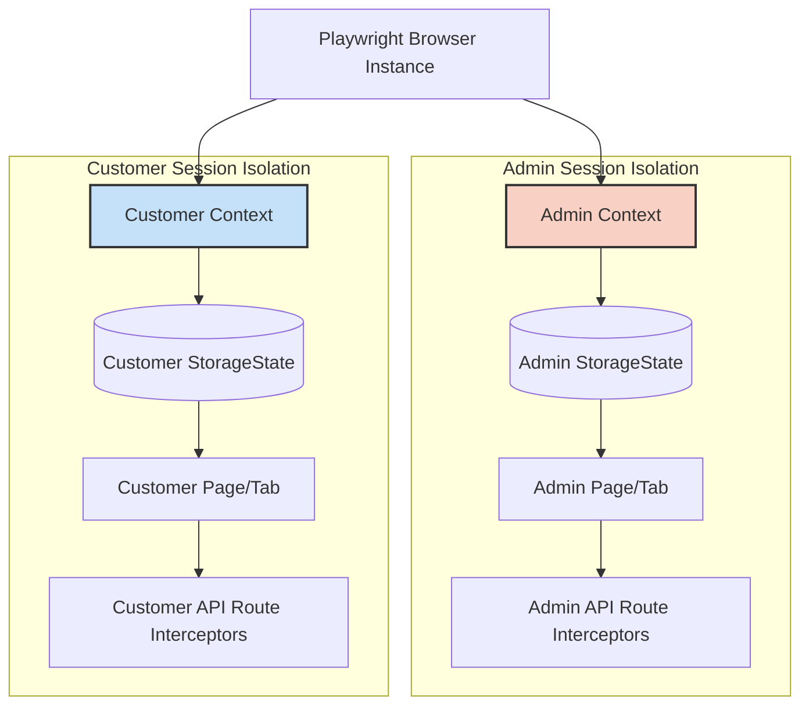

# 13. Cross-Website Pattern 3 — Dual Browser Contexts (Admin + Customer Simultaneously)

**Navigation**: [← Chapter 12: New Tab Shared Context](./12_CrossSite_Pattern2_NewTab_SharedContext.md) | [Index](../00_INDEX.md) | [→ Chapter 14: Token & Magic Link](./14_CrossSite_Pattern4_Token_Magic_Link.md)

**Cross-links:**

- [`06_Custom_Fixtures_Architecture.md`](../02_Core_Architecture/06_Custom_Fixtures_Architecture.md) — `browser` fixture, context creation
- [`16_CrossSite_Pattern6_StorageState_Chaining.md`](./16_CrossSite_Pattern6_StorageState_Chaining.md) — Pre-saved auth states

---

## 5W1H

- **WHAT**: Running two completely isolated browser sessions simultaneously in one test — one as admin, one as customer — to verify that an admin action is immediately reflected in the customer's view.
- **WHY**: Some bugs only appear at the session boundary. An admin suspends an account — does the customer's next request get a 403? An admin changes a price — does the customer's cart update? You cannot test this with one session.
- **WHO**: SDETs testing any admin-facing action whose effect must appear on the customer-facing side.
- **WHEN**: Tests whose description says "admin does X → customer sees Y."
- **HOW**: By creating two `BrowserContext` objects from the same `browser` fixture, each with its own auth state, running them as alternating steps in one test.

---

## 1. Context vs Page — The Full Isolation Table

| What is shared?       | Same Page | Same Context, Different Pages | Different Contexts |
| --------------------- | --------- | ----------------------------- | ------------------ |
| Cookies               | ✅ Yes    | ✅ Yes (same origin)          | ❌ No              |
| localStorage          | ✅ Yes    | ✅ Yes (same origin)          | ❌ No              |
| sessionStorage        | ✅ Yes    | ❌ No (per-tab)               | ❌ No              |
| Auth state            | ✅ Yes    | ✅ Yes                        | ❌ No              |
| Network interceptors  | ✅ Yes    | ✅ Yes                        | ❌ No              |
| Certificate overrides | ✅ Yes    | ✅ Yes                        | ❌ No              |

**Rule:** For two isolated sessions (e.g., admin + customer), you MUST use two different `BrowserContext` objects.

### Dual Context Architecture Visualised



---

## 2. Creating Two Contexts From the Same Browser

```typescript
test("admin suspends account → customer portal shows suspended state", async ({
  browser,
}) => {
  // Note: We use 'browser' fixture (not 'page' or 'context')
  // 'browser' gives us a Browser object we can create multiple contexts from

  // Context A — Admin session
  const adminContext = await browser.newContext({
    storageState: "auth-states/admin-state.json", // pre-saved admin login
    viewport: { width: 1920, height: 1080 },
  });

  // Context B — Customer session
  const customerContext = await browser.newContext({
    storageState: "auth-states/customer-state.json", // pre-saved customer login
    viewport: { width: 1280, height: 720 },
  });

  // Create a Page from each context
  const adminTab = await adminContext.newPage();
  const customerTab = await customerContext.newPage();

  try {
    // Now both sessions are completely isolated
    // Anything the admin does in adminTab has NO effect on customerTab's session
    // ... test steps ...
  } finally {
    // ALWAYS close both — even if the test fails
    await adminContext.close();
    await customerContext.close();
  }
});
```

---

## 3. The Full Dual-Context Test

```typescript
import { test, expect } from "@playwright/test";
import { AdminPortalPage } from "../../websites/admin-crm/pages/AdminPortalPage";
import { CustomerPortalPage } from "../../websites/customer-portal/pages/CustomerPortalPage";

const testCustomer = {
  id: process.env.TEST_CUSTOMER_ID!,
  email: process.env.TEST_CUSTOMER_EMAIL!,
};

test.describe("Admin ↔ Customer Cross-Session Tests @dual-context", () => {
  test("Admin suspends account → Customer portal shows suspended banner", async ({
    browser,
  }) => {
    const data = {
      adminActionCompleted: false,
      customerSesSuspendedBanner: false,
      customerRedirectedToLogin: false,
    };

    const adminContext = await browser.newContext({
      storageState: "auth-states/admin-state.json",
    });
    const customerContext = await browser.newContext({
      storageState: "auth-states/customer-state.json",
    });

    const adminTab = await adminContext.newPage();
    const customerTab = await customerContext.newPage();

    try {
      const adminPortal = new AdminPortalPage(adminTab);
      const customerPortal = new CustomerPortalPage(customerTab);

      // ─── ADMIN SIDE: navigate and verify initial state ────────────────
      await test.step("[Admin] Navigate to Admin Portal", async () => {
        await adminPortal.goto();
      });

      await test.step("[Customer] Navigate to Customer Portal", async () => {
        await customerPortal.goto();
        // Customer is logged in — verify initial healthy state
        await expect(customerPortal.dashboardWelcome).toBeVisible({
          timeout: 20000,
        });
      });

      await test.step("[Admin] Find and suspend the test customer account", async () => {
        await adminPortal.users.navigateToUser(testCustomer.id);
        await adminPortal.users.suspendAccount(testCustomer.id);
        data.adminActionCompleted = true;

        // Verify admin side shows suspended
        const statusField = adminTab.locator(
          '[data-automation-key="statecode"]',
        );
        await expect(statusField).toHaveText("Inactive", { timeout: 15000 });
      });

      // ─── CUSTOMER SIDE: verify the effect ────────────────────────────
      await test.step("[Customer] Reload the portal", async () => {
        await customerTab.reload();
        // After reload, the suspended check should kick in
        await customerTab.waitForLoadState("domcontentloaded");
      });

      await test.step("[Customer] Customer sees suspended banner OR is redirected to login", async () => {
        // Wait for either outcome — give it 20 seconds for server to propagate
        const suspendedBanner = customerPortal.suspendedBanner;
        const loginButton = customerPortal.loginButton;

        await expect(suspendedBanner.or(loginButton)).toBeVisible({
          timeout: 20000,
        });

        if (await suspendedBanner.isVisible()) {
          data.customerSesSuspendedBanner = true;
        } else {
          data.customerRedirectedToLogin = true;
        }

        // At least one outcome must be true
        expect(
          data.customerSesSuspendedBanner || data.customerRedirectedToLogin,
          "Customer should see suspended state or be kicked to login",
        ).toBe(true);
      });

      // ─── ADMIN SIDE: reactivate (cleanup) ─────────────────────────────
      await test.step("[Admin] Reactivate customer account (test cleanup)", async () => {
        await adminPortal.users.activateAccount(testCustomer.id);
        const statusField = adminTab.locator(
          '[data-automation-key="statecode"]',
        );
        await expect(statusField).toHaveText("Active", { timeout: 15000 });
      });
    } finally {
      await adminContext.close();
      await customerContext.close();
    }
  });
});
```

---

## 4. The Timing Problem — Propagation Delay

When Admin does something, it doesn't appear on Customer's side instantly. The data has to:

1. Be written to the database on the backend (milliseconds to seconds)
2. The customer's next request must read fresh data (some apps cache the session)
3. The customer's UI must re-render

**This is eventual consistency, tested in miniature.** Werner Vogels (Amazon CTO) gave the formal definition in his 2008 ACM Queue paper *Eventually Consistent*: "if no new updates are made to the object, eventually all accesses will return the last updated value" — the guarantee is convergence *given time*, not immediacy. Admin's write and Customer's read are two different vantage points into the same underlying system, exactly like two replicas in a distributed store; the gap between them isn't a bug to eliminate, it's the consistency model itself. A test that reloads once and asserts immediately is testing for *strong* consistency the system was never designed to provide — which is why polling (below) isn't a workaround, it's the only test strategy that matches what the system actually promises.

**Polling strategy for eventual consistency:**

```typescript
await test.step("[Customer] Wait for suspended state to propagate", async () => {
  // Don't just reload once — poll until the state appears
  await expect
    .poll(
      async () => {
        await customerTab.reload();
        await customerTab.waitForLoadState("domcontentloaded");
        return await customerPortal.suspendedBanner.isVisible();
      },
      {
        message: "Expected customer to see suspended banner within 30 seconds",
        timeout: 30_000,
        intervals: [2000, 3000, 5000, 5000, 5000, 5000, 5000], // retry every 2-5s
      },
    )
    .toBe(true);
});
```

---

## 5. Context-Level Request Interception — Per Session

Each `BrowserContext` has its own `route()` interceptor. This lets you intercept requests differently per session:

```typescript
test("admin sees full data, customer sees masked data", async ({ browser }) => {
  const adminContext = await browser.newContext({
    storageState: "auth-states/admin-state.json",
  });
  const customerContext = await browser.newContext({
    storageState: "auth-states/customer-state.json",
  });
  const adminTab = await adminContext.newPage();
  const customerTab = await customerContext.newPage();

  try {
    // Monitor what each session receives from the API
    const adminApiResponses: Record<string, unknown>[] = [];
    const customerApiResponses: Record<string, unknown>[] = [];

    // Route on the CONTEXT — only intercepts requests from pages in this context
    await adminContext.route("**/api/customers/**", async (route) => {
      const response = await route.fetch();
      const body = await response.json();
      adminApiResponses.push(body);
      await route.fulfill({ response });
    });

    await customerContext.route("**/api/customers/**", async (route) => {
      const response = await route.fetch();
      const body = await response.json();
      customerApiResponses.push(body);
      await route.fulfill({ response });
    });

    // Navigate both
    await adminTab.goto("/admin/customers/CUST-001");
    await customerTab.goto("/portal/my-account");

    await adminTab.waitForResponse((r) => r.url().includes("/api/customers/"));
    await customerTab.waitForResponse((r) =>
      r.url().includes("/api/customers/"),
    );

    // Admin sees SSN, customer sees masked SSN
    const adminData = adminApiResponses[0] as { ssn: string };
    const customerData = customerApiResponses[0] as { ssn: string };

    expect(adminData.ssn).toMatch(/^\d{9}$/); // full SSN
    expect(customerData.ssn).toMatch(/^\*{5}\d{4}$/); // masked: *****1234
  } finally {
    await adminContext.close();
    await customerContext.close();
  }
});
```

### Network Condition Simulation Per Context

```typescript
// Simulate slow customer connection while admin has fast connection:
const slowCustomerContext = await browser.newContext({
  storageState: "auth-states/customer-state.json",
});

// Emulate slow 3G for the customer context
const cdpSession = await slowCustomerContext.newCDPSession(
  await slowCustomerContext.newPage(),
);
await cdpSession.send("Network.enable");
await cdpSession.send("Network.emulateNetworkConditions", {
  offline: false,
  downloadThroughput: (500 * 1024) / 8, // 500 Kbps
  uploadThroughput: (500 * 1024) / 8,
  latency: 200, // 200ms RTT
});

// Now admin on fast connection can do something, and we verify
// customer on slow connection still sees a consistent (if delayed) result
```

---

## 6. Monitoring Cross-Session Events

```typescript
// Listen for requests/responses in BOTH contexts simultaneously:
const allRequests: string[] = [];

adminContext.on("request", (req) =>
  allRequests.push(`[ADMIN] ${req.method()} ${req.url()}`),
);
customerContext.on("request", (req) =>
  allRequests.push(`[CUSTOMER] ${req.method()} ${req.url()}`),
);

// After the test, you can dump the full request log:
console.log("Cross-session requests:", allRequests.join("\n"));
// Very useful for debugging: did the customer's session make an unexpected admin API call?

// Alert on cross-context API boundary violations:
customerContext.on("request", (req) => {
  if (req.url().includes("/api/admin/")) {
    throw new Error(
      `SECURITY VIOLATION: Customer session accessed admin API: ${req.url()}`,
    );
  }
});
```

---

## 7. Dual-Context Fixture — Reusable for All Tests

Extract the context setup into a fixture so you don't repeat it:

```typescript
// fixtures/dual-context.fixture.ts

import {
  test as base,
  type Browser,
  type BrowserContext,
  type Page,
} from "@playwright/test";
import { AdminPortalPage } from "../websites/admin-crm/pages/AdminPortalPage";
import { CustomerPortalPage } from "../websites/customer-portal/pages/CustomerPortalPage";

interface DualContextFixtures {
  adminContext: BrowserContext;
  customerContext: BrowserContext;
  adminTab: Page;
  customerTab: Page;
  adminPortal: AdminPortalPage;
  customerPortal: CustomerPortalPage;
}

export const test = base.extend<DualContextFixtures>({
  adminContext: async ({ browser }, use) => {
    const ctx = await browser.newContext({
      storageState: "auth-states/admin-state.json",
    });
    await use(ctx);
    await ctx.close(); // always closed, even on failure
  },

  customerContext: async ({ browser }, use) => {
    const ctx = await browser.newContext({
      storageState: "auth-states/customer-state.json",
    });
    await use(ctx);
    await ctx.close();
  },

  adminTab: async ({ adminContext }, use) => {
    const page = await adminContext.newPage();
    await use(page);
    await page.close();
  },

  customerTab: async ({ customerContext }, use) => {
    const page = await customerContext.newPage();
    await use(page);
    await page.close();
  },

  adminPortal: async ({ adminTab }, use) => {
    await use(new AdminPortalPage(adminTab));
  },

  customerPortal: async ({ customerTab }, use) => {
    await use(new CustomerPortalPage(customerTab));
  },
});

export { expect } from "@playwright/test";
```

**With the fixture — the test becomes clean:**

```typescript
import { test, expect } from "../../fixtures/dual-context.fixture";

test("admin price change → customer cart updates", async ({
  adminPortal,
  customerPortal,
  adminTab,
  customerTab,
}) => {
  await adminPortal.goto();
  await customerPortal.goto();

  // Admin changes price
  await adminPortal.products.updatePrice("PROD-001", 99.99);

  // Customer refreshes cart
  await customerTab.reload();
  await expect(customerPortal.cartItemPrice).toHaveText("$99.99", {
    timeout: 20000,
  });
});
```

---

## 9. The Three-Context Pattern — Admin + Agent + Customer

When you need to test a 3-role workflow simultaneously (e.g., admin creates policy, agent assigns it, customer sees it):

```typescript
test("Admin creates policy → Agent assigns → Customer sees assigned policy", async ({
  browser,
}) => {
  const adminContext = await browser.newContext({
    storageState: "auth-states/admin-state.json",
  });
  const agentContext = await browser.newContext({
    storageState: "auth-states/agent-state.json",
  });
  const customerContext = await browser.newContext({
    storageState: "auth-states/customer-state.json",
  });

  const adminTab = await adminContext.newPage();
  const agentTab = await agentContext.newPage();
  const customerTab = await customerContext.newPage();

  const data = { policyId: null as string | null };

  try {
    await test.step("[Admin] Create new policy", async () => {
      const adminPortal = new AdminPortalPage(adminTab);
      await adminPortal.goto();
      data.policyId = await adminPortal.policies.create({
        type: "BRONZE",
        annualLimit: 10_000,
      });
      expect(data.policyId).toBeTruthy();
    });

    await test.step("[Agent] Assign policy to customer CUST-001", async () => {
      const agentPortal = new AgentPortalPage(agentTab);
      await agentPortal.goto();
      await agentPortal.customers.assignPolicy("CUST-001", data.policyId!);
      await expect(agentPortal.successToast).toBeVisible({ timeout: 15_000 });
    });

    await test.step("[Customer] See the newly assigned policy", async () => {
      await customerTab.goto(`${process.env.CUSTOMER_URL}/my-policies`);
      // Poll — propagation delay between agent assigning and customer seeing it
      await expect
        .poll(
          async () =>
            customerTab
              .locator(`[data-policy-id="${data.policyId}"]`)
              .isVisible(),
          { timeout: 30_000, intervals: [2000, 3000, 5000] },
        )
        .toBe(true);
    });
  } finally {
    // Cleanup order matters: undo assignment first, then delete policy
    await agentContext.close().catch(() => {});
    await adminContext.close().catch(() => {});
    await customerContext.close().catch(() => {});
  }
});
```

### Propagation Delay Measurement Utility

```typescript
/**
 * Measures how long it takes for a state change in one session
 * to become visible in another session.
 */
async function measurePropagationDelay(
  condition: () => Promise<boolean>,
  intervalMs = 500,
  timeoutMs = 30_000,
): Promise<number> {
  const start = Date.now();
  const deadline = start + timeoutMs;

  while (Date.now() < deadline) {
    if (await condition()) {
      return Date.now() - start;
    }
    await new Promise((r) => setTimeout(r, intervalMs));
  }
  throw new Error(`Propagation timed out after ${timeoutMs}ms`);
}

// Usage:
const delayMs = await measurePropagationDelay(() =>
  customerPortal.suspendedBanner.isVisible(),
);
console.log(`Account suspension propagated in ${delayMs}ms`);
// Add this measurement to the test report:
await test.info().attach("propagation-delay", {
  body: `${delayMs}ms`,
  contentType: "text/plain",
});
```

---

## 10. CRM → JSP Cross-App Dual Context

Your specific environment: Admin in D365 CRM → Customer in JSP portal:

```typescript
test("Admin changes credit limit in D365 → JSP customer portal shows updated limit", async ({
  browser,
}) => {
  const adminContext = await browser.newContext({
    storageState: "auth-states/admin-d365-state.json",
  });
  const customerContext = await browser.newContext({
    storageState: "auth-states/customer-jsp-state.json",
  });

  const adminTab = await adminContext.newPage();
  const customerTab = await customerContext.newPage();

  try {
    // D365 side
    await adminTab.goto(`${process.env.D365_URL}/main.aspx#entityname=account`);
    await expect(adminTab.locator(".ms-Spinner")).toHaveCount(0, {
      timeout: 30000,
    });

    // Find the customer record in D365
    await adminTab.getByRole("menuitem", { name: "Search" }).click();
    await adminTab
      .locator('[data-automation-key="name.fieldControl-text-box-text"]')
      .fill("CUST-001");
    await adminTab.getByRole("menuitem", { name: "Find" }).click();
    await adminTab.locator(".ms-DetailsList-row").first().click();

    // Update credit limit field in D365
    const creditLimitField = adminTab.locator(
      '[data-automation-key="creditlimit.fieldControl-money-box"]',
    );
    await creditLimitField.fill("50000");
    await adminTab.getByRole("menuitem", { name: "Save" }).click();
    await expect(
      adminTab.locator(".ms-MessageBar").filter({ hasText: "Saved" }),
    ).toBeVisible();

    // JSP portal side — reload and check
    await customerTab.goto(`${process.env.CUSTOMER_PORTAL_URL}/account/limits`);
    await customerTab.waitForLoadState("domcontentloaded");
    await expect(customerTab.locator("#creditLimitDisplay")).toHaveText(
      "$50,000.00",
      { timeout: 30000 },
    );
  } finally {
    await adminContext.close();
    await customerContext.close();
  }
});
```

---

## 🏋️ Practice Challenges

### Challenge 1 [MCQ] — When to use dual context

Which scenario REQUIRES two separate `BrowserContext` objects?

A) Opening the order detail in a new tab while staying on the order list  
B) Admin logged in as themselves verifies their own profile while checking customer data  
C) Admin (admin credentials) and customer (customer credentials) both interact simultaneously  
D) Running the same test twice in parallel workers

<details><summary>Answer</summary>

**C** — Two different users with different credentials need completely isolated sessions (different cookie stores). Dual contexts are the only correct solution.

A = same session, new tab → Pattern 2 (same context). B = one user, one session → single context with multiple pages. D = parallel workers have their own separate browser processes, no action needed.

</details>

---

### Challenge 2 [Spot the Bug]

```typescript
test("admin and customer simultaneous", async ({ browser }) => {
  const adminContext = await browser.newContext({
    storageState: "auth-states/admin.json",
  });
  const customerContext = await browser.newContext({
    storageState: "auth-states/customer.json",
  });
  const adminTab = await adminContext.newPage();
  const customerTab = await customerContext.newPage();

  await adminPortal.suspendAccount(customerId);
  await customerTab.reload();
  await expect(customerPortal.suspendedBanner).toBeVisible();

  await adminContext.close();
  await customerContext.close();
});
```

<details><summary>Answer</summary>

No `try/finally` block. If `expect(customerPortal.suspendedBanner).toBeVisible()` throws (banner not visible), the test fails mid-execution, and `adminContext.close()` and `customerContext.close()` are never called. Both browser contexts leak — consuming memory and potentially leaving the test customer account in a suspended state.

Fix:

```typescript
try {
  // ... all test steps ...
} finally {
  await adminContext.close();
  await customerContext.close();
}
```

</details>

---

### Challenge 3 [Write It Yourself]

Write a `test.extend` fixture called `supervisorContext` that creates a third browser context using `auth-states/supervisor-state.json`. It should auto-close after the test.

<details><summary>Answer</summary>

```typescript
import { test as base, type BrowserContext } from "@playwright/test";

interface SupervisorFixture {
  supervisorContext: BrowserContext;
  supervisorTab: import("@playwright/test").Page;
}

export const test = base.extend<SupervisorFixture>({
  supervisorContext: async ({ browser }, use) => {
    const ctx = await browser.newContext({
      storageState: "auth-states/supervisor-state.json",
    });
    await use(ctx);
    await ctx.close(); // runs after test, even on failure
  },

  supervisorTab: async ({ supervisorContext }, use) => {
    const page = await supervisorContext.newPage();
    await use(page);
    await page.close();
  },
});
```

</details>

---

### Challenge 4 [Deep Understanding]

An admin action in D365 (a JavaScript SPA backed by Azure SQL) triggers a background job that eventually writes to a second database, which the customer portal (a JSP app) reads. What is the correct testing strategy for verifying this end-to-end flow, and why won't a simple `reload()` after the admin action always work?

<details><summary>Answer</summary>

**Why simple reload won't always work:**

1. **Background job latency**: D365 may call an async API endpoint, which queues a background job (Azure Service Bus, Hangfire, etc.). The job runs seconds to minutes later — not synchronously.
2. **Database caching**: The customer portal may cache results in Redis or an in-memory cache with a TTL (e.g., 60 seconds). Even if the DB is updated, the cached response is still stale.
3. **CDN caching**: Static or semi-static content may be served from a CDN with cache-control headers — `reload()` doesn't bypass CDN.
4. **Session caching**: The customer's session object may have the old data cached in memory until it expires.

**Correct strategy:**

```typescript
// 1. Use expect.poll() with reload on each attempt:
await expect
  .poll(
    async () => {
      await customerTab.reload({ waitUntil: "domcontentloaded" });
      return customerTab.locator("#credit-limit").textContent();
    },
    { timeout: 120_000, intervals: [5000, 10000, 15000, 30000] },
  )
  .toBe("$50,000.00");

// 2. If you have API access: poll the API before checking the UI
await expect
  .poll(() => citationsClient.getById(id).then((c) => c.creditLimit), {
    timeout: 60_000,
  })
  .toBe(50000);
// THEN reload the UI — we know the data is there
await customerTab.reload();
await expect(customerTab.locator("#credit-limit")).toHaveText("$50,000.00");

// 3. If you can instrument: check the background job status via API
const jobId = await adminPortal.getLastJobId();
await expect
  .poll(() => jobsClient.getStatus(jobId), { timeout: 120_000 })
  .toBe("COMPLETED");
// Now the data is guaranteed to be in the DB
await customerTab.reload();
```

The key insight: **separate the propagation wait from the UI assertion**. First confirm the data is in the system (via API or job status), then verify the UI renders it correctly.

That ordering — confirm the write has propagated to a ground-truth source, *then* assert on a downstream view — is the standard testing strategy for any eventually-consistent system (§4), and it generalizes past this one D365/JSP pair: any test spanning a cache, a CDN, a queue, or a replica is making the same bet that "eventually" has already happened by the time you look.

</details>

---

### Challenge 5 [Fixture Design]

Design a `tripleContext` fixture that provides `{ adminPortal, agentPortal, customerPortal }` where each uses the appropriate auth state and auto-closes. Sketch the fixture structure.

<details><summary>Answer</summary>

```typescript
// fixtures/triple-context.fixture.ts

interface TripleContextFixtures {
  adminPortal: AdminPortalPage;
  agentPortal: AgentPortalPage;
  customerPortal: CustomerPortalPage;
}

export const test = base.extend<TripleContextFixtures>({
  adminPortal: async ({ browser }, use) => {
    const ctx = await browser.newContext({
      storageState: "auth-states/admin-state.json",
    });
    const page = await ctx.newPage();
    await use(new AdminPortalPage(page));
    await ctx.close();
  },

  agentPortal: async ({ browser }, use) => {
    const ctx = await browser.newContext({
      storageState: "auth-states/agent-state.json",
    });
    const page = await ctx.newPage();
    await use(new AgentPortalPage(page));
    await ctx.close();
  },

  customerPortal: async ({ browser }, use) => {
    const ctx = await browser.newContext({
      storageState: "auth-states/customer-state.json",
    });
    const page = await ctx.newPage();
    await use(new CustomerPortalPage(page));
    await ctx.close();
  },
});

// Usage: 3 isolated sessions, each pre-authenticated, auto-cleanup:
test("3-role workflow", async ({
  adminPortal,
  agentPortal,
  customerPortal,
}) => {
  await adminPortal.goto();
  await agentPortal.goto();
  await customerPortal.goto();
  // ...
});
```

</details>

---

## 11. Where `auth-states/*.json` Come From — globalSetup

The dual-context pattern relies on pre-saved auth state files. Here is the complete `globalSetup` that creates all three:

```typescript
// fixtures/global.setup.ts
// Runs ONCE before the entire test suite — creates auth state files per role.

import { chromium, expect } from "@playwright/test";
import * as path from "path";

type Role = "admin" | "agent" | "customer";

interface Credentials {
  email: string;
  password: string;
  stateFile: string;
  loginUrl: string;
}

const ROLES: Record<Role, Credentials> = {
  admin: {
    email: process.env.ADMIN_EMAIL!,
    password: process.env.ADMIN_PASSWORD!,
    stateFile: "auth-states/admin-state.json",
    loginUrl: process.env.ADMIN_URL!,
  },
  agent: {
    email: process.env.AGENT_EMAIL!,
    password: process.env.AGENT_PASSWORD!,
    stateFile: "auth-states/agent-state.json",
    loginUrl: process.env.ADMIN_URL!, // agents may log in through the same admin portal
  },
  customer: {
    email: process.env.CUSTOMER_EMAIL!,
    password: process.env.CUSTOMER_PASSWORD!,
    stateFile: "auth-states/customer-state.json",
    loginUrl: process.env.CUSTOMER_PORTAL_URL!,
  },
};

async function loginAndSave(creds: Credentials): Promise<void> {
  const browser = await chromium.launch({ headless: true });
  const context = await browser.newContext();
  const page = await context.newPage();

  await page.goto(creds.loginUrl);

  // Handle Azure AD or standard login form
  const emailInput = page.locator(
    'input[type="email"], input[name="username"], #username',
  );
  await emailInput.waitFor({ state: "visible", timeout: 30_000 });
  await emailInput.fill(creds.email);

  const nextBtn = page
    .locator('input[type="submit"], button[type="submit"]')
    .first();
  await nextBtn.click();

  // Password field (may be on same or next page — Azure AD splits them)
  const passwordInput = page.locator('input[type="password"]');
  await passwordInput.waitFor({ state: "visible", timeout: 10_000 });
  await passwordInput.fill(creds.password);
  await nextBtn.click();

  // "Stay signed in?" — dismiss if present
  const staySignedIn = page.getByRole("button", { name: "Yes" });
  if (await staySignedIn.isVisible({ timeout: 5_000 }).catch(() => false)) {
    await staySignedIn.click();
  }

  // Wait for the app shell — detect by the D365 AppBar OR a known post-login selector
  const appReady = page.locator(".ms-AppBar, #dashboardHome, .welcome-header");
  await appReady.first().waitFor({ state: "visible", timeout: 60_000 });

  // Save auth state (cookies + localStorage + sessionStorage)
  await context.storageState({ path: path.resolve(creds.stateFile) });
  console.log(`[globalSetup] Saved auth state: ${creds.stateFile}`);

  await browser.close();
}

export default async function globalSetup(): Promise<void> {
  // Run all logins in parallel — much faster than sequential
  await Promise.all([
    loginAndSave(ROLES.admin),
    loginAndSave(ROLES.agent),
    loginAndSave(ROLES.customer),
  ]);
  console.log("[globalSetup] All auth states saved.");
}
```

```typescript
// playwright.config.ts — wire up the globalSetup
import { defineConfig } from "@playwright/test";

export default defineConfig({
  globalSetup: "./fixtures/global.setup.ts",

  // Each project uses its own storageState:
  projects: [
    {
      name: "admin",
      use: { storageState: "auth-states/admin-state.json" },
      testMatch: "**/*.admin.spec.ts",
    },
    {
      name: "agent",
      use: { storageState: "auth-states/agent-state.json" },
      testMatch: "**/*.agent.spec.ts",
    },
    {
      name: "customer",
      use: { storageState: "auth-states/customer-state.json" },
      testMatch: "**/*.customer.spec.ts",
    },
    {
      name: "dual-context",
      // Dual-context tests use 'browser' fixture and create contexts themselves
      // No storageState at project level — handled inside each test
      testMatch: "**/*.dual.spec.ts",
    },
  ],
});

// .gitignore — NEVER commit auth state files (they contain live session tokens):
// auth-states/
```

---

## 📚 References & Further Reading

### Official Documentation

- [Playwright BrowserContext API](https://playwright.dev/docs/browser-contexts) — Core documentation on context isolation
- [Playwright `storageState`](https://playwright.dev/docs/auth) — Official guide on saving and loading authentication state
- [Playwright Multiple Contexts](https://playwright.dev/docs/pages#multiple-contexts) — Testing with multiple accounts concurrently

### Deep Dives

- [MDN: Event Loop](https://developer.mozilla.org/en-US/docs/Web/JavaScript/EventLoop) — Why `expect.poll` is required to allow the browser to process concurrent data syncs across separate session contexts

---

**Navigation**: [← Chapter 12: New Tab Shared Context](./12_CrossSite_Pattern2_NewTab_SharedContext.md) | [Index](../00_INDEX.md) | [→ Chapter 14: Token & Magic Link](./14_CrossSite_Pattern4_Token_Magic_Link.md)


---

## Reality Check

**"Two browser contexts simulate two different users"**→ Browser contexts provide isolated cookie jars and storage, which is correct for session isolation. But they share the same browser process, IP address, and user-agent string. Server-side rate limiting, IP-based blocking, or device fingerprinting may treat both contexts as the same user. For true multi-user simulation, use separate browser instances or different proxy configurations.

**"Dual contexts double resource consumption"**→ Each browser context creates an isolated environment but shares the browser process. The memory overhead per context is roughly 50-100MB (mostly for the renderer process). In CI with limited memory, opening 10 contexts for parallel user simulation may cause out-of-memory failures. Monitor CI runner memory when using multiple contexts.

**"Context isolation means no interaction between contexts"**→ Contexts are isolated at the browser level, but the APPLICATION may not be isolated. Two contexts logged in as different users hitting the same API endpoint may interfere with each other if the API has non-user-scoped shared state (global caches, rate limiters, sequential counters). Test isolation must consider both browser-level and application-level state.

**"switchToContext is a Playwright API"**→ Unlike Selenium which has driver.switchTo(), Playwright works with context and page objects directly. You hold references to multiple pages from different contexts and interact with them by variable name. There is no global context switch. This means you must manage page references explicitly, which is more verbose but eliminates the class of bugs where you forget which context is active.

**"Dual context tests are inherently slower"**→ The setup cost (creating a second context and page) is roughly 200-500ms. The ongoing cost is minimal because Playwright communicates with both contexts through the same WebSocket connection to the browser. The perceived slowness usually comes from double authentication (logging in twice), which can be avoided with storageState reuse.
