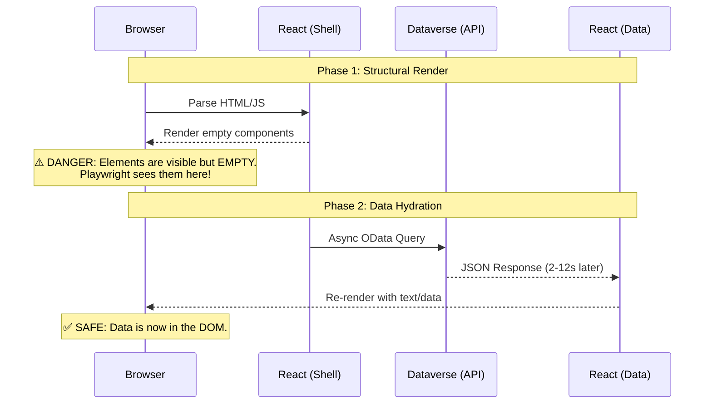
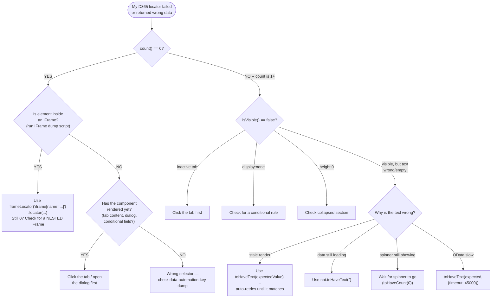

# 17. D365 Advanced — Timing Traps, Hidden DOM & Text Race Conditions

**Navigation**: [← Chapter 16: StorageState Chaining](./16_CrossSite_Pattern6_StorageState_Chaining.md) | [Index](../00_INDEX.md) | [→ Chapter 18: Mega POM Architecture](../04_Enterprise_Architecture/18_Mega_POM_Architecture.md)

**Cross-links:**

- [`08_Browser_Internals_for_SDETs.md`](../02_Core_Architecture/08_Browser_Internals_for_SDETs.md) — 4 browser trees, two-phase render
- [`10_Dynamics365_CRM_Testing.md`](./10_Dynamics365_CRM_Testing.md) — D365 DOM anatomy, `.ms-*` classes
- [`04_JS_TS_For_Automation.md`](../01_Foundations/04_JS_TS_For_Automation.md) — `async/await` and `Promise.all`

---

## 5W1H

- **WHAT**: A deep technical guide to every timing failure mode unique to Dynamics 365 — where elements exist in the DOM but aren't visible, are visible but have wrong text, have the right structure but no data, or exist in hidden states that Playwright cannot interact with.
- **WHY**: D365 is built on React + Microsoft Fluent UI + Dataverse OData queries. It renders in two phases: UI shell first, then data. Every standard wait strategy fails here in subtle ways that produce flaky tests.
- **WHO**: Any SDET automating Dynamics 365 forms, grids, command bars, or sub-grids.
- **WHEN**: Every time a D365 test times out, throws "element not visible," or asserts wrong data.
- **HOW**: By understanding exactly WHY each failure happens and using the matching precision wait strategy.

---

## 1. Why D365 Timing Is Uniquely Hard (Two-Phase Render Deep Dive)

Three systems fire in sequence when D365 renders a page. Understanding this architecture is the key to mastering D365 test automation.

**The Two-Phase Render Architecture:**



**Total time from navigation to "ready for testing": 3–15 seconds.**

Standard Playwright locators interact with the DOM after the FIRST render — the shell with empty text. This is why `waitFor({ state: 'visible' })` passes on an empty element and your test reads empty strings. You must wait for Phase 2 before reading text or asserting values.

---

## 2. Problem 1 — Element in DOM but Text Not Loaded

**What you see:** The field is on screen. You can see it. Playwright finds it. But `.textContent()` returns `""` or `null`.

**Why it happens:**

```
Time 0ms:   React renders <span class="fieldControl-text">  </span>  ← empty
Time 50ms:  Playwright: waitFor({ state: 'visible' }) → PASSES (span is visible)
Time 51ms:  Your test: textContent() → ""  ← wrong!
Time 3000ms: OData API returns data
Time 3200ms: React re-renders: <span class="fieldControl-text">CIT-001234</span>
```

**The fix — wait for SPECIFIC TEXT, not just visibility:**

```typescript
// ❌ Wrong — passes before text loads
const statusField = page.locator('[data-automation-key="statecode"]');
await statusField.waitFor({ state: "visible" });
const status = await statusField.textContent(); // "" — wrong!

// ✅ Correct — waits until text is exactly 'Active'
await expect(statusField).toHaveText("Active", { timeout: 30000 });

// ✅ Also correct — waits until any non-empty text is present
await expect(statusField).not.toHaveText("", { timeout: 30000 });

// ✅ Also correct — waits until text matches a pattern
await expect(statusField).toContainText("CIT-", { timeout: 30000 });

// Only AFTER one of the above passes, read the value:
const actualStatus = (await statusField.textContent())?.trim() ?? "";
```

**Key rule:** `waitFor({ state: 'visible' })` tells you the element EXISTS. `toHaveText(expected)` tells you the element has the RIGHT CONTENT. Always use `toHaveText` or `not.toHaveText('')` before reading text from D365 fields.

---

## 3. Problem 2 — Element Visible But Wrong Text (Stale Render)

**What you see:** You navigate to Customer B's record. The page shows Customer B's form layout. But the name field still shows "Customer A" for 2 seconds.

**Why it happens:** SPA navigation doesn't reload the page. React reuses the existing components (Customer A's data) and starts loading Customer B's data. The component shows old data during the transition.

**Your test passes with Customer A's data — and you don't know it.**

```typescript
// ❌ Wrong — reads stale data from previous navigation
await page.locator(".ms-DetailsList-row").first().click(); // navigate to customer
const customerName = await page
  .locator('[data-automation-key="fullname"]')
  .textContent();
// customerName = "Customer A" (previous record's name still showing!)

// ✅ Correct — wait for the EXACT expected value
const expectedCustomer = "John Smith"; // you know which customer you clicked
await expect(page.locator('[data-automation-key="fullname"]')).toHaveText(
  expectedCustomer,
  { timeout: 30000 },
);

// Now safe to read:
const customerName = await page
  .locator('[data-automation-key="fullname"]')
  .textContent();
```

**Pattern for grid→record navigation:**

```typescript
async function navigateToCustomerAndWait(
  page: Page,
  rowLocator: Locator,
  expectedCustomerName: string,
): Promise<void> {
  await rowLocator.click();

  // Wait for a URL change (D365 hash changes on record open)
  await page.waitForURL(/entityname=contact/, { timeout: 15000 });

  // Wait for spinner to clear
  await expect(page.locator(".ms-Spinner")).toHaveCount(0, { timeout: 30000 });

  // Wait for the SPECIFIC customer's name — rejects stale renders
  await expect(page.locator('[data-automation-key="fullname"]')).toHaveText(
    expectedCustomerName,
    { timeout: 30000 },
  );
}
```

---

## 4. Problem 3 — Element Hidden But Still in DOM

D365 hides elements in 4 different ways. Each has different Playwright behavior:

```
Method 1: display: none
  → Element IS in the DOM
  → Element has NO space on screen
  → Playwright isVisible() returns: FALSE ✓
  → Playwright count() returns: 1 (it's there!)
  → You CAN'T interact with it

Method 2: visibility: hidden
  → Element IS in the DOM
  → Element HAS space on screen (blank area)
  → Playwright isVisible() returns: FALSE ✓
  → Playwright count() returns: 1
  → You CAN'T interact with it

Method 3: opacity: 0
  → Element IS in the DOM
  → Element HAS space on screen
  → Playwright isVisible() returns: FALSE ✓
  → Playwright count() returns: 1

Method 4: height: 0 / width: 0 / overflow: hidden
  → Element IS in the DOM
  → Element technically has a box (zero-size)
  → Playwright isVisible() returns: FALSE ✓
  → count() returns: 1
```

**Why this matters for D365:**

D365 hides tab content, collapsed form sections, and conditional fields using these CSS techniques. A locator for a field on Tab 2 returns `count() = 1` even when Tab 1 is active — but it's hidden.

**How to distinguish "not in DOM" vs "hidden in DOM":**

```typescript
const fieldLocator = page.locator('[data-automation-key="creditlimit"]');

// These two tell you VERY DIFFERENT things:
const domCount = await fieldLocator.count(); // 1 = in DOM (could be hidden)
const isVisible = await fieldLocator.isVisible(); // false = hidden or not in DOM

if (domCount === 0) {
  console.log("Element not rendered by React at all");
} else if (!isVisible) {
  console.log(
    "Element exists but is CSS-hidden — check: display, visibility, opacity, size",
  );
} else {
  console.log("Element is visible and ready");
}

// Use state: 'attached' to just confirm DOM presence without visibility check:
await fieldLocator.waitFor({ state: "attached", timeout: 10000 }); // in DOM, don't care about visibility

// Use state: 'visible' when you need to interact:
await fieldLocator.waitFor({ state: "visible", timeout: 20000 });
```

**Tab-specific fields:**

```typescript
// ❌ Wrong — reads field from hidden Tab 2 when Tab 1 is active
const tab2Field = page.locator('[data-automation-key="bankaccount"]');
const value = await tab2Field.textContent(); // returns empty or errors

// ✅ Correct — click tab first, then read its fields
await page.getByRole("tab", { name: "Banking" }).click();
await expect(page.getByRole("tab", { name: "Banking" })).toHaveAttribute(
  "aria-selected",
  "true",
);
await expect(page.locator(".ms-Spinner")).toHaveCount(0, { timeout: 10000 });
// Now the tab is active and its fields are visible
await expect(tab2Field).toBeVisible({ timeout: 10000 });
const value = await tab2Field.textContent();
```

---

## 5. Problem 4 — Structure Loads But Text Takes 10+ Seconds

D365 Dataverse queries (OData calls to Microsoft's cloud DB) can take 8–12 seconds on large datasets.

**What you see:**

- Grid appears immediately (skeleton structure)
- Rows appear: but cells show `...` or nothing
- After 10 seconds: real data appears in cells

**Never use `waitForTimeout`:**

```typescript
// ❌ NEVER do this — hard sleep is always wrong
await page.waitForTimeout(10000); // fails in fast envs, too slow in slow envs

// ✅ Content-based wait with generous timeout
await expect(page.locator(".ms-DetailsList-row").first()).not.toHaveText("", {
  timeout: 45000,
});

// ✅ Wait for a specific known value in the first row
await expect(
  page
    .locator(".ms-DetailsList-row")
    .first()
    .locator('[data-automation-key="name"]'),
).toContainText("CIT-", { timeout: 45000 }); // citation IDs start with CIT-

// ✅ Advanced: waitForFunction for custom DOM conditions
await page.waitForFunction(
  () => {
    const rows = document.querySelectorAll(".ms-DetailsList-row");
    if (rows.length === 0) return false;
    const firstCell = rows[0].querySelector("[data-automation-key]");
    return (
      firstCell !== null &&
      firstCell.textContent !== null &&
      firstCell.textContent.trim().length > 0
    );
  },
  { timeout: 45000, polling: 500 },
);
```

---

## 6. Problem 5 — Tab Click → Component Unmounts and Re-Mounts

In standard D365 Pivot tabs, clicking a tab does NOT just show/hide panels. React UNMOUNTS the previous tab's component and MOUNTS the new tab's component. Any locator references you saved before the tab click become STALE.

```typescript
// ❌ Wrong — storing locator before tab switch
const contactsGrid = page.locator(".contacts-subgrid-container");
await page.getByRole("tab", { name: "Contacts" }).click();
await contactsGrid.waitFor({ state: "visible" }); // might work...

// Later:
const rowCount = await contactsGrid.locator(".ms-DetailsList-row").count();
// ↑ MIGHT fail: the component was unmounted/remounted, locator might be detached

// ✅ Correct — re-instantiate locators AFTER tab switch + load
await page.getByRole("tab", { name: "Contacts" }).click();
await expect(page.getByRole("tab", { name: "Contacts" })).toHaveAttribute(
  "aria-selected",
  "true",
);
await expect(page.locator(".ms-Spinner")).toHaveCount(0, { timeout: 20000 });

// NOW create the locator (after the component has fully mounted)
const contactRows = page.locator(
  ".contacts-subgrid-container .ms-DetailsList-row",
);
await expect(contactRows.first()).toBeVisible({ timeout: 15000 });
const rowCount = await contactRows.count();
```

**Rule:** In D365, get locators AFTER navigation/tab switches, not before.

---

## 7. Problem 6 — IFrame Inside IFrame

D365 dialog boxes sometimes open in a new IFrame that is inside the main content IFrame:

```
page (main browser context)
└── iframe[name="contentIFrame0"]   ← main D365 content
    └── .form-content
        └── .dialog-container
            └── iframe[name="InlineDialog_iframe"]  ← nested dialog IFrame!
                └── .dialog-form-content
                    └── (the actual dialog content)
```

```typescript
// ❌ Won't find elements inside nested IFrame
const mainFrame = page.frameLocator('iframe[name="contentIFrame0"]');
await mainFrame.locator("#dialogButton").click(); // dialog content not here

// ✅ Chain frameLocator calls
const mainFrame = page.frameLocator('iframe[name="contentIFrame0"]');
const dialogFrame = mainFrame.frameLocator(
  'iframe[name="InlineDialog_iframe"]',
);

// Now you can reach the dialog content
await dialogFrame.locator(".dialog-confirm-button").click();

// Finding the nested IFrame name — browser console script:
// page.frameLocator('iframe[name="contentIFrame0"]')
//   .locator('iframe').evaluateAll(iframes =>
//     iframes.map(f => ({ name: f.name, id: f.id, src: f.src.substring(0, 80) }))
//   );
```

---

## 8. Problem 7 — React StrictMode Double-Render (Dev/Staging Environments)

In development and staging D365 environments, React StrictMode causes effects to run TWICE deliberately. This means elements can flash: appear → disappear → appear again.

```typescript
// What StrictMode does (simplified):
// 1. Mount component → element appears → isVisible() = true
// 2. Unmount component → element disappears → isVisible() = false
// 3. Re-mount component → element appears again → isVisible() = true (for real this time)

// ❌ Sometimes fails: catches element in step 1 (first mount)
await element.waitFor({ state: "visible" });
// → element briefly disappears in step 2 WHILE PLAYWRIGHT IS INTERACTING
// → "element is not visible" error mid-test

// ✅ Playwright's built-in retry handles this:
// expect().toBeVisible() retries automatically and waits for STABLE visibility
await expect(element).toBeVisible({ timeout: 10000 });
// Playwright retries this assertion internally. If element briefly disappears, it retries.

// ✅ For interactions that need stable element:
await expect(element).toBeVisible();
await element.click(); // Playwright auto-waits for actionability before clicking
```

---

## 9. The Complete D365 Diagnostic Flowchart



---

## 10. Wait Strategy Decision Table

| Situation                                | Strategy             | Code                                        |
| ---------------------------------------- | -------------------- | ------------------------------------------- |
| Need specific text                       | Content wait         | `await expect(el).toHaveText('Value')`      |
| Need any non-empty text                  | Non-empty wait       | `await expect(el).not.toHaveText('')`       |
| Text matches pattern                     | Regex wait           | `await expect(el).toContainText('CIT-')`    |
| D365 data loading                        | Spinner then content | `toHaveCount(0)` then `toHaveText()`        |
| Check element is in DOM (any state)      | Attached wait        | `waitFor({ state: 'attached' })`            |
| Need to interact with element            | Visible wait         | `await expect(el).toBeVisible()`            |
| Async side effect (eventual consistency) | Polling              | `await expect.poll(...)`                    |
| Custom DOM condition                     | waitForFunction      | `page.waitForFunction(() => ...)`           |
| New page loaded (JSP)                    | Load state           | `page.waitForLoadState('domcontentloaded')` |
| **Never use**                            | Hard sleep           | ~~`waitForTimeout(5000)`~~                  |

---

## 11. Problem 8 — CommandBar Button Disabled State

D365 command bar buttons can appear enabled but actually be disabled via `aria-disabled` rather than the standard `disabled` attribute. This is a Fluent UI pattern.

```typescript
// ❌ Wrong: only checks HTML 'disabled' attribute
const saveBtn = page.locator('[aria-label="Save"]');
await expect(saveBtn).not.toBeDisabled(); // PASSES even when button is aria-disabled!

// Why: Playwright's .toBeDisabled() checks the HTML 'disabled' attribute.
// Fluent UI buttons use 'aria-disabled="true"' and prevent clicks via JavaScript,
// NOT the HTML disabled attribute.

// ✅ Correct: check aria-disabled attribute explicitly
await expect(saveBtn).toHaveAttribute("aria-disabled", "false", {
  timeout: 10000,
});
// Or verify it doesn't have aria-disabled set to 'true':
const ariaDisabled = await saveBtn.getAttribute("aria-disabled");
expect(ariaDisabled, "Save button should not be aria-disabled").not.toBe(
  "true",
);

// ✅ For verifying a button IS correctly disabled (testing read-only forms):
await expect(saveBtn).toHaveAttribute("aria-disabled", "true");

// Helper function for D365 CommandBar:
export async function assertCommandBarButton(
  page: import("@playwright/test").Page,
  buttonLabel: string,
  expectedState: "enabled" | "disabled",
): Promise<void> {
  const btn = page.locator(`[aria-label="${buttonLabel}"]`).first();
  await btn.waitFor({ state: "visible", timeout: 15_000 });
  const expected = expectedState === "disabled" ? "true" : "false";
  await expect(btn).toHaveAttribute("aria-disabled", expected, {
    timeout: 10_000,
  });
}

// Usage:
await assertCommandBarButton(page, "Save", "enabled"); // after making an edit
await assertCommandBarButton(page, "Save", "disabled"); // on a read-only record
await assertCommandBarButton(page, "Activate", "disabled"); // on already-active record
```

---

## 12. The `menuitem` Trap — Flyout Menus and Dialog Close Buttons

D365 relies heavily on `role="menuitem"` for command bar buttons and flyout menus. The trap occurs when clicking a button that opens a dialog or flyout, and immediately trying to click a button inside it (like a `modelCloseButton`).

**What you see:** You click "Assign", the Assign dialog opens, Playwright clicks the "Close" (X) button, but the dialog _stays open_ and the test times out later.

**Why it happens:**

1. You click "Assign".
2. React mounts the Dialog component (the close button appears in DOM).
3. Playwright instantly sees the close button and clicks it.
4. _Then_ React attaches the `onClick` event listener to the close button.
5. Playwright's click happened 5ms too early and went into the void.

**The Fix:** Use `Promise.all` with `waitForResponse`, or ensure the dialog's data is fully hydrated before clicking close.

```typescript
// ❌ WRONG: The MenuItem Trap (Clicking before event binding)
await page.getByRole("menuitem", { name: "Assign" }).click();
const modelCloseButton = page.locator('button[aria-label="Close"]');
await modelCloseButton.waitFor({ state: "visible" });
await modelCloseButton.click(); // 💥 Clicked before React attached onClick handler!

// ✅ CORRECT: Verify the dialog content has hydrated before interacting with its shell
await page.getByRole("menuitem", { name: "Assign" }).click();

const dialog = page.locator('div[role="dialog"]');
const modelCloseButton = dialog.locator('button[aria-label="Close"]');

// Wait for a known data element INSIDE the dialog to ensure Phase 2 render completed
await expect(dialog.locator(".owner-name")).not.toHaveText("", {
  timeout: 10000,
});

// Now we know the component is fully mounted and bound
await modelCloseButton.click();
```

---

## 13. PCF Control Wait Patterns (PowerApps Component Framework)

PCF controls are custom React components built by developers that sit inside standard D365 forms. They have their own independent lifecycle, separate from the main D365 form.

**The Trap:** The main D365 form finishes loading (spinner disappears), but the PCF control inside an iframe or container is still booting its own React tree.

```typescript
// ❌ WRONG: Assuming PCF is ready when D365 is ready
await expect(page.locator(".ms-Spinner")).toHaveCount(0);
// D365 is ready, but custom PCF control is still a blank div!
await page.locator(".custom-pcf-input").fill("123"); // Fails: element not found

// ✅ CORRECT: PCF-specific wait patterns
async function waitForPcfControl(page: Page, controlId: string) {
  const pcfContainer = page.locator(`[data-control-name="${controlId}"]`);

  // 1. Wait for the container to exist
  await expect(pcfContainer).toBeVisible({ timeout: 15_000 });

  // 2. PCF controls usually inject an iframe or a specific internal shell
  // Wait for the custom class that proves the PCF React tree mounted
  await expect(
    pcfContainer.locator(".pcf-initialized-marker, .custom-pcf-input"),
  ).toBeVisible({ timeout: 20_000 });
}

// Usage
await page.goto("/entity");
await waitForPcfControl(page, "CustomAddressValidationControl");
await page.locator(".custom-pcf-input").fill("123 Main St");
```

Whenever you interact with a custom PCF control, define a specific wait function that targets its internal initialized state.

---

## 14. Problem 9 — Lookup Field Interaction (Hardest D365 Control)

The D365 Lookup field is the most complex control to automate. It fires OData searches on each keystroke and renders results in a floating panel outside the main DOM hierarchy.

```typescript
// D365 Lookup field interaction sequence:
// 1. Click the lookup field (focus it)
// 2. Type search text (fires OData search)
// 3. Wait for results panel to appear (async OData response)
// 4. Click the desired result item
// 5. Wait for the field to show the selected value (another render cycle)

async function selectLookupValue(
  page: import("@playwright/test").Page,
  fieldLabel: string, // e.g., 'Customer'
  searchText: string, // e.g., 'John'
  selectText: string, // the result item to click (must match displayed text)
  timeout = 30_000,
): Promise<void> {
  const { expect } = await import("@playwright/test");

  // Step 1: Click the lookup input field
  // D365 lookup fields: input role with the field label as aria-label
  const lookupInput = page.getByRole("combobox", { name: fieldLabel });
  await lookupInput.click();
  await lookupInput.clear();

  // Step 2: Type the search text
  await lookupInput.type(searchText, { delay: 100 }); // slight delay to avoid OData debounce

  // Step 3: Wait for the suggestion panel to appear
  // D365 renders suggestions in a listbox that overlays the form
  const suggestionPanel = page.locator('[role="listbox"]');
  await suggestionPanel.waitFor({ state: "visible", timeout });

  // Step 4: Wait for at least one option to be populated (OData may take 3-5s)
  const targetOption = suggestionPanel.getByRole("option", {
    name: selectText,
    exact: false,
  });
  await targetOption.waitFor({ state: "visible", timeout });

  // Step 5: Click the option
  await targetOption.click();

  // Step 6: Verify the lookup field now shows the selected value
  await expect(lookupInput).toHaveValue(selectText, { timeout: 10_000 });
}

// Usage:
await selectLookupValue(page, "Customer", "John", "John Smith");
await selectLookupValue(page, "Owner", "Service", "Service Team Alpha");

// COMMON FAILURE: typing too fast
// If you use .fill() instead of .type() with delay, OData may not fire a search
// because .fill() doesn't dispatch keyboard events that trigger the lookup.
// Always use .type() with a small delay for D365 lookup fields.
```

---

## 15. OData Request Interception — Speed Up Specific Tests

For tests that don't need real Dataverse data (e.g., UI layout tests), intercept OData calls and return mock data to avoid 8–12 second data load times:

```typescript
// Use ONLY for tests that verify UI behaviour, not data correctness
test("Citation form shows validation errors when required fields are empty", async ({
  page,
}) => {
  // Intercept the OData call that loads the form's lookup options
  // This makes the form load instantly instead of waiting 8 seconds
  await page.route("**/api/data/v9.2/citations**", async (route) => {
    await route.fulfill({
      status: 200,
      contentType: "application/json",
      body: JSON.stringify({
        "@odata.context": "...",
        value: [], // empty data — we're testing the FORM, not the data
      }),
    });
  });

  await page.goto("/citations/new");
  // Form loads immediately (no 8-second OData wait)
  await expect(page.locator('[data-automation-key="name"]')).toBeVisible({
    timeout: 5000,
  });

  // Test the UI validation behaviour:
  await page.click('[aria-label="Save"]');
  await expect(page.locator(".ms-MessageBar--error")).toBeVisible({
    timeout: 5000,
  });
  // Verify the required field error message appears
});

// Pattern: intercept specific OData entities by entity name
const oDataRoutePattern = "**/api/data/v9.2/cr123_citations*";
await page.route(oDataRoutePattern, (route) =>
  route.fulfill({
    status: 200,
    contentType: "application/json",
    body: JSON.stringify({ value: mockedCitations }),
  }),
);

// When to use OData interception:
//   ✅ UI layout / rendering tests
//   ✅ Validation / error state tests
//   ✅ Conditional field logic (show/hide rules)
// When NOT to use it:
//   ❌ End-to-end data flow tests (need real Dataverse)
//   ❌ Tests that verify data was saved correctly
//   ❌ Tests that test search/filter behaviour
```

---

## 🏋️ Practice Challenges

### Challenge 1 [MCQ] — Which wait strategy?

A D365 form loads. You need to assert that a "Customer Name" field shows "John Smith". The field is definitely visible. Which is correct?

A) `await expect(nameField).toBeVisible()`  
B) `await expect(nameField).toHaveText('John Smith', { timeout: 30000 })`  
C) `await nameField.waitFor({ state: 'visible' }); const txt = await nameField.textContent();`  
D) `await page.waitForTimeout(5000); const txt = await nameField.textContent();`

<details><summary>Answer</summary>

**B** — `toHaveText('John Smith', { timeout: 30000 })` waits until the field specifically contains "John Smith". This handles the two-phase render: if the field loads empty first, this keeps retrying until the text arrives.

A = only verifies visibility, doesn't check text. C = reads text immediately after `waitFor` — the element is visible but might still show "" from phase 1. D = hard sleep (never acceptable).

</details>

---

### Challenge 2 [Spot the Bug]

```typescript
async function getCustomerStatus(page: Page): Promise<string> {
  const statusLocator = page.locator('[data-automation-key="statecode"]');
  await statusLocator.waitFor({ state: "visible" });
  return (await statusLocator.textContent()) ?? "";
}

// In the test:
const status = await getCustomerStatus(page);
expect(status).toBe("Active"); // fails 40% of the time with status = ''
```

<details><summary>Answer</summary>

`waitFor({ state: 'visible' })` passes when the `statecode` element is visible — which happens after React's phase 1 render (shell with empty text). The `textContent()` call then reads `""` before the OData data arrives.

Fix:

```typescript
async function getCustomerStatus(page: Page): Promise<string> {
  const statusLocator = page.locator('[data-automation-key="statecode"]');
  // Wait for non-empty text instead of just visibility
  await expect(statusLocator).not.toHaveText("", { timeout: 30000 });
  return ((await statusLocator.textContent()) ?? "").trim();
}
```

Or if you know the expected value:

```typescript
await expect(statusLocator).toHaveText("Active", { timeout: 30000 });
```

</details>

---

### Challenge 3 [Write It Yourself]

Write a reusable `waitForD365GridToLoad(page, minRows)` function that:

1. Waits for any `.ms-Spinner` to disappear
2. Waits for at least `minRows` rows to appear
3. Waits for the first row's first data cell to have non-empty text
4. Accepts a configurable timeout (default: 45 seconds)

<details><summary>Answer</summary>

```typescript
async function waitForD365GridToLoad(
  page: import("@playwright/test").Page,
  minRows: number = 1,
  timeout: number = 45000,
): Promise<void> {
  const { expect } = await import("@playwright/test");

  // Step 1: Spinner must disappear
  await expect(page.locator(".ms-Spinner")).toHaveCount(0, { timeout });

  // Step 2: Minimum row count must be met.
  // Playwright's toHaveCount takes a specific number, not an { minimum } object.
  // "At least N rows" is expressed by asserting the Nth-from-top row is attached —
  // Playwright polls until it appears (or the timeout fires).
  await expect(
    page.locator(".ms-DetailsList-row").nth(minRows - 1),
  ).toBeAttached({ timeout });

  // Step 3: First row's data cell must have non-empty text
  const firstDataCell = page
    .locator(".ms-DetailsList-row")
    .first()
    .locator("[data-automation-key]")
    .first();
  await expect(firstDataCell).not.toHaveText("", { timeout: 10000 });
}

// Usage:
await adminPortal.goto();
await waitForD365GridToLoad(page, 5); // wait for at least 5 rows with data
```

</details>

---

### Challenge 4 [CommandBar + Lookup]

Write the test steps (as pseudocode or real Playwright code) for this scenario: Open a D365 citation record → set the Owner lookup to "Support Team Alpha" → click Save → verify the Save button becomes disabled (record saved) → verify the Owner field shows "Support Team Alpha" after save.

<details><summary>Answer</summary>

```typescript
test("Set citation owner to Support Team Alpha", async ({ page, account }) => {
  const data = {
    ownerSet: false,
    savedOk: false,
  };

  await test.step("Open citation record", async () => {
    await page.goto(`${process.env.D365_URL}/citations/${testCitationId}`);
    await expect(page.locator(".ms-Spinner")).toHaveCount(0, {
      timeout: 30_000,
    });
    // Wait for the record name to confirm correct record loaded
    await expect(page.locator('[data-automation-key="name"]')).not.toHaveText(
      "",
      { timeout: 30_000 },
    );
  });

  await test.step("Set Owner lookup to Support Team Alpha", async () => {
    await selectLookupValue(page, "Owner", "Support", "Support Team Alpha");
    data.ownerSet = true;
  });

  await test.step("Save the record", async () => {
    await page.locator('[aria-label="Save"]').click();
    // Save button should become aria-disabled='true' after successful save
    await assertCommandBarButton(page, "Save", "disabled");
    data.savedOk = true;
  });

  await test.step("Verify Owner field after save", async () => {
    // After save: the lookup field should show the saved value
    const ownerField = page.getByRole("combobox", { name: "Owner" });
    await expect(ownerField).toHaveValue("Support Team Alpha", {
      timeout: 15_000,
    });
  });
});
```

Key points:

- Wait for spinner gone + field non-empty to confirm page loaded
- Use `selectLookupValue` (type + wait for listbox + click option)
- After save: `assertCommandBarButton('Save', 'disabled')` — NOT `.toBeDisabled()` (Fluent UI uses aria-disabled)
- Wait for the lookup field value to update after save (another render cycle)
</details>

---

### Challenge 5 [OData Interception]

Your D365 test suite has 40 tests that navigate to the Citations list view. Each test waits 8–12 seconds for Dataverse to load citations data. Total suite time: 6–8 minutes just in data load waits. What's the correct strategy?

<details><summary>Answer</summary>

**Split the tests into two groups:**

**Group 1: Data-dependent tests (keep real OData)**

- Citation search by status, amount range, date
- Tests that verify data was created/updated correctly
- Tests that verify filter/sort behaviour
- These MUST use real Dataverse (cannot mock)

**Group 2: UI-only tests (mock OData)**

- Form layout and field visibility tests
- CommandBar button state tests (enabled/disabled)
- Conditional field show/hide rule tests
- Validation error message tests
- These can use `page.route()` to intercept OData and return minimal mock data instantly

```typescript
// globalSetup or a shared fixture:
export const interceptODataForUITests = async (page: Page) => {
  await page.route("**/api/data/v9.2/cr123_citations*", (route) => {
    route.fulfill({
      status: 200,
      contentType: "application/json",
      body: JSON.stringify({ value: [minimalCitationMock] }),
    });
  });
};

// Apply it in tests tagged @ui-only:
test.beforeEach(async ({ page }, testInfo) => {
  if (testInfo.tags.includes("@ui-only")) {
    await interceptODataForUITests(page);
  }
});
```

Result: Group 2 tests load in <2 seconds. Group 1 tests take the full time but are fewer. Expected suite time reduction: 60-70%.

</details>

---

## 16. OData Response-Time Measurement — Distinguish Load vs. Regression

Measure actual Dataverse response times in tests and attach them to the Playwright report. This lets you distinguish "expected 8s load" from "new 20s regression":

```typescript
// utils/odata-performance.util.ts

interface ODataCallMetric {
  url: string;
  entity: string;
  durationMs: number;
  statusCode: number;
  rowCount: number | null;
}

export async function measureODataCalls(
  page: import("@playwright/test").Page,
  action: () => Promise<void>,
  entityFilter?: string, // optional: only measure calls for specific entity
): Promise<ODataCallMetric[]> {
  const metrics: ODataCallMetric[] = [];
  const timings = new Map<string, number>(); // url → start time

  page.on("request", (req) => {
    if (req.url().includes("/api/data/v9.2/")) {
      if (!entityFilter || req.url().includes(entityFilter)) {
        timings.set(req.url(), Date.now());
      }
    }
  });

  page.on("response", async (resp) => {
    const startTime = timings.get(resp.url());
    if (startTime === undefined) return;

    const durationMs = Date.now() - startTime;
    let rowCount: number | null = null;

    try {
      const body = await resp.json().catch(() => null);
      rowCount = Array.isArray(body?.value) ? body.value.length : null;
    } catch {
      /* response not JSON */
    }

    const entityMatch = resp.url().match(/\/api\/data\/v9\.2\/([^?$/]+)/);
    metrics.push({
      url: resp.url().substring(0, 100),
      entity: entityMatch?.[1] ?? "unknown",
      durationMs,
      statusCode: resp.status(),
      rowCount,
    });
  });

  await action();
  return metrics;
}

// Usage in a test:
test("Citations grid loads within acceptable OData thresholds", async ({
  page,
}) => {
  const metrics = await measureODataCalls(
    page,
    async () => {
      await page.goto(`${process.env.D365_URL}/citations`);
      await expect(page.locator(".ms-DetailsList-row").first()).toBeVisible({
        timeout: 45_000,
      });
    },
    "cr123_citations", // only measure citation entity calls
  );

  // Attach timing report to the test artifact
  await test.info().attach("odata-timing", {
    body: JSON.stringify(metrics, null, 2),
    contentType: "application/json",
  });

  // Enforce SLA thresholds:
  const slowCalls = metrics.filter((m) => m.durationMs > 15_000);
  expect(
    slowCalls,
    `OData calls exceeding 15s threshold: ${JSON.stringify(slowCalls.map((m) => ({ entity: m.entity, ms: m.durationMs })))}`,
  ).toHaveLength(0);

  // Warn (but don't fail) if any call exceeds 8s:
  const warnCalls = metrics.filter((m) => m.durationMs > 8_000);
  if (warnCalls.length > 0) {
    console.warn(
      `[odata-perf] Slow calls (>8s): ${JSON.stringify(warnCalls.map((m) => ({ entity: m.entity, ms: m.durationMs })))}`,
    );
  }
});
```

```
// Interpretation guide:
//
// Duration  | Classification
// --------- | -----------------------------------------------
// < 3s      | Excellent — standard Dataverse
// 3–8s      | Normal — expected for large entity sets
// 8–15s     | Slow — investigate query filters, indexes
// > 15s     | SLA breach — fail the test, file a defect
// Timeout   | Critical — likely Dataverse throttling (429)
//
// In CI: attach the JSON metrics artifact to every run.
// Compare P95 across 30 CI runs to detect regressions.
```

---

## 📚 References & Further Reading

### Official Documentation

- [Playwright Auto-waiting](https://playwright.dev/docs/actionability) — How Playwright waits for actionability (and why it doesn't solve React two-phase renders)
- [PowerApps Component Framework (PCF)](https://learn.microsoft.com/en-us/power-apps/developer/component-framework/overview) — Understanding the lifecycle of custom D365 controls
- [Fluent UI React](https://developer.microsoft.com/en-us/fluentui#/) — The UI framework powering D365

### Deep Dives

- [React Component Lifecycle](https://reactjs.org/docs/react-component.html) — Why event handlers might not be bound when the DOM element first appears

---

**Navigation**: [← Chapter 16: StorageState Chaining](./16_CrossSite_Pattern6_StorageState_Chaining.md) | [Index](../00_INDEX.md) | [→ Chapter 18: Mega POM Architecture](../04_Enterprise_Architecture/18_Mega_POM_Architecture.md)


---

## Reality Check

**"waitForLoadState('networkidle') means the page is ready"**→ networkidle fires when no network requests have been made for 500ms. But: single-page applications may have lazy-loaded components that fire requests after user interaction, WebSocket connections are not counted as network activity, and long-polling requests may keep the network permanently non-idle. Wait for specific DOM elements that indicate readiness rather than relying on network silence.

**"Fixed timeouts (await page.waitForTimeout) are acceptable"**→ Fixed timeouts are the primary source of test flakiness: too short causes failures on slow CI runners, too long wastes execution time. Replace every waitForTimeout with a condition-based wait: waitForSelector, waitForResponse, or expect with polling. The only acceptable use of fixed timeout is as a last-resort debounce after a known animation that has no programmatic completion signal.

**"Slow applications need longer test timeouts"**→ Increasing timeouts masks performance problems. If a page takes 15 seconds to load in test, it takes 15 seconds in production too — that is a bug, not a test configuration issue. Set timeouts to the ACCEPTABLE performance threshold (page loads in 3 seconds) and let tests fail when the application is too slow. This turns your test suite into a performance monitoring tool.

**"Race conditions in tests are caused by bad test code"**→ Some race conditions are in the APPLICATION: a button that is clickable before its event handler is attached, a form that submits before validation completes, or a list that renders before its data loads. These are real bugs that real users experience. Tests that expose race conditions are finding application defects, not test defects.

**"D365 applications follow standard web timing patterns"**→ Dynamics 365 uses a custom rendering engine with: ribbon controls that load asynchronously, form sections that populate incrementally, business rules that fire after field changes with variable delay, and modal dialogs that animate in over 300-500ms. Generic web testing strategies (wait for DOM ready) are insufficient. D365 testing requires waiting for specific Xrm SDK events or polling for control-specific readiness states.
